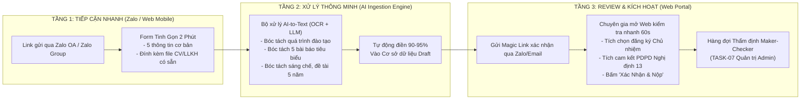
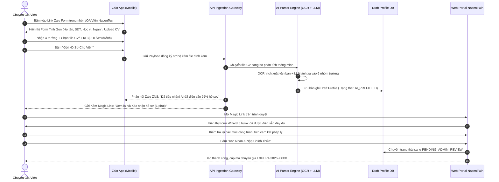

# BÁO CÁO PHÂN TÍCH THIẾT KẾ CƠ SỞ: SỔ TAY CHUYÊN GIA KH&CN & CHIẾN LƯỢC INPUT ĐA KÊNH (ZALO FORM + WEB PORTAL)

> **Mã phân hệ**: `TASK-05`  
> **Chủ đề**: Phân tích Danh mục trường cần thiết và Xây dựng Luồng thu thập dữ liệu (Input Architecture) cho Chuyên gia Viện NacenTech  
> **Cơ quan chủ quản**: Viện Ứng dụng Công nghệ (NacenTech) — Bộ Khoa học và Công nghệ  
> **Ngày lập**: 25/09/2026 | **Phiên bản**: v2.1.0  
> **Căn cứ nghiệp vụ**: Sheet `C.gia` (94 dòng dữ liệu nguồn) & Mẫu LLKH chuẩn của Bộ KH&CN  

---

## 1. BỐI CẢNH & BÀI TOÁN THỰC TẾ CỦA VIỆN NACENTECH

### 1.1. Thực trạng & Nỗi đau khi thu thập hồ sơ chuyên gia (Pain Points)
- **Đặc thù đối tượng**: Đội ngũ nhà khoa học, nghiên cứu viên chính, giảng viên cao cấp của Viện NacenTech và mạng lưới viện trường có chuyên môn sâu, rất bận rộn và thường ngại thao tác trên các form đăng ký hành chính phức tạp 50 - 60 trường.
- **Rào cản drop-off (Tỷ lệ bỏ dở cao)**: Nếu bắt chuyên gia mở máy tính, tự tay gõ lại từng bài báo ISI/Scopus, từng bằng sáng chế và quá trình đào tạo từ năm 2000 đến nay $\rightarrow$ Hơn 80% chuyên gia sẽ trì hoãn hoặc không hoàn thành.
- **Tài nguyên sẵn có**: 100% chuyên gia đều **đã có sẵn file Lý lịch khoa học (LLKH)** theo mẫu Bộ KH&CN, file CV tóm tắt (Word/PDF) hoặc hồ sơ cá nhân đã lưu trữ trong máy.
- **Kênh tiếp cận tối ưu**: Các nhóm công tác, hội đồng khoa học của Viện hiện hoạt động rất tích cực trên **Zalo**. Do đó, gửi đường link nhập liệu nhanh qua Zalo để chuyên gia mở trên điện thoại (Mobile-First) là con đường tiếp cận có tỷ lệ phản hồi cao nhất.

### 1.2. Mục tiêu giải pháp: Chiến lược Input 3 Tầng "Zero Friction" (Không Rào Cản)



---

## 2. PHÂN TÍCH CƠ BẢN CÁC TRƯỜNG DỮ LIỆU CẦN THIẾT (FIELD DECOMPOSITION)

Dựa trên 94 dòng dữ liệu nguồn từ Sheet `C.gia`, hệ thống phân rã toàn bộ dữ liệu chuyên gia thành **6 Nhóm Trường** với cấp độ ưu tiên rõ ràng:

### Nhóm A: Trường Thu Thập Tức Thì Trên Zalo Form (Tối Thiểu — Bắt Buộc Nhập Ban Đầu)
*Mục tiêu: Hoàn thành trong vòng dưới 2 phút trên điện thoại di động.*

| STT | Tên Trường | Kiểu Dữ Liệu | Mục Đích & Ràng Buộc Nghiệp Vụ | Nguồn Sheet `C.gia` |
| :---: | :--- | :--- | :--- | :---: |
| 1 | **Họ và tên chuyên gia** | String | Bắt buộc, tự động đồng bộ từ tài khoản Zalo nếu cho phép. | Dòng 955 |
| 2 | **Số điện thoại (Zalo)** | Phone String | Bắt buộc, dùng làm mã định danh và kênh nhận thông báo kết quả. | Dòng 940, 966 |
| 3 | **Email công tác** | Email String | Bắt buộc, dùng để nhận hồ sơ pháp lý và hợp đồng tư vấn. | Dòng 941 |
| 4 | **Học hàm & Học vị cao nhất** | Dropdown | GS, PGS, Tiến sĩ, Thạc sĩ, Kỹ sư. (Dùng để phân loại ban đầu). | Dòng 958, 960 |
| 5 | **Đơn vị công tác chính** | String | Tên Viện, Trường, Trung tâm, Doanh nghiệp (VD: Viện NacenTech). | Dòng 969, 970 |
| 6 | **Lĩnh vực thế mạnh (18 ngành TT17)** | Multi-Select | Tích chọn 1 - 3 ngành chuyên sâu (VD: Laser, Vật liệu, Tự động hóa). | Dòng 1019 |
| 7 | **Tệp LLKH / CV sẵn có** | File Upload (PDF/DOCX/Ảnh) | **Trường cốt lõi**: Chuyên gia tải lên tệp CV có sẵn để AI xử lý toàn bộ. | Dòng 937, 938, 951 |

---

### Nhóm B: Trường Định Danh Pháp Lý & Văn Bằng (AI Trích Xuất / Rà Soát Trên Web)
*Mục tiêu: Đảm bảo tính pháp lý để tham gia Hội đồng KH&CN và ký hợp đồng chuyển giao.*

| STT | Tên Trường | Kiểu Dữ Liệu | Ràng Buộc & Quy Chuẩn | Nguồn Sheet `C.gia` |
| :---: | :--- | :--- | :--- | :---: |
| 8 | **Năm sinh & Giới tính** | Number / Enum | $1940 \le \text{Năm} \le 2005$; Nam / Nữ. | Dòng 956, 957 |
| 9 | **Số CCCD / Định danh cá nhân** | String (12 số) | Chuẩn 12 chữ số Bộ Công an cấp (Bảo mật theo PDPD). | Dòng 962 |
| 10 | **Ngày cấp CCCD** | Date | Định dạng YYYY-MM-DD. | Dòng 963 |
| 11 | **Ảnh chụp CCCD 2 mặt** | File Image/PDF | Phục vụ đối soát danh tính Maker-Checker. | Dòng 949 |
| 12 | **Năm phong học hàm / Năm đạt học vị**| Number (YYYY) | Kiểm tra thâm niên chuyên môn của chuyên gia. | Dòng 959, 961 |
| 13 | **Chức danh nghiên cứu** | String | Nghiên cứu viên, Nghiên cứu viên chính, Giảng viên cao cấp... | Dòng 964 |
| 14 | **Chức vụ quản lý hiện nay** | String | Trưởng/Phó phòng, Viện trưởng, Giám đốc Trung tâm... | Dòng 965 |
| 15 | **Ảnh chân dung chuyên gia** | File Image | Ảnh chân dung nghiêm túc nền sáng phục vụ danh bạ chuyên gia. | Dòng 939, 1017 |

---

### Nhóm C: Quá Trình Đào Tạo & Quá Trình Công Tác (Repeater Tables — AI Tự Bóc Tách)
*Mục tiêu: Đánh giá độ tin cậy và chuyên môn của chuyên gia trong từng giai đoạn.*

| Bảng Dữ Liệu | Các Cột Thành Phần | Quy Tắc Điền Sẵn Bằng AI | Nguồn Sheet `C.gia` |
| :--- | :--- | :--- | :---: |
| **Quá trình Đào tạo** | - Bậc đào tạo (Đại học / ThS / TS)<br>- Cơ sở đào tạo (Trường/Viện)<br>- Chuyên ngành đào tạo<br>- Năm tốt nghiệp | AI tự nhận dạng các đoạn văn bản chứa mốc năm và cơ sở đào tạo trong CV để đưa vào các dòng bảng. | Dòng 974 - 978 |
| **Quá trình Công tác** | - Khoảng thời gian (Từ năm ... đến năm ...)<br>- Vị trí / Chức danh công tác<br>- Đơn vị / Cơ quan công tác<br>- Địa chỉ đơn vị | AI trích xuất mốc thời gian kinh nghiệm làm việc và đơn vị tương ứng. | Dòng 979 - 983 |

---

### Nhóm D: Hồ Sơ Khoa Học, Công Trình & Tài Sản Trí Tuệ (Kho Tri Thức Chuyên Gia)
*Mục tiêu: Dữ liệu quan trọng nhất để xếp hạng chuyên gia và đối chiếu tiêu chuẩn nhiệm vụ KH&CN.*

| STT | Danh Mục Hồ Sơ | Chi Tiết Cần Thu Thập | Cơ Chế Thu Thập Khuyên Dùng | Nguồn Sheet `C.gia` |
| :---: | :--- | :--- | :--- | :---: |
| 16 | **Công trình công bố tiêu biểu** | Tối đa 5 bài báo/công trình uy tín nhất: Tên bài báo, Tạp chí, Vai trò (Tác giả chính/Đồng tác giả), Năm công bố, Chỉ số (ISI/Scopus nếu có). | AI bóc tách trực tiếp từ mục "Publications / Công trình công bố" trong file LLKH. | Dòng 984 - 989 |
| 17 | **Bằng sáng chế & Giải pháp hữu ích** | Tên sáng chế, Số văn bằng, Năm cấp, Đơn vị cấp (Cục SHTT). | AI bóc tách các mục Patent / Bằng sáng chế. | Dòng 990 - 993 |
| 18 | **Công trình ứng dụng thực tế** | Tên giải pháp, Doanh nghiệp/Địa phương tiếp nhận, Quy mô ứng dụng, Hiệu quả kinh tế - kỹ thuật mang lại. | Hỗ trợ chuyên gia nhập nhanh dạng danh sách hoặc upload tệp hợp đồng chuyển giao. | Dòng 994 - 998 |
| 19 | **Đề tài / Dự án KH&CN (5 năm gần đây)**| Tên đề tài, Cấp quản lý (Nhà nước / Bộ / Cơ sở), Thời gian thực hiện, Vai trò (Chủ nhiệm / Thư ký / Thành viên), Tình trạng nghiệm thu (Xuất sắc / Đạt). | AI phân loại tự động cấp đề tài và tình trạng nghiệm thu. | Dòng 999 - 1003 |
| 20 | **Giải thưởng KH&CN** | Tên giải thưởng (Vifotec, Nhân tài Đất Việt, Giải thưởng Nhà nước...), Năm trao giải. | Nhập tùy chọn (nếu có). | Dòng 1004 - 1008 |

---

### Nhóm E: Dịch Vụ Tư Vấn & Năng Lực Kết Nối Cung Cầu (Thương Mại Hóa Dịch Vụ)
*Mục tiêu: Đưa chuyên gia vào thị trường kết nối thực chiến với Doanh nghiệp sản xuất.*

| STT | Tên Trường | Kiểu Dữ Liệu | Ý Nghĩa Thực Tế Với Doanh Nghiệp | Nguồn Sheet `C.gia` |
| :---: | :--- | :--- | :--- | :---: |
| 21 | **Mô tả công nghệ thế mạnh** | Textarea | Mô tả ngắn gọn (3-5 câu) về công nghệ mà chuyên gia sẵn sàng chuyển giao hoặc tư vấn khắc phục sự cố. | Dòng 1023 |
| 22 | **Loại hình dịch vụ tư vấn sẵn sàng cung cấp** | Checkboxes | - Thẩm định công nghệ & Đánh giá TRL<br>- Tư vấn thiết kế quy trình sản xuất<br>- Nghiên cứu phát triển (R&D) theo đơn đặt hàng<br>- Phản biện độc lập dự án đầu tư | Dòng 1024 |
| 23 | **Hình thức làm việc ưu tiên** | Checkboxes | Làm việc Online / Làm việc tại Nhà máy / Cố vấn định kỳ. | Bổ sung thực tiễn |
| 24 | **Khung giờ / Thời lượng sẵn sàng** | Option | Theo buổi / Bán thời gian / Theo dự án. | Bổ sung thực tiễn |

---

### Nhóm F: Điều Kiện Pháp Lý & Phân Cấp Nhiệm Vụ (Governance & Legal)
*Mục tiêu: Phục vụ trực tiếp việc lập hồ sơ nhiệm vụ của Viện và tuân thủ pháp luật.*

| STT | Tên Trường | Kiểu Dữ Liệu | Ràng Buộc Bắt Buộc | Nguồn Sheet `C.gia` |
| :---: | :--- | :--- | :--- | :---: |
| 25 | **Đăng ký Chủ nhiệm nhiệm vụ KH&CN** | Checkbox | Phải có học vị từ Tiến sĩ trở lên hoặc có công trình tương đương theo quy định của Bộ KH&CN. | Dòng 947 |
| 26 | **Đăng ký tham gia thực hiện chính** | Checkbox | Thành viên nghiên cứu chủ chốt của đề tài. | Dòng 948 |
| 27 | **Cam kết bảo vệ dữ liệu PDPD (NĐ 13/2023)** | Checkbox bắt buộc | Đồng ý cho Viện NacenTech lưu trữ và sử dụng dữ liệu trong khuôn khổ hệ sinh thái ĐMST. | Dòng 1027 |
| 28 | **Cam kết tính chính xác của hồ sơ** | Checkbox bắt buộc | Chịu trách nhiệm pháp lý về tính chân thực của văn bằng và công trình khoa học đã khai. | Dòng 1027 |

---

## 3. THIẾT KẾ KIẾN TRÚC LUỒNG INPUT KẾT HỢP ZALO FORM & WEB PORTAL

### 3.1. Luồng Người Dùng Trải Nghiệm Qua Zalo (Mobile-First Experience)



### 3.2. Cấu trúc Zalo Form Tinh Gọn (Payload Mẫu Tiếp Nhận)

```json
{
  "submission_source": "ZALO_MINI_FORM",
  "zalo_user_id": "zalo_uid_84904634288",
  "full_name": "TS. Vũ Văn Liệu",
  "phone": "0904634288",
  "email": "lieu.vu@nacentech.gov.vn",
  "academic_degree": "TIEN_SI",
  "organization": "Viện Ứng dụng Công nghệ (NacenTech)",
  "sectors": ["CO_KHI_CHE_TAO", "TU_DONG_HOA"],
  "cv_attachment_url": "https://storage.nacentech.vn/temp-cv/cv_vu_van_lieu_2026.pdf",
  "client_ip": "113.190.234.12",
  "timestamp": "2026-09-25T13:45:00Z"
}
```

---

## 4. CHIẾN LƯỢC TRIỂN KHAI THỰC CHIẾN TẠI VIỆN NACENTECH

Để đảm bảo tỷ lệ hoàn thành thu thập đạt trên **90%** trong nội bộ Viện và mạng lưới đối tác:

1. **Giai đoạn 1: Chuẩn bị Mẫu Form Zalo & Tài nguyên (Tuần 1)**:
   - Cấu hình trang Landing Form thân thiện với thiết bị di động (hỗ trợ cả mở trong Zalo WebView hoặc qua Zalo Mini App).
   - Tích hợp pipeline AI Parser trích xuất CV tự động (sử dụng model LLM chuyên biệt tiếng Việt để nhận diện định dạng LLKH Bộ KH&CN).
2. **Giai đoạn 2: Phát động chiến dịch trong Viện NacenTech (Tuần 2)**:
   - Lãnh đạo Viện / Trưởng các phòng chuyên môn gửi thông báo kèm đường link Zalo Form vào các nhóm công tác nội bộ.
   - Chuyên gia chỉ cần 2 phút đính kèm file CV có sẵn trên máy/điện thoại.
3. **Giai đoạn 3: AI xử lý và gửi Magic Link xác thực (Tự động trong 30 giây)**:
   - Sau khi chuyên gia gửi file trên Zalo, bot tự động quét và gửi lại tin nhắn: *"Chào TS. [Họ Tên], hồ sơ LLKH của Thầy/Cô đã được AI bóc tách hoàn chỉnh 15/15 mục. Kính mời Thầy/Cô bấm vào link sau để rà soát và xác nhận chữ ký số/cam kết."*
4. **Giai đoạn 4: Thẩm định & Cấp Thẻ Chuyên Gia Số (Tuần 3)**:
   - Ban Quản trị Viện duyệt nhanh trên Dashboard Admin (`TASK-07`).
   - Cấp mã định danh chuyên gia quốc gia `EXPERT-ID` và mở hồ sơ trên Cổng kết nối Cung Cầu NacenTwin.

---

## 5. KẾ HOẠCH BÀN GIAO & CÁC BƯỚC TIẾP THEO

- [x] Phân tích hoàn chỉnh bộ trường dữ liệu chuẩn từ Sheet `C.gia`.
- [x] Thiết kế mô hình kiến trúc luồng Input 3 tầng (Zalo Form $\rightarrow$ AI Parser $\rightarrow$ Web Portal Verification).
- [ ] Xây dựng giao diện Zalo Mobile Form mẫu (`Specification/02_BASIC_DESIGN/TASK-05_HO_SO_CHUYEN_GIA_KHCN/wireframe_zalo_input_form.html`).
- [ ] Đồng bộ tài liệu vào `README.md` của `TASK-05` và bảng theo dõi `DANH_SACH_TIEN_DO_BASIC_DESIGN.md`.
