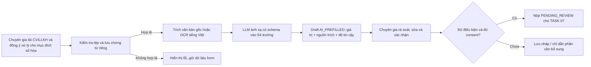
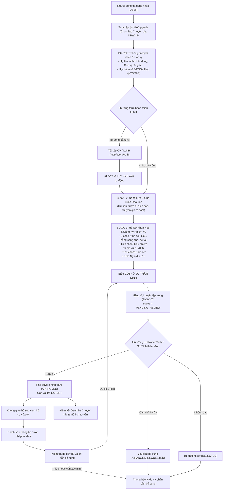

# TASK-05: Thiết Kế Cơ Sở — Hồ Sơ Chuyên Gia Khoa Học Công Nghệ & Luồng Nâng Hạng

> **Mã phân hệ**: `TASK-05`  
> **Quyết định phê duyệt PO**: `PO-DEC-20261008-07` (Kiến Trúc Phân Tầng Trợ Lý AI Nhập Liệu & Chuẩn Hóa DTO Mở P2)  
> **Đặc tả API Hợp đồng DTO mở (DD-02)**: [`DD-02-ai-extractor-contracts.md`](DD-02-ai-extractor-contracts.md)  
> **Bộ Wireframe Tương Tác Khép Kín CRUD & Human-in-the-Loop**:
> - Wizard AI Scan CV & Nâng hạng chuyên gia: [`wireframe_ai_cv_scan_wizard.html`](wireframe_ai_cv_scan_wizard.html)
> - Biểu mẫu Web Portal: [`wireframe_expert_upgrade.html`](wireframe_expert_upgrade.html) & Zalo Mobile: [`wireframe_zalo_input_form.html`](wireframe_zalo_input_form.html)
> - Danh bạ chuyên gia công khai: [`wireframe_danh_ba_chuyen_gia_v11.html`](wireframe_danh_ba_chuyen_gia_v11.html)
> - Workspace tự quản trị sau đăng nhập: [`wireframe_expert_owner_workspace.html`](wireframe_expert_owner_workspace.html)
> - Dashboard chuyên gia: [`wireframe_expert_dashboard.html`](wireframe_expert_dashboard.html)
> - Chỉnh sửa hồ sơ LLKH chuyên gia (Update/Edit): [`wireframe_chinh_sua_ho_so_chuyen_gia.html`](wireframe_chinh_sua_ho_so_chuyen_gia.html)
> - Hộp thư quản lý yêu cầu tư vấn từ DN (Consulting Requests): [`wireframe_quan_ly_yeu_cau_tu_van_chuyen_gia.html`](wireframe_quan_ly_yeu_cau_tu_van_chuyen_gia.html)
> **Sheet nguồn**: `C.gia` (94 dòng dữ liệu, 6 cột) trong [`../DỮ_LIỆU_GỐC_MASTER/Nacentwin_20260924_bo_loc_da_sua.xlsx`](../DỮ_LIỆU_GỐC_MASTER/Nacentwin_20260924_bo_loc_da_sua.xlsx)  
> **Tài liệu trích xuất MD**: [`../DỮ_LIỆU_GỐC_MASTER/Nacentwin_20260924_bo_loc_da_sua.md#sheet-7-cgia`](../DỮ_LIỆU_GỐC_MASTER/Nacentwin_20260924_bo_loc_da_sua.md#sheet-7-cgia)  
> **Tài liệu phân tích chuyên sâu**: [`PHAN_TICH_SO_TAY_CHUYEN_GIA_VA_LUONG_INPUT_ZALO_WEB.md`](PHAN_TICH_SO_TAY_CHUYEN_GIA_VA_LUONG_INPUT_ZALO_WEB.md)  
> **Mã nguồn Zalo Mini App ứng dụng**: [`SourceCode/ZaloMiniApp/`](../../../SourceCode/ZaloMiniApp/)  
> **Trạng thái**: 🟢 APPROVED BY PO (Open DTO Contract, Human-in-the-Loop & Trọn bộ Wireframe CRUD Chuyên gia)  
> **Quản lý tổng thể**: [`../DANH_SACH_TIEN_DO_BASIC_DESIGN.md`](../DANH_SACH_TIEN_DO_BASIC_DESIGN.md)

---

## 1. MỤC TIÊU & PHẠM VI NGHIỆP VỤ

Phân hệ xây dựng mạng lưới và quản lý **Hồ sơ Chuyên gia Khoa học & Công nghệ**. Cung cấp công cụ số hóa lý lịch khoa học (LLKH) chuẩn Bộ KH&CN, quy trình tự nâng hạng tài khoản cá nhân lên chuyên gia, và kết nối nhà khoa học với các bài toán đổi mới công nghệ thực tiễn từ doanh nghiệp.

### Các Năng Lực Trọng Tâm Của Phân Hệ:
1. **Luồng Tự Nâng Hạng Tài Khoản (User-to-Expert Upgrade)**:
   - Thành viên đã đăng ký (`USER`/`GUEST`) có thể nộp hồ sơ xin cấp thẩm quyền Chuyên gia (`EXPERT`).
   - Sử dụng **Form Wizard 3 bước chuẩn hóa** thu thập toàn diện thông tin định danh, văn bằng và công trình khoa học.
2. **Số Hóa Thông Minh Bằng AI-to-Text**:
   - Cho phép tải ảnh chụp hoặc file PDF/Word Lý lịch khoa học (LLKH/CV) $\rightarrow$ Hệ thống sử dụng OCR (PaddleOCR/Docling) kết hợp LLM để tự động trích xuất và điền sẵn (pre-fill) dữ liệu vào các trường trong biểu mẫu.
   - Chuyên gia chỉ cần kiểm tra lại, chỉnh sửa nếu cần và xác nhận tính pháp lý.
3. **Chuẩn Hóa LLKH Cá Nhân Thực Hiện Nhiệm Vụ KH&CN**:
   - Bám sát quy định của Bộ Khoa học và Công nghệ về tiêu chí chủ nhiệm đề tài và chuyên gia phản biện.
   - Quản lý điều kiện: *Đăng ký Chủ nhiệm nhiệm vụ KH&CN* hoặc *Đăng ký tham gia thực hiện chính*.
4. **Liên Thông Hàng Đợi Phê Duyệt Phân Cấp (Gắn kết `TASK-07`)**:
   - Hồ sơ nộp xong được chuyển vào hàng đợi `approval_requests` (`request_type = "EXPERT"`).
   - Cán bộ Sở KH&CN hoặc Hội đồng Khoa học NacenTech thẩm định, đối soát văn bằng trước khi cấp vai trò `EXPERT` chính thức.
5. **Tự Phục Vụ Hồ Sơ Chuyên Gia (Owner Profile Workspace)**:
   - Chuyên gia đã đăng nhập luôn có một điểm vào duy nhất để **xem hồ sơ của mình**, phân biệt rõ dữ liệu công khai và dữ liệu riêng tư.
   - Chuyên gia có thể **chỉnh sửa phần được phép tự khai**, lưu nháp và nộp lại để thẩm định khi thay đổi chạm tới thông tin cần xác minh.
   - Hệ thống chủ động nêu rõ **hồ sơ còn thiếu gì, mức độ ảnh hưởng và hành động cần làm**, thay vì chỉ báo lỗi khi bấm nộp.

### Quyết định trải nghiệm tài khoản chuyên gia

- Sau khi đăng nhập bằng `VERIFIED_EXPERT`, trang đích là **Không gian hồ sơ chuyên gia**; từ đó có hai hành động chính: **Xem hồ sơ** và **Chỉnh sửa/Bổ sung hồ sơ**.
- Cảnh báo hoàn thiện hồ sơ là một năng lực của `TASK-05`: hiển thị tiến độ tổng quan, nhóm thiếu thông tin và lối tắt đến phần cần bổ sung; việc thay đổi trạng thái duyệt vẫn thuộc `TASK-07`.
- Thanh **“Kiểm thử nhanh (tạm thời)”** và các lựa chọn chuyển sang Seller/Buyer/Đơn vị đổi mới chỉ là công cụ QA sinh session giả. Chúng **không có ý nghĩa nghiệp vụ** trong tài khoản chuyên gia thực, không được dùng để đổi vai trò và phải bị loại khỏi giao diện phát hành. Multi-role thực tế, nếu được duyệt sau này, cần một luồng quản trị quyền riêng trong `TASK-07`.
- Trang đích `/portal` của `VERIFIED_EXPERT` là **Dashboard chuyên gia**, không phải dashboard đa vai trò. Không hiển thị các thẻ **Gian hàng công nghệ**, **Bài toán tìm mua** hay **Doanh nghiệp ĐMST**; các năng lực đó thuộc các vai trò/ngữ cảnh khác.

### Quyết định PII CCCD — nguồn chân lý v2.5

`CCCD` là dữ liệu định danh nhạy cảm có thể **được lưu giữ** nếu đã có từ lịch sử hoặc được tiếp nhận trong một quy trình xác minh được phê duyệt riêng. Tuy nhiên, trong phạm vi MVP hiện tại, chuyên gia **không tự nhập và không xem lại CCCD** trên Web Portal hoặc Zalo Mini App; các luồng này cũng không yêu cầu ảnh CCCD.

| Bề mặt | Quyết định hiện tại |
| :--- | :--- |
| Zalo Mini App | Không thu thập, không hiển thị CCCD/ảnh CCCD. |
| Web Wizard / Chỉnh sửa hồ sơ | Không hiển thị hoặc bắt buộc nhập CCCD, ngày cấp, ảnh CCCD. |
| Owner Dashboard / Owner Detail | Không hiển thị số CCCD, kể cả dữ liệu lịch sử đã tồn tại. |
| Public Detail / tra cứu | Tuyệt đối không hiển thị. |
| CSDL | Giữ dữ liệu lịch sử tương thích ngược; không được buộc tạo/sửa hồ sơ mới phải có CCCD. |
| Xác minh sau này | Chỉ mở lại qua một luồng xác minh có thẩm quyền, mục đích xử lý, consent/audit và Detail Design riêng. |

**Ưu tiên áp dụng:** Quyết định này thay thế mọi mô tả trước v2.5 yêu cầu CCCD/ảnh CCCD ở Step 1, bao gồm cả Web Wizard. Các bảng trường cũ chỉ còn giá trị lịch sử, phải được cập nhật qua Delta trước khi code/DB thay đổi.

### Cổng chống lệch đa kênh cho trường nhạy cảm

Mỗi thay đổi field nhạy cảm phải có một **Field Lifecycle Matrix** làm nguồn chân lý duy nhất, ghi rõ: được lưu hay không, ai được nhập, bề mặt nào được hiển thị, quyền đọc và thời hạn/mục đích xử lý. Delta không được coi là hoàn thành nếu chưa đối chiếu đủ sáu bề mặt: Basic Design, Detail Spec, API/domain validation, DB/migration, Web Portal và Zalo Mini App.

Definition of Done bắt buộc gồm: (1) API contract test xác nhận field không bắt buộc khi tạo/sửa hồ sơ; (2) Web/Zalo component hoặc E2E test xác nhận không render nhãn/input/ảnh CCCD; (3) public/owner DTO test deny-list xác nhận không trả field cho UI hiện tại; (4) checklist traceability ghi rõ từng bề mặt đã kiểm tra. Đây là cổng hồi quy cho mọi PII, không riêng CCCD.

### Decision Record v2.6 — AI CV Scan thật, có người xác nhận (30/09/2026)

**Quyết định thay thế:** nút “AI CV Scan” không được được coi là đã hoạt động nếu chỉ điền dữ liệu mẫu hoặc trả về kết quả mô phỏng. Năng lực thuộc **TASK-05.2 — AI-to-Text Scan CV/LLKH**, không tách Epic mới. AI chỉ hỗ trợ tạo bản nháp; chuyên gia luôn là người rà soát, sửa và xác nhận trước khi hồ sơ được nộp thẩm định.

**Ranh giới năng lực đã chốt:**

1. Nhận CV/LLKH định dạng PDF, DOCX và ảnh; DOC cũ chỉ được nhận khi dịch vụ chuyển đổi an toàn đã được phê duyệt. Tệp phải qua kiểm tra định dạng thực, kích thước, chống mã độc và lưu kho riêng trước khi xử lý.
2. Pipeline gồm ba năng lực tách rời: **đọc văn bản gốc** (PDF/DOCX), **OCR tiếng Việt cho trang scan/ảnh**, và **LLM trích xuất có schema** để ánh xạ vào 94 trường/nhóm trường của `C.gia`. Từng trường kết quả có `nguồn trích`, `độ tin cậy` và trạng thái để chuyên gia đối chiếu.
3. Không chốt một nhà cung cấp LLM/OCR tại Basic Design. Detail Design phải chọn adapter triển khai dựa trên thỏa thuận xử lý dữ liệu, nơi lưu trữ dữ liệu, chi phí và benchmark CV tiếng Việt. `BGE-M3` chỉ là embedding/tìm kiếm ngữ nghĩa nếu cần ở giai đoạn sau; **không phải OCR và không phải lựa chọn cho CV Scan**.
4. Mọi kết quả AI thấp độ tin cậy, mâu thuẫn hoặc không trích được nguồn phải được đánh dấu “Cần chuyên gia xác nhận”; không tự suy đoán, không tự gán vai trò `VERIFIED_EXPERT`, không tự nộp `PENDING_REVIEW`.
5. Trong khi pipeline thật chưa triển khai, Web/Zalo phải hiển thị rõ “Tính năng đang thử nghiệm/mô phỏng”, không tuyên bố đã quét tệp hay đã điền đủ 94 trường.

#### Luồng giá trị AI CV Scan mục tiêu



#### Ma trận lan truyền quyết định v2.6

| Bề mặt | Quyết định áp dụng | Trạng thái |
| :--- | :--- | :--- |
| Basic Design / wireframe | Quy định AI Scan là upload thật → prefill có review; mô phỏng phải gắn nhãn. | Đã đồng bộ Basic Design; wireframe cần Delta hiển thị trạng thái thật. |
| Detail Spec `TASK-05` | Bổ sung contract upload, job ingestion, schema kết quả, provenance/confidence, retry và trạng thái lỗi/partial. | Cần Delta |
| API / domain validation | Không nhận `fileName` thay cho tệp; xác minh loại tệp; AI output không tự thành dữ liệu chính thức. | Cần Delta |
| DB / migration | Document riêng tư, ingestion job, version model, kết quả có nguồn/độ tin cậy và audit. | Cần Delta |
| Web Portal | Dropzone thật, progress/polling, review theo từng trường, 5 trạng thái UX và thông báo lỗi rõ ràng. | Cần Delta |
| Zalo Mini App | Upload CV, theo dõi trạng thái và Magic Link chỉ tới draft của chính chủ. | Cần Delta |
| Public / owner / admin projection | Chỉ owner/admin có quyền xem bản nháp/chứng từ; public không thấy PII, file gốc hay dữ liệu AI chưa xác nhận. | Cần Delta |
| Kiểm thử | Unit mapping, integration upload/job, E2E upload → review → submit; bộ benchmark CV tiếng Việt có consent. | Cần Delta |

**PII và quyền xử lý:** tệp CV/LLKH cùng nội dung trích xuất là dữ liệu cá nhân/chuyên môn riêng tư. Chỉ xử lý sau consent riêng nêu rõ mục đích “số hóa hồ sơ”, không hiển thị công khai, không dùng để huấn luyện mô hình, và không gửi sang dịch vụ bên thứ ba trước khi có thỏa thuận xử lý dữ liệu được phê duyệt. Quyết định này không thay đổi chính sách CCCD v2.5: AI CV Scan không yêu cầu, không trích xuất và không hiển thị CCCD trong Web/Zalo MVP.

### Decision Record v2.7 — Phương án AI thật, chi phí và cổng đo chất lượng (30/09/2026)

**Quyết định kiến trúc cho pilot:** chọn tuyến lai, thay thế nút mô phỏng bằng một pipeline thật: **trích văn bản cục bộ cho PDF/DOCX có text → Google Cloud Enterprise Document OCR cho trang scan/ảnh → GPT-5 Mini Structured Outputs để chuẩn hóa thành draft hồ sơ**. Đây là phương án khuyến nghị để triển khai pilot của `TASK-05.2`; chỉ được bật production sau khi có thỏa thuận xử lý dữ liệu với các nhà cung cấp và bộ benchmark CV đã được phê duyệt.

Việc chọn theo adapter là bắt buộc: `TextExtraction`, `OcrProvider` và `StructuredExtraction` là ba năng lực hoán đổi được. Vì vậy NacenTech có thể thay OCR hoặc LLM mà không làm thay đổi Wizard, dữ liệu hồ sơ hay quy trình duyệt `TASK-07`.

| Phương án | Phù hợp | Chi phí công bố / chi phí vận hành | Chất lượng và hạn chế |
| :--- | :--- | :--- | :--- |
| **Khuyến nghị pilot: Google OCR + GPT-5 Mini** | CV tiếng Việt scan lẫn PDF/DOCX có text; cần đi nhanh và có Structured Outputs. | Google OCR: **$1.50/1.000 trang**; GPT-5 Mini: **$0.25/1M token vào, $2/1M token ra**. Với giả định 1 CV có 5 trang scan, 12k token vào + 2k token ra: khoảng **$0.0145/CV**, hay **$14.50/1.000 CV**, chưa gồm storage, malware scan, network và vận hành. | Google liệt kê tiếng Việt cho OCR; GPT-5 Mini hỗ trợ Structured Outputs. Không có nhà cung cấp nào cam kết sẵn độ chính xác cho mẫu LLKH Việt Nam; phải qua benchmark riêng. Dữ liệu đi qua bên thứ ba nên bắt buộc DPA/consent. |
| **Microsoft Azure Document Intelligence + Azure OpenAI** | Tổ chức đã có tenant Azure, cần quản trị/điều khoản doanh nghiệp thống nhất. | Tính theo trang và region; Azure yêu cầu dùng Pricing Calculator/quote theo subscription. Không dùng con số ước đoán làm cam kết ngân sách. | OCR đa ngôn ngữ và layout tốt; cần POC cùng bộ benchmark để so với phương án khuyến nghị. |
| **Tự vận hành PaddleOCR v5 + LLM private/được phê duyệt** | Dữ liệu không được phép ra ngoài hạ tầng NacenTech. | Không có phí API theo trang; đổi lại có chi phí máy chủ CPU/GPU, giám sát, vá bảo mật và đội ngũ MLOps. | PaddleOCR v5 có hỗ trợ tiếng Việt. Chất lượng, khả năng đọc bảng/phụ lục và SLA là trách nhiệm NacenTech; chỉ chọn khi yêu cầu chủ quyền dữ liệu cao hơn tốc độ triển khai. |
| **AWS Textract + LLM trên Bedrock** | Chỉ xem xét khi hạ tầng AWS là ràng buộc đã có. | Textract text OCR có giá công bố từ **$0.0015/trang** ở ví dụ US West; giá phụ thuộc region/tính năng. | Chưa dùng làm chuẩn cho CV tiếng Việt cho đến khi benchmark chứng minh đạt ngưỡng; không chọn cho pilot mặc định. |

#### Cổng chất lượng và chi phí trước production

- Bộ benchmark tối thiểu 200 CV/LLKH đã có consent, cân bằng: PDF text, DOCX, PDF scan, ảnh điện thoại; tách riêng nội dung tiếng Việt, tiếng Anh và bảng biểu.
- Đo theo **field exact-match/F1**, không dùng cảm nhận hoặc % “AI điền sẵn”: nhóm định danh-học vị-cơ quan phải đạt ít nhất 95% với tài liệu text và 90% với scan; nhóm danh sách đào tạo/công tác/công trình đạt ít nhất 85% và mọi dữ liệu dưới ngưỡng được đưa vào hàng “Cần xác nhận”.
- Từ chối phát hành nếu có một lỗi lộ CV/PII, một field không truy được nguồn trích, hoặc AI tự biến draft thành hồ sơ đã xác nhận.
- Chốt ngân sách theo lượng trang thực tế sau pilot; công thức chuẩn là `trang scan × phí OCR + token input/output × phí LLM + storage/scan/monitoring`, không dùng mức giá ví dụ làm hạn mức mua sắm.

#### Ranh giới vận hành của pilot

1. PDF/DOCX có lớp text đi thẳng qua bộ đọc cục bộ; không gửi bản gốc đến OCR cloud nếu không cần.
2. Chỉ trang scan/ảnh hợp lệ mới gọi OCR. Text kết quả được giảm thiểu theo mục đích trước bước LLM; tệp gốc vẫn ở kho chứng từ riêng.
3. LLM chỉ trả JSON đúng schema và bằng chứng đoạn trích; nếu không đúng schema hoặc vượt chi phí/ngưỡng thời gian, job chuyển `AI_FAILED`/`PARTIAL`, không mất dữ liệu người dùng đã nhập.
4. Mỗi job phải lưu provider/model-version, lượng trang/token, chi phí, confidence và audit để đối soát. Đây là dữ liệu vận hành owner/admin, không công khai.

### Decision Record v2.8 — Tích hợp Google Gemini API (Multimodal CV Parsing) cho Môi trường Phát triển & Thử nghiệm Pilot (01/10/2026)

**Quyết định phê duyệt kỹ thuật từ PO/Lead BA:**
1. **Mục tiêu kỹ thuật**: Chuyển đổi tính năng Quét CV/LLKH (`TASK-05.2`) từ mô phỏng (mock fallback) sang gọi API trí tuệ nhân tạo thực tế thông qua **Google Gemini API**, hỗ trợ phân tích đa phương thức (Multimodal Input: PDF, DOCX, Ảnh chụp văn bản) và trích xuất dữ liệu có cấu trúc (Structured Outputs JSON).
2. **Adapter thực thi**: 
   - Model chỉ định: `gemini-3.5-flash-lite` (kết hợp cơ chế fallback dự phòng: `gemini-3.1-flash-lite`, `gemini-3.8-flash`).
   - Giao thức: REST API Endpoint `https://generativelanguage.googleapis.com/v1beta/models/{model}:generateContent` với `responseMimeType: "application/json"`.
   - Cơ chế bảo vệ khóa bí mật: Quản lý tập trung qua biến môi trường server-side `GEMINI_API_KEY`, tuyệt đối không phơi lộ API Key phía Client Webview.
3. **Ánh xạ 94 trường Sheet `C.gia` vào Schema JSON**:
   - Nhóm Định danh & Học vị: Họ tên (`fullName`), Năm sinh (`birthYear`), Giới tính (`gender`), Học hàm (`academicRank`), Học vị (`degree`), Đơn vị công tác (`organizationName`), Chức vụ quản lý (`positionTitle`).
   - Nhóm Chuyên môn & Lĩnh vực: 18 ngành công nghiệp trọng điểm TT17 (`sectors`), 6 lĩnh vực OECD (`oecdFields`), Tóm tắt năng lực tư vấn (`consultingSummary`).
   - Nhóm Tiến trình Đào tạo & Công tác: Bảng động `trainingHistory` (bậc, nơi đào tạo, chuyên ngành, năm) và `employmentHistory` (giai đoạn, vị trí, cơ quan).
   - Nhóm Thành tựu & Đề tài: Tối đa 5 công bố tiêu biểu `publications` (tiêu đề, tạp chí/hội thảo, năm), Sáng chế `patents`, Đề tài KH&CN `researchProjects` (tên đề tài, cấp quản lý, vai trò, năm).
4. **Quy tắc Kiểm soát Chất lượng & Phê chuẩn Dữ liệu**:
   - Toàn bộ trường được trích xuất thành công được đánh dấu trạng thái `AI_PREFILLED`.
   - Giao diện người dùng Web Wizard 3 bước hiển thị biểu tượng xác nhận bên cạnh các trường AI đã điền sẵn, cho phép Chuyên gia trực tiếp xem, đối chiếu với tài liệu gốc và chỉnh sửa trước khi bấm nộp thẩm định.
   - Cơ chế Graceful Fallback: Trường hợp mạng chập chờn, API Key hết quota hoặc tệp scan quá mờ không đọc được, hệ thống tự động cảnh báo người dùng và chuyển sang chế độ điền mẫu bổ trợ để không làm gián đoạn trải nghiệm của Chuyên gia.

---

## 2. QUY TRÌNH NGƯỜI DÙNG TOÀN TRÌNH (END-TO-END USER JOURNEY)



---

## 2.1. KHUNG XƯƠNG SỐNG OWNER VIEW / EDIT / COMPLETENESS

| Hoạt động | Giá trị cho chuyên gia | Kết quả mong muốn | Ranh giới trách nhiệm |
| :--- | :--- | :--- | :--- |
| Xem hồ sơ của tôi | Biết chính xác hồ sơ đang được hệ thống sử dụng thế nào | Một trang owner hiển thị phần công khai, dữ liệu riêng tư và trạng thái thẩm định | Public view vẫn áp dụng chính sách ẩn PII; owner view chỉ dành cho chủ hồ sơ/quản trị được phân quyền |
| Chỉnh sửa / lưu nháp | Tự cập nhật năng lực, đơn vị công tác và thành tựu mà không phải làm lại toàn bộ hồ sơ | Bản nháp cập nhật, lịch sử thay đổi và điểm nộp lại rõ ràng | Thông tin pháp lý/đã xác minh không tự ghi đè; thay đổi có thể quay lại hàng đợi `TASK-07` |
| Cảnh báo hồ sơ cần bổ sung | Không phải đoán lý do chưa thể hoàn tất hoặc đang bị trả về | Danh sách nhóm thiếu, mức độ ưu tiên và điều hướng tới nơi bổ sung | `TASK-05` xác định mức độ hoàn thiện; `TASK-07` quyết định yêu cầu sửa/phê duyệt/từ chối |
| Nhận thông báo | Không bỏ sót yêu cầu từ hội đồng | Thông báo trong workspace và kênh ngoài hệ thống khi có yêu cầu bổ sung/trạng thái mới | Kênh gửi, mẫu nội dung và SLA được chi tiết hóa ở SRS/Detail Design |

**Walking Skeleton bổ sung**: một chuyên gia đăng nhập → xem hồ sơ owner → nhận cảnh báo còn thiếu hoặc yêu cầu sửa → mở đúng phần để bổ sung → nộp lại → nhận trạng thái mới. Không cho phép chuyển vai trò bằng UI QA.

### 2.1.1. Dashboard chuyên gia sau đăng nhập

Dashboard là điểm điều hành chung của chuyên gia, trả lời ba câu hỏi theo đúng thứ tự ưu tiên: **hồ sơ đang ở đâu, cần làm gì ngay, và có thông báo nào mới**. Đây không phải trang tổng hợp mô-đun marketplace.

| Khối thông tin | Giá trị nghiệp vụ | Trạng thái dữ liệu |
| :--- | :--- | :--- |
| Trạng thái hồ sơ | Hiển thị trạng thái thẩm định và mức độ hoàn thiện để chuyên gia biết hồ sơ đã sẵn sàng hay chưa | Dữ liệu thật từ hồ sơ/duyệt |
| Việc cần làm | Liệt kê các thiếu sót hoặc yêu cầu chỉnh sửa; mỗi việc điều hướng tới đúng vùng chỉnh sửa | Dữ liệu thật từ kiểm tra completeness và yêu cầu `TASK-07` |
| Thông báo mới | Gom kết quả thẩm định, yêu cầu bổ sung và cập nhật liên quan hồ sơ | Dữ liệu thật từ notification khi có backend; trạng thái rỗng nói rõ chưa có thông báo |
| Lối tắt hồ sơ | Đi tới **Xem hồ sơ của tôi** hoặc **Chỉnh sửa/Bổ sung** | Luôn có |

**Nguyên tắc hiển thị:** không dùng số liệu/đơn hàng/tác vụ marketplace giả để lấp dashboard. Khi chưa có yêu cầu tư vấn thật, khối này không hiển thị hoặc hiện trạng thái rỗng; menu “Yêu cầu tư vấn & kết nối” tiếp tục là **Sắp có** cho đến khi hoàn tất phạm vi đã pending.

### 2.2. Cây chức năng sau khi chuyên gia đăng nhập

Các tiêu đề dưới đây là cấu trúc điều hướng của **Không gian Chuyên gia**. Chúng gom những năng lực đã có trong Basic Design, wireframe và nguồn `C.gia`, tránh trộn workspace chuyên gia với Seller/Buyer/Đơn vị đổi mới.

```text
Không gian Chuyên gia
├── Tổng quan
│   ├── Tiến độ hoàn thiện hồ sơ
│   ├── Việc cần làm / yêu cầu bổ sung
│   └── Thông báo trạng thái thẩm định
├── Hồ sơ của tôi
│   ├── Xem hồ sơ đầy đủ (owner view)
│   ├── Xem hồ sơ công khai
│   ├── Chỉnh sửa / lưu nháp / nộp lại
│   ├── Minh chứng & cam kết PDPD
│   └── Lịch sử thay đổi và thẩm định
├── Năng lực chuyên môn
│   ├── Đào tạo và quá trình công tác
│   ├── Công bố, sáng chế, đề tài, ứng dụng và giải thưởng
│   ├── Công nghệ làm chủ / ngành TT17
│   └── Dịch vụ tư vấn & lịch sẵn sàng
├── Yêu cầu tư vấn & kết nối
│   ├── Yêu cầu mới từ doanh nghiệp / NacenTech
│   ├── Lịch sử yêu cầu tư vấn
│   └── Lịch làm việc / kết quả tư vấn
└── Thông báo
    ├── Yêu cầu bổ sung hồ sơ
    ├── Kết quả thẩm định
    └── Cập nhật yêu cầu tư vấn
```

| Tiêu đề chức năng | Mục tiêu nghiệp vụ | Trạng thái phạm vi |
| :--- | :--- | :--- |
| **Tổng quan** | Cho chuyên gia biết ngay hồ sơ có đầy đủ không, đang ở trạng thái nào và cần làm gì tiếp. | MVP / `TASK-05` |
| **Hồ sơ của tôi** | View và Edit có kiểm soát; phân biệt public, owner/private và thông tin cần thẩm định lại. | MVP / `TASK-05` + `TASK-07` |
| **Năng lực chuyên môn** | Quản lý dữ liệu LLKH, công trình và năng lực tư vấn làm đầu vào cho tra cứu/matching. | MVP / `TASK-05` |
| **Yêu cầu tư vấn & kết nối** | Nhận, theo dõi và phản hồi các yêu cầu kết nối/tư vấn phát sinh từ doanh nghiệp hoặc NacenTech. Đây là lịch sử công việc của chuyên gia. | MVP, liên thông Matching & Advisory |
| **Thông báo** | Không bỏ sót yêu cầu bổ sung, kết quả thẩm định hay yêu cầu tư vấn mới. | MVP / `TASK-05` + Communication |
| **Đơn tư vấn / hợp đồng / thanh toán** | Theo dõi đơn đặt dịch vụ có báo giá, ký kết, thanh toán và đối soát. | **Post-MVP** — chưa có căn cứ nghiệp vụ/điều khoản thương mại để đưa vào menu vận hành hiện tại |

**Quyết định thuật ngữ:** ở MVP, dùng nhãn **“Yêu cầu tư vấn & kết nối”** thay cho “Lịch sử đơn đặt hàng”. Chỉ đổi thành **“Đơn tư vấn / hợp đồng”** khi PO chốt phạm vi báo giá, quy trình chấp nhận, hủy/hoàn và thanh toán; phần này thuộc miền Marketplace & Commerce, không tự mở rộng `TASK-05`.

---

## 2.3. THIẾT KẾ CƠ SỞ: DANH BẠ TÌM KIẾM & LỌC CHUYÊN GIA CÔNG KHAI (`/experts` & `/chuyen-gia`)

> **Wireframe tham chiếu**: [`wireframe_danh_ba_chuyen_gia_v11.html`](wireframe_danh_ba_chuyen_gia_v11.html)  
> **Điểm vào điều hướng**: Thanh Menu chính toàn sàn (Header Navbar `/chuyen-gia`), liên kết tắt từ Banner Trang chủ Home (`TASK-01`) và Route chuẩn quốc tế `/experts`.

### 2.3.1. Bối cảnh & Mục tiêu nghiệp vụ
Trang Danh bạ Chuyên gia công khai là bộ mặt đối ngoại của mạng lưới tri thức NacenTech, nơi Doanh nghiệp (Buyer), Đơn vị nghiên cứu và Cơ quan quản lý tìm kiếm các nhà khoa học uy tín để:
1. **Tra cứu & Khảo sát năng lực**: Tìm chuyên gia theo học vị, đơn vị công tác và công trình nghiên cứu.
2. **Khớp nối bài toán công nghệ (Technology Matching)**: Lọc chuyên gia có làm chủ công nghệ giải quyết đúng nỗi đau kỹ thuật của doanh nghiệp trong 18 ngành TT17.
3. **Bảo vệ quyền riêng tư tuyệt đối (PDPD Nghị định 13/2023/NĐ-CP)**: Chỉ niêm yết các hồ sơ đã có trạng thái `APPROVED` (được Sở KH&CN hoặc Viện NacenTech thẩm định). Tuyệt đối **KHÔNG PHƠI LỘ** số CCCD, ảnh CCCD, Số điện thoại cá nhân hoặc Email riêng tư trên danh bạ công khai.

### 2.3.2. Cấu trúc Giao diện & Bố cục Không gian (Layout Anatomy)

Trang danh bạ được tổ chức theo cấu trúc tiêu chuẩn của các sàn giao dịch công nghệ quốc tế:
1. **Hero Search Bar**:
   - Khẩu hiệu định vị mạng lưới chuyên gia.
   - Thanh tìm kiếm toàn văn (Full-text Search): Hỗ trợ tìm kiếm theo Họ tên chuyên gia, Cơ quan/Trường/Viện công tác, Lĩnh vực nghiên cứu, Từ khóa công nghệ.
   - Quick Filter Chips: Các từ khóa công nghệ xu hướng (#Trí tuệ nhân tạo, #Vật liệu nano, #Năng lượng tái tạo...).
2. **Sidebar Bộ lọc 4 trục chuyên sâu (Left Column - 280px)**:
   - **Trục 1: Học hàm & Học vị**: Giáo sư (GS), Phó Giáo sư (PGS), Tiến sĩ (TS/TSKH), Thạc sĩ / Kỹ sư chính.
   - **Trục 2: 18 Ngành công nghiệp trọng điểm TT17**: 18 ngành chuẩn Thông tư 17/2019/TT-BKHCN (Chế biến thực phẩm, Hóa dược, Điện tử, Cơ khí chế tạo, Năng lượng...).
   - **Trục 3: Địa bàn Sở KH&CN tiếp nhận (34 Tỉnh thành trọng điểm)**: Phân nhóm 3 miền Bắc (12), Trung (10), Nam (12) hỗ trợ doanh nghiệp tìm chuyên gia bản địa.
   - **Trục 4: Chứng thực & Thẩm quyền**:
     + [x] Đã xác thực bởi Sở KH&CN / Viện NacenTech (Badge Verified).
     + [ ] Đăng ký làm Chủ nhiệm nhiệm vụ KH&CN cấp Nhà nước / Bộ.
     + [ ] Có bằng Độc quyền Sáng chế / Giải pháp hữu ích (Cục SHTT).
3. **Vùng Kết quả Danh sách Thẻ Chuyên gia (Main Grid - 3 Cột)**:
   - Thanh điều khiển: Hiển thị tổng số lượng chuyên gia tìm thấy (Count), Sắp xếp (Nổi bật, Học vị GS/PGS ưu tiên, Mới cập nhật).
   - **Thẻ Chuyên gia chuẩn hóa (Expert Card)**:
     + Ảnh đại diện / Avatar viết tắt chữ cái kèm huy hiệu tích xanh xác thực.
     + Học hàm / Học vị nổi bật (Badge màu chuyên biệt).
     + Huy hiệu địa bàn thẩm định (VD: "Sở Hà Nội", "Sở TP.HCM").
     + Họ và tên chuyên gia (Đậm, liên kết dẫn tới `/experts/[expertCode]`).
     + Cơ quan / Trường đại học / Viện nghiên cứu công tác.
     + Nhãn lĩnh vực TT17 chính & Danh sách tag công nghệ làm chủ.
     + Khối chỉ số thành tựu: Số lượng bài báo khoa học, Số bằng sáng chế, Số đề tài KH&CN đã chủ trì.
     + Bộ nút hành động: **[Xem hồ sơ chi tiết]** (Dẫn tới Public Detail) và **[Gửi yêu cầu kết nối]** (Mở popup gửi bài toán tư vấn).
4. **Phân trang & Xử lý Trạng thái UX**:
   - Phân trang chuẩn 9 hoặc 12 chuyên gia/trang.
   - Trạng thái tải: Skeleton Card nhấp nháy mô phỏng cấu trúc thẻ.
   - Trạng thái rỗng (Empty State): Khi bộ lọc không có kết quả, hiển thị hướng dẫn nới lỏng bộ lọc hoặc nút "Đặt lại bộ lọc".

### 2.3.3. Delta v11 — Quyết định PO về taxonomy và bố cục compact

- **Ngành lọc**: lấy danh sách `SECTOR` đang active trực tiếp từ DB qua `GET /api/v1/sectors`. Số lựa chọn hiển thị khớp số record trả về; baseline migration TASK-06 seed có 10 mã `LV` xác thực. Không hardcode “18 ngành” vào bộ lọc và không tự sinh mã còn thiếu. Trường tham chiếu TT17 trong metadata dùng để hiển thị/đối chiếu, không làm phát sinh taxonomy mới.
- **Địa bàn**: chỉ hiển thị/lọc theo mã tỉnh có nguồn xác thực từ hồ sơ đã duyệt. Dùng scope tỉnh đã được phê duyệt của chủ hồ sơ; hồ sơ không có scope thì không gán tỉnh suy đoán.
- **Bố cục**: giảm chiều cao Hero và khoảng đệm; desktop dùng thanh tìm kiếm nổi bật cùng bộ lọc mở rộng gọn; mobile đưa bộ lọc vào drawer/bottom sheet. Card ưu tiên định danh chuyên môn, đơn vị, lĩnh vực, thành tựu và hành động chính; giảm viền, bóng và khoảng trắng thừa.
- **Tính trung thực của control**: chỉ hiển thị filter/sort khi được áp dụng thật vào kết quả. Modal gọi POST /api/v1/public/experts/{expertCode}/consultation-requests; chỉ báo tiếp nhận khi API thành công và nêu rõ NacenTech là đầu mối điều phối.
- **Trạng thái UX**: giữ đủ Loading, Empty, Error (có retry), Success và Updating; giữ bảo vệ PII, responsive desktop/mobile và khả năng điều khiển bằng bàn phím.
- **Wireframe cập nhật**: [`wireframe_danh_ba_chuyen_gia_v11.html`](wireframe_danh_ba_chuyen_gia_v11.html), được đăng ký trong [`wireframe_tong_the_nacentwin.html`](../wireframe_tong_the_nacentwin.html).

---

## 3. CHI TIẾT FORM WIZARD 3 BƯỚC NÂNG CẤP CHUYÊN GIA

### 3.1. Bước 1 — Thông Tin Định Danh & Văn Bằng Học Vị

| Mã Trường | Nhãn Hiển Thị | Kiểu Nhập Liệu | Ràng Buộc & Quy Tắc Nghiệp Vụ | Nguồn Sheet `C.gia` |
| :--- | :--- | :--- | :--- | :---: |
| `full_name` | Họ và tên chuyên gia | Text (String) | Bắt buộc, 2 - 100 ký tự, tự động lấy từ tài khoản cá nhân. | Dòng 83 |
| `birth_year` | Năm sinh | Number (YYYY) | Bắt buộc, $1940 \le \text{Năm sinh} \le 2005$. | Dòng 84 |
| `gender` | Giới tính | Dropdown | Bắt buộc: `Nam`, `Nữ`, `Khác`. | Dòng 85 |
| `id_card_number` | Số Căn cước công dân | Text | Bắt buộc, đúng 12 chữ số theo chuẩn Bộ Công an. | Dòng 90 |
| `id_card_date` | Ngày cấp CCCD | Date Picker | Bắt buộc, không lớn hơn ngày hiện tại. | Dòng 91 |
| `id_card_files` | Ảnh chụp CCCD (2 mặt) | Upload File (Ảnh/PDF) | Bắt buộc 2 mặt, định dạng JPG/PNG/PDF $\le 10$MB. | Dòng 77 |
| `portrait_image` | Ảnh chân dung chuyên gia | Upload File (Ảnh) | Bắt buộc, ảnh chân dung nghiêm túc nền sáng $\le 5$MB. | Dòng 67 |
| `academic_rank` | Học hàm | Dropdown | `Không có`, `Phó Giáo sư (PGS)`, `Giáo sư (GS)`. | Dòng 86 |
| `academic_rank_year`| Năm được phong học hàm | Number (YYYY) | Bắt buộc nếu chọn PGS/GS. | Dòng 87 |
| `degree` | Học vị cao nhất | Dropdown | Bắt buộc: `Cử nhân / Kỹ sư`, `Thạc sĩ`, `Tiến sĩ`, `Tiến sĩ Khoa học`. | Dòng 88 |
| `degree_year` | Năm đạt học vị | Number (YYYY) | Bắt buộc, 4 chữ số. | Dòng 89 |
| `degree_certificate`| Văn bằng chứng chỉ cao nhất | Upload File (PDF/Ảnh)| Bắt buộc đính kèm bản scan văn bằng gốc. | Dòng 78 |
| `organization_name`| Cơ quan / Đơn vị công tác | Text | Bắt buộc, tên Viện, Trường, Doanh nghiệp. | Dòng 98 |
| `organization_address`| Địa chỉ cơ quan | Text | Tối đa 255 ký tự. | Dòng 101 |
| `research_title` | Chức danh nghiên cứu | Text | Ví dụ: Nghiên cứu viên chính, Giảng viên cao cấp. | Dòng 92 |
| `position_title` | Chức vụ quản lý | Dropdown / Text | Trưởng bộ môn, Phó Viện trưởng, Trưởng phòng, v.v. | Dòng 93 |

---

### 3.2. Bước 2 — Năng Lực Chuyên Môn & Trích Xuất AI Scan LLKH

| Mã Trường | Nhãn Hiển Thị | Kiểu Nhập Liệu | Ràng Buộc & Quy Tắc Nghiệp Vụ | Nguồn Sheet `C.gia` |
| :--- | :--- | :--- | :--- | :---: |
| `ai_cv_uploader` | **Tải lên LLKH/CV để AI điền tự động** | Dropzone (PDF/Word/Ảnh) | **Tính năng thông minh**: Hỗ trợ tệp $\le 20$MB. Kích hoạt OCR & LLM bóc tách tự động điền các trường bên dưới. | Dòng 65-66, 79 |
| `expertise_sectors`| Lĩnh vực chuyên môn chính | Multi-Select (18 Ngành) | Bắt buộc chọn ít nhất 1 trong 18 ngành công nghiệp TT17. | Dòng 147 |
| `oecd_fields` | Lĩnh vực KH&CN (OECD) | Multi-Select | 6 lĩnh vực lớn: Tự nhiên, Kỹ thuật, Y dược, Nông nghiệp, Xã hội, Nhân văn. | Master Data |
| `training_history` | Quá trình đào tạo | Bảng động (Repeater) | Gồm: Bậc đào tạo, Nơi đào tạo, Chuyên ngành, Năm tốt nghiệp. | Dòng 102-106 |
| `employment_history`| Quá trình công tác | Bảng động (Repeater) | Gồm: Khoảng thời gian, Vị trí công tác, Cơ quan công tác. | Dòng 107-111 |
| `consulting_summary`| Tóm tắt năng lực tư vấn | Textarea | Mô tả công nghệ, giải pháp thế mạnh nhận chuyển giao/cố vấn. | Dòng 151 |

---

### 3.3. Bước 3 — Hồ Sơ Khoa Học, Đăng Ký Nhiệm Vụ & Cam Kết Pháp Lý

| Mã Trường | Nhãn Hiển Thị | Kiểu Nhập Liệu | Ràng Buộc & Quy Tắc Nghiệp Vụ | Nguồn Sheet `C.gia` |
| :--- | :--- | :--- | :--- | :---: |
| `publications` | Các công trình công bố tiêu biểu | Bảng động (Tối đa 5 bài) | Tên công trình, vai trò (Tác giả chính/Đồng tác giả), Tạp chí, Năm công bố. | Dòng 112-117 |
| `patents` | Bằng độc quyền sáng chế / GPHI | Bảng động (Nếu có) | Tên sáng chế, số văn bằng, năm cấp, cơ quan cấp (Cục SHTT). | Dòng 118-121 |
| `practical_projects`| Công trình ứng dụng thực tế | Bảng động (Nếu có) | Tên công nghệ, quy mô, doanh nghiệp/địa chỉ tiếp nhận áp dụng. | Dòng 122-126 |
| `research_projects` | Đề tài/Dự án 5 năm gần đây | Bảng động (Nếu có) | Tên đề tài, cấp quản lý (Nhà nước/Bộ/Cơ sở), vai trò, tình trạng nghiệm thu. | Dòng 127-131 |
| `awards` | Giải thưởng KH&CN đã đạt | Bảng động (Nếu có) | Tên giải thưởng, hình thức, năm trao thưởng. | Dòng 132-136 |
| `is_project_leader` | **Đăng ký làm Chủ nhiệm nhiệm vụ KH&CN** | Checkbox | Phải có học vị từ Tiến sĩ trở lên hoặc chứng chỉ năng lực theo quy chế Bộ KH&CN. | Dòng 75 |
| `is_main_contributor`| **Đăng ký tham gia thực hiện chính** | Checkbox | Đăng ký thành viên nghiên cứu chủ chốt. | Dòng 76 |
| `pdpd_consent` | **Cam kết bảo vệ dữ liệu cá nhân (PDPD)** | Checkbox bắt buộc | Bắt buộc đồng ý lưu trữ hồ sơ và chia sẻ trong hệ sinh thái theo Nghị định 13/2023. | Dòng 155 |
| `legal_oath` | **Cam kết tính chính xác của hồ sơ** | Checkbox bắt buộc | Chịu trách nhiệm hoàn toàn trước pháp luật về tính chân thực của văn bằng, công trình. | Dòng 155 |

---

## 4. CHIẾN LƯỢC INPUT ĐA KÊNH & QUY HOẠCH KỸ THUẬT TÍCH HỢP ZALO MINI APP (`SourceCode/ZaloMiniApp`)

Nhằm khắc phục triệt để tỷ lệ bỏ cuộc (drop-off > 80%) khi thu thập hồ sơ chuyên gia, hệ thống áp dụng **Chiến lược Input 3 Tầng "Zero Friction"**, trong đó phân hệ **Zalo Mini App** đóng vai trò là "cửa ngõ tiếp nhận nhanh" trên thiết bị di động.

### 4.1. Mô Hình Kiến Trúc Thu Thập 3 Tầng (Zero-Friction Architecture)

```mermaid
sequenceDiagram
    autonumber
    actor Expert as Chuyên Gia KH&CN
    participant Zalo as Zalo Mini App (Mobile)
    participant Gateway as Backend .NET Core API
    participant AI as AI Ingestion Engine (OCR + LLM)
    participant DB as Draft Profile DB
    participant Portal as Web Portal NacenTwin

    Note over Expert,Zalo: TẦNG 1: TIẾP CẬN NHANH TRÊN DI ĐỘNG (< 2 PHÚT)
    Expert->>Zalo: Mở Zalo Mini App từ nhóm công tác / Zalo OA Viện NacenTech
    Zalo->>Zalo: Gọi SDK getUserInfo & getPhoneNumber tự động điền Họ tên & SĐT
    Expert->>Zalo: Nhập Email, Học vị, Cơ quan, Ngành TT17 & Chọn tệp CV/LLKH (PDF/Word/Ảnh)
    Expert->>Zalo: Tích cam kết PDPD (NĐ 13/2023) & Bấm "Gửi Hồ Sơ"
    
    Note over Zalo,AI: TẦNG 2: XỬ LÝ THÔNG MINH BẰNG AI ENGINE
    Zalo->>Gateway: POST /api/v1/public/experts/quick-intake (multipart/form-data)
    Gateway->>DB: Khởi tạo bản ghi Draft Profile (Status = AI_PROCESSING)
    Gateway-->>Zalo: Trả về Tracking ID & Magic Link tra cứu
    Zalo-->>Expert: Hiển thị thanh tiến trình AI & Thông báo tiếp nhận thành công
    Gateway->>AI: Đẩy tệp CV/LLKH vào pipeline đọc văn bản/OCR + LLM có schema
    AI->>DB: Lưu dữ liệu trích xuất kèm nguồn trích và độ tin cậy
    DB-->>Gateway: Chuyển trạng thái sang AI_PREFILLED hoặc AI_FAILED; không công bố % điền sẵn cố định
    Gateway-->>Expert: Gửi tin nhắn Zalo ZNS / SMS kèm Magic Link: "Xem lại hồ sơ 60s"

    Note over Expert,Portal: TẦNG 3: REVIEW & KÍCH HOẠT TRÊN WEB PORTAL
    Expert->>Portal: Mở Magic Link trên trình duyệt máy tính / mobile web
    Portal->>DB: Nạp dữ liệu đã được AI điền sẵn vào Wizard 3 Bước
    Expert->>Portal: Kiểm tra lại các công trình, tích cam kết & Nộp chính thức
    Portal->>Gateway: Chuyển trạng thái sang PENDING_ADMIN_REVIEW
    Gateway-->>Portal: Cấp mã số EXPERT-2026-XXXX và chuyển sang Hàng đợi duyệt TASK-07
```

---

### 4.2. Danh Mục Trường Thu Thập Tức Thì Trên Zalo Mini App (Form Tinh Gọn 2 Phút)

Biểu mẫu được tối ưu theo giao diện [`wireframe_zalo_input_form.html`](wireframe_zalo_input_form.html), tuân thủ nghiêm ngặt nguyên tắc **Zero-Friction** và **Bảo vệ dữ liệu cá nhân (PDPD NĐ 13/2023)** (đã loại bỏ hoàn toàn số CCCD và ảnh CCCD nhạy cảm ở bước thu thập ban đầu, thay thế bằng trường năng lực chuyên sâu):

| STT | Tên Trường | Kiểu Dữ Liệu | Ràng Buộc & Cơ Chế UX Tối Ưu | Nguồn Sheet `C.gia` |
| :---: | :--- | :--- | :--- | :---: |
| 1 | **Họ và tên chuyên gia** | Text | Tự động lấy từ tài khoản Zalo (`getUserInfo`), cho phép sửa. | Dòng 83 |
| 2 | **Số điện thoại Zalo** | Phone Text | Tự động gợi ý từ Zalo API (`getPhoneNumber`), làm mã định danh liên lạc. | Dòng 7, 29 |
| 3 | **Email công tác** | Email Text | Bắt buộc, nhận Magic Link và kết quả thẩm định. | Dòng 8, 27 |
| 4 | **Học vị cao nhất** | Dropdown | Các giá trị chuẩn: `Tiến sĩ (TS)`, `Phó Giáo sư (PGS)`, `Giáo sư (GS)`, `Thạc sĩ (ThS)`, `Kỹ sư / Cử nhân`. | Dòng 88 |
| 5 | **Cơ quan / Đơn vị công tác** | Text | Tên Viện, Trường, Doanh nghiệp chủ quản (VD: Viện Ứng Dụng Công Nghệ). | Dòng 98 |
| 6 | **Lĩnh vực thế mạnh (18 ngành TT17)** | Dropdown | Bắt buộc chọn 1 trong 18 ngành chuẩn Thông tư 17 (Liên thông Master Data `TASK-06`). | Dòng 147 |
| 7 | **Công nghệ làm chủ** | Multi-Select | Chọn 1 đến nhiều nhóm công nghệ từ danh mục 34 công nghệ chuẩn (CN01 -> CN39 từ Sheet Ma trận LV-CN). | Ma trận LV-CN |
| 8 | **Tệp LLKH / CV sẵn có** | File Upload | **Cốt lõi**: Chấp nhận PDF, DOC, DOCX, Ảnh chụp CV $\le 20$MB. Đầu vào cho AI Ingestion Engine. | Dòng 65-66, 79 |
| 9 | **Cam kết bảo vệ dữ liệu PDPD** | Checkbox | Bắt buộc tích: Đồng ý lưu trữ hồ sơ theo Nghị định 13/2023/NĐ-CP. | Dòng 155 |

---

### 4.3. Kế Hoạch Chuyển Đổi Kỹ Thuật Từ Codebase `SourceCode/ZaloMiniApp`

Thư mục [`SourceCode/ZaloMiniApp/`](../../../SourceCode/ZaloMiniApp/) hiện có sẵn khung sườn hoàn chỉnh của một Zalo Mini App. Kế hoạch cải tạo và tích hợp như sau:

#### 1. Tận dụng hạ tầng đóng gói ZMP đã hoàn thiện
- **Nền tảng**: React 18, TypeScript, Vite 5, `zmp-sdk` v2.53, `zmp-ui` v1.11.
- **Cơ chế đóng gói**: Tiếp tục sử dụng cấu hình khóa cứng bundle name trong `vite.config.ts`:
  ```ts
  output: {
    entryFileNames: "assets/[name].module.js",
    chunkFileNames: "assets/[name].module.js",
    assetFileNames: "assets/[name][extname]",
  }
  ```
  giúp khớp 100% với `app-config.json` mà không lo vỡ asset khi deploy lên máy chủ Zalo CDN (`h5.zdn.vn`).

#### 2. Cấu hình định danh & quyền hạn Zalo
- Trong `app-config.json`:
  - `title`: `"Viện NacenTech — Sổ tay Chuyên gia KH&CN"`.
  - `headerColor` / `backgroundColor`: `#1d4ed8` (Màu xanh nhận diện Viện NacenTech).
  - Khai báo cấp quyền Zalo SDK: `scope.userInfo`, `scope.userPhonenumber`.
- Trong Zalo Mini App Console:
  - Khởi tạo Mini App ID mới thuộc Zalo Official Account (OA) của Viện NacenTech.
  - Cấu hình whitelist **API Domains** trỏ về domain backend NacenTwin.

#### 3. Cấu hình Backend .NET Core & CORS
- **Proxy môi trường dev** (`vite.config.ts`): Cấu hình proxy `/api` trỏ về API Backend .NET Core (`http://localhost:5000`).
- **CORS Backend Production**: Trong `Program.cs` của Backend .NET Core, bổ sung 2 origins bắt buộc của Webview Zalo:
  ```csharp
  builder.Services.AddCors(options => {
      options.AddPolicy("ZaloMiniAppPolicy", policy => {
          policy.WithOrigins("https://h5.zdn.vn", "https://mini.zalo.me")
                .AllowAnyHeader()
                .AllowAnyMethod();
      });
  });
  ```

#### 4. API Ingestion Contract (`POST /api/v1/public/experts/quick-intake`)
- **Kiểu nội dung**: `multipart/form-data`.
- **Request Fields**:
  - `fullName` (string, required)
  - `phone` (string, required)
  - `email` (string, email format, required)
  - `highestDegree` (enum: `TS`, `PGS`, `GS`, `ThS`, `KS`)
  - `organization` (string, required)
  - `sectorCode` (string, 2 digits: `"01"` -> `"18"`)
  - `masteredTechCodes` (array of strings: `["CN02", "CN05", "CN06"]`)
  - `cvFile` (binary file: PDF/DOC/DOCX/JPG/PNG, $\le 20$MB)
  - `pdpdConsent` (boolean, required: true)
- **Response Format**:
  ```json
  {
    "success": true,
    "trackingId": "DRAFT-EXP-2026-0814",
    "status": "AI_PROCESSING",
    "message": "Đã tiếp nhận hồ sơ thành công. AI đang bóc tách dữ liệu.",
    "magicLinkUrl": "https://nacentwin.vn/verify-profile?token=eyJhbGciOi...",
    "estimatedSeconds": 30
  }
  ```

#### 5. Tái cấu trúc Màn hình ứng dụng (`SourceCode/ZaloMiniApp/src/`)
- **`src/pages/home.tsx`**: Viết lại hoàn toàn theo mã nguồn wireframe [`wireframe_zalo_input_form.html`](wireframe_zalo_input_form.html).
- **`src/components/ai-progress.tsx`**: Tạo component hiển thị thanh tiến trình giả lập / polling trạng thái AI Engine đang đọc hiểu CV.
- **`src/pages/me.tsx`**: Giữ lại để hiển thị Profile chuyên gia và nút "Quan tâm OA Viện NacenTech" (`followOA`) để chuyên gia nhận thông báo ZNS tự động khi hồ sơ được duyệt.
- **`src/api/expert.ts`**: Tạo module gọi API `submitExpertForm` và `pollAiStatus`, thay thế hoàn toàn file `src/api/tracepro.ts` cũ.
- **Dọn dẹp**: Lược bỏ các màn hình và thư viện barcode cũ (`result.tsx`, `brand.tsx`, `history.tsx`, `qr.ts`).

---

## 5. DỮ LIỆU ĐẶC TẢ CHI TIẾT GỐC (TRÍCH XUẤT 100% TỪ SHEET `C.gia`)

Toàn bộ 94 dòng dữ liệu nghiệp vụ gốc được lưu giữ nguyên vẹn tại [Mục 3 phiên bản trước](#3-dữ-liệu-đặc-tả-chi-tiết-gốc-trích-xuất-100-từ-sheet-cgia).

---

## 6. TIÊU CHÍ NGHIỆM THU (DEFINITION OF DONE - DoD)

- [x] Khớp 100% dữ liệu gốc từ Sheet `C.gia` (94 dòng dữ liệu).
- [x] Đặc tả chi tiết User Journey tự nâng hạng chuyên gia qua Form Wizard 3 bước trên Web Portal.
- [x] Bổ sung Chiến lược Input 3 Tầng Zero-Friction kết hợp Zalo Mini App (< 2 phút) và Web Portal.
- [x] Xây dựng phương án kỹ thuật chuyển đổi cụ thể từ codebase có sẵn [`SourceCode/ZaloMiniApp/`](../../../SourceCode/ZaloMiniApp/).
- [x] Chốt kiến trúc và ranh giới AI CV Scan: upload thật, OCR/text extraction, LLM có schema, provenance/confidence và human review.
- [x] Triển khai AI CV Scan thật (Google Gemini API Multimodal + JSON schema trích xuất 94 trường C.gia), bảo toàn cơ chế graceful fallback và review trước khi nộp.
- [x] Liên thông với hàng đợi kiểm duyệt phân cấp và cơ chế Optimistic Locking của `TASK-07`.
- [x] Xây dựng 02 bản dựng giao diện trực quan: [`wireframe_expert_upgrade.html`](wireframe_expert_upgrade.html) (Web) và [`wireframe_zalo_input_form.html`](wireframe_zalo_input_form.html) (Zalo).
- [x] Cập nhật đồng bộ ngược lên bảng theo dõi tổng thể [`DANH_SACH_TIEN_DO_BASIC_DESIGN.md`](../DANH_SACH_TIEN_DO_BASIC_DESIGN.md).

## Delta v12 (PO xác nhận 07/10/2026): taxonomy ngành động toàn hệ thống

Mở rộng CR-2026-005 từ danh bạ sang mọi giao diện/API dùng ngành. `SECTOR` active trong DB là nguồn sự thật duy nhất cho danh sách, số đếm, lựa chọn hồ sơ, tìm kiếm, quản trị và projection. Cấm hardcode danh sách/count/tên ngành và cấm fallback UI/API khi DB trống; hiển thị empty/error. Áp dụng Home, `/experts` và profile detail, upgrade expert/CV parser, Admin taxonomy + matrix label, RBAC scope ngành, login, GOV và dashboard/navigation. Admin create chỉ báo thành công sau khi API ghi DB thành công.

`CATEGORY` trong taxonomy là nguồn runtime cho phân ngành TT17. Seed migration 10 ngành chỉ là bootstrap dữ liệu trong DB; không phải fallback. Mapping lĩnh vực-công nghệ vẫn là tập quan hệ cấu hình riêng, nhưng tên sector phải resolve bằng taxonomy hiện thời; mã mapping không tồn tại không được trình bày như ngành đang hoạt động. Chi tiết triển khai và xác minh theo `SourceCode/docs/change-requests/CR-2026-005-task05-directory-search.md`, Gate 4/5 vẫn mở.
