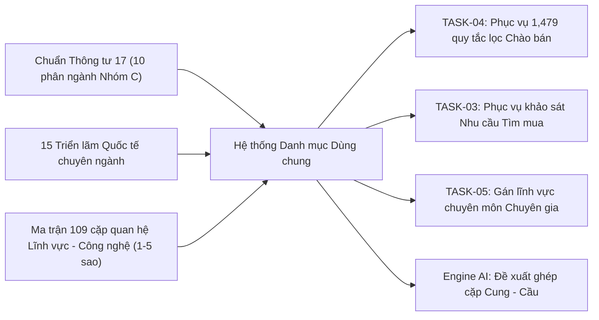

# TASK-06: Thiết Kế Cơ Sở — Hệ Thống Danh Mục Ngành & Ma Trận Lĩnh Vực - Công Nghệ

> **Mã phân hệ**: `TASK-06` *(Master Data Trung Tâm)*  
> **Sheet nguồn**: `Ngành` (29 dòng) và `Ma trận Lĩnh vực-Công nghệ` (132 dòng) trong [`../DỮ_LIỆU_GỐC_MASTER/Nacentwin_20260924_bo_loc_da_sua.xlsx`](../DỮ_LIỆU_GỐC_MASTER/Nacentwin_20260924_bo_loc_da_sua.xlsx)  
> **Tài liệu trích xuất MD**: [`../DỮ_LIỆU_GỐC_MASTER/Nacentwin_20260924_bo_loc_da_sua.md#sheet-9-ngnh`](../DỮ_LIỆU_GỐC_MASTER/Nacentwin_20260924_bo_loc_da_sua.md#sheet-9-ngnh)  
> **Wireframe 1 (Admin Console)**: [`wireframe_quan_tri_danh_muc_nganh.html`](wireframe_quan_tri_danh_muc_nganh.html) *(5 Tabs: 18 Ngành, TT17 Nhóm C, Ma Trận 2D Heatmap Grid tương tác, Cây Taxonomy 3 Tầng LV-CN-NC, 15 Triển lãm)*  
> **Wireframe 2 (Public Explorer)**: [`wireframe_kham_pha_danh_muc_va_ma_tran.html`](wireframe_kham_pha_danh_muc_va_ma_tran.html) *(Bản Đồ Khám Phá Công Nghệ & Nguồn Cung Dành Cho Doanh Nghiệp & Công Chúng)*  
> **Trạng thái**: 🟢 100% Basic Design Hoàn Hảo (Bao phủ cả Admin Console và Public Surface)  
> **Quản lý tổng thể**: [`../DANH_SACH_TIEN_DO_BASIC_DESIGN.md`](../DANH_SACH_TIEN_DO_BASIC_DESIGN.md)

---

## 1. MỤC TIÊU & PHẠM VI DỮ LIỆU CHUẨN (MASTER DATA)

Phân hệ quản trị **Dữ liệu danh mục nền tảng (Master/Reference Data)** phục vụ chuẩn hóa dữ liệu cho toàn bộ các module khác (Chào bán, Tìm mua, Bộ lọc, Matching engine):
1. **Danh mục 15 Hội chợ / Triển lãm quốc tế chuyên ngành**:
   - Viễn thông CNTT, In ấn bao bì, Nhựa cao su, Logistics, Thủy sản, Thực phẩm, Hóa chất, Dệt may, PCCC, Growtech, Thang máy...
2. **Bảng chuẩn hóa ngành chế biến chế tạo theo Thông tư 17 (Nhóm C)**:
   - C.10: Sản xuất chế biến thực phẩm
   - C.11: Sản xuất đồ uống
   - C.13: Dệt
   - C.16: Chế biến gỗ và sản xuất sản phẩm từ gỗ
   - C.20: Sản xuất hóa chất
   - C.21: Sản xuất thuốc, hóa dược và dược liệu
   - C.26: Sản xuất sản phẩm điện tử, máy vi tính và quang học
   - C.27: Sản xuất thiết bị điện
   - C.31: Sản xuất giường, tủ, bàn, ghế
   - C.32: Công nghiệp chế biến, chế tạo khác
3. **Ma trận tương thích 109 cặp quan hệ giữa 15 Lĩnh vực và 18 Nhóm công nghệ**:
   - Ánh xạ mã lĩnh vực (`LV01` - `LV15`) sang mã công nghệ (`CN01` - `CN18`).
   - Mức độ phù hợp được lượng hóa theo thang điểm từ **1 đến 5 sao**.
   - Cung cấp dữ liệu gốc làm trọng số cho thuật toán gợi ý (Recommendation/Matching Engine).

---

## 2. SƠ ĐỒ ÁNH XẠ MASTER DATA TRONG HỆ SINH THÁI



---

## 3. DỮ LIỆU ĐẶC TẢ GỐC PHẦN 1: DANH MỤC TRIỂN LÃM & CHUẨN THÔNG TƯ 17 (`NGÀNH`)

| Triển lãm Viễn thông, Công nghệ Thông tin và Truyền thông. |  |  |  |  |  |  |
| :--- | :--- | :--- | :--- | :--- | :--- | :--- |
| Triển lãm Công nghiệp In ấn & Bao bì tại Hà Nội 2026 |  |  |  |  |  |  |
| Triển lãm Quốc tế Ngành nhựa và Cao su tại Hà Nội 2026 |  |  |  |  |  |  |
| Triển lãm quốc tế Logistics Việt Nam 2026 |  |  |  |  |  |  |
| Triển lãm Quốc tế Thủy sản Việt Nam 2026 |  |  |  |  |  |  |
| Triển lãm Công nghệ Chế biến Thực phẩm Việt Nam 2026 |  |  |  |  |  |  |
| Triển lãm Quốc tế Công nghiệp Hoá chất lần thứ 22 tại Việt Nam |  |  |  |  |  |  |
| Triển lãm Quốc tế Thực phẩm và Đồ uống 2026 tại Hà Nội. |  |  |  |  |  |  |
| Triển lãm Máy móc, Thiết bị, Nguyên phụ liệu Dệt may 2026 |  |  |  |  |  |  |
| Triển lãm Nội thất & Xây dựng Việt Nam 2026 |  |  |  |  |  |  |
| Fire Safety & Rescue – PCCC & Cứu nạn. |  |  |  |  |  |  |
| Textile – Dệt may & Máy móc. |  |  |  |  |  |  |
| Food & Beverage – Thực phẩm & Đồ uống. |  |  |  |  |  |  |
| Growtech – Nông nghiệp công nghệ cao. |  |  |  |  |  |  |
| Triển lãm Thang máy – Giải pháp tòa nhà. |  |  |  |  |  |  |
|  |  |  |  |  |  |  |
|  |  |  |  |  |  |  |
|  | Nhóm C Công nghiệp chế biến chế tạo |  |  |  |  |  |
| 1 | Sản xuất chế biến thực phẩm | C.10 | 200 | 0.07 | 0.75 | 150 |
| 2 | Sản xuất đồ uống | C.11 | 200 | 0.05 | 0.2 | 150 |
| 3 | Dệt | C.13 | 200 | 0.05 | 0.4 | 75 |
| 4 | Chế biến gỗ và sản xuất sản phẩm từ gỗ, tre, nứa (trừ giường, tủ, bàn, ghế); sản xuất sản phẩm từ rơm, rạ và vật liệu tết bện | C.16 | 150 | 0.05 | 0.65 | 100 |
| 5 | Sản xuất hóa chất và sản phẩm hóa chất | C.20 | 250 | 0.1 | 0.55 | 150 |
| 6 | Sản xuất thuốc, hóa dược và dược liệu | C.21 | 300 | 0.07 | 0.6 | 200 |
| 7 | Sản xuất sản phẩm điện tử, máy vi tính và sản phẩm quang học | C.26 | 300 | 0.05 | 0.45 | 100 |
| 8 | Sản xuất thiết bị điện | C.27 | 300 | 0.05 | 0.45 | 100 |
| 9 | Sản xuất giường, tủ, bàn, ghế | C.31 | 150 | 0.05 | 0.55 | 100 |
| 10 | Công nghiệp chế biến, chế tạo khác | C.32 | 200 | 0.07 | 0.55 | 150 |
| Phụ lục II Chuẩn nhóm ngành Thông tư 17 |  |  |  |  |  |  |


---

## 4. DỮ LIỆU ĐẶC TẢ GỐC PHẦN 2: MA TRẬN 109 CẶP LĨNH VỰC - CÔNG NGHỆ (`MA TRẬN LĨNH VỰC-CÔNG NGHỆ`)

| Mã lĩnh vực | Lĩnh vực | Mã công nghệ | Nhóm công nghệ | Mức phù hợp 1-5 |
| :--- | :--- | :--- | :--- | :--- |
| LV01 | Nông nghiệp | CN05 | IoT và cảm biến | 5 |
| LV01 | Nông nghiệp | CN06 | Trí tuệ nhân tạo – AI | 5 |
| LV01 | Nông nghiệp | CN13 | GIS – bản đồ số | 5 |
| LV01 | Nông nghiệp | CN14 | UAV – drone | 5 |
| LV01 | Nông nghiệp | CN17 | Công nghệ sau thu hoạch | 5 |
| LV01 | Nông nghiệp | CN18 | Công nghệ bảo quản | 5 |
| LV01 | Nông nghiệp | CN25 | Năng lượng tái tạo | 5 |
| LV01 | Nông nghiệp | CN28 | Công nghệ xanh | 5 |
| LV05 | Chế biến thực phẩm – đồ uống | CN02 | Tự động hóa | 5 |
| LV05 | Chế biến thực phẩm – đồ uống | CN05 | IoT và cảm biến | 5 |
| LV05 | Chế biến thực phẩm – đồ uống | CN12 | Truy xuất nguồn gốc | 5 |
| LV05 | Chế biến thực phẩm – đồ uống | CN16 | Công nghệ thực phẩm | 5 |
| LV05 | Chế biến thực phẩm – đồ uống | CN17 | Công nghệ sau thu hoạch | 5 |
| LV05 | Chế biến thực phẩm – đồ uống | CN18 | Công nghệ bảo quản | 5 |
| LV05 | Chế biến thực phẩm – đồ uống | CN27 | Tiết kiệm năng lượng | 5 |
| LV05 | Chế biến thực phẩm – đồ uống | CN30 | Sản xuất sạch hơn | 5 |
| LV07 | Cơ khí – chế tạo – công nghiệp hỗ trợ | CN01 | Cơ khí – chế tạo | 5 |
| LV07 | Cơ khí – chế tạo – công nghiệp hỗ trợ | CN02 | Tự động hóa | 5 |
| LV07 | Cơ khí – chế tạo – công nghiệp hỗ trợ | CN03 | Robot | 5 |
| LV07 | Cơ khí – chế tạo – công nghiệp hỗ trợ | CN04 | Điện – điện tử | 5 |
| LV07 | Cơ khí – chế tạo – công nghiệp hỗ trợ | CN36 | Công nghệ in 3D | 5 |
| LV07 | Cơ khí – chế tạo – công nghiệp hỗ trợ | CN38 | Đo lường – kiểm định | 5 |
| LV08 | Điện – điện tử – tự động hóa | CN02 | Tự động hóa | 5 |
| LV08 | Điện – điện tử – tự động hóa | CN03 | Robot | 5 |
| LV08 | Điện – điện tử – tự động hóa | CN04 | Điện – điện tử | 5 |
| LV08 | Điện – điện tử – tự động hóa | CN05 | IoT và cảm biến | 5 |
| LV08 | Điện – điện tử – tự động hóa | CN06 | Trí tuệ nhân tạo – AI | 5 |
| LV08 | Điện – điện tử – tự động hóa | CN33 | An toàn – an ninh mạng | 5 |
| LV11 | Nước – môi trường – chất thải | CN05 | IoT và cảm biến | 5 |
| LV11 | Nước – môi trường – chất thải | CN22 | Công nghệ môi trường | 5 |
| LV11 | Nước – môi trường – chất thải | CN23 | Xử lý nước | 5 |
| LV11 | Nước – môi trường – chất thải | CN24 | Xử lý chất thải | 5 |
| LV11 | Nước – môi trường – chất thải | CN27 | Tiết kiệm năng lượng | 5 |
| LV11 | Nước – môi trường – chất thải | CN39 | Quan trắc | 5 |
| LV12 | Xây dựng – vật liệu – hạ tầng | CN13 | GIS – bản đồ số | 5 |
| LV12 | Xây dựng – vật liệu – hạ tầng | CN14 | UAV – drone | 5 |
| LV12 | Xây dựng – vật liệu – hạ tầng | CN35 | Công nghệ xây dựng | 5 |
| LV14 | Logistics – vận tải – kho bãi | CN05 | IoT và cảm biến | 5 |
| LV14 | Logistics – vận tải – kho bãi | CN06 | Trí tuệ nhân tạo – AI | 5 |
| LV14 | Logistics – vận tải – kho bãi | CN10 | Thương mại điện tử | 5 |
| LV14 | Logistics – vận tải – kho bãi | CN34 | Công nghệ logistics | 5 |
| LV15 | Du lịch – khách sạn – nhà hàng | CN06 | Trí tuệ nhân tạo – AI | 5 |
| LV15 | Du lịch – khách sạn – nhà hàng | CN10 | Thương mại điện tử | 5 |
| LV15 | Du lịch – khách sạn – nhà hàng | CN13 | GIS – bản đồ số | 5 |
| LV15 | Du lịch – khách sạn – nhà hàng | CN32 | Công nghệ giáo dục | 5 |
| LV16 | CNTT – viễn thông – chuyển đổi số | CN06 | Trí tuệ nhân tạo – AI | 5 |
| LV16 | CNTT – viễn thông – chuyển đổi số | CN07 | Dữ liệu lớn – Big Data | 5 |
| LV16 | CNTT – viễn thông – chuyển đổi số | CN08 | Điện toán đám mây | 5 |
| LV16 | CNTT – viễn thông – chuyển đổi số | CN09 | Phần mềm quản trị doanh nghiệp | 5 |
| LV16 | CNTT – viễn thông – chuyển đổi số | CN10 | Thương mại điện tử | 5 |
| LV16 | CNTT – viễn thông – chuyển đổi số | CN11 | Blockchain | 5 |
| LV16 | CNTT – viễn thông – chuyển đổi số | CN13 | GIS – bản đồ số | 5 |
| LV16 | CNTT – viễn thông – chuyển đổi số | CN33 | An toàn – an ninh mạng | 5 |
| LV17 | Khoa học – công nghệ – đổi mới sáng tạo | CN06 | Trí tuệ nhân tạo – AI | 5 |
| LV17 | Khoa học – công nghệ – đổi mới sáng tạo | CN07 | Dữ liệu lớn – Big Data | 5 |
| LV17 | Khoa học – công nghệ – đổi mới sáng tạo | CN15 | Công nghệ sinh học | 5 |
| LV17 | Khoa học – công nghệ – đổi mới sáng tạo | CN19 | Vật liệu mới | 5 |
| LV17 | Khoa học – công nghệ – đổi mới sáng tạo | CN20 | Công nghệ nano | 5 |
| LV17 | Khoa học – công nghệ – đổi mới sáng tạo | CN28 | Công nghệ xanh | 5 |
|  |  |  |  |  |
|  |  |  |  |  |
|  |  |  |  |  |
| ĐỐI CHIẾU DỰ KIẾN LV – DM (GIỮ NGUYÊN MÃ LV) |  |  |  |  |
| Đã chốt hướng: giữ mã LV và lập đối chiếu, dùng thống nhất cho mua/bán. Từng cặp dưới đây |  |  |  |  |
| là đề xuất BA, chưa được duyệt riêng. |  |  |  |  |
| Nguồn LV: ma trận phía trên, chỉ có 10 mã với tên. Nguồn DM: Phân chia nhóm ngành nghề và |  |  |  |  |
| nhu cầu công nghệ doanh nghiệp.docx, mục 4–16. |  |  |  |  |
| Đây là đối chiếu phạm vi nghiệp vụ, không phải xác nhận mã ngành pháp lý. Không ánh xạ tự |  |  |  |  |
| động mọi hồ sơ theo tên LV. |  |  |  |  |
| LV01 — Nông nghiệp → DM01 |  |  |  |  |
| Đề xuất BA: Nông nghiệp là một phần của nhóm nông nghiệp–lâm nghiệp–thủy sản. |  |  |  |  |
|  |  |  |  |  |
| LV02 — Chưa tìm thấy tên trong các nguồn đã kiểm tra; chưa đề xuất DM. Không tự đặt tên. |  |  |  |  |
|  |  |  |  |  |
| LV03 — Chưa tìm thấy tên trong các nguồn đã kiểm tra; chưa đề xuất DM. Không tự đặt tên. |  |  |  |  |
|  |  |  |  |  |
| LV04 — Chưa tìm thấy tên trong các nguồn đã kiểm tra; chưa đề xuất DM. Không tự đặt tên. |  |  |  |  |
|  |  |  |  |  |
| LV05 — Chế biến thực phẩm – đồ uống → DM03 |  |  |  |  |
| Đề xuất BA: Chế biến thực phẩm–đồ uống thuộc phạm vi chế biến, chế tạo trong tài liệu PN. |  |  |  |  |
|  |  |  |  |  |
| LV06 — Chưa tìm thấy tên trong các nguồn đã kiểm tra; chưa đề xuất DM. Không tự đặt tên. |  |  |  |  |
|  |  |  |  |  |
| LV07 — Cơ khí – chế tạo – công nghiệp hỗ trợ → DM03 |  |  |  |  |
| Đề xuất BA: Cơ khí, chế tạo, công nghiệp hỗ trợ được nêu trong DM03. |  |  |  |  |
|  |  |  |  |  |
| LV08 — Điện – điện tử – tự động hóa → DM03; cân nhắc DM04/DM10 |  |  |  |  |
| Đề xuất BA: Thiết bị điện/điện tử: DM03; ứng dụng năng lượng: DM04; dịch vụ số: DM10. Cần |  |  |  |  |
| xét hoạt động cụ thể. |  |  |  |  |
|  |  |  |  |  |
| LV09 — Chưa tìm thấy tên trong các nguồn đã kiểm tra; chưa đề xuất DM. Không tự đặt tên. |  |  |  |  |
|  |  |  |  |  |
| LV10 — Chưa tìm thấy tên trong các nguồn đã kiểm tra; chưa đề xuất DM. Không tự đặt tên. |  |  |  |  |
|  |  |  |  |  |
| LV11 — Nước – môi trường – chất thải → DM05 |  |  |  |  |
| Đề xuất BA: Nước, môi trường, chất thải tương ứng phạm vi nước–môi trường–kinh tế tuần |  |  |  |  |
| hoàn. |  |  |  |  |
|  |  |  |  |  |
| LV12 — Xây dựng – vật liệu – hạ tầng → DM06; cân nhắc DM03 |  |  |  |  |
| Đề xuất BA: Xây dựng/hạ tầng: DM06; sản xuất vật liệu có thể thuộc DM03. Cần phân biệt |  |  |  |  |
| hoạt động. |  |  |  |  |
|  |  |  |  |  |
| LV13 — Chưa tìm thấy tên trong các nguồn đã kiểm tra; chưa đề xuất DM. Không tự đặt tên. |  |  |  |  |
|  |  |  |  |  |
| LV14 — Logistics – vận tải – kho bãi → DM08 |  |  |  |  |
| Đề xuất BA: Logistics, vận tải, kho bãi tương ứng DM08. |  |  |  |  |
|  |  |  |  |  |
| LV15 — Du lịch – khách sạn – nhà hàng → DM09 |  |  |  |  |
| Đề xuất BA: Du lịch, khách sạn, nhà hàng là một phần nhóm du lịch–lưu trú–ăn uống–văn |  |  |  |  |
| hóa–giải trí. |  |  |  |  |
|  |  |  |  |  |
| LV16 — CNTT – viễn thông – chuyển đổi số → DM10 |  |  |  |  |
| Đề xuất BA: CNTT, viễn thông, dịch vụ số tương ứng chính DM10; chuyển đổi số ứng dụng có |  |  |  |  |
| thể ở mọi lĩnh vực. |  |  |  |  |
|  |  |  |  |  |
| LV17 — Khoa học – công nghệ – đổi mới sáng tạo → DM11 |  |  |  |  |
| Đề xuất BA: Khoa học–công nghệ và dịch vụ chuyên môn nằm trong DM11; đổi mới sáng tạo có |  |  |  |  |
| tính liên ngành. |  |  |  |  |
|  |  |  |  |  |
| LV18 — Chưa tìm thấy tên trong các nguồn đã kiểm tra; chưa đề xuất DM. Không tự đặt tên. |  |  |  |  |
|  |  |  |  |  |
| DM02, DM04, DM07, DM12 chưa có LV tương ứng rõ ràng trong 10 mã đã tìm thấy; chưa kết luận |  |  |  |  |
| thiếu phạm vi vì còn 8 LV chưa có tên. |  |  |  |  |
| Cần bổ sung danh mục gốc: LV02, LV03, LV04, LV06, LV09, LV10, LV13, LV18. Sau đó rà cặp |  |  |  |  |
| nhiều-nghĩa và xác nhận từng ánh xạ. |  |  |  |  |
|  |  |  |  |  |
|  |  |  |  |  |
| Đã chốt: tạm dùng 10 lĩnh vực có nguồn cho basic mua/bán, giữ nguyên mã LV. |  |  |  |  |
| LV01, LV05, LV07, LV08, LV11, LV12, LV14, LV15, LV16, LV17. |  |  |  |  |
| LV02, LV03, LV04, LV06, LV09, LV10, LV13, LV18: bổ sung sau; chưa có tên để chọn. |  |  |  |  |
| Đối chiếu LV–DM vẫn là đề xuất, chưa thay thế danh mục LV. |  |  |  |  |


---

## 5. BỐ CỤC GIAO DIỆN QUẢN TRỊ DANH MỤC NGÀNH (UI WIREFRAME SPECIFICATION)

### 5.1. Bảng Quản Trị Danh Mục Ngành & Ma Trận TT17 (`UI-MASTER-SECTOR-001`)

```text
+---------------------------------------------------------------------------------------------------+
|                        QUẢN TRỊ DANH MỤC NGÀNH & MA TRẬN TT17 (MASTER DATA)                       |
+---------------------------------------------------------------------------------------------------+
|  [#01] Thống kê: [18 Ngành Trọng Điểm] | [10 Phân Ngành TT17] | [109 Cặp Quan Hệ LV-CN] | [15 Expo] |
|                                                                                                   |
|  [#02] Tabs Điều Hướng:                                                                           |
|  [ [✓] 18 Nhóm Ngành Trọng Điểm ] [ 10 Phân Ngành TT17 ] [ Ma Trận 109 Cặp LV-CN ] [ 15 Triển Lãm ]|
|                                                                                                   |
|  [#03] Toolbar: [ Tìm kiếm ngành... ]  [ Lọc Trạng thái [v] ]  [ + Thêm Ngành Mới ]               |
|  +--------+------------------------------------+--------------------------+-------------+---------+ |
|  | Mã     | Tên Nhóm Ngành                     | Phân Nhóm TT17           | Trạng Thái  | Thao Tác| |
|  +--------+------------------------------------+--------------------------+-------------+---------+ |
|  | SEC-01 | Chế biến Thực phẩm & Đồ uống       | C.10 (Thực phẩm), C.11   | Hoạt Động   | [Sửa]   | |
|  | SEC-02 | Dệt may & Da giày                  | C.13 (Dệt)               | Hoạt Động   | [Sửa]   | |
|  | SEC-03 | Chế biến Gỗ & Sản phẩm từ gỗ       | C.16, C.31 (Nội thất)    | Hoạt Động   | [Sửa]   | |
|  | SEC-04 | Hóa chất & Sản phẩm hóa chất       | C.20 (Hóa chất)          | Hoạt Động   | [Sửa]   | |
|  | SEC-05 | Dược phẩm & Thiết bị y tế          | C.21 (Thuốc, dược liệu)  | Hoạt Động   | [Sửa]   | |
|  | SEC-06 | Điện tử & Thiết bị viễn thông      | C.26 (Điện tử, quang học)| Hoạt Động   | [Sửa]   | |
|  | SEC-07 | Cơ khí chế tạo & Tự động hóa       | C.32 (Chế tạo khác)      | Hoạt Động   | [Sửa]   | |
|  +--------+------------------------------------+--------------------------+-------------+---------+ |
|                                                                                                   |
|  [#04] Modal Thêm / Chỉnh Sửa Ngành:                                                              |
|  - Mã Ngành (Code): [ SEC-AI ]                                                                    |
|  - Tên Ngành: [ Trí tuệ nhân tạo & Robot công nghiệp ]                                            |
|  - Ánh xạ Nhóm C TT17: [ C.26 Sản xuất sản phẩm điện tử, máy tính [v] ]                          |
|  - Trạng thái: [ Hoạt động [v] ]                                                                  |
|  [ Lưu Danh Mục ]  [ Hủy Bỏ ]                                                                     |
+---------------------------------------------------------------------------------------------------+
```

---

## 6. TIÊU CHÍ NGHIỆM THU (DEFINITION OF DONE - DoD)

- [x] Khớp 100% dữ liệu gốc từ Sheet `Ngành` (29 dòng) và `Ma trận Lĩnh vực-Công nghệ` (132 dòng).
- [x] Chuẩn hóa mã ngành theo chuẩn Thông tư 17 (10 phân ngành nhóm C) và 18 nhóm ngành bộ lọc.
- [x] Lưu giữ nguyên vẹn bảng ma trận 109 quan hệ và trọng số 1-5 sao làm Master Data cho matching engine.
- [x] Thiết kế Wireframe HTML tương tác hoàn chỉnh: [`wireframe_quan_tri_danh_muc_nganh.html`](wireframe_quan_tri_danh_muc_nganh.html).
- [x] Cập nhật bảng theo dõi tổng thể [`DANH_SACH_TIEN_DO_BASIC_DESIGN.md`](../DANH_SACH_TIEN_DO_BASIC_DESIGN.md).

