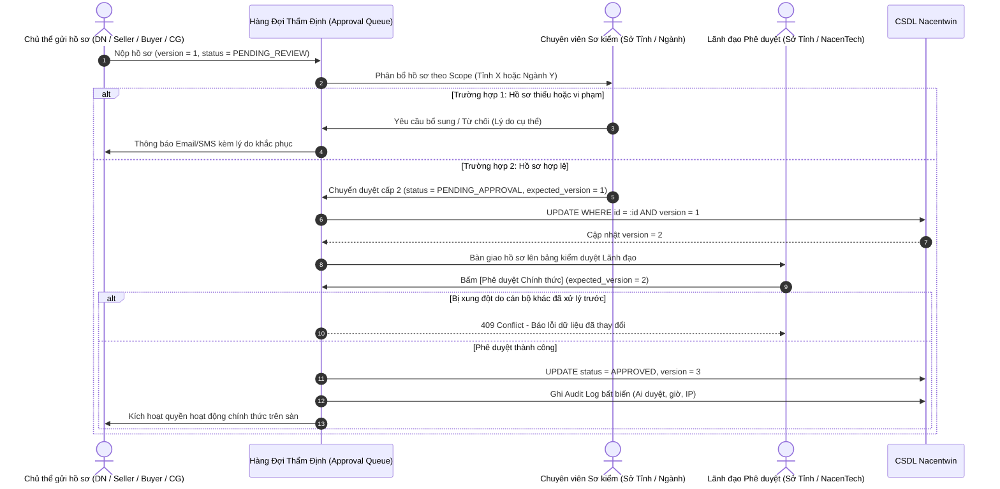
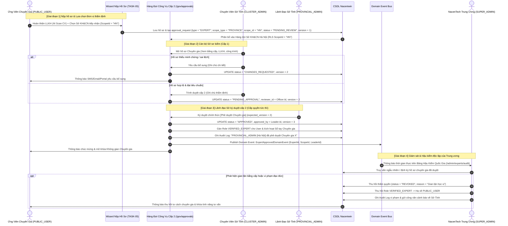
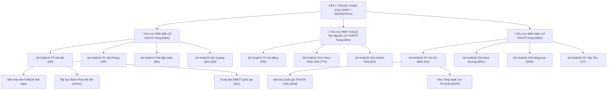
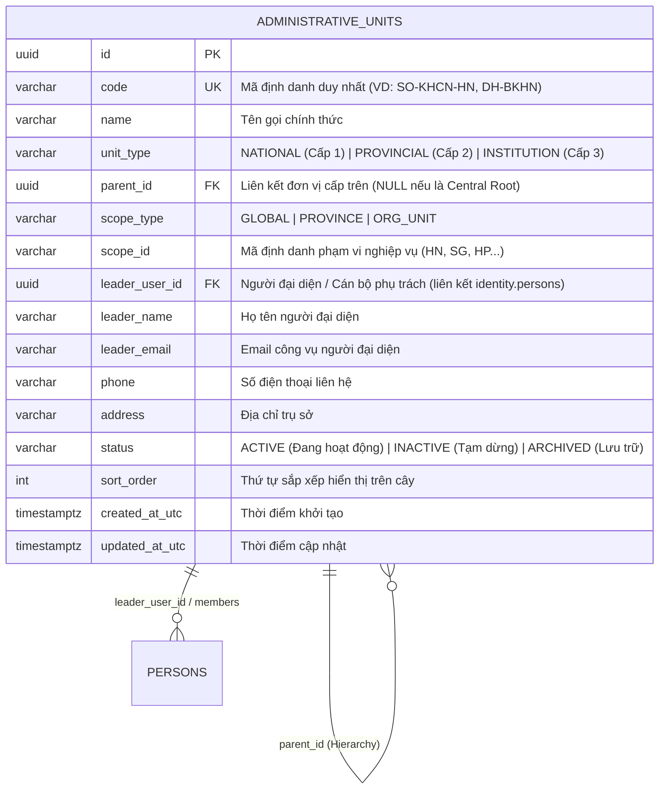

# TASK-07: Thiết Kế Cơ Sở — Phân Quyền & Năng Lực Quản Trị Hệ Thống (Admin)

> **Mã phân hệ**: `TASK-07`  
> **Sheet nguồn**: `Admin` (6 dòng dữ liệu, 2 cột) trong [`../DỮ_LIỆU_GỐC_MASTER/Nacentwin_20260924_bo_loc_da_sua.xlsx`](../DỮ_LIỆU_GỐC_MASTER/Nacentwin_20260924_bo_loc_da_sua.xlsx)  
> **Tài liệu trích xuất MD**: [`../DỮ_LIỆU_GỐC_MASTER/Nacentwin_20260924_bo_loc_da_sua.md#sheet-3-admin`](../DỮ_LIỆU_GỐC_MASTER/Nacentwin_20260924_bo_loc_da_sua.md#sheet-3-admin)  
> **Tài liệu Review HTML trực quan**: [`BANG_PHAN_QUYEN_VA_ROLE_HE_THONG.html`](BANG_PHAN_QUYEN_VA_ROLE_HE_THONG.html)  
> **Bộ 4 Wireframe Quản Trị & Thẩm Định Phân Cấp (Admin & Gov Console)**:
> - Quản lý vai trò & Cây thư mục 34 tỉnh: [`wireframe_quan_ly_vai_tro_va_cay_34_tinh.html`](wireframe_quan_ly_vai_tro_va_cay_34_tinh.html)
> - Trung tâm kiểm duyệt hồ sơ tập trung (Maker-Checker & Sở Cấp 2): [`wireframe_trung_tam_kiem_duyet_admin_va_gov.html`](wireframe_trung_tam_kiem_duyet_admin_va_gov.html)
> - Bàn làm việc Quản trị Người dùng (10 Roles 3D Scoped RBAC & Audit Log): [`wireframe_quan_ly_nguoi_dung_admin.html`](wireframe_quan_ly_nguoi_dung_admin.html)
> - Quản trị Tenant DN & Nhật ký thẩm định Sở: [`wireframe_tenant_quan_tri_dn.html`](wireframe_tenant_quan_tri_dn.html)
> **Trạng thái**: 🟢 APPROVED BY PO (Basic Design v2.6 - Giải Pháp Phân Cấp Quản Lý & Phê Duyệt Cấp 2 [Sở Tỉnh / Viện Liên Kết] & Trọn bộ Wireframe Admin/Gov)  
> **Quản lý tổng thể**: [`../DANH_SACH_TIEN_DO_BASIC_DESIGN.md`](../DANH_SACH_TIEN_DO_BASIC_DESIGN.md)

> **Nguồn chân lý PO cho Identity/RBAC (29/09/2026 & v2.6 Update):** đây là mô hình chuẩn **10 role / 4 tầng / 3D scope**. Các role lưu trong DB/JWT là `SUPER_ADMIN`, `OPERATOR_ADMIN`, `PROVINCIAL_ADMIN`, `SECTOR_ADMIN`, `CLUSTER_ADMIN`, `SELLER`, `BUYER`, `INNOVATION_ENTITY`, `VERIFIED_EXPERT`, `PUBLIC_USER`. `GUEST` chỉ là persona chưa xác thực; `USER`, `ADMIN`, `EXPERT`, `SHOP_OWNER` là giá trị/nhãn tương thích, không mở rộng danh mục 10 role. Detail spec bắt buộc đồng bộ tại [`SourceCode/specs/TASK-00_PLATFORM_FOUNDATION_VA_COMMON/spec.md`](../../../SourceCode/specs/TASK-00_PLATFORM_FOUNDATION_VA_COMMON/spec.md).

---

## 1. MỤC TIÊU & PHẠM VI NGHIỆP VỤ

Phân hệ quản trị tập trung và phân cấp (Hierarchical Admin & Governance) vận hành toàn bộ nền tảng Nacentwin. Thiết lập cơ chế kiểm soát chất lượng, xác thực tính pháp lý và phân quyền vận hành hệ sinh thái đa cấp độ: Trung ương (NacenTech / Cục ĐMST), Địa phương (63 Sở KH&CN tỉnh/thành), Chuyên ngành (18 ngành công nghiệp trọng điểm TT17), và Cơ sở liên kết (Viện/Trường/Doanh nghiệp).

### 1.1. 5 Quyền Năng Hạt Nhân Của Quản Trị Viên (Trích xuất 100% từ Sheet `Admin`):

| STT | Quyền Hạt Nhân (Sheet Admin) | Phạm Vi Thẩm Định | Cơ Chế Phân Cấp Thực Thi | Đối Tượng Thụ Hưởng |
| :---: | :--- | :--- | :--- | :--- |
| **1** | **Phê duyệt tài khoản đăng ký** | Xác thực danh tính người dùng mới (Cá nhân, Doanh nghiệp ĐMST, Viện/Trường, HTX). | Phân cấp theo địa bàn: Cán bộ Sở tỉnh duyệt tài khoản thuộc tỉnh; NacenTech duyệt toàn quốc. | Người dùng mới (`PUBLIC_USER` $\rightarrow$ `BUYER`/`SELLER`) |
| **2** | **Phê duyệt hồ sơ shop** | Kiểm tra năng lực pháp lý, giấy phép kinh doanh, nguồn gốc gian hàng công nghệ và tư cách nhà cung ứng. | Phân cấp theo địa bàn (Sở Tỉnh thẩm định GPKD) và theo chuyên ngành (18 ngành TT17). | Nhà cung ứng (`SELLER`) |
| **3** | **Phê duyệt hồ sơ chuyên gia** | Đối soát văn bằng, học hàm, học vị, công trình khoa học của chuyên gia KH&CN theo chuẩn Bộ KH&CN. | **Phân cấp triệt để cho Cấp 2**: Cán bộ Sở Tỉnh (`PROVINCIAL_ADMIN` / `CLUSTER_ADMIN`) trực tiếp thẩm định và phê duyệt cho Chuyên gia thuộc địa bàn tỉnh mình (`ScopeId = Mã Tỉnh / OrgUnitId`). NacenTech Trung ương quản lý chuyên gia toàn quốc và hậu kiểm. | Chuyên gia KH&CN (`VERIFIED_EXPERT`) |
| **4** | **Phê duyệt hồ sơ nhu cầu** | Kiểm duyệt bài toán công nghệ đăng tuyển từ Bên Mua, bảo đảm không vi phạm quy định, bảo vệ bí mật công nghệ. | Trưởng ngành công nghiệp (18 ngành TT17) & Cán bộ Sở tỉnh duyệt bài toán trên địa bàn. | Bên Mua công nghệ (`BUYER`) |
| **5** | **Phân quyền cơ sở liên kết** | Quản lý cây đơn vị tổ chức, các đối tác, viện trường, sở KH&CN 63 tỉnh/thành và cấp quyền liên thông dữ liệu. | Dành riêng cho Super Admin NacenTech (Cấp Trung ương) khởi tạo và ủy quyền phân cấp. | 63 Sở KH&CN, Viện/Trường liên kết |

---

### 1.2. Giải Pháp Đột Phá v2.6: Phân Cấp Quản Lý & Phê Duyệt Chuyên Gia Cho Cấp 2 (Sở Tỉnh / Viện Liên Kết)

#### Bối Cảnh & Nỗi Đau Thực Tế (User Pain Points):
- **Nghẽn cổ chai Trung ương**: Trước v2.6, toàn bộ hồ sơ chuyên gia KH&CN nộp từ 63 tỉnh/thành đều đổ dồn về `SUPER_ADMIN` tại Trung ương. Điều này gây quá tải kiểm duyệt, kéo dài thời gian phản hồi (chậm trễ SLA), đi ngược lại tinh thần phân cấp công vụ.
- **Thiếu kiểm chứng thực địa**: Cơ quan Trung ương khó xác minh nhanh chóng tính xác thực về đơn vị công tác, uy tín thực địa và các hoạt động nghiên cứu chuyển giao công nghệ tại cơ sở của chuyên gia.

#### Giải Pháp Phân Cấp Toàn Diện:
1. **Phân quyền trực tiếp cho Cấp 2**:
   - Cán bộ Sở KH&CN Tỉnh (`PROVINCIAL_ADMIN` / `CLUSTER_ADMIN`) hoặc Quản trị Viện/Trường (`CLUSTER_ADMIN` thuộc `ORG_UNIT`) được trao toàn quyền thẩm định và phê duyệt hồ sơ chuyên gia thuộc địa bàn/đơn vị của mình (`ScopeType = PROVINCE / ORG_UNIT`, `ScopeId`).
   - Phân cấp theo nguyên tắc Maker - Checker:
     + **Chuyên viên Sở Tỉnh / Viện (`CLUSTER_ADMIN`)**: Tiếp nhận hồ sơ, sơ kiểm văn bằng, đối soát AI Scan LLKH, yêu cầu bổ sung nếu thiếu.
     + **Lãnh đạo Sở Tỉnh / Viện (`PROVINCIAL_ADMIN`)**: Ký duyệt cấp 2 (Final Approval), **trực tiếp cấp vai trò `VERIFIED_EXPERT`** có hiệu lực ngay trên toàn hệ thống mà không cần chờ Trung ương duyệt trước.
2. **Cơ Chế Hậu Kiểm (Post-Audit Surveillance) Của NacenTech Trung ương**:
   - `SUPER_ADMIN` và `OPERATOR_ADMIN` đóng vai trò quản lý danh bạ chuyên gia toàn quốc và giám sát hậu kiểm:
     + Nhận thông báo thời gian thực (`Domain Event: ExpertApprovedDomainEvent`) khi có chuyên gia được cấp quyền tại các tỉnh.
     + Thực hiện hậu kiểm ngẫu nhiên hoặc theo chuyên đề.
     + Giữ quyền tối cao **Thu hồi vai trò chuyên gia (`REVOKE_EXPERT`)** và đình chỉ tài khoản nếu phát hiện gian lận hồ sơ hoặc vi phạm quy chế.

---

## 2. MA TRẬN 10 ROLES & MÔ HÌNH PHÂN QUYỀN 3D SCOPED RBAC

Hệ thống thiết lập cơ chế phân quyền 3 chiều (**Role + ScopeType + ScopeId**) giải quyết triệt để bài toán phân cấp quản trị đa tầng, tránh tình trạng NacenTech Trung ương bị quá tải kiểm duyệt:

```text
       ┌────────────────────────────────────────────────────────┐
       │             3D SCOPED RBAC ARCHITECTURE                │
       └────────────────────────────────────────────────────────┘
                   │                       │
      [1. Platform Role]            [2. Scope Dimension]
      - SUPER_ADMIN                 - GLOBAL   : Toàn quốc (NacenTech)
      - OPERATOR_ADMIN              - PROVINCE : 63 Tỉnh/Thành phố
      - PROVINCIAL_ADMIN            - SECTOR   : 18 Ngành công nghiệp TT17
      - CLUSTER_ADMIN               - ORG_UNIT : Viện, Trường, Doanh nghiệp
      - SECTOR_ADMIN                └───────────────────────────
      - SELLER                                     │
      - BUYER                                      ▼
      - INNOVATION_ENTITY           [3. Scope Identifier (ScopeId)]
      - VERIFIED_EXPERT             Mã Tỉnh (VD: "HN", "SG"),
      - PUBLIC_USER                 Mã Ngành (VD: "CNTT", "COKHI"),
                                    hoặc OrgUnitId (UUID)
```

### 2.1. Chi tiết 10 Roles và Phạm vi Thẩm quyền Kỹ thuật:

| Tầng Quản Trị | Mã Role Kỹ Thuật (JWT / DB) | Tên Vai Trò Nghiệp Vụ | Phạm Vi Quản Lý (Scope) | Thẩm Quyền Phê Duyệt & Vận Hành Cốt Lõi |
| :--- | :--- | :--- | :---: | :--- |
| **Tầng 1: Trung Ương** | `SUPER_ADMIN` | Quản trị Hệ thống Cấp cao | `GLOBAL` | Toàn quyền cấu hình hệ thống, khởi tạo Cây 63 tỉnh/thành, phân quyền Cấp 2, hậu kiểm toàn quốc và thu hồi thẩm quyền khi có vi phạm. |
| | `OPERATOR_ADMIN` | Quản trị Vận hành NacenTech | `GLOBAL` | Duyệt chéo toàn sàn, hòa giải khiếu nại, giám sát chất lượng hồ sơ, hỗ trợ hậu kiểm danh bạ chuyên gia toàn quốc. |
| **Tầng 2: Địa Phương (Sở KH&CN Tỉnh)** | `PROVINCIAL_ADMIN` | Lãnh đạo Sở KH&CN Tỉnh / Cụm | `PROVINCE` (Mã Tỉnh) | **Ký duyệt cấp 2 (Final Approval)**: Phê duyệt hồ sơ Doanh nghiệp, Shop, Nhu cầu VÀ **trực tiếp phê duyệt cấp vai trò `VERIFIED_EXPERT`** cho Chuyên gia thuộc địa bàn tỉnh mình. Quản lý cán bộ Sở. |
| | `CLUSTER_ADMIN` | Chuyên viên Thẩm định Sở / Viện | `PROVINCE` hoặc `ORG_UNIT` | **Sơ kiểm cấp 1 (Maker)**: Tiếp nhận, đối soát hồ sơ pháp lý, ĐKKD và **thẩm định hồ sơ Chuyên gia địa phương** (văn bằng, học hàm/học vị, AI Scan CV), yêu cầu bổ sung hoặc trình Lãnh đạo ký duyệt. |
| **Tầng 3: Chuyên Ngành (18 Ngành TT17)** | `SECTOR_ADMIN` | Quản trị Ngành Công nghiệp | `SECTOR` (Mã Ngành) | Phê duyệt bài toán công nghệ, thẩm định phân loại công nghệ theo 18 ngành TT17, phối hợp đánh giá hồ sơ chuyên gia thuộc ngành. |
| **Tầng 4: Chủ Thể Hệ Sinh Thái** | `INNOVATION_ENTITY` | Tổ chức / Doanh nghiệp ĐMST | `ORG_UNIT` (MST / Mã Viện) | Quản lý hồ sơ pháp nhân ĐMST, Viện/Trường liên kết, quản lý chuyên gia thuộc viện/trường trực thuộc. |
| | `SELLER` | Nhà Cung Ứng Công Nghệ | `PERSONAL` / `ORG_UNIT` | Tạo lập gian hàng công nghệ, đăng tải công nghệ chào bán (Lớp 1-4). |
| | `BUYER` | Bên Mua / Doanh nghiệp Nhu Cầu | `PERSONAL` / `ORG_UNIT` | Khảo sát nhu cầu công nghệ, đăng bài toán tìm mua, gửi yêu cầu kết nối. |
| | `VERIFIED_EXPERT` | Chuyên gia KH&CN Đã Xác Minh | `PERSONAL` | Tham gia tư vấn công nghệ, phản biện đề tài, tra cứu bài toán từ Sở & DN, nhận đánh giá năng lực từ cộng đồng. |
| | `PUBLIC_USER` | Người Dùng Đại Chúng Đã Định Danh | `PERSONAL` | Tra cứu thông tin mở, nộp hồ sơ nâng hạng lên Seller, Buyer hoặc Chuyên gia KH&CN (`TASK-05`). |

---

### 2.2. Ma Trận Quyền Hạn Chi Tiết Phân Cấp Phê Duyệt Chuyên Gia (3D Scoped Matrix)

Cơ chế phân quyền bảo đảm tính toàn vẹn đa tầng và cô lập ranh giới đa tổ chức (Multi-tenant Data Isolation):

| Hành Động Nghiệp Vụ Chuyên Gia | `PUBLIC_USER` | `CLUSTER_ADMIN` (Sở/Viện) | `PROVINCIAL_ADMIN` (Lãnh đạo Sở) | `OPERATOR_ADMIN` | `SUPER_ADMIN` (Trung ương) |
| :--- | :---: | :---: | :---: | :---: | :---: |
| **Nộp hồ sơ nâng hạng Chuyên gia** | [✓] Chính chủ | [-] | [-] | [-] | [-] |
| **Xem hồ sơ sơ bộ Chuyên gia** | [-] | [✓] Trong ScopeId | [✓] Trong ScopeId | [✓] Toàn quốc | [✓] Toàn quốc |
| **Sơ kiểm hồ sơ (Maker Check)** | [-] | [✓] Trong ScopeId | [✓] Trong ScopeId | [✓] Toàn quốc | [✓] Toàn quốc |
| **Yêu cầu bổ sung hồ sơ** | [-] | [✓] Trong ScopeId | [✓] Trong ScopeId | [✓] Toàn quốc | [✓] Toàn quốc |
| **Ký duyệt cấp 2 (Cấp `VERIFIED_EXPERT`)** | [-] | [-] Không có quyền | **[✓] Trong ScopeId (Ký trực tiếp)** | [✓] Toàn sàn | **[✓] Toàn quyền** |
| **Hậu kiểm hồ sơ chuyên gia đã duyệt** | [-] | [✓] Địa phương | [✓] Địa phương | [✓] Toàn quốc | **[✓] Toàn quyền** |
| **Thu hồi quyền chuyên gia (`Revoke`)** | [-] | [-] | [✓] Địa phương mình | [✓] Hòa giải sàn | **[✓] Toàn quyền tối cao** |
| **Xem Audit Log phê duyệt chuyên gia** | [-] | [✓] Địa phương | [✓] Địa phương | [✓] Toàn quốc | [✓] Toàn quốc |

> **Ràng Buộc Kỹ Thuật Bất Biến**:
> 1. Cán bộ Sở Tỉnh A (`ScopeId = "HN"`) **tuyệt đối không xem được và không thể phê duyệt** hồ sơ Chuyên gia có `ScopeId = "SG"`. Backend API bắt buộc kiểm tra `claims.scope_id == request.scope_id` (HTTP 403 Forbidden).
> 2. `PROVINCIAL_ADMIN` khi ký duyệt cấp 2 sẽ tự động ghi dấu `approved_by = current_user_id`, `approved_by_org = current_scope_id` và kích hoạt chuyển role trong JWT Claim của chuyên gia.

---

## 3. QUY TRÌNH PHÊ DUYỆT PHÂN CẤP KÉP & CHỐNG XUNG ĐỘT (OPTIMISTIC LOCKING)

### 3.1. Quy Trình Phê Duyệt Phân Cấp Khung (Maker - Checker Cơ Sở)

Hệ thống áp dụng quy trình kiểm duyệt 2 vòng (Maker-Checker / Sơ kiểm - Phê duyệt) kết hợp cơ chế kiểm soát đồng thời (Optimistic Locking) chống xung đột khi nhiều cán bộ cùng xử lý:



### 3.2. Quy Trình Phê Duyệt Hồ Sơ Chuyên Gia 3 Cấp (Sở Tỉnh Duyệt Trực Tiếp & Trung Ương Hậu Kiểm)

Quy trình giải quyết triệt để nút thắt cổ chai bằng cách trao quyền phê duyệt tối hậu cho Cấp 2, chuyển vai trò Trung ương sang Hậu kiểm độc lập:



### 3.3. Quy Tắc Nghiệp Vụ Phê Duyệt Bắt Buộc:
1. **Cô lập dữ liệu cấp tỉnh (Row-Level Security - RLS)**: Cán bộ Sở tỉnh A tuyệt đối không xem được hồ sơ nộp về tỉnh B.
2. **Optimistic Locking**: Bắt buộc truyền `expected_version` trong request phê duyệt; nếu bản ghi đã bị thay đổi bởi người khác, hệ thống từ chối giao dịch với mã lỗi HTTP 409.
3. **Bắt buộc nhập lý do từ chối**: Khi từ chối hoặc yêu cầu sửa đổi, chuyên viên bắt buộc nhập lý do chi tiết từ 10 đến 500 ký tự.
4. **Cam kết SLA xử lý**:
   - Duyệt tài khoản cá nhân: Tự động hoặc tối đa **4 giờ làm việc**.
   - Duyệt hồ sơ Shop / Doanh nghiệp: Tối đa **24 giờ làm việc**.
   - Duyệt hồ sơ Chuyên gia Cấp 2: Tối đa **48 giờ làm việc** (Sơ kiểm 24h + Lãnh đạo ký 24h).
   - Hậu kiểm Trung ương: Thực hiện định kỳ hàng tuần hoặc đột xuất khi có khiếu nại.

---

## 4. KIẾN TRÚC CÂY THƯ MỤC 34 TỈNH THÀNH TRỌNG ĐIỂM & ĐƠN VỊ CƠ SỞ

Để thực thi quyền năng số 5 trong Sheet `Admin` (*"Phân quyền cơ sở liên kết"*), hệ thống thiết lập bảng cây phân cấp đơn vị 3 tầng tập trung vào **Mạng lưới 34 Tỉnh/Thành phố Trọng Điểm Đổi Mới Sáng Tạo (Key Innovation Hubs)**:



### Danh Sách 34 Tỉnh/Thành Trọng Điểm Phân Bổ Theo 3 Miền:

| Vùng Địa Lý | Số Lượng | Danh Sách 34 Tỉnh / Thành Phố Trọng Điểm (Kèm Mã Định Danh Scope) |
| :--- | :---: | :--- |
| **Miền Bắc** | **12** | Hà Nội (`HN`), Hải Phòng (`HP`), Quảng Ninh (`QN`), Bắc Ninh (`BN`), Vĩnh Phúc (`VP`), Thái Nguyên (`TN`), Hải Dương (`HD`), Hưng Yên (`HY`), Nam Định (`ND`), Phú Thọ (`PT`), Ninh Bình (`NB`), Bắc Giang (`BG`). |
| **Miền Trung & Tây Nguyên** | **10** | Đà Nẵng (`DN`), Thanh Hóa (`TH`), Nghệ An (`NA`), Thừa Thiên Huế (`TTH`), Quảng Nam (`QNA`), Quảng Ngãi (`QNG`), Bình Định (`BD`), Khánh Hòa (`KH`), Đắk Lắk (`DL`), Lâm Đồng (`LD`). |
| **Miền Nam** | **12** | TP. Hồ Chí Minh (`SG`), Bình Dương (`BDG`), Đồng Nai (`DNA`), Bà Rịa - Vũng Tàu (`BRVT`), Cần Thơ (`CT`), Long An (`LA`), Tiền Giang (`TG`), An Giang (`AG`), Đồng Tháp (`DT`), Kiên Giang (`KG`), Tây Ninh (`TNH`), Cà Mau (`CM`). |

### Cơ Chế Phân Cấp & Thẩm Quyền Vận Hành:
1. **Thẩm quyền Super Admin (NacenTech)**: Khởi tạo đơn vị tỉnh, cấu hình email công vụ, bổ nhiệm tài khoản Lãnh đạo Sở Tỉnh (`PROVINCIAL_ADMIN`).
2. **Thẩm quyền Lãnh đạo Sở Tỉnh (`PROVINCIAL_ADMIN`)**: Quản lý đơn vị cơ sở liên kết trên địa bàn (Viện, Trường, Doanh nghiệp ĐMST), phân công chuyên viên sơ kiểm hồ sơ (`CLUSTER_ADMIN`).
3. **Thẩm quyền Chuyên viên Sở Tỉnh (`CLUSTER_ADMIN`)**: Trực tiếp tiếp nhận hồ sơ shop, chuyên gia và nhu cầu phát sinh tại địa phương, tiến hành sơ kiểm trước khi trình Lãnh đạo Sở duyệt chính thức.

---

### 4.4. Đặc Tả Nghiệp Vụ Vận Hành Cây Đơn Vị Hành Chính (Full CRUD & Data Lifecycle)

#### A. Mô Hình Dữ Liệu Khái Niệm Bounded Context (Conceptual Entity Schema):
Bảng lưu trữ chính trong CSDL PostgreSQL: `governance.administrative_units`



#### B. Quy Tắc Nghiệp Vụ Cốt Lõi (Business Rules):
- **`BR-TREE-001` (Ràng buộc mã định danh duy nhất)**: Trường `code` là duy nhất trên toàn hệ thống (Case-insensitive). Đơn vị Cấp 2 bắt buộc có `scope_id` tương ứng với mã tỉnh theo danh mục 63 tỉnh/thành.
- **`BR-TREE-002` (Ràng buộc phân cấp 3 tầng)**:
  - Đơn vị Cấp 1 (`NATIONAL`): Không có `parent_id`. Toàn hệ thống chỉ có duy nhất 1 Root node (`NACENTECH-CENTRAL`).
  - Đơn vị Cấp 2 (`PROVINCIAL`): `parent_id` bắt buộc trỏ tới Cấp 1.
  - Đơn vị Cấp 3 (`INSTITUTION`): `parent_id` bắt buộc trỏ tới đơn vị Cấp 2 (Sở Tỉnh tương ứng theo địa bàn).
- **`BR-TREE-003` (Ràng buộc bảo vệ dữ liệu khi Xóa/Vô hiệu hóa)**:
  - **Chặn xóa cứng (Zero Hard-Delete)**: Hệ thống sử dụng Soft-Delete (`status = INACTIVE` hoặc `ARCHIVED`).
  - **Chặn xóa khi còn nút con**: Không cho phép vô hiệu hóa hoặc xóa một node cha khi còn tồn tại bất kỳ node con nào đang ở trạng thái `ACTIVE`.
  - **Chặn xóa khi còn tài khoản liên kết**: Không cho phép vô hiệu hóa khi còn tài khoản cán bộ/chuyên gia đang được gán quyền trực thuộc node đó.
- **`BR-TREE-004` (Bổ nhiệm & Bàn giao tài khoản tự động)**: Khi thực hiện "Cấp Tài Khoản Sở / Bổ Nhiệm Người Phụ Trách", hệ thống tự động:
  - Kiểm tra tính hợp lệ của email và định danh cán bộ trong `identity.persons`.
  - Gán quyền tương ứng (`PROVINCIAL_ADMIN` cho Cấp 2, `CLUSTER_ADMIN` cho Cấp 3).
  - Cập nhật `leader_user_id`, `leader_email`, `leader_name` trên node hành chính trong cùng một Transaction nguyên tử.
- **`BR-TREE-005` (Kế thừa quyền & Audit Trail)**: Mọi thao tác Thêm, Sửa thông tin, Đổi trạng thái, Xóa đơn vị đều phải ghi lại `AuditEvent` với đầy đủ `ActorId`, `Action`, `OldValueJson`, `NewValueJson`.

---

### 4.5. Bảng Lan Truyền Quyết Định (Decision Propagation Matrix)

Chuẩn bị bàn giao sang `/speckit-delta` để triển khai kỹ thuật:

| Bề Mặt Hệ Thống | Hiện Trạng Cũ | Quyết Định Mới Cần Đồng Bộ (Delta) | Trạng Thái |
| :--- | :--- | :--- | :---: |
| **Basic Design & Wireframe** | Chỉ hiển thị cây tĩnh, form Thêm chỉ lưu RAM local. | Bổ sung đầy đủ giao diện: Thêm Cấp 2/3, Sửa Node, Xóa/Vô hiệu hóa, Cấp quyền kèm Modal. | 🟢 **Đã cập nhật** |
| **Detail Spec (SRS/Spec Kit)** | Chưa có đặc tả kỹ thuật endpoints cho Org Tree. | Bổ sung `spec.md` cho `TASK-07`: `REQ-TREE-001` đến `REQ-TREE-004`, `BR-TREE-001` đến `005`. | 🟡 **Cần Delta** |
| **Database Schema** | Chưa có bảng `administrative_units`. | Tạo Migration EF Core `CreateAdministrativeUnitsTable` trong PostgreSQL. | 🟡 **Cần Delta** |
| **Backend API / Contracts** | Chưa có Controller quản lý cây hành chính. | Xây dựng Controller `OrgTreeController` với các endpoints: `GET/POST/PUT/DELETE /api/v1/governance/org-tree`. | 🟡 **Cần Delta** |
| **Frontend Web Portal** | `org-tree/page.tsx` dùng mảng cố định `INITIAL_ORG_TREE`. | Thay thế bằng hook `useOrgTree()`, hiển thị 5 UX States qua `<Async>`, nối API CRUD thật. | 🟡 **Cần Delta** |
| **Kiểm Thử (Test Suites)** | Chưa có test cho cây tổ chức. | Bổ sung Invariant Tests backend (ràng buộc 3 tầng, chống xóa khi có con) và Vitest frontend. | 🟡 **Cần Delta** |

---

## 5. BỐ CỤC GIAO DIỆN QUẢN LÝ VAI TRÒ & CÂY ĐƠN VỊ (UI WIREFRAME SPECIFICATION)

### 5.1. Bảng Quản Lý Vai Trò & Phân Quyền Tài Khoản (`UI-ADMIN-ROLES-001`)

```text
+---------------------------------------------------------------------------------------------------+
|                        QUẢN LÝ VAI TRÒ & PHÂN QUYỀN TÀI KHOẢN (RBAC GOVERNANCE)                   |
+---------------------------------------------------------------------------------------------------+
|  [#01] Thống kê: [10 Roles Chuẩn] | [4 Tầng Quản Trị] | [3D Scoped: Global/Province/Sector/Org]   |
|                                                                                                   |
|  [#02] BẢNG MA TRẬN QUYỀN HẠN (10 Roles x Nhóm Quyền):                                            |
|  +--------------------+--------------+----------------+-------------+-------------+-------------+ |
|  | Mã Role            | Phạm Vi      | Thẩm Định HS   | Ký Duyệt    | Quản Trị Sở | Cấu Hình HT | |
|  +--------------------+--------------+----------------+-------------+-------------+-------------+ |
|  | SUPER_ADMIN        | GLOBAL       | [✓] Toàn quốc  | [✓] Toàn quyền | [✓] 34 Tỉnh | [✓] Toàn bộ | |
|  | OPERATOR_ADMIN     | GLOBAL       | [✓] Toàn sàn   | [✓] Hòa giải| [-] Không   | [-] Không   | |
|  | PROVINCIAL_ADMIN   | PROVINCE     | [✓] Hồ sơ Tỉnh | [✓] Ký duyệt| [✓] Cấp tỉnh| [-] Không   | |
|  | CLUSTER_ADMIN      | PROVINCE     | [✓] Sơ kiểm    | [-] Không   | [-] Không   | [-] Không   | |
|  | SECTOR_ADMIN       | SECTOR       | [✓] Công nghệ  | [✓] Ký ngành| [-] Không   | [-] Không   | |
|  +--------------------+--------------+----------------+-------------+-------------+-------------+ |
|                                                                                                   |
|  [#03] DANH SÁCH CÁN BỘ & GÁN QUYỀN TÀI KHOẢN:                                                    |
|  [ Tìm kiếm theo email / tên... ]  [ Lọc Role [v] ]  [ Lọc Scope [v] ]  [ + Gán Vai Trò Mới ]     |
|  +----+-------------------------+--------------------+------------+------------+---------------+  |
|  | STT| Họ & Tên Cán Bộ         | Email Tài Khoản    | Vai Trò    | Phạm Vi    | Thao Tác      |  |
|  +----+-------------------------+--------------------+------------+------------+---------------+  |
|  | 01 | Lãnh Đạo Cục ĐMST       | admin.super@...    | SUPER_ADMIN| GLOBAL     | [Xem Audit]   |  |
|  | 02 | Nguyễn Văn Hùng (Sở HN) | so.hanoi@...       | PROVINCIAL | HN (Hà Nội)| [Sửa Quyền]   |  |
|  +----+-------------------------+--------------------+------------+------------+---------------+  |
+---------------------------------------------------------------------------------------------------+
```

### 5.2. Cây Thư Mục 34 Tỉnh Thành Trọng Điểm & Cơ Sở Liên Kết (`UI-ORG-TREE-001`)

```text
+---------------------------------------------------------------------------------------------------+
|                        CÂY THƯ MỤC 34 TỈNH THÀNH TRỌNG ĐIỂM & ĐƠN VỊ CƠ SỞ                        |
+---------------------------------------------------------------------------------------------------+
|  [ Cột Trái: Cây Thư Mục Explorer ]        |  [ Cột Phải: Thông Tin Chi Tiết Đơn Vị Đang Chọn ]    |
|  [ Tìm kiếm tỉnh/thành... ]                |                                                      |
|  ▼ 🏛️ TRUNG ƯƠNG NACENTECH                 |  🏛️ SỞ KHOA HỌC & CÔNG NGHỆ TP. HÀ NỘI              |
|    ▼ 📁 Khu Vực Miền Bắc (12 Tỉnh/TP)      |  Mã Scope: HN | Cấp: PROVINCE (Tỉnh Trực Thuộc)      |
|      ▶ 📄 Sở KH&CN TP. Hà Nội (Active)     |  Lãnh đạo phụ trách: Nguyễn Văn Hùng (so.hanoi@...)  |
|      ▶ 📄 Sở KH&CN TP. Hải Phòng           |  [ + Thêm Cơ Sở Liên Kết ]  [ Bổ Nhiệm Lãnh Đạo ]    |
|      ▶ 📄 Sở KH&CN Tỉnh Quảng Ninh         |                                                      |
|      ▶ 📄 Sở KH&CN Tỉnh Bắc Ninh           |  Thống kê địa bàn:                                   |
|      ▶ ... (8 tỉnh khác)                   |  [ 14 Viện/Trường ] [ 68 Chuyên gia ] [ 42 Shop ]    |
|    ▶ 📁 Khu Vực Miền Trung & TN (10 Tỉnh)  |                                                      |
|    ▶ 📁 Khu Vực Miền Nam (12 Tỉnh)         |  Danh sách Cơ sở Liên kết trực thuộc:                |
|                                            |  1. Đại học Bách Khoa Hà Nội (HUST) - Đang hoạt động |
|                                            |  2. Viện Hàn Lâm KH&CN Việt Nam (VAST)               |
|                                            |  3. Trung tâm Đổi mới sáng tạo Quốc gia (NIC)        |
+---------------------------------------------------------------------------------------------------+
```

### 5.3. Bảng Điều Khiển Kiểm Duyệt Hồ Sơ Phân Cấp (`UI-ADMIN-APPROVAL-001`)

```text
+---------------------------------------------------------------------------------------------------+
|                        BẢNG ĐIỀU KHIỂN & KIỂM DUYỆT HỒ SƠ PHÂN CẤP                                |
+---------------------------------------------------------------------------------------------------+
|  [#01] Bộ lọc Scope:                                                                              |
|  Địa bàn: [ Tỉnh Hà Nội (Cố định theo Sở) [v] ]    Ngành: [ Cơ khí - Tự động hóa [v] ]            |
|  Loại hồ sơ: [ [#02] Tất cả (24) | Shop (8) | Chuyên gia (6) | Nhu cầu (7) | Tài khoản (3) ]       |
|  Trạng thái: [ [#03] Chờ duyệt (12) [v] ]          Tìm kiếm: [#04] [ Nhập tên DN / MST / SĐT... ] |
|                                                                                                   |
|  Danh sách hồ sơ cần thẩm định:                                                                   |
|  +----+-------------------------+----------+------------+------------+---------------+----------+ |
|  | STT| Chủ thể đăng ký         | Phân loại| Địa bàn    | Ngày nộp   | Hồ sơ đính kèm| Thao tác | |
|  +----+-------------------------+----------+------------+------------+---------------+----------+ |
|  | 01 | Công ty CP Công nghệ A  | Shop     | Hà Nội     | 24/09/2026 | [Xem ĐKKD PDF]| [#05][#06| |
|  | 02 | TS. Nguyễn Văn B        | Chuyên gia| Hà Nội    | 23/09/2026 | [Xem LLKH CV] | [#05][#06| |
|  | 03 | Nhu cầu Cải tiến Robot  | Nhu cầu  | Vĩnh Phúc  | 24/09/2026 | [Xem Mô tả]   | [#05][#06| |
|  +----+-------------------------+----------+------------+------------+---------------+----------+ |
|  [#07] Phân trang: [ < Trang 1 / 4 > ] (Hiển thị 10 hồ sơ/trang)                                  |
|                                                                                                   |
|  [#08] Modal Thao Tác Từ Chối / Yêu Cầu Bổ Sung:                                                  |
|  +---------------------------------------------------------------------------------------------+  |
|  | Lý do từ chối / nội dung yêu cầu bổ sung (Bắt buộc từ 10 - 500 ký tự):                       |  |
|  | [ Giấy phép ĐKKD bản scan bị mờ con dấu, đề nghị tải lại bản công chứng mới nhất...        ] |  |
|  | [ Nút: Xác nhận Từ Chối ]                 [ Nút: Hủy bỏ ]                                   |  |
|  +---------------------------------------------------------------------------------------------+  |
+---------------------------------------------------------------------------------------------------+
```

### 5.3.1. Danh Mục Callout và Hợp Đồng Trường (`UI-ADMIN-APPROVAL-001`):

| Callout | Nhãn / Control | Kiểu dữ liệu / DTO | Nguồn dữ liệu | Ràng buộc nghiệp vụ |
| :---: | :--- | :--- | :--- | :--- |
| `#01` | Lọc Scope Địa bàn | `scope_id: string` | Token JWT Claims | Nếu là Sở Tỉnh: Bị khóa cứng mã tỉnh (`readonly`). |
| `#02` | Tabs Phân loại Hồ sơ | `approval_type: string` | Enum | Gồm 5 tabs: `ALL`, `ACCOUNT`, `SHOP`, `EXPERT`, `DEMAND`. |
| `#03` | Lọc Trạng thái | `status: string` | Enum | `PENDING`, `IN_REVIEW`, `APPROVED`, `REJECTED`, `CHANGES_REQUESTED`. |
| `#04` | Ô tìm kiếm nhanh | `search_query: string` | User Input (Debounce 300ms) | Hỗ trợ tìm kiếm theo Tên chủ thể, MST, SĐT, Email. |
| `#05` | Nút [Phê duyệt] | `approve_action` | Action Button | Gửi request kèm `expected_version` kiểm soát Optimistic Lock. |
| `#06` | Nút [Từ chối] | `reject_action` | Action Button | Mở Modal `#08` yêu cầu nhập lý do. |
| `#07` | Phân trang | `page`, `page_size` | Query Params | Mặc định 10 bản ghi/trang, bảo lưu bộ lọc khi chuyển trang. |
| `#08` | Modal Nhập Lý do | `review_note: string` | Form Input Modal | Bắt buộc nhập $\ge 10$ ký tự khi từ chối hồ sơ. |

---

### 5.4. Liên Thông Bề Mặt Giao Diện — Phân Cấp Phê Duyệt Chuyên Gia (Cross-Surface UI Integration)

#### 5.4.1. Bề Mặt 1: Màn Hình Wizard Chuyên Gia (`TASK-05`) — Chọn Đơn Vị Thẩm Định Phân Cấp

Tại **Bước 1** của Biểu mẫu Nâng hạng Chuyên gia (`/profile/upgrade`), bổ sung khối lựa chọn đơn vị công vụ tiếp nhận hồ sơ:

```text
+---------------------------------------------------------------------------------------------------+
|  [BƯỚC 1/3: THÔNG TIN ĐỊNH DANH & CƠ QUAN TIẾP NHẬN THẨM ĐỊNH]                                    |
|                                                                                                   |
|  [#01] Họ và tên: [ PGS.TS Trần Văn C                        ]  Năm sinh: [ 1978 ]  Giới tính: [v]|
|  [#02] Học hàm: [ Phó Giáo Sư [v] ]    Học vị: [ Tiến Sĩ [v] ]     Học vị cao nhất: [ 2012 ]       |
|  [#03] Cơ quan công tác chính: [ Trường Đại học Bách Khoa Hà Nội                                ] |
|                                                                                                   |
|  [#04] ĐƠN VỊ TIẾP NHẬN THẨM ĐỊNH & PHÊ DUYỆT HỒ SƠ (PHÂN CẤP CẤP 2):                             |
|  Loại hình cơ quan: (•) Sở Khoa học & Công nghệ Tỉnh/TP     ( ) Viện Nghiên Cứu / Trường Đại Học  |
|  Cơ quan thẩm định: [ Sở Khoa học và Công nghệ TP. Hà Nội (Mã: HN)                            [v] ]|
|  ℹ️ Hồ sơ của Quý Chuyên gia sẽ được chuyển trực tiếp đến Sở KH&CN TP. Hà Nội để thẩm định và phê|
|     duyệt theo thẩm quyền phân cấp địa phương.                                                    |
+---------------------------------------------------------------------------------------------------+
```

- **Hợp đồng dữ liệu nộp lên**:
  + `agency_type`: `"PROVINCE"` (Sở Tỉnh) | `"ORG_UNIT"` (Viện/Trường liên kết).
  + `scope_id`: `"HN"` (Mã tỉnh) hoặc UUID viện/trường.
  + Gán trực tiếp vào `approval_requests`: `scope_type = "PROVINCE"`, `scope_id = "HN"`.

---

#### 5.4.2. Bề Mặt 2: Cổng Tác Nghiệp Công Vụ Cấp 2 (`/gov/approvals`) — Hàng Đợi Kiểm Duyệt Chuyên Gia Địa Phương (`UI-GOV-EXPERT-APPROVAL-001`)

Giao diện chuyên biệt dành cho Cán bộ Sở KH&CN Tỉnh (`PROVINCIAL_ADMIN` / `CLUSTER_ADMIN`) tác nghiệp hàng ngày:

```text
+---------------------------------------------------------------------------------------------------+
|  🏛️ HỆ THỐNG CÔNG VỤ SỞ KH&CN TP. HÀ NỘI — HÀNG ĐỢI KIỂM DUYỆT CHUYÊN GIA ĐỊA BÀN               |
|  Tài khoản: Nguyễn Văn Hùng (Chuyên viên Thẩm định - CLUSTER_ADMIN) | Scope: TP. Hà Nội (HN)       |
+---------------------------------------------------------------------------------------------------+
|  [#01] Bộ lọc Cố Định: Địa bàn: [ TP. Hà Nội (Cố định theo thẩm quyền) 🔒 ]                        |
|  [#02] KPI Hàng Đợi:                                                                              |
|  [ Chờ Sơ Kiểm: 05 ]  |  [ Chờ Lãnh Đạo Ký: 03 ]  |  [ Yêu Cầu Bổ Sung: 02 ]  |  [ Đã Duyệt: 48 ] |
|                                                                                                   |
|  [#03] Tìm kiếm: [ Nhập tên chuyên gia / Email / Cơ quan... ]    Ngành: [ Tất cả 18 Ngành TT17 [v] ]
|                                                                                                   |
|  [#04] DANH SÁCH HỒ SƠ CHUYÊN GIA ĐỊA PHƯƠNG CẦN XỬ LÝ:                                           |
|  +----+---------------------+-----------+-------------------------+--------+----------+----------+ |
|  | STT| Họ Tên Chuyên Gia   | Học Hàm/Vị| Cơ Quan Công Tác        | AI Conf| Trạng Thái| Thao Tác | |
|  +----+---------------------+-----------+-------------------------+--------+----------+----------+ |
|  | 01 | PGS.TS Trần Văn C   | PGS - TS  | ĐH Bách Khoa Hà Nội     | 96.5%  | Chờ SơKiểm| [#05][#06| |
|  | 02 | TS. Lê Thị Mai      | Tiến Sĩ   | Viện Công Nghệ Sinh Học | 92.0%  | Chờ SơKiểm| [#05][#06| |
|  | 03 | GS.TS Vũ Hoàng Long | GS - TS   | ĐH Quốc Gia Hà Nội      | 98.2%  | Chờ KýDuyệt| [#07][#08| |
|  +----+---------------------+-----------+-------------------------+--------+----------+----------+ |
|  [#09] Phân trang: [ < Trang 1 / 5 > ] (Hiển thị 10 hồ sơ/trang)                                  |
|                                                                                                   |
|  [#10] MODAL CHI TIẾT SƠ KIỂM HỒ SƠ (DÀNH CHO CHUYÊN VIÊN SỞ - CLUSTER_ADMIN):                    |
|  +---------------------------------------------------------------------------------------------+  |
|  | 👤 Ứng viên: PGS.TS Trần Văn C | Lĩnh vực: Vật liệu mới & Nanotech (TT17)                    |  |
|  | 📄 Chứng từ gốc: [File LLKH PDF] [Văn bằng TS Scan] [Quyết định bổ nhiệm PGS]                |  |
|  | 🤖 AI Đối soát: 94 trường Sheet C.gia đã trích xuất (Tỷ lệ tin cậy: 96.5%)                   |  |
|  | 📝 Ghi chú thẩm định của Chuyên viên:                                                        |  |
|  | [ Đã đối soát bản gốc Quyết định bổ nhiệm PGS năm 2018, công trình bài báo Scopus chuẩn... ] |  |
|  | ------------------------------------------------------------------------------------------- |  |
|  | [ Nút: Yêu Cầu Bổ Sung Hồ Sơ ]        [ Nút: Đạt Chuẩn - Trình Lãnh Đạo Ký Duyệt Cấp 2 ]    |  |
|  +---------------------------------------------------------------------------------------------+  |
|                                                                                                   |
|  [#11] MODAL KÝ DUYỆT CẤP 2 (DÀNH CHO LÃNH ĐẠO SỞ - PROVINCIAL_ADMIN):                            |
|  +---------------------------------------------------------------------------------------------+  |
|  | ✍️ KÝ DUYỆT CẤP 2 VÀ CẤP VAI TRÒ VERIFIED_EXPERT                                            |  |
|  | Ứng viên: PGS.TS Trần Văn C | Tờ trình số: 42/TTr-SKHCN-HN do CV Nguyễn Văn Hùng lập       |  |
|  | Ý kiến Lãnh đạo Sở: [ Phê duyệt công nhận Chuyên gia KH&CN TP. Hà Nội và cấp quyền Sàn...  ] |  |
|  | [ ] Tôi cam kết đã thẩm định tính xác thực của hồ sơ theo Quy chế Quản lý Chuyên gia        |  |
|  | [ Nút: KÝ DUYỆT & CẤP QUYỀN VERIFIED_EXPERT ]                       [ Nút: Trả Lại Sơ Kiểm ] |  |
|  +---------------------------------------------------------------------------------------------+  |
+---------------------------------------------------------------------------------------------------+
```

##### Danh Mục Callout và Hợp Đồng Trường (`UI-GOV-EXPERT-APPROVAL-001`):

| Callout | Nhãn / Control | Kiểu dữ liệu / DTO | Nguồn dữ liệu | Ràng buộc nghiệp vụ |
| :---: | :--- | :--- | :--- | :--- |
| `#01` | Lọc Địa bàn Cố định | `scope_id: string` | Token JWT Claims | Khóa cứng mã tỉnh của Cán bộ (Ví dụ: `HN`), không cho phép chọn tỉnh khác. |
| `#02` | KPI Hàng đợi | `counts: object` | API `/api/v1/gov/experts/metrics` | Thống kê số lượng theo 4 trạng thái thời gian thực. |
| `#03` | Ô tìm kiếm & Lọc ngành | `query`, `sector_id` | User Input | Tìm kiếm theo họ tên, cơ quan, lọc theo 18 ngành TT17. |
| `#04` | Bảng hàng đợi | `ExpertApprovalRowDTO[]` | API `/api/v1/gov/experts/queue` | Chỉ nạp các hồ sơ có `scope_id == CurrentUser.ScopeId`. |
| `#05` | Nút [Xem & Sơ kiểm] | `review_action` | Action Button | Mở Modal `#10` cho Chuyên viên Sở (`CLUSTER_ADMIN`). |
| `#06` | Nút [Yêu cầu bổ sung] | `request_changes_action` | Action Button | Yêu cầu nhập lý do chi tiết từ 10 - 500 ký tự. |
| `#07` | Nút [Ký duyệt cấp 2] | `approve_final_action` | Action Button | Chỉ hiển thị cho `PROVINCIAL_ADMIN`. Mở Modal `#11`. |
| `#08` | Nút [Trả lại sơ kiểm] | `return_action` | Action Button | Dành cho Lãnh đạo trả hồ sơ về chuyên viên thẩm định lại. |
| `#09` | Phân trang | `page`, `page_size` | Query Params | Mặc định 10 hồ sơ/trang, bảo lưu bộ lọc. |
| `#10` | Modal Sơ kiểm | `ReviewerForm` | Form Modal | Cập nhật `status = PENDING_APPROVAL`, ghi nhận `reviewer_id`. |
| `#11` | Modal Ký duyệt cấp 2 | `FinalApprovalForm` | Form Modal | Cập nhật `status = APPROVED`, cấp Role `VERIFIED_EXPERT`, bắn Domain Event. |

---

#### 5.4.3. Bề Mặt 3: Bảng Hậu Kiểm Chuyên Gia Toàn Quốc Cho Super Admin (`UI-ADMIN-EXPERT-AUDIT-001`)

Giao diện giám sát Trung ương của NacenTech (`/admin/experts/audit`):
- **Phạm vi dữ liệu**: Hiển thị danh bạ chuyên gia đã được tất cả các Sở Tỉnh phê duyệt toàn quốc (`Scope = GLOBAL`).
- **Bộ lọc đa chiều**: Lọc theo 63 Tỉnh/Thành phố, Lọc theo Cán bộ/Lãnh đạo ký duyệt, Lọc theo Thời gian cấp phép.
- **Thẩm quyền Hậu kiểm Tối cao**:
  + Bấm [Xác nhận Hậu Kiểm Hợp Lệ] $\rightarrow$ Đóng dấu kiểm định chất lượng cấp Trung ương.
  + Bấm [Thu Hồi Quyền Chuyên Gia (`REVOKE_EXPERT`)] $\rightarrow$ Mở Modal bắt buộc nhập Quyết định xử lý và biên bản vi phạm; lập tức hạ Role về `PUBLIC_USER`, hủy niêm yết trên Sàn và bắn thông báo cảnh báo về Sở KH&CN phụ trách.

---

## 6. DỮ LIỆU ĐẶC TẢ CHI TIẾT GỐC (TRÍCH XUẤT 100% TỪ SHEET `Admin`)

Toàn bộ 6 dòng dữ liệu nghiệp vụ gốc được lưu giữ nguyên bản:

| Tài khoản admin có chức năng |  |
| :--- | :--- |
|  | Phê duyệt tài khoản đăng ký |
|  | Phê duyệt hồ sơ shop |
|  | Phê duyệt hồ sơ chuyên gia |
|  | Phê duyệt hồ sơ nhu cầu |
|  | Phân quyền cơ sở liên kết |

---

## 7. TIÊU CHÍ NGHIỆM THU (DEFINITION OF DONE - DoD v2.6)

- [x] Khớp 100% dữ liệu gốc từ Sheet `Admin` (6 dòng dữ liệu).
- [x] Đặc tả chi tiết 5 thẩm quyền cốt lõi của tài khoản Admin tương ứng 5 luồng nghiệp vụ.
- [x] Tích hợp mô hình 10 Roles và 3D Scoped RBAC (`GLOBAL`, `PROVINCE`, `SECTOR`, `ORG_UNIT`).
- [x] **[v2.6] Bổ sung Giải pháp Phân cấp Quản lý & Phê duyệt Chuyên gia cho Cấp 2 (Sở Tỉnh / Viện Liên kết)** giải quyết triệt để nút thắt cổ chai Trung ương.
- [x] **[v2.6] Chuẩn hóa Ma trận Quyền hạn 3D Scope**: `PROVINCIAL_ADMIN` ký duyệt cấp 2 và cấp vai trò `VERIFIED_EXPERT` trực tiếp; `CLUSTER_ADMIN` sơ kiểm hồ sơ địa phương.
- [x] **[v2.6] Thiết lập Sơ đồ Quy trình Phê duyệt Chuyên gia 3 Cấp**: Nộp hồ sơ $\rightarrow$ Sở Tỉnh sơ kiểm & ký duyệt trực tiếp $\rightarrow$ NacenTech Trung ương hậu kiểm và có quyền thu hồi.
- [x] **[v2.6] Liên thông Bề mặt Giao diện**: Wizard nộp hồ sơ (`TASK-05`), Cổng tác nghiệp công vụ Cấp 2 (`/gov/approvals` - `UI-GOV-EXPERT-APPROVAL-001`), và Bảng Hậu kiểm Trung ương (`UI-ADMIN-EXPERT-AUDIT-001`).
- [x] Thiết lập sơ đồ quy trình phê duyệt phân cấp kép có tích hợp Optimistic Locking và Audit Log.
- [x] Quy hoạch kiến trúc Cây đơn vị hành chính & cơ sở liên kết 63 tỉnh/thành.
- [x] Chuẩn hóa Wireframe UI Bảng điều khiển kiểm duyệt phân cấp (`UI-ADMIN-APPROVAL-001`).
- [x] File HTML Review trực quan sẵn có tại [`BANG_PHAN_QUYEN_VA_ROLE_HE_THONG.html`](BANG_PHAN_QUYEN_VA_ROLE_HE_THONG.html).
- [x] Đồng bộ ngược lên bảng theo dõi tổng thể [`DANH_SACH_TIEN_DO_BASIC_DESIGN.md`](../DANH_SACH_TIEN_DO_BASIC_DESIGN.md).

---

## 8. QUYẾT ĐỊNH PO ĐÃ CHỐT

### 8.1. Vòng Đời Tài Khoản (29/09/2026):
- Bổ sung phạm vi đăng ký, đăng nhập, khôi phục truy cập và ranh giới giữa **tài khoản** với **hồ sơ doanh nghiệp/tổ chức**.
- **Tài khoản tự kích hoạt** sau khi đăng ký thành công. Kiểm duyệt của Admin áp dụng cho hồ sơ/doanh nghiệp, shop, chuyên gia và nhu cầu theo các luồng hiện có; không biến thành bước chặn kích hoạt tài khoản.
- Cách xác thực thông tin đăng ký, các kênh đăng nhập và tiêu chí liên kết tài khoản–doanh nghiệp sẽ được đặc tả ở SRS Platform/Identity.

### 8.2. Quyết Định PO v2.6 (06/10/2026) — Phân Cấp Phê Duyệt Chuyên Gia Cho Cấp 2:
1. **Phân cấp triệt để quyền phê duyệt**: Cán bộ Lãnh đạo Sở KH&CN Tỉnh (`PROVINCIAL_ADMIN`) được quyền ký duyệt cấp 2 và trực tiếp cấp vai trò `VERIFIED_EXPERT` cho hồ sơ Chuyên gia thuộc địa bàn tỉnh (`ScopeId = ProvinceCode`). Không yêu cầu tiền kiểm từ Super Admin.
2. **Chuyển Trung ương sang chế độ Hậu kiểm (Post-Audit)**: Super Admin NacenTech không thẩm định từng hồ sơ chuyên gia thường quy; chỉ thực hiện hậu kiểm độc lập, đối soát ngẫu nhiên và kích hoạt quyền thu hồi (`REVOKE_EXPERT`) khi phát hiện vi phạm.
3. **Liên thông 1:1 với Wizard Chuyên gia (`TASK-05`)**: Hồ sơ nộp nâng hạng bắt buộc phải chọn Đơn vị công tác / Sở KH&CN tiếp nhận thẩm định (`ScopeType = PROVINCE / ORG_UNIT`, `ScopeId`) để tự động phân luồng vào Hàng đợi công vụ `/gov/approvals`.
4. **Bảo vệ Ranh giới 3D Scope**: Nghiêm cấm Cán bộ Sở tỉnh này xem hoặc can thiệp hồ sơ của tỉnh khác; vi phạm sẽ bị hệ thống chặn ở tầng API qua RLS và JWT Claims.
