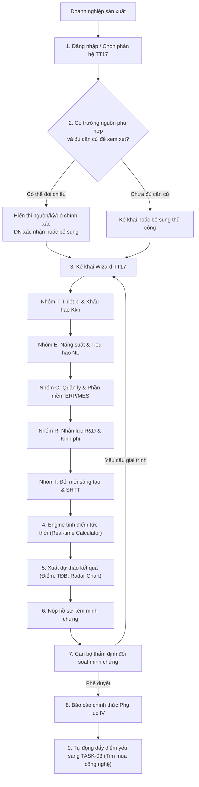

# TASK-09 — Thiết Kế Cơ Sở: Đánh Giá Trình Độ & Năng Lực Công Nghệ Sản Xuất (TT17)

> **Mã phân hệ:** `TASK-09`  
> **Trạng thái:** 🟡 Wireframe đã qua PO review; mapping còn điều kiện, backend chưa audit đầy đủ, DDL chưa được duyệt; chưa sẵn sàng chuyển SRS.  
> **Căn cứ pháp lý:** [Thông tư 17/2019/TT-BKHCN](https://congbao.chinhphu.vn/van-ban/thong-tu-so-17-2019-tt-bkhcn-30405/29385.htm), ban hành ngày 10/12/2019 của Bộ Khoa học và Công nghệ.  
> **Phạm vi áp dụng:** Doanh nghiệp ngành công nghiệp chế biến, chế tạo (mã ngành C.10 – C.32 theo VSIC).  
> **Tài liệu liên quan:**
> - Bảng theo dõi tổng thể: [`../DANH_SACH_TIEN_DO_BASIC_DESIGN.md`](../DANH_SACH_TIEN_DO_BASIC_DESIGN.md)
> - Hồ sơ gốc Doanh nghiệp SSOT: [`../TASK-02_HO_SO_DOANH_NGHIEP_DMST/README.md`](../TASK-02_HO_SO_DOANH_NGHIEP_DMST/README.md)
> - Phiếu khảo sát nhu cầu công nghệ DNNVV: [`../TASK-03_HO_SO_TIM_MUA_BUYER/README.md`](../TASK-03_HO_SO_TIM_MUA_BUYER/README.md)
> - Giao diện khung 3 Tab tổng hợp: [`../wireframe_khao_sat_va_danh_gia_cong_nghe.html`](../wireframe_khao_sat_va_danh_gia_cong_nghe.html)
> - Báo cáo đối soát & giải pháp liên thông: [`../bao_cao_doi_soat_va_giai_phap_lien_thong_du_lieu.html`](../bao_cao_doi_soat_va_giai_phap_lien_thong_du_lieu.html)

---

## 1. MỤC TIÊU & ĐỊNH VỊ PHÂN HỆ

Basic Design định hướng số hóa quy trình tự đánh giá và thẩm định **Trình độ và Năng lực công nghệ sản xuất** theo Thông tư 17/2019/TT-BKHCN. Các mục tiêu dưới đây là định hướng nghiệp vụ; chưa đồng nghĩa tính năng đang vận hành hoặc đã được phê duyệt triển khai:
1. **Dành cho Doanh nghiệp (Tự chẩn đoán & định vị)**: Kê khai trực tuyến, tự động tính điểm 26 tiêu chí (thang 100), tính hệ số đồng bộ $T_{ĐB}$ và tự động nhận diện điểm nghẽn công nghệ (Technology Bottlenecks).
2. **Dành cho Cơ quan Quản lý / Hội đồng Thẩm định**: Cung cấp công cụ rà soát hồ sơ, đối chiếu minh chứng đính kèm, hiệu chỉnh điểm số có lưu vết (Audit Trail) và phê duyệt báo cáo đánh giá chính thức (Phụ lục IV).
3. **Đối chiếu nguồn dữ liệu**: Xem xét khả năng tái sử dụng dữ liệu từ `TASK-03`/`TASK-02` khi cùng pháp nhân, cơ sở/phạm vi, định nghĩa, kỳ, đơn vị và độ chính xác; mọi kế thừa cần có bước xác nhận. Đây là mục tiêu thiết kế, không phải năng lực liên thông đã triển khai.

### Quyết định UX sau khi đối chiếu biểu mẫu gốc (05/10/2026)

- Luồng kê khai theo cấu trúc quen thuộc của **Phụ lục I**: Mục A thông tin doanh nghiệp; B thiết bị/công nghệ; C sản xuất/kinh doanh; D nhân lực/quản lý/thông tin/môi trường; Đ đầu tư cho thông tin/R&D; E đổi mới sáng tạo.
- Sau kê khai, kết quả trình bày theo **Phụ lục II và IV**: mã ngành/chuẩn so sánh, 26 tiêu chí, điểm từng nhóm và bảng kết quả dự thảo. Phiếu điều tra và phiếu chấm điểm là hai góc nhìn liên kết, không gom thành một danh sách câu hỏi kỹ thuật.
- Chỉ tiêu gốc có bảng 3 năm được thiết kế thành các cột theo năm điều tra; giá trị dùng từng năm/tổng/bình quân phải bám đúng định nghĩa tiêu chí. Dây chuyền, cơ sở, sản phẩm, nguyên liệu và sáng kiến cần danh sách nhiều dòng, có gợi ý giới hạn từ phiếu giấy.
- Wireframe hiện là bản đề xuất UX, chưa bao phủ toàn bộ câu hỏi và các bảng lặp của Phụ lục I; chưa phải form vận hành hoặc thiết kế kỹ thuật.
- **Sai khác nguồn cần giữ mở trước khi khóa công thức:** nội dung Điều 4 và sheet `Bảng khảo sát` trong workbook ghi TC07 tối đa 4 điểm; bảng báo cáo Phụ lục IV trong cùng văn bản ghi TC07 tối đa 3 điểm. Wireframe đang mô phỏng theo Điều 4/workbook (4 điểm); cần PO/SA xác minh cách xử lý biểu mẫu báo cáo trước khi chuyển SRS.

---

## 2. KHUNG TOÁN HỌC & CÔNG THỨC ĐÁNH GIÁ (TT17)

### 2.1. Cấu trúc 5 Nhóm Tiêu Chí Thành Phần

| Nhóm | Tên nhóm tiêu chí | Số tiêu chí | Trọng số điểm tối đa | Trọng số hệ số đồng bộ ($\alpha_i$) |
|:---:|:---|:---:|:---:|:---:|
| **T** | Hiện trạng công nghệ, thiết bị | 1 – 7 | **30 điểm** | $\alpha_T = 0,30$ |
| **E** | Hiệu quả khai thác công nghệ | 8 – 12 | **20 điểm** | $\alpha_E = 0,20$ |
| **O** | Năng lực tổ chức, quản lý | 13 – 17 | **19 điểm** | $\alpha_O = 0,19$ |
| **R** | Năng lực nghiên cứu, phát triển | 18 – 22 | **17 điểm** | $\alpha_R = 0,17$ |
| **I** | Năng lực đổi mới sáng tạo | 23 – 26 | **14 điểm** | $\alpha_I = 0,14$ |
| **TỔNG** | **Toàn bộ 5 nhóm tiêu chí** | **26 tiêu chí** | **100 điểm** | **$\sum \alpha_i = 1,00$** |

### 2.2. Công thức Tổng điểm và Hệ số Đồng bộ

$$\tau = T + E + O + R + I \quad (0 \le \tau \le 100)$$

$$T_{ĐB} = \left(\frac{T}{30}\right)^{0,30} \times \left(\frac{E}{20}\right)^{0,20} \times \left(\frac{O}{19}\right)^{0,19} \times \left(\frac{R}{17}\right)^{0,17} \times \left(\frac{I}{14}\right)^{0,14}$$

### 2.3. Quy tắc Phân loại Trình độ Công nghệ (Điều 9)

| Cấp độ xếp loại | Điều kiện tổng điểm ($\tau$) | Điều kiện hệ số đồng bộ ($T_{ĐB}$) | Ý nghĩa phân loại |
|:---|:---:|:---:|:---|
| **Lạc hậu** | $\tau < 35$ | $T_{ĐB} < 0,30$ | Cần cấp bách chuyển đổi công nghệ / đổi mới thiết bị |
| **Trung bình** | $35 \le \tau < 60$ | $T_{ĐB} \ge 0,30$ | Đạt ngưỡng vận hành phổ thông, nhiều dư địa cải tiến |
| **Trung bình tiên tiến** | $60 \le \tau < 75$ | $T_{ĐB} \ge 0,50$ | Ứng dụng công nghệ khá, quản trị tốt |
| **Tiên tiến** | $\tau \ge 75$ | $T_{ĐB} \ge 0,65$ | Trình độ công nghệ cao, tự động hóa và R&D dẫn đầu |

*Lưu ý nghiệp vụ*: Nếu điểm số rơi vào khoảng không thỏa mãn đồng thời cả 2 điều kiện (ví dụ $\tau \ge 75$ nhưng $T_{ĐB} < 0,65$ do lệch pha giữa thiết bị cao nhưng quản lý yếu), hệ thống không tự ý gán nhãn mà hiển thị trạng thái **"Cần thẩm định chuyên gia"** để hội đồng kết luận.

---

## 3. QUY TRÌNH ĐỀ XUẤT ĐỂ REVIEW (CHƯA PHẢI LUỒNG ĐANG VẬN HÀNH)

Sơ đồ dưới đây mô tả hướng nghiệp vụ dự kiến. Nộp hồ sơ, thẩm định, phê duyệt Phụ lục IV, đẩy điểm yếu sang TASK-03 và tính điểm trên wireframe không chứng minh các năng lực đã được triển khai hoặc được PO chốt vận hành.

---

## 4. QUY TẮC ĐỐI CHIẾU NGUỒN VỚI PHIẾU KHẢO SÁT DNNVV (`TASK-03`)

Không có căn cứ cho con số “18 trường khớp”, tỷ lệ kế thừa hay “1 lần nhập”. Tab 3 cung cấp ma trận nghiệp vụ nguồn–đích; đây chưa phải mapping API/schema và không xác nhận trạng thái backend. Chỉ xem xét tái sử dụng khi doanh nghiệp xác nhận đúng pháp nhân và dữ liệu khớp cơ sở/phạm vi, định nghĩa, kỳ, đơn vị, độ chính xác và nguồn.

| Nhóm trường nguồn | Đích/tiêu chí có thể liên quan | Xử lý hiện tại | Điều kiện / giới hạn |
|:---|:---|:---|:---|
| Tên DN, MST | Hồ sơ DN của đánh giá | Có thể dùng sau khi chọn đúng pháp nhân và xác nhận | Chưa giả định hệ thống có master profile hoặc DB field tương ứng. |
| Ngành kinh tế; lĩnh vực công nghệ quan tâm | Mã ngành và chuẩn Phụ lục II | DN xác nhận mã ngành; lĩnh vực quan tâm chỉ gợi ý | Không tự ánh xạ tên lĩnh vực/ngành chung sang mã TT17. |
| Lao động dạng khoảng / BHXH | M và các mẫu số lao động | Chỉ tham khảo, cần khai lại số chính xác | Đúng định nghĩa Điều 2.8 và kỳ; không chuyển khoảng thành số. |
| Doanh thu, đầu tư, vốn, tài sản | Các biến tài chính của tiêu chí liên quan | Bổ sung/xác minh theo từng biến | Không đánh đồng doanh thu, tổng đầu tư, tổng nguồn vốn, vốn điều lệ hay tài sản; phải khớp kỳ/đơn vị. |
| Máy móc, công đoạn, năm đầu tư | TC thiết bị/tích hợp/hiệu quả liên quan | Gợi ý để khai và kiểm tra minh chứng | Tên thiết bị/tuổi máy không tự xác định giá trị tài chính hoặc điểm. |
| Nhân lực theo nhóm khảo sát | M, Mtt, Mcn, Mbc, Mql, Mnv, Mr&d | Bổ sung và rà định nghĩa, kiêm nhiệm | Không gộp chức danh hoặc cộng trùng khi chưa được đối chiếu. |
| Chứng chỉ, môi trường, R&D/hợp tác | TC16, TC17, TC21, TC25 và tiêu chí liên quan | Kiểm tra điều kiện và minh chứng | Chứng chỉ/quan hệ đối tác riêng lẻ không chứng minh đủ toàn bộ điều kiện chấm. |
| Nhu cầu, điểm nghẽn, ngân sách, thời hạn | Tổng hợp/đề xuất hỗ trợ | Chỉ dùng làm ngữ cảnh nhu cầu | Không tự biến thành điểm TT17 hoặc dữ liệu tài chính đã xác minh. |

Chi tiết từng trường và lý do: [`../bao_cao_doi_soat_va_giai_phap_lien_thong_du_lieu.html`](../bao_cao_doi_soat_va_giai_phap_lien_thong_du_lieu.html). Quyết định phạm vi và cross-surface: [PO Decision Record](../../../Reports/PO_quyet_dinh_scope_lien_thong_khao_sat_TT17_2026-10-05.md).

## 5. MÔ HÌNH DỮ LIỆU Ở MỨC ĐỀ XUẤT — CHƯA DUYỆT DDL

Hiện chưa có kết quả full backend audit để xác nhận entity, DbContext, migration, API hay schema liên quan doanh nghiệp/đánh giá TT17. Các tên `enterprise.profiles` và `assessment.tt17_evaluations` cùng SQL/DDL từng xuất hiện ở phiên bản trước chỉ là giả thuyết thiết kế, không phải hiện trạng đã kiểm chứng hoặc DDL được phê duyệt; chúng đã bị thay thế bởi phần ghi nhận này.

Có thể tiếp tục nghiên cứu khái niệm về hồ sơ pháp nhân, phiên đánh giá theo kỳ, câu trả lời từng tiêu chí, nguồn/kỳ/độ chính xác, minh chứng và lịch sử xác minh. Chưa chốt bảng/cột, khóa, schema, ràng buộc, ownership hoặc migration. PO Decision Record quy định: DDL/migration chưa duyệt; SA cần rà entity/model/migration backend đầy đủ trước khi đề xuất schema. Không chuyển bất kỳ DDL nào sang triển khai trước cổng này.

## 6. GIAO DIỆN TƯƠNG TÁC & REVIEW ARTIFACTS

- **Bộ Wireframe Tương Tác Đánh Giá TT17**:
  - *Wizard nhập liệu 5 bước (T-E-O-R-I) & Thẩm định Hội đồng/Sở KH&CN*: [`wireframe_wizard_nhap_lieu_va_tham_dinh_tt17.html`](wireframe_wizard_nhap_lieu_va_tham_dinh_tt17.html) *(Tính điểm 100, hệ số đồng bộ $T_{ĐB}$, thẩm định Phụ lục IV)*
  - *Bảng điểm & Ma trận chỉ số TT17*: [`wireframe_danh_gia_tt17.html`](wireframe_danh_gia_tt17.html)
- **Khung giao diện 3 Tab liên thông**: [`../wireframe_khao_sat_va_danh_gia_cong_nghe.html`](../wireframe_khao_sat_va_danh_gia_cong_nghe.html)
  - *Tab 1*: Phiếu khảo sát nhu cầu công nghệ DNNVV (`TASK-03`).
  - *Tab 2*: Biểu mẫu đánh giá trình độ công nghệ 26 tiêu chí TT17 (`TASK-09`).
  - *Tab 3*: Ma trận nguồn–đích và mô phỏng nhập liệu có điều kiện; không đại diện tích hợp backend đang chạy.
- **Báo cáo chuyên sâu**: [`../bao_cao_doi_soat_va_giai_phap_lien_thong_du_lieu.html`](../bao_cao_doi_soat_va_giai_phap_lien_thong_du_lieu.html)

---

## 7. CỔNG TIẾP THEO TRƯỚC SRS / SPEC KIT

Wireframe Basic Design đã qua PO review; điều đó chưa phê duyệt yêu cầu triển khai, API hay DB. Chưa đánh dấu các điều kiện kỹ thuật hoàn tất.

- [x] Công thức/tiêu chí TT17 trên wireframe được đối chiếu với DOC/Excel trong phạm vi Basic Design; nội dung chưa đủ nguồn đã được giữ dưới dạng cần xác nhận/chưa tính.
- [x] Ma trận Tab 3 mô tả điều kiện và giới hạn tái sử dụng trường; không khẳng định 18 trường, tự đồng bộ hoặc schema/backend đã có.
- [ ] Đối soát độc lập mapping/định nghĩa/kỳ/đơn vị với PO và ghi quyết định vào [PO Decision Record](../../../Reports/PO_quyet_dinh_scope_lien_thong_khao_sat_TT17_2026-10-05.md).
- [ ] SA hoàn thành full backend audit (entity/model, DbContext, migration và API) trước mọi đề xuất schema; DDL vẫn chưa được duyệt.
- [ ] Lập và duyệt Cross-Surface Impact Matrix cho Basic Design, Detail Spec, API/DTO, domain validation, DB/migration, Web, Zalo/Mobile, public/owner/admin projection và test. Kênh Zalo/Mobile, quyền xem dữ liệu và quy trình chuyên gia còn theo trạng thái trong Decision Record.
- [ ] Sau khi quyết định phạm vi, mapping và backend audit được duyệt, mới chốt đầu vào cho SRS/Detail Spec và chuyển cổng SA/PO tiếp theo.
