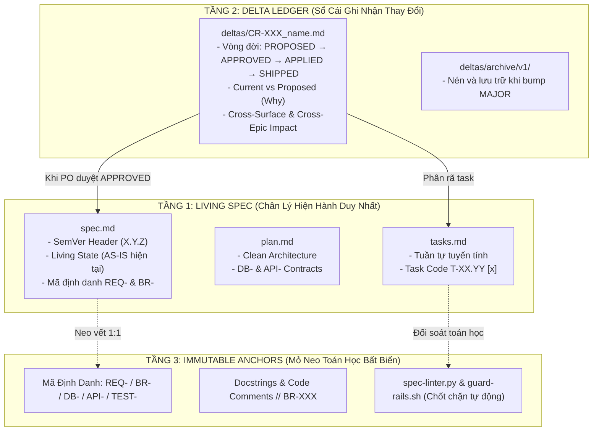
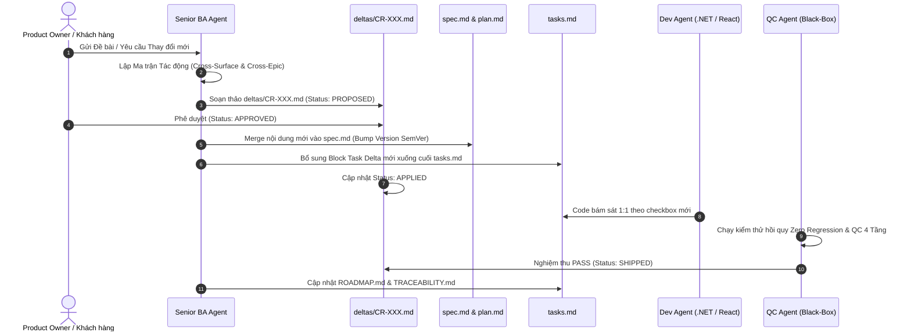

# HIẾN PHÁP QUẢN LÝ ĐẶC TẢ, VERSION & CHANGE REQUEST (CR)
## Mô Hình: 3 Tầng Bất Biến (Immutable Core) × Living Spec × Delta Ledger
*Phiên bản: 1.0.0 | Ngày ban hành: 30/10/2026 | Đối tượng áp dụng: Toàn bộ thành viên và AI Agents (PO, BA, TechLead, Dev, QC, QA)*

---

> [!IMPORTANT]
> **HIỆU LỰC PHÁP LÝ TỐI CAO ĐỐI VỚI AI AGENTS & DEVELOPERS**:
> 1. Tài liệu này là **Hiến pháp chuẩn hóa duy nhất** về quản trị Đặc tả (Spec), Phiên bản (Version) và Yêu cầu Thay đổi (Change Request - CR) trong hệ sinh thái NacenTech.
> 2. Mọi AI Agent (Antigravity, Cursor, Windsurf, Claude Code...) và lập trình viên **BẮT BUỘC TUÂN THỦ 100%**.
> 3. Tuyệt đối cấm hành vi "Vibe Coding" không có mỏ neo: Không có mã định danh, không sửa spec mà tự ý gõ code, hoặc sửa đè thô bạo làm phá vỡ tính truy vết.

---



---

## 1. KIẾN TRÚC LƯU TRỮ SPEC: THEO TỪNG MODULE / EPIC (PER-EPIC SPECS)

Tuyệt đối **không dùng 1 file spec khổng lồ** (hàng chục nghìn dòng), vì LLM sẽ bị quá tải context window, gây hiện tượng ảo giác, cắt xén logic và trôi dạt kiến trúc.

### Cấu trúc thư mục chuẩn mực trong `SourceCode/specs/`:
```text
SourceCode/specs/
├── ROADMAP.md                            # Master Registry: Toàn bộ Epics, Trạng thái, Task count
├── TRACEABILITY.md                       # Ma trận truy vết khép kín: REQ ↔ BR ↔ DB ↔ UI ↔ API ↔ Test
├── TASK-00_PLATFORM_FOUNDATION_VA_COMMON/
│   ├── spec.md                           # Living Spec: Chân lý nghiệp vụ HIỆN HÀNH (As-Is State)
│   ├── plan.md                           # Thiết kế kỹ thuật, DB Schema, API Contracts
│   ├── tasks.md                          # Danh sách công việc phân rã tuần tự có checkbox [x]
│   └── deltas/                           # Sổ cái lịch sử các Change Request (CR)
│       ├── CR-2026-014_seller_dual_mode.md
│       ├── CR-2026-015_seller_workspace.md
│       ├── CR-2026-019_buyer_dashboard.md
│       └── archive/                      # Thư mục nén lưu trữ các CR của chu kỳ Major cũ
│           └── v1/
└── TASK-01_TONG_QUAN_VA_KIEN_TRUC_HOME/
    ├── spec.md
    ├── plan.md
    ├── tasks.md
    └── deltas/
```

---

## 2. QUY TRÌNH QUẢN LÝ VERSION: SEMVER CHO SPEC (SEMANTIC SPEC VERSIONING)

Áp dụng chuẩn đánh version ngữ nghĩa ngay tại Header của mỗi `spec.md`, `plan.md`, `tasks.md`:

- **`MAJOR (X.0.0)`**: Thay đổi lớn phá vỡ tính tương thích (Breaking Change) — Đổi luồng nghiệp vụ cốt lõi, xóa bỏ phân hệ cũ, tái cấu trúc bảng CSDL hạt nhân.
- **`MINOR (1.X.0)`**: Bổ sung tính năng mới, thêm luồng nghiệp vụ mới nhưng tương thích ngược (Non-breaking additive) — Thêm màn hình, thêm bảng mới, mở rộng API.
- **`PATCH (1.0.X)`**: Làm rõ câu chữ (Clarification), bổ sung validation rule, sửa lỗi biên góc khuất (Edge case fix), cập nhật test.

### Header Metadata Bắt Buộc ở đầu mỗi file Spec:
```markdown
# Feature Specification: [Mã Task] [Tên Tính Năng]

**Epic**: TASK-00 Platform Foundation & Common Architecture  
**Version**: 1.15.0  
**Status**: Shipped | In Implementation | In Review  
**Last Updated**: 2026-10-30  
**Baseline Hash / Commit**: abc123def  
**Ánh Xạ Kỹ Thuật**: Clean Architecture Modular Monolith, JWT RBAC, Workspace Navigation  
```

> **Quy định nghiêm ngặt**: Khi 100% tasks trong `tasks.md` đã hoàn tất `[x]`, Metadata `Status` bắt buộc phải cập nhật sang `Shipped`. Cấm tuyệt đối tình trạng code xong mà Header vẫn để `In Planning`.

---

## 3. QUY TRÌNH XỬ LÝ CHANGE REQUEST (CR) & UPDATE: NON-DESTRUCTIVE DELTA

Khi có yêu cầu thay đổi (CR) từ Product Owner hoặc Khách hàng, **tuyệt đối không cho AI nhảy vào sửa đè thẳng vào code hoặc xoá spec cũ ngay lập tức**. Chu trình 6 bước bất biến:



### Chi tiết 6 bước:

#### Bước 1: Phân Tích Tác Động Toàn Diện (Impact Analysis)
Trước khi viết bất kỳ dòng nào, BA bắt buộc phải rà soát 2 ma trận:
1. **Cross-Surface Impact**: Database Schema có bị phá vỡ không? API DTO có lệch không? Frontend có component/nút nào bị ảnh hưởng không? Test cũ có bị gãy không?
2. **Cross-Epic Impact**: Các phân hệ khác trong hệ thống có đang tiêu thụ (consume) API hoặc Entity này không? (Ví dụ: TASK-03 sửa Demand thì TASK-08 Deal Room và TASK-01 Home có bị gãy không?).

#### Bước 2: Tạo Tài Liệu Delta (`deltas/CR-XXX_name.md`)
Tài liệu Delta là sổ cái ghi vết, bắt buộc có Metadata Vòng Đời:
```markdown
# Change Request: CR-2026-019 Bàn Làm Việc Tổng Quan Mua Sắm (Buyer Dashboard)

**CR-ID**: CR-2026-019  
**Epic**: TASK-00_PLATFORM_FOUNDATION_VA_COMMON  
**Status**: PROPOSED | APPROVED | APPLIED | SHIPPED  
**Target Version**: 1.14.0  
**Author**: PO / Lead BA  
**Date**: 2026-10-30  

### 1. Bối Cảnh & Lý Do Thay Đổi (Why)
- Hiện trạng cũ (Current State): ...
- Đề xuất mới (Proposed State): ...

### 2. Chi Tiết Thay Đổi Quy Chuẩn
- [ADD] REQ-BUYER-DASH-001: ...
- [MODIFY] BR-NAV-004: ...
- [DEPRECATE] API-V1-OLD: ...

### 3. Ma Trận Tác Động (Cross-Surface & Cross-Epic)
- DB Impact: None
- API Impact: None
- Frontend UI: Thêm component `buyer-dashboard.tsx`
- Consuming Epics: [TASK-03 Buyer], [TASK-08 Deal Room]
```

#### Bước 3: Cập Nhật Living Spec (`spec.md` & `plan.md`)
- Khi CR đạt trạng thái **`APPROVED`**: BA merge trực tiếp nội dung mới vào phần thân tương ứng của `spec.md` để file này luôn là Chân lý hiện hành duy nhất.
- Đẩy số phiên bản SemVer (ví dụ từ `1.13.0` $\rightarrow$ `1.14.0`).
- Cập nhật file Delta sang trạng thái **`APPLIED`**.

#### Bước 4: Phân Rã Task Mới Vào `tasks.md`
- **Không bao giờ xóa** các task cũ đã tick `[x]`.
- Thêm một Giai đoạn / Block mới ở cuối file với mã Giai đoạn và số Version tiếp nối tuyến tính:
```markdown
## Giai đoạn 18: Delta v14 (CR-2026-019) — Xây Dựng Bàn Làm Việc Mua Sắm [`[FE-BUYER-DASHBOARD]`]

- [ ] `T-00.73` **[FE][DASHBOARD]** Xây dựng component `<BuyerDashboard />` tại `src/components/portal/buyer-dashboard.tsx`
- [ ] `T-00.74` **[FE][ROUTING]** Tích hợp rẽ nhánh tại `src/app/portal/page.tsx`
- [ ] `T-00.75` **[TEST][QC]** Viết test suite chuyên biệt và kiểm thử hồi quy
```

#### Bước 5: Thực Thi Lập Trình & Kiểm Thử Hồi Quy (Zero Regression)
- Developer thực thi tuần tự theo từng checkbox mới.
- Chạy toàn bộ test suites cũ để đảm bảo tính năng mới không làm gãy logic cũ.

#### Bước 6: Nghiệm Thu & Cập Nhật Master Registry
- Khi QC ký duyệt Gate 4 PASS: Đổi trạng thái CR sang **`SHIPPED`**.
- Chạy `spec-linter.py` đối soát.
- Cập nhật số task và trạng thái trong `ROADMAP.md` và `TRACEABILITY.md`.

---

## 4. CƠ CHẾ NEO VẾT TOÁN HỌC (IMMUTABLE TRACEABILITY ANCHORS)

Để AI luôn hiểu đúng và code đồng nhất giữa các phiên làm việc (kể cả khi context window bị reset), toàn bộ hệ thống phải sử dụng **Mã Định Danh Bất Biến**:

| Loại Thành Phần | Cú Pháp Chuẩn | Ví Dụ Minh Họa | Vị Trí Bắt Buộc |
| :--- | :--- | :--- | :--- |
| **Yêu cầu chức năng** | `REQ-<Epic>-<STT>` | `REQ-NAV-001`, `REQ-BUYER-DMD-004` | `spec.md`, `tasks.md`, PR |
| **Quy tắc nghiệp vụ** | `BR-<Epic>-<STT>` | `BR-DMD-PUBLIC-01`, `BR-EXP-CV-01` | `spec.md`, Code Validator, Unit Test |
| **Bảng CSDL / Schema** | `DB-<Bảng>` | `DB-DEMAND_ITEMS`, `DB-PERSONS` | `plan.md`, EF Core Entity, Migration |
| **Hợp đồng API** | `API-<Method>-<Endpoint>` | `API-GET-PORTAL-STATS`, `API-PUT-DEMAND` | `plan.md`, Controllers, SDK |
| **Thành phần Giao diện** | `UI-<Epic>-<Tên>` | `UI-BUYER-DASHBOARD`, `UI-NAV-SIDEBAR` | `plan.md`, Components, Visual QA |
| **Ca kiểm thử** | `TEST-<Rule ID>` | `TEST-BR-DMD-PUBLIC-01` | Test Files, QC Reports |

### Quy Tắc Vàng Về Mỏ Neo Trong Code (Anchor Comment Discipline):
Mọi hàm xử lý nghiệp vụ trong Backend và Frontend bắt buộc phải có comment mỏ neo dẫn chiếu đến mã `BR-*` hoặc `REQ-*`:

```csharp
// [BR-DMD-PUBLIC-01] Bắt buộc xác thực chính chủ: Người tạo mới có quyền cập nhật bài toán
if (item.CreatedBy != actor.PersonId && !actor.IsAdmin)
{
    return Result.Failure(DemandErrors.ForbiddenAccess);
}
```

```typescript
// [REQ-PUB-NAV-001] May đo menu Sidebar chuẩn 5 mục cho Thành viên Đại chúng
if (currentRole === "PUBLIC_USER") {
    return publicNavItems;
}
```

> **Lợi ích**: Khi có CR sửa đổi `BR-DMD-PUBLIC-01`, AI chỉ cần chạy lệnh `grep -rn "BR-DMD-PUBLIC-01"` trên toàn bộ repo là định vị chính xác 100% vị trí cần can thiệp, không bỏ sót, không đoán mò.

---

## 5. CƠ CHẾ ĐÓNG GÓI & NÉN LƯU TRỮ (DELTA PRUNING & CONSOLIDATION)

Để tránh tình trạng thư mục `deltas/` bị phình to làm nghẽn context của LLM sau nhiều tháng phát triển:

1. **Chu kỳ Minor (`v1.1.0` $\rightarrow$ `v1.9.0`)**: Giữ nguyên các file `CR-XXX.md` trong `deltas/` để tra cứu lịch sử gần.
2. **Chu kỳ Major (`v2.0.0`)**:
   - Khi có nâng cấp kiến trúc lớn bump lên `v2.0.0`, toàn bộ các file `CR-XXX.md` thuộc thế hệ v1 được tự động di chuyển vào:
     `specs/TASK-XX/deltas/archive/v1/`
   - File `spec.md` được biên tập lại thành bản **Living Baseline v2.0.0** tinh gọn, mạch lạc.
   - Thư mục `deltas/` chỉ giữ lại các CR mới của chu kỳ v2.

---

## 6. PHÂN ĐỊNH RANH GIỚI SSOT GIỮA BASIC DESIGN VÀ LIVING SPEC

Dự án NacenTech vận hành theo mô hình Multi-Repo, ranh giới phân định nguồn chân lý xác thực (SSOT) được phân cấp rạch ròi:

```text
┌─────────────────────────────────────────────────────────────────────────────┐
│ TẦNG VĨ MÔ: Specification/BASIC_DESIGN_NACENTECH.md                         │
│ - Nguồn chân lý duy nhất cho: C4 Architecture (Context & Container)        │
│ - Product Backbone, Walking Skeleton toàn hệ thống                          │
│ - Ma trận 10 Vai trò (10 Scoped Roles) & Luồng tương tác liên phân hệ      │
│ - Design System chung: Typography (Nunito Sans & Lora), 5 UX States         │
└──────────────────────────────────────┬──────────────────────────────────────┘
                                       │ Ánh xạ phân rã 1:1
                                       ▼
┌─────────────────────────────────────────────────────────────────────────────┐
│ TẦNG VI MÔ: SourceCode/specs/TASK-XX/spec.md                                │
│ - Nguồn chân lý duy nhất cho: Từng quy tắc nghiệp vụ chi tiết (BR-*)        │
│ - Hợp đồng API chi tiết (DTOs, Parameters, Status Codes)                    │
│ - Form fields, validation rules, error messages                             │
│ - Các đợt Change Request (CR) vi mô giải quyết trong nội bộ phân hệ         │
└─────────────────────────────────────────────────────────────────────────────┘
```

---

## 7. CHỐT CHẶN TỰ ĐỘNG BẰNG MÁY (ZERO-TRUST AUTOMATED ENFORCEMENT)

Không trông chờ vào tính cẩn thận thủ công của con người hay AI. Hệ thống vận hành 2 chốt chặn toán học cưỡng chế:

1. **Script Kiểm Toán `spec-linter.py`** (`Agent/scripts/spec-linter.py`):
   - Tự động kiểm tra tính liên tục của Phase trong `tasks.md`.
   - Đối soát từng task `[x]` với `ROADMAP.md`.
   - Bắt lỗi trùng lặp Delta version, tiêu đề dị thường, lệch pha Status header.
2. **Chốt Chặn Git Hooks `guard-rails.sh`** (`Agent/scripts/guard-rails.sh`):
   - Tích hợp vào `pre-commit` và `pre-push` hooks.
   - Ngắt lệnh lập tức (exit 1) nếu phát hiện bất kỳ lỗi lộn xộn hoặc lệch pha nào.
   - Ngăn chặn triệt để cờ bypass (`--no-verify`, `-n`) qua `block-no-verify.py`.

---

## 8. TỔNG KẾT: "4 KHÔNG" BẤT KHẢ XÂM PHẠM

```text
1. KHÔNG SỬA CODE KHI SPEC CHƯA ĐỔI:
   Muốn sửa logic -> Soạn CR -> Sửa spec.md -> Phân rã task -> Mới được gõ code.

2. KHÔNG GHI ĐÈ LỊCH SỬ THÔ BẠO:
   spec.md luôn là bản As-Is sạch đẹp; lịch sử và căn cứ thay đổi lưu tại deltas/CR-XXX.md.

3. KHÔNG DÙNG SPEC KHÔNG CÓ MÃ ĐỊNH DANH:
   100% logic phải có mỏ neo bất biến: REQ-*, BR-*, DB-*, API-*, UI-*, TEST-*.

4. KHÔNG ĐỂ QUY TRÌNH NẰM TRÊN GIẤY:
   Mọi quy tắc phải được kiểm chứng bằng script tự động (spec-linter.py, guard-rails.sh).
```
