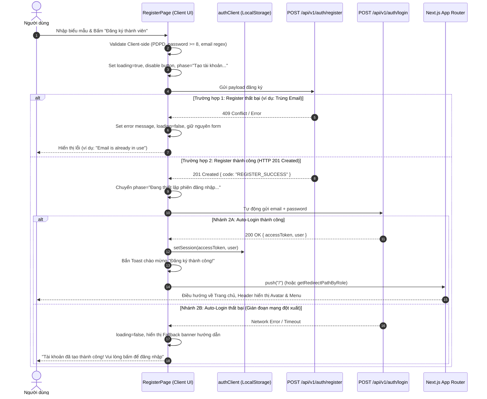
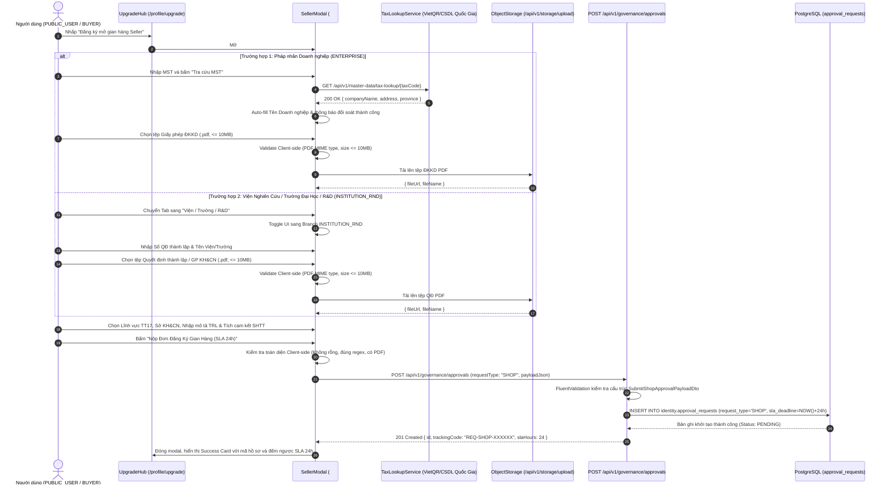

# Technical Plan: TASK-00 Platform Foundation & Common Architecture

**Feature**: `TASK-00_PLATFORM_FOUNDATION_VA_COMMON`  
**Spec Reference**: [`spec.md`](./spec.md)  
**Status**: Completed (Shipped Gate 5)  

---

## 1. Kiến Trúc Kỹ Thuật (Architecture Design)

Hệ thống Backend được tổ chức theo mô hình **Modular Monolith** với Clean Architecture:

```text
SourceCode/
├── backend/
│   ├── apps/
│   │   └── api/                     # Host Web API, Program.cs, Middleware, Swagger
│   ├── config/                      # appsettings.json, logging, cors
│   ├── modules/                     # Các module nghiệp vụ độc lập
│   │   ├── identity/                # Ánh xạ TASK-07 (Admin, IAM, Auth)
│   │   ├── technology/              # Ánh xạ TASK-04 (Seller & Bộ lọc)
│   │   ├── demand/                  # Ánh xạ TASK-03 (Buyer nhu cầu)
│   │   ├── expert/                  # Ánh xạ TASK-05 (Chuyên gia KH&CN)
│   │   └── master-data/             # Ánh xạ TASK-06 (Ngành TT17 & Ma trận)
│   ├── packages/                    # Thư viện dùng chung nội bộ
│   │   ├── kernel/                  # Domain primitives: Result, Error, Entity
│   │   ├── persistence/             # EF Core base DbContext, Interceptors
│   │   ├── contracts/               # Shared DTOs, Event interfaces
│   │   └── test-kit/                # Fixtures, test doubles, mock helpers
│   ├── infra/                       # Docker compose, DB scripts
│   └── NacenTech.slnx               # Solution file
└── frontend/                        # Dành cho UI Web / App (gắn Submodule sau)
```

---

## 2. API Contract & Response Wrapper Standard

Mọi response API trả về client đều tuân thủ hợp đồng chung (Contract-First):

### Thành công:
```json
{
  "isSuccess": true,
  "data": { ... },
  "error": null,
  "timestamp": "2026-09-25T09:50:00Z"
}
```

### Thất bại (RFC 7807 ProblemDetails):
```json
{
  "isSuccess": false,
  "data": null,
  "error": {
    "code": "ENTITY_NOT_FOUND",
    "message": "Không tìm thấy bản ghi yêu cầu.",
    "details": [
      { "field": "id", "issue": "Giá trị ID không hợp lệ." }
    ]
  },
  "timestamp": "2026-09-25T09:50:00Z"
}
```

---

## 3. Database Schema & Infrastructure Configuration

### Cấu hình Docker Compose (`backend/docker-compose.yml`):
- Service `postgres`: Image `postgres:16-alpine`, port `5432:5432`, volume persist `pgdata`.
- Service `redis`: Image `redis:7-alpine`, port `6379:6379` (caching & distributed lock).

### Audit Interceptor trong `packages/persistence`:
- Tự động bắt sự kiện `SavingChanges` để điền:
  - `CreatedAtUtc = DateTime.UtcNow`
  - `UpdatedAtUtc = DateTime.UtcNow`
  - `CreatedBy = currentUser.Id`
  - `UpdatedBy = currentUser.Id`

---

## 4. Chiến Lược Kiểm Thử (Testing Strategy)

1. **Unit Test (xUnit / FluentAssertions)**:
   - Test `Result<T>`: Success state, Failure state, null safety, error aggregation.
   - Test `AuditableEntity`: Kiểm tra gán Id, so sánh equality dựa trên Id.
2. **Integration Test**:
   - Khởi chạy Test Container PostgreSQL để kiểm chứng migration và `DbContextBase`.

---

## Plan Delta v2: Thiết Kế Kỹ Thuật 3D Scoped RBAC Foundation

### 1. Database Schema Delta (Non-destructive Migration)
Mở rộng bảng `identity.persons` trong PostgreSQL:
- Bổ sung cột:
  - `scope_type`: `VARCHAR(20) NOT NULL DEFAULT 'GLOBAL'`
  - `scope_id`: `VARCHAR(50) NULL`
- Tạo index hỗ trợ tìm kiếm theo phạm vi:
  `CREATE INDEX idx_persons_scope ON identity.persons (scope_type, scope_id);`
- Chiến lược tương thích ngược (Backward Compatibility): Mọi bản ghi hiện có tự động mang `scope_type = 'GLOBAL'` và `scope_id = NULL`.

### 2. Domain & Application Contracts
- Trong `packages/kernel/Application/ICurrentActor.cs`:
  - Mở rộng hằng số `PlatformRoles` với 10 vai trò hạt nhân (`SuperAdmin`, `OperatorAdmin`, `ProvincialAdmin`, `SectorAdmin`, `ClusterAdmin`, `Seller`, `Buyer`, `InnovationEntity`, `VerifiedExpert`, `PublicUser`).
  - Thêm class hằng số `ScopeTypes` (`Global`, `Province`, `Sector`, `OrgUnit`).
  - Mở rộng interface `ICurrentActor` với `string ScopeType { get; }` và `string? ScopeId { get; }`.
- Trong `modules/identity/Domain/Person.cs`:
  - Thêm property `ScopeType` và `ScopeId`.
  - Bổ sung phương thức `AssignRoleAndScope(string platformRole, string scopeType, string? scopeId)`.

### 3. JWT Token Issuer & Claims Extraction
- Trong `modules/identity/Infrastructure/JwtTokenIssuer.cs`:
  - Thêm claim `"scope_type"` và `"scope_id"` vào token payload.
- Trong `apps/api/Infrastructure/HttpCurrentActor.cs`:
  - Trích xuất claim `scope_type` và `scope_id` để cung cấp cho `ICurrentActor`.

### 4. Policy Engine Decision Table Rule Update
- Trong `config/policies/authorization-rules.v1.json`:
  - Đăng ký nhận diện các role mới, đảm bảo `SUPER_ADMIN` và `OPERATOR_ADMIN` có toàn quyền điều phối tương đương `ADMIN` hiện hữu.

### 5. Hợp đồng vòng đời account cần hội tụ

`platform_role` lưu đúng 10 role hạt nhân theo `spec.md`; `GUEST` chỉ là trạng thái anonymous, còn `USER`/`ADMIN` chỉ phục vụ tương thích dữ liệu cũ. Luồng kỹ thuật bắt buộc gồm: public registration → `PUBLIC_USER` active → request/approval profile nếu cần → atomic assign role + scope → audit → login trả role/scope thật. Tầng 0–1 chỉ được provision qua API quản trị có authorization/audit; không thêm role vào public register request. API/DTO provision, validation scope-role và migration dữ liệu legacy là phần mở, phải được contract-first trước khi code.

---

## Plan Delta v3: Kiến Trúc Chi Tiết Frontend Common Kit (`SourceCode/frontend/`)

### 1. Cấu Trúc Thư Mục Thành Phần Dùng Chung
```text
SourceCode/frontend/src/
├── components/
│   ├── common/
│   │   ├── dialog.tsx             # Modal popup đa năng có backdrop & animation
│   │   ├── confirm-modal.tsx      # Modal xác nhận hành vi nguy hiểm / gửi duyệt
│   │   ├── toast.tsx              # Toast Notification Provider & useToast() hook
│   │   ├── theme-provider.tsx     # Context Dark/Light Theme & useTheme()
│   │   ├── theme-toggle.tsx       # Nút chuyển đổi Theme kèm icon Mặt trời/Mặt trăng
│   │   ├── fontsize-control.tsx   # Bộ nút chỉnh cỡ chữ (A- / A / A+)
│   │   ├── i18n-provider.tsx      # Context Đa ngôn ngữ (VI / EN) & useI18n()
│   │   ├── navbar.tsx             # Header điều hướng cố định + Auth + Tiện ích
│   │   └── footer.tsx             # Footer thông tin cơ quan Bộ KH&CN
│   └── ui/
│       └── async.tsx              # 5 trạng thái UX (Loading, Empty, Error, Success, Partial)
├── app/
│   ├── layout.tsx                 # Bọc ThemeProvider, I18nProvider, ToastProvider, Navbar, Footer
│   ├── error.tsx                  # Global Next.js Error Boundary bắt lỗi runtime
│   └── globals.css                # Biến màu CSS variables hỗ trợ .dark class & font scale
```

### 2. Thiết Kế Kỹ Thuật Từng Thành Phần

- **`toast.tsx`**:
  - `ToastType = 'success' | 'error' | 'warning' | 'info'`
  - Function: `toast.success(message, title?)`, `toast.error(message, title?)`, v.v.
  - Vị trí: `fixed bottom-5 right-5 z-50` kèm animation trượt `translate-y-0` và tự động tắt sau 3500ms.

- **`theme-provider.tsx`**:
  - State: `theme = 'light' | 'dark'`.
  - Effect: Đồng bộ class `dark` trên `document.documentElement` và lưu `localStorage.setItem('nacentwin_theme', theme)`.

- **`fontsize-control.tsx`**:
  - Scale: `sm` (87.5%), `base` (100%), `lg` (112.5%).
  - Effect: Đồng bộ style `fontSize` trên thẻ `<html>` hoặc gán dataset `data-font-scale`.

- **`i18n-provider.tsx`**:
  - Ngôn ngữ: `vi` (Tiếng Việt - Mặc định), `en` (Tiếng Anh).
  - Cung cấp hàm dịch: `t(key)` lấy chuỗi theo key từ từ điển dùng chung.

- **`dialog.tsx` & `confirm-modal.tsx`**:
  - Nhận props: `isOpen: boolean`, `onClose: () => void`, `title: string`, `children: ReactNode`.
  - Hỗ trợ ESC key listener, focus trap và animation `fade-in-scale`.

---

## Plan Delta v4: Thiết Kế Kỹ Thuật 4 Cổng Trỏ Đường Dẫn (Path-Based Role Portals)

### 1. Kiến Trúc Thư Mục Next.js 15 App Router
```text
SourceCode/frontend/src/
├── lib/
│   ├── auth-client.ts             # Bổ sung getRedirectPathByRole(role) & hasPermission(user, requiredTiers)
│   └── route-guard.ts             # Danh sách whitelist quyền hạn theo từng path prefix
├── components/
│   ├── auth/
│   │   └── role-guard.tsx         # Component bọc bảo vệ Route theo Role Tier
│   └── portal/
│       ├── portal-sidebar.tsx     # Sidebar cho Cổng Doanh nghiệp & Chuyên gia
│       ├── gov-header.tsx         # Header chứa ScopeBadge cho Cổng Quản lý 63 tỉnh
│       └── admin-sidebar.tsx      # Sidebar Quản trị Tối cao cho Super Admin
├── app/
│   ├── page.tsx                   # [Cổng 1: Đại Chúng /] - Marketplace tra cứu công khai
│   ├── (auth)/
│   │   ├── login/page.tsx         # Trang Login tự động redirect theo Role
│   │   └── register/page.tsx
│   ├── portal/                    # [Cổng 2: /portal/*] - Dành cho Seller, Buyer, Expert
│   │   ├── layout.tsx             # Portal Layout có Sidebar & Navigation B2B
│   │   └── page.tsx               # Hub không gian làm việc thị trường
│   ├── gov/                       # [Cổng 3: /gov/*] - Dành cho 63 Sở KH&CN & 18 Ngành TT17
│   │   ├── layout.tsx             # Gov Layout có Scope Badge & SLA Tracker
│   │   └── page.tsx               # Hàng đợi thẩm định phân cấp
│   └── admin/                     # [Cổng 4: /admin/*] - Dành cho Super Admin & Operator
│       ├── layout.tsx             # Admin Layout bảo mật cấp cao
│       └── page.tsx               # Tổng hành dinh điều phối toàn quốc
```

### 2. Thuật Toán Phân Giải Đường Dẫn Theo Vai Trò (`getRedirectPathByRole`)
```typescript
export function getRedirectPathByRole(role: string): string {
  switch (role) {
    case "SUPER_ADMIN":
    case "OPERATOR_ADMIN":
    case "ADMIN":
      return "/admin";
    case "PROVINCIAL_ADMIN":
    case "SECTOR_ADMIN":
    case "CLUSTER_ADMIN":
      return "/gov";
    case "SELLER":
    case "BUYER":
    case "INNOVATION_ENTITY":
    case "VERIFIED_EXPERT":
    case "EXPERT":
      return "/portal";
    case "PUBLIC_USER":
    case "GUEST":
    default:
      return "/";
  }
}
```

### 3. Cơ Chế Role-Based Route Guarding
- Component `<RoleGuard allowedTiers={["TIER_0", "TIER_1"]} fallbackPath="/login">` bảo vệ từng Layout.
- Nếu không có token $\rightarrow$ Chuyển về `/login`.
- Nếu có token nhưng role không thuộc `allowedTiers` $\rightarrow$ Hiển thị màn hình 403 Forbidden kèm nút quay về Cổng được phân quyền.

---

## Plan Delta v5: Identity lifecycle contract-first

```text
Public Web register ──POST /api/v1/auth/register──► PUBLIC_USER/active/GLOBAL
                                                          │
                                                          ▼
                                                     POST /login ──► JWT(role, scope_type, scope_id) ──► portal route

Authorized admin ──POST /api/v2/identity/provisioned-accounts──► Person(role, scope)
Authorized admin ──PUT /api/v2/identity/persons/{id}/role-scope──► atomic assignment + audit SUCCESS
```

**Files/ownership:** Kernel owns canonical role/scope validation; Identity application owns lifecycle and re-checks policy; API v2 only maps DTO/HTTP; v1 registration/login remains compatible facade; frontend never submits privileged role/scope on public registration. Existing migration `ScopedMultiTierRbac` is sufficient; no schema change is introduced.

**API contracts:** provision request requires `email`, `password`, `firstName`, `platformRole`, `scopeType`; optional profile fields, scopeId and `isActive` (default true). Assignment request requires exactly `platformRole`, `scopeType`, optional `scopeId`. Both return `PersonDto` with real role/scope and v2 Problem Details on validation/authorization error.

**Test plan:** authorization unit tests cover canonical pairs; PostgreSQL integration creates fresh identities, tests public register/login and all 10 provision/login/JWT/audit paths; Vitest parameterizes all 10 frontend redirect routes and checks public registration payload excludes role/scope.

---

## Plan Delta v6: Menu tài khoản và đăng xuất Web Portal

**Phạm vi:** Frontend-only. Không thay đổi schema, migration, API hay policy. `authClient.clearSession()` là điểm dùng chung để xóa access token và user context cục bộ sau xác nhận.

**Thành phần và trách nhiệm:**

- `src/components/common/navbar.tsx`: quản lý trạng thái mở/đóng menu tài khoản, điều hướng Settings và yêu cầu logout; hỗ trợ click ngoài, `Escape`, `aria-expanded` và cùng hành vi trong menu hẹp.
- `src/app/settings/page.tsx`: tái sử dụng `ConfirmModal`, `useToast` và `authClient.clearSession()` cho hành động logout tại Settings.
- `src/components/common/navbar.test.tsx` và `src/app/settings/page.test.tsx`: xác minh menu, hủy/xác nhận logout, xóa session và điều hướng.

**Tương thích ngược:** LocalStorage key và redirect đích `/` không đổi; không có dữ liệu CSDL để migrate. Header chỉ đổi trình bày cho người dùng đã đăng nhập; người dùng chưa đăng nhập giữ nguyên đường đi hiện tại.

**UX 5 trạng thái:** Không có gọi API. Normal là menu đóng/mở; Cancel là giữ phiên; Success là toast + redirect; Error/Partial không áp dụng vì clear session là thao tác local đồng bộ.

---

## Plan Delta v9: Cổng Đăng Ký Nâng Cấp Vai Trò (Upgrade Hub `/profile/upgrade` 4 Lộ Trình)

**Phạm vi:** Frontend Web Portal (`TASK-00` / `TASK-07`), kết nối API thẩm định `approval_requests` (`TASK-07`), khảo sát nhu cầu (`TASK-03`), wizard chuyên gia (`TASK-05`).

### 1. Kiến Trúc Trang `src/app/profile/upgrade/page.tsx`
- Xóa bỏ hoàn toàn lệnh `redirect("/profile/upgrade/expert")`.
- Triển khai Component Client `ProfileUpgradeHubPage` tích hợp:
  - Header Hero Banner giới thiệu Hệ Thống Phân Cấp & Thẩm Quyền 3D Scoped RBAC.
  - Lưới 4 Thẻ Lộ Trình (Upgrade Cards):
    1. **Chuyên Gia KH&CN**: Liên kết `/profile/upgrade/expert` (SLA 48h).
    2. **Doanh Nghiệp ĐMST**: Trigger Modal Kê khai MST, tra cứu tự động, tệp ĐKKD, chọn Sở KH&CN tiếp nhận, gửi `approval_requests` loại `INSTITUTION`.
    3. **Bên Mua (Buyer)**: Liên kết trực tiếp vào Phiếu Khảo Sát Sâu DNNVV 7 Bước `/khao-sat-nhu-cau`.
    4. **Bên Bán (Seller)**: Trigger Modal Đăng ký Mở Gian Hàng Seller, chọn ngành TT17 và Sở KH&CN quản lý địa bàn, gửi `approval_requests` loại `SHOP` (SLA 24h).
  - Bảng ma trận đối soát tiêu chuẩn hồ sơ & SLA giữa 4 vai trò.
- Cập nhật Sidebar trong `src/app/portal/layout.tsx`: Chuyển liên kết của `PUBLIC_USER` sang `/profile/upgrade`.

### 2. Thiết Kế 5 Trạng Thái UX (<Async>)
- **Loading**: Skeleton placeholder khi tải thông tin tài khoản người dùng (`authClient.getStoredSession()`).
- **Empty / Ready**: 4 thẻ hiển thị đầy đủ thông tin, điều kiện, quyền lợi và nút CTA hành động.
- **Submitting (Updating)**: Spinner và disable nút submit khi đang gửi hồ sơ thẩm định hoặc tra cứu MST.
- **Success**: Modal feedback / Toast thông báo nộp hồ sơ thành công kèm mã phiếu thẩm định (ví dụ `REQ-INST-*`, `REQ-SHOP-*`).
- **Error**: Hiển thị thông báo lỗi rõ ràng nếu thiếu trường bắt buộc hoặc vi phạm định dạng MST/tệp đính kèm.


---

## Plan Delta v10 (CR-2026-TYPO): Kiến Trúc Typography Cổng DVCQG (Nunito Sans & Lora) [PO-DEC-20261015-01]

### 1. Bối Cảnh & Mục Tiêu Kỹ Thuật (Architecture Context & Objectives)
- Căn cứ Quyết định PO: **`PO-DEC-20261015-01`** và Mục 10 Spec Delta v2 tại `spec.md`.
- Thay thế hoàn toàn cơ chế nạp font local `be-vietnam-pro` đơn điệu bằng **Kiến Trúc Font Song Hành (Dual Font Architecture)** chuẩn Cổng DVCQG và Cổng Đổi Mới Sáng Tạo Quốc Gia:
  1. **Nunito Sans** (`--font-sans`): Dành cho toàn bộ thân văn bản (Body), điều khiển tương tác (Controls), bảng số liệu (Data Grid), thẻ (Cards), biểu mẫu (Forms). Tiết kiệm 8% - 12% bề ngang ký tự, chống tràn dòng trên màn hình laptop 1024px - 1366px.
  2. **Lora** (`--font-heading`, `--font-serif`): Dành riêng cho Quốc hiệu, Tiêu ngữ, Header Viện/Bộ, Banner quốc gia, Khẩu hiệu Slogan Hero và Tiêu đề phân hệ lớn. Đảm bảo tính uy nghiêm, hàn lâm của cơ quan nhà nước.

---

### 2. Kiến Trúc Tải Font Tối Ưu (Next.js 15 `next/font/google` Zero CLS)

#### 2.1. Cấu hình Nạp Font trong `src/app/layout.tsx`
Khởi tạo 2 font instances từ gói tích hợp `next/font/google`:

```typescript
import { Nunito_Sans, Lora } from "next/font/google";

export const nunitoSans = Nunito_Sans({
  subsets: ["vietnamese", "latin"],
  weight: ["400", "500", "600", "700"],
  display: "swap",
  variable: "--font-sans",
  adjustFontFallback: true,
});

export const lora = Lora({
  subsets: ["vietnamese", "latin"],
  weight: ["600", "700"],
  display: "swap",
  variable: "--font-heading",
  adjustFontFallback: true,
});
```

#### 2.2. Cơ chế Zero CLS (Cumulative Layout Shift = 0)
- **Tự động Preload & Tự lưu trữ tĩnh (Build-time Self-hosting)**: Next.js 15 tự động tải file font WOFF2 về thư mục static build tại thời điểm biên dịch (`next build`). Khi runtime phục vụ người dùng, font được nạp trực tiếp từ domain nội bộ, không phụ thuộc kết nối ngoài tới máy chủ Google, triệt tiêu nguy cơ nghẽn mạng hay rủi ro bảo mật dữ liệu công quyền.
- **Tự động Override Font Metrics**: Thuộc tính `adjustFontFallback: true` tự động tính toán `size-adjust`, `ascent-override`, `descent-override`, `line-gap-override` cho font fallback hệ thống (`ui-sans-serif, system-ui` và `ui-serif, Georgia, serif`), triệt tiêu 100% hiện tượng nhảy giật layout (layout shift) khi font đang tải.

#### 2.3. Tích Hợp Thẻ Gốc HTML
```tsx
<html
  lang="vi"
  className={`${nunitoSans.variable} ${lora.variable}`}
  suppressHydrationWarning
>
  <body className="min-h-screen flex flex-col bg-slate-50 dark:bg-slate-950 text-slate-900 dark:text-slate-100 antialiased font-sans">
    ...
  </body>
</html>
```

---

### 3. Ánh Xạ Design Tokens Trong Tailwind v4 `@theme` (`src/app/globals.css`)

#### 3.1. Cấu hình Tokens Typography
```css
@theme {
  --font-sans: var(--font-sans), ui-sans-serif, system-ui, -apple-system, BlinkMacSystemFont, "Segoe UI", Roboto, "Helvetica Neue", Arial, sans-serif;
  --font-heading: var(--font-heading), ui-serif, Georgia, Cambria, "Times New Roman", Times, serif;
  --font-serif: var(--font-heading), ui-serif, Georgia, Cambria, "Times New Roman", Times, serif;
  
  /* Backward-compatibility fallback */
  --font-be-vietnam-pro: var(--font-sans);
}
```

#### 3.2. Quy Tắc Ánh Xạ Phân Bổ 10 Thành Phần UI Cốt Lõi
1. **Quốc Hiệu, Tiêu Ngữ & Header Viện/Bộ**: `font-heading font-bold` (`Lora`, 20px - 24px, line-height 1.3).
2. **Banner Quốc Gia, Slogan Hero & Display Title**: `font-heading font-bold` (`Lora`, 36px - 44px / 28px - 32px mobile, line-height 1.2).
3. **Menu Điều Hướng Cấp 1 & Dropdown Menu**: `font-sans font-semibold` (`Nunito Sans`, 14px - 15px, line-height 1.4).
4. **Buttons & CTA Controls**: `font-sans font-semibold` (`Nunito Sans`, 14px - 15px, min-height 44px).
5. **Form Inputs, Labels & Helpers**: `font-sans` (`Nunito Sans`, 14px, Label: Medium 500, Input: Regular 400).
6. **Data Grid & Bảng Dữ Liệu Số Liệu**: `font-sans` (`Nunito Sans`, 13px - 14px, Header: SemiBold 600, Cell: Regular 400).
7. **Cards & Sub-Headings**: `font-sans font-semibold` (`Nunito Sans`, 16px - 18px).
8. **Modals & Dialogs**: `font-sans` (`Nunito Sans`, Header: 18px - 20px 600, Body: 14px - 15px 400).
9. **Status Badges, Chips & Micro-Copy**: `font-sans font-semibold` (`Nunito Sans`, 11px - 12px, line-height 1.2).
10. **Footer & Thông Tin Pháp Lý**: `font-sans` (`Nunito Sans`, 13px - 14px, Regular 400 / Medium 500).

---

### 4. Cơ Chế Kiểm Soát Text Scaling A-/A/A+ Bảo Vệ Bố Cục (WCAG 2.1 AA)

#### 4.1. Cấu hình Quy Chuẩn Tỉ Lệ Co Giãn
```css
@layer base {
  /* Nấc A- (Thu nhỏ 92.5%): Tăng mật độ dữ liệu bảng/chuyên gia */
  html[data-text-scale="sm"] {
    font-size: 92.5%;
  }

  /* Nấc A (Mặc định 100%): 1rem = 16px */
  html[data-text-scale="base"],
  html[data-text-scale="md"] {
    font-size: 100%;
  }

  /* Nấc A+ (Phóng to 110%): Hỗ trợ cán bộ cao tuổi & tiếp cận dịch vụ công */
  html[data-text-scale="lg"] {
    font-size: 110%;
  }
}
```

#### 4.2. Ràng Buộc Kỹ Thuật Bảo Vệ Bố Cục (Zero Horizontal Overflow)
- **Đơn vị tương đối**: Tuyệt đối sử dụng `rem`, `em`, `%`, `dvw/dvh` cho margin, padding, gap, font-size và container dimensions. Không gán cứng chiều rộng cố định bằng pixel (`width: 1200px`) trên các container chính.
- **Ràng buộc kiểm thử A+ (110%)**:
  1. `window.scrollX === 0` trên mọi dải phân giải viewport từ 320px đến 4K (ngoại trừ các container bảng `overflow-x: auto` được thiết kế có chủ đích).
  2. Không xảy ra hiện tượng chồng chéo ký tự (overlapping text) hay che khuất nội dung.
  3. Header Navigation tự động ngắt dòng hợp lý hoặc co giãn padding thông minh nhờ font `Nunito Sans` gọn hơn 10%.
- **Vùng chạm tối thiểu**: Duy trì kích thước tương tác $\ge 44 \times 44\text{px}$ cho toàn bộ Buttons, Form Controls và Toggles.

---

### 5. Thẩm Định Gate 2: Rủi Ro & Chiến Lược Kiểm Thử (Gate 2 Architecture Review)

| Hạng Mục | Rủi Ro Kỹ Thuật | Giải Pháp Kiểm Soát Kiến Trúc |
|:---|:---|:---|
| **Hồi quy giao diện (UI Regression)** | Thành phần cũ gọi font cũ hoặc biến cũ bị lỗi font hiển thị | Khai báo alias fallback `--font-be-vietnam-pro: var(--font-sans)` song song trong `@theme`. |
| **Ký tự Tiếng Việt đặc biệt** | Thiếu glyphs tiếng Việt có dấu kép (`ẩ`, `ễ`, `ợ`, `Đ`) dẫn đến lỗi chân dấu | Chỉ định rõ `subsets: ['vietnamese', 'latin']` trên cả 2 cấu hình `Nunito_Sans` và `Lora`. |
| **Tràn viền màn hình khi scale A+** | Header menu hoặc Data Grid bị vỡ nát khi phóng to 110% | Quy chuẩn `overflow-x: clip` trên `html`, `body`; bảng dữ liệu bọc trong wrapper `overflow-x: auto`. |
| **Vi phạm Design Rules** | Vô tình sử dụng lại utility classes blue/indigo/purple hoặc font nhỏ < 12px | Giữ vững hàng rào bảo vệ tự động bằng `src/test/design-rules.test.ts`. |

---

## Plan Delta v11 (CR-2026-014): Kiến Trúc Điều Hướng Động & Tối Ưu Bố Cục Sidebar Workspace

### 1. Phân Tầng Kiến Trúc & Luồng Dữ Liệu Điều Hướng (Navigation Architecture)

```text
┌─────────────────────────────────────────────────────────────────────────────┐
│                       PORTAL NAVIGATION RESOLVER PIPELINE                   │
└─────────────────────────────────────────────────────────────────────────────┘
                                  authClient.getUser()
                                           │ (role, scopeType, orgName)
                                           ▼
                           fetchMyEnterpriseProfile()
                                           │ (subjectType, capabilityTier)
                                           ▼
┌─────────────────────────────────────────────────────────────────────────────┐
│              resolveProfileLabel(role, subjectType, orgName)                │
├─────────────────────────────────────────────────────────────────────────────┤
│ 1. match subjectType: viện/trường/đại học ──> "Hồ sơ Viện / Trường"         │
│ 2. match subjectType: htx/hợp tác xã       ──> "Hồ sơ Hợp tác xã"           │
│ 3. match subjectType: đmst/đổi mới sáng tạo ─> "Hồ sơ Doanh nghiệp ĐMST"    │
│ 4. match orgName: viện/trường/học viện     ──> "Hồ sơ Viện / Trường"         │
│ 5. match role: CLUSTER_ADMIN               ──> "Hồ sơ Viện / Trường"         │
│ 6. match role: INNOVATION_ENTITY           ──> "Hồ sơ Doanh nghiệp ĐMST"    │
│ 7. Default (BUYER / SELLER / Doanh nghiệp) ──> "Hồ sơ Doanh nghiệp"         │
└─────────────────────────────────────────────────────────────────────────────┘
                                           │
                                           ▼
                           displayedNavItems = navItems.map(...)
                 (Gán nhãn động tương thích 100% cho /portal/enterprise/profile)
```

### 2. Tinh Chỉnh Bố Cục Component RoleSwitcher (Grid CSS Optimization)
- **Vấn đề đã xử lý**: Nhãn `Bên Mua (Buyer)` và `Bên Bán (Seller)` kết hợp icon `ShoppingBag`/`Store` và icon `Check` gây vượt quá chiều rộng cột `grid-cols-2` trong Sidebar `w-72` (288px), kích hoạt CSS `truncate` cắt cụt chuỗi.
- **Giải pháp**: Rút gọn text thành `Bên Mua` và `Bên Bán`. Giữ nguyên các thuộc tính tương tác: Optimistic UI cập nhật `<300ms`, đồng bộ `localStorage('nacentwin_active_role')`, gọi API `switchEnterpriseActiveRole()`.

### 3. Tích Hợp Module Đánh Giá TT17 Vào Seller Workspace
- Tuyến đường: `/assessments/tt17`
- Vị trí: Chèn vào giữa `Tiến trình Chuyển giao & MOU` và `Hồ sơ Doanh nghiệp` trong `sellerNavItems`.
- Icon: `FileCheck` từ thư viện `lucide-react`.

### 4. Thẩm Định Kiến Trúc Gate 2 (Gate 2 Architectural Review)
- **Zero Schema Change**: Delta thuần Frontend & Navigation Mapping, không phát sinh EF Core migration hay thay đổi CSDL PostgreSQL.
- **Tương thích ngược 100%**: Các vai trò khác (`EXPERT`, `PUBLIC_USER`, `ADMIN`, `GOV`) không bị ảnh hưởng, giữ nguyên các route chuyên trách.

---

## Plan Delta v13 (CR-2026-016): Kiến Trúc Phân Nhóm 3 Section & Trải Nghiệm Navigation Bên Mua

### 1. Phân Tầng Kiến Trúc Navigation Bên Mua (Buyer Navigation Tree)

```text
┌─────────────────────────────────────────────────────────────────────────────┐
│                       BUYER WORKSPACE NAVIGATION TREE                       │
└─────────────────────────────────────────────────────────────────────────────┘
                                  role === "BUYER"
                                         │
                                         ▼
                 ┌──────────────────────────────────────────────┐
                 │ Section 1: "Tác nghiệp Mua sắm"              │
                 │ ├─ /portal (Tổng quan Mua sắm)              │
                 │ ├─ /portal/buyer/demands (Bài toán ĐMST [3]) │
                 │ └─ /portal/opportunities/pipeline (MOU [1])  │
                 ├──────────────────────────────────────────────┤
                 │ Section 2: "Khám phá & Ghép nối"             │
                 │ └─ /portal/matching/radar (Radar AI [Mới])   │
                 ├──────────────────────────────────────────────┤
                 │ Section 3: "Chẩn đoán & Hồ sơ"               │
                 │ ├─ /khao-sat-nhu-cau (Khảo sát TNI)          │
                 │ ├─ /assessments/tt17 (Đánh giá TT17)         │
                 │ └─ /portal/enterprise/profile (Hồ sơ DN)     │
                 └──────────────────────────────────────────────┘
```

### 2. Các Tệp Mã Nguồn Tác Động (Affected Files)
1. `src/app/portal/layout.tsx`: Cập nhật cấu hình `buyerNavItems` với `section`, `badge`, `badgeType`, `label`.
2. `src/app/portal/page.tsx`: Cập nhật `generalModules` đổi `title` sang `Bài toán Đổi mới Công nghệ`.
3. `Specification/02_BASIC_DESIGN/TASK-00_PLATFORM_FOUNDATION_VA_COMMON/wireframe_workspace_seller_dual_mode.html`: Đồng bộ cấu trúc 3 section và badges.
4. `src/app/portal/layout.test.tsx` & `src/app/portal/portal-navigation-delta.test.tsx`: Bổ sung kiểm thử tự động.

### 3. Thẩm Định Gate 2 (Architectural Guard)
- **Zero Regression**: Không thay đổi route URL hay logic xác thực vai trò (`RoleGuard`).
- **Clean Architecture**: Toàn bộ nhãn và section tuân thủ cấu trúc hiển thị của `NavItem`, không làm rò rỉ state ngoài component.

---

## Plan Delta v14 (CR-2026-019): Bàn Làm Việc Tổng Quan Mua Sắm (Executive Buyer Dashboard)

### 1. Kiến Trúc Phân Tách Component
- Component: `src/components/portal/buyer-dashboard.tsx`.
- Tích hợp tại `src/app/portal/page.tsx` khi vai trò đang hoạt động là `BUYER` hoặc `INNOVATION_ENTITY`.
- 4 KPI cards sống dẫn hướng trực tiếp đến các phân hệ nghiệp vụ:
  - Bài toán đang mở -> `/portal/buyer/demands`
  - Ứng viên AI -> `/portal/matching/radar`
  - Deals đang trao đổi -> `/portal/opportunities/pipeline`
  - Thỏa thuận đã ký MOU -> `/portal/opportunities/pipeline`

### 2. Tiêu Chí Nghiệm Thu Kiến Trúc
- Lắng nghe sự kiện `storage` cập nhật `activeRole` khi chuyển đổi Dual Mode trên Sidebar.
- Không rò rỉ dữ liệu ngoài scope, đạt 100% Green test suites.

---

## Plan Delta v15 (CR-2026-10-30): Kế Hoạch Triển Khai Tinh Gọn Onboarding & Bàn Làm Việc Thành Viên Đại Chúng (PUBLIC_USER)

### 1. Bối Cảnh & Kiến Trúc Phân Tách Component Frontend

Theo phê duyệt của PO (`PO-DEC-20261030-01` / CR-2026-006), Thành viên Đại chúng (`PUBLIC_USER`) được định vị là **"Bên Mua tiềm năng (Buyer-leaning explorer)"**. Kiến trúc giao diện cần tách biệt hoàn toàn không gian khám phá cá nhân với không gian tác nghiệp pháp nhân có điều kiện (Bên Mua/Bên Bán/Chuyên gia/Doanh nghiệp ĐMST).

```text
┌─────────────────────────────────────────────────────────────────────────────┐
│                   PUBLIC USER WORKSPACE & ONBOARDING ARCHITECTURE           │
└─────────────────────────────────────────────────────────────────────────────┘

  [1. Onboarding Form]                 [2. Navigation Tree]              [3. Dashboard /portal]
src/app/(auth)/register/page.tsx     src/app/portal/layout.tsx         src/app/portal/page.tsx
┌──────────────────────────────┐     ┌───────────────────────────┐     ┌────────────────────────────────┐
│  - Họ và Tên đệm (lastName)  │     │ 1. Bàn làm việc (/portal) │     │ Khối 1: Quick Action Banner    │
│  - Tên (firstName)           │     │ 2. Quan tâm (/saved)      │     │  - Lời chào cá nhân hóa        │
│  - Email (RFC 5322)          │     │ 3. Radar AI (/radar) [Mới]│     │  - Lối tắt: Sàn & Nâng Hạng    │
│  - Số điện thoại (VN mobile) │     │ 4. Nâng hạng (/upgrade)   │     ├────────────────────────────────┤
│  - Mật khẩu & Xác nhận       │     │ 5. Cài đặt (/settings)    │     │ Khối 2: 3-Card Explorer Grid   │
│  - Checkbox PDPD (NĐ13/2023) │     └───────────────────────────┘     │  - Thẻ 1: Khám phá Sàn CN      │
│  [X] GỠ BỎ ORGANIZATION     │                   │                   │  - Thẻ 2: Bài toán ĐMST        │
└──────────────┬───────────────┘                   │                   │  - Thẻ 3: Radar Ghép Nối AI    │
               │                                   │                   ├────────────────────────────────┤
               ▼                                   ▼                   │ Khối 3: Upgrade CTA Banner     │
        Register Thành công                 Sidebar 5 mục              │  - 4 Lộ trình nâng hạng        │
    (Tự động role: PUBLIC_USER)        (Zero Legal Entity Modules)     │  - Nút chuyển hướng /upgrade   │
               │                                                       └────────────────────────────────┘
               └───────────────────────> Chuyển hướng /portal
```

#### Chi tiết tái cấu trúc các Component:
1. **Form Đăng Ký (`src/app/(auth)/register/page.tsx`)**:
   - Loại bỏ thuộc tính `organization` trong `initialFormData`, interface state, JSX rendering, và client-side payload validation.
   - Giữ nguyên vẹn cơ chế kiểm tra tính hợp lệ của họ tên, email chuẩn RFC, mật khẩu phức hợp (chữ hoa, chữ thường, số, ký tự đặc biệt) và checkbox tuân thủ Nghị định 13/2023/NĐ-CP (`acceptPdpd`).
   - Đảm bảo endpoint API đăng ký tiếp nhận payload gọn nhẹ, tự động kích hoạt tài khoản `PUBLIC_USER` với phạm vi mặc định `scopeType = GLOBAL`.

2. **Sidebar Navigation (`src/app/portal/layout.tsx`)**:
   - Chuẩn hóa mảng `publicNavItems` gồm đúng 5 phần tử:
     ```typescript
     const publicNavItems: NavItem[] = [
       { href: "/portal", label: "Bàn làm việc", icon: LayoutDashboard },
       { href: "/portal/saved", label: "Nhu cầu & Sản phẩm quan tâm", icon: ShoppingBag },
       { href: "/portal/matching/radar", label: "Radar Ghép Nối AI", icon: Sparkles, badge: "Mới", badgeType: "new" },
       { href: "/profile/upgrade", label: "Đăng ký Nâng hạng Vai trò", icon: Rocket },
       { href: "/settings", label: "Cài đặt Tài khoản", icon: FileCheck },
     ];
     ```
   - Cách ly tuyệt đối: Không còn hiển thị các route của Bên Bán (`/portal/seller/technologies`), Đánh giá TT17 (`/assessments/tt17`), hay Hồ sơ Doanh nghiệp (`/portal/enterprise/profile`) trong sidebar của `PUBLIC_USER`.

3. **Dashboard Thành Viên Đại Chúng (`src/app/portal/page.tsx`)**:
   - Tái cấu trúc component `GeneralPortalDashboard`:
     + **Khối 1 (Quick Action Hero Banner)**: Lời chào mừng `Xin chào, {user?.fullName || "Quý Thành Viên"}!`, huy hiệu định vị `"Thành viên Khám phá / Bên Mua tiềm năng"`, đoạn giới thiệu truyền cảm hứng và các nút hành động nhanh trỏ về `/san-pham` và `/profile/upgrade`.
     + **Khối 2 (3-Card Explorer Grid)**: Thay thế hoàn toàn 4 thẻ pháp nhân cũ (`generalModules`) bằng 3 thẻ khám phá hướng mua sắm & công nghệ:
       * *Thẻ 1*: "Khám phá Sàn Công nghệ" (`/san-pham`) - Icon `Cpu`, dải TRL 1–9, thiết bị, sáng chế đã kiểm định.
       * *Thẻ 2*: "Bài toán Đổi mới Công nghệ" (`/nhu-cau-cong-nghe` hoặc `/portal/buyer/demands`) - Icon `ShoppingBag`, cơ hội hợp tác R&D mở từ thị trường.
       * *Thẻ 3*: "Radar Ghép Nối AI" (`/portal/matching/radar`) - Icon `Sparkles`, huy hiệu `"Mới"`, đề xuất cung - cầu thông minh.
     + **Khối 3 (Upgrade CTA Banner)**: Khối truyền thông nổi bật về 4 lộ trình nâng hạng (Bên Mua, Bên Bán, Chuyên gia KH&CN, Doanh nghiệp ĐMST) với nút CTA dẫn trực tiếp đến `/profile/upgrade`.

---

### 2. Phân Tích Tính Độc Lập & Cam Kết Zero Impact (Zero Impact Analysis)

Tuân thủ nghiêm ngặt nguyên tắc Clean Architecture và quy tắc nghiệp vụ `BR-DELTA-V10-01`:

1. **Zero Database & EF Core Impact**:
   - Không thay đổi bảng CSDL PostgreSQL, không bổ sung migration, không chỉnh sửa entity hay value object trong `SourceCode/backend/`.
   - Thuộc tính `Organization` trong bảng `Users` (hoặc profile) vẫn giữ nguyên schema (đã là nullable trong DB). Việc frontend gỡ bỏ trường nhập liệu không ảnh hưởng đến bất kỳ constraint hay foreign key nào.

2. **Zero MediatR & API Contract Impact**:
   - Endpoint `POST /api/v1/auth/register` (hoặc command handler tương đương) tiếp nhận DTO với trường `Organization` tùy chọn (`null` hoặc rỗng).
   - Không làm breaking contract đối với bất kỳ client SDK hay Zalo Mini App nào.

3. **Zero Cross-Role Impact (Bảo toàn 100% không gian tác nghiệp các vai trò khác)**:
   - **`BUYER`**: Giữ nguyên vẹn 100% cấu trúc 3 section (`buyerNavItems`) và component `<BuyerDashboard />` (Delta v13/v14).
   - **`SELLER`**: Giữ nguyên vẹn 100% 7 mục chuyên biệt (`sellerNavItems`) và component `<SellerDashboard />` (Delta v12).
   - **`EXPERT`**: Giữ nguyên vẹn 100% 6 mục chuyên biệt (`expertNavItems`) và component `<ExpertDashboard />` (Delta v8/v10).
   - **`ADMIN` & `GOV`**: Giữ nguyên vẹn 100% Cổng Công vụ 7 màn hình (`PROVINCE_OFFICER`, `PROVINCE_LEADER`) và Cổng Quản trị Super Admin.

---

### 3. Thiết Kế 5 Trạng Thái UX (5 UX States) & Interactive Controls Cho 3 Khối Dashboard

Áp dụng chuẩn component `<Async>` và quy chuẩn Design System NacenTech cho bàn làm việc `GeneralPortalDashboard`:

| Trạng Thái UX | Hành Vi & Phản Ứng Giao Diện | Quy Chuẩn Kỹ Thuật (Implementation Details) |
| :--- | :--- | :--- |
| **1. Loading State** | Shimmer animation dạng Skeleton cho cả 3 khối: Banner chào mừng, Lưới 3 thẻ khám phá, và Banner CTA Nâng hạng. | Sử dụng `<div className="animate-pulse bg-slate-200 dark:bg-slate-800 ...">` giữ đúng kích thước khung hình, chống giật layout (CLS = 0). |
| **2. Empty State** | Khi người dùng chưa lưu nhu cầu/công nghệ nào hoặc chưa có tương tác trước đó. | Hiển thị thông điệp gợi ý thân thiện: *"Bạn chưa có danh mục theo dõi. Hãy bắt đầu khám phá Sàn Công nghệ hoặc tìm kiếm Bài toán ĐMST bên dưới."* |
| **3. Error State** | Khi xảy ra lỗi nạp phiên đăng nhập hoặc đứt kết nối mạng. | Khung cảnh báo lỗi mềm kèm nút `"Tải lại trang"` (`window.location.reload()`) và đường dẫn an toàn quay về trang chủ công khai `/`. |
| **4. Success State** | Hiển thị hoàn chỉnh và sắc nét cả 3 khối chức năng với dữ liệu người dùng cá nhân hóa. | Các thẻ có hiệu ứng hover nâng card, border highlight `brand-600`, focus ring rõ ràng, typography chuẩn Design System. |
| **5. Updating / Partial State** | Trạng thái chuyển đổi khi người dùng bấm nút CTA Nâng hạng hoặc click các thẻ điều hướng. | Hiệu ứng chuyển động mượt mà qua Next.js Link / App Router, không gây đơ giao diện hay màn hình trắng. |

#### Quy chuẩn Interactive Controls & Accessibility:
- **100% Controls Tương Tác Sống**: Toàn bộ nút CTA (`AppButton`, `Link`) và thẻ liên kết có sự kiện click, `href` hợp lệ trỏ tới đúng route chức năng (`/san-pham`, `/nhu-cau-cong-nghe`, `/portal/matching/radar`, `/profile/upgrade`, `/settings`).
- **Touch Target & A11y**: Đảm bảo chiều cao tối thiểu `min-h-[44px]` (hoặc `min-h-11`) cho mọi tương tác chạm trên thiết bị di động, đường viền focus rõ ràng (`focus-ring`), tuân thủ chuẩn WCAG 2.1 AA.


---

## Technical Plan: Spec Delta v16 (CR-2026-020) — Tự Động Thiết Lập Phiên Đăng Nhập Sau Khi Đăng Ký (Seamless Auto-Login)

### 1. Kiến Trúc Luồng Tuần Tự & Phục Hồi Lỗi (Resilience Sequence Diagram)



### 2. Thiết Kế 5 Trạng Thái UX Cho Nút Submit & Form Đăng Ký

| Trạng Thái UX | Hành Vi & Phản Ứng Giao Diện | Chi Tiết Kỹ Thuật |
| :--- | :--- | :--- |
| **1. Idle / Normal** | Nút CTA xanh `AppButton variant="cta"` sẵn sàng, icon `UserPlus`, nhãn *"Đăng ký thành viên"*. | `disabled = false`, trạng thái mặc định. |
| **2. Submitting Phase 1** | Người dùng bấm đăng ký $\rightarrow$ Nút bị khóa, icon đổi thành Spinner quay vòng, nhãn *"Đang tạo tài khoản..."*. | Ngăn chặn Double-Submit, chống spam click. |
| **3. Submitting Phase 2** | Register API trả về 201 $\rightarrow$ Nút vẫn bị khóa, Spinner duy trì, nhãn *"Đang khởi tạo phiên làm việc..."*. | Người dùng hiểu hệ thống đang xử lý đăng nhập, không giật màn hình. |
| **4. Success State** | Toast thông báo thành công xanh lá bắn lên góc màn hình, URL chuyển sang `/`, Header hiển thị tên và avatar. | `authClient.setSession()`, `toast.success()`, `router.push('/')`. |
| **5. Error / Fallback State** | Nếu Register lỗi: Banner đỏ hiển thị lỗi cụ thể.<br>Nếu Register xong mà Login lỗi mạng: Banner vàng hiển thị *"Tài khoản đã tạo thành công! Vui lòng đăng nhập"* kèm nút sang `/login`. | Xử lý ngoại lệ an toàn (Graceful Degradation), bảo vệ trải nghiệm người dùng. |

### 3. Cam Kết Độc Lập Kiến Trúc & Zero Breaking Changes
1. **Zero Backend API Break**: `POST /api/v1/auth/register` và `POST /api/v1/auth/login` giữ nguyên vẹn 100% hợp đồng API v1.
2. **Zero Storage Pollution**: Dữ liệu lưu trong LocalStorage sử dụng đúng hai key chuẩn mực: `nacentwin_access_token` và `nacentwin_user_context`.

---

## Technical Plan: Spec Delta v17 (CR-2026-021) — Chuẩn Hóa Bắt Buộc Định Danh Pháp Nhân Khi Mở Gian Hàng Seller (Legal Entity Mandate for Seller Onboarding)

### 1. Kiến Trúc Luồng Đăng Ký Gian Hàng Seller & Xác Thực Pháp Nhân



### 2. Thiết Kế Mô Hình DTO & FluentValidation C# (.NET Core)

#### 2.1. DTO Định Danh Pháp Nhân Gian Hàng (`SubmitShopApprovalPayloadDto`)
```csharp
namespace NacenTech.Modules.Identity.Application.Dtos;

public enum ShopEntityType
{
    ENTERPRISE = 1,
    INSTITUTION_RND = 2
}

public sealed record SubmitShopApprovalPayloadDto(
    string EntityType,
    string? TaxCode,
    string? EstablishmentDecisionNo,
    string OrgName,
    string LegalDocUrl,
    string LegalDocFileName,
    string MainSector,
    string Province,
    string Description,
    bool PledgeAgreed,
    DateTimeOffset SubmittedAt
);
```

#### 2.2. Quy Tắc FluentValidation Cho Payload `SHOP`
```csharp
public sealed class SubmitShopApprovalPayloadValidator : AbstractValidator<SubmitShopApprovalPayloadDto>
{
    public SubmitShopApprovalPayloadValidator()
    {
        RuleFor(x => x.EntityType)
            .NotEmpty().WithMessage("Loại hình pháp nhân không được để trống.")
            .Must(x => x == "ENTERPRISE" || x == "INSTITUTION_RND")
            .WithMessage("Loại hình pháp nhân phải là 'ENTERPRISE' hoặc 'INSTITUTION_RND'.");

        RuleFor(x => x.OrgName)
            .NotEmpty().WithMessage("Tên đơn vị không được để trống.")
            .MinimumLength(5).MaximumLength(255).WithMessage("Tên đơn vị phải từ 5 đến 255 ký tự.");

        RuleFor(x => x.LegalDocUrl)
            .NotEmpty().WithMessage("Tệp văn bản pháp lý minh chứng không được để trống.")
            .Must(url => url.EndsWith(".pdf", StringComparison.OrdinalIgnoreCase))
            .WithMessage("Tệp văn bản pháp lý bắt buộc phải là định dạng PDF.");

        RuleFor(x => x.MainSector)
            .NotEmpty().WithMessage("Lĩnh vực công nghệ TT17 không được để trống.");

        RuleFor(x => x.Province)
            .NotEmpty().WithMessage("Sở KH&CN tiếp nhận thẩm định không được để trống.");

        RuleFor(x => x.Description)
            .NotEmpty().WithMessage("Mô tả năng lực cung ứng không được để trống.")
            .MinimumLength(10).WithMessage("Mô tả năng lực cung ứng phải từ 10 ký tự trở lên.");

        RuleFor(x => x.PledgeAgreed)
            .Equal(true).WithMessage("Đơn vị bắt buộc phải tích cam kết tuân thủ quy chế và bản quyền SHTT.");

        // Ràng buộc có điều kiện cho Doanh nghiệp
        When(x => x.EntityType == "ENTERPRISE", () =>
        {
            RuleFor(x => x.TaxCode)
                .NotEmpty().WithMessage("Mã số thuế doanh nghiệp không được để trống.")
                .Matches(@"^\d{10}(\d{3})?$").WithMessage("Mã số thuế phải gồm 10 hoặc 13 chữ số.");
        });

        // Ràng buộc có điều kiện cho Viện / Trường / R&D
        When(x => x.EntityType == "INSTITUTION_RND", () =>
        {
            RuleFor(x => x.EstablishmentDecisionNo)
                .NotEmpty().WithMessage("Số Quyết định thành lập / Giấy phép KH&CN không được để trống.")
                .MinimumLength(5).WithMessage("Số Quyết định thành lập phải có ít nhất 5 ký tự.");
        });
    }
}
```

### 3. Thiết Kế Frontend Client State Machine (`page.tsx`)

| Trạng Thái / State Variable | Kiểu Dữ Liệu | Mục Đích Sử Dụng |
| :--- | :--- | :--- |
| `sellerEntityType` | `'ENTERPRISE' \| 'INSTITUTION_RND'` | Quản lý Tab pháp nhân đang kích hoạt, điều khiển hiển thị nhánh nhập liệu tương ứng. |
| `sellerTaxCode` | `string` | Lưu MST người dùng nhập cho nhánh Doanh nghiệp. |
| `sellerDecisionNo` | `string` | Lưu Số QĐ thành lập / Giấy phép KH&CN cho nhánh Viện/Trường R&D. |
| `sellerOrgName` | `string` | Tên đơn vị (được tự động điền khi tra cứu MST thành công hoặc nhập tay theo QĐ). |
| `sellerFile` | `File \| null` | Quản lý tệp PDF được chọn, kiểm tra MIME type `application/pdf` và `size <= 10MB`. |
| `sellerTaxLookupMsg` | `string \| null` | Phản hồi thông tin đối soát từ API CSDL Doanh nghiệp Quốc gia. |
| `isSubmittingSeller` | `boolean` | Khóa nút nộp đơn, hiển thị spinner chống double-submit trong khi gửi request. |

---

## Plan Delta v18: Thiết Kế Kỹ Thuật Typography Be Vietnam Pro & JetBrains Mono (CR-2026-022)

**Căn cứ thiết kế:** Quyết định PO-DEC-20261103-03; Đồng bộ 100% typography hệ thống với Cục Thông tin KH&CN Quốc gia (`sti.gov.vn`) và nền tảng số `trace.nacencheck.com`.

### 1. Kiến Trúc Tích Hợp Font Next.js (`src/app/layout.tsx`)

Thay thế toàn bộ việc nhập khẩu `Nunito_Sans` và `Lora` bằng `Be_Vietnam_Pro` và `JetBrains_Mono` thông qua module `next/font/google`:

```typescript
import { Be_Vietnam_Pro, JetBrains_Mono } from "next/font/google";

const beVietnamPro = Be_Vietnam_Pro({
  subsets: ["vietnamese", "latin"],
  weight: ["400", "500", "600", "700", "800"],
  variable: "--font-be-vietnam-pro",
  display: "swap",
});

const jetbrainsMono = JetBrains_Mono({
  subsets: ["vietnamese", "latin"],
  weight: ["400", "500", "600"],
  variable: "--font-jetbrains-mono",
  display: "swap",
});

export default function RootLayout({
  children,
}: Readonly<{
  children: React.ReactNode;
}>) {
  return (
    <html lang="vi" className={`${beVietnamPro.variable} ${jetbrainsMono.variable}`} suppressHydrationWarning>
      <body className="min-h-screen flex flex-col bg-slate-50 dark:bg-slate-950 text-slate-900 dark:text-slate-100 antialiased font-sans">
        {/* providers & components */}
      </body>
    </html>
  );
}
```

### 2. Cấu Hình Design Tokens Toàn Cục (`src/app/globals.css`)

Ánh xạ lại các token typography trong `@theme` Tailwind CSS v4:

```css
@theme {
  --font-sans: var(--font-be-vietnam-pro), ui-sans-serif, system-ui, sans-serif;
  --font-heading: var(--font-be-vietnam-pro), ui-sans-serif, system-ui, sans-serif;
  --font-serif: var(--font-be-vietnam-pro), ui-sans-serif, system-ui, sans-serif;
  --font-mono: var(--font-jetbrains-mono), ui-monospace, SFMono-Regular, monospace;
  --font-be-vietnam-pro: var(--font-sans);
}
```

### 3. Ma Trận Kỹ Thuật Bảo Toàn Kỷ Luật Hiển Thị

1. **Zero CLS**: Sử dụng thuộc tính `display: "swap"` nạp font tĩnh tự lưu trữ nội bộ qua Next.js font optimization, triệt tiêu CLS trong Core Web Vitals.
2. **Zero Horizontal Overflow**: Đã cấu hình `overflow-x: clip` trên `html`, `body` và quản lý breakpoint menu điều hướng `hidden xl:flex` kết hợp `whitespace-nowrap`, bảo đảm không bao giờ tràn ngang hay gãy menu ở độ phân giải 1024px – 1366px hay khi zoom A+ 110%.
3. **Touch Targets $\ge 44\text{px}$**: Duy trì chuẩn `min-h-11 min-w-11` (2.75rem = 44px) trên toàn bộ buttons, controls, select triggers.

### 4. Kế Hoạch Kiểm Thử Tự Động (QC Test Plan)

Cập nhật `src/test/qc-gate4-typography.test.ts`:
- Kiểm tra `layout.tsx` nhập khẩu `Be_Vietnam_Pro` và `JetBrains_Mono` với đầy đủ cấu hình subset, display và variable.
- Kiểm tra `globals.css` định nghĩa `--font-sans` và `--font-heading` ánh xạ tới `--font-be-vietnam-pro`, `--font-mono` ánh xạ tới `--font-jetbrains-mono`.
- Chạy Vitest test suite xác nhận 100% Green.

---

## Plan Delta v19 (CR-2026-UIUX-005): Tối Ưu Tốc Độ Chuyển Route Toàn Trang, Đóng Gói Next.js & Client Cache Danh Mục [PO-DEC-20261111-01]

> **Căn cứ thiết kế:** Quyết định điều hành `PO-DEC-20261111-01` (11/11/2026), Delta Ledger [`CR-2026-UIUX-005`](./deltas/CR-2026-UIUX-005_route_transition_and_client_perf.md), `Spec Delta v19` trong [`spec.md`](./spec.md) và ADR `0017`.  
> **Kiểm soát Gate:** Gate 2 (Architecture Approved) — Không thay đổi Backend `.NET` hay Schema PostgreSQL.

### 1. Tổng Quan Kiến Trúc & Phân Bổ Tầng (`REQ-UI-040`..`042`, `BR-UI-030`)

| Tầng / Lớp | Phạm Vi Tác Động | Trách Nhiệm Kỹ Thuật | Điểm Neo |
| :--- | :--- | :--- | :--- |
| **WebApp / Global Shell** | `src/components/common/navigation-progress.tsx` | Kích hoạt thanh tiến trình chuyển route tức thì tại sự kiện click (`<50ms`), loại bỏ `startTransition`, nâng độ rõ nét hiển thị (`CLS = 0`), bảo toàn a11y và cleanup timer an toàn. | `REQ-UI-040`, `BR-UI-030` |
| **WebApp / Build & Dev Toolchain** | `next.config.ts`, `package.json` | Bật `experimental.optimizePackageImports: ["lucide-react"]` và chuyển dev server sang `next dev --turbopack -p 3000` để tăng tốc biên dịch on-demand trên CloudStorage. | `REQ-UI-041` |
| **WebApp / Client Data SDK** | `src/lib/master-data-client.ts` | Triển khai In-memory TTL cache (`60_000ms`) + In-flight Promise deduplication cho `getActiveSectors(options?)`, bổ sung `invalidateSectorsCache()`, bảo toàn API contract & reject lỗi không fallback. | `REQ-UI-042`, `BR-UI-030` |
| **WebApp / Admin Mutation Consumer** | `src/app/admin/sectors/page.tsx` | Kích hoạt `invalidateSectorsCache()` ngay sau khi Tạo mới (`POST`), Cập nhật (`PATCH`), Vô hiệu hóa (`DELETE`) lĩnh vực hoặc bấm Tải lại danh mục. | `REQ-UI-042`, `BR-UI-030` |
| **Backend / Database** | `SourceCode/backend/` | **Ngoài phạm vi** (API `/api/v1/sectors` và `ApiEnvelope<MasterDataOption[]>` giữ nguyên 100%). | `BR-UI-030` |

### 2. Danh Mục Tệp Tin Dự Kiến Chỉnh Sửa (File Manifest)

- `[MODIFY] SourceCode/frontend/src/components/common/navigation-progress.tsx` *(Đợt 2)*
- `[MODIFY] SourceCode/frontend/src/components/common/navigation-progress.test.tsx` *(Đợt 2)*
- `[MODIFY] SourceCode/frontend/next.config.ts` *(Đợt 3)*
- `[MODIFY] SourceCode/frontend/package.json` *(Đợt 3)*
- `[MODIFY] SourceCode/frontend/src/lib/master-data-client.ts` *(Đợt 3)*
- `[MODIFY] SourceCode/frontend/src/app/admin/sectors/page.tsx` *(Đợt 3)*
- `[MODIFY] SourceCode/frontend/src/lib/master-data-client.test.ts` *(Đợt 3)*
- `[MODIFY] SourceCode/frontend/src/test/setup.ts` *(Đợt 3 — reset `invalidateSectorsCache()` toàn cục giữa các test)*

### 3. Thiết Kế Kỹ Thuật Chi Tiết

#### 3.1. `NavigationProgress` Immediate State (`src/components/common/navigation-progress.tsx`)
1. **Loại bỏ trì hoãn transition**: Gỡ bỏ `useTransition` (`startTransition`) khỏi `NavigationProgressInner`. Trong `handleAnchorClick` (capture phase `document.addEventListener("click", handleAnchorClick, true)`), gọi đồng bộ `setVisible(true)` và `setProgress(25)` ngay trong frame click (`<50ms`).
2. **Bảo toàn lọc liên kết (`BR-UI-030`)**:
   - Bỏ qua nếu `e.defaultPrevented`, `!href`, `href.startsWith("#")`, `href.startsWith("mailto:")`, `href.startsWith("tel:")`, `targetAttr === "_blank"`, hoặc có modifier key (`e.ctrlKey || e.metaKey || e.shiftKey || e.altKey`).
   - Bọc `new URL(href, window.location.href)` trong `try/catch` để an toàn với `href` bất thường; chỉ kích hoạt khi `targetUrl.origin === currentUrl.origin` và `(targetUrl.pathname !== currentUrl.pathname || targetUrl.search !== currentUrl.search)`.
3. **Độ rõ nét hiển thị, `CLS = 0` & A11y**:
   - Giữ container `fixed top-0 left-0 right-0 z-[9999] pointer-events-none overflow-hidden bg-transparent` (không chiếm dòng layout $\Rightarrow$ `CLS = 0`).
   - Nâng chiều cao từ `h-[2px]` lên `h-[3px]` với dải màu tương phản cao (`bg-gradient-to-r from-cyan-400 via-teal-400 to-brand-500 shadow-[0_0_8px_rgba(6,182,212,0.5)]`) để dễ nhận diện trên cả nền Header `#3C5999` lẫn nền sáng `#F8FAFC`.
   - Giữ đầy đủ thuộc tính tiếp cận: `role="progressbar"`, `aria-valuemin={0}`, `aria-valuemax={100}`, `aria-valuenow={progress}`, `aria-label="Đang tải trang"`.
4. **Timer & Fail-safe Cleanup**:
   - Khi `pathname` hoặc `searchParams` thay đổi (route mới đã mount), đẩy `setProgress(100)` và sau `250ms` reset `setVisible(false); setProgress(0);` (luôn `clearTimeout` trong cleanup `useEffect`).
   - Bổ sung fail-safe timeout (`15000ms`) khi `visible === true` để tự đóng thanh tiến trình nếu điều hướng bị hủy/lỗi mạng không làm đổi `pathname`/`searchParams`, tránh treo UI.

#### 3.2. Tối Ưu Đóng Gói & Dev Server (`next.config.ts`, `package.json`)
1. **`SourceCode/frontend/next.config.ts`**:
   - Bổ sung vào `config: NextConfig`:
     ```ts
     experimental: {
       optimizePackageImports: ["lucide-react"],
     },
     ```
   - Giữ nguyên cấu hình `distDir: ".next"`, `images.remotePatterns` và toàn bộ bảng `rewrites()`.
2. **`SourceCode/frontend/package.json`**:
   - Cập nhật script `"dev": "next dev --turbopack -p 3000"`.
3. **Kiểm chứng tương thích (`Next.js 15.2.1` + `React 19.0.0` + `Tailwind CSS v4`)**:
   - Đã đối chiếu `SourceCode/frontend/package.json` (`next: 15.2.1`, `@tailwindcss/postcss: ^4.0.0`, `tailwindcss: ^4.0.0`, `lucide-react: ^0.475.0`) và `postcss.config.mjs` (`"@tailwindcss/postcss": {}`).
   - Next.js 15.2.1 hỗ trợ `next dev --turbopack` cùng `@tailwindcss/postcss` v4 và `experimental.optimizePackageImports: ["lucide-react"]`. Tại Đợt 3 bắt buộc chạy kiểm chứng `npm run build` (`next build`) sạch 0 lỗi và smoke test `npm run dev` để xác nhận không phát sinh lỗi biên dịch CSS `@theme` trong `globals.css` hay `rewrites()`.

#### 3.3. Client In-Memory TTL Cache & Deduplication (`src/lib/master-data-client.ts` + `src/app/admin/sectors/page.tsx`)
1. **Hằng số & Trạng thái Cache (Browser-only, SSR-safe)**:
   ```ts
   const SECTORS_CACHE_TTL_MS = 60_000;

   export interface GetActiveSectorsOptions {
     forceRefresh?: boolean;
   }

   let sectorsCache: { data: SectorOption[]; expiresAt: number } | null = null;
   let sectorsInFlight: Promise<SectorOption[]> | null = null;
   ```
   - Chỉ lưu `sectorsCache` và dùng `sectorsInFlight` khi `typeof window !== "undefined"` (tránh rò rỉ/dùng chung cache giữa các request khác nhau trên Node SSR; môi trường Vitest `jsdom` có `window` nên vẫn test đầy đủ).
2. **Hành vi `getActiveSectors(options?: GetActiveSectorsOptions)` & `invalidateSectorsCache()`**:
   - `invalidateSectorsCache()`: Đặt `sectorsCache = null` và `sectorsInFlight = null`.
   - Nếu `options?.forceRefresh === true`: xóa `sectorsCache = null` và `sectorsInFlight = null` trước khi gọi mạng để bảo đảm luôn lấy dữ liệu tươi mới nhất từ API (`BR-UI-030`).
   - Nếu `!options?.forceRefresh` và `sectorsCache !== null` và `Date.now() < sectorsCache.expiresAt`: trả về `[...sectorsCache.data]` ngay lập tức (0 HTTP call).
   - Nếu `sectorsInFlight !== null`: trả về chính `sectorsInFlight` (gộp các cuộc gọi đồng thời từ nhiều component/trang thành 1 HTTP `GET /api/v1/sectors`).
   - Khi khởi tạo request mới qua `getOptions("/api/v1/sectors")` (giữ nguyên `fetch(\`\${API_BASE}/api/v1/sectors\`, { cache: "no-store" })`):
     - Nếu thành công: lưu `sectorsCache = { data: rows, expiresAt: Date.now() + SECTORS_CACHE_TTL_MS }` (khi ở browser) và trả về `[...rows]`.
     - Nếu thất bại (HTTP error hoặc invalid `ApiEnvelope`): **không** lưu cache, giữ nguyên hành vi `throw Error` (`rejects.toThrow()`), tuyệt đối không trả về stale cache hoặc dữ liệu giả (`BR-UI-030`).
     - Trong `.finally()`: chỉ xóa `sectorsInFlight = null` nếu `sectorsInFlight === currentPromise` (tránh race condition khi `invalidateSectorsCache()` hoặc `forceRefresh` vừa khởi tạo request mới hơn).
   - `getPublicExpertFilterOptions()`: Gọi `Promise.all([getActiveSectors(), getOptions("/api/v1/governance/org-units/public-provinces")])` để tái sử dụng cache/dedup mà vẫn bảo toàn 100% output `{ sectors, provinces }`.
3. **Điểm kích hoạt Invalidation tại `SourceCode/frontend/src/app/admin/sectors/page.tsx`**:
   - Import `invalidateSectorsCache` từ `@/lib/master-data-client`.
   - Gọi `invalidateSectorsCache()` ngay sau khi:
     1. `handleAddSectorSubmit` (dòng ~181) lưu thành công cả nhánh Tạo mới (`POST /api/v1/master-data/sectors`) và Cập nhật (`PATCH /api/v1/admin/sectors/${editingSector.id}`).
     2. `deactivateSector` (dòng ~256) vô hiệu hóa thành công (`DELETE /api/v1/admin/sectors/${sector.id}`).
     3. Nút `"Tải lại"` (dòng ~289) được bấm để làm mới danh mục đồng bộ với cache client.

### 4. Chiến Lược Kiểm Thử & Benchmark (`TEST-UI-030`)

1. **Đợt 2 (`navigation-progress.test.tsx`)**:
   - Click link nội bộ bật `role="progressbar"` và `aria-valuenow > 0` ngay lập tức (không qua transition delay).
   - Bỏ qua `#hash`, `mailto:`, `tel:`, `target="_blank"`, modifier keys (`ctrlKey`/`metaKey`/`shiftKey`/`altKey`), và link trùng URL hiện tại.
   - Đổi `pathname` / `searchParams` hoàn tất `100%` và ẩn sau `250ms`; fail-safe timeout tự ẩn nếu route không đổi; `clearTimeout` sạch sẽ khi unmount.
2. **Đợt 3 (`master-data-client.test.ts` + Build/Benchmark)**:
   - Gọi `invalidateSectorsCache()` trong `beforeEach` và `afterEach` để bảo đảm cô lập state giữa các test case.
   - Kiểm chứng: (a) Cache hit trong TTL 60s chỉ gọi `fetch` 1 lần; (b) Hết hạn TTL sau 60s (`vi.advanceTimersByTime(60_001)`) gọi `fetch` lại; (c) In-flight deduplication (`Promise.all([getActiveSectors(), getActiveSectors()])`) chỉ gọi `fetch` 1 lần; (d) `getActiveSectors({ forceRefresh: true })` bỏ qua cache và fetch lại; (e) `invalidateSectorsCache()` xóa sạch cache; (f) Lỗi mạng/envelope không hợp lệ vẫn reject và không làm ô nhiễm cache.
   - Kiểm chứng `npx tsc --noEmit`, `npx vitest run`, `npm run build` (`next build`) sạch `0` lỗi, kèm đo benchmark thời gian compile/chuyển route trước và sau tối ưu.

### 5. Rủi Ro Kỹ Thuật & Biện Pháp Phòng Ngừa

- **Rủi ro 1 — Stale cache danh mục sau CRUD ở tab/cửa sổ khác**: Giới hạn TTL ngắn (`60s`), kèm `invalidateSectorsCache()` ngay tại mọi thao tác CRUD của Admin ở `/admin/sectors` và tùy chọn `{ forceRefresh: true }` cho luồng cần dữ liệu thời gian thực tuyệt đối.
- **Rủi ro 2 — Turbopack / CloudStorage file-watching bất ổn**: Nếu `next dev --turbopack -p 3000` phát sinh lỗi không tương thích plugin hoặc watcher trên Google Drive mount, kiểm chứng ngay ở Đợt 3 bằng `next build` và smoke test điều hướng thực tế trên `localhost:3000` trước khi bàn giao Gate 3.
- **Rủi ro 3 — Test pollution từ module-level cache**: Bắt buộc reset bằng `invalidateSectorsCache()` trong `beforeEach`/`afterEach` của `master-data-client.test.ts` để không làm gãy bất kỳ test unit nào.


