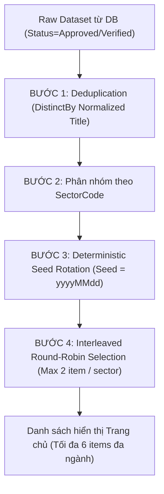

# Kế Hoạch Thiết Kế Kỹ Thuật (plan.md) — TASK-01: Cổng Điều Hướng Home & Sự Kiện BACLINK

> **Mã phân hệ**: `TASK-01`  
> **Version**: 1.4.0  
> **Status**: In Implementation  
> **Ánh xạ Đặc tả**: [`spec.md`](spec.md) | [`CR-BACLINK-004`](deltas/CR-BACLINK-004_home_about_events_services_content.md)  
> **Kiến trúc áp dụng**: Clean Architecture (.NET Core API v1), Contract-First, Next.js 15 App Router, PostgreSQL Schema `portal` / `content`

---

## 1. CONTRACT-FIRST API & DTO SPECIFICATION

### 1.1. Portal Stats Contracts
- **Endpoint**: `GET /api/v1/portal/stats`
- **Output Contract**:
  ```csharp
  public record PortalOverviewStatsDto
  {
      public int TotalOffers { get; init; }
      public int TotalDemands { get; init; }
      public int TotalEnterprises { get; init; }
      public int TotalExperts { get; init; }
      public int TotalProvinces { get; init; } = 63;
      public DateTime UpdatedAt { get; init; }
  }
  ```

### 1.2. Techmart Event Contracts
- **Endpoint 1**: `GET /api/v1/events/techmart?status={upcoming|closed}&page={page}&pageSize={pageSize}`
- **Endpoint 2**: `GET /api/v1/events/techmart/{id}`
- **DTOs**:
  ```csharp
  public record TechmartEventDto
  {
      public Guid Id { get; init; }
      public string Title { get; init; } = default!;
      public string Description { get; init; } = default!;
      public string Location { get; init; } = default!;
      public DateTime StartDate { get; init; }
      public DateTime EndDate { get; init; }
      public string Status { get; init; } = "UPCOMING"; // UPCOMING, HAPPENING, CLOSED
      public int TechnologiesCount { get; init; }
      public string? PdfBrochureUrl { get; init; }
      public string? BannerUrl { get; init; }
  }
  ```
- **Endpoint 3**: `POST /api/v1/events/register`
- **Input Contract**:
  ```csharp
  public record EventRegistrationRequestDto
  {
      public Guid EventId { get; init; }
      public string OrganizationName { get; init; } = default!;
      public string ContactName { get; init; } = default!;
      public string PhoneNumber { get; init; } = default!;
      public string Email { get; init; } = default!;
      public string RoleType { get; init; } = "VISITOR"; // VISITOR, BUYER, SELLER_BOOTH
      public string? Notes { get; init; }
  }
  ```
- **Output Contract**:
  ```csharp
  public record EventRegistrationResponseDto
  {
      public string RegistrationCode { get; init; } = default!;
      public string Status { get; init; } = "CONFIRMED";
      public DateTime RegisteredAt { get; init; }
  }
  ```

### 1.3. AI Quick Assist Contracts
- **Endpoint**: `POST /api/v1/ai/quick-assist`
- **Contract**:
  ```csharp
  public record AiQuickAssistRequestDto
  {
      public string Prompt { get; init; } = default!;
  }
  
  public record AiQuickAssistResponseDto
  {
      public string Reply { get; init; } = default!;
      public string? SuggestedTopic { get; init; } // TRL_GUIDE, PRICING, EXPERT_MATCH
      public string? RedirectUrl { get; init; }
  }
  ```

---

## 2. DATABASE SCHEMA DESIGN (PostgreSQL)

Thiết kế lược đồ quan hệ trong schema `portal`:

```sql
CREATE SCHEMA IF NOT EXISTS portal;

CREATE TABLE IF NOT EXISTS portal.techmart_events (
    id UUID PRIMARY KEY DEFAULT gen_random_uuid(),
    title VARCHAR(255) NOT NULL,
    description TEXT,
    location VARCHAR(255) NOT NULL,
    start_date TIMESTAMPTZ NOT NULL,
    end_date TIMESTAMPTZ NOT NULL,
    status VARCHAR(50) NOT NULL DEFAULT 'UPCOMING',
    technologies_count INT NOT NULL DEFAULT 0,
    pdf_brochure_url VARCHAR(500),
    banner_url VARCHAR(500),
    created_at TIMESTAMPTZ NOT NULL DEFAULT NOW()
);

CREATE TABLE IF NOT EXISTS portal.event_registrations (
    id UUID PRIMARY KEY DEFAULT gen_random_uuid(),
    event_id UUID NOT NULL REFERENCES portal.techmart_events(id) ON DELETE CASCADE,
    organization_name VARCHAR(255) NOT NULL,
    contact_name VARCHAR(255) NOT NULL,
    phone_number VARCHAR(50) NOT NULL,
    email VARCHAR(255) NOT NULL,
    role_type VARCHAR(50) NOT NULL DEFAULT 'VISITOR',
    notes TEXT,
    registration_code VARCHAR(50) NOT NULL UNIQUE,
    status VARCHAR(50) NOT NULL DEFAULT 'CONFIRMED',
    created_at TIMESTAMPTZ NOT NULL DEFAULT NOW()
);

CREATE INDEX IF NOT EXISTS idx_techmart_events_status ON portal.techmart_events(status);
CREATE INDEX IF NOT EXISTS idx_event_reg_code ON portal.event_registrations(registration_code);
```

---

## 3. FRONTEND ARCHITECTURE & 5 UX STATES

### 3.1. Các Màn Hình & Thành Phần Cần Xây Dựng / Nâng Cấp:
1. **`src/components/common/navbar.tsx`**:
   - Nâng cấp Mega-menu 7 mục khớp chính xác với `wireframe_home.html`.
   - Thêm dropdown cho "Chào bán" (Sản phẩm vs Chuyển giao) và "Dịch vụ khác" (Đánh giá TT17 & Tư vấn SHTT).
   - Tích hợp menu tài khoản đăng nhập (Cài đặt & Đăng xuất).
2. **`src/app/page.tsx`**:
   - Thay thế toàn bộ mảng tĩnh `offers` và `demands` bằng dữ liệu gọi từ API thật.
   - Bọc bộ đếm chỉ số và danh sách trong component `<Async>` chuẩn 5 trạng thái UX (Loading Skeleton, Empty State, Error Retry, Success Data).
3. **`src/app/trien-lam/page.tsx` & `src/app/trien-lam/dang-ky-tham-quan/page.tsx`**:
   - Dựng giao diện Lịch sự kiện & Phiên chào giá theo `wireframe_techmart_events.html`.
   - Tabs "Đang/Sắp mở" vs "Đã khép lại".
   - Form đăng ký tham quan/gian hàng có validation dữ liệu và feedback popup.
4. **`src/components/home/AIAssistantWidget.tsx`**:
   - Floating Action Button (FAB) góc phải màn hình kèm badge Trợ lý AI.
   - Hộp thoại hội thoại trượt, tích hợp các gợi ý truy vấn nhanh và kết nối API `/api/v1/ai/quick-assist`.

---

## 4. MA TRẬN RỦI RO & BẢO VỆ PHẠM VI (RISK & QUALITY CONTROL)

1. **Rủi ro rò rỉ mã Đấu giá & Escrow**: Cấm tiệt mọi logic liên quan đến nạp ví, đặt cọc tiền mặt hoặc auto-bid (chặn hoàn toàn theo `PO-DEC-20261008-06`).
2. **Rủi ro N+1 Query thống kê**: Sử dụng `COUNT(*)` trực tiếp hoặc cache in-memory 5 phút cho `PortalOverviewStats`.
3. **Rủi ro Broken Links**: Mọi link trong Mega-menu phải trỏ tới các route đang hoạt động trong hệ thống.

---

## 5. KẾ HOẠCH KIẾN TRÚC DELTA v2: TƯƠI MỚI & ĐA DẠNG HÓA CUNG - CẦU TRANG CHỦ

> **Trọng tâm kiến trúc**: Bảo vệ tính toàn vẹn của Clean Architecture, Non-destructive Migration, triệt tiêu trùng lặp dữ liệu và đa dạng hóa ngành nghề hiển thị trên Trang chủ.

### 5.1. Thuật Toán Xoay Tua Xác Định Hàng Ngày & Phân Bổ Ngành Đan Xen (Deterministic Daily Rotation & Interleaved Sector Selection)

Nhằm đáp ứng `REQ-01-DELTA-01`, `BR-01-DELTA-01` và `BR-01-DELTA-03`, cơ chế lựa chọn bản ghi Cung - Cầu cho Trang chủ được thiết kế theo nguyên tắc 3 bước:



#### Chi tiết thuật toán:
1. **Khởi tạo Seed ngẫu nhiên xác định (Deterministic Seed)**:
   - `int seed = int.Parse(DateTime.UtcNow.ToString("yyyyMMdd"));`
   - Dùng chung seed cho toàn bộ người dùng trong một ngày để đảm bảo tính ổn định phiên (F5 trang chủ không làm xáo trộn vị trí thẻ bất thường, nhưng sang ngày mới sẽ tự động luân phiên bài viết khác).
2. **Khử trùng lặp nội dung trước khi xáo trộn**:
   - Nhóm các bản ghi theo tiêu đề chuẩn hóa `title.Trim().ToLowerInvariant()`, chỉ giữ lại bản ghi có độ ưu tiên cao nhất (cập nhật mới nhất hoặc điểm đánh giá cao nhất).
3. **Xáo trộn ngẫu nhiên nội bộ từng nhóm ngành**:
   - Sử dụng `Random(seed)` để Fisher-Yates shuffle các bài viết bên trong từng nhóm ngành (`SectorCode`) và xáo trộn thứ tự các nhóm ngành.
4. **Thuật toán Đan xen ngành (Interleaved Round-Robin Selection)**:
   - Duyệt vòng tròn (Round-Robin) qua các nhóm ngành, mỗi lượt bốc đúng 1 phần tử đại diện từ ngành đó.
   - Áp dụng ràng buộc cứng: **Tối đa 2 phần tử từ cùng một nhóm ngành** trong kết quả cuối cùng.
   - Dừng lại khi đạt `limit = 6` hoặc hết dữ liệu. Thuật toán đảm bảo tối thiểu từ 3 đến 5 lĩnh vực công nghệ khác nhau được giới thiệu trên màn hình chính.

### 5.2. Cơ Chế Khử Trùng Lặp 2 Lớp (Defense-in-Depth Deduplication)

Nhằm đảm bảo tuân thủ tuyệt đối `REQ-01-DELTA-02` và `BR-01-DELTA-02`:

1. **Lớp 1 — Backend API Level**:
   - **Endpoint Demand** (`GET /api/v1/public/demands`):
     - Lọc `Status == DemandItemStatuses.Verified && IsPublicListed == true`.
     - Áp dụng lọc Distinct bằng `GroupBy(x => x.TechnicalProblem.Trim().ToLowerInvariant()).Select(g => g.OrderByDescending(x => x.CreatedAt).First())`.
   - **Endpoint Technology Offers** (`GET /api/v1/technologies`):
     - Lọc `Status == "APPROVED"`.
     - Áp dụng lọc Distinct bằng `GroupBy(x => x.Title.Trim().ToLowerInvariant()).Select(g => g.OrderByDescending(x => x.PublishedAt ?? x.CreatedAt).First())`.
2. **Lớp 2 — Frontend Client-Side Level**:
   - Ngay cả khi dữ liệu từ nhiều nguồn API hoặc fallback cache trả về, component `page.tsx` thực thi lọc phòng thủ trước khi gán vào React State:
     ```typescript
     const seen = new Set<string>();
     const uniqueListings = rawListings.filter((item) => {
       const key = (item.title || "").trim().toLowerCase();
       if (!key || seen.has(key)) return false;
       seen.add(key);
       return true;
     }).slice(0, 6);
     ```
3. **Triệt tiêu cảnh báo React Key Collision** (`REQ-01-DELTA-04`):
   - Thay thế hoàn toàn cú pháp cũ `key={item.title}` gây cảnh báo trùng lặp bằng:
     ```tsx
     <ListingCard key={`${item.type}-${item.id || item.itemCode || idx}-${idx}`} item={item} />
     ```

### 5.3. Cấu Trúc Ánh Xạ Media Đa Ngành 17 Lĩnh Vực (`technology-media.ts`)

Mở rộng `SECTOR_IMAGE_MAP` phủ trọn 17 mã ngành chuẩn Bộ Khoa học & Công nghệ (`LV01`–`LV17`) theo `REQ-01-DELTA-03`:

| Mã Ngành | Tên Lĩnh Vực KH&CN Chuẩn Hóa | Ảnh Đại Diện Chính (`main`) | Bộ Sưu Tập Phụ (`gallery`) |
| :--- | :--- | :--- | :--- |
| **LV01** | Trồng trọt & Bảo vệ thực vật | `/tech-agri.png` | Agri, Biotech, Solar, AI |
| **LV02** | Chăn nuôi & Thú y | `/tech-agri.png` | Agri, Biotech, Solar, AI |
| **LV03** | Thủy sản & Nuôi trồng hải sản | `/tech-agri.png` | Agri, Biotech, Solar, AI |
| **LV04** | Lâm nghiệp & Phát triển rừng | `/tech-agri.png` | Agri, Biotech, Solar, AI |
| **LV05** | Chế biến nông sản & Thực phẩm - Đồ uống | `/tech-agri.png` | Agri, Biotech, Solar, AI |
| **LV06** | Dệt may & Da giày công nghiệp | `/tech-ai-vision.png` | AI, Solar, Biotech, Agri |
| **LV07** | Cơ khí chế tạo & Công nghiệp hỗ trợ | `/tech-solar.png` | Solar, AI, Biotech, Agri |
| **LV08** | Điện, Điện tử, Tự động hóa & Robot | `/tech-ai-vision.png` | AI, Solar, Biotech, Agri |
| **LV09** | Hóa chất, Vật liệu mới & Công nghệ Nano | `/tech-biotech.png` | Biotech, Solar, AI, Agri |
| **LV10** | Xây dựng, Giao thông & Hạ tầng kỹ thuật | `/tech-solar.png` | Solar, AI, Biotech, Agri |
| **LV11** | Nước, Môi trường & Xử lý chất thải | `/tech-solar.png` | Solar, AI, Biotech, Agri |
| **LV12** | Y tế & Trang thiết bị y tế chuyên dụng | `/tech-biotech.png` | Biotech, AI, Solar, Agri |
| **LV13** | Dược liệu & Y dược học cổ truyền | `/tech-biotech.png` | Biotech, Agri, Solar, AI |
| **LV14** | Công nghệ sinh học & Vi sinh ứng dụng | `/tech-biotech.png` | Biotech, Agri, Solar, AI |
| **LV15** | Năng lượng mới & Năng lượng tái tạo | `/tech-solar.png` | Solar, AI, Biotech, Agri |
| **LV16** | CNTT, Viễn thông & Chuyển đổi số | `/tech-ai-vision.png` | AI, Solar, Biotech, Agri |
| **LV17** | Đổi mới sáng tạo & Chuyển giao công nghệ | `/innovation-hero-background.png` | Hero, AI, Solar, Biotech |

#### Hệ Thống Phân Cấp Ảnh Minh Họa (Visual Fallback Hierarchy):
1. **Bậc 1 (Ưu tiên số 1)**: `customImageUrl` / `mainImageUrl` thực tế từ chủ sở hữu.
2. **Bậc 2**: Mã ngành chuẩn hóa qua `SECTOR_IMAGE_MAP[sectorCode.toUpperCase()]`.
3. **Bậc 3**: Phân tích từ khóa tiếng Việt đa ngữ (nông nghiệp, dược, sinh học, năng lượng, vật liệu...).
4. **Bậc 4 (Mặc định toàn hệ thống)**: `/tech-ai-vision.png`.

### 5.4. Thẩm Định Non-Destructive Migration & Tối Ưu Hiệu Năng CSDL

1. **Bảo toàn Cấu trúc Schema (Zero-Breaking Schema Changes)**:
   - Toàn bộ cơ chế xoay tua và khử trùng lặp được giải quyết ở tầng nghiệp vụ UseCase / Controller và LINQ Query.
   - Không thực hiện bất kỳ lệnh `ALTER TABLE`, không thêm cột mới hoặc xóa bỏ trường dữ liệu nào trong PostgreSQL.
   - Tham số mới trên API (`rotate`, `limit`) hoàn toàn tùy chọn (`optional`), giữ nguyên tương thích 100% với các client hiện hành.
2. **Tối ưu Hóa Chỉ Mục Truy Vấn (Read-Optimized Indexing)**:
   - Đảm bảo các chỉ mục phục vụ truy vấn Trang chủ đạt tốc độ phản hồi $< 100\text{ms}$:
     - `CREATE INDEX IF NOT EXISTS ix_demand_items_home ON demand.demand_items (status, is_public_listed, sector_code);`
     - `CREATE INDEX IF NOT EXISTS ix_seller_offers_home ON technology.seller_technology_offers (status, sector_code);`
3. **Quy Trình Dọn Dẹp Dữ Liệu Rác (Data Sanitization Script)**:
   - Tuyệt đối không dùng lệnh `DELETE` vật lý gây đứt gãy ràng buộc khóa ngoại với các bảng khảo sát hoặc hợp đồng.
   - Sử dụng cập nhật mềm: Đổi cờ `is_public_listed = false` đối với các bản ghi bài toán trùng lặp tiêu đề do quá trình test, chỉ giữ lại 1 bản ghi đại diện hợp lệ cho mỗi tiêu đề bài toán.


---

## 6. KẾ HOẠCH KIẾN TRÚC DELTA v3 (CR-2026-010): CHUẨN HÓA 4 MARKETPLACE METRICS & ZERO-MOCK

### 6.1. Backend Architecture & Clean Architecture Separation
- **Căn cứ**: Quyết định PO-DEC-20261030-01 và CR-2026-010.
- **Nâng cấp DTO Contract** (`SourceCode/backend/modules/content/Application/PortalContracts.cs`):
  ```csharp
  public sealed record PortalOverviewStatsDto(
      int TotalOffers,
      int TotalDemands,
      int TotalEnterprises,
      int TotalExperts,
      int TotalProvinces,
      DateTimeOffset UpdatedAt,
      long TotalSuccessfulConnections = 0,
      decimal TotalEstimatedValueMillionVnd = 0m
  );
  ```
- **Tái cấu trúc ReadModel Service** (`SourceCode/backend/apps/api/V1Compat/PortalOverviewService.cs`):
  + Tuân thủ ranh giới Clean Architecture (§9.1 reporting read model facade): Truy vấn AsNoTracking, in-memory cache 5 phút `portal:overview:stats`.
  + **totalOffers**: Đếm `SellerTechnologyOffer` có `Status = "APPROVED"` (nếu 0, đếm `TechnologyAsset` fallback).
  + **totalDemands**: Đếm `DemandItem` có `Status = "VERIFIED"` và `IsPublicListed = true` (nếu 0, đếm `DemandSurvey` hoặc `DemandBrief`).
  + **totalEnterprises**: Đếm `Enterprise`.
  + **totalExperts**: Đếm `ExpertProfile`.
  + **totalProvinces**: Tính toán động `COUNT(DISTINCT province_city)` từ `enterprise.enterprises` (bỏ hoàn toàn số tĩnh 34).
  + **totalSuccessfulConnections**: Đếm số lượng kết nối thành công từ schema brokerage:
    `COUNT(connection_requests WHERE status IN ("ACCEPTED", "COMPLETED")) + COUNT(mou_agreements WHERE status = "SIGNED")`.
  + **totalEstimatedValueMillionVnd**: Tổng giá trị ước tính từ:
    `SUM(opportunities.estimated_value_million_vnd WHERE stage != "CLOSED_LOST")` cộng với giá trị ngân sách từ các bài toán nhu cầu công khai.
- **Controller**: `PortalControllers.cs` trả về `ApiResponse<PortalOverviewStatsDto>`.

### 6.2. Frontend Presentation Architecture & Zero-Mock
- **SDK Contract** (`SourceCode/frontend/src/lib/portal-client.ts`):
  ```typescript
  export interface PortalOverviewStats {
    totalOffers: number;
    totalDemands: number;
    totalEnterprises: number;
    totalExperts: number;
    totalProvinces: number;
    updatedAt: string;
    totalSuccessfulConnections: number;
    totalEstimatedValueMillionVnd: number;
  }
  ```
- **Trang Chủ (`SourceCode/frontend/src/app/page.tsx`)**:
  + Thay thế 4 thẻ số liệu cũ bằng 4 Marketplace Metrics chuẩn:
    1. **Tổng Cung Công Nghệ**: `statsData.totalOffers` -> `/chao-ban-cong-nghe`
    2. **Tổng Cầu Doanh Nghiệp**: `statsData.totalDemands` -> `/nhu-cau-cong-nghe`
    3. **Kết Nối Thành Công & MOU**: `statsData.totalSuccessfulConnections` -> `/portal/matching/radar` (hoặc `/trien-lam`)
    4. **Quy Mô Giao Dịch & Ngân Sách**: `statsData.totalEstimatedValueMillionVnd` (format tỷ/triệu VNĐ) -> `/portal/opportunities/pipeline`
  + Bao bọc toàn bộ qua component chuẩn `<Async>` đủ 5 UX States (Loading Skeleton, Error Retry, Empty 0, Success formatted, Updating).


---

## 7. KẾ HOẠCH KIẾN TRÚC DELTA BACLINK (`CR-BACLINK-004` · Version 1.4.0)

> **Căn cứ**: [`CR-BACLINK-004`](deltas/CR-BACLINK-004_home_about_events_services_content.md), [`ADR-0018`](../../backend/docs/decisions/ADR-0018-BACLINK-3-TIER-RBAC-AND-CONTENT-REFACTOR.md) (Mục 2.3, 2.5).

### 7.1. Backend Portal Stats, Sự Kiện Giao Thương & AI Prompt (`content` & `api`)
1. **Portal Overview ReadModel (`SourceCode/backend/apps/api/V1Compat/PortalOverviewService.cs`, `PortalControllers.cs`)**:
   - Bảo toàn Clean Architecture facade (`AsNoTracking` + cache 5 phút), đảm bảo 4 KPI trang chủ phản ánh dữ liệu PostgreSQL thật của hệ sinh thái BACLINK:
     * `TotalEnterprises`: đếm `enterprise.enterprises` hội viên (`Status = "ACTIVE"` / đã xác thực).
     * `TotalOffers`: đếm `technology.seller_technology_offers` (`Status = "APPROVED"`).
     * `TotalDemands`: đếm `demand.demand_items` (`Status = "VERIFIED"` và `IsPublicListed = true`).
     * `TotalSuccessfulConnections` & `TotalEstimatedValueMillionVnd`: tổng hợp từ `brokerage.connection_requests` (`ACCEPTED`, `COMPLETED`), `brokerage.mou_agreements` (`SIGNED`) và `brokerage.opportunities`.
2. **Sự kiện Xúc tiến Giao thương Bắc Ninh (`SourceCode/backend/modules/content/Application/TechmartEventService.cs`, `PortalControllers.cs`)**:
   - Đọc danh sách sự kiện trực tiếp từ `content.techmart_events` (nạp qua `seed_baclink_demo_data.sql` gồm 3 sự kiện BACLINK: *Diễn đàn Quản trị bền vững*, *Ngày hội Kết nối Chuỗi cung ứng FDI–Nội địa Bắc Ninh 2026*, *Hội thảo Chuyển đổi xanh & ESG*).
   - Giữ hợp đồng đăng ký tham quan & đặt lịch B2B (`POST /api/v1/events/register` / `POST /api/v1/trien-lam/dang-ky`) lưu vào `content.event_registrations` (ràng buộc khóa ngoại `event_id` $\rightarrow$ `content.techmart_events.id`).
3. **Trợ lý AI BACLINK (`SourceCode/backend/modules/content/Application/AiAssistantService.cs`)**:
   - Chuyển system prompt & ngữ cảnh gợi ý sang **Hiệp hội Sản xuất Công nghiệp tỉnh Bắc Ninh (BACLINK)**, 8 ngành công nghiệp `IND_*`, các KCN Bắc Ninh và 3 cấp tài khoản (`ADMIN`, `ENTERPRISE`, `PUBLIC_USER`); loại bỏ hoàn toàn dẫn chiếu `NacenTech`, `NacenTwin`, `Bộ KH&CN`, `34 Sở KH&CN`.

### 7.2. Frontend Cổng Công Khai BACLINK (`Next.js 15 App Router`)
1. **Trang Chủ (`SourceCode/frontend/src/app/page.tsx`) — `REQ-01-BL-01`, `BR-01-BL-01`**:
   - Hero banner: *"Kết Nối Chuỗi Cung Ứng & Nâng Tầm Công Nghiệp Bắc Ninh"*.
   - 4 thẻ KPI đọc động từ `GET /api/v1/portal/stats` qua `<Async>` (5 UX States: Loading skeleton, Error + Retry, Empty `0`, Success, Updating) — cấm tuyệt đối số tĩnh/fallback giả.
   - Quy trình 4 bước BACLINK: (1) Đăng ký Hội viên $\rightarrow$ (2) Chuẩn hóa Hồ sơ & Năng lực $\rightarrow$ (3) Ghép nối AI Nội địa–FDI $\rightarrow$ (4) Ký kết MOU & Chứng thực số.
   - Khối Đối tác & KCN trọng điểm Bắc Ninh (Yên Phong I/II, Quế Võ I/II/III, VSIP Bắc Ninh, Tiên Sơn, Đại Đồng – Hoàn Sơn, Hanaka, Thuận Thành, Gia Bình) + Hội viên tiêu biểu + 8 sector chips nạp động từ danh mục `IND_*` (`TASK-06`).
2. **Giới Thiệu Pháp Nhân QĐ 1652 & Ma Trận (`gioi-thieu/page.tsx`, `matrix/page.tsx`) — `REQ-01-BL-02`**:
   - `/gioi-thieu`: Hiển thị đầy đủ **Quyết định số 1652/QĐ-UBND ngày 16/06/2025**, trụ sở **Số 7, đường Lý Thái Tổ, P. Suối Hoa, TP. Bắc Ninh**, Đại hội lần thứ I (2025–2028), BCH 28 thành viên, phương châm *"Liên kết - Hợp tác - Đổi mới - Hội nhập"*, định vị *"Công nghiệp xanh - Tử tế - Bắc Ninh"*, Điều lệ & Quyền lợi Hội viên.
   - `/matrix`: Tái cấu trúc thành Ma trận **8 Ngành công nghiệp `IND_*` × Địa bàn/KCN Bắc Ninh** (thay ma trận 18 ngành TT17 & 59 cặp LV-CN cũ).
3. **Sự Kiện Giao Thương (`trien-lam/page.tsx`, `trien-lam/dang-ky-tham-quan/page.tsx`) — `REQ-01-BL-03`**:
   - Tái định vị thành **Sự kiện Xúc tiến Giao thương FDI–Nội địa & Hội chợ Công nghiệp BACLINK**, đọc 100% từ PostgreSQL qua `<Async>`, giữ luồng đăng ký tham quan & lịch hẹn B2B.
4. **Dịch Vụ Hỗ Trợ Hội Viên & Hướng Dẫn 3 Cấp (`dich-vu-khac/page.tsx`, `huong-dan/page.tsx`, `huong-dan/guide-data.ts`) — `REQ-01-BL-04`**:
   - `/dich-vu-khac`: Tái định vị dịch vụ BACLINK (Tư vấn kết nối FDI, Chuẩn hóa ISO/IATF/Lean/ESG, Radar AI ghép nối, Đánh giá Năng lực Nhà máy & CĐS); giữ tinh gọn Card 03 (`REQ-01-SRV-01`, 1 CTA chính trỏ `/khao-sat-dmst`).
   - `/huong-dan` & `guide-data.ts`: Chỉ trình bày hướng dẫn cho **3 cấp** (`ADMIN` duyệt 1 cấp `/admin/*`, `ENTERPRISE` Dual-Mode `RoleSwitcher` `/portal/*`, `PUBLIC_USER` tra cứu & nâng cấp `/profile/upgrade`); xóa 100% hướng dẫn `/gov/*` và 34 Sở KH&CN.
5. **Nhãn Bảo Chứng Công Khai (`SourceCode/frontend/src/components/common/IndexVerificationBadge.tsx`) — `BR-01-BL-02`**:
   - Cập nhật chuỗi mặc định khi `authorityName` rỗng từ `'cơ quan quản lý nhà nước / Sở KH&CN'` sang `'Hiệp hội BACLINK'` (`✓ TRL {X}/9 · Đã chứng thực` / `✓ Đã chứng thực bởi Hiệp hội BACLINK`), vẫn giữ tương thích ngược khi `authorityName` có giá trị cụ thể từ DB.

### 7.3. Chiến Lược Kiểm Thử (`AC-01-009` .. `AC-01-012`)
- **Backend**: `dotnet test` trên `PortalHomeInvariantsTests.cs` kiểm chứng stats thật + event seed + AI assistant context BACLINK.
- **Frontend**: `vitest` cho `page.test.tsx`, `gioi-thieu/page.test.tsx`, `dich-vu-khac/page.test.tsx`, `huong-dan/page.test.tsx`, `IndexVerificationBadge.test.tsx` (và test mới cho `/matrix`, `/trien-lam`); kiểm chứng Zero Brand Leakage (không còn `NacenTech`/`NacenTwin`/`34 Sở KH&CN`/`/gov/`).

---

## Plan Delta v23 (CR-BACLINK-009): CMS
- **DB (non-destructive)**: migration `AddBaclinkCms` tạo `content.cms_articles / cms_documents / cms_media / cms_faqs / cms_partners` (IF NOT EXISTS) + seed 13 bài từ `news-data.ts` (giữ slug) và FAQ quy trình hiện có.
- **API**: `CmsControllers.cs` (facade V1Compat, SQL tham số hóa như `MembershipControllers`): public đọc ẩn danh chỉ `PUBLISHED`; ghi chỉ `RequireAdmin`.
- **FE**: client `lib/cms-client.ts`; trang `/tin-tuc`, `/chinh-sach`, `/tai-lieu`, `/thu-vien`, `/gioi-thieu/{dieu-le,bao-cao-thuong-nien,co-cau-to-chuc/[code]}`; admin `/admin/cms`. Markdown render an toàn (không cho HTML thô).
