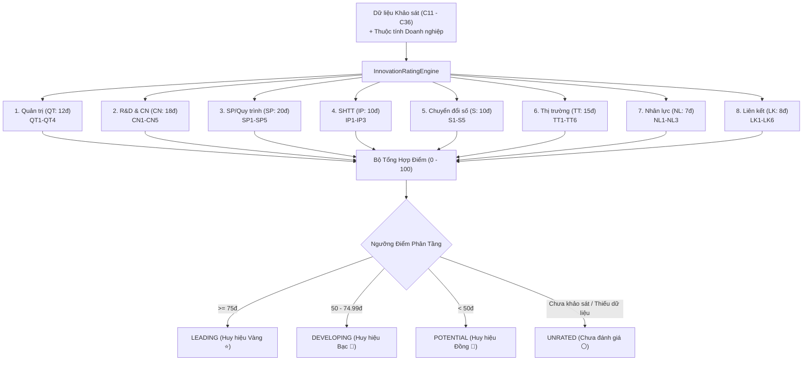

# Kế Hoạch Kỹ Thuật (plan.md) — TASK-02: Hồ Sơ Chủ Thể & 304 Doanh Nghiệp ĐMST

> **Mã phân hệ**: `TASK-02`  
> **Kiến trúc**: Clean Architecture, Modular Monolith .NET Core 8/10, Next.js 15 Tailwind CSS  
> **CSDL**: PostgreSQL 16+ (Schemas `enterprise` & `demand`)  
> **Tài liệu đặc tả**: [`spec.md`](spec.md)  
> **Bộ kiểm thử**: xUnit Invariants, PostgreSQL Integration, Vitest, Playwright E2E

---

## 1. THIẾT KẾ CONTRACT-FIRST (APIS & DTOS)

### 1.1 Danh Sách Endpoints V1

| Mã API | Giao Thức & Đường Dẫn | Quyền Truy Cập (RBAC) | Mục Đích Sử Dụng |
| :--- | :--- | :--- | :--- |
| **`API-02-001`** | `GET /api/v1/enterprises` | Công khai (`PUBLIC_USER` / Ẩn danh) | Danh bạ tra cứu doanh nghiệp công khai (Lọc theo tỉnh, ngành TT17, quy mô, TNI, phân trang). |
| **`API-02-002`** | `GET /api/v1/enterprises/{taxCode}` | Công khai (Có PDPD Masking) | Xem hồ sơ chi tiết công khai của doanh nghiệp theo MST (Doanh thu & SĐT bị ẩn). |
| **`API-02-003`** | `GET /api/v1/portal/enterprise/profile` | Doanh nghiệp (`ENTERPRISE`, `INNOVATIVE_ENTERPRISE`) | Lấy toàn bộ 10 nhóm trường hồ sơ của doanh nghiệp hiện đang đăng nhập (Đầy đủ dữ liệu thật). |
| **`API-02-004`** | `PUT /api/v1/portal/enterprise/profile` | Doanh nghiệp (Owner) | Cập nhật dữ liệu 10 nhóm trường của doanh nghiệp; tự động ghi `system_audit_logs`. |
| **`API-02-005`** | `POST /api/v1/portal/enterprise/submit-verification` | Doanh nghiệp (Owner) | Nộp hồ sơ đề nghị Sở KH&CN thẩm định cấp Verified Badge (Kiểm tra điều kiện `BR-02-003`). |
| **`API-02-006`** | `GET /api/v1/admin/enterprises/dashboard` | Admin / Cán bộ Sở (`PROVINCIAL_ADMIN`, `SUPER_ADMIN`) | Thống kê phân tích kho CSDL 304 DN theo địa bàn, ngành TT17, phân tầng TNI, top khó khăn. |
| **`API-02-007`** | `POST /api/v1/gov/enterprises/{id}/approve` | Cán bộ Sở (`PROVINCIAL_ADMIN` đúng ScopeId) | Phê duyệt hồ sơ doanh nghiệp cấp tỉnh, cấp Verified Badge và ghi audit log. |
| **`API-02-008`** | `POST /api/v1/gov/enterprises/{id}/reject` | Cán bộ Sở (`PROVINCIAL_ADMIN` đúng ScopeId) | Từ chối hoặc yêu cầu bổ sung hồ sơ kèm lý do. |

### 1.2 Chi Tiết DTO Contracts

#### DTO `EnterprisePublicDirectoryDto`:
```json
{
  "items": [
    {
      "id": "e8112d52-8637-4d95-a52b-2fa7e6bf4455",
      "name": "CÔNG TY TNHH MỘT THÀNH VIÊN LÂM NGHIỆP ĐÔNG BẮC",
      "taxCode": "2400120030",
      "subjectType": "ENTERPRISE",
      "provinceCity": "Lạng Sơn",
      "mainSectorName": "Nông nghiệp công nghệ cao, nông nghiệp số",
      "sectorCode": "LV05",
      "workforceScale": "50-dưới 100 người",
      "isVerified": true,
      "tniScore": 62.5,
      "tniClassification": "MEDIUM",
      "ipCount": 0,
      "status": "ACTIVE"
    }
  ],
  "totalCount": 304,
  "page": 1,
  "pageSize": 9,
  "totalPages": 34
}
```

#### DTO `EnterprisePublicDetailDto`:
```json
{
  "id": "e8112d52-8637-4d95-a52b-2fa7e6bf4455",
  "name": "CÔNG TY TNHH MỘT THÀNH VIÊN LÂM NGHIỆP ĐÔNG BẮC",
  "taxCode": "2400120030",
  "subjectType": "ENTERPRISE",
  "establishedDate": null,
  "provinceCity": "Lạng Sơn",
  "addressDetail": "Lạng Sơn",
  "website": null,
  "isVerified": true,
  "mainSectorName": "Nông nghiệp công nghệ cao, nông nghiệp số",
  "ownershipType": "Nhà nước",
  "workforceScale": "50-dưới 100 người",
  "revenueRange": "[BẢO MẬT]",
  "operatingZone": "Ngoài các khu trên",
  "highQualificationRatio": "10–30%",
  "tniScore": 62.5,
  "tniClassification": "MEDIUM",
  "hasRdUnit": false,
  "hasRdBudget": false,
  "isExporting": false,
  "inValueChain": false,
  "topBottlenecks": ["Thiếu vốn", "Thiếu thông tin", "Khó tiếp cận chính sách hỗ trợ"],
  "supportNeeds": ["Hỗ trợ tài chính", "Hỗ trợ đào tạo nhân lực", "Hỗ trợ kết nối đối tác"],
  "projects": [],
  "intellectualProperties": []
}
```

#### DTO `EnterpriseDashboardStatsDto`:
```json
{
  "totalEnterprises": 304,
  "verifiedCount": 304,
  "byProvince": [
    { "province": "Lạng Sơn", "count": 6 },
    { "province": "Hà Nội", "count": 82 }
  ],
  "bySector": [
    { "sector": "Nông nghiệp công nghệ cao, nông nghiệp số", "count": 45 },
    { "sector": "Công nghệ thông tin, chuyển đổi số", "count": 88 }
  ],
  "byTniClassification": [
    { "classification": "HIGH", "count": 52 },
    { "classification": "MEDIUM", "count": 184 },
    { "classification": "LOW", "count": 68 }
  ],
  "topBottlenecks": [
    { "name": "Thiếu vốn", "count": 192 },
    { "name": "Thiếu thông tin", "count": 145 },
    { "name": "Khó tiếp cận chính sách hỗ trợ", "count": 128 }
  ]
}
```

---

## 2. BACKEND ARCHITECTURE PLAN (`SourceCode/backend/`)

### 2.1 Cấu Trúc Thư Mục Module `NacenTech.Modules.Enterprise`
```text
modules/enterprise/NacenTech.Modules.Enterprise/
├── Domain/
│   ├── Enterprise.cs                 # Aggregate Root chính
│   ├── EnterpriseProject.cs          # Thực thể Hoạt động / Dự án ĐMST (1-N)
│   ├── EnterpriseIpAsset.cs          # Thực thể Bằng sáng chế / SHTT (1-N)
│   ├── DemandSurvey.cs               # Thực thể Khảo sát ĐMST & Điểm TNI (304 DN)
│   └── Enums.cs                      # SubjectType, VerificationStatus, TniLevel
├── Application/
│   ├── Contracts/                    # DTOs request/response
│   ├── Queries/                      # GetPublicEnterprises, GetDetail, GetDashboardStats
│   ├── Commands/                     # UpsertProfile, SubmitVerification, ApproveEnterprise
│   └── EnterpriseService.cs          # Nghiệp vụ lõi & BR-02-* validation
├── Infrastructure/
│   ├── Persistence/
│   │   ├── EnterpriseDbContext.cs    # DbContext với Schemas enterprise & demand
│   │   ├── Configurations.cs         # Fluent API mapping & GIN Index
│   │   └── Migrations/               # EF Core Migrations
│   └── Seeders/
│       └── Enterprise304DataSeeder.cs# Tự động nạp seed_304_dn_real_data.sql nếu trống
└── Presentation/
    └── V1Compat/
        └── EnterpriseController.cs   # RESTful Endpoints
```

### 2.2 Schema CSDL PostgreSQL (Hybrid Design)
1. **Bảng `enterprise.enterprises`**:
   - `id` UUID PRIMARY KEY
   - `tax_code` VARCHAR(20) UNIQUE NOT NULL (Index B-Tree)
   - `name` VARCHAR(255) NOT NULL
   - `subject_type` VARCHAR(50) NOT NULL
   - `province_city` VARCHAR(100) NOT NULL (Index B-Tree)
   - `main_sector_name` VARCHAR(255) (Index B-Tree)
   - `ownership_type` VARCHAR(50)
   - `workforce_scale` VARCHAR(50)
   - `revenue_range` VARCHAR(50) (PDPD Protected)
   - `operating_zone` VARCHAR(50)
   - `high_qualification_ratio` VARCHAR(20)
   - `status` VARCHAR(30) DEFAULT 'ACTIVE'
   - `verification_status` VARCHAR(30) DEFAULT 'DRAFT'
   - `created_at`, `updated_at` TIMESTAMPTZ

2. **Bảng `demand.demand_surveys`**:
   - `id` UUID PRIMARY KEY
   - `enterprise_id` UUID REFERENCES `enterprise.enterprises(id)`
   - `survey_code` VARCHAR(50) UNIQUE NOT NULL
   - `survey_year` INT DEFAULT 2024
   - `has_rd_unit`, `has_tech_training`, `has_machinery_upgrade`, `has_rd_budget` BOOLEAN
   - `is_exporting`, `in_value_chain` BOOLEAN
   - `top_bottlenecks` TEXT[]
   - `support_needs` TEXT[]
   - `recommendations` TEXT
   - `tni_score` NUMERIC(5,2)
   - `tni_classification` VARCHAR(20)
   - `survey_answers` JSONB (GIN Index)

---

## 3. FRONTEND ARCHITECTURE PLAN (`SourceCode/frontend/`)

### 3.1 Cấu Trúc Routes & Components
```text
src/app/
├── enterprises/
│   ├── page.tsx                      # MÀN HÌNH 1: Danh bạ tra cứu công khai
│   └── [taxCode]/
│       └── page.tsx                  # MÀN HÌNH 2: Hồ sơ chi tiết công khai (PDPD masked)
├── portal/
│   └── enterprise/
│       └── profile/
│           └── page.tsx              # MÀN HÌNH 3: Kê khai 10 nhóm trường (Owner Workspace)
├── admin/
│   └── enterprises/
│       └── dashboard/
│           └── page.tsx              # MÀN HÌNH 4: Dashboard thống kê 304 DN & TNI
└── gov/
    └── approvals/
        └── enterprises/
            └── page.tsx              # MÀN HÌNH 5: Cổng thẩm định cấp tỉnh (Maker-Checker)
```

### 3.2 Chuẩn Hóa 5 Trạng Thái UX (`<Async>`)
- **Loading**: Skeleton Card cho danh bạ `/enterprises`, Skeleton Tabs cho trang chi tiết.
- **Empty**: Hiển thị illustration rỗng khi bộ lọc không có doanh nghiệp nào phù hợp.
- **Error**: Khung thông báo lỗi thân thiện kèm nút "Thử lại".
- **Success**: Hiển thị dữ liệu trơn tru kèm Verified Badge.
- **Partial**: Phân trang linh hoạt 9 thẻ/trang trên Desktop, Infinite Pagination trên Mobile.

---

## 4. PLAN DELTA V2 (CR-2026-010): THIẾT KẾ KỸ THUẬT NÂNG CẤP DANH BẠ 34 TỈNH TRỌNG ĐIỂM & THÔNG TIN CỐT LÕI

### 4.1 Mở Rộng DTO `EnterprisePublicDirectoryItemDto`
```csharp
public sealed record EnterprisePublicDirectoryItemDto(
    Guid Id,
    string Name,
    string TaxCode,
    string SubjectType,
    string ProvinceCity,
    string MainSectorName,
    string? SectorCode,
    string? WorkforceScale,
    bool IsVerified,
    decimal? TniScore,
    string? TniClassification,
    int IpCount,
    string Status,
    string? OwnershipType,
    string? OperatingZone,
    bool HasRdUnit,
    bool IsExporting,
    bool InValueChain,
    IReadOnlyList<string> TopBottlenecks,
    IReadOnlyList<string> SupportNeeds
);
```

### 4.2 Thiết Kế Chuẩn Hóa Lọc Địa Bàn & Ngành Tại Backend
- **Tỉnh/Thành (`EfEnterpriseRepository.cs`)**:
  - Khi `query.Province` chứa `"hồ chí minh"` hoặc `"tphcm"`:
    `qry = qry.Where(x => x.ProvinceCity.ToLower().Contains("tphcm") || x.ProvinceCity.ToLower().Contains("hồ chí minh"));`
  - Chuẩn hóa Unicode NFC đối với chuỗi tìm kiếm địa phương.
- **Lĩnh vực TT17 (`SectorCode`)**:
  - Ánh xạ từ điển:
    `LV01` $\rightarrow$ `cơ khí, chế tạo, tự động hóa`  
    `LV05` $\rightarrow$ `nông nghiệp`  
    `LV07` $\rightarrow$ `y - dược, sinh học, thiết bị y tế`  
    `LV08` $\rightarrow$ `thông tin, chuyển đổi số`  
    `LV11` $\rightarrow$ `vật liệu`  
    `LV12` $\rightarrow$ `năng lượng, môi trường`  
    `LV14` $\rightarrow$ `điện - điện tử, viễn thông`  
    `LV15` $\rightarrow$ `thực phẩm, đồ uống`  
    `LV16` $\rightarrow$ `dệt may, da giày`  
    `LV17` $\rightarrow$ `logistics`  
    và `chế biến, chế tạo` $\rightarrow$ `LV01`.
  - Truy vấn linh hoạt: `x.SectorCode == query.SectorCode || [khớp từ khóa trong MainSectorName]`.
- **Phân tầng TNI**:
  - Khi lọc `query.TniClassification == "HIGH"`: Khớp cả `x.TniClassification == "HIGH" || x.TniClassification == "VERY_HIGH" || x.TniScore >= 75`.
- **Sắp xếp (`SortBy`)**:
  - Mặc định: `tni_desc` (`TniScore DESC`).
  - `ip_desc`: `IntellectualProperties.Count DESC, TniScore DESC`.
  - `name_asc`: `Name ASC`.
  - `recent`: `CreatedAt DESC`.

### 4.3 Thiết Kế Frontend Enterprise Avatar & Core Card UI
- Component `EnterpriseAvatar`:
  - Input: `name`, `sectorCode`, `mainSectorName`, `taxCode`.
  - Output: Avatar Badge $48 \times 48\text{ px}$, bo tròn `rounded-2xl`, chữ cái đầu in hoa cỡ lớn, huy hiệu icon ngành ở góc nhỏ, màu Gradient theo ngành (Blue cho Cơ khí, Green cho Nông nghiệp, Purple cho CNTT, Emerald cho Môi trường...).
- Phân trang động (Dynamic Pagination Component) có Ellipsis `...`.

---

## 5. PLAN DELTA V3: KIẾN TRÚC BỘ TIÊU CHÍ ĐMST 8 NHÓM & INNOVATIONRATINGENGINE

> **Căn cứ**: `PO-DEC-20261014-03`, `BD-TASK02-INNOVATION-RATING-v1.0`, `spec.md` Mục 7 (Spec Delta v3).  
> **Mục tiêu**: Hiện thực hóa bộ tiêu chí ĐMST 8 nhóm / 37 tiêu chí (Thang 100 điểm), động cơ tính điểm tự động `InnovationRatingEngine` từ 43 câu hỏi khảo sát C11–C36 của 304 DN, bảng đánh giá theo kỳ `enterprise.innovation_evaluations`, Radar Chart 8 trục và API phục vụ giao diện.

### 5.1 Database Schema Phi Phá Hủy (Non-Destructive Migration)

#### 1. Bảng Mới: `enterprise.innovation_evaluations`
Bảng này lưu trữ kết quả đánh giá theo kỳ của từng doanh nghiệp, đảm bảo tính bất biến (`BR-02-010`) và không ghi đè lịch sử:

```sql
-- Migration: AddInnovationEvaluationsTable
CREATE TABLE enterprise.innovation_evaluations (
    id UUID PRIMARY KEY,
    enterprise_id UUID NOT NULL REFERENCES enterprise.enterprises(id) ON DELETE CASCADE,
    tax_code VARCHAR(20) NOT NULL,
    evaluation_year INT NOT NULL,
    criteria_version VARCHAR(20) NOT NULL DEFAULT 'v1.0',
    total_score NUMERIC(5,2) NOT NULL DEFAULT 0.0,
    classification VARCHAR(30) NOT NULL DEFAULT 'UNRATED', -- 'LEADING', 'DEVELOPING', 'POTENTIAL', 'UNRATED'
    group_scores JSONB NOT NULL DEFAULT '{}'::jsonb,
    criteria_details JSONB NOT NULL DEFAULT '[]'::jsonb,
    status VARCHAR(30) NOT NULL DEFAULT 'DRAFT_CALCULATED', -- 'DRAFT_CALCULATED', 'SUBMITTED', 'APPROVED', 'REJECTED'
    reviewed_by VARCHAR(150) NULL,
    reviewed_at TIMESTAMPTZ NULL,
    notes TEXT NULL,
    created_at TIMESTAMPTZ NOT NULL DEFAULT CURRENT_TIMESTAMP,
    updated_at TIMESTAMPTZ NOT NULL DEFAULT CURRENT_TIMESTAMP,
    CONSTRAINT uq_enterprise_evaluation_period UNIQUE (enterprise_id, evaluation_year, criteria_version)
);

CREATE INDEX ix_innovation_evaluations_enterprise_id ON enterprise.innovation_evaluations(enterprise_id);
CREATE INDEX ix_innovation_evaluations_tax_code ON enterprise.innovation_evaluations(tax_code);
CREATE INDEX ix_innovation_evaluations_classification ON enterprise.innovation_evaluations(classification);
CREATE INDEX ix_innovation_evaluations_status ON enterprise.innovation_evaluations(status);
CREATE INDEX ix_innovation_evaluations_group_scores ON enterprise.innovation_evaluations USING GIN (group_scores);
```

#### 2. Nguyên Tắc Di Trú Non-Destructive
- **Bảo toàn dữ liệu hiện hữu**: Không xóa, đổi tên hoặc thay đổi kiểu dữ liệu của bất kỳ cột nào trên các bảng hiện tại (`enterprise.enterprises`, `demand.demand_surveys`).
- **Khóa ngoại an toàn**: Khóa ngoại `enterprise_id` liên kết tới bảng `enterprise.enterprises(id)` với hành vi `ON DELETE CASCADE`.
- **Cơ chế Idempotency & Re-eval**: Tính toán điểm kỳ 2024 từ 304 DN thông qua Seeder/Worker với lệnh `ON CONFLICT (enterprise_id, evaluation_year, criteria_version) DO UPDATE` giúp tái chạy nhiều lần mà không gây lỗi khóa hay mất dữ liệu.

---

### 5.2 Thiết Kế `InnovationRatingEngine` (Động Cơ Chấm Điểm 8 Nhóm / 37 Tiêu Chí)

Động cơ `InnovationRatingEngine` nằm tại tầng `Application/Services` của module `NacenTech.Modules.Enterprise`. Engine nhận dữ liệu từ `enterprise.enterprises` và `demand.demand_surveys.survey_answers` (JSONB) để lượng hóa thành 8 nhóm điểm:



#### Ma Trận Logic Chi Tiết 37 Tiêu Chí:

1. **Nhóm 1: Quản trị ĐMST (QT - Tối đa 12 điểm)**
   - `QT1` (4đ - C15): Kiểm tra `has_rd_budget == true` hoặc `rd_budget_amount > 0` $\rightarrow$ Có ngân sách R&D cố định: 4.0đ; Có nhưng không cố định: 2.0đ; Chưa có: 0đ.
   - `QT2` (3đ - C12): `has_rd_unit == true` $\rightarrow$ 3.0đ; `rd_personnel_count > 0` $\rightarrow$ 1.5đ; Không có: 0đ.
   - `QT3` (2đ - C16): Mảng `governance_platforms`: $\ge 2$ nền tảng ERP/CRM/SCM: 2.0đ; 1 nền tảng: 1.0đ; Chỉ dùng công cụ cơ bản/khác: 0đ.
   - `QT4` (3đ - C20): `innovation_activities.organization == 'Có'` (Đổi mới mô hình quản trị trong 3 năm) $\rightarrow$ 3.0đ; 'Không': 0đ.

2. **Nhóm 2: R&D và Công nghệ (CN - Tối đa 18 điểm)**
   - `CN1` (5đ - C22): Mảng `tech_acquisition` chứa "R&D nội bộ" hoặc hoạt động tự nghiên cứu $\rightarrow$ 5.0đ; Không: 0đ.
   - `CN2` (4đ - C14): `has_machinery_upgrade == true` (Đầu tư máy móc/công nghệ mới trong 3 năm) $\rightarrow$ 4.0đ; Không: 0đ.
   - `CN3` (3đ - C22): `tech_acquisition` chứa "Mua công nghệ mới" hoặc "Mua bản quyền/bí quyết" $\rightarrow$ 3.0đ; Không: 0đ.
   - `CN4` (4đ - C22): `tech_acquisition` chứa "Chuyển giao công nghệ" từ Viện/Trường/Đối tác $\rightarrow$ 4.0đ; Không: 0đ.
   - `CN5` (2đ - C31): `innovation_results` chứa quy trình công nghệ mới hoặc giải pháp kỹ thuật $\rightarrow$ 2.0đ; Không: 0đ.

3. **Nhóm 3: Sản phẩm / Quy trình (SP - Tối đa 20 điểm)**
   - `SP1` (5đ - C17): `innovation_activities.new_product == 'Có'` (Sản phẩm/dịch vụ mới) $\rightarrow$ 5.0đ; Không: 0đ.
   - `SP2` (4đ - C18): `innovation_activities.improved_product == 'Có'` (Cải tiến đáng kể sản phẩm) $\rightarrow$ 4.0đ; Không: 0đ.
   - `SP3` (5đ - C19): `innovation_activities.process == 'Có'` (Đổi mới quy trình sản xuất/vận hành) $\rightarrow$ 5.0đ; Không: 0đ.
   - `SP4` (3đ - C32): Mảng `innovation_results`: $\ge 2$ kết quả được thương mại hóa: 3.0đ; 1 kết quả: 1.5đ; 0: 0đ.
   - `SP5` (3đ - C23+C34): Mảng `recorded_impacts`: Chứa tác động tăng năng suất hoặc giảm chi phí: có $\ge 2$ tác động: 3.0đ; 1 tác động: 1.5đ; Không: 0đ.

4. **Nhóm 4: Sở hữu trí tuệ (IP - Tối đa 10 điểm)**
   - `IP1` (5đ - C31 & Entity `IntellectualProperties`): Có Bằng Độc quyền Sáng chế hoặc Giải pháp hữu ích $\rightarrow$ 5.0đ; Có Nhãn hiệu/Kiểu dáng công nghiệp: 3.0đ; Chưa có: 0đ.
   - `IP2` (3đ - C31): Mảng `ip_assets` chứa "Bí quyết kỹ thuật" hoặc "Phần mềm máy tính" $\rightarrow$ 3.0đ; Không: 0đ.
   - `IP3` (2đ - Tự kê khai): Có hoạt động thương mại hóa/li-xăng tài sản trí tuệ $\rightarrow$ 2.0đ; Dữ liệu khảo sát cũ gán mặc định: 0đ (cho phép cập nhật qua cổng tự khai).

5. **Nhóm 5: Chuyển đổi số (S - Tối đa 10 điểm)**
   - `S1` (2đ - C24): `digital_strategy == 'Đã ban hành chiến lược'` $\rightarrow$ 2.0đ; 'Đang xây dựng': 1.0đ; 'Chưa có': 0đ.
   - `S2` (2đ - C25): `digital_maturity`: Mức 'Nâng cao' hoặc 'Toàn diện': 2.0đ; Mức 'Cơ bản/Đang mở rộng': 1.0đ; 'Khởi đầu': 0đ.
   - `S3` (2đ - C26): Mảng `digitized_activities`: Số hóa $\ge 3$ khâu: 2.0đ; 1–2 khâu: 1.0đ; 0 khâu: 0đ.
   - `S4` (3đ - C27): Mảng `applied_technologies`: Chứa Cloud/AI/IoT/Big Data $\rightarrow$ 3.0đ; Phần mềm chuyên môn hóa khác: 1.5đ; 'Không áp dụng': 0đ.
   - `S5` (1đ - C16): Vận hành số tích hợp (sử dụng nền tảng số trong điều hành) $\rightarrow$ 1.0đ; Không: 0đ.

6. **Nhóm 6: Thị trường (TT - Tối đa 15 điểm)**
   - `TT1` (5đ - C33): `revenue_ratio_from_innovation`: 'Trên 50%' hoặc 'Từ 30% đến 50%': 5.0đ; 'Từ 10% đến dưới 30%': 3.0đ; 'Dưới 10%': 1.0đ; 'Không có': 0đ.
   - `TT2` (2đ - C21): `innovation_activities.marketing == 'Có'` (Đổi mới tiếp thị, mở rộng thị trường mới) $\rightarrow$ 2.0đ; 'Không': 0đ.
   - `TT3` (3đ - C34): `recorded_impacts` chứa "Tăng doanh thu" hoặc "Mở rộng thị phần": 3.0đ; 1 tác động khác: 1.5đ; Không: 0đ.
   - `TT4` (2đ - C35): `is_exporting == true` $\rightarrow$ 2.0đ; Chỉ phục vụ thị trường nội địa: 0đ.
   - `TT5` (2đ - C36): `in_value_chain == true` (Tham gia mạng lưới cung ứng toàn cầu hoặc khu vực) $\rightarrow$ 2.0đ; Không: 0đ.
   - `TT6` (1đ - C32+C34): Nâng cao vị thế và uy tín thương hiệu ĐMST trên thị trường $\rightarrow$ 1.0đ; 0đ.

7. **Nhóm 7: Nhân lực KH&CN (NL - Tối đa 7 điểm)**
   - `NL1` (2đ - C11): `high_qualification_ratio`: Tỷ lệ ĐH/CĐ '> 30%': 2.0đ; '10–30%': 1.0đ; '< 10%': 0.5đ; Khác: 0đ.
   - `NL2` (3đ - C12): `has_rd_unit == true`: 3.0đ; có nhân sự kỹ thuật/R&D kiêm nhiệm: 1.5đ; Không: 0đ.
   - `NL3` (2đ - C13): `has_tech_training == true` (Hàng năm có cử nhân sự đào tạo nâng cao công nghệ) $\rightarrow$ 2.0đ; Không: 0đ.

8. **Nhóm 8: Liên kết & Hợp tác (LK - Tối đa 8 điểm)**
   - `LK1` (2đ - C28 ĐH+Viện): `collaborations.universities` hoặc `research_institutes` khác 'Không' $\rightarrow$ 2.0đ; 'Không': 0đ.
   - `LK2` (1đ - C28 DN): `collaborations.other_enterprises` khác 'Không' $\rightarrow$ 1.0đ; 'Không': 0đ.
   - `LK3` (1đ - C28 Tổ chức hỗ trợ): `collaborations.innovation_centers` khác 'Không' $\rightarrow$ 1.0đ; 'Không': 0đ.
   - `LK4` (1đ - C28 Quỹ + C30): `collaborations.investment_funds` khác 'Không' hoặc `accessed_funds` khác 'Không' $\rightarrow$ 1.0đ; 'Không': 0đ.
   - `LK5` (1đ - C28 NN + C29): `collaborations.state_agencies` khác 'Không' hoặc `received_public_support` khác 'Không' $\rightarrow$ 1.0đ; 'Không': 0đ.
   - `LK6` (2đ - C28 Quốc tế): `collaborations.international_orgs` khác 'Không' $\rightarrow$ 2.0đ; 'Không': 0đ.

---

### 5.3 Thiết Kế Contracts & DTOs

#### DTO `InnovationEvaluationDto`:
```csharp
public sealed record InnovationCriteriaDetailDto(
    string CriteriaCode,
    string CriteriaName,
    decimal MaxScore,
    decimal Score,
    string? SourceQuestion,
    string? ReviewerComment = null
);

public sealed record InnovationGroupScoreDto(
    string GroupCode,
    string GroupName,
    decimal MaxScore,
    decimal Score,
    decimal Percentage,
    IReadOnlyList<InnovationCriteriaDetailDto>? CriteriaList = null
);

public sealed record RadarAxisDto(
    string Axis,
    decimal Value,
    decimal MaxValue,
    int FullMark = 100
);

public sealed record InnovationEvaluationDto(
    Guid Id,
    Guid EnterpriseId,
    string TaxCode,
    int EvaluationYear,
    string CriteriaVersion,
    decimal TotalScore,
    string Classification,          // "LEADING", "DEVELOPING", "POTENTIAL", "UNRATED"
    string ClassificationLabel,     // "Dẫn đầu", "Đang phát triển", "Tiềm năng", "Chưa đánh giá"
    string BadgeName,               // "Huy hiệu Vàng ĐMST", "Huy hiệu Bạc ĐMST", "Huy hiệu Đồng ĐMST"
    string Status,                  // "DRAFT_CALCULATED", "SUBMITTED", "APPROVED", "REJECTED"
    string? ReviewedBy,
    DateTimeOffset? ReviewedAt,
    IReadOnlyList<InnovationGroupScoreDto> GroupScores,
    IReadOnlyList<RadarAxisDto> RadarChartData,
    IReadOnlyList<InnovationCriteriaDetailDto>? CriteriaDetails = null // Che giấu với công chúng theo PDPD BR-02-011
);
```

---

### 5.4 Thiết Kế API Contract

#### Endpoint `GET /api/v1/enterprises/{taxCode}/innovation-rating`
- **Quyền truy cập**: Public (Công khai) kèm PDPD Masking theo `BR-02-011`.
- **Logic xử lý**:
  1. Tìm hồ sơ doanh nghiệp theo `taxCode`. Nếu không tồn tại $\rightarrow$ Trả về `404 Not Found`.
  2. Truy vấn kỳ đánh giá mới nhất từ `enterprise.innovation_evaluations`.
  3. Nếu chưa có bản ghi đánh giá nhưng có câu trả lời khảo sát trong `demand_surveys` $\rightarrow$ Tự động kích hoạt `InnovationRatingEngine.CalculateScore()` để sinh kết quả sơ bộ `DRAFT_CALCULATED`.
  4. Nếu không có bất kỳ dữ liệu khảo sát nào $\rightarrow$ Trả về DTO với `Classification = "UNRATED"`, `TotalScore = 0`, các trục Radar Chart mang giá trị 0.
  5. Áp dụng quy tắc PDPD (`BR-02-011`):
     - Với Khách vãng lai / Public: Ẩn `CriteriaDetails` (trả về `null`) để không để lộ chi tiết doanh thu C33 và ngân sách R&D C15.
     - Với `ENTERPRISE_OWNER` và `PROVINCIAL_ADMIN` (đúng địa bàn): Trả về trọn vẹn danh sách 37 tiêu chí `CriteriaDetails`.
- **Cấu trúc JSON Response**:
```json
{
  "code": 200,
  "data": {
    "id": "c1f7a28b-9021-4f47-817c-2b2260d84311",
    "enterpriseId": "e8112d52-8637-4d95-a52b-2fa7e6bf4455",
    "taxCode": "2400120030",
    "evaluationYear": 2024,
    "criteriaVersion": "v1.0",
    "totalScore": 68.5,
    "classification": "DEVELOPING",
    "classificationLabel": "Đang phát triển",
    "badgeName": "Huy hiệu Bạc ĐMST",
    "status": "APPROVED",
    "reviewedBy": "Sở KH&CN Lạng Sơn",
    "reviewedAt": "2024-10-14T08:00:00Z",
    "groupScores": [
      { "groupCode": "QT", "groupName": "Quản trị", "maxScore": 12.0, "score": 8.0, "percentage": 66.7 },
      { "groupCode": "CN", "groupName": "R&D và Công nghệ", "maxScore": 18.0, "score": 12.0, "percentage": 66.7 },
      { "groupCode": "SP", "groupName": "Sản phẩm / Quy trình", "maxScore": 20.0, "score": 15.0, "percentage": 75.0 },
      { "groupCode": "IP", "groupName": "Sở hữu trí tuệ", "maxScore": 10.0, "score": 5.0, "percentage": 50.0 },
      { "groupCode": "S",  "groupName": "Chuyển đổi số", "maxScore": 10.0, "score": 7.0, "percentage": 70.0 },
      { "groupCode": "TT", "groupName": "Thị trường", "maxScore": 15.0, "score": 10.5, "percentage": 70.0 },
      { "groupCode": "NL", "groupName": "Nhân lực", "maxScore": 7.0, "score": 5.0, "percentage": 71.4 },
      { "groupCode": "LK", "groupName": "Liên kết", "maxScore": 8.0, "score": 6.0, "percentage": 75.0 }
    ],
    "radarChartData": [
      { "axis": "Quản trị", "value": 8.0, "maxValue": 12.0, "fullMark": 100 },
      { "axis": "R&D & CN", "value": 12.0, "maxValue": 18.0, "fullMark": 100 },
      { "axis": "SP / Quy trình", "value": 15.0, "maxValue": 20.0, "fullMark": 100 },
      { "axis": "Sở hữu trí tuệ", "value": 5.0, "maxValue": 10.0, "fullMark": 100 },
      { "axis": "Chuyển đổi số", "value": 7.0, "maxValue": 10.0, "fullMark": 100 },
      { "axis": "Thị trường", "value": 10.5, "maxValue": 15.0, "fullMark": 100 },
      { "axis": "Nhân lực", "value": 5.0, "maxValue": 7.0, "fullMark": 100 },
      { "axis": "Liên kết", "value": 6.0, "maxValue": 8.0, "fullMark": 100 }
    ]
  }
}
```


