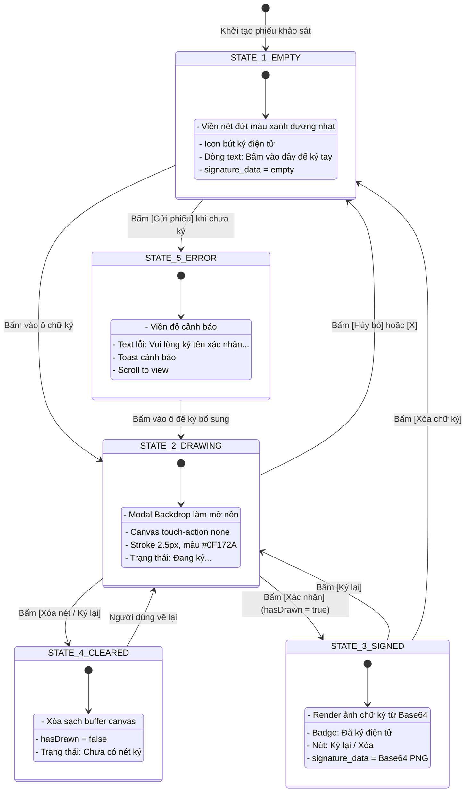

# Change Request: CR-TASK-03-DELTA-02 Chuẩn Hóa Chữ Ký Tay Cảm Ứng Điện Tử (Touch Digital Signature Pad Shared Component)

**CR-ID**: `CR-TASK-03-DELTA-02`  
**Phân hệ chủ quản**: `TASK-03_HO_SO_TIM_MUA_BUYER` (Khảo sát nhu cầu công nghệ chuyên sâu `/khao-sat-nhu-cau`)  
**Phân hệ phối hợp**: `TASK-00_PLATFORM_FOUNDATION_VA_COMMON` (Shared Components), `TASK-07_PHAN_QUYEN_QUAN_TRI_ADMIN` (Audit log & Tiếp nhận hồ sơ Sở KH&CN)  
**Trạng thái**: `APPROVED` (Phê duyệt bởi Product Owner ngày 04/11/2026)  
**Phiên bản mục tiêu (Target SemVer)**: `1.15.0`  
**Tác giả**: Senior Business Analyst NacenTech (`nacen-ba`)  
**Ngày ban hành**: 04/11/2026  
**Căn cứ pháp lý & Thiết kế cơ sở**:
- Luật Giao dịch điện tử số 20/2023/QH15 được Quốc hội thông qua ngày 22/06/2023 (Hiệu lực từ 01/07/2024), quy định về chữ ký điện tử và giá trị pháp lý của thông điệp dữ liệu.
- Nghị định 13/2023/NĐ-CP của Chính phủ về Bảo vệ Dữ liệu Cá nhân (PDPD).
- Hiến pháp Quản trị Đặc tả Spec-Kit tại [`SourceCode/specs/SPEC_MANAGEMENT_CONSTITUTION.md`](file:///Users/luongdt/Library/CloudStorage/GoogleDrive-luongdt.wi@gmail.com/My%20Drive/NacenTechProject/SourceCode/specs/SPEC_MANAGEMENT_CONSTITUTION.md).
- Quyết định Phê duyệt Kế hoạch Delta Đợt 1 của Product Owner ngày 04/11/2026.
- Basic Design Wireframe chuẩn hóa tại [`Specification/XUAT_MAN_HINH_WEB_HTML/25_web_khao_sat_nhu_cau_cong_nghe_dnnvv.html`](file:///Users/luongdt/Library/CloudStorage/GoogleDrive-luongdt.wi@gmail.com/My%20Drive/NacenTechProject/Specification/XUAT_MAN_HINH_WEB_HTML/25_web_khao_sat_nhu_cau_cong_nghe_dnnvv.html).

---

## 1. Tuyên Bố Thay Đổi (Change Statement & Căn Cứ Nghiệp Vụ)

### 1.1. Hiện trạng Cũ (As-Is / Current State)
- Tại Bước 5 (**Xác Nhận & Cam Kết PDPD**) của phiếu khảo sát trực tuyến (`/khao-sat-nhu-cau` và phiếu khảo sát năng lực ĐMST `/khao-sat-dmst`), form chỉ yêu cầu nhập dạng Text: *Họ và tên người đại diện xác nhận*, *Ngày xác nhận* và một hộp kiểm *Checkbox đồng ý điều khoản*.
- **Hoàn toàn chưa có cơ chế thu thập chữ ký số hoặc chữ ký tay điện tử trực tiếp** của người đại diện theo phong cách ký điện tử cảm ứng (Touch Digital Signature).
- Doanh nghiệp không thể hiện được tính cam kết pháp lý trực tiếp (handwriting signature gesture) trên văn bản điện tử trước khi gửi về Viện NacenTech và Sở KH&CN.

### 1.2. Hậu quả & Nỗi đau Nghiệp vụ (Business Pain Points)
1. **Thiếu tính xác thực và tính chống chối bỏ (Non-Repudiation)**: Nếu xảy ra tranh chấp về thông tin nhu cầu hoặc dữ liệu bí mật kinh doanh, doanh nghiệp có thể phủ nhận với lý do người điền form không phải người có thẩm quyền hoặc form bị điền bừa bãi.
2. **Trải nghiệm thiếu trang trọng và chưa đạt chuẩn văn bản hành chính điện tử**: Hồ sơ khảo sát công nghệ phục vụ Hội đồng Khoa học cấp Nhà nước đòi hỏi tính trang trọng tương đương biên bản nghiệm thu hoặc bản cam kết chính thức.
3. **Bất tiện khi xử lý trên thiết bị di động**: Trước đây người dùng muốn ký phải in ra giấy, ký rồi chụp ảnh scan tải lên, gây đứt gãy tỷ lệ hoàn tất biểu mẫu (Conversion drop).

### 1.3. Đề Xuất Chuẩn Hóa (To-Be / Proposed State)
1. **BẮT BUỘC PHẢI KÝ (Mandatory Electronic Signature)**: Bổ sung trường Chữ ký điện tử của người đại diện vào Bước 5 kèm nhãn dấu sao đỏ `*`. Nếu người dùng chưa ký mà bấm submit, hệ thống kích hoạt Validation chặn lại, hiển thị thông báo lỗi và tự động cuộn (smooth scroll) đến ô chữ ký.
2. **Chuẩn hoá thành Shared Component**: Xây dựng thành bộ thành phần dùng chung `<TouchSignaturePadModal />` và `<SignatureTriggerBox />`, áp dụng ngay cho `/khao-sat-nhu-cau` và sẵn sàng tái sử dụng 100% cho `/khao-sat-dmst` cũng như các hợp đồng điện tử của Deal Room sau này.
3. **Hỗ trợ Đa phương thức Nhập liệu (Mouse & Touch-action: none)**:
   - Trên điện thoại thông minh và tablet: Người dùng dùng ngón tay hoặc bút cảm ứng (stylus) để ký trực tiếp trên màn hình mượt mà, không bị hiện tượng cuộn trang ngoài ý muốn nhờ cơ chế `touch-action: none` và `e.preventDefault()`.
   - Trên máy tính để bàn / laptop: Người dùng dùng chuột hoặc trackpad để ký dễ dàng.
4. **Cơ chế Xem trước & Quản lý Chữ ký linh hoạt**:
   - Sau khi ký và bấm "Xác nhận & Sử dụng chữ ký", chữ ký được render lập tức trong hộp xem trước (Signature Preview Box) với ảnh nét vẽ sắc nét và Badge `✓ Đã ký điện tử`.
   - Cho phép người dùng bấm [Ký lại] hoặc [Xóa chữ ký] bất cứ lúc nào trước khi gửi.
5. **Lưu trữ Chuẩn hóa Dạng Base64 PNG Data URL**: Toàn bộ nét ký được xuất thành chuỗi `data:image/png;base64,...`, lưu vào CSDL, đồng bộ vào Bản nháp (LocalStorage Draft) và nhúng trực tiếp vào phiếu tiếp nhận (Ticket Modal) và bản in PDF xác nhận.

---

## 2. Đánh Giá Tác Động Đa Bề Mặt (Cross-Surface & Cross-Epic Impact Matrix)

| Bề Mặt Kiến Trúc | Mức Độ Tác Động | Chi Tiết Tác Động | Biện Pháp Can Thiệp & Kế Thừa |
| :--- | :---: | :--- | :--- |
| **1. Basic Design Wireframe (`Specification/`)** | **ĐÃ HOÀN TẤT** | Cập nhật file `25_web_khao_sat_nhu_cau_cong_nghe_dnnvv.html` (cả trong thư mục gốc và `Specification/`). Bổ sung ô trigger, modal canvas ký tay cảm ứng, script xử lý mouse/touch, validation và export JSON/Print. | Đồng bộ 100% giữa 2 cây thư mục HTML. |
| **2. Living Spec (`SourceCode/specs/`)** | **CAO** | Bổ sung mỏ neo bất biến: `REQ-SIG-01`, `REQ-SIG-02`, `REQ-SIG-03`, `BR-SIG-01`, `BR-SIG-02`, `BR-SIG-03`, `UI-SIG-PAD-01`, `TEST-SIG-01` $\rightarrow$ `TEST-SIG-05`. | Cập nhật `spec.md`, `plan.md`, `tasks.md` của `TASK-03`. Bump SemVer lên `1.15.0`. |
| **3. CSDL PostgreSQL (`Schema`)** | **THẤP** | Bảng `demand.demand_surveys` (hoặc CSDL phiếu khảo sát chuyên sâu): Bổ sung cột `representative_signature_url TEXT NULL` (hoặc lưu trực tiếp Data URL Base64 đối với bản nháp và S3 URL đối với bản nộp chính thức). | Tùy chọn migration EF Core thêm cột nullable, hoàn toàn tương thích ngược (non-breaking). |
| **4. Backend API (`.NET / C#`)** | **TRUNG BÌNH** | DTO `SubmitDeepSurveyRequest`: Bổ sung thuộc tính `string SignatureDataUrl` có validator kiểm tra dữ liệu hình ảnh hợp lệ. Service xử lý lưu trữ và audit log. | Cập nhật `DemandSurveyController.cs` và `SubmitDeepSurveyCommand.cs`. |
| **5. Frontend Web Portal (`Next.js / React`)** | **CAO** | Xây dựng Shared Component `SignaturePadModal.tsx` và tích hợp tại form khảo sát `src/app/khao-sat-nhu-cau/page.tsx`. Tích hợp xử lý Canvas DPR, Touch events, LocalStorage preview. | Đảm bảo tính tái sử dụng cho form `/khao-sat-dmst`. |
| **6. Testing & QC Automation** | **TRUNG BÌNH** | Viết test case Playwright E2E mô phỏng hành vi vuốt vẽ cảm ứng (Touch drag) và chuột (Mouse drag), kiểm tra validation chặn gửi khi thiếu chữ ký. | Bổ sung test suites theo mã `TEST-SIG-*`. |

---

## 3. Danh Mục Yêu Cầu Chức Năng Mới Với Mỏ Neo Bất Biến (Immutable Anchors)

### 3.1. [ADD] `REQ-SIG-01`: Bảng Ký Điện Tử Cảm Ứng (Touch Digital Signature Pad Modal)
- **Kích hoạt giao diện**: Người dùng nhấp vào khung *"Bấm vào đây để ký tay / Chữ ký điện tử"* tại Bước 5 để mở modal popup ký tên.
- **Hỗ trợ Canvas Tương Tác Cao**:
  - Khung Canvas có kích thước vật lý tối ưu (chiều cao 220px, chiều rộng tự co giãn 100% theo màn hình container, tối đa 570px trên desktop).
  - Tự động chuẩn hóa độ nét Retina/High-DPI bằng cách nhân hệ số `window.devicePixelRatio` vào thuộc tính buffer `canvas.width` và `canvas.height`, sau đó co về kích thước CSS pixel hiển thị.
  - Ngăn ngừa hoàn toàn hành vi cuộn trang không mong muốn trên thiết bị di động (Mobile/Tablet) bằng thuộc tính CSS `touch-action: none` và lệnh `e.preventDefault()` trong các sự kiện `touchstart`, `touchmove`.
  - Hỗ trợ đầy đủ bộ sự kiện con trỏ: Mouse (`mousedown`, `mousemove`, `mouseup`, `mouseleave`) và Touch (`touchstart`, `touchmove`, `touchend`, `touchcancel`).
  - Đường nét ký có độ dày 2.5px, bo tròn đầu nét (`lineCap = 'round'`, `lineJoin = 'round'`), màu mực xanh than đậm chuẩn văn bản (`#0F172A`).
- **Nút Điều Khiển Trong Modal**:
  - `[Xóa nét / Ký lại]`: Xóa toàn bộ nội dung trong canvas, đặt lại cờ trạng thái `hasDrawn = false`, hiển thị lại văn bản gợi ý *"Ký tên vào khung này"*.
  - `[Hủy bỏ]`: Đóng modal mà không ghi đè hoặc thay đổi chữ ký hiện tại (nếu trước đó đã ký).
  - `[Xác nhận & Sử dụng chữ ký]`: Kiểm tra tính hợp lệ của nét ký; nếu hợp lệ, xuất hình ảnh dạng Base64 PNG, gán vào form và đóng modal.

### 3.2. [ADD] `REQ-SIG-02`: Hiển Thị Xem Trước & Quản Lý Chữ Ký Trên Phiếu (Preview Box)
- **Hiển thị trực quan**: Ngay sau khi người dùng bấm xác nhận chữ ký trong modal, giao diện tại Bước 5 chuyển đổi trạng thái từ *Khung chờ ký* sang *Khung xem trước chữ ký (Signature Preview Box)*.
- **Thành phần hộp xem trước**:
  - Hình ảnh chữ ký render sắc nét trên nền sáng chống lóa.
  - Nhãn trạng thái chuẩn hóa: `✓ Đã ký điện tử` màu xanh lục (Emerald badge).
  - Nút `[Ký lại]`: Mở lại modal ký tên để người dùng vẽ lại nét ký mới thay thế nét cũ.
  - Nút `[Xóa chữ ký]`: Xóa hoàn toàn dữ liệu chữ ký khỏi form, đưa ô về trạng thái trống ban đầu và cập nhật lại thanh tiến độ khảo sát.
- **Tự động lưu vào Bản nháp (Auto-Save Draft)**: Chuỗi Base64 chữ ký được lưu tự động vào `localStorage` cùng với toàn bộ thông tin khảo sát, cho phép khôi phục nguyên vẹn trạng thái chữ ký khi người dùng tải lại trang hoặc tải bản nháp đã lưu.

### 3.3. [ADD] `REQ-SIG-03`: Toàn Vẹn Dữ Liệu & Cam Kết Bảo Mật PDPD
- **Định dạng dữ liệu**: Chữ ký được đóng gói dưới định dạng Data URL `data:image/png;base64,...`.
- **Ràng buộc toàn vẹn hồ sơ**:
  - Chữ ký điện tử không tồn tại độc lập mà gắn chặt với:
    1. Họ và tên người đại diện xác nhận (`confirm_name`).
    2. Ngày xác nhận (`confirm_date`).
    3. Hộp kiểm cam kết chịu trách nhiệm về thông tin cung cấp (`confirm_agree = true`).
    4. Mã tiếp nhận hồ sơ duy nhất do hệ thống sinh ra (`ticket_id`).
- **Bảo mật PDPD**: Dữ liệu chữ ký được lưu trữ bảo mật trong cơ sở dữ liệu của Viện NacenTech theo tiêu chuẩn Nghị định 13/2023/NĐ-CP, tuyệt đối không bị index trên các công cụ tìm kiếm công cộng.

---

## 4. Danh Mục Quy Tắc Nghiệp Vụ Mới (Business Rules)

### 4.1. [ADD] `BR-SIG-01`: Bắt Buộc Ký Xác Nhận Điện Tử Trước Khi Gửi Phiếu (Mandatory Validation)
- **Mức độ bắt buộc**: Trường chữ ký là trường **bắt buộc 100% (Mandatory)** đối với mọi đối tượng nộp phiếu khảo sát nhu cầu công nghệ.
- **Quy tắc chặn lỗi (Validation Gate)**:
  - Khi người dùng bấm nút `[Kiểm Tra & Gửi Phiếu Khảo Sát]`, hệ thống kiểm tra trường ẩn `signature_data`.
  - Nếu trường `signature_data` có giá trị rỗng (`""`), `null` hoặc độ dài không đạt chuẩn ảnh Base64:
    1. Ngăn chặn sự kiện submit form (`event.preventDefault()`).
    2. Tự động cuộn màn hình mượt mà (smooth scroll) định vị đến khung chữ ký `signature-trigger-box`.
    3. Hiển thị thông báo lỗi màu đỏ ngay dưới ô ký: *"⚠ Vui lòng ký tên xác nhận điện tử trước khi gửi phiếu khảo sát!"*.
    4. Kích hoạt Toast cảnh báo: *"Vui lòng ký tên xác nhận điện tử trước khi gửi phiếu khảo sát!"*.

### 4.2. [ADD] `BR-SIG-02`: Tiêu Chuẩn Kỹ Thuật Nét Ký & Độ Phân Giải Tối Thiểu
- **Định dạng chuẩn**: Hình ảnh phải là PNG trong suốt (`image/png`), mã hóa Base64 MIME.
- **Tiêu chuẩn chống gian lận nét ký (Anti-Blank Signature)**:
  - Hệ thống không cho phép bấm "Xác nhận & Sử dụng chữ ký" nếu cờ `hasDrawn === false`.
  - Nếu người dùng mở modal nhưng chưa tạo bất kỳ nét vẽ nào mà bấm xác nhận, hệ thống báo lỗi: *"Vui lòng ký tên vào khung trước khi bấm xác nhận!"*.
- **Độ nét hiển thị**: Nét ký trên canvas và trong ảnh xuất ra phải đạt độ phân giải tối thiểu tương đương 1.5x đến 2x tỷ lệ pixel vật lý của thiết bị di động, đảm bảo khi in ra bản giấy A4 (qua nút "In phiếu xác nhận") không bị vỡ hạt hoặc mờ nhòe.

### 4.3. [ADD] `BR-SIG-03`: Tính Bất Biến & Chống Chối Bỏ Sau Khi Nộp Hồ Sơ (Immutability Post-Submission)
- Khi phiếu khảo sát đã được hệ thống tiếp nhận thành công (`success-modal` kích hoạt, sinh `Ticket ID`):
  - Chữ ký điện tử chuyển sang trạng thái **Bất biến (Immutable / Read-only)**.
  - Hình ảnh chữ ký được nhúng trực tiếp vào Modal tiếp nhận thành công tại hàng mục *"Chữ ký người đại diện: Đã ký xác nhận điện tử"*.
  - Khi người dùng tải file dữ liệu JSON (`Phieu_Khao_Sat_{ticket_id}.json`), trường `signature_data` chứa toàn văn chuỗi Base64 để làm bằng chứng số đối chiếu pháp lý.

---

## 5. Đặc Tả 5 Trạng Thái UI/UX State Máy Chữ Ký



---

## 6. Đặc Tả Kỹ Thuật, Hợp Đồng DTO & CSDL Delta

### 6.1. Backend API DTO Delta (`SubmitDeepSurveyRequest`)
Tại phân hệ Backend .NET (`SourceCode/backend/`):

```csharp
namespace NacenTech.Contracts.Demands;

public record SubmitDeepSurveyRequest
{
    // Các thông tin doanh nghiệp sẵn có...
    public string CompanyName { get; init; } = string.Empty;
    public string ContactName { get; init; } = string.Empty;
    public string ContactPhone { get; init; } = string.Empty;
    public string ContactEmail { get; init; } = string.Empty;
    
    // [ADD] BR-SIG-01: Bắt buộc chữ ký điện tử của người đại diện
    [Required(ErrorMessage = "Chữ ký điện tử người đại diện xác nhận là bắt buộc.")]
    public string SignatureDataUrl { get; init; } = string.Empty;

    public DateTime ConfirmedAt { get; init; } = DateTime.UtcNow;
    public bool ConfirmAgree { get; init; }
}
```

### 6.2. CSDL PostgreSQL Entity Delta (`demand.demand_surveys`)
Bổ sung trường lưu trữ chữ ký đại diện:
```sql
-- Delta migration bổ sung cột lưu trữ chữ ký số khảo sát
ALTER TABLE demand.demand_surveys 
ADD COLUMN IF NOT EXISTS representative_signature_url TEXT NULL;

COMMENT ON COLUMN demand.demand_surveys.representative_signature_url 
IS 'Chữ ký điện tử người đại diện dạng Base64 Data URL PNG hoặc URL lưu trữ đám mây S3';
```

---

## 7. Ma Trận Kiểm Thử Nghiệm Thu & Traceability (TEST-SIG-*)

| Mã Test | Loại Kiểm Thử | Mục Tiêu & Kịch Bản Kiểm Thử | Kết Quả Kỳ Vọng (Pass Criteria) | Trạng Thái |
| :--- | :--- | :--- | :--- | :---: |
| **`TEST-SIG-01`** | Functional / Validation | Để trống ô chữ ký và bấm `[Kiểm Tra & Gửi Phiếu Khảo Sát]`. | Hệ thống chặn submit, cuộn đến ô chữ ký, viền đỏ cảnh báo, Toast lỗi hiển thị. | **READY** |
| **`TEST-SIG-02`** | UI/UX / Desktop Mouse | Mở modal ký, dùng chuột vẽ chữ ký và bấm `[Xóa nét / Ký lại]`. | Nét vẽ mượt mà theo chuyển động chuột, xóa nét sạch sẽ, canvas trở về trạng thái ban đầu. | **READY** |
| **`TEST-SIG-03`** | Mobile Touch Event | Mở modal trên smartphone/tablet, dùng ngón tay vuốt vẽ nét ký. | Không xảy ra cuộn trang ngoài ý muốn (`touch-action: none` hoạt động chuẩn xác), nét ký ghi nhận đầy đủ theo tọa độ cảm ứng. | **READY** |
| **`TEST-SIG-04`** | Data Integrity & Preview | Vẽ chữ ký và bấm `[Xác nhận & Sử dụng chữ ký]`. | Modal đóng, hộp Preview hiển thị đúng ảnh chữ ký, hidden input chứa chuỗi `data:image/png;base64,...`, thanh tiến độ tăng. | **READY** |
| **`TEST-SIG-05`** | Draft Persistence & Restore | Đã ký xong, bấm `Lưu bản nháp`, F5 tải lại trang và bấm `Tải lại bản nháp`. | Chữ ký được khôi phục 100% nguyên vẹn từ LocalStorage, Preview hiển thị đầy đủ, không bắt người dùng phải ký lại. | **READY** |

---

## 8. Kế Hoạch Triển Khai Tiếp Theo (Next Implementation Steps)
1. **Phân rã task kỹ thuật**: Bổ sung Block Phase Delta v15 vào file `tasks.md` của phân hệ `TASK-03_HO_SO_TIM_MUA_BUYER`.
2. **Merge Living Spec**: Cập nhật nội dung đặc tả chữ ký vào file sống `spec.md` và `plan.md` của `TASK-03`, bump phiên bản lên `1.15.0`.
3. **Triển khai Frontend & Backend**: Dev Agent tiến hành hiện thực Shared Component `SignaturePadModal.tsx` trên source code Next.js và controller API .NET.
