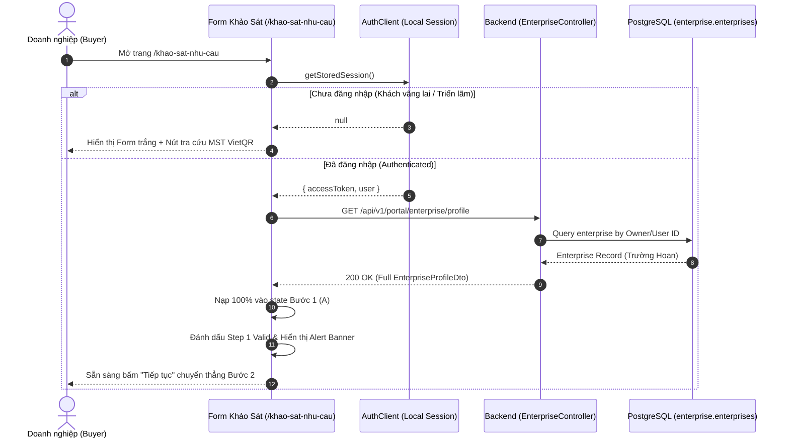

# Kế Hoạch Kỹ Thuật (plan.md): TASK-03 — Hồ Sơ Tìm Mua & Nhu Cầu Chuyển Giao Công Nghệ (Buyer)

> **Mã phân hệ**: `TASK-03_HO_SO_TIM_MUA_BUYER`  
> **Kiến trúc**: .NET Core 8+ Clean Architecture / Modular Monolith & Next.js 15 App Router  
> **Cơ sở dữ liệu**: PostgreSQL 16+ / EF Core (Npgsql)  
> **Tiêu chuẩn kiểm thử**: QC Black-Box 4 Tầng (Invariants, Contract, DB Integration, Playwright E2E)

---

## 1. THIẾT KẾ HỢP ĐỒNG API (CONTRACT-FIRST DTOs & ENDPOINTS)

### 1.1. Danh mục Endpoints chuẩn RESTful:
| Method | Endpoint URL | Mục Đích Nghiệp Vụ | Phân Quyền (3D RBAC) | Màn Hình / Luồng |
| :--- | :--- | :--- | :--- | :--- |
| `POST` | `/api/v1/demands/surveys` | Nộp phiếu khảo sát sâu DNNVV (7 phần) | `PUBLIC_USER` / `BUYER` | `SC-03-01` / `WF-01` |
| `GET` | `/api/v1/demands/surveys/{id}` | Lấy chi tiết phiếu khảo sát | `BUYER` (Owner) / `GOV` | `SC-03-01` / `WF-01` |
| `POST` | `/api/v1/demands/items` | Tạo bài toán nhu cầu nhanh (Quick Demand Ticket) | `BUYER_REPRESENTATIVE` | `SC-03-03` / `WF-02` |
| `GET` | `/api/v1/buyer/demands` | Lấy danh sách bài toán của Bên Mua | `BUYER_REPRESENTATIVE` | `SC-03-02` / `WF-02` |
| `GET` | `/api/v1/public/demands` | Danh sách bài toán công khai (PDPD Masking) | `PUBLIC_USER` (Tất cả) | `SC-03-04` / `WF-04` |
| `GET` | `/api/v1/public/demands/{id}` | Chi tiết bài toán công khai (PDPD Masking) | `PUBLIC_USER` (Tất cả) | `SC-03-04` / `WF-04` |
| `GET` | `/api/v1/gov/demands` | Danh sách hồ sơ khảo sát & bài toán chờ duyệt | `PROVINCIAL_ADMIN` / `SUPER_ADMIN` | `SC-03-05` / `WF-03` |
| `POST` | `/api/v1/gov/demands/{id}/verify` | Phê duyệt bài toán niêm yết lên sàn | `PROVINCIAL_ADMIN` / `SUPER_ADMIN` | `SC-03-05` / `WF-03` |
| `POST` | `/api/v1/gov/demands/{id}/assign-expert` | Chỉ định chuyên gia tư vấn 1-1 (SLA 24h) | `PROVINCIAL_ADMIN` / `SUPER_ADMIN` | `SC-03-05` / `WF-03` |
| `POST` | `/api/v1/trien-lam/dang-ky` | Đăng ký tham quan hội chợ & gửi nhu cầu | `PUBLIC_USER` | `SC-03-06` / `WF-05` |

### 1.2. Hợp đồng DTOs cốt lõi:
```csharp
// DTO Tạo Nhu Cầu Nhanh
public sealed record CreateDemandItemDto(
    string StageName,
    string TechnicalProblem,
    string? DesiredSolution,
    bool NeedConsulting,
    string ExpectedGoal,
    string? ApplicationScale,
    string SectorCode,      // LV01 - LV18
    string TechGroupCode,   // CN01 - CN48
    string DemandTypeCode,  // NC01 - NC25
    string BudgetRange,     // 7 khoảng chuẩn hóa
    int UrgencyScore,       // K: 1 - 5
    int ImpactScore,        // L: 1 - 5
    int InvestmentCapacity, // N: 1 - 5
    int AdoptionReadiness   // O: 1 - 5
);

// DTO Bài Toán Công Khai (PDPD Protected)
public sealed record PublicDemandItemDto(
    Guid Id,
    string ItemCode,
    string StageName,
    string TechnicalProblem,
    string? DesiredSolution,
    bool NeedConsulting,
    string ExpectedGoal,
    string SectorCode,
    string TechGroupCode,
    string DemandTypeCode,
    string BudgetRange,
    int TniScore,
    string TniClassification,
    string ProvinceName,
    DateTimeOffset CreatedAt
);
```

---

## 2. THIẾT KẾ CƠ SỞ DỮ LIỆU (POSTGRESQL SCHEMA)

### 2.1. Bảng `demand_surveys`:
- Lưu trữ hồ sơ khảo sát tổng thể (7 phần).
- Khóa ngoại `organization_id` (Nullable, liên kết Master DN ĐMST `TASK-02`).
- Hybrid JSONB cho `tech_status_overview` (Hiện trạng công nghệ) và `text[] top_bottlenecks` (Tối đa 5 điểm nghẽn).
- Các trường định danh liên hệ `contact_phone`, `contact_email` được mã hóa hoặc kiểm soát quyền truy cập chặt chẽ.

### 2.2. Bảng `demand_items`:
- Là thực thể quản trị các bài toán kỹ thuật (Demand Tickets) được bóc tách từ phiếu khảo sát hoặc tạo trực tiếp.
- Khóa ngoại liên kết `survey_id` (nếu bắt nguồn từ khảo sát sâu).
- Lưu trữ trực tiếp 4 tham số định lượng: `urgency_score`, `impact_score`, `investment_capacity`, `adoption_readiness`.
- Lưu trữ chỉ số tính toán: `tni_score` (0–100), `tni_classification` (`VERY_HIGH`, `HIGH`, `MEDIUM`, `LOW`).
- Cột trạng thái: `status` (`DRAFT`, `PENDING`, `VERIFIED`, `CONNECTED`, `CLOSED`), `is_public_listed` (Boolean).

---

## 3. THIẾT KẾ BACKEND CLEAN ARCHITECTURE (`NacenTech.Modules.Demand`)

```text
SourceCode/backend/modules/demand/
├── Domain/
│   ├── DemandSurvey.cs             # Aggregate Root khảo sát sâu 7 phần
│   ├── DemandItem.cs               # Entity bài toán kỹ thuật (Demand Ticket)
│   ├── Services/
│   │   └── TniCalculationEngine.cs # SSOT Thuật toán tính TNI (BR-TNI-01 -> 04)
│   ├── ValueObjects/
│   │   └── TniResult.cs            # Value Object (Score & Classification)
│   └── Enums/
│       ├── TniClassification.cs    # VeryHigh, High, Medium, Low
│       └── DemandItemStatus.cs     # Pending, Verified, Connected, Closed
├── Application/
│   ├── Commands/
│   │   ├── SubmitDeepSurveyCommand.cs
│   │   └── CreateQuickDemandItemCommand.cs
│   ├── Queries/
│   │   ├── GetBuyerDemandsQuery.cs
│   │   └── GetPublicDemandsQuery.cs
│   └── Validators/
│       └── CreateDemandItemValidator.cs
├── Infrastructure/
│   └── Persistence/
│       ├── DemandDbContext.cs
│       └── Configurations/
└── Presentation/
    └── DemandEndpoints.cs          # Minimal API hoặc Controller RESTful
```

---

## 4. THIẾT KẾ FRONTEND (NEXT.JS 15 APP ROUTER)

### 4.1. Cấu trúc Routing & Components:
1. `src/app/khao-sat-nhu-cau/page.tsx`: Màn hình 1 — Phiếu khảo sát sâu 7 phần kèm `TniRealtimeCalculator.tsx`.
2. `src/app/portal/buyer/demands/page.tsx`: Màn hình 2 — Bàn làm việc Buyer Workspace quản trị bài toán.
3. `src/components/demand/QuickDemandModal.tsx`: Màn hình 3 — Modal popup tạo nhanh bài toán kỹ thuật.
4. `src/app/nhu-cau-cong-nghe/page.tsx` & `[id]/page.tsx`: Màn hình 4 — Sàn công khai khám phá bài toán (PDPD Masking).
5. `src/app/gov/demands/page.tsx`: Màn hình 5 — Cổng cán bộ Sở KH&CN thẩm định & phân luồng bài toán.
6. `src/app/trien-lam/dang-ky-tham-quan/page.tsx`: Màn hình 6 — Form đăng ký tham quan hội chợ triển lãm.

### 4.2. Chuẩn hóa 5 UX States:
Mọi màn hình và bảng danh sách đều được bọc qua `<Async>` component chuẩn:
- `Loading`: Skeleton shimmer nạp dữ liệu.
- `Empty`: Hiển thị thông báo thân thiện kèm nút Call-to-Action.
- `Error`: Hiển thị lỗi RFC 7807 kèm nút Thử lại.
- `Success`: Hiển thị dữ liệu hoàn chỉnh.
- `Submitting`: Nút bấm chuyển trạng thái spinner chống double-click.

---

## 5. KẾ HOẠCH KIỂM ĐỊNH QC BLACK-BOX 4 TẦNG (QUALITY GATE 4)

1. **Tầng 1 — Invariants & Unit Tests (`NacenTech.Modules.Demand.Tests`)**:
   - `BR-TNI-01`: Kiểm chứng công thức toán học với các bộ giá trị chuẩn.
   - `BR-TNI-02`: Kiểm chứng 4 ngưỡng xếp loại màu sắc.
   - `BR-TNI-03`: Kiểm chứng Client không thể ghi đè `TniScore`.
   - `BR-TNI-04`: Kiểm chứng chặn dải biên ($< 1$ hoặc $> 5$ bị ném ngoại lệ).
2. **Tầng 2 — API Contract Tests**:
   - Xác thực schema DTOs giữa Backend và Frontend, không để lệch kiểu dữ liệu hoặc phá vỡ hợp đồng.
3. **Tầng 3 — Database Integration Tests**:
   - Kiểm tra lưu trữ toàn vẹn vào PostgreSQL, khóa ngoại `organizations`, không làm ảnh hưởng bảng Master DN `TASK-02`.
4. **Tầng 4 — Playwright E2E Black-box Tests (`test_task03_buyer_demands_blackbox.py`)**:
   - Kịch bản TC-01: Điền phiếu khảo sát sâu 7 phần, kéo thanh trượt TNI, nộp phiếu thành công.
   - Kịch bản TC-02: Đăng nhập Buyer Workspace, mở modal tạo nhanh bài toán, danh sách hiển thị đúng bài toán mới.
   - Kịch bản TC-03: Cán bộ Sở đăng nhập `/gov/demands`, duyệt bài toán và chỉ định chuyên gia khi $TNI \ge 80$.
   - Kịch bản TC-04: Khách vãng lai xem sàn công khai `/nhu-cau-cong-nghe`, xác minh 100% PII (SĐT, Email, Ngân sách) đã được ẩn giấu.
   - Kịch bản TC-05: Khách tham quan điền form tại `/trien-lam/dang-ky-tham-quan` ghi nhận dữ liệu hội chợ.

---

## Plan Delta v2: Tối Ưu Contrast, Danh Mục 10 Ngành TT17 & Phân Quyền Nút Bấm

### 1. Kiến Trúc Bề Mặt & Frontend Components
- **Banner Layout**:
  - Tách layer: Nền gradient `bg-gradient-to-r from-slate-900 via-brand-900 to-slate-900`, `innovation-hero-art` ở tầng giữa với opacity an toàn, và container nội dung bọc `relative z-10`.
  - Bổ sung khối **Hero Quick Metrics** (140+ Bài toán đang tìm, 68.5+ Tỷ ngân sách mua, 24 Giờ hỗ trợ kết nối) chuẩn Wireframe Basic Design.
- **Master Data Integration**:
  - Thay thế danh mục cứng trong `page.tsx` bằng `getActiveSectors()` từ `@/lib/master-data-client`, có fallback sang `SECTORS_18_CATALOG`.
  - Bổ sung ánh xạ mã ngành $\leftrightarrow$ Tên tiếng Việt trên từng thẻ Card.
- **Data Presentation Sanitization (Zero-Jargon & Humanized Cards)**:
  - Ẩn các mã code dạng ID thô hoặc chuỗi hash (`DMD-202610-0FF52B`).
  - Hiển thị nhãn lĩnh vực tiếng Việt nổi bật trên đầu Card.
  - Hiển thị danh tính doanh nghiệp ẩn danh theo PDPD masking.
- **Role Action Guarding**:
  - Sử dụng `authClient` để nhận diện vai trò người dùng khi kích hoạt nút bấm "Đăng Nhanh Bài Toán".
  - Với khách vãng lai: Hiển thị hộp thoại mời đăng nhập tài khoản Doanh nghiệp hoặc link tới Phiếu khảo sát công khai.

---

## Plan Delta v3: Kiến Trúc Wizard 7 Bước & Mở Rộng Schema CSDL Phi Phá Hủy

### 1. Kiến Trúc Frontend Wizard (`khao-sat-nhu-cau`)
- **Quản lý trạng thái đa bước (Step State Machine)**:
  - Khai báo enum 7 bước: `STEP_ENTERPRISE_INFO (A)`, `STEP_TECH_EQUIPMENT (B)`, `STEP_BOTTLENECKS (C)`, `STEP_ADOPTION_CAPACITY (D)`, `STEP_DEMAND_ITEMS (E)`, `STEP_FUTURE_SUPPORT (F)`, `STEP_REVIEW_CONFIRM (G)`.
  - Bộ hook `useSurveyWizard` quản lý state toàn cục, tự động sync vào `localStorage` key `nacentwin_deep_survey_draft_v1`.
  - Validate độc lập từng bước trước khi cho phép chuyển `currentStep + 1`.
- **Thành phần giao diện từng bước**:
  - `StepNavigation`: Thanh tiến trình (Progress Bar) + Stepper 7 nút bấm đánh dấu trạng thái Hoàn thành / Đang làm.
  - `EquipmentDynamicTable`: Cho phép Thêm / Xóa thiết bị, có trường Công đoạn, Tên máy móc, Năm đầu tư, Xuất xứ, Tình trạng.
  - `Criteria8EvaluationTable`: Bảng radio ma trận 8 tiêu chí hiện trạng (thang 1–5), tự động tính điểm trung bình hiện trạng.
  - `BottlenecksSelector`: Lưới checkbox tối đa 5 điểm nghẽn, tự động disable khi đã tích đủ 5 mục; kèm dropdown công đoạn khó nhất & nguyên nhân.
  - `AdoptionCapacityForm`: Lưới nhập số lượng 6 vị trí nhân lực kỹ thuật, tự động tính tổng nhân sự; 3 thang đo năng lực hấp thụ 1–5.
  - `DemandItemsList`: Cho phép thêm $1..n$ bài toán; mỗi bài toán nhúng `TniRealtimeCalculator` độc lập.
  - `FutureSupportForm`: Checkbox định hướng Tự động hóa, CĐS, Công nghệ xanh; thang đo 4 nhu cầu hỗ trợ 1–5; đối tác mong muốn.
  - `ReviewConfirmStep`: Render bảng tóm tắt tổng thể dữ liệu đã nhập, 2 ô nhập Người đại diện + Chức vụ, và checkbox PDPD bắt buộc.

### 2. Mở Rộng CSDL PostgreSQL (Non-destructive Migration)
- **Tên Migration**: `AddDeepSurveyFullSpecification`
- **Thay đổi trên bảng `demand.demand_surveys`**:
  - Thêm cột Nullable:
    - `province` (`character varying(100)`, NULLABLE)
    - `headquarters_address` (`character varying(255)`, NULLABLE)
    - `surveyed_facility` (`character varying(255)`, NULLABLE)
    - `contact_title` (`character varying(100)`, NULLABLE)
    - `main_industry` (`character varying(100)`, NULLABLE)
    - `main_products` (`text`, NULLABLE)
    - `confirmed_by_name` (`character varying(150)`, NULLABLE)
    - `confirmed_by_title` (`character varying(100)`, NULLABLE)
    - `pdpd_consent_at` (`timestamp with time zone`, NULLABLE)
    - `survey_details` (`jsonb`, NULLABLE) — lưu trữ chi tiết: bảng thiết bị B, điểm 8 tiêu chí B, chi tiết C, nhân lực D, định hướng F.
- **Không thay đổi phá hủy**: Toàn bộ dữ liệu cũ giữ nguyên 100%, không Drop bất kỳ cột nào.

### 3. Backend DTO & API Logic
- Mở rộng DTO `SubmitDeepSurveyRequest`:
  - Tiếp nhận các trường định danh mở rộng, `List<EquipmentDto> CurrentEquipments`, `TechEvaluationDto Criteria8`, `BottleneckDetailDto BottlenecksDetail`, `AdoptionCapacityDto AdoptionCapacity`, `List<DeepSurveyItemRequest> DemandItems`, `FutureSupportDto FutureSupport`, `ConfirmationDto Confirmation`.
- Cập nhật mapping trong `DemandController.cs`:
  - Lưu đầy đủ thông tin vào `DemandSurvey` và `survey_details`.
  - Duyệt mảng `DemandItems`: Khởi tạo $1..n$ bản ghi `DemandItem` gắn kèm `survey_id`, tính toán điểm TNI chuẩn hóa từ `TniCalculationEngine`.
  - Trả về mã phiếu `surveyCode` và danh sách toàn bộ mã tickets khởi tạo `createdTickets`.

---

## Plan Delta v4: Mở Rộng Kênh Triển Lãm, Tra Cứu MST & Auto-Provisioning Tài Khoản (PO-DEC-20261012-01)

### 1. Kiến Trúc Backend & Tích Hợp API Ngoài
- **Endpoint Tra cứu Mã số thuế Hybrid**:
  - `GET /api/v1/enterprises/lookup-tax/{taxCode}` (trong `EnterpriseController.cs`):
    1. Kiểm tra CSDL nội bộ `NacenTechDbContext.Enterprises` (kho 304 DN ĐMST). Nếu tìm thấy $\rightarrow$ trả về dữ liệu nội bộ đã xác thực (Tên, MST, Tỉnh/TP, Địa chỉ, Đại diện, Ngành nghề).
    2. Nếu không tìm thấy trong DB: Gọi HTTP GET tới VietQR Business Open API (`https://api.vietqr.io/v2/business/{taxCode}`), timeout 3 giây.
    3. Trích xuất: `data.name` (Tên công ty), `data.address` (Địa chỉ), bóc tách Tỉnh/Thành phố từ địa chỉ.
    4. Trả về DTO chuẩn `TaxLookupResultDto`.
- **Nâng cấp `SubmitDeepSurvey` Auto-Provisioning**:
  - Trong `DemandController.cs`:
    - Inject `IPersonService` và `IAuthenticationService`.
    - Khi nhận request từ khách chưa đăng nhập (`Actor.IsAuthenticated == false`):
      1. Kiểm tra email `req.ContactEmail` trong bảng `identity.Persons`.
      2. Nếu chưa có: Tạo mật khẩu ngẫu nhiên an toàn, gọi `IPersonService.ProvisionAsync` với:
         - `Email = req.ContactEmail.Trim()`
         - `FirstName = req.ContactName.Trim()`
         - `Organization = req.CompanyName.Trim()`
         - `Phone = req.ContactPhone`
         - `PlatformRole = "BUYER"`
         - `ScopeType = "GLOBAL"`
         - `IsActive = true`
      3. Gán `PersonId` vừa tạo vào `survey.CreatedByPersonId` và các `demandItem.CreatedByPersonId`.
      4. Bổ sung trường `accountProvisioned = true` và `provisionedEmail = req.ContactEmail` vào response JSON.

### 2. Kiến Trúc Frontend (`/khao-sat-nhu-cau`)
- **Nút Tra cứu MST (Tax Lookup Trigger)**:
  - Thêm nút 🔍 "Tra cứu" ngay bên phải ô input `Mã số thuế`.
  - Khi click hoặc khi người dùng nhập đủ 10/13 số và blur:
    - Gọi API `/api/v1/enterprises/lookup-tax/{taxCode}`.
    - Hiển thị spinner trạng thái và thông báo toast.
    - Tự động điền các state: `companyName`, `province`, `address`.
- **Smart Pre-fill Profile cho Doanh nghiệp đã đăng nhập**:
  - Kiểm tra `authClient.getToken()`. Nếu có phiên đăng nhập:
    - Gọi `fetchMyEnterpriseProfile()` từ `@/lib/enterprise-client`.
    - Tự động điền: `companyName`, `taxCode`, `province`, `address`, `contactName`, `contactPosition`, `contactPhone`, `contactEmail`, `companyType`, `mainIndustry`, `employeeScale`, `revenueRange3y`.
    - Render Banner chào mừng màu xanh trên đầu Hero Card.
- **Màn hình thành công (Success State UI)**:
  - Hiển thị thông báo nếu tài khoản đã được cấp tự động:
    - *"Tài khoản Cổng ĐMST của DN đã được khởi tạo tự động với email [email@dn.vn]. Mật khẩu và liên kết kích hoạt đã được gửi tới hộp thư của bạn."*
    - Nút CTA: *"Đăng nhập ngay để theo dõi tiến độ"*.

---

## Plan Delta v5: Hoàn Thiện Vòng Đời CRUD & Quản Trị Bài Toán Bên Mua (Edit & Close Actions)

### 1. Kiến Trúc Backend Domain & API (`NacenTech.Modules.Demand`)
- **Domain Entity Enhancement (`DemandItem.cs`)**:
  - Bổ sung phương thức `Update(...)`:
    ```csharp
    public void Update(
        string stageName,
        string technicalProblem,
        string? desiredSolution,
        bool needConsulting,
        string expectedGoal,
        string? applicationScale,
        string sectorCode,
        string techGroupCode,
        string demandTypeCode,
        string budgetRange,
        int urgencyScore,
        int impactScore,
        int investmentCapacity,
        int adoptionReadiness)
    ```
    - Tính lại $TNI = TniCalculationEngine.Calculate(...)$.
    - Cập nhật `TniScore`, `TniClassification`, `UpdatedAt = DateTimeOffset.UtcNow`.
  - Bổ sung phương thức `Close()`:
    ```csharp
    public void Close()
    {
        Status = DemandItemStatuses.Closed;
        IsPublicListed = false;
        UpdatedAt = DateTimeOffset.UtcNow;
    }
    ```
- **Hợp đồng DTO & Endpoints (`DemandController.cs`)**:
  - `PUT /api/v1/buyer/demands/{id}`:
    - Nhận `UpdateDemandItemRequest`.
    - Kiểm tra `Status`: Chỉ cho phép sửa khi `Status == DemandItemStatuses.Pending || Status == DemandItemStatuses.Draft`.
    - Gọi `item.Update(...)` và `await uow.CommitAsync(ct)`.
  - `POST /api/v1/buyer/demands/{id}/close`:
    - Gọi `item.Close()` và `await uow.CommitAsync(ct)`.

### 2. Kiến Trúc Frontend (`/portal/buyer/demands`)
- **Component `EditDemandModal.tsx` (`src/components/demand/EditDemandModal.tsx`)**:
  - Nạp toàn bộ dữ liệu ban đầu từ `item` được chọn.
  - Cho phép sửa đổi tiêu đề, công đoạn, mục tiêu, lĩnh vực, ngân sách, và bộ 4 thanh trượt $K, L, N, O$.
  - Tính toán và render preview màu Badge TNI thời gian thực bằng `getTniClassification`.
  - Gọi API `PUT /api/v1/buyer/demands/{id}` và callback `onSuccess(updatedItem)` để cập nhật state danh sách mà không cần reload trang.
- **Tích hợp Bàn làm việc Bên Mua (`src/app/portal/buyer/demands/page.tsx`)**:
  - Cột "Thao tác":
    - Nếu `item.status === 'PENDING'`: Hiển thị nút `[Chỉnh sửa]` (Icon `Edit`).
    - Nếu `item.status !== 'CLOSED'`: Hiển thị nút `[Đóng bài toán]` (Icon `Archive` / `XCircle`).
    - Nút `[Chi tiết]` (Icon `ExternalLink`).
  - Hộp thoại `ConfirmModal` khi đóng bài toán kèm toast feedback.
  - Thêm filter tab `Đã đóng` (`CLOSED`) bên cạnh `Tất cả`, `Đang mở tìm cung`, `Chờ thẩm định`.

---

## 8. DELTA V7 (CR-2026-016): BẮT BUỘC TỰ ĐỘNG NẠP 100% HỒ SƠ DOANH NGHIỆP ĐÃ ĐĂNG NHẬP & ĐỒNG BỘ DEMO BUYER

> **Mã thay đổi**: `CR-2026-016`  
> **Căn cứ**: Yêu cầu Gate 2 từ PO, Đặc tả `spec.md` Mục 9 (`FR-Delta-15`, `FR-Delta-16`, `BR-03-005`, `BR-03-006`, `AC-03-06`, `AC-03-07`).  
> **Mục tiêu**:
> 1. Triệt tiêu 100% ma sát nhập liệu tại Bước 1 (Phần A) đối với người dùng doanh nghiệp đã đăng nhập.
> 2. Đảm bảo tài khoản Demo Buyer `buyer.user@demo.nacentech.vn` tự động nạp chính xác dữ liệu của **CÔNG TY TNHH TRƯỜNG HOAN** (MST: `0100255428`).
> 3. Cơ chế đồng bộ 2 chiều (Bi-directional Sync) giữa Form Khảo Sát và Hồ Sơ Doanh Nghiệp Cốt Lõi (`enterprise.enterprises`).

---

### 8.1 Kiến Trúc Tự Động Nạp Dữ Liệu (Auto-Prefill Lifecycle & State Management)



#### 1. Quy Trình Nạp Dữ Liệu Chi Tiết Bước 1 (11 Trường Thông Tin Cốt Lõi)
Khi `fetchMyEnterpriseProfile()` trả về thành công:
1. `companyName`: `profile.name || profile.legalName`
2. `taxCode`: `profile.taxCode`
3. `province`: `profile.provinceCity`
4. `address`: `profile.addressDetail`
5. `contactName`: `profile.contactPerson`
6. `contactPosition`: `profile.contactPosition || 'Đại diện Doanh nghiệp'`
7. `contactPhone`: `profile.contactPhone`
8. `contactEmail`: `profile.contactEmail || session.user.email`
9. `companyType`: `profile.ownershipType || 'Công ty TNHH'`
10. `mainIndustry`: `profile.sectorCode || profile.mainSectorName`
11. `employeeScale`: `profile.workforceScale`
12. `revenueRange3y`: `profile.revenueRange && profile.revenueRange !== '[BẢO MẬT]' ? profile.revenueRange : ''`

#### 2. Trạng Thái Giao Diện & UX Banner
- **Alert Banner**: Hiển thị trên đầu Bước 1 với thiết kế nổi bật:
  > **🎉 Dữ liệu đã được nạp tự động từ Hồ sơ Doanh nghiệp!**  
  > Toàn bộ thông tin pháp nhân và người đại diện của **{companyName}** đã được điền sẵn. Quý DN có thể bấm **"Tiếp tục sang Bước 2"** để bắt đầu kê khai bài toán kỹ thuật ngay lập tức.
- **Validation Bypass**: Hàm kiểm tra hợp lệ `validateStep(1)` ngay lập tức trả về `true` khi các trường bắt buộc đã được nạp đầy đủ từ profile, cho phép người dùng nhấp trực tiếp vào Stepper Bước 2 trên thanh điều hướng.

---

### 8.2 Kiến Trúc Đồng Bộ Hai Chiều (Bi-directional Sync Invariant `BR-03-006`)

Khi doanh nghiệp đã đăng nhập chủ động chỉnh sửa thông tin tại Bước 1 và nộp phiếu ở Bước 7:
1. Form khảo sát phát hiện sự sai khác (`diff`) giữa thông tin gửi đi và hồ sơ gốc trong `profile`.
2. Nếu có thay đổi, hệ thống mở Modal xác nhận:
   *"Bạn đã điều chỉnh thông tin người liên hệ / địa chỉ so với Hồ sơ Doanh nghiệp gốc. Bạn có muốn đồng bộ cập nhật vào Hồ sơ Doanh nghiệp chính thức không?"*
3. Nếu người dùng chọn **"Đồng ý đồng bộ"**:
   - Hệ thống thực hiện đồng thời `POST /api/v1/demands/surveys` để lưu phiếu khảo sát và `PUT /api/v1/portal/enterprise/profile` để cập nhật hồ sơ doanh nghiệp tại bảng `enterprise.enterprises`.
   - Đảm bảo nguyên tắc Bản sắc Doanh nghiệp Duy nhất (SSOT) toàn hệ thống.

---

### 8.3 Kịch Bản Kiểm Thử & Xác Nhận Tài Khoản Demo Buyer

1. **Đăng nhập**: Email `buyer.user@demo.nacentech.vn` / Mật khẩu `Demo@2026`.
2. **Mở URL**: `/khao-sat-nhu-cau`.
3. **Kỳ vọng hiển thị**:
   - MST: `0100255428`
   - Tên DN: `CÔNG TY TNHH TRƯỜNG HOAN`
   - Tỉnh/thành: `Hà Nội`
   - Người liên hệ: `Trần Trường Hoan`
   - Email: `buyer.user@demo.nacentech.vn`
   - SĐT: `0988123456`
   - Quy mô: `Dưới 10 người`
   - Nút "Tiếp tục sang Bước 2" sẵn sàng bấm chuyển bước.

