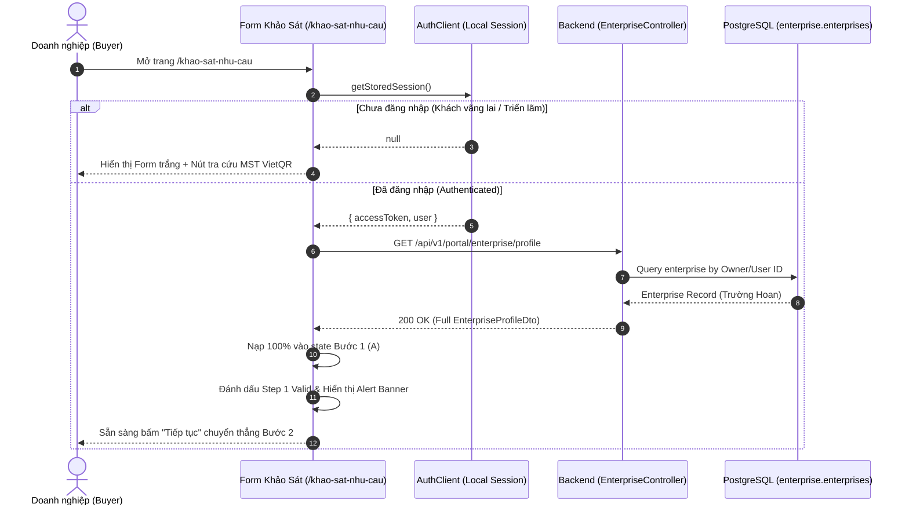
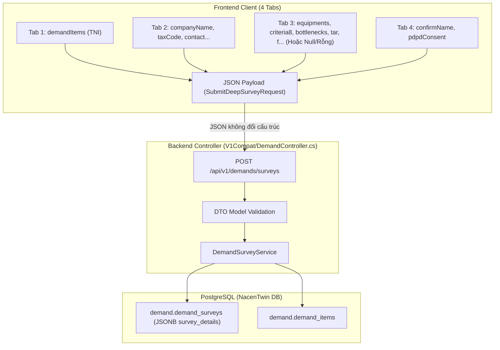
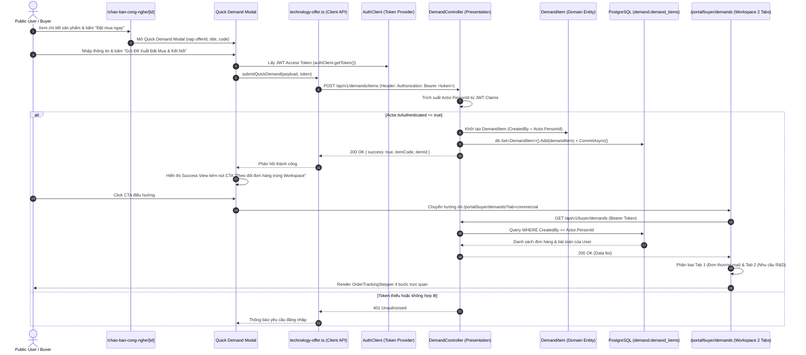
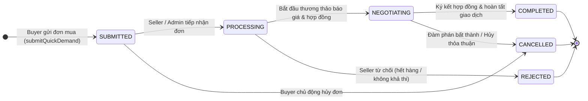

# Kế Hoạch Kỹ Thuật (plan.md): TASK-03 — Hồ Sơ Tìm Mua & Nhu Cầu Chuyển Giao Công Nghệ (Buyer)

**Epic**: TASK-03_HO_SO_TIM_MUA_BUYER  
**Version**: 1.15.0  
**Status**: In Progress (Gate 2 Architecture Approved - Executing Delta v15)  
**Last Updated**: 2026-11-04  
**Baseline Hash**: `a1b2c3d`  
**Ánh Xạ Kỹ Thuật**: Clean Architecture Modular Monolith, Lean 4-Step Wizard, Order Tracking Stepper  

> **Mã phân hệ**: `TASK-03_HO_SO_TIM_MUA_BUYER`  
> **Kiến trúc**: .NET Core 8+ Clean Architecture / Modular Monolith & Next.js 15 App Router  
> **Cơ sở dữ liệu**: PostgreSQL 16+ / EF Core (Npgsql)  
> **Tiêu chuẩn kiểm thử**: QC Black-Box 4 Tầng (Invariants, Contract, DB Integration, Playwright E2E)

---

## 1. THIẾT KẾ HỢP ĐỒNG API (CONTRACT-FIRST DTOs & ENDPOINTS)

### 1.1. Danh mục Endpoints chuẩn RESTful:
| Method | Endpoint URL | Mục Đích Nghiệp Vụ | Phân Quyền (3D RBAC) | Màn Hình / Luồng |
| :--- | :--- | :--- | :--- | :--- |
| `POST` | `/api/v1/demands/surveys` | Nộp phiếu khảo sát sâu DNNVV (7 phần) | `PUBLIC_USER` / `BUYER` | `SC-03-01` / `WF-01` |
| `GET` | `/api/v1/demands/surveys/{id}` | Lấy chi tiết phiếu khảo sát | `BUYER` (Owner) / `GOV` | `SC-03-01` / `WF-01` |
| `POST` | `/api/v1/demands/items` | Tạo bài toán nhu cầu nhanh (Quick Demand Ticket) | `BUYER_REPRESENTATIVE` | `SC-03-03` / `WF-02` |
| `GET` | `/api/v1/buyer/demands` | Lấy danh sách bài toán của Bên Mua | `BUYER_REPRESENTATIVE` | `SC-03-02` / `WF-02` |
| `GET` | `/api/v1/public/demands` | Danh sách bài toán công khai (PDPD Masking) | `PUBLIC_USER` (Tất cả) | `SC-03-04` / `WF-04` |
| `GET` | `/api/v1/public/demands/{id}` | Chi tiết bài toán công khai (PDPD Masking) | `PUBLIC_USER` (Tất cả) | `SC-03-04` / `WF-04` |
| `GET` | `/api/v1/gov/demands` | Danh sách hồ sơ khảo sát & bài toán chờ duyệt | `PROVINCIAL_ADMIN` / `SUPER_ADMIN` | `SC-03-05` / `WF-03` |
| `POST` | `/api/v1/gov/demands/{id}/verify` | Phê duyệt bài toán niêm yết lên sàn | `PROVINCIAL_ADMIN` / `SUPER_ADMIN` | `SC-03-05` / `WF-03` |
| `POST` | `/api/v1/gov/demands/{id}/assign-expert` | Chỉ định chuyên gia tư vấn 1-1 (SLA 24h) | `PROVINCIAL_ADMIN` / `SUPER_ADMIN` | `SC-03-05` / `WF-03` |
| `POST` | `/api/v1/trien-lam/dang-ky` | Đăng ký tham quan hội chợ & gửi nhu cầu | `PUBLIC_USER` | `SC-03-06` / `WF-05` |

### 1.2. Hợp đồng DTOs cốt lõi:
```csharp
// DTO Tạo Nhu Cầu Nhanh
public sealed record CreateDemandItemDto(
    string StageName,
    string TechnicalProblem,
    string? DesiredSolution,
    bool NeedConsulting,
    string ExpectedGoal,
    string? ApplicationScale,
    string SectorCode,      // LV01 - LV18
    string TechGroupCode,   // CN01 - CN48
    string DemandTypeCode,  // NC01 - NC25
    string BudgetRange,     // 7 khoảng chuẩn hóa
    int UrgencyScore,       // K: 1 - 5
    int ImpactScore,        // L: 1 - 5
    int InvestmentCapacity, // N: 1 - 5
    int AdoptionReadiness   // O: 1 - 5
);

// DTO Bài Toán Công Khai (PDPD Protected)
public sealed record PublicDemandItemDto(
    Guid Id,
    string ItemCode,
    string StageName,
    string TechnicalProblem,
    string? DesiredSolution,
    bool NeedConsulting,
    string ExpectedGoal,
    string SectorCode,
    string TechGroupCode,
    string DemandTypeCode,
    string BudgetRange,
    int TniScore,
    string TniClassification,
    string ProvinceName,
    DateTimeOffset CreatedAt
);
```

---

## 2. THIẾT KẾ CƠ SỞ DỮ LIỆU (POSTGRESQL SCHEMA)

### 2.1. Bảng `demand_surveys`:
- Lưu trữ hồ sơ khảo sát tổng thể (7 phần).
- Khóa ngoại `organization_id` (Nullable, liên kết Master DN ĐMST `TASK-02`).
- Hybrid JSONB cho `tech_status_overview` (Hiện trạng công nghệ) và `text[] top_bottlenecks` (Tối đa 5 điểm nghẽn).
- Các trường định danh liên hệ `contact_phone`, `contact_email` được mã hóa hoặc kiểm soát quyền truy cập chặt chẽ.

### 2.2. Bảng `demand_items`:
- Là thực thể quản trị các bài toán kỹ thuật (Demand Tickets) được bóc tách từ phiếu khảo sát hoặc tạo trực tiếp.
- Khóa ngoại liên kết `survey_id` (nếu bắt nguồn từ khảo sát sâu).
- Lưu trữ trực tiếp 4 tham số định lượng: `urgency_score`, `impact_score`, `investment_capacity`, `adoption_readiness`.
- Lưu trữ chỉ số tính toán: `tni_score` (0–100), `tni_classification` (`VERY_HIGH`, `HIGH`, `MEDIUM`, `LOW`).
- Cột trạng thái: `status` (`DRAFT`, `PENDING`, `VERIFIED`, `CONNECTED`, `CLOSED`), `is_public_listed` (Boolean).

---

## 3. THIẾT KẾ BACKEND CLEAN ARCHITECTURE (`NacenTech.Modules.Demand`)

```text
SourceCode/backend/modules/demand/
├── Domain/
│   ├── DemandSurvey.cs             # Aggregate Root khảo sát sâu 7 phần
│   ├── DemandItem.cs               # Entity bài toán kỹ thuật (Demand Ticket)
│   ├── Services/
│   │   └── TniCalculationEngine.cs # SSOT Thuật toán tính TNI (BR-TNI-01 -> 04)
│   ├── ValueObjects/
│   │   └── TniResult.cs            # Value Object (Score & Classification)
│   └── Enums/
│       ├── TniClassification.cs    # VeryHigh, High, Medium, Low
│       └── DemandItemStatus.cs     # Pending, Verified, Connected, Closed
├── Application/
│   ├── Commands/
│   │   ├── SubmitDeepSurveyCommand.cs
│   │   └── CreateQuickDemandItemCommand.cs
│   ├── Queries/
│   │   ├── GetBuyerDemandsQuery.cs
│   │   └── GetPublicDemandsQuery.cs
│   └── Validators/
│       └── CreateDemandItemValidator.cs
├── Infrastructure/
│   └── Persistence/
│       ├── DemandDbContext.cs
│       └── Configurations/
└── Presentation/
    └── DemandEndpoints.cs          # Minimal API hoặc Controller RESTful
```

---

## 4. THIẾT KẾ FRONTEND (NEXT.JS 15 APP ROUTER)

### 4.1. Cấu trúc Routing & Components:
1. `src/app/khao-sat-nhu-cau/page.tsx`: Màn hình 1 — Phiếu khảo sát sâu 7 phần kèm `TniRealtimeCalculator.tsx`.
2. `src/app/portal/buyer/demands/page.tsx`: Màn hình 2 — Bàn làm việc Buyer Workspace quản trị bài toán.
3. `src/components/demand/QuickDemandModal.tsx`: Màn hình 3 — Modal popup tạo nhanh bài toán kỹ thuật.
4. `src/app/nhu-cau-cong-nghe/page.tsx` & `[id]/page.tsx`: Màn hình 4 — Sàn công khai khám phá bài toán (PDPD Masking).
5. `src/app/gov/demands/page.tsx`: Màn hình 5 — Cổng cán bộ Sở KH&CN thẩm định & phân luồng bài toán.
6. `src/app/trien-lam/dang-ky-tham-quan/page.tsx`: Màn hình 6 — Form đăng ký tham quan hội chợ triển lãm.

### 4.2. Chuẩn hóa 5 UX States:
Mọi màn hình và bảng danh sách đều được bọc qua `<Async>` component chuẩn:
- `Loading`: Skeleton shimmer nạp dữ liệu.
- `Empty`: Hiển thị thông báo thân thiện kèm nút Call-to-Action.
- `Error`: Hiển thị lỗi RFC 7807 kèm nút Thử lại.
- `Success`: Hiển thị dữ liệu hoàn chỉnh.
- `Submitting`: Nút bấm chuyển trạng thái spinner chống double-click.

---

## 5. KẾ HOẠCH KIỂM ĐỊNH QC BLACK-BOX 4 TẦNG (QUALITY GATE 4)

1. **Tầng 1 — Invariants & Unit Tests (`NacenTech.Modules.Demand.Tests`)**:
   - `BR-TNI-01`: Kiểm chứng công thức toán học với các bộ giá trị chuẩn.
   - `BR-TNI-02`: Kiểm chứng 4 ngưỡng xếp loại màu sắc.
   - `BR-TNI-03`: Kiểm chứng Client không thể ghi đè `TniScore`.
   - `BR-TNI-04`: Kiểm chứng chặn dải biên ($< 1$ hoặc $> 5$ bị ném ngoại lệ).
2. **Tầng 2 — API Contract Tests**:
   - Xác thực schema DTOs giữa Backend và Frontend, không để lệch kiểu dữ liệu hoặc phá vỡ hợp đồng.
3. **Tầng 3 — Database Integration Tests**:
   - Kiểm tra lưu trữ toàn vẹn vào PostgreSQL, khóa ngoại `organizations`, không làm ảnh hưởng bảng Master DN `TASK-02`.
4. **Tầng 4 — Playwright E2E Black-box Tests (`test_task03_buyer_demands_blackbox.py`)**:
   - Kịch bản TC-01: Điền phiếu khảo sát sâu 7 phần, kéo thanh trượt TNI, nộp phiếu thành công.
   - Kịch bản TC-02: Đăng nhập Buyer Workspace, mở modal tạo nhanh bài toán, danh sách hiển thị đúng bài toán mới.
   - Kịch bản TC-03: Cán bộ Sở đăng nhập `/gov/demands`, duyệt bài toán và chỉ định chuyên gia khi $TNI \ge 80$.
   - Kịch bản TC-04: Khách vãng lai xem sàn công khai `/nhu-cau-cong-nghe`, xác minh 100% PII (SĐT, Email, Ngân sách) đã được ẩn giấu.
   - Kịch bản TC-05: Khách tham quan điền form tại `/trien-lam/dang-ky-tham-quan` ghi nhận dữ liệu hội chợ.

---

## Plan Delta v2: Tối Ưu Contrast, Danh Mục 10 Ngành TT17 & Phân Quyền Nút Bấm

### 1. Kiến Trúc Bề Mặt & Frontend Components
- **Banner Layout**:
  - Tách layer: Nền gradient `bg-gradient-to-r from-slate-900 via-brand-900 to-slate-900`, `innovation-hero-art` ở tầng giữa với opacity an toàn, và container nội dung bọc `relative z-10`.
  - Bổ sung khối **Hero Quick Metrics** (140+ Bài toán đang tìm, 68.5+ Tỷ ngân sách mua, 24 Giờ hỗ trợ kết nối) chuẩn Wireframe Basic Design.
- **Master Data Integration**:
  - Thay thế danh mục cứng trong `page.tsx` bằng `getActiveSectors()` từ `@/lib/master-data-client`, có fallback sang `SECTORS_18_CATALOG`.
  - Bổ sung ánh xạ mã ngành $\leftrightarrow$ Tên tiếng Việt trên từng thẻ Card.
- **Data Presentation Sanitization (Zero-Jargon & Humanized Cards)**:
  - Ẩn các mã code dạng ID thô hoặc chuỗi hash (`DMD-202610-0FF52B`).
  - Hiển thị nhãn lĩnh vực tiếng Việt nổi bật trên đầu Card.
  - Hiển thị danh tính doanh nghiệp ẩn danh theo PDPD masking.
- **Role Action Guarding**:
  - Sử dụng `authClient` để nhận diện vai trò người dùng khi kích hoạt nút bấm "Đăng Nhanh Bài Toán".
  - Với khách vãng lai: Hiển thị hộp thoại mời đăng nhập tài khoản Doanh nghiệp hoặc link tới Phiếu khảo sát công khai.

---

## Plan Delta v3: Kiến Trúc Wizard 7 Bước & Mở Rộng Schema CSDL Phi Phá Hủy

### 1. Kiến Trúc Frontend Wizard (`khao-sat-nhu-cau`)
- **Quản lý trạng thái đa bước (Step State Machine)**:
  - Khai báo enum 7 bước: `STEP_ENTERPRISE_INFO (A)`, `STEP_TECH_EQUIPMENT (B)`, `STEP_BOTTLENECKS (C)`, `STEP_ADOPTION_CAPACITY (D)`, `STEP_DEMAND_ITEMS (E)`, `STEP_FUTURE_SUPPORT (F)`, `STEP_REVIEW_CONFIRM (G)`.
  - Bộ hook `useSurveyWizard` quản lý state toàn cục, tự động sync vào `localStorage` key `nacentwin_deep_survey_draft_v1`.
  - Validate độc lập từng bước trước khi cho phép chuyển `currentStep + 1`.
- **Thành phần giao diện từng bước**:
  - `StepNavigation`: Thanh tiến trình (Progress Bar) + Stepper 7 nút bấm đánh dấu trạng thái Hoàn thành / Đang làm.
  - `EquipmentDynamicTable`: Cho phép Thêm / Xóa thiết bị, có trường Công đoạn, Tên máy móc, Năm đầu tư, Xuất xứ, Tình trạng.
  - `Criteria8EvaluationTable`: Bảng radio ma trận 8 tiêu chí hiện trạng (thang 1–5), tự động tính điểm trung bình hiện trạng.
  - `BottlenecksSelector`: Lưới checkbox tối đa 5 điểm nghẽn, tự động disable khi đã tích đủ 5 mục; kèm dropdown công đoạn khó nhất & nguyên nhân.
  - `AdoptionCapacityForm`: Lưới nhập số lượng 6 vị trí nhân lực kỹ thuật, tự động tính tổng nhân sự; 3 thang đo năng lực hấp thụ 1–5.
  - `DemandItemsList`: Cho phép thêm $1..n$ bài toán; mỗi bài toán nhúng `TniRealtimeCalculator` độc lập.
  - `FutureSupportForm`: Checkbox định hướng Tự động hóa, CĐS, Công nghệ xanh; thang đo 4 nhu cầu hỗ trợ 1–5; đối tác mong muốn.
  - `ReviewConfirmStep`: Render bảng tóm tắt tổng thể dữ liệu đã nhập, 2 ô nhập Người đại diện + Chức vụ, và checkbox PDPD bắt buộc.

### 2. Mở Rộng CSDL PostgreSQL (Non-destructive Migration)
- **Tên Migration**: `AddDeepSurveyFullSpecification`
- **Thay đổi trên bảng `demand.demand_surveys`**:
  - Thêm cột Nullable:
    - `province` (`character varying(100)`, NULLABLE)
    - `headquarters_address` (`character varying(255)`, NULLABLE)
    - `surveyed_facility` (`character varying(255)`, NULLABLE)
    - `contact_title` (`character varying(100)`, NULLABLE)
    - `main_industry` (`character varying(100)`, NULLABLE)
    - `main_products` (`text`, NULLABLE)
    - `confirmed_by_name` (`character varying(150)`, NULLABLE)
    - `confirmed_by_title` (`character varying(100)`, NULLABLE)
    - `pdpd_consent_at` (`timestamp with time zone`, NULLABLE)
    - `survey_details` (`jsonb`, NULLABLE) — lưu trữ chi tiết: bảng thiết bị B, điểm 8 tiêu chí B, chi tiết C, nhân lực D, định hướng F.
- **Không thay đổi phá hủy**: Toàn bộ dữ liệu cũ giữ nguyên 100%, không Drop bất kỳ cột nào.

### 3. Backend DTO & API Logic
- Mở rộng DTO `SubmitDeepSurveyRequest`:
  - Tiếp nhận các trường định danh mở rộng, `List<EquipmentDto> CurrentEquipments`, `TechEvaluationDto Criteria8`, `BottleneckDetailDto BottlenecksDetail`, `AdoptionCapacityDto AdoptionCapacity`, `List<DeepSurveyItemRequest> DemandItems`, `FutureSupportDto FutureSupport`, `ConfirmationDto Confirmation`.
- Cập nhật mapping trong `DemandController.cs`:
  - Lưu đầy đủ thông tin vào `DemandSurvey` và `survey_details`.
  - Duyệt mảng `DemandItems`: Khởi tạo $1..n$ bản ghi `DemandItem` gắn kèm `survey_id`, tính toán điểm TNI chuẩn hóa từ `TniCalculationEngine`.
  - Trả về mã phiếu `surveyCode` và danh sách toàn bộ mã tickets khởi tạo `createdTickets`.

---

## Plan Delta v4: Mở Rộng Kênh Triển Lãm, Tra Cứu MST & Auto-Provisioning Tài Khoản (PO-DEC-20261012-01)

### 1. Kiến Trúc Backend & Tích Hợp API Ngoài
- **Endpoint Tra cứu Mã số thuế Hybrid**:
  - `GET /api/v1/enterprises/lookup-tax/{taxCode}` (trong `EnterpriseController.cs`):
    1. Kiểm tra CSDL nội bộ `NacenTechDbContext.Enterprises` (kho 304 DN ĐMST). Nếu tìm thấy $\rightarrow$ trả về dữ liệu nội bộ đã xác thực (Tên, MST, Tỉnh/TP, Địa chỉ, Đại diện, Ngành nghề).
    2. Nếu không tìm thấy trong DB: Gọi HTTP GET tới VietQR Business Open API (`https://api.vietqr.io/v2/business/{taxCode}`), timeout 3 giây.
    3. Trích xuất: `data.name` (Tên công ty), `data.address` (Địa chỉ), bóc tách Tỉnh/Thành phố từ địa chỉ.
    4. Trả về DTO chuẩn `TaxLookupResultDto`.
- **Nâng cấp `SubmitDeepSurvey` Auto-Provisioning**:
  - Trong `DemandController.cs`:
    - Inject `IPersonService` và `IAuthenticationService`.
    - Khi nhận request từ khách chưa đăng nhập (`Actor.IsAuthenticated == false`):
      1. Kiểm tra email `req.ContactEmail` trong bảng `identity.Persons`.
      2. Nếu chưa có: Tạo mật khẩu ngẫu nhiên an toàn, gọi `IPersonService.ProvisionAsync` với:
         - `Email = req.ContactEmail.Trim()`
         - `FirstName = req.ContactName.Trim()`
         - `Organization = req.CompanyName.Trim()`
         - `Phone = req.ContactPhone`
         - `PlatformRole = "BUYER"`
         - `ScopeType = "GLOBAL"`
         - `IsActive = true`
      3. Gán `PersonId` vừa tạo vào `survey.CreatedByPersonId` và các `demandItem.CreatedByPersonId`.
      4. Bổ sung trường `accountProvisioned = true` và `provisionedEmail = req.ContactEmail` vào response JSON.

### 2. Kiến Trúc Frontend (`/khao-sat-nhu-cau`)
- **Nút Tra cứu MST (Tax Lookup Trigger)**:
  - Thêm nút 🔍 "Tra cứu" ngay bên phải ô input `Mã số thuế`.
  - Khi click hoặc khi người dùng nhập đủ 10/13 số và blur:
    - Gọi API `/api/v1/enterprises/lookup-tax/{taxCode}`.
    - Hiển thị spinner trạng thái và thông báo toast.
    - Tự động điền các state: `companyName`, `province`, `address`.
- **Smart Pre-fill Profile cho Doanh nghiệp đã đăng nhập**:
  - Kiểm tra `authClient.getToken()`. Nếu có phiên đăng nhập:
    - Gọi `fetchMyEnterpriseProfile()` từ `@/lib/enterprise-client`.
    - Tự động điền: `companyName`, `taxCode`, `province`, `address`, `contactName`, `contactPosition`, `contactPhone`, `contactEmail`, `companyType`, `mainIndustry`, `employeeScale`, `revenueRange3y`.
    - Render Banner chào mừng màu xanh trên đầu Hero Card.
- **Màn hình thành công (Success State UI)**:
  - Hiển thị thông báo nếu tài khoản đã được cấp tự động:
    - *"Tài khoản Cổng ĐMST của DN đã được khởi tạo tự động với email [email@dn.vn]. Mật khẩu và liên kết kích hoạt đã được gửi tới hộp thư của bạn."*
    - Nút CTA: *"Đăng nhập ngay để theo dõi tiến độ"*.

---

## Plan Delta v5: Hoàn Thiện Vòng Đời CRUD & Quản Trị Bài Toán Bên Mua (Edit & Close Actions)

### 1. Kiến Trúc Backend Domain & API (`NacenTech.Modules.Demand`)
- **Domain Entity Enhancement (`DemandItem.cs`)**:
  - Bổ sung phương thức `Update(...)`:
    ```csharp
    public void Update(
        string stageName,
        string technicalProblem,
        string? desiredSolution,
        bool needConsulting,
        string expectedGoal,
        string? applicationScale,
        string sectorCode,
        string techGroupCode,
        string demandTypeCode,
        string budgetRange,
        int urgencyScore,
        int impactScore,
        int investmentCapacity,
        int adoptionReadiness)
    ```
    - Tính lại $TNI = TniCalculationEngine.Calculate(...)$.
    - Cập nhật `TniScore`, `TniClassification`, `UpdatedAt = DateTimeOffset.UtcNow`.
  - Bổ sung phương thức `Close()`:
    ```csharp
    public void Close()
    {
        Status = DemandItemStatuses.Closed;
        IsPublicListed = false;
        UpdatedAt = DateTimeOffset.UtcNow;
    }
    ```
- **Hợp đồng DTO & Endpoints (`DemandController.cs`)**:
  - `PUT /api/v1/buyer/demands/{id}`:
    - Nhận `UpdateDemandItemRequest`.
    - Kiểm tra `Status`: Chỉ cho phép sửa khi `Status == DemandItemStatuses.Pending || Status == DemandItemStatuses.Draft`.
    - Gọi `item.Update(...)` và `await uow.CommitAsync(ct)`.
  - `POST /api/v1/buyer/demands/{id}/close`:
    - Gọi `item.Close()` và `await uow.CommitAsync(ct)`.

### 2. Kiến Trúc Frontend (`/portal/buyer/demands`)
- **Component `EditDemandModal.tsx` (`src/components/demand/EditDemandModal.tsx`)**:
  - Nạp toàn bộ dữ liệu ban đầu từ `item` được chọn.
  - Cho phép sửa đổi tiêu đề, công đoạn, mục tiêu, lĩnh vực, ngân sách, và bộ 4 thanh trượt $K, L, N, O$.
  - Tính toán và render preview màu Badge TNI thời gian thực bằng `getTniClassification`.
  - Gọi API `PUT /api/v1/buyer/demands/{id}` và callback `onSuccess(updatedItem)` để cập nhật state danh sách mà không cần reload trang.
- **Tích hợp Bàn làm việc Bên Mua (`src/app/portal/buyer/demands/page.tsx`)**:
  - Cột "Thao tác":
    - Nếu `item.status === 'PENDING'`: Hiển thị nút `[Chỉnh sửa]` (Icon `Edit`).
    - Nếu `item.status !== 'CLOSED'`: Hiển thị nút `[Đóng bài toán]` (Icon `Archive` / `XCircle`).
    - Nút `[Chi tiết]` (Icon `ExternalLink`).
  - Hộp thoại `ConfirmModal` khi đóng bài toán kèm toast feedback.
  - Thêm filter tab `Đã đóng` (`CLOSED`) bên cạnh `Tất cả`, `Đang mở tìm cung`, `Chờ thẩm định`.

---

## 8. DELTA V7 (CR-2026-016): BẮT BUỘC TỰ ĐỘNG NẠP 100% HỒ SƠ DOANH NGHIỆP ĐÃ ĐĂNG NHẬP & ĐỒNG BỘ DEMO BUYER

> **Mã thay đổi**: `CR-2026-016`  
> **Căn cứ**: Yêu cầu Gate 2 từ PO, Đặc tả `spec.md` Mục 9 (`FR-Delta-15`, `FR-Delta-16`, `BR-03-005`, `BR-03-006`, `AC-03-06`, `AC-03-07`).  
> **Mục tiêu**:
> 1. Triệt tiêu 100% ma sát nhập liệu tại Bước 1 (Phần A) đối với người dùng doanh nghiệp đã đăng nhập.
> 2. Đảm bảo tài khoản Demo Buyer `buyer.user@demo.nacentech.vn` tự động nạp chính xác dữ liệu của **CÔNG TY TNHH TRƯỜNG HOAN** (MST: `0100255428`).
> 3. Cơ chế đồng bộ 2 chiều (Bi-directional Sync) giữa Form Khảo Sát và Hồ Sơ Doanh Nghiệp Cốt Lõi (`enterprise.enterprises`).

---

### 8.1 Kiến Trúc Tự Động Nạp Dữ Liệu (Auto-Prefill Lifecycle & State Management)



#### 1. Quy Trình Nạp Dữ Liệu Chi Tiết Bước 1 (11 Trường Thông Tin Cốt Lõi)
Khi `fetchMyEnterpriseProfile()` trả về thành công:
1. `companyName`: `profile.name || profile.legalName`
2. `taxCode`: `profile.taxCode`
3. `province`: `profile.provinceCity`
4. `address`: `profile.addressDetail`
5. `contactName`: `profile.contactPerson`
6. `contactPosition`: `profile.contactPosition || 'Đại diện Doanh nghiệp'`
7. `contactPhone`: `profile.contactPhone`
8. `contactEmail`: `profile.contactEmail || session.user.email`
9. `companyType`: `profile.ownershipType || 'Công ty TNHH'`
10. `mainIndustry`: `profile.sectorCode || profile.mainSectorName`
11. `employeeScale`: `profile.workforceScale`
12. `revenueRange3y`: `profile.revenueRange && profile.revenueRange !== '[BẢO MẬT]' ? profile.revenueRange : ''`

#### 2. Trạng Thái Giao Diện & UX Banner
- **Alert Banner**: Hiển thị trên đầu Bước 1 với thiết kế nổi bật:
  > **🎉 Dữ liệu đã được nạp tự động từ Hồ sơ Doanh nghiệp!**  
  > Toàn bộ thông tin pháp nhân và người đại diện của **{companyName}** đã được điền sẵn. Quý DN có thể bấm **"Tiếp tục sang Bước 2"** để bắt đầu kê khai bài toán kỹ thuật ngay lập tức.
- **Validation Bypass**: Hàm kiểm tra hợp lệ `validateStep(1)` ngay lập tức trả về `true` khi các trường bắt buộc đã được nạp đầy đủ từ profile, cho phép người dùng nhấp trực tiếp vào Stepper Bước 2 trên thanh điều hướng.

---

### 8.2 Kiến Trúc Đồng Bộ Hai Chiều (Bi-directional Sync Invariant `BR-03-006`)

Khi doanh nghiệp đã đăng nhập chủ động chỉnh sửa thông tin tại Bước 1 và nộp phiếu ở Bước 7:
1. Form khảo sát phát hiện sự sai khác (`diff`) giữa thông tin gửi đi và hồ sơ gốc trong `profile`.
2. Nếu có thay đổi, hệ thống mở Modal xác nhận:
   *"Bạn đã điều chỉnh thông tin người liên hệ / địa chỉ so với Hồ sơ Doanh nghiệp gốc. Bạn có muốn đồng bộ cập nhật vào Hồ sơ Doanh nghiệp chính thức không?"*
3. Nếu người dùng chọn **"Đồng ý đồng bộ"**:
   - Hệ thống thực hiện đồng thời `POST /api/v1/demands/surveys` để lưu phiếu khảo sát và `PUT /api/v1/portal/enterprise/profile` để cập nhật hồ sơ doanh nghiệp tại bảng `enterprise.enterprises`.
   - Đảm bảo nguyên tắc Bản sắc Doanh nghiệp Duy nhất (SSOT) toàn hệ thống.

---

### 8.3 Kịch Bản Kiểm Thử & Xác Nhận Tài Khoản Demo Buyer

1. **Đăng nhập**: Email `buyer.user@demo.nacentech.vn` / Mật khẩu `Demo@2026`.
2. **Mở URL**: `/khao-sat-nhu-cau`.
3. **Kỳ vọng hiển thị**:
   - MST: `0100255428`
   - Tên DN: `CÔNG TY TNHH TRƯỜNG HOAN`
   - Tỉnh/thành: `Hà Nội`
   - Người liên hệ: `Trần Trường Hoan`
   - Email: `buyer.user@demo.nacentech.vn`
   - SĐT: `0988123456`
   - Quy mô: `Dưới 10 người`
   - Nút "Tiếp tục sang Bước 2" sẵn sàng bấm chuyển bước.


---

## 9. DELTA V8 (CR-2026-017 / TASK-03-CR59): TÁI CẤU TRÚC FORM KHẢO SÁT NHU CẦU 4 TAB TINH GỌN (LEAN 4-STEP WIZARD)

> **Mã thay đổi**: `CR-2026-017` / `TASK-03-CR59` / `PLAN-DELTA-V8`  
> **Căn cứ**: Yêu cầu Gate 2 từ PO, Đặc tả `spec.md` Section 10 (`FR-NEW-03-01`, `BR-NEW-03-01`, `AC-NEW-03-01` -> `AC-NEW-03-06`).  
> **Tư tưởng kiến trúc**: Martin Fowler (Refactoring towards Pragmatism) & Werner Vogels (Frictionless Customer-Obsessed Flow).  
> **Mục tiêu**:
> 1. Tối ưu tỷ lệ chuyển đổi (Conversion Rate) của khảo sát nhu cầu chuyển giao công nghệ bằng cách thu gọn từ 7 bước dàn trải xuống **4 tab tinh gọn**.
> 2. Phân định dứt khoát ranh giới giữa **Trọng tâm bắt buộc (Core Mandatory: Nhu cầu kỹ thuật, Pháp nhân)** và **Mở rộng tùy chọn (Optional Extensions: Hiện trạng, Điểm nghẽn, TAR, Định hướng)**.
> 3. Tuyệt đối bảo toàn tính phi phá hủy (**Non-destructive Contract**): Giữ nguyên 100% schema backend `POST /api/v1/demands/surveys`, không sinh EF Core migration mới, không ảnh hưởng CSDL `demand.demand_surveys`.

---

### 9.1 Kiến Trúc 4-Step Wizard & State Machine Transitions

#### 1. Mô Hình Chuyển Đổi Tab

```mermaid
stateDiagram-v2
    direction LR
    [*] --> Tab1: Mở form khảo sát

    state "Tab 1: Nhu Cầu & TNI\n(Bắt buộc - currentStep=1)" as Tab1
    state "Tab 2: Doanh Nghiệp\n(Bắt buộc - currentStep=2)" as Tab2
    state "Tab 3: Thông Tin Bổ Sung\n(Tùy chọn - Gộp B, C, D, F - currentStep=3)" as Tab3
    state "Tab 4: Xác Nhận & PDPD\n(Bắt buộc - currentStep=4)" as Tab4
    state "Nộp Phiếu Thành Công\n(Success View: SUR-XXXXX)" as Success

    Tab1 --> Tab2: Tiếp tục (validate: min 1 bài toán)
    Tab2 --> Tab3: Tiếp tục (validate: thông tin DN hợp lệ)
    Tab2 --> Tab4: Bỏ qua bước tùy chọn (Fast-track Skip)
    Tab3 --> Tab4: Tiếp tục (KHÔNG CHẶN, cho phép để trống)
    Tab3 --> Tab2: Quay lại Bước 2
    Tab4 --> Tab3: Quay lại Bước 3
    Tab4 --> Success: Hoàn Tất & Nộp Khảo Sát (Validate 3 tầng)

    note right of Tab1: Free-click: Cho phép click trực tiếp bất kỳ Tab 1..4 trên Stepper
```

#### 2. Định Nghĩa 4 Tab Cốt Lõi

| Tab Index (`currentStep`) | Tên Tab Stepper | Tính Chất | Phân Mục Nghiệp Vụ Chứa Đựng | Quy Tắc Validation Chuyển Bước |
| :---: | :--- | :---: | :--- | :--- |
| **1** | `Nhu Cầu & TNI` | **Bắt buộc** | Danh mục bài toán kỹ thuật (Demand Tickets) & Widget Realtime TNI Calculator ($K, L, N, O$). | Có ít nhất 1 bài toán; đã điền `stageName` và `technicalProblem`. |
| **2** | `Doanh Nghiệp` | **Bắt buộc** | Thông tin định danh pháp nhân, địa chỉ nhà máy, người liên hệ, hỗ trợ Auto-Lookup MST và Smart Pre-fill 100% hồ sơ đã đăng nhập. | Bắt buộc `companyName`, `province`, `contactName`, `contactPhone`, `contactEmail`. Hỗ trợ 2 nút CTA: Tiếp tục sang Tab 3 hoặc Bỏ qua sang Tab 4. |
| **3** | `Thông Tin Bổ Sung` | **Tùy chọn** | Hợp nhất 4 phân mục:<br>• **B**: Thiết bị & 8 tiêu chí hiện trạng<br>• **C**: Điểm nghẽn sản xuất (max 5)<br>• **D**: Năng lực tiếp nhận TAR & Nhân lực<br>• **F**: Định hướng 3 năm & Hỗ trợ | **Không chặn**: Người dùng có thể để trống toàn bộ và bấm "Tiếp tục sang Bước 4" trơn tru. |
| **4** | `Xác Nhận` | **Bắt buộc** | Bảng tổng hợp tóm tắt (Review Summary), Thông tin người ký (`confirmName`, `confirmPosition`) và Checkbox PDPD Consent. | Bắt buộc `confirmName` và `pdpdConsent = true`. Kích hoạt validation 3 tầng toàn diện trước khi gọi API. |

#### 3. Thanh Chỉ Báo Hoàn Thành (Progress Bar Indicator)

- Công thức tiến độ cập nhật thành: `(currentStep / 4) * 100%`:
  * Tab 1: **25% Hoàn thành** (`Bước 1/4: Nhu Cầu & Thuật Toán TNI (Bắt buộc)`)
  * Tab 2: **50% Hoàn thành** (`Bước 2/4: Thông Tin Doanh Nghiệp (Bắt buộc)`)
  * Tab 3: **75% Hoàn thành** (`Bước 3/4: Thông Tin Bổ Sung / Hiện Trạng & Năng Lực (Tùy chọn)`)
  * Tab 4: **100% Hoàn thành** (`Bước 4/4: Rà Soát & Xác Nhận PDPD`)

---

### 9.2 Thiết Kế Giao Diện Tab 3: Unified Supplementary Container

Nhằm ngăn chặn đứt gãy UX khi hợp nhất 4 phân mục lớn, Tab 3 được tổ chức thành **Unified Supplementary Container** gồm 4 Card chuyên đề có cấu trúc thị giác phân cấp rõ ràng:

1. **Card 1 — Phân mục B: Hiện Trạng Máy Móc Thiết Bị & 8 Tiêu Chí Tự Đánh Giá**:
   - Header Card: Badge màu lam `Phân mục B (Tùy chọn)`, tiêu đề *"Hiện trạng dây chuyền, máy móc thiết bị chủ lực & Tự đánh giá 8 tiêu chí"*.
   - Cho phép thêm/xóa dòng thiết bị, bảng tự chấm điểm 8 tiêu chí (thang điểm 1–5).
2. **Card 2 — Phân mục C: Nhận Diện Điểm Nghẽn Kỹ Thuật Sản Xuất**:
   - Header Card: Badge màu cam `Phân mục C (Tùy chọn)`, tiêu đề *"Điểm nghẽn công nghệ & Khâu sản xuất nan giải nhất"*.
   - Grid chọn tối đa 5 điểm nghẽn nghiêm trọng, mức độ nghiêm trọng (1–5), công đoạn khó nhất & nguyên nhân chính.
3. **Card 3 — Phân mục D: Năng Lực Tiếp Nhận Công Nghệ (TAR) & Đội Ngũ Nhân Lực**:
   - Header Card: Badge màu tím `Phân mục D (Tùy chọn)`, tiêu đề *"Năng lực hấp thụ công nghệ & Thống kê nhân lực kỹ thuật"*.
   - Form thống kê số lượng kỹ sư/kỹ thuật viên, bảng sẵn sàng TAR 9 tiêu chí và trạng thái quản trị hệ thống.
4. **Card 4 — Phân mục F: Định Hướng Đổi Mới Sáng Tạo 3 Năm Tới & Nhu Cầu Hỗ Trợ**:
   - Header Card: Badge màu lục `Phân mục F (Tùy chọn)`, tiêu đề *"Định hướng công nghệ giai đoạn 2026–2028 & Đề xuất hỗ trợ từ Nhà nước"*.
   - Nhóm checkbox công nghệ tự động hóa, chuyển đổi số, công nghệ xanh, đối tác mong muốn và mức độ cần hỗ trợ.

**Thanh Điều Hướng Cuối Tab 3**:
- Nút phụ: `← Quay lại Bước 2 (Doanh Nghiệp)`
- Nút chính: `Tiếp tục sang Bước 4 (Rà soát & Nộp phiếu) →` (Thực thi chuyển bước ngay lập tức, không báo lỗi nếu để trống).

---

### 9.3 Phân Tích Tính Phi Phá Hủy & API/DTO Compatibility (Non-destructive Invariant)

Kiến trúc backend giữ nguyên tắc bảo toàn hoàn toàn giao ước API:



- **Tính tương thích DTO**:
  - DTO `SubmitDeepSurveyRequest` tại backend nhận các thuộc tính:
    * `currentEquipments`: Nếu để trống $\rightarrow$ map `[]`
    * `criteria8`: Nếu để trống $\rightarrow$ map `null`
    * `topBottlenecks`: Nếu để trống $\rightarrow$ map `[]`
    * `techPersonnel`: Nếu để trống $\rightarrow$ map `null`
    * `tarReadiness`: Nếu để trống $\rightarrow$ map `null`
    * `automationNeeds`, `digitalNeeds`, `greenNeeds`: Nếu để trống $\rightarrow$ map `[]`
  - Backend đã hỗ trợ nullable/empty array cho toàn bộ các trường này trong `jsonb survey_details`.
  - **Kết luận**: Khẳng định **100% Non-destructive**, không thay đổi schema CSDL, không tạo thêm migration EF Core.

---

### 9.4 Chiến Lược Kiểm Thử Hồi Quy & Đảm Bảo Chất Lượng (Test Strategy)

#### 1. Vitest Unit Test (`frontend/src/app/khao-sat-nhu-cau/page.test.tsx`)
Cập nhật toàn bộ các test cases hiện tại từ mô hình 7 bước sang 4 bước:
- **Test 1**: Render ban đầu đúng Tab 1/4 (`Nhu Cầu & TNI`), thanh tiến độ hiển thị đúng `Bước 1/4`, Stepper hiển thị chính xác 4 tab: `Nhu Cầu & TNI`, `Doanh Nghiệp`, `Thông Tin Bổ Sung`, `Xác Nhận`.
- **Test 2**: Validation Tab 1: Không cho phép chuyển bước khi chưa nhập bài toán kỹ thuật; điền đầy đủ chuyển sang Tab 2 thành công.
- **Test 3**: Validation Tab 2: Chặn chuyển bước nếu thiếu thông tin doanh nghiệp bắt buộc.
- **Test 4**: Fast-track Skip từ Tab 2: Sau khi Tab 2 hợp lệ, click "Bỏ qua bước tùy chọn & Đến nộp phiếu" nhảy thẳng sang Tab 4 (Xác Nhận).
- **Test 5**: Tab 3 hợp nhất: Kiểm tra sự hiện diện của cả 4 phân mục (B, C, D, F); người dùng không nhập gì bấm "Tiếp tục sang Bước 4" thành công mà không có lỗi.
- **Test 6**: Free-click Stepper: Click trực tiếp vào Tab 3 hoặc Tab 4 từ Stepper chuyển view tức thì.
- **Test 7**: Submit toàn trình tại Tab 4: Yêu cầu ký tên và PDPD; submit gọi đúng `POST /api/v1/demands/surveys`, chuyển sang Success View (`SUR-XXXXX`).

#### 2. E2E Playwright Regression Verification
- Chạy kiểm thử tự động xác minh:
  * Quy trình 4 tab thông thường (1 $\rightarrow$ 2 $\rightarrow$ 3 $\rightarrow$ 4 $\rightarrow$ Submit).
  * Quy trình fast-track bỏ qua Tab 3 (1 $\rightarrow$ 2 $\rightarrow$ 4 $\rightarrow$ Submit).
  * Đảm bảo tính tương thích với tính năng Auto-Prefill của tài khoản Demo Buyer Trường Hoan (`AC-03-07`).


---

## 10. KẾ HOẠCH KỸ THUẬT DELTA V1.1: MỞ QUYỀN ĐĂNG NHU CẦU CHO PUBLIC_USER (CR-TASK-03-DELTA-01)

> **Mã thay đổi**: `CR-TASK-03-DELTA-01` / `PLAN-DELTA-V1.1`  
> **Căn cứ**: Quyết định PO `PO-DEC-20261030-01` ngày 30/10/2026; Đặc tả Spec Delta v1.1 Mục 12 (`REQ-BUYER-DMD-004`, `BR-DMD-PUBLIC-01`, `AC-DELTA-DMD-05` -> `AC-DELTA-DMD-07`).  
> **Mục tiêu**:
> 1. Xóa bỏ rào cản pháp nhân bắt buộc đối với thành viên đại chúng (`PUBLIC_USER` / `USER`), cho phép kỹ sư, nhà sáng tạo và cá nhân đóng góp bài toán kỹ thuật từ thực tiễn sản xuất.
> 2. Đảm bảo an toàn phân luồng: Mọi bài toán từ `PUBLIC_USER` đều có trạng thái khởi tạo `PENDING`, `IsPublicListed = false`, chuyển vào hàng đợi thẩm định của Sở KH&CN / Ban quản trị sàn trước khi niêm yết công khai.
> 3. Tuyệt đối tuân thủ Zero-IDOR, bảo vệ dữ liệu cá nhân PDPD (NĐ 13/2023/NĐ-CP) và Clean Architecture không làm đứt gãy hợp đồng hiện hữu.

---

### 10.1 Phân Tích Ranh Giới Clean Architecture & Luồng Dữ Liệu

```mermaid
flowchart TD
    subgraph Client["Frontend Client (Next.js 15)"]
        PublicPage["Sàn Công Khai: /nhu-cau-cong-nghe\n(Nút Đăng bài toán nhanh)"]
        PortalPublic["Bàn làm việc: /portal\n(Public User Dashboard)"]
        Modal["QuickDemandModal.tsx\n(Form tạo bài toán nhanh)"]
        Workspace["/portal/buyer/demands\n(Menu 'Bài toán Đã Đăng')"]
    end

    subgraph API["Presentation Layer (API Controller)"]
        CreateEndpoint["POST /api/v1/demands/items\n(CreateQuickDemandItem)"]
        GetDemandsEndpoint["GET /api/v1/buyer/demands\n(GetBuyerDemands)"]
    end

    subgraph AppDomain["Domain & Application Layer"]
        DomainService["TniCalculationEngine.Calculate(K, L, N, O)"]
        DemandEntity["DemandItem Entity\n(Status = PENDING, IsPublicListed = false)"]
        IDORGuard["Zero-IDOR Guard\n(Where CreatedBy == Actor.PersonId)"]
    end

    subgraph Storage["Infrastructure Layer (PostgreSQL 16)"]
        DBItems[("demand.demand_items\nCreatedBy = PersonId\nStatus = 'PENDING'")]
        GovQueue[("Hàng đợi Thẩm định /gov/demands\n(Sở KH&CN Tỉnh / Sàn)")]
    end

    PublicPage -->|handleOpenQuickDemand\n(Allow PUBLIC_USER/USER)| Modal
    PortalPublic -->|Quick Action CTA| Modal
    Modal -->|Payload (No MST required)| CreateEndpoint
    CreateEndpoint --> DomainService
    DomainService --> DemandEntity
    DemandEntity --> DBItems
    DBItems -.-> GovQueue

    Workspace -->|Token Bearer JWT| GetDemandsEndpoint
    GetDemandsEndpoint --> IDORGuard
    IDORGuard --> DBItems
```

#### 1. Ranh Giới Từng Tầng Clean Architecture
- **Domain Layer (`NacenTech.Modules.Demand.Domain`)**:
  - `DemandItem` tiếp tục bảo toàn bất biến cốt lõi: Khi khởi tạo không qua xét duyệt hành chính, `Status = DemandItemStatuses.Pending`, `IsPublicListed = false`.
  - Điểm TNI được tính toán tập trung tại `TniCalculationEngine.Calculate(urgency, impact, investment, readiness)`, Client không thể can thiệp điểm số.
  - Trường `CreatedBy` lưu định danh cá nhân `Actor.PersonId` của `PUBLIC_USER`.
- **Application Layer (`NacenTech.Modules.Demand.Application`)**:
  - Command `CreateQuickDemandItem`: Xác thực đầu vào $1 \le K, L, N, O \le 5$, tiêu đề bài toán và mục tiêu kỳ vọng không để trống. Miễn trừ ràng buộc mã số thuế doanh nghiệp (`TaxCode`).
- **Infrastructure / Persistence Layer (`NacenTech.Persistence`)**:
  - Dữ liệu lưu vào bảng `demand.demand_items`. Không yêu cầu khóa ngoại tới bảng `enterprise.enterprises`.
- **Presentation Layer (`NacenTech.Api.V1Compat.DemandController`)**:
  - `POST /api/v1/demands/items`: Tiếp nhận request từ người dùng đã xác thực (Bearer Token), gán `CreatedBy = Actor.PersonId`.
  - `GET /api/v1/buyer/demands`: Đọc danh sách bài toán của người dùng hiện tại, tự động áp dụng bộ lọc Zero-IDOR.

---

### 10.2 Phân Tích Hợp Đồng API & Đảm Bảo Bảo Mật Zero-IDOR

#### 1. Hợp đồng `POST /api/v1/demands/items` (Tạo Nhanh Bài Toán)
- **Phương thức**: `POST`
- **Xác thực**: Bearer Token (Yêu cầu đăng nhập; chấp nhận vai trò `PUBLIC_USER`, `USER`, `BUYER`, `SELLER`, `INNOVATION_ENTITY`, `ADMIN`, `SUPER_ADMIN`).
- **Payload DTO (`CreateQuickDemandItemRequest`)**:
  ```json
  {
    "stageName": "Gia công cơ khí chính xác",
    "technicalProblem": "Tối ưu hóa hành trình dao phay CNC giảm mài mòn dụng cụ hợp kim cứng",
    "desiredSolution": "Thuật toán tối ưu hóa đường chạy dao dựa trên AI/Machine Learning",
    "needConsulting": true,
    "expectedGoal": "Tăng tuổi thọ dao cắt thêm 35% và giảm thời gian gia công 15%",
    "applicationScale": "Quy mô xưởng thực nghiệm cá nhân",
    "sectorCode": "LV01",
    "techGroupCode": "CN01",
    "demandTypeCode": "NC01",
    "budgetRange": "500 triệu – 1 tỷ đồng",
    "targetTrlRange": "TRL_4_6",
    "isConfidential": false,
    "deadlineDate": "2026-12-31",
    "rfpFileName": null,
    "urgencyScore": 4,
    "impactScore": 4,
    "investmentCapacity": 3,
    "adoptionReadiness": 3
  }
  ```
- **Xử lý phía Server**:
  - Gán `demandItem.CreatedBy = Actor.PersonId`.
  - Gán `demandItem.Status = "PENDING"`.
  - Gán `demandItem.IsPublicListed = false`.
  - Tính `TniScore` và `TniClassification` tự động.
- **Phản hồi 200 OK**:
  ```json
  {
    "success": true,
    "itemId": "3fa85f64-5717-4562-b3fc-2c963f66afa6",
    "itemCode": "DMD-20261030-9E2F1B",
    "tniScore": 73,
    "tniClassification": "HIGH",
    "message": "Đăng bài toán nhu cầu công nghệ thành công. Bài toán đang ở trạng thái Chờ thẩm định (PENDING)."
  }
  ```

#### 2. Hợp đồng `GET /api/v1/buyer/demands` & Phân Tích Zero-IDOR
- **Phương thức**: `GET`
- **Bảo Mật Zero-IDOR (In-Depth Analysis)**:
  - Lỗ hổng IDOR (Insecure Direct Object Reference) xảy ra khi Client truyền định danh `userId` hoặc `tenantId` qua Query String / Route Param và Server tin cậy giá trị đó mà không kiểm tra quyền sở hữu.
  - Tại `DemandController.cs`, phương thức `GetBuyerDemands` lấy danh tính trực tiếp từ **Claims của JWT Token** đã ký bảo mật (`Actor.PersonId`), tuyệt đối không chấp nhận tham số định danh từ Client:
    ```csharp
    if (Actor.PlatformRole != PlatformRoles.Admin &&
        Actor.PlatformRole != PlatformRoles.SuperAdmin &&
        Actor.PlatformRole != PlatformRoles.OperatorAdmin &&
        Actor.PlatformRole != PlatformRoles.ProvincialAdmin)
    {
        query = query.Where(i => i.CreatedBy == Actor.PersonId);
    }
    ```
  - Với tài khoản mang vai trò `PUBLIC_USER` hoặc `USER`, truy vấn EF Core được ép chặt điều kiện `i.CreatedBy == Actor.PersonId`. Do đó, người dùng đại chúng chỉ xem được danh sách bài toán do chính mình tạo ra, hoàn toàn cách ly với bài toán của các Doanh nghiệp, Bên mua hay cá nhân khác.
  - Không tồn tại nguy cơ rò rỉ dữ liệu chéo (Zero Data Leakage).

---

### 10.3 Thiết Kế Chi Tiết Bề Mặt Giao Diện Frontend (Components Design)

#### 1. Cập nhật `SourceCode/frontend/src/app/nhu-cau-cong-nghe/page.tsx`
- **Hàm `handleOpenQuickDemand`**:
  - Mở rộng phân quyền cho phép `PUBLIC_USER` và `USER`:
    ```typescript
    const role = (user.role || "").toUpperCase();
    if (
      role === ROLES.BUYER ||
      role === ROLES.SELLER ||
      role === ROLES.INNOVATION_ENTITY ||
      role === ROLES.ADMIN ||
      role === ROLES.SUPER_ADMIN ||
      role === "PUBLIC_USER" ||
      role === "USER"
    ) {
      setIsModalOpen(true);
    }
    ```
- **Xử lý thân thiện cho Guest (Khách vãng lai chưa đăng nhập)**:
  - Thay vì thông báo cảnh báo khô cứng chỉ dành cho Doanh nghiệp, cập nhật thông báo hướng dẫn đa kênh văn minh:
    * Toast / Modal thông báo: *"Bạn cần đăng nhập tài khoản NacenTech (Doanh nghiệp hoặc Thành viên đại chúng) để đăng bài toán kỹ thuật, hoặc có thể tham gia điền Phiếu Khảo Sát Nhu Cầu mở."*
    * Cung cấp nút dẫn hướng tới trang Đăng Nhập (`/login?redirect=/nhu-cau-cong-nghe`) hoặc Đăng Ký tài khoản công chúng (`/register`).

#### 2. Cập nhật `SourceCode/frontend/src/app/portal/layout.tsx`
- **Cập nhật danh mục `publicNavItems`**:
  - Chuẩn hóa nhãn menu trỏ tới `/portal/buyer/demands` thành **`"Bài toán Đã Đăng"`** (Icon `ShoppingBag`), giúp thành viên đại chúng dễ dàng theo dõi tiến độ thẩm định của các bài toán kỹ thuật mà họ đã gửi lên sàn.
  ```typescript
  const publicNavItems: NavItem[] = [
    { href: "/portal", label: "Bàn làm việc", icon: LayoutDashboard },
    { href: "/portal/buyer/demands", label: "Bài toán Đã Đăng", icon: ShoppingBag },
    { href: "/portal/matching/radar", label: "Radar Ghép Nối AI", icon: Sparkles, badge: "Mới", badgeType: "new" },
    { href: "/profile/upgrade", label: "Đăng ký Nâng hạng Vai trò", icon: Rocket },
    { href: "/settings", label: "Cài đặt Tài khoản", icon: FileCheck },
  ];
  ```

---

### 10.4 Tuân Thủ Bảo Vệ Dữ Liệu Cá Nhân PDPD (NĐ 13/2023/NĐ-CP)

1. **Nguyên tắc Che Giấu Danh Tính Công Khai (Public Masking Invariant)**:
   - Bài toán do `PUBLIC_USER` gửi lên sau khi được Sở KH&CN duyệt `VERIFIED` sẽ xuất hiện trên sàn `/nhu-cau-cong-nghe`.
   - Toàn bộ thông tin cá nhân của người đề xuất (Họ tên, SĐT, Email, Địa chỉ chi tiết) được che giấu 100% trên `GET /api/v1/public/demands` và `GET /api/v1/public/demands/{id}`.
   - Thẻ hiển thị định danh dạng: `[Kỹ sư / Nhà sáng chế - {Lĩnh vực} - {Tỉnh/TP}] (PDPD Masked)`.
2. **Cơ Chế Bắt Tay Hai Chiều (Opt-in Handshake)**:
   - Các bên bán (Seller) và Chuyên gia tư vấn không được xem số điện thoại hay email trực tiếp.
   - Khi có nhà cung cấp chào giải pháp, hệ thống gửi thông báo tới người đề xuất trong Bàn làm việc `/portal/buyer/demands`. Chỉ khi người đề xuất bấm "Chấp thuận kết nối", thông tin liên hệ mới được mở khóa an toàn.

---

### 10.5 Chiến Lược Kiểm Thử Hồi Quy & Đảm Bảo Chất Lượng (Quality Strategy)

1. **Kiểm Thử Đơn Vị (Vitest Unit Tests)**:
   - File `frontend/src/app/nhu-cau-cong-nghe/page.test.tsx`:
     * Test case: Người dùng có vai trò `PUBLIC_USER` hoặc `USER` bấm "Đăng Nhanh Bài Toán" $\rightarrow$ Modal `QuickDemandModal` mở thành công.
     * Test case: Khách vãng lai (Guest) bấm "Đăng Nhanh Bài Toán" $\rightarrow$ Hiển thị thông báo dẫn hướng đăng nhập/đăng ký văn minh.
   - File `frontend/src/app/portal/layout.test.tsx`:
     * Test case: Kiểm tra `publicNavItems` hiển thị chính xác menu `"Bài toán Đã Đăng"` trỏ về `/portal/buyer/demands`.
2. **Kịch Bản Kiểm Thử Black-Box 4 Tầng QC (Zero-Mock trên PostgreSQL Thật)**:
   - **Tầng 1 (Invariants)**: Xác minh điểm TNI của bài toán gửi từ `PUBLIC_USER` được tính chuẩn hóa và trạng thái khởi tạo luôn là `PENDING`.
   - **Tầng 2 (API Contract)**: Gọi `POST /api/v1/demands/items` với tài khoản `public.user@demo.nacentech.vn` không kèm MST $\rightarrow$ Trả về `200 OK`, `itemId`, `itemCode`, `tniScore`.
   - **Tầng 3 (DB Integration & Zero-IDOR)**: Kiểm tra trực tiếp trong DB bảng `demand.demand_items` bản ghi mới có `created_by` khớp với `PersonId` của `public.user`. Gọi `GET /api/v1/buyer/demands` xác nhận chỉ trả về bài toán của chính tài khoản này.
   - **Tầng 4 (E2E Verification)**: Đăng nhập `public.user@demo.nacentech.vn` trên UI, mở modal, nộp bài toán thành công, kiểm tra bài toán xuất hiện trong `/portal/buyer/demands` ở trạng thái Chờ thẩm định và không xuất hiện trên sàn công khai `/nhu-cau-cong-nghe` khi chưa được duyệt.


---

## Plan Delta v10 (CR-2026-010): Triệt Tiêu 100% Mock Số Tĩnh Tại Sàn Nhu Cầu & Tích Hợp `<Async>`

### 1. Kiến Trúc Frontend Presentation & Zero-Mock (`app/nhu-cau-cong-nghe/page.tsx`)
- **Vấn đề giải quyết**: Hiện trạng Hero Banner đang hardcode cứng 3 khối số liệu:
  `"142 bài toán"`, `"68.5 tỷ"`, `"24 Giờ hỗ trợ kết nối"`.
- **Giải pháp kỹ thuật chuẩn hóa**:
  + Tích hợp gọi `portalClient.getStats()` song song với dữ liệu bài toán công khai.
  + Bọc khối Hero Quick Metrics bằng component chuẩn `<Async>` đủ 5 UX States:
    1. **Khối 1 · Bài toán đang tìm**: Nạp động `stats.totalDemands` (hoặc tổng số bài toán đang mở từ API), format `totalDemands.toLocaleString("vi-VN")`. Khi = 0, hiển thị `0`.
    2. **Khối 2 · Tổng ngân sách mua**: Nạp động `stats.totalEstimatedValueMillionVnd` (hoặc tính tổng ngân sách từ các bài toán công khai), format rút gọn theo đơn vị Tỷ VNĐ / Triệu VNĐ.
    3. **Khối 3 · Kết nối thành công & MOU**: Nạp động `stats.totalSuccessfulConnections`, thay thế hoàn toàn chữ cứng `"24 Giờ"`.
  + **Fallback & Error Handling**: Khi API lỗi, hiển thị nút Retry tải lại; khi chưa có dữ liệu, hiển thị `0`, tuyệt đối không fallback sang số dummy `142` hay `68.5 tỷ`.

### 2. Thống Nhất Danh Mục Ngành TT17
- Đồng bộ bộ lọc ngành trên Sàn Tìm Mua sang dùng `getActiveSectors()` từ `master-data-client.ts` (10 Lĩnh vực chuẩn `LV01..LV17`), xóa bỏ mọi tham chiếu tới các mã ngành ngoài SSOT.


---

## Kế Hoạch Kỹ Thuật Delta v1.2 (CR-TASK-03-DELTA-02): Quản Lý Đơn Hàng & Tiến Trình Đơn Mua Cho Public User

> **Mã thay đổi**: `CR-TASK-03-DELTA-02` / `PLAN-DELTA-V1.2`  
> **Căn cứ pháp lý & Kế hoạch**: Quyết định PO `PO-DEC-20261030-03` ngày 30/10/2026; Đặc tả Spec Delta v1.2 (`REQ-BUYER-ORD-001` -> `REQ-BUYER-ORD-003`, `BR-ORD-AUTH-01`, `BR-ORD-TRACKING-01`, `AC-ORD-01` -> `AC-ORD-05`).  
> **Mục tiêu**:
> 1. Chuẩn hóa quy trình đặt mua sản phẩm thương mại & yêu cầu chuyển giao công nghệ cho Thành viên Đại chúng (`PUBLIC_USER` / `USER`).
> 2. Triệt tiêu 100% đơn hàng mồ côi (Zero Orphaned Orders) bằng việc gắn kết bắt buộc JWT Bearer Token tại API Client, đảm bảo Backend trích xuất và gán chính xác `CreatedBy = Actor.PersonId`.
> 3. Tái cấu trúc Bàn làm việc Bên Mua (`/portal/buyer/demands`) thành kiến trúc 2 Tabs độc lập: Tab 1 "Đơn mua sản phẩm thương mại" tích hợp Thanh tiến trình `OrderTrackingStepper` 4 bước; Tab 2 "Nhu cầu R&D / Bài toán công nghệ".
> 4. Cung cấp nút CTA điều hướng trực tiếp vào Workspace tại Modal xác nhận đặt mua trên trang chi tiết công nghệ/sản phẩm (`/chao-ban-cong-nghe/[id]`).
> 5. Bảo toàn tính toàn vẹn kiến trúc Clean Architecture, Zero-IDOR và tương thích ngược 100% với các vai trò hiện hữu (`BUYER`, `ENTERPRISE`, `SELLER`).

---

### 1. Phân Tích Ranh Giới Clean Architecture & Luồng Dữ Liệu Toàn Trình



---

### 2. Thiết Kế Hợp Đồng API & Cơ Chế Xác Thực Bắt Buộc (API Contract & Auth)

#### 2.1 Nâng Cấp Frontend Client `services/api/technology-offer.ts`
- **Mở rộng giao diện `CreateQuickDemandPayload`**:
  ```typescript
  export interface CreateQuickDemandPayload {
    stageName?: string;
    technicalProblem: string;
    desiredSolution?: string;
    needConsulting: boolean;
    expectedGoal: string;
    applicationScale?: string;
    sectorCode?: string;
    techGroupCode?: string;
    demandTypeCode?: string;
    budgetRange?: string;
    urgencyScore: number;
    impactScore: number;
    investmentCapacity: number;
    adoptionReadiness: number;
    // Metadata liên kết sản phẩm thương mại / chuyển giao (Delta v1.2)
    offerId?: string;
    offerTitle?: string;
    offerCode?: string;
    isCommercialOrder?: boolean;
  }
  ```
- **Chuẩn hóa hàm `submitQuickDemand`**:
  - Tự động lấy JWT Access Token thông qua `authClient.getToken()`.
  - Gắn Header `Authorization: Bearer <token>` vào request gửi tới `${API_BASE}/api/v1/demands/items`.
  - Nếu có `offerId` và `offerCode`, bổ sung vào metadata của trường `desiredSolution` hoặc payload gửi lên backend theo chuẩn cấu trúc rõ ràng:
    `[Đơn hàng thương mại: Mã SP ${offerCode}] ...`.
  - Xử lý mã lỗi `401 Unauthorized` thân thiện, trả về message hướng dẫn đăng nhập rõ ràng.

#### 2.2 Backend Presentation Layer `DemandController.cs`
- **Đảm bảo không còn đơn hàng mồ côi (Zero Orphaned Orders Invariant)**:
  - Tại endpoint `POST /api/v1/demands/items`:
    * Khi request mang Header `Authorization: Bearer <token>`, middleware xác thực ASP.NET Core nạp thông tin người dùng vào `Actor`.
    * Backend lấy `submitterPersonId = Actor.IsAuthenticated ? Actor.PersonId : null`.
    * Đối với luồng đặt mua thương mại từ người dùng đã đăng nhập, `CreatedBy` được lưu trữ chính xác là `Actor.PersonId`.
  - Tại endpoint `GET /api/v1/buyer/demands`:
    * Áp dụng bộ lọc bảo mật Zero-IDOR: `query = query.Where(i => i.CreatedBy == Actor.PersonId)`.
    * Đảm bảo tài khoản `PUBLIC_USER` / `USER` truy vấn được toàn bộ đơn hàng và bài toán do chính họ khởi tạo từ bất kỳ màn hình nào (Sàn công nghệ, Gian hàng sản phẩm, Modal đặt nhanh).

---

### 3. Kiến Trúc Giao Diện Bề Mặt (Frontend UI Architecture)

#### 3.1 Cập Nhật Sidebar Navigation `SourceCode/frontend/src/app/portal/layout.tsx`
- **Chuẩn hóa nhãn menu `publicNavItems`**:
  - Nhãn menu điều hướng trỏ tới `/portal/buyer/demands` được đổi thành **`"Đơn hàng & Yêu cầu mua"`** (thay thế nhãn cũ "Nhu cầu công nghệ" hoặc "Bài toán Đã Đăng").
  - Icon: Giữ nguyên `ShoppingBag` mang ý nghĩa vừa là giỏ hàng/đơn hàng vừa là hồ sơ thu mua.
  - Cấu trúc cập nhật:
    ```typescript
    const publicNavItems: NavItem[] = [
      { href: "/portal", label: "Trang tổng quan", icon: LayoutDashboard },
      { href: "/portal/buyer/demands", label: "Đơn hàng & Yêu cầu mua", icon: ShoppingBag },
      { href: "/portal/matching/radar", label: "Radar Ghép Nối AI", icon: Sparkles, badge: "Mới", badgeType: "new" },
      { href: "/profile/upgrade", label: "Đăng ký Nâng hạng Vai trò", icon: Rocket },
      { href: "/settings", label: "Cài đặt Tài khoản", icon: FileCheck },
    ];
    ```

#### 3.2 Tái Cấu Trúc Bàn Làm Việc 2 Tabs Tại `SourceCode/frontend/src/app/portal/buyer/demands/page.tsx`
Tổ chức không gian làm việc thành 2 Tab cấp cao (High-Level Workspace Tabs):

```text
[Tab 1: Đơn mua sản phẩm thương mại]    [Tab 2: Nhu cầu R&D / Bài toán công nghệ]
----------------------------------------------------------------------------------
- Danh sách đơn đặt mua thiết bị/sản phẩm     - Danh sách bài toán kỹ thuật cần giải
- Bảng Order Grid (Mã đơn, Tên SP, NCC...)    - Bộ chỉ số TNI 4 chiều, Phân loại TNI
- Component OrderTrackingStepper (4 bước)     - Bộ lọc: Đang mở, Chờ duyệt, Đã đóng...
- Nút Hủy đơn (khi đang ở bước SUBMITTED)     - Nút [Chỉnh sửa], [Đóng bài toán]
```

1. **Tab 1: "Đơn mua sản phẩm thương mại" (`COMMERCIAL_ORDERS`)**:
   - **Tiêu chí lọc bản ghi thương mại**: Các bản ghi `demand_items` có thuộc tính:
     * `desiredSolution` chứa tiền tố `[Đề xuất thương mại` hoặc `[Đơn hàng thương mại`, HOẶC
     * `stageName` chứa từ khóa `"Sản xuất & Chuyển giao"` / `"Thương mại"`.
   - **Giao diện bảng Đơn mua**:
     * Cột 1: Mã đơn đặt hàng (`itemCode` hoặc format `ORD-*`).
     * Cột 2: Sản phẩm thương mại & Nhà cung cấp.
     * Cột 3: Hình thức đặt mua & Quy cách (Mua buôn / Hợp đồng cung ứng / Mua lẻ).
     * Cột 4: Ngày đặt hàng & Thời hạn kỳ vọng.
     * Cột 5: Trạng thái & Thanh tiến trình thu gọn (`OrderTrackingStepper` mini).
     * Cột 6: Thao tác (Xem chi tiết đơn, Hủy đơn khi đang `SUBMITTED`).
   - **Hộp thoại Chi tiết Đơn hàng (`OrderDetailModal`)**:
     * Render toàn văn `OrderTrackingStepper` 4 bước chi tiết kèm dấu mốc thời gian (Timestamps).
     * Thông tin đối tác cung cấp, người liên hệ, địa chỉ giao nhận và ghi chú đặt hàng.

2. **Tab 2: "Nhu cầu R&D / Bài toán công nghệ" (`RD_DEMANDS`)**:
   - Chứa toàn bộ các bài toán công nghệ chuyên sâu từ Khảo sát 4 tab `/khao-sat-nhu-cau` và `QuickDemandModal`.
   - Bảo toàn 100% logic hiện hữu: Hàng 4 KPI Cards (Tổng nhu cầu, Điểm TNI TB, Nguồn cung tiềm năng, Chuyên gia Sở), Sub-tabs bộ lọc trạng thái (`ALL`, `VERIFIED`, `PENDING`, `CLOSED`, `BOOKMARKED`), phân trang 5 items/trang và 5 UX States qua `<Async>`.

#### 3.3 Thiết Kế Component `OrderTrackingStepper` (`src/components/demand/OrderTrackingStepper.tsx`)
- **Cấu trúc 4 bước tuyến tính**:
  1. `SUBMITTED` — **Đã gửi đơn**: Khách hàng gửi yêu cầu mua sắm/chuyển giao thành công.
  2. `PROCESSING` — **Đang xử lý**: Bên Bán hoặc Quản trị viên tiếp nhận đơn, kiểm tra năng lực đáp ứng / tồn kho.
  3. `NEGOTIATING` — **Đang đàm phán**: Hai bên thương thảo hợp đồng, báo giá chi tiết, phương thức giao hàng và thanh toán.
  4. `COMPLETED` — **Hoàn tất**: Ký kết hợp đồng / giao nhận nghiệm thu thành công.
- **Trực quan hóa trạng thái (Visual States)**:
  - *Bước đã hoàn thành*: Icon check tròn màu xanh lá (`bg-emerald-500 text-white`), đường nối xanh.
  - *Bước hiện tại (Active)*: Icon nổi bật viền đậm (`border-brand-600 bg-brand-50 text-brand-700 animate-pulse`), kèm nhãn chú thích hành động tiếp theo.
  - *Bước tương lai (Upcoming)*: Icon xám mờ (`bg-slate-100 text-slate-400`), đường nối xám mờ.
  - *Trạng thái ngoại lệ*: Nếu đơn bị hủy (`CANCELLED`) hoặc từ chối (`REJECTED`), stepper hiển thị banner cảnh báo màu đỏ/xám kèm lý do hủy.

#### 3.4 Bổ Sung CTA Điều Hướng Tại Modal `SourceCode/frontend/src/app/chao-ban-cong-nghe/[id]/page.tsx`
- Tại giao diện xác nhận thành công (`connectSuccess === true`):
  - Bên cạnh nút `"Hoàn tất & Đóng"`, bổ sung nút Call-To-Action nổi bật:
    **`"Theo dõi đơn hàng trong Workspace →"`**
  - Hành động click: Điều hướng người dùng trực tiếp tới `/portal/buyer/demands?tab=commercial`.
  - Đảm bảo người dùng ngay lập tức nhìn thấy đơn hàng vừa tạo với trạng thái ban đầu `SUBMITTED` và thanh tiến trình Stepper 4 bước.

---

### 4. Thiết Kế Máy Trạng Thái Đơn Hàng (Order State Machine)



- **Quy tắc ánh xạ trạng thái hệ thống (Mapping Rules)**:
  * Trạng thái `PENDING` trong `DemandItem`: Ánh xạ sang bước `SUBMITTED` (Đã gửi đơn, chờ tiếp nhận) hoặc `PROCESSING` (khi đã phân công xử lý).
  * Trạng thái `VERIFIED` / `CONNECTED`: Ánh xạ sang bước `NEGOTIATING` (Đang kết nối thương thảo).
  * Trạng thái `CLOSED`: Ánh xạ sang bước `COMPLETED` (nếu hoàn tất thành công) hoặc `CANCELLED` (nếu người mua chủ động đóng).

---

### 5. Kỷ Luật Clean Architecture & Bảo Đảm Zero Regression

1. **Tách Biệt Trách Nhiệm (Separation of Concerns)**:
   - Client API (`technology-offer.ts`) chỉ thực hiện giao tiếp HTTP và đóng gói DTO, không can thiệp logic nghiệp vụ.
   - Controller (`DemandController.cs`) giữ vai trò tiếp nhận request, xác thực danh tính qua `Actor.PersonId`, ủy quyền lưu trữ cho Entity và Unit of Work. Tuyệt đối không tiêm `DbContext` tràn lan hay thực thi truy vấn tùy tiện.
2. **Nguyên Tắc Bất Biến Zero-IDOR**:
   - Truy vấn đơn hàng tại Workspace luôn gắn chặt điều kiện `CreatedBy == Actor.PersonId` đối với các vai trò không có quyền quản trị tối cao.
   - Người dùng `PUBLIC_USER` không thể xem hoặc can thiệp vào đơn hàng của tài khoản khác.
3. **Bảo Toàn Khả Năng Tương Thích Ngược (Backward Compatibility)**:
   - Các API `POST /api/v1/demands/items` và `GET /api/v1/buyer/demands` tiếp tục hỗ trợ đầy đủ các tham số cũ.
   - Tài khoản Doanh nghiệp (`BUYER`, `ENTERPRISE`) khi sử dụng Bàn làm việc vẫn xem được đầy đủ các bài toán R&D tại Tab 2 mà không có bất kỳ thay đổi tiêu cực nào.

---

## 6. THIẾT KẾ KỸ THUẬT CR-TASK-03-DELTA-01: VÒNG ĐỜI BÀI TOÁN & PDPD PREVIEW GUARD

### 6.1. Backend API (`DemandController.cs`)
1. **Nâng cấp `GET /api/v1/public/demands/{id}`**:
   - Trích xuất thông tin người dùng từ `Actor`.
   - Kiểm tra trạng thái bài toán:
     * Nếu `item.Status != DemandItemStatuses.Verified`:
       - Xác định quyền xem:
         + `isOwner = Actor.IsAuthenticated && Actor.PersonId.HasValue && Actor.PersonId.Value == item.CreatedBy;`
         + `isGovOrAdmin = Actor.PlatformRole == PlatformRoles.ProvincialAdmin || Actor.PlatformRole == PlatformRoles.SuperAdmin || Actor.PlatformRole == PlatformRoles.OperatorAdmin || Actor.PlatformRole == PlatformRoles.Admin;`
       - Trả về DTO kèm cờ:
         `isPendingReview: item.Status == DemandItemStatuses.Pending`
         `isOwner: isOwner`
         `canViewDraft: isOwner || isGovOrAdmin`
         `canSubmitOffer: item.Status == DemandItemStatuses.Verified`
2. **Giữ vững nguyên tắc Không phá vỡ tương thích ngược (Backward Compatibility)**:
   - Toàn bộ các trường dữ liệu hiện hữu vẫn được giữ nguyên để không làm gãy các test contract cũ.

### 6.2. Frontend UI (`SourceCode/frontend/src/app/nhu-cau-cong-nghe/[id]/page.tsx`)
1. **Loại bỏ Hardcode nhãn trạng thái**:
   - Thay thế dòng `{isCommercialOrder ? "ĐƠN MUA HÀNG THƯƠNG MẠI" : "ĐANG MỞ TÌM CUNG"}` bằng hàm render đa trạng thái `resolveStatusBadge(item.status, isCommercialOrder)`.
2. **Thêm Component Banner Cảnh Báo Cho Chính Chủ**:
   - Khi `item.status === 'PENDING'`, hiển thị Banner phía trên tiêu đề bài toán cảnh báo hồ sơ đang chờ Cán bộ Sở KH&CN thẩm định.
3. **Tạm Khóa Form Gửi Chào Giải Pháp Khi Bài Toán `PENDING`**:
   - Nếu `item.status !== 'VERIFIED'`, ẩn hoặc vô hiệu hóa form nộp hồ sơ giải pháp kèm thông báo giải thích rõ ràng.

---

## 7. THIẾT KẾ KIẾN TRÚC KỸ THUẬT CR-TASK-03-DELTA-02: CHUẨN HÓA CHỮ KÝ TAY CẢM ỨNG ĐIỆN TỬ (DIGITAL SIGNATURE PAD SHARED COMPONENT)

### 7.1. Kiến Trúc Frontend: Shared Component `<SignaturePadModal />` & `<SignatureBoxPreview />`
Component được đặt tại: `src/components/ui/signature-pad-modal.tsx` (sẵn sàng xuất khẩu dùng chung cho toàn bộ dự án).

#### 1. Nguyên Tắc Thiết Kế Không Phụ Thuộc Thư Viện Ngoài (Zero External Dependencies):
- Tuyệt đối không cài đặt các package bên thứ ba (như `signature_pad`, `react-signature-canvas`) để:
  * Tránh phình to bundle client-side JS (~30-50KB).
  * Tránh rủi ro bảo mật supply-chain và audit CVEs.
  * Tránh xung đột typing / hydrate tương thích với React 19 và Next.js 15 App Router.
- Toàn bộ cơ chế vẽ được hiện thực trực tiếp bằng HTML5 Canvas 2D Rendering Context thuần.

#### 2. Kỹ Thuật Chuẩn Hóa Retina High-DPI (High-Resolution Canvas):
- Màn hình Retina (iPhone, iPad, MacBook, Android High-DPI) có tỷ lệ `window.devicePixelRatio >= 2.0`. Nếu vẽ canvas thông thường sẽ xảy ra hiện tượng mờ nhòe (blurry/pixelated).
- Giải pháp kiến trúc:
  ```typescript
  const dpr = typeof window !== 'undefined' ? window.devicePixelRatio || 1 : 1;
  const rect = canvas.getBoundingClientRect();
  // 1. Phóng to kích thước bộ nhớ đệm (buffer) theo DPR
  canvas.width = rect.width * dpr;
  canvas.height = 220 * dpr; // Chiều cao chuẩn 220px
  // 2. Co lại kích thước hiển thị vật lý qua style CSS
  canvas.style.width = `${rect.width}px`;
  canvas.style.height = '220px';
  // 3. Scale ngữ cảnh render 2D để nét vẽ tọa độ logic trùng khớp tọa độ CSS
  ctx.scale(dpr, dpr);
  ```

#### 3. Bộ Xử Lý Đa Phương Thức Nhập Liệu Chuột & Cảm Ứng (Mouse & Touch Engine):
- **Phản ứng Touch-Action**: Áp dụng thuộc tính CSS `touch-action: none` trực tiếp trên canvas và container, kèm lời gọi `e.preventDefault()` trong các sự kiện `onTouchStart` và `onTouchMove`. Điều này triệt tiêu hoàn toàn hành vi giật trang hoặc cuộn cuộn màn hình của trình duyệt di động khi người dùng vuốt ngón tay ký.
- **Tính toán Tọa độ Chuẩn xác (`getCanvasPos`)**:
  ```typescript
  function getCanvasPos(e: React.MouseEvent<HTMLCanvasElement> | React.TouchEvent<HTMLCanvasElement>, canvas: HTMLCanvasElement) {
    const rect = canvas.getBoundingClientRect();
    let clientX = 0;
    let clientY = 0;
    if ('touches' in e && e.touches.length > 0) {
      clientX = e.touches[0].clientX;
      clientY = e.touches[0].clientY;
    } else if ('clientX' in e) {
      clientX = e.clientX;
      clientY = e.clientY;
    }
    return {
      x: clientX - rect.left,
      y: clientY - rect.top
    };
  }
  ```
- **Bộ thông số nét vẽ văn bản hành chính**:
  * Nét mực: Xanh đen `#0F172A` (Slate-900 / Chuẩn văn bản hành chính).
  * Độ dày nét: `lineWidth = 2.5`.
  * Đầu nét và điểm nối bo tròn mượt mà: `lineCap = 'round'`, `lineJoin = 'round'`.

#### 4. Quản Lý 5 Trạng Thái UX (State Machine):
| Trạng Thái | Mô Tả UI / Hành Vi | Dữ Liệu Biến Thiên |
| :--- | :--- | :--- |
| **`STATE_1_EMPTY`** | Ô ký ban đầu: Viền nét đứt màu xanh nhạt, icon bút ký, text "Bấm vào đây để ký tay / Chữ ký điện tử". | `value = null`, `hasDrawn = false` |
| **`STATE_2_DRAWING`**| Modal popup mở: Canvas sẵn sàng tiếp nhận nét vẽ từ chuột hoặc cảm ứng. | `isDrawing = true`, `hasDrawn = true` |
| **`STATE_3_SIGNED`** | Hộp xem trước (Preview): Hiển thị ảnh chữ ký sắc nét, Badge `✓ Đã ký điện tử`, nút [Ký lại], nút [Xóa chữ ký]. | `value = data:image/png;base64,...` |
| **`STATE_4_CLEARED`**| Bấm [Xóa nét / Ký lại] trong modal: Xóa trắng canvas buffer, reset cờ nét vẽ. | `hasDrawn = false` |
| **`STATE_5_ERROR`**  | Chặn nộp phiếu: Viền đỏ cảnh báo, text thông báo lỗi, cuộn màn hình mượt đến ô ký. | `hasError = true`, báo lỗi `BR-SIG-01` |

#### 5. Cơ Chế Chống Chữ Ký Trống (Anti-Blank Signature Gate):
- Kiểm tra kết hợp 2 lớp:
  1. **Lớp 1 (Cờ thao tác)**: Biến trạng thái `hasDrawn` chỉ bật `true` khi có ít nhất 1 chuỗi sự kiện `down -> move -> up` thành công.
  2. **Lớp 2 (Pixel Inspection Fallback)**: Trước khi xuất hình, kiểm tra độ dài chuỗi Data URL hoặc hàm kiểm tra pixel không rỗng trên canvas. Bấm [Xác nhận] khi chưa có nét vẽ sẽ kích hoạt thông báo: *"Vui lòng ký tên vào khung trước khi bấm xác nhận!"*.

#### 6. Hợp Đồng Props TypeScript Cho Shared Components:
```typescript
// src/components/ui/signature-pad-modal.tsx

export interface SignaturePadModalProps {
  isOpen: boolean;
  onClose: () => void;
  onConfirm: (signatureDataUrl: string) => void;
  title?: string;
  confirmBtnText?: string;
}

export interface SignatureBoxPreviewProps {
  value: string | null;
  onOpenPad: () => void;
  onClear: () => void;
  hasError?: boolean;
  errorMessage?: string;
  label?: string;
  required?: boolean;
  disabled?: boolean;
}
```

---

### 7.2. Kiến Trúc Backend & Hợp Đồng DTO Delta

#### 1. Hợp Đồng DTO `SubmitDeepSurveyRequest`
Tại `SourceCode/backend/apps/api/V1Compat/DemandController.cs`:
```csharp
public sealed record SubmitDeepSurveyRequest(
    string CompanyName,
    string? TaxCode,
    string ContactName,
    string ContactPhone,
    string ContactEmail,
    // ... các trường hiện hữu ...
    string? ConfirmedByName = null,
    string? ConfirmedByTitle = null,
    DateTimeOffset? PdpdConsentAt = null,
    string? SurveyDetails = null,
    // [ADD] CR-TASK-03-DELTA-02: Chữ ký điện tử người đại diện (Base64 Data URL)
    string? SignatureDataUrl = null,
    string? RepresentativeSignatureUrl = null // Alias tương thích ngược
);
```

#### 2. CSDL PostgreSQL Entity Delta (`demand.demand_surveys`)
- Bổ sung thuộc tính trong Domain Aggregate Root `DemandSurvey.cs`:
  ```csharp
  public string? RepresentativeSignatureUrl { get; private set; }
  ```
- Cập nhật hàm tạo và phương thức cập nhật chữ ký.
- CSDL Migration Script (`THIET_KE_CSDL_DEMAND_VA_TNI.md`):
  ```sql
  -- Delta Migration bổ sung cột lưu trữ chữ ký số
  ALTER TABLE demand.demand_surveys 
  ADD COLUMN IF NOT EXISTS representative_signature_url TEXT NULL;

  COMMENT ON COLUMN demand.demand_surveys.representative_signature_url 
  IS 'Chữ ký điện tử người đại diện dạng Base64 Data URL PNG hoặc URL S3';
  ```

#### 3. Rào Chắn Kiểm Tra Tính Hợp Lệ Dữ Liệu (Payload Validation):
- Tại Action `SubmitDeepSurvey` của `DemandController.cs`:
  ```csharp
  var signatureData = req.SignatureDataUrl ?? req.RepresentativeSignatureUrl;
  if (string.IsNullOrWhiteSpace(signatureData))
  {
      return BadRequest(new { message = "Chữ ký điện tử người đại diện xác nhận là bắt buộc theo quy định." });
  }
  ```

---

### 7.3. Tích Hợp Frontend Form Khảo Sát (`/khao-sat-nhu-cau`)

#### 1. Quản Lý Trạng Thái Trong `src/app/khao-sat-nhu-cau/page.tsx`:
- Bổ sung state:
  ```typescript
  const [signatureDataUrl, setSignatureDataUrl] = useState<string>('');
  const [isSignatureModalOpen, setIsSignatureModalOpen] = useState<boolean>(false);
  const [signatureError, setSignatureError] = useState<string>('');
  ```
- Tích hợp vào Step 4 (Section Cam kết & Xác nhận):
  * Render `<SignatureBoxPreview />` ngay phía trên hoặc cạnh thông tin người đại diện.
  * Tích hợp vào hàm `validateStep(4)`:
    ```typescript
    if (!signatureDataUrl || signatureDataUrl.trim() === '') {
      setSignatureError('Vui lòng ký tên xác nhận điện tử trước khi gửi phiếu khảo sát!');
      toast.error('Vui lòng ký tên xác nhận điện tử trước khi gửi phiếu khảo sát!', 'Thiếu chữ ký');
      const sigElem = document.getElementById('signature-trigger-container');
      if (sigElem) sigElem.scrollIntoView({ behavior: 'smooth', block: 'center' });
      return false;
    }
    ```

#### 2. Đồng Bộ Bản Nháp Tự Động (Auto-Save LocalStorage):
- Dữ liệu `signatureDataUrl` được gộp vào đối tượng lưu trữ `localStorage.getItem('SURVEY_DRAFT_KEY')`.
- Khi người dùng bấm "Lưu bản nháp" hoặc kích hoạt Auto-save 30s: Chữ ký Base64 được bảo lưu.
- Khi người dùng bấm "Tải lại bản nháp": State `signatureDataUrl` được khôi phục, ô chữ ký tự động hiển thị trạng thái `STATE_3_SIGNED` mà không bắt ký lại.

#### 3. Nhúng Vào Phiếu Tiếp Nhận (Ticket Modal & In Bản Xác Nhận):
- Trong Modal Thông Báo Nộp Thành Công (`successModal`):
  * Bổ sung mục *"Chữ ký điện tử người đại diện"*: Render ảnh thu nhỏ từ `signatureDataUrl` kèm nhãn xanh `✓ Đã xác thực điện tử`.
  * Hỗ trợ khi người dùng bấm "In phiếu tiếp nhận" (`window.print()`), hình ảnh chữ ký hiển thị sắc nét trong bản in khổ A4.


