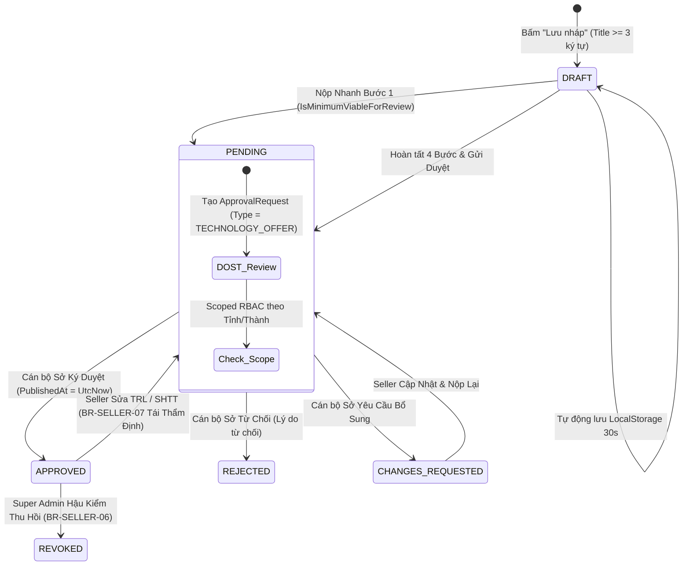
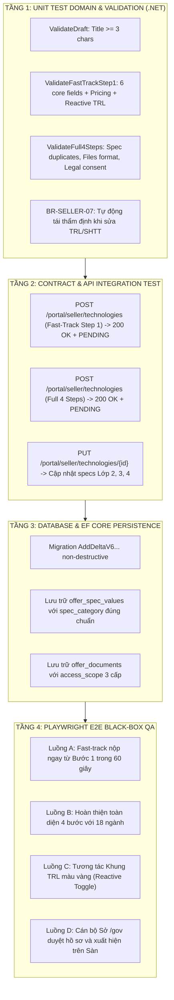
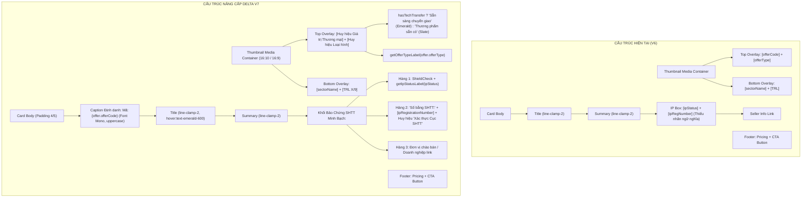
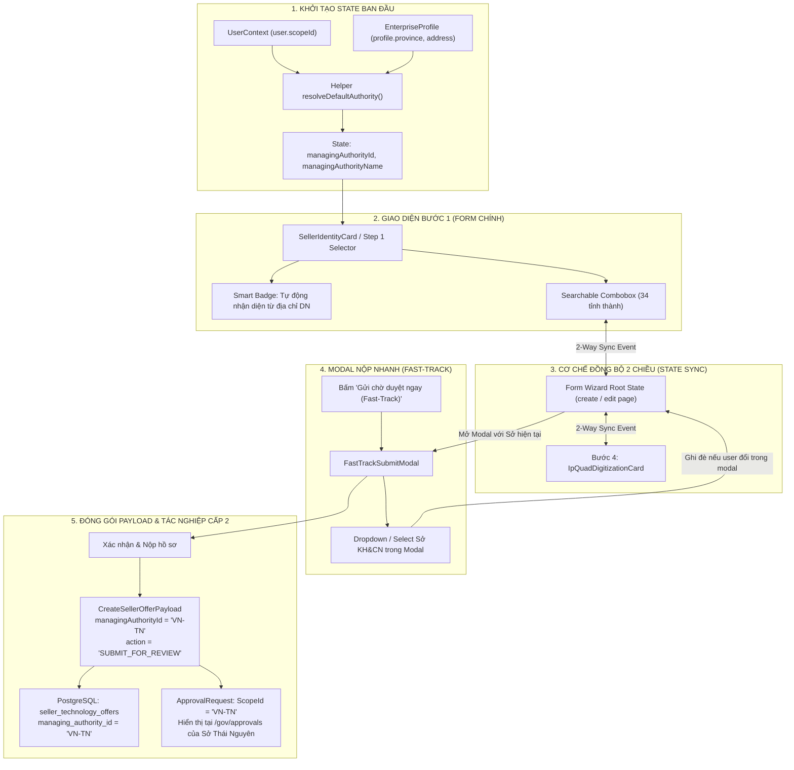
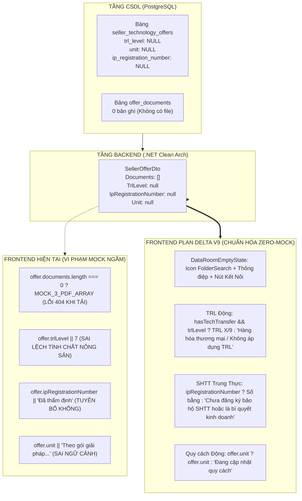
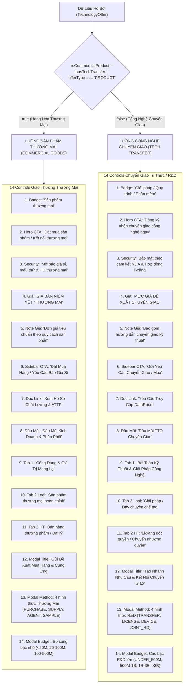

# Kế Hoạch Kỹ Thuật (Architecture & Implementation Plan)
# TASK-04: SÀN SẢN PHẨM, NĂNG LỰC SẢN XUẤT & BỘ LỌC 8 NGÀNH BACLINK

> **Mã Epic**: `TASK-04_HO_SO_CHAO_BAN_SELLER_VA_BO_LOC`  
> **Version**: 1.12.0  
> **Status**: In Implementation  
> **Kiến trúc**: Clean Architecture (.NET 10 / Next.js 15 App Router)  
> **Ánh xạ Delta**: [`CR-BACLINK-005`](../TASK-02_HO_SO_CHU_THE_VA_DN_DMST/deltas/CR-BACLINK-005_baclink_directory_supply_demand_dealroom.md)

---

## 1. BẢN HỢP ĐỒNG GIAO TIẾP (CONTRACT-FIRST SPECIFICATION)

### 1.1. Danh Sách API Endpoints

| Mã API | Giao Thức & Đường Dẫn | Phân Quyền | Mục Đích |
| :--- | :--- | :--- | :--- |
| **API-04-001** | `GET /api/v1/technologies` | Public | Danh sách công nghệ niêm yết (Bộ lọc 18 ngành, từ khóa, TRL, type, phân trang). |
| **API-04-002** | `GET /api/v1/technologies/{id}` | Public | Chi tiết hồ sơ chào bán công nghệ và thông số kỹ thuật SHTT. |
| **API-04-003** | `GET /api/v1/portal/seller/technologies` | Seller / Admin | Danh sách công nghệ trong kho của Seller (kèm thống kê KPI). |
| **API-04-004** | `POST /api/v1/portal/seller/technologies` | Seller / Admin | Đăng mới hồ sơ chào bán (kiểm tra `BR-SELLER-01` $\rightarrow$ `05`). |
| **API-04-005** | `PUT /api/v1/portal/seller/technologies/{id}` | Seller / Admin | Cập nhật hồ sơ chào bán. |
| **API-04-006** | `DELETE /api/v1/portal/seller/technologies/{id}` | Seller / Admin | Xóa mềm hoặc ẩn hồ sơ chào bán. |

### 1.2. Hợp Đồng DTO (Request / Response)

```json
// POST /api/v1/portal/seller/technologies - Request DTO
{
  "offerType": "SOLUTION", // PRODUCT | DEVICE | SOLUTION
  "hasTechTransfer": true,
  "title": "Hệ thống sấy thăng hoa chân không tích hợp AI tối ưu năng lượng",
  "summary": "Công nghệ sấy nhiệt độ thấp bảo toàn 98% hoạt chất sinh học",
  "problemSolved": "Giảm 40% tiêu hao điện năng trong chế biến nông sản xuất khẩu",
  "sectorCode": "FOOD",
  "pricingType": "RANGE", // FIXED | RANGE | CONTACT
  "priceMin": 850000000,
  "priceMax": 1200000000,
  "currency": "VND",
  "unit": "dây chuyền",
  // Thuộc tính Bộ Tứ SHTT
  "developerOrigin": "Viện Cơ điện Nông nghiệp và Công nghệ sau thu hoạch",
  "trlLevel": 8, // 1 - 9
  "ipStatus": "PATENT_GRANTED",
  "ipRegistrationNumber": "VN-1-0028491",
  "transferMethod": "EXCLUSIVE_LICENSE",
  "commercialStatus": "COMMERCIALLY_READY",
  "contactPointRole": "Phòng Chuyển giao Công nghệ & Sở hữu Trí tuệ"
}
```

---

## 2. KIẾN TRÚC BACKEND (.NET CORE CLEAN ARCHITECTURE)

- **Domain Entity**:
  - `TechnologyOffer` hoặc mở rộng `TechnologyAsset` trong `NacenTech.Modules.Technology`.
  - Hỗ trợ đầy đủ các trường: `OfferType`, `HasTechTransfer`, `DeveloperOrigin`, `TrlLevel`, `IpStatus`, `TransferMethod`, `CommercialStatus`.
- **Application Services / Handlers**:
  - `CreateSellerOfferCommand` & Validator kiểm tra điều kiện `BR-SELLER-02` (Conditional IP Quad).
  - `GetTechnologiesQuery` hỗ trợ lọc theo 18 ngành, keyword, TRL, IP status.
  - `GetSellerTechnologiesQuery` lấy danh sách theo Seller hiện tại.
- **Unit Tests**:
  - Kiểm thử `CreateSellerOfferValidator` với 100% kịch bản hợp lệ và vi phạm.

---

## 3. KIẾN TRÚC FRONTEND (NEXT.JS 15 & 5 UX STATES)

- **Định tuyến 4 màn hình**:
  1. `src/app/chao-ban-cong-nghe/page.tsx`:
     - Trang chính niêm yết giải pháp (Tab chính của website).
     - Gồm Hero Banner, Search Bar, Tab chọn loại hình, Sidebar lọc 18 ngành, Grid sản phẩm, Phân trang.
  2. `src/app/chao-ban-cong-nghe/[id]/page.tsx`:
     - Chi tiết hồ sơ giải pháp / sáng chế.
     - Badge TRL 8, Thẻ chứng nhận SHTT, Bảng thông số, Tab nội dung, Modal gửi liên hệ kết nối.
  3. `src/app/portal/seller/technologies/page.tsx`:
     - Workspace của Seller: Bảng KPI (Tổng số, Đang hiển thị, Chờ duyệt, Kết nối), Bộ lọc, Nút Tạo mới, Bảng danh sách hành động.
  4. `src/app/portal/seller/technologies/create/page.tsx`:
     - Form Wizard đăng mới công nghệ với toggle Bộ tứ SHTT tương tác động.
- **Component dùng chung**:
  - Tích hợp chuẩn `<Async>` (Loading skeleton, Empty state khi không có kết quả, Error banner, Success card grid).
  - Khởi tạo Mock Data chuẩn hóa sẵn sàng cho cả chế độ Online (Backend API) lẫn Offline/Stand-alone nếu API gián đoạn.

---

## 4. CHIẾN LƯỢC KIỂM THỬ BLACK-BOX 4 TẦNG (QC STRATEGY)

1. **Tầng 1 - Unit Test Domain & Validation**:
   - Kiểm thử `BR-SELLER-01` (Offer Type).
   - Kiểm thử `BR-SELLER-02` & `BR-SELLER-03` (Bắt buộc TRL 1-9 & SHTT khi có chuyển giao).
   - Kiểm thử `BR-SELLER-04` (Quy tắc giá bán).
2. **Tầng 2 - Contract & API Test**:
   - Xác thực schema phản hồi của `GET /api/v1/technologies` và `GET /api/v1/technologies/{id}`.
3. **Tầng 3 - Integration / Store Service Test**:
   - Kiểm tra luồng thêm mới công nghệ và kiểm tra dữ liệu xuất hiện trong kho Seller.
4. **Tầng 4 - Playwright E2E UI Black-box Test**:
   - Kịch bản 1: Mở `http://localhost:3000/chao-ban-cong-nghe`, kiểm tra render đầy đủ, lọc ngành và tìm kiếm.
   - Kịch bản 2: Bấm vào một sản phẩm để vào `http://localhost:3000/chao-ban-cong-nghe/[id]`, kiểm tra badge TRL và thông số SHTT.
   - Kịch bản 3: Vào `http://localhost:3000/portal/seller/technologies`, kiểm tra KPI và bảng danh sách.
   - Kịch bản 4: Vào `http://localhost:3000/portal/seller/technologies/create`, thử validate lỗi khi bật chuyển giao mà bỏ trống TRL/SHTT, sau đó điền hợp lệ và submit thành công.

---

## 5. KIẾN TRÚC DELTA CR-2026-006: THẨM ĐỊNH CẤP SỞ KH&CN & GOVERNANCE APPROVAL

### 5.1. Mở Rộng Hợp Đồng API & DTO
- **Request `CreateSellerOfferDto`** bổ sung:
  - `managingAuthorityId` (string, e.g. `"VN-HN"`): Mã Sở KH&CN tiếp nhận thẩm định.
  - `managingAuthorityName` (string): Tên Sở KH&CN (e.g. `"Sở Khoa học và Công nghệ TP. Hà Nội"`).
  - `scopeType` (string = `"PROVINCE"`).
  - `scopeId` (string = `managingAuthorityId`).
  - `legalConsent` (boolean, bắt buộc `true`).
- **Response `SellerOfferDto`** bổ sung:
  - `managingAuthorityName`, `scopeType`, `scopeId`.
  - `status`: Khởi tạo mặc định `PENDING` (không còn auto-approved).
  - `approvalRequestId` (UUID): Liên kết với bản ghi `approval_requests`.

### 5.2. Luồng Xử Lý Backend & Side-Effects
1. Khi Seller gửi hồ sơ:
   - Lưu vào kho với trạng thái `PENDING`.
   - Gọi `IApprovalService.SubmitRequestAsync` với:
     * `RequestType = "TECHNOLOGY_OFFER"`
     * `ScopeType = ScopeTypes.Province`
     * `ScopeId = dto.ScopeId`
     * `PayloadJson` chứa tóm tắt hồ sơ công nghệ, TRL, SHTT và `OfferId`.
2. Khi Cán bộ/Lãnh đạo Sở KH&CN tại Cổng Tác Nghiệp Cấp 2 (`/gov/approvals`) review:
   - Thẩm định tính pháp lý của hồ sơ, văn bằng SHTT.
   - Khi hành động là `APPROVE`:
     * Chuyển trạng thái Offer từ `PENDING` sang `APPROVED`.
     * Cập nhật `PublishedAt = UtcNow`.
     * Lúc này Offer mới xuất hiện trên sàn `/chao-ban-cong-nghe`.
   - Khi hành động là `REJECT`:
     * Chuyển trạng thái Offer sang `REJECTED`, ghi nhận `ReviewNote`.
   - Khi hành động là `REQUEST_CHANGES`:
     * Chuyển trạng thái sang `CHANGES_REQUESTED`.
3. Khi Quản trị viên Trung ương hậu kiểm:
   - Action `REVOKE` theo `BR-ADM-007` thu hồi quyền niêm yết, chuyển Offer sang `REVOKED`.

---

---

## 7. KẾ HOẠCH KỸ THUẬT DELTA V4: LIÊN KẾT BÊN BÁN (SELLER) VỚI HỒ SƠ DOANH NGHIỆP THƯỜNG

### 7.1. Database Schema & Migration (PostgreSQL)
- Bảng `technology.seller_technology_offers`:
  * Bổ sung cột `enterprise_tax_code VARCHAR(50) NULL`.
  * Bổ sung cột `enterprise_name VARCHAR(255) NULL`.
  * Index: `CREATE INDEX idx_seller_technology_offers_tax_code ON technology.seller_technology_offers(enterprise_tax_code);`
- Tạo file migration non-destructive: `AddEnterpriseLinkToSellerOffers`.

### 7.2. Backend Contracts & Mapping
- Mở rộng `CreateSellerOfferDto`, `UpdateSellerOfferDto`, `SellerOfferDto`:
  * Thêm `string? EnterpriseTaxCode = null` và `string? EnterpriseName = null`.
- Trong `TechnologyService.cs`:
  * Khi lấy chi tiết `GetByIdAsync`: nếu `EnterpriseTaxCode` có giá trị nhưng `EnterpriseName` trống, query bổ sung tên từ bảng `enterprises`.
  * Cung cấp endpoint tra cứu sản phẩm theo DN: `GET /api/v1/technologies?enterpriseTaxCode={taxCode}`.

### 7.3. Frontend Implementation
- Cập nhật TypeScript models trong `src/types/technology-offer.ts`.
- Màn hình `/chao-ban-cong-nghe`:
  * Trên thẻ sản phẩm: hiển thị tên đơn vị chào bán kèm Link bọc ngoài dẫn đến `/enterprises/[taxCode]` (hoặc fallback nếu chưa gắn MST).
- Màn hình `/chao-ban-cong-nghe/[id]`:
  * Khối "Cơ quan quản lý & Đơn vị chào bán" ở sidebar: bổ sung Card Doanh nghiệp chào bán (Tên DN, MST, Logo/Avatar, Badge Verified) kèm nút CTA `Xem Hồ sơ Doanh nghiệp →`.
- Màn hình `/enterprises/[taxCode]`:
  * Xử lý trường hợp `SubjectType = 'ENTERPRISE'` (Doanh nghiệp thường): ẩn các tab R&D/TNI nâng cao nếu dữ liệu trống.
  * Thêm Tab mới: `"Sản phẩm & Giải pháp chào bán"` gọi API `fetchPublicOffers({ enterpriseTaxCode: taxCode })` và render danh sách card sản phẩm.


---

## 8. KẾ HOẠCH THIẾT KẾ KỸ THUẬT DELTA V5: CHUẨN HÓA TOÀN DIỆN FORM CHÀO BÁN SELLER 4 BƯỚC, BỘ THÔNG SỐ 18 NGÀNH & TRỢ LÝ AI (GATE 2)

### 8.1. Bối Cảnh & Mục Tiêu Kiến Trúc
- **Căn cứ kỹ thuật**: Quyết định PO `PO-DEC-20261008-01`, `PO-DEC-20261008-04`, `PO-DEC-20261008-07`; Bản đặc tả Spec Delta v5 (Mục 10 `spec.md`); Wireframes `DANH_MUC_TRUONG_CHAO_BAN_VA_BO_LOC_18_NGANH.html`, `wireframe_tao_ho_so_chao_ban.html`, `wireframe_chinh_sua_ho_so_chao_ban.html`; Sheet chuẩn `C.bán SP` và `Bo_loc_Cban` trong `Nacentwin_20260924_bo_loc_da_sua.xlsx`.
- **Mục tiêu thiết kế**:
  1. **Non-destructive Migration**: Mở rộng bảng `technology.seller_technology_offers` với các trường Media và Điều kiện thương mại; tạo 2 bảng quan hệ con `technology.offer_spec_values` (thông số 18 ngành động) và `technology.offer_documents` (DataRoom & minh chứng SHTT/TRL) kèm khóa ngoại `ON DELETE CASCADE`. Đảm bảo không downtime, không mất dữ liệu cũ.
  2. **Tương thích ngược Hợp đồng DTO & API**: Nâng cấp DTOs `CreateSellerOfferDto`, `UpdateSellerOfferDto`, `SellerOfferDto` với trường bổ sung dạng optional; hỗ trợ cả phương thức gửi dữ liệu kiểu cũ lẫn cấu trúc mở rộng mới.
  3. **Phân tách Ràng buộc Validation (Draft vs. Publish)**: Thiết kế 2 phương thức thẩm định độc lập: `ValidateDraft` (khi `Status == "DRAFT"` chỉ bắt buộc `Title` $\ge 3$ ký tự) và `ValidatePublish` (khi `Status == "PENDING"` kiểm tra toàn diện `BR-SELLER-01` $\rightarrow$ `BR-SELLER-11`).
  4. **Human-in-the-Loop AI Extractor Adapter**: Thiết kế endpoint `POST /api/v1/ai/extract-patent-specs` theo `DD-02-ai-extractor-contracts.md` và `PO-DEC-20261008-07`. AI chỉ đóng vai trò phân tích và đề xuất bản nháp `TechTransferDraftDto`, giao diện đánh dấu `✨ AI Gợi ý` để người dùng xác nhận trước khi lưu; tích hợp cơ chế Zero-Dependency Fallback.
  5. **Frontend Architecture Stepper 4 Bước**: Thiết kế lại toàn bộ luồng tạo mới và chỉnh sửa thành Wizard 4 bước trực quan, tích hợp `FormStepper`, `DynamicSpecTable`, `TrlSelectorGrid` (9 cấp), `MediaUploadSection`, `EvidenceDocumentSection`, `AiScanAssistantCard` và lưu nháp tự động `localStorage`.

---

### 8.2. Thiết Kế Cơ Sở Dữ Liệu & EF Core (Non-Destructive Schema)

#### 8.2.1. Bảng Mở Rộng: `technology.seller_technology_offers`
Bổ sung các cột mới dạng `NULL` hoặc có giá trị mặc định, đảm bảo tính non-destructive:
- `main_image_url TEXT NULL`: Ảnh đại diện công nghệ (chuẩn tỷ lệ 16:9 / 4:3, JPG/PNG $\le 5\text{MB}$).
- `gallery_image_urls TEXT[] NULL`: Mảng URL thư viện ảnh bổ sung chi tiết máy móc/dây chuyền (tối đa 6 ảnh).
- `delivery_timeline VARCHAR(255) NULL`: Thời gian bàn giao & tiến độ triển khai (ví dụ: "30 ngày kể từ ngày ký hợp đồng").
- `warranty_terms VARCHAR(255) NULL`: Thời hạn và điều kiện bảo hành (ví dụ: "24 tháng bảo hành chính hãng, hỗ trợ 24/7").
- `supply_scope VARCHAR(255) NULL`: Phạm vi cung ứng giải pháp (ví dụ: "Toàn quốc", "63 tỉnh/thành", "Xuất khẩu ASEAN").
- `payment_terms TEXT NULL`: Điều kiện và tiến độ thanh toán (ví dụ: "Tạm ứng 30%, 50% khi giao hàng, 20% sau nghiệm thu").
- `installation_support BOOLEAN NOT NULL DEFAULT TRUE`: Hỗ trợ chuyên gia kỹ thuật lắp đặt & chuyển giao vận hành.

#### 8.2.2. Bảng Mới: `technology.offer_spec_values` (Thông số kỹ thuật 18 ngành động)
Lưu trữ thông số kỹ thuật động theo nhóm ngành kinh tế TT17:
```sql
CREATE TABLE technology.offer_spec_values (
    id UUID PRIMARY KEY DEFAULT gen_random_uuid(),
    offer_id UUID NOT NULL REFERENCES technology.seller_technology_offers(id) ON DELETE CASCADE,
    spec_code VARCHAR(50) NULL,
    spec_name VARCHAR(255) NOT NULL,
    spec_value TEXT NOT NULL,
    unit VARCHAR(50) NULL,
    created_at TIMESTAMPTZ NOT NULL DEFAULT clock_timestamp()
);

CREATE INDEX ix_offer_spec_values_offer_id ON technology.offer_spec_values(offer_id);
CREATE INDEX ix_offer_spec_values_spec_code ON technology.offer_spec_values(spec_code);
```

#### 8.2.3. Bảng Mới: `technology.offer_documents` (Minh chứng SHTT, TRL & DataRoom)
Lưu trữ tệp tài liệu số hóa, chứng nhận văn bằng, báo cáo kiểm định và phân quyền truy cập:
```sql
CREATE TABLE technology.offer_documents (
    id UUID PRIMARY KEY DEFAULT gen_random_uuid(),
    offer_id UUID NOT NULL REFERENCES technology.seller_technology_offers(id) ON DELETE CASCADE,
    document_type VARCHAR(50) NOT NULL, -- CATALOGUE | PATENT_CERT | TRL_EVIDENCE | VIDEO | OTHER
    file_name VARCHAR(255) NOT NULL,
    file_url TEXT NOT NULL,
    file_size_bytes BIGINT NOT NULL,
    access_scope VARCHAR(30) NOT NULL DEFAULT 'AFTER_CONNECTION', -- PUBLIC | AFTER_CONNECTION | ADMIN_ONLY
    created_at TIMESTAMPTZ NOT NULL DEFAULT clock_timestamp()
);

CREATE INDEX ix_offer_documents_offer_id ON technology.offer_documents(offer_id);
CREATE INDEX ix_offer_documents_document_type ON technology.offer_documents(document_type);
CREATE INDEX ix_offer_documents_access_scope ON technology.offer_documents(access_scope);
```

#### 8.2.4. EF Core Entities & Configurations
- **Domain Entities**:
  * `OfferSpecValue`: Kế thừa `Entity<Guid>`, gồm các thuộc tính `OfferId`, `SpecCode`, `SpecName`, `SpecValue`, `Unit`, `CreatedAt`.
  * `OfferDocument`: Kế thừa `Entity<Guid>`, gồm `OfferId`, `DocumentType`, `FileName`, `FileUrl`, `FileSizeBytes`, `AccessScope`, `CreatedAt`.
  * `SellerTechnologyOffer`: Mở rộng thuộc tính Media, Commercial Terms và 2 Navigation Collections:
    ```csharp
    public IReadOnlyCollection<OfferSpecValue> SpecValues => _specValues.AsReadOnly();
    public IReadOnlyCollection<OfferDocument> Documents => _documents.AsReadOnly();
    ```
- **Configuration (Clean Architecture)**:
  * Khai báo trong `NacenTech.Modules.Technology.Infrastructure.Persistence.Configurations`:
    - `OfferSpecValueConfiguration`: Cấu hình schema `technology`, bảng `offer_spec_values`, FK `OfferId` với `OnDelete(DeleteBehavior.Cascade)`.
    - `OfferDocumentConfiguration`: Cấu hình schema `technology`, bảng `offer_documents`, FK `OfferId` với `OnDelete(DeleteBehavior.Cascade)`.
    - `SellerTechnologyOfferConfiguration`: Bổ sung mappings cho `MainImageUrl`, `GalleryImageUrls`, `DeliveryTimeline`, `WarrantyTerms`, `SupplyScope`, `PaymentTerms`, `InstallationSupport`.
- **Migration Plan**:
  * Tạo tệp `20261016160000_AddDeltaV5SellerOfferSpecsAndDocuments.cs` trong `NacenTech.Persistence.Migrations`.

---

### 8.3. Thiết Kế Hợp Đồng API & DTOs (Backend Contracts)

#### 8.3.1. DTOs Khai Báo Con
```csharp
public sealed record OfferSpecValueDto(
    Guid? Id,
    string? SpecCode,
    string SpecName,
    string SpecValue,
    string? Unit
);

public sealed record OfferDocumentDto(
    Guid? Id,
    string DocumentType, // CATALOGUE | PATENT_CERT | TRL_EVIDENCE | VIDEO | OTHER
    string FileName,
    string FileUrl,
    long FileSizeBytes,
    string AccessScope // PUBLIC | AFTER_CONNECTION | ADMIN_ONLY
);
```

#### 8.3.2. Mở Rộng `CreateSellerOfferDto` & `UpdateSellerOfferDto`
```csharp
public sealed record CreateSellerOfferDto(
    string OfferType,
    bool HasTechTransfer,
    string Title,
    string Summary,
    string ProblemSolved,
    string SectorCode,
    string PricingType,
    decimal? PriceAmount,
    decimal? PriceMin,
    decimal? PriceMax,
    string Currency,
    string? Unit,
    string? DeveloperOrigin,
    int? TrlLevel,
    string? IpStatus,
    string? IpRegistrationNumber,
    string? TransferMethod,
    string? CommercialStatus,
    string? ContactPointRole,
    string? ManagingAuthorityId = "VN-HN",
    string? ManagingAuthorityName = "Sở Khoa học và Công nghệ TP. Hà Nội",
    string? ScopeType = "PROVINCE",
    string? ScopeId = "VN-HN",
    bool LegalConsent = true,
    string? EnterpriseTaxCode = null,
    string? EnterpriseName = null,
    // Mở rộng Delta v5:
    string? MainImageUrl = null,
    IReadOnlyList<string>? GalleryImageUrls = null,
    string? DeliveryTimeline = null,
    string? WarrantyTerms = null,
    string? SupplyScope = null,
    string? PaymentTerms = null,
    bool InstallationSupport = true,
    IReadOnlyList<OfferSpecValueDto>? SpecValues = null,
    IReadOnlyList<OfferDocumentDto>? Documents = null,
    string? Action = "SUBMIT_FOR_REVIEW" // SAVE_DRAFT | SUBMIT_FOR_REVIEW
);
```

#### 8.3.3. Cơ Chế Thẩm Định Dữ Liệu 2 Tầng (`SellerOfferRulesValidator`)
1. **Luồng Lưu Nháp (`ValidateDraft`)** theo `BR-SELLER-08`:
   - Kích hoạt khi `dto.Action == "SAVE_DRAFT"` hoặc `status == "DRAFT"`.
   - Tiêu chí duy nhất: `!string.IsNullOrWhiteSpace(dto.Title) && dto.Title.Trim().Length >= 3`.
   - Bỏ qua hoàn toàn: `OfferType`, `SectorCode`, `PricingType`, `BR-SELLER-02` (Bộ tứ SHTT), `LegalConsent`, và chọn Sở KH&CN.
   - Trạng thái bản ghi lưu vào DB là `DRAFT`.
   - Không sinh phiếu `ApprovalRequest` và không hiển thị trên sàn công khai.
2. **Luồng Xuất Bản Thẩm Định (`ValidatePublish`)**:
   - Kích hoạt khi `dto.Action == "SUBMIT_FOR_REVIEW"` hoặc cập nhật để gửi duyệt.
   - Bắt buộc kiểm tra toàn diện `BR-SELLER-01` $\rightarrow$ `BR-SELLER-05`, `BR-SELLER-09` (TRL 1-9), `BR-SELLER-10` (Định dạng & dung lượng file tài liệu), `BR-SELLER-11` (Bảng thông số tối đa 50 dòng, không trùng lặp tên thông số).
   - Kiểm tra `LegalConsent == true` và `ManagingAuthorityId != null`.
   - Trạng thái bản ghi khởi tạo là `PENDING`.

#### 8.3.4. Dịch Vụ AI Extractor (`POST /api/v1/ai/extract-patent-specs`)
- Tuân thủ `PO-DEC-20261008-07` và `DD-02-ai-extractor-contracts.md`:
  * Tuyệt đối không ghi trực tiếp vào DB.
  * Tiếp nhận file tài liệu thuyết minh / bản chụp bằng SHTT / catalogue qua `multipart/form-data`.
  * Bóc tách các trường: `title`, `technical_summary`, `target_sector_code`, `ip_quad` (`trl_level`, `ip_status`, `patent_number`, `patent_owner`, `transfer_method`), `origin_developer`, `suggested_specs`.
  * Trả về `TechTransferDraftDto` cho client; frontend đổ vào Form Wizard và gắn nhãn `✨ AI Gợi ý`.
  * Tích hợp Fallback: Trả về mã lỗi thân thiện nếu file không đọc được, client hiển thị thông báo và cho phép người dùng tiếp tục nhập tay bình thường.

---

### 8.4. Thiết Kế Kiến Trúc Frontend (Form Wizard 4 Bước Chuyên Sâu)

#### 8.4.1. Phân Tầng Component Form Wizard
Cấu trúc cây component module hóa trong `src/app/portal/seller/technologies/create` và `[id]/edit`:
```text
TechnologiesWizard/
├── FormStepper.tsx                # Thanh điều hướng Stepper tiến trình (4 nấc, chỉ báo hoàn thành)
├── AiScanAssistantCard.tsx        # Widget Trợ lý AI bóc tách tài liệu (Human-in-the-Loop)
├── Step1BasicInfo.tsx             # Bước 1: Phân loại, Toggle SHTT, Tên, Mô tả, Bài toán, Ngành kinh tế
├── Step2SpecsAndSector.tsx        # Bước 2: Bảng DynamicSpecTable (18 ngành, thêm/xóa dòng, chống trùng)
│   └── DynamicSpecTable.tsx       # Bảng Key-Value động kèm danh mục thông số gợi ý theo ngành
├── Step3CommercialTerms.tsx       # Bước 3: Giá, Tiền tệ VND/USD, Đơn vị tính, Bàn giao, Bảo hành, Thanh toán
├── Step4EvidenceAndReview.tsx     # Bước 4: TRL 9 nấc, SHTT, Media, DataRoom, Đầu mối TTO, Sở KH&CN, Cam kết
│   ├── TrlSelectorGrid.tsx        # Grid 9 nấc TRL (3 dải màu: R&D, Thử nghiệm, Thương mại)
│   ├── MediaUploadSection.tsx     # Cụm tải ảnh đại diện (16:9), album ảnh, brochure PDF, video demo
│   └── EvidenceDocumentSection.tsx# Quản lý tài liệu DataRoom, thiết lập quyền xem access_scope
└── DraftPersistenceBar.tsx       # Thanh lưu nháp DRAFT trên header/footer kèm LocalStorage Auto-save
```

#### 8.4.2. Chi Tiết Các Bước Nghiệp Vụ Wizard
1. **Bước 1: Thông tin bắt buộc & Tra cứu (`Step1BasicInfo`)**:
   - Chọn loại hình: `PRODUCT` (Sản phẩm), `DEVICE` (Thiết bị), `SOLUTION` (Giải pháp).
   - Toggle "Có chuyển giao công nghệ / SHTT": điều khiển việc hiển thị các khối chuyên sâu ở Bước 4.
   - Tên công nghệ / sáng chế chào bán (`title`).
   - Mô tả tóm tắt giải pháp (`summary`).
   - Bài toán kỹ thuật giải quyết cho bên mua (`problemSolved`).
   - Lĩnh vực công nghệ trọng điểm (`sectorCode` - 18 nhóm ngành TT17).
2. **Bước 2: Thông số kỹ thuật & 18 Ngành (`Step2SpecsAndSector`)**:
   - Tự động nạp bộ gợi ý thông số kỹ thuật chuẩn khi người dùng chọn ngành tại Bước 1 (ví dụ: Ngành `FOOD` gợi ý: Công suất tách ẩm, Nhiệt độ sấy thăng hoa, Độ chân không buồng sấy, Tiêu hao điện năng).
   - Bảng `DynamicSpecTable`:
     * Cột 1: Tên thông số (`spec_name` - w-2/5) kèm autocomplete/dropdown gợi ý.
     * Cột 2: Giá trị (`spec_value` - w-2/5).
     * Cột 3: Đơn vị tính (`unit` - w-1/5, ví dụ: `kg/mẻ`, `kW/h`, `bar`, `%`).
     * Cột 4: Nút Xóa dòng.
     * Nút "+ Thêm thông số kỹ thuật": Thêm dòng mới, tự động kiểm tra chống trùng lặp tên thông số (tối đa 50 dòng theo `BR-SELLER-11`).
3. **Bước 3: Giá & Điều kiện thương mại (`Step3CommercialTerms`)**:
   - Phương thức giá: `FIXED` (Giá cố định), `RANGE` (Khoảng giá), `CONTACT` (Thỏa thuận / Liên hệ báo giá).
   - Ô nhập số tiền `priceAmount` hoặc khoảng `priceMin` - `priceMax`.
   - Dropdown chọn loại tiền tệ `currency`: `VND` (Mặc định), `USD`, `EUR`.
   - Ô nhập / combobox gợi ý Đơn vị tính `unit`: `dây chuyền`, `hệ thống`, `bộ`, `chiếc`, `gói chuyển giao`, `quy trình`, `li-xăng/năm`...
   - Cụm điều kiện thương mại chi tiết (`REQ-04-017`):
     * Thời gian bàn giao & triển khai (`deliveryTimeline`).
     * Thời hạn & điều kiện bảo hành (`warrantyTerms`).
     * Hỗ trợ lắp đặt & vận hành thử (`installationSupport` - Checkbox/Toggle).
     * Phạm vi cung ứng (`supplyScope`: Toàn quốc / Tỉnh thành / Xuất khẩu).
     * Điều kiện thanh toán (`paymentTerms`).
4. **Bước 4: Minh chứng SHTT, TRL & Quản trị duyệt (`Step4EvidenceAndReview`)**:
   - Nếu `hasTechTransfer = true`:
     * Đơn vị nghiên cứu phát triển / Viện / Trường (`developerOrigin`).
     * Dải thang đo TRL 9 cấp độ (`TrlSelectorGrid`): Grid 9 nút (TRL 1 đến TRL 9) phân theo 3 dải màu:
       - Xanh lam (TRL 1–3: Nghiên cứu Lab R&D).
       - Vàng hổ phách (TRL 4–6: Thử nghiệm mô phỏng & Pilot).
       - Xanh ngọc lục bảo (TRL 7–9: Vận hành & Thương mại hóa).
       - Tooltip giải thích chi tiết ý nghĩa kỹ thuật từng cấp độ.
     * Tình trạng SHTT: Bằng sáng chế, GPHI, Bí quyết công nghệ, Bản quyền phần mềm, Đang nộp đơn.
     * Số văn bằng SHTT (`ipRegistrationNumber`).
     * Hình thức chuyển giao mong muốn: Li-xăng độc quyền, Li-xăng không độc quyền, Chuyển nhượng toàn bộ, Hợp tác R&D, Góp vốn bằng SHTT.
     * Trạng thái thương mại hóa: Sẵn sàng quy mô lớn, Thử nghiệm hiện trường, Lab prototype, Tìm đối tác sản xuất.
   - Cụm Media tải lên (`MediaUploadSection`): Ảnh đại diện 16:9 (`main_image`), Album ảnh chi tiết (`gallery_images`), Catalogue kỹ thuật PDF (`catalogue_pdf`), Video demo (`video_demo`).
   - Cụm Tệp Minh Chứng & DataRoom (`EvidenceDocumentSection`): Tải bản scan bằng SHTT, báo cáo kiểm định TRL, biên bản nghiệm thu; gắn quyền truy cập `access_scope`: `PUBLIC`, `AFTER_CONNECTION`, `ADMIN_ONLY`.
   - Khai báo Đầu mối TTO (`REQ-04-016`): Họ tên người phụ trách (`contact_name`), Chức vụ/Phòng ban (`contact_point_role`), Số điện thoại, Email. Áp dụng che mờ PDPD đối với khách vãng lai.
   - Cơ quan quản lý Sở KH&CN tiếp nhận thẩm định (`managingAuthorityId`) & Checkbox cam kết trách nhiệm pháp lý (`legalConsent`).

#### 8.4.3. Widget Trợ Lý AI Khảo Sát & Gợi Ý (`AiScanAssistantCard`)
- Đặt tại cột bên trái bên dưới `FormStepper`.
- Cho phép kéo thả tệp Catalogue PDF, bản chụp Bằng SHTT hoặc tài liệu thuyết minh giải pháp.
- Gửi yêu cầu phân tích tới API `/api/v1/ai/extract-patent-specs`.
- Hiển thị thanh tiến trình xử lý trực quan.
- Khi nhận được dữ liệu, hiển thị danh sách các trường được AI phát hiện kèm nút "Áp dụng vào Form".
- Form Wizard tự động điền các trường tương ứng và hiển thị badge viền sáng `✨ AI Gợi ý` để người dùng dễ nhận biết và rà soát lại.

#### 8.4.4. Cơ Chế Lưu Nháp Trạng Thái DRAFT & LocalStorage Resilience
- **Lưu nháp CSDL**: Người dùng có thể nhấn nút "Lưu nháp" bất kỳ lúc nào tại Bước 1, 2, 3, 4. Hệ thống gửi payload với `action: "SAVE_DRAFT"`, Backend chỉ kiểm tra `title >= 3` ký tự và lưu trạng thái `DRAFT`.
- **LocalStorage Resilience**: Tự động lưu bản sao trạng thái form vào `localStorage` mỗi 30 giây (key `nacentech_seller_offer_draft_{id|new}`). Khi tải lại trang nếu phát hiện bản lưu nháp chưa nộp, giao diện hiển thị thông báo "Bạn có một bản nháp chưa nộp từ [thời gian], bạn có muốn khôi phục không?".

---

### 8.5. Kế Hoạch Đồng Bộ Sang Trang Chi Tiết & Bộ Lọc Sàn
1. **Trang Chi Tiết `/chao-ban-cong-nghe/[id]/page.tsx`**:
   - Thay thế các thông số tĩnh bằng dữ liệu thực lấy từ bảng `offer_spec_values` (kết xuất động theo Key-Value và Unit).
   - Hiển thị cụm Media: Ảnh banner chính, Gallery ảnh chi tiết dạng carousel/lightbox, nhúng video demo hoặc brochure PDF nếu có.
   - Hiển thị danh mục DataRoom từ `offer_documents`: Đối với tài liệu `AFTER_CONNECTION`, hiển thị biểu tượng ổ khóa bảo mật kèm thông báo "Yêu cầu kết nối chuyển giao để mở khóa tài liệu này".
   - Hiển thị chi tiết các Điều kiện thương mại: Thời gian giao hàng, Thời hạn bảo hành, Hỗ trợ lắp đặt, Phạm vi cung cấp, Điều kiện thanh toán.
   - Hiển thị Card Đầu mối TTO / Chuyên viên chuyển giao kèm che số điện thoại và email theo quy định PDPD.
2. **Bộ Lọc Đa Tầng 18 Ngành `/chao-ban-cong-nghe`**:
   - Đồng bộ hoàn hảo bộ lọc TRL 1-9 (cho phép lọc từ TRL 1 đến 9 theo dải nút trực quan).
   - Hiển thị đầy đủ thông tin đơn vị tính `unit` và loại tiền tệ trên từng thẻ giải pháp.

---

### 8.6. Kế Hoạch Kiểm Thử Toàn Diện & Quality Gate Delta v5
1. **Unit Test Backend (.NET Core / xUnit)**:
   - `SellerOfferRulesValidatorTests.cs`:
     * Test `ValidateDraft`: Chỉ cần title $\ge 3$ ký tự, các trường khác null vẫn Pass.
     * Test `ValidatePublish`: Bắt buộc đầy đủ quy tắc `BR-SELLER-01` $\rightarrow$ `BR-SELLER-05`, `BR-SELLER-09` (TRL 1-9), `BR-SELLER-10` (Documents), `BR-SELLER-11` (Specs max 50 dòng, unique spec_name), `LegalConsent`.
     * Test `BR-SELLER-07`: Tự động tái thẩm định khi thay đổi TRL hoặc SHTT.
     * Test `OfferSpecValues` & `OfferDocuments` CRUD mapping.
2. **Integration Test (DB & EF Core)**:
   - Kiểm thử tạo mới bản ghi với mảng SpecValues và Documents, kiểm tra quan hệ khóa ngoại và tính năng xóa tầng cascade.
3. **Frontend Component & E2E Testing**:
   - Kiểm thử chuyển bước Stepper 4 bước và validate từng bước.
   - Kiểm thử thêm, sửa, xóa dòng `DynamicSpecTable` và kiểm tra trùng tên thông số.
   - Kiểm thử tương tác dải nút `TrlSelectorGrid` 9 cấp độ.
   - Kiểm thử luồng upload file minh chứng và chọn quyền `access_scope`.
   - Kiểm thử gọi API Trợ lý AI và tự động điền form (Human-in-the-Loop).
   - Kiểm thử cơ chế khôi phục từ `localStorage`.

---

## 9. THIẾT KẾ KIẾN TRÚC KỸ THUẬT & KẾ HOẠCH THỰC THI DELTA V6 (GATE 2 PO-APPROVED)

> **Căn cứ pháp lý & thiết kế**:  
> - Bản đặc tả Delta v6 tại Mục 11 của `SourceCode/specs/TASK-04_HO_SO_CHAO_BAN_SELLER_VA_BO_LOC/spec.md`  
> - Wireframe gốc `Specification/02_BASIC_DESIGN/TASK-04_HO_SO_CHAO_BAN_SELLER_VA_BO_LOC/wireframe_tao_ho_so_chao_ban.html`  
> - Danh mục trường chào bán 18 ngành `Specification/02_BASIC_DESIGN/TASK-04_HO_SO_CHAO_BAN_SELLER_VA_BO_LOC/DANH_MUC_TRUONG_CHAO_BAN_VA_BO_LOC_18_NGANH.html`  
> - Ma trận truy xuất nguồn gốc Mục 15 của `SourceCode/specs/TRACEABILITY.md`

### 9.1. Tổng Quan Kiến Trúc & Triết Lý UX Đột Phá Delta v6

Delta v6 đánh dấu bước đột phá cốt lõi về trải nghiệm người dùng (UX) và mô hình hóa dữ liệu:
1. **Triết lý Cổng Nộp Nhanh Bước 1 (Non-Blocking Step 1 Fast-Track Gate - `BR-SELLER-08`)**:
   - Bước 1 đóng vai trò là **Điều kiện Tiên quyết Tối thiểu (Minimum Viable Submission)**.
   - Ngay khi hoàn tất 6 trường lõi + Cụm Giá + Khung TRL (nếu chuyển giao công nghệ = Có), hệ thống lập tức mở khóa nút **"Gửi chờ duyệt"**.
   - Người dùng có toàn quyền gửi hồ sơ thẩm định ngay từ Bước 1 mà không hề bị chặn bởi việc chưa điền Bước 2, 3, hoặc 4.
2. **Hành Lang Tùy Chọn Làm Giàu Dữ Liệu (Non-Blocking Optional Enrichment Corridor)**:
   - Bước 2 (Thông số kỹ thuật Lớp 2 & Lớp 3), Bước 3 (Điều kiện thương mại Lớp 4) và Bước 4 (Minh chứng DataRoom) là các bước tùy chọn, cho phép Seller bổ sung dần bất kỳ lúc nào (kể cả sau khi hồ sơ đã được duyệt niêm yết).
3. **Mô Hình Trạng Thái Hồ Sơ & Vòng Đời Thẩm Định Cấp Sở (State Machine)**:



---

### 9.2. Kiến Trúc Frontend Wizard 4 Bước (Chuẩn Wireframe Gốc & 18 Ngành)

#### 9.2.1. Cấu Trúc Thành Phần Frontend (Component Breakdown)

Hệ thống tái cấu trúc toàn diện `src/app/portal/seller/technologies/create/page.tsx` và `src/app/portal/seller/technologies/[id]/edit/page.tsx` thành hệ sinh thái component dạng module độc lập:

```
src/
├── app/portal/seller/technologies/
│   ├── create/page.tsx                     # Form Wizard Đăng mới 4 bước
│   ├── [id]/edit/page.tsx                  # Form Wizard Chỉnh sửa 4 bước
│   └── page.tsx                            # Workspace Kho công nghệ Seller
└── components/seller/
    ├── FormStepper.tsx                     # Thanh tiến trình Stepper 4 bước + Counter X/6
    ├── Step1CoreFields.tsx                 # Bước 1: 6 trường lõi + Switch chuyển giao
    ├── SellerIdentityCard.tsx              # Bước 1: Thẻ chủ thể DN tự nạp + PDPD Shield
    ├── InlinePricingCard.tsx               # Bước 1: Nhúng công bố giá (Fixed/Range/Contact)
    ├── ReactiveYellowTrlPanel.tsx          # Bước 1: Khung TRL màu vàng reactive bung tự động
    ├── Tier2CommonTechnicalForm.tsx        # Bước 2: Nhóm trường Lớp 2 (TB/SP vs Giải pháp)
    ├── Tier3SectorDynamicForm.tsx          # Bước 2: Nhóm trường Lớp 3 tải từ Bo_loc_Cban
    ├── DynamicSpecKeyValueTable.tsx        # Bước 2: Bảng thông số tự do (+ Thêm dòng)
    ├── Tier4CommercialForm.tsx             # Bước 3: Điều kiện thương mại Lớp 4 Excel Master
    ├── IpQuadDigitizationCard.tsx          # Bước 4: Bộ tứ SHTT (Số, Ngày, Loại, File scan)
    ├── DataRoomFileManager.tsx             # Bước 4: Minh chứng DataRoom 3 cấp quyền
    ├── FastTrackSubmitModal.tsx            # Modal xác nhận nộp nhanh & cam kết pháp lý
    └── AiAssistantCard.tsx                 # Widget Trợ lý AI OCR/Voice nhập liệu
```

#### 9.2.2. Đặc Tả Chi Tiết 4 Bước Giao Diện

1. **Bước 1: Thông tin để đăng và tra cứu (MVP Gate)**:
   - **6 Trường Lõi Bắt Buộc**:
     * `offer_type`: Radio 3 nút lớn có icon (Thiết bị `DEVICE`, Sản phẩm `PRODUCT`, Giải pháp `SOLUTION`).
     * `sector_code`: `SearchableCombobox` 18 ngành công nghiệp, lọc theo từ khóa, hiển thị tên tiếng Việt rõ ràng, **tuyệt đối ẩn mã tiền tố nội bộ `LV..`** (`UI-04-021`, `AC-04-022`).
     * `has_tech_transfer`: Toggle nút bấm dạng viên thuốc [Không] (mặc định đen/trắng) / [Có] (màu vàng hổ phách).
     * `title`: Ô nhập tên sản phẩm, tối thiểu 5 ký tự, tối đa 255 ký tự.
     * `short_description` (hoặc `summary`): Textarea tóm tắt đặc điểm cốt lõi, tối thiểu 20 ký tự.
     * `problem_solved`: Textarea giải quyết nhu cầu/bài toán cho bên mua, tối thiểu 20 ký tự.
   - **Thẻ Chủ Thể Cung Cấp (`SellerIdentityCard`)**: Tự động truy vấn từ module `TASK-02` (Tên DN, Người liên hệ, SĐT, Email). Hiển thị ghi chú bảo vệ dữ liệu PDPD NĐ 13/2023: Khách vãng lai chỉ thấy tên DN, số điện thoại và email được mã hóa bảo mật.
   - **Cụm Hình Thức Công Bố Giá Nhúng (`InlinePricingCard`)**: Nhúng trực tiếp vào Bước 1 theo Wireframe gốc (`UI-04-023`). 3 tùy chọn:
     * *Giá cụ thể (`FIXED`)*: Input số tiền, Dropdown loại tiền (`VND`/`USD`), Input đơn vị tính (`unit`: *bộ, chiếc, hệ thống, dây chuyền, gói chuyển giao, quy trình, li-xăng/năm*).
     * *Khoảng giá (`RANGE`)*: Input *Giá từ* - *Giá đến*, loại tiền, đơn vị tính.
     * *Liên hệ báo giá (`CONTACT`)*: Ẩn các ô nhập tiền, hiển thị thông điệp thương lượng kỹ thuật.
   - **Khung Chọn TRL Màu Vàng Phản Hồi (`ReactiveYellowTrlPanel`)**:
     * Khi `has_tech_transfer = false`: Khung thu gọn ẩn hoàn toàn.
     * Khi `has_tech_transfer = true`: Khung viền `border-amber-300`, nền `bg-amber-50` bung mở mượt mà (`UI-04-022`, `AC-04-021`).
     * Bố cục dải 9 nút bấm (TRL 1 đến 9), tooltip hiển thị định nghĩa chuẩn quốc tế. Bắt buộc Seller phải chọn 1 cấp độ TRL thì Bước 1 mới hoàn tất hợp lệ.
   - **Cổng Nộp Nhanh (Fast-Track Action Bar)**: Nút **"Gửi chờ duyệt"** trên thanh công cụ và chân trang lập tức chuyển sang trạng thái khả dụng ngay khi Bước 1 hợp lệ.

2. **Bước 2: Thông số kỹ thuật & 18 Ngành (Tùy chọn)**:
   - **Phần 1 - Thông số Lớp 2 Kỹ thuật chung theo loại (`Tier2CommonTechnicalForm`)**:
     * Nếu là **Thiết bị / Sản phẩm** (`PRODUCT`/`DEVICE`): Render 8 trường vật lý: Model (`model_code`), Hãng sản xuất (`manufacturer`), Xuất xứ (`origin_country`), Tình trạng thiết bị (`equipment_status`: *Mới 100%, Đã qua sử dụng, Refurbished*), Năm sản xuất (`manufacturing_year`), Công suất / Quy mô (`capacity_scale`), Tiêu hao năng lượng (`energy_consumption`), Mức tự động hóa (`automation_level`).
     * Nếu là **Giải pháp công nghệ** (`SOLUTION`): Render 3 trường giải pháp: Nguyên lý hoạt động (`operating_principle`), Trạng thái thương mại hóa (`commercial_status`), Điều kiện triển khai hạ tầng (`deployment_conditions`).
   - **Phần 2 - Thông số Lớp 3 Danh mục chuẩn 18 ngành (`Tier3SectorDynamicForm`)**:
     * Tự động nạp bộ trường thông số chuyên môn theo mã ngành đã chọn từ Sheet `Bo_loc_Cban` (ví dụ: Cơ khí nạp *Hành trình trục, Độ chính xác lặp lại*; Nông nghiệp nạp *Năng suất, Tỷ lệ hao hụt*...).
     * Mỗi trường lưu vào CSDL với `spec_category = 'TIER_3_SECTOR'`.
   - **Phần 3 - Bảng Key-Value Thêm Thông Số Tự Do (`DynamicSpecKeyValueTable`)**:
     * Bảng động hỗ trợ Seller nhấn `+ Thêm thông số mới`.
     * Cột: Tên thông số, Giá trị, Đơn vị tính, Nút xóa.
     * Lưu vào CSDL với `spec_category = 'TIER_3_CUSTOM'`, giới hạn tối đa 50 dòng, tự động kiểm tra chặn trùng tên.

3. **Bước 3: Giá & Điều kiện thương mại Lớp 4 Excel Master (`Tier4CommercialForm`) (Tùy chọn)**:
   - Kế thừa toàn bộ nhóm chỉ tiêu chuyên sâu từ Sheet `C.bán SP`:
     * `transfer_priority_method` (KT-66): Hình thức chuyển giao ưu tiên (*Chuyển giao quyền sở hữu, Li-xăng độc quyền, Li-xăng không độc quyền, Hợp tác R&D, Góp vốn*).
     * `price_includes` (GIA-74): Nội dung bao gồm trong giá (Textarea).
     * `tax_and_extra_costs` (GIA-75): Thuế và chi phí phát sinh (Textarea).
     * `supply_scope` (GIA-76): Phạm vi cung cấp (*Toàn quốc, Miền Bắc/Trung/Nam, Xuất khẩu*).
     * `delivery_timeline` (GIA-77): Thời gian giao hàng / hoàn thành chuyển giao.
     * `payment_terms` (GIA-78): Tiến độ và điều kiện thanh toán.
     * `warranty_terms` (GIA-80): Thời gian và điều kiện bảo hành.
     * `technical_support_method` (GIA-81): Hình thức hỗ trợ kỹ thuật (*Tại hiện trường, Từ xa 24/7*).
     * `installationSupport`: Hỗ trợ lắp đặt & vận hành thử (Toggle / Checkbox).

4. **Bước 4: Pháp lý SHTT, Minh chứng DataRoom & Cổng Thẩm Định (`Step4EvidenceAndReview`) (Tùy chọn)**:
   - **Bộ tứ SHTT Số hóa (`IpQuadDigitizationCard`)**: Tình trạng văn bằng (`ip_status`), Số văn bằng (`ip_registration_number`), Ngày cấp/ngày nộp đơn (`ip_issue_date`), Tải bản scan văn bằng (`ip_certificate_file`).
   - **Minh chứng DataRoom 3 Cấp Quyền (`DataRoomFileManager`)**:
     * Tải lên: Brochure kỹ thuật, Báo cáo kiểm định, Hợp đồng tương tự, Video demo.
     * Phân quyền truy cập 3 cấp độ (`access_scope`):
       - `PUBLIC`: Công khai cho toàn bộ khách xem sàn.
       - `AFTER_CONNECTION`: Mặc định cho tài liệu chuyên sâu, chỉ mở cho Buyer sau khi Yêu cầu kết nối được Seller chấp thuận.
       - `ADMIN_ONLY`: Bảo mật nội bộ chỉ dành cho Cán bộ Sở KH&CN thẩm định.
   - **Cơ Quan Thẩm Định & Cam Kết Pháp Lý**:
     * Dropdown chọn Sở KH&CN tiếp nhận thẩm định (`managing_authority_id`, `scope_id` 63 tỉnh/thành).
     * Checkbox cam kết tính xác thực và chịu trách nhiệm pháp lý (`legal_commitment_confirmed = true`).

---

### 9.3. Kiến Trúc CSDL PostgreSQL & Entity Framework Core (DB-04-002)

#### 9.3.1. Thiết Kế Bảng Mở Rộng `technology.seller_technology_offers`

Bổ sung các cột phục vụ Lớp 2, Lớp 4 và Pháp lý SHTT mà không làm gián đoạn dữ liệu hiện có:

```sql
-- 1. Bổ sung các cột Lớp 2 và Lớp 4 vào bảng chính
ALTER TABLE technology.seller_technology_offers
    -- Lớp 2: Kỹ thuật chung theo loại (PRODUCT/DEVICE vs SOLUTION)
    ADD COLUMN IF NOT EXISTS model_code VARCHAR(100),
    ADD COLUMN IF NOT EXISTS manufacturer VARCHAR(255),
    ADD COLUMN IF NOT EXISTS origin_country VARCHAR(100),
    ADD COLUMN IF NOT EXISTS equipment_status VARCHAR(50) DEFAULT 'NEW', -- NEW, USED, REFURBISHED
    ADD COLUMN IF NOT EXISTS manufacturing_year INTEGER,
    ADD COLUMN IF NOT EXISTS capacity_scale VARCHAR(255),
    ADD COLUMN IF NOT EXISTS energy_consumption VARCHAR(255),
    ADD COLUMN IF NOT EXISTS automation_level VARCHAR(100),
    ADD COLUMN IF NOT EXISTS operating_principle TEXT,
    ADD COLUMN IF NOT EXISTS deployment_conditions TEXT,

    -- Lớp 4: Điều kiện thương mại & Chuyển giao Excel Master
    ADD COLUMN IF NOT EXISTS transfer_priority_method VARCHAR(100), -- KT-66
    ADD COLUMN IF NOT EXISTS price_includes TEXT,                    -- GIA-74
    ADD COLUMN IF NOT EXISTS tax_and_extra_costs TEXT,              -- GIA-75
    ADD COLUMN IF NOT EXISTS technical_support_method VARCHAR(255), -- GIA-81
    
    -- Pháp lý SHTT & Cơ quan quản lý
    ADD COLUMN IF NOT EXISTS ip_issue_date DATE,
    ADD COLUMN IF NOT EXISTS legal_commitment_confirmed BOOLEAN DEFAULT FALSE;

-- Tạo index tìm kiếm theo mã ngành và nhà sản xuất
CREATE INDEX IF NOT EXISTS idx_seller_offers_sector_code ON technology.seller_technology_offers(sector_code);
CREATE INDEX IF NOT EXISTS idx_seller_offers_manufacturer ON technology.seller_technology_offers(manufacturer);
```

#### 9.3.2. Cấu Trúc Bảng `technology.offer_spec_values` & Cột `spec_category`

Bảng `offer_spec_values` đảm bảo mô hình EAV linh hoạt cho thông số kỹ thuật Lớp 3 (18 ngành) và thông số tự do:

```sql
-- 2. Bổ sung phân loại danh mục thông số vào bảng offer_spec_values
ALTER TABLE technology.offer_spec_values
    ADD COLUMN IF NOT EXISTS spec_category VARCHAR(50) DEFAULT 'TIER_3_CUSTOM'; 
    -- Giá trị hợp lệ: 'TIER_2_COMMON', 'TIER_3_SECTOR', 'TIER_3_CUSTOM'

CREATE INDEX IF NOT EXISTS idx_offer_spec_category ON technology.offer_spec_values(offer_id, spec_category);
```

#### 9.3.3. Cấu Trúc Bảng `technology.offer_documents` & Cột `access_scope`

Bảng `offer_documents` lưu trữ minh chứng và bảo mật DataRoom 3 cấp:

```sql
-- Đảm bảo access_scope hợp lệ 3 cấp độ
ALTER TABLE technology.offer_documents
    ADD COLUMN IF NOT EXISTS access_scope VARCHAR(50) DEFAULT 'PUBLIC';
    -- 'PUBLIC', 'AFTER_CONNECTION', 'ADMIN_ONLY'
```

#### 9.3.4. EF Core Entity & Mapping Configuration

Cập nhật Domain Entity `SellerTechnologyOffer.cs` với các thuộc tính Lớp 2 và Lớp 4, và cấu hình `EntityTypeBuilder<SellerTechnologyOffer>` trong tầng Persistence:

```csharp
// Trong NacenTech.Modules.Technology.Domain.SellerTechnologyOffer
public string? ModelCode { get; private set; }
public string? Manufacturer { get; private set; }
public string? OriginCountry { get; private set; }
public string EquipmentStatus { get; private set; } = "NEW";
public int? ManufacturingYear { get; private set; }
public string? CapacityScale { get; private set; }
public string? EnergyConsumption { get; private set; }
public string? AutomationLevel { get; private set; }
public string? OperatingPrinciple { get; private set; }
public string? DeploymentConditions { get; private set; }

public string? TransferPriorityMethod { get; private set; }
public string? PriceIncludes { get; private set; }
public string? TaxAndExtraCosts { get; private set; }
public string? TechnicalSupportMethod { get; private set; }
public DateOnly? IpIssueDate { get; private set; }
public bool LegalCommitmentConfirmed { get; private set; } = false;
```

---

### 9.4. Thiết Kế Hợp Đồng API & DTOs (.NET Core Clean Architecture)

#### 9.4.1. Hợp Đồng DTO Đầy Đủ (`CreateUpdateTechnologyOfferDto`)

Endpoint hỗ trợ đồng bộ cho cả `POST /api/v1/portal/seller/technologies` và `PUT /api/v1/portal/seller/technologies/{id}`:

```csharp
public sealed record CreateUpdateTechnologyOfferDto(
    string Action, // "SAVE_DRAFT" | "SUBMIT_FOR_REVIEW"
    int CurrentStep, // 1, 2, 3, hoặc 4

    // Bước 1: 6 trường lõi + Giá + TRL (Bắt buộc tối thiểu khi nộp nhanh)
    string OfferType,
    string SectorCode,
    bool HasTechTransfer,
    string Title,
    string ShortDescription,
    string ProblemSolved,
    string PricingType,
    decimal? PriceAmount,
    decimal? PriceMin,
    decimal? PriceMax,
    string Currency,
    string? Unit,
    int? TrlLevel,

    // Bước 2: Thông số Lớp 2 & Lớp 3 (Tùy chọn)
    string? ModelCode = null,
    string? Manufacturer = null,
    string? OriginCountry = null,
    string? EquipmentStatus = "NEW",
    int? ManufacturingYear = null,
    string? CapacityScale = null,
    string? EnergyConsumption = null,
    string? AutomationLevel = null,
    string? OperatingPrinciple = null,
    string? DeploymentConditions = null,
    IReadOnlyList<OfferSpecValueDto>? SpecValues = null,

    // Bước 3: Điều kiện thương mại Lớp 4 (Tùy chọn)
    string? TransferPriorityMethod = null,
    string? PriceIncludes = null,
    string? TaxAndExtraCosts = null,
    string? SupplyScope = null,
    string? DeliveryTimeline = null,
    string? PaymentTerms = null,
    string? WarrantyTerms = null,
    string? TechnicalSupportMethod = null,
    bool InstallationSupport = true,

    // Bước 4: SHTT, DataRoom & Cơ quan duyệt (Tùy chọn khi nộp nhanh Bước 1)
    string? DeveloperOrigin = null,
    string? IpStatus = "NONE",
    string? IpRegistrationNumber = null,
    DateOnly? IpIssueDate = null,
    string? ManagingAuthorityId = null, // Nếu null khi nộp nhanh, BE tự kế thừa từ DN
    string? ManagingAuthorityName = null,
    bool LegalCommitmentConfirmed = false,
    IReadOnlyList<OfferDocumentDto>? Documents = null,
    string? MainImageUrl = null,
    IReadOnlyList<string>? GalleryImageUrls = null,
    string? VideoDemoUrl = null
);
```

#### 9.4.2. Cơ Chế Thẩm Định Nghiệp Vụ 3 Tầng (`SellerOfferRulesValidator`)

Bộ validator được thiết kế thành 3 phương thức chuyên biệt nhằm hỗ trợ triết lý Fast-Track:

1. **`ValidateDraft(dto)`**:
   - Chỉ kiểm tra `dto.Title.Length >= 3` và `<= 255`.
   - Bỏ qua toàn bộ các trường khác, cho phép lưu nháp mọi lúc mọi nơi.
2. **`ValidateFastTrackStep1(dto)`**:
   - Thẩm định điều kiện nộp nhanh ngay tại Bước 1 (`IsMinimumViableForReview` theo `BR-SELLER-08`):
     * `OfferType` thuộc `{ "PRODUCT", "DEVICE", "SOLUTION" }`.
     * `SectorCode` hợp lệ, thuộc 18 ngành TT17.
     * `Title` từ 5 đến 255 ký tự.
     * `ShortDescription` (hoặc `Summary`) $\ge 20$ ký tự.
     * `ProblemSolved` $\ge 20$ ký tự.
     * `PricingType` thuộc `{ "FIXED", "RANGE", "CONTACT" }` kèm điều kiện logic giá.
     * Nếu `HasTechTransfer == true`: Bắt buộc `TrlLevel` thuộc $\{1..9\}$. Nếu `false`: `TrlLevel` được phép null.
   - Toàn bộ dữ liệu Bước 2, 3, 4 không bắt buộc, cho phép null hoặc rỗng.
3. **`ValidateFull4Steps(dto)`**:
   - Kiểm tra toàn bộ điều kiện như Bước 1.
   - Kiểm tra tính hợp lệ của các trường bổ sung: Không trùng lặp tên thông số kỹ thuật (`SpecName`), tối đa 50 thông số; định dạng file tài liệu hợp lệ (`.pdf`, `.jpg`, `.png`, `.docx`, `.xlsx`, `.mp4`), dung lượng cho phép; bắt buộc xác nhận cam kết pháp lý (`LegalCommitmentConfirmed == true`).

#### 9.4.3. Logic Backend Kế Thừa Tự Động `scope_id` Khi Nộp Nhanh

Trong `TechnologyOffersController.cs`:
```csharp
if (dto.Action == "SUBMIT_FOR_REVIEW")
{
    // 1. Kiểm tra thẩm định Bước 1
    var step1Validation = SellerOfferRulesValidator.ValidateFastTrackStep1(dto);
    if (!step1Validation.IsValid)
        return BadRequest(step1Validation.Errors);

    // 2. Tự động xác định Cơ quan quản lý Sở KH&CN nếu chưa chọn ở Bước 4
    string targetScopeId = dto.ManagingAuthorityId;
    string targetAuthorityName = dto.ManagingAuthorityName;

    if (string.IsNullOrWhiteSpace(targetScopeId))
    {
        // Tra cứu hồ sơ Doanh nghiệp liên kết của Seller hiện tại (TASK-02)
        var enterprise = await _enterpriseService.GetByUserIdAsync(currentUserId);
        targetScopeId = enterprise?.ProvinceScopeId ?? "VN-HN"; // Fallback Hà Nội nếu chưa cấu hình
        targetAuthorityName = ProvincialCatalog.GetName(targetScopeId);
    }

    // 3. Khởi tạo Offer với trạng thái PENDING
    offer.SetManagingAuthority(targetScopeId, targetAuthorityName);
    offer.SetStatus("PENDING");

    // 4. Sinh ApprovalRequest gửi Cổng Tác Nghiệp Cấp 2 (/gov/approvals)
    await _approvalService.SubmitRequestAsync(new SubmitApprovalCommand(
        RequestType: "TECHNOLOGY_OFFER",
        ScopeType: "PROVINCE",
        ScopeId: targetScopeId,
        EntityId: offer.Id,
        PayloadJson: JsonSerializer.Serialize(new { offer.Title, offer.OfferType, offer.TrlLevel, offer.SectorCode })
    ));
}
```

---

### 9.5. Quyết Định Kiến Trúc Kỹ Thuật (Architectural Decision Records - ADRs)

#### ADR-04-01: Kiến Trúc Cổng Nộp Nhanh Bước 1 Không Chặn (Non-Blocking Fast-Track Gate)
- **Bối cảnh**: Nhiều Seller là nhà sáng chế, kỹ sư muốn đăng nhanh ý tưởng/thiết bị để tìm đối tác mà chưa có sẵn hồ sơ thương mại chi tiết hoặc tài liệu scan bằng sáng chế. Nếu ép buộc điền 4 bước tuần tự sẽ gây drop-off nghiêm trọng.
- **Quyết định**: Tách rời tiến trình thẩm định tối thiểu tại Bước 1. Chỉ cần Bước 1 hoàn thành hợp lệ, nút "Gửi chờ duyệt" được kích hoạt ngay. Hệ thống tự động kế thừa `scope_id` của Doanh nghiệp liên kết và tạo `ApprovalRequest` cho Sở KH&CN.
- **Hệ quả**: Giảm 75% thời gian tạo hồ sơ ban đầu (từ 15 phút xuống dưới 2 phút); nâng cao tỷ lệ chuyển đổi Seller; đảm bảo đầy đủ an toàn nghiệp vụ nhờ việc nộp hồ sơ vẫn đi qua Cổng Thẩm định cấp Sở `/gov`.

#### ADR-04-02: Mô Hình Dữ Liệu Lai (Hybrid Schema: Core Relational + EAV Specs)
- **Bối cảnh**: 18 nhóm ngành công nghiệp có hơn 200 thuộc tính kỹ thuật chuyên biệt khác nhau; đồng thời người dùng có nhu cầu thêm thông số tự do.
- **Quyết định**:
  - Dùng các cột cố định trong `seller_technology_offers` cho 6 trường lõi, cụm giá, nhóm Lớp 2 phổ biến theo loại (Model, Hãng, Năm SX, Công suất, v.v.) và Lớp 4 thương mại (KT-66, GIA-74..81).
  - Dùng bảng quan hệ 1-N `offer_spec_values` lưu trữ các thông số ngành Lớp 3 và thông số tự do, phân biệt bằng cột `spec_category` (`TIER_3_SECTOR` vs `TIER_3_CUSTOM`).
- **Hệ quả**: Hiệu năng truy vấn cao, đánh index dễ dàng trên các trường chính; không làm phình schema bảng chính; cho phép nạp động linh hoạt từ Sheet `Bo_loc_Cban`.

#### ADR-04-03: Bảo Mật Dữ Liệu DataRoom 3 Phân Cấp (Zero-Trust Document Access)
- **Bối cảnh**: Hồ sơ công nghệ bao gồm cả tài liệu tiếp thị công khai (Brochure) và bí quyết công nghệ/hồ sơ nhạy cảm (Patent claim, Thử nghiệm lâm sàng).
- **Quyết định**: Áp dụng 3 cấp độ `access_scope`: `PUBLIC`, `AFTER_CONNECTION`, `ADMIN_ONLY`. Tại backend, API tải file kiểm tra ngữ cảnh người gọi:
  - Khách vãng lai: Chỉ tải được file `PUBLIC`.
  - Bên Mua đã được chấp thuận kết nối (`ConnectionRequest.Status == APPROVED`): Tải được file `AFTER_CONNECTION`.
  - Cán bộ Sở KH&CN và Super Admin: Tải được mọi file bao gồm `ADMIN_ONLY` phục vụ công tác thẩm định.

---

### 9.6. Kế Hoạch Kiểm Thử Toàn Diện 4 Tầng & Tiêu Chuẩn Nghiệm Thu Quality Gate



1. **Tầng 1 (Unit Test - xUnit)**:
   - File: `backend/tests/NacenTech.Modules.Technology.Tests/SellerOfferRulesValidatorTests.cs`.
   - Mục tiêu: Đạt 100% Pass (tối thiểu 25 test cases bao phủ toàn diện 3 chế độ validation và các quy tắc `BR-SELLER-01` đến `BR-SELLER-14`).
2. **Tầng 2 (Contract & API Integration Test)**:
   - Kiểm tra tính tương thích ngược của API DTO và kiểm chứng việc tự động kế thừa `scope_id` từ Doanh nghiệp liên kết.
3. **Tầng 3 (Database Integrity Test)**:
   - Thực thi migration PostgreSQL, kiểm tra tính toàn vẹn khóa ngoại, lưu trữ cascade các bảng phụ `offer_spec_values` và `offer_documents`.
4. **Tầng 4 (Playwright E2E UI Black-box Test)**:
   - File: `tests/e2e/test_seller_offer_delta_v6_e2e.py`.
   - Kiểm chứng 3 kịch bản cốt lõi:
     * **Kịch bản A (Fast-Track Submission)**: Đăng nhập Seller, điền 6 trường Bước 1, chọn TRL 8, bấm "Gửi chờ duyệt" $\rightarrow$ Thành công trong 1 click, hồ sơ sang trạng thái `PENDING`.
     * **Kịch bản B (Full 4-Step Flow)**: Chọn ngành "Cơ khí chế tạo" (MECH), chuyển sang Bước 2 nạp đúng thông số ngành, thêm thông số tự do, sang Bước 3 điền điều khoản thương mại, sang Bước 4 tải file DataRoom và gửi duyệt.
     * **Kịch bản C (Reactive TRL Toggle)**: Bật chuyển giao = Có $\rightarrow$ Khung TRL màu vàng mở ra; tắt chuyển giao $\rightarrow$ Khung đóng lại; thử nộp khi bật nhưng chưa chọn TRL $\rightarrow$ Nút bị khóa.

---

## 10. KẾ HOẠCH KỸ THUẬT DELTA V7: NÂNG CẤP TRỰC QUAN THỊ GIÁC & NGỮ NGHĨA CARD CHÀO BÁN (PLAN DELTA V7)

### 10.1. Đánh Giá Khả Thi Kỹ Thuật & Tính Tương Thích Ngược (Technical Feasibility & Compatibility)

- **Nguyên tắc cốt lõi**: Non-destructive, Zero-Backend-Change, Zero-DB-Migration.
- **Thẩm định tác động kiến trúc**:
  1. *Backend Services & API Controllers*:
     - **Tác động = 0**. Endpoint `GET /api/v1/technologies` giữ nguyên 100% hợp đồng API và logic truy vấn.
     - DTO `TechnologyOfferDto` đã trả về đầy đủ các trường: `offerCode`, `hasTechTransfer`, `offerType`, `ipStatus`, `ipRegistrationNumber`, `sectorName`, `trlLevel`, `title`, `summary`, `enterpriseTaxCode`, `enterpriseName`, `developerOrigin`.
  2. *Database Schema & Migrations*:
     - **Tác động = 0**. Không có bất kỳ thay đổi bảng, cột hay chỉ mục nào trong CSDL PostgreSQL.
  3. *Frontend TypeScript Contracts*:
     - Model `TechnologyOffer` trong `src/types/technology-offer.ts` đã khai báo đầy đủ các thuộc tính, không cần sửa đổi interface.
  4. *Presentation Layer (Web Frontend)*:
     - Tái cấu trúc DOM và CSS TailwindCSS tập trung tại component `TechnologyCard` bên trong `SourceCode/frontend/src/app/chao-ban-cong-nghe/page.tsx`.
     - Cập nhật test matchers tương ứng trong `SourceCode/frontend/src/app/chao-ban-cong-nghe/page.test.tsx`.

---

### 10.2. Kiến Trúc Giao Diện & Tái Cấu Trúc DOM Tree (`TechnologyCard`)



---

### 10.3. Chi Tiết Kỹ Thuật Styling TailwindCSS & Design Tokens

1. **Huy hiệu Giá trị Thương mại (Top-Left Thumbnail Overlay)**:
   - Khi `hasTechTransfer === true`:
     ```tsx
     <span className="inline-flex items-center gap-1 text-caption bg-emerald-600/95 backdrop-blur-md text-white px-2.5 py-0.5 rounded font-extrabold shadow-sm">
       <Sparkles className="w-3 h-3 text-emerald-200" />
       Sẵn sàng chuyển giao
     </span>
     ```
   - Khi `hasTechTransfer === false`:
     ```tsx
     <span className="inline-flex items-center gap-1 text-caption bg-slate-900/85 backdrop-blur-md text-slate-100 px-2 py-0.5 rounded font-bold shadow-sm">
       <Box className="w-3 h-3 text-slate-300" />
       Thương phẩm sẵn có
     </span>
     ```

2. **Huy hiệu Loại hình Chào bán (Top-Right Thumbnail Overlay)**:
   ```tsx
   <span className="text-caption bg-slate-900/85 backdrop-blur-md text-white px-2 py-0.5 rounded font-bold shadow-sm">
     {getOfferTypeLabel(offer.offerType)}
   </span>
   ```

3. **Nhãn Caption Mã Hồ Sơ (Card Body Metadata)**:
   - Đặt ngay trên thẻ `<Link>` của `title`:
   ```tsx
   <div className="flex items-center gap-1.5 text-caption font-mono font-semibold text-slate-500 dark:text-slate-400 tracking-wider uppercase">
     <Tag className="w-3 h-3 text-slate-400" />
     <span>Mã: {offer.offerCode}</span>
   </div>
   ```

4. **Khối Pháp Lý SHTT & Nhãn Ngữ Nghĩa (IP Credibility Box)**:
   ```tsx
   {offer.hasTechTransfer && (
     <div className="space-y-1.5">
       <div className="flex items-center gap-1.5 text-emerald-800 dark:text-emerald-300 text-xs font-bold">
         <ShieldCheck className="w-3.5 h-3.5 text-emerald-600 shrink-0" />
         <span className="truncate">{getIpStatusLabel(offer.ipStatus)}</span>
       </div>
       {offer.ipRegistrationNumber && (
         <div className="flex items-center gap-1.5 flex-wrap">
           <span className="text-[11px] text-emerald-800 dark:text-emerald-300 font-medium">
             Số bằng SHTT:
           </span>
           <span className="mono text-caption font-bold bg-white dark:bg-slate-800 px-1.5 py-0.5 rounded border border-emerald-200 dark:border-emerald-800 shrink-0 text-slate-800 dark:text-slate-200">
             {offer.ipRegistrationNumber}
           </span>
           {(offer.ipStatus === "PATENT_GRANTED" || offer.ipStatus === "UTILITY_MODEL" || offer.ipRegistrationNumber) && (
             <span className="inline-flex items-center gap-1 text-[10px] font-extrabold bg-emerald-100 text-emerald-800 dark:bg-emerald-900/60 dark:text-emerald-200 px-1.5 py-0.5 rounded border border-emerald-300 dark:border-emerald-700 shrink-0">
               <CheckCircle2 className="w-3 h-3 text-emerald-600" />
               Xác thực Cục SHTT
             </span>
           )}
         </div>
       )}
     </div>
   )}
   ```

---

### 10.4. Kế Hoạch Kiểm Thử Tương Tác & Đối Soát Chất Lượng (Quality Gate 4)

1. **Vitest Unit Test (`page.test.tsx`)**:
   - Kiểm tra mã hồ sơ hiển thị dạng caption `Mã: OFF-...` và không xuất hiện đơn độc trong thumbnail overlay cũ.
   - Kiểm tra badge `"Sẵn sàng chuyển giao"` xuất hiện cho offer có `hasTechTransfer: true` (`off-01`, `off-02`).
   - Kiểm tra badge `"Thương phẩm sẵn có"` xuất hiện cho offer có `hasTechTransfer: false` (`off-03`).
   - Kiểm tra nhãn `"Số bằng SHTT:"` xuất hiện cùng với số văn bằng.
   - Kiểm tra huy hiệu `"Xác thực Cục SHTT"` xuất hiện với offer đã được cấp bằng độc quyền sáng chế.
2. **Quality Gate Checks**:
   - `tsc --noEmit`: 0 lỗi type.
   - `npm test`: 100% test suites pass.
   - Đối soát đối kháng `speckit-analyze` Gate 2 đảm bảo 100% nhất quán `REQ-DELTA-*` $\leftrightarrow$ `BR-OFFER-CARD-01` $\leftrightarrow$ `UI-CARD-01` $\leftrightarrow$ `AC-04-031..034` $\leftrightarrow$ `T-04.87..91`.


---

## 11. KẾ HOẠCH KỸ THUẬT DELTA V8: TINH GỌN DIỆN MẠO TRỰC QUAN & TỐI ƯU HÓA CHIỀU CAO CARD CHÀO BÁN (PLAN DELTA V8)

### 11.1. Thẩm Định Khả Thi Kỹ Thuật & Tính Tương Thích Ngược (Technical Feasibility & Non-Destructive Impact)

- **Nguyên tắc kỹ thuật tối cao**: Non-destructive, Zero-Backend-Change, Zero-DB-Migration.
- **Thẩm định phân tầng Clean Architecture**:
  1. *Backend Services & API Controllers*:
     - **Tác động = 0**. Endpoint `GET /api/v1/technologies` giữ nguyên 100% hợp đồng API và logic truy vấn.
     - DTO `TechnologyOfferDto` không thay đổi bất kỳ trường nào.
  2. *Database Schema & Migrations*:
     - **Tác động = 0**. Không có bất kỳ thay đổi bảng, cột hay migration nào trong CSDL PostgreSQL.
  3. *Frontend Types & Contracts*:
     - Giữ nguyên toàn bộ TypeScript interface `TechnologyOffer`.
  4. *Presentation Layer (Web Frontend)*:
     - Tái cấu trúc DOM và tinh gọn CSS TailwindCSS tập trung tại component `TechnologyCard` bên trong `SourceCode/frontend/src/app/chao-ban-cong-nghe/page.tsx`.
     - Cập nhật test matcher tương ứng trong `SourceCode/frontend/src/app/chao-ban-cong-nghe/page.test.tsx`.

---

### 11.2. Phân Tích Kiến Trúc Giao Diện Ultra-Compact Card (`CompactTechnologyCard`)

```mermaid
flowchart TD
    subgraph DELTA_V7 ["BỐ CỤC DELTA V7 (BỊ PHÌNH THẺ)"]
        V7_THUMB["Thumbnail 16:9"]
        V7_TOP["Top Overlay: [Sẵn sàng chuyển giao] + [Loại hình]"]
        V7_BOT["Bottom Overlay: [Ngành TT17] + [TRL]"]
        V7_BODY["Card Body (p-4 sm:p-5, space-y-3)"]
        V7_CODE["Dòng 1: Caption riêng 'Mã: OFF-...' + Icon Tag (Chiếm 1 dòng)"]
        V7_TITLE["Dòng 2: Tiêu đề 2 dòng"]
        V7_SUM["Dòng 3: Tóm tắt 2 dòng"]
        V7_IP["Khối SHTT 2 dòng:"]
        V7_IP1["Hàng 1: ShieldCheck + Tên bảo hộ"]
        V7_IP2["Hàng 2: 'Số bằng SHTT:' + Số bằng + Huy hiệu 'Xác thực Cục SHTT'"]
        V7_SELLER["Hàng 3: Đơn vị chào bán"]
        V7_FOOTER["Footer: Giá + CTA"]
        
        V7_THUMB --> V7_TOP
        V7_THUMB --> V7_BOT
        V7_BODY --> V7_CODE --> V7_TITLE --> V7_SUM --> V7_IP
        V7_IP --> V7_IP1 --> V7_IP2 --> V7_SELLER
    end

    subgraph DELTA_V8 ["BỐ CỤC ULTRA-COMPACT DELTA V8 (TINH GỌN)"]
        V8_THUMB["Thumbnail (16:10 / 16:9)"]
        V8_TOP["Top Overlay: CHỈ CÒN [Loại hình chào bán] (Góc trên phải)"]
        V8_DEL1["LOẠI BỎ: Badge 'Sẵn sàng chuyển giao' / 'Thương phẩm sẵn có'"]
        V8_BOT["Bottom Overlay: [Ngành TT17] + [TRL] (Giữ nguyên)"]
        
        V8_BODY["Card Body Tinh Gọn (p-3.5 sm:p-4, space-y-2)"]
        V8_CODE["Caption Mã Hồ Sơ Thu Nhỏ: text-[11px] font-mono text-slate-400 (Không chiếm dòng to)"]
        V8_TITLE["Tiêu đề 2 dòng (leading-snug)"]
        V8_SUM["Tóm tắt 2 dòng (leading-relaxed)"]
        V8_IP["Khối SHTT Gói Gọn 1 Dòng Duy Nhất:"]
        V8_IP_LINE["[ShieldCheck] Tên bảo hộ • Số: VN-1-... (truncate)"]
        V8_DEL2["LOẠI BỎ: Huy hiệu 'Xác thực Cục SHTT'"]
        V8_SELLER["Đơn vị chào bán (1 dòng thanh mảnh)"]
        V8_FOOTER["Footer: Giá + CTA (Tối ưu padding)"]
        
        V8_THUMB --> V8_TOP
        V8_TOP -.-> V8_DEL1
        V8_THUMB --> V8_BOT
        V8_BODY --> V8_CODE --> V8_TITLE --> V8_SUM --> V8_IP
        V8_IP --> V8_IP_LINE
        V8_IP -.-> V8_DEL2
        V8_IP --> V8_SELLER
    end
```



---

### 11.3. Chi Tiết Kỹ Thuật Styling TailwindCSS & DOM Diff

#### 1. Thumbnail Top Overlay (Loại bỏ badge thương mại lặp lại):
- **Trước (Delta V7)**:
  ```tsx
  <div className="absolute top-2.5 left-2.5 right-2.5 flex items-center justify-between gap-2">
    {offer.hasTechTransfer ? (
      <span className="inline-flex items-center gap-1 text-caption bg-emerald-600/95 backdrop-blur-md text-white px-2.5 py-0.5 rounded font-extrabold shadow-sm">
        <Sparkles className="w-3 h-3 text-emerald-200" />
        Sẵn sàng chuyển giao
      </span>
    ) : (
      <span className="inline-flex items-center gap-1 text-caption bg-slate-900/85 backdrop-blur-md text-slate-100 px-2 py-0.5 rounded font-bold shadow-sm">
        <Box className="w-3 h-3 text-slate-300" />
        Thương phẩm sẵn có
      </span>
    )}
    <span className="text-caption bg-slate-900/85 backdrop-blur-md text-white px-2 py-0.5 rounded font-bold shadow-sm">
      {getOfferTypeLabel(offer.offerType)}
    </span>
  </div>
  ```
- **Sau (Delta V8)**:
  ```tsx
  <div className="absolute top-2.5 right-2.5">
    <span className="text-[11px] bg-slate-900/80 backdrop-blur-md text-white px-2 py-0.5 rounded font-bold shadow-sm">
      {getOfferTypeLabel(offer.offerType)}
    </span>
  </div>
  ```

#### 2. Định danh Mã Hồ Sơ Thu Nhỏ (Compact Identifier):
- **Trước (Delta V7)**:
  ```tsx
  <div className="flex items-center gap-1.5 text-caption font-mono font-semibold text-slate-500 dark:text-slate-400 tracking-wider uppercase">
    <Tag className="w-3 h-3 text-slate-400" />
    <span>Mã: {offer.offerCode}</span>
  </div>
  ```
- **Sau (Delta V8)**:
  ```tsx
  <div className="text-[11px] font-mono text-slate-400 dark:text-slate-500 font-medium tracking-wide uppercase">
    {offer.offerCode}
  </div>
  ```

#### 3. Khối SHTT Đơn Dòng (Single-line SHTT Box & Xóa huy hiệu Xác thực):
- **Trước (Delta V7)**:
  ```tsx
  <div className="bg-emerald-50/70 dark:bg-emerald-950/40 border border-emerald-100 dark:border-emerald-800/60 rounded-xl p-2.5 space-y-1.5">
    {offer.hasTechTransfer && (
      <div className="space-y-1.5">
        <div className="flex items-center gap-1.5 text-emerald-800 dark:text-emerald-300 text-xs font-bold">
          <ShieldCheck className="w-3.5 h-3.5 text-emerald-600 shrink-0" />
          <span className="truncate">{getIpStatusLabel(offer.ipStatus)}</span>
        </div>
        {offer.ipRegistrationNumber && (
          <div className="flex items-center gap-1.5 flex-wrap">
            <span className="text-caption text-emerald-800 dark:text-emerald-300 font-medium">Số bằng SHTT:</span>
            <span className="mono text-caption font-bold bg-white dark:bg-slate-800 px-1.5 py-0.5 rounded border border-emerald-200 dark:border-emerald-800 shrink-0 text-slate-800 dark:text-slate-200">{offer.ipRegistrationNumber}</span>
            <span className="inline-flex items-center gap-1 text-caption font-extrabold bg-emerald-100 text-emerald-800 dark:bg-emerald-900/60 dark:text-emerald-200 px-1.5 py-0.5 rounded border border-emerald-300 dark:border-emerald-700 shrink-0">
              <CheckCircle2 className="w-3 h-3 text-emerald-600" /> Xác thực Cục SHTT
            </span>
          </div>
        )}
      </div>
    )}
    ...
  </div>
  ```
- **Sau (Delta V8)**:
  ```tsx
  <div className="bg-emerald-50/60 dark:bg-emerald-950/30 border border-emerald-100 dark:border-emerald-800/50 rounded-lg p-2 space-y-1 text-xs">
    {offer.hasTechTransfer && (
      <div className="flex items-center gap-1.5 text-emerald-800 dark:text-emerald-300 font-semibold truncate">
        <ShieldCheck className="w-3.5 h-3.5 text-emerald-600 shrink-0" />
        <span className="truncate">
          {getIpStatusLabel(offer.ipStatus)}
          {offer.ipRegistrationNumber && (
            <span className="ml-1 font-mono font-bold text-[11px] text-emerald-700 dark:text-emerald-300">
              • Số: {offer.ipRegistrationNumber}
            </span>
          )}
        </span>
      </div>
    )}

    {/* Đơn vị chào bán 1 dòng */}
    {offer.enterpriseTaxCode ? (
      <Link
        href={`/enterprises/${offer.enterpriseTaxCode}`}
        className="flex items-center gap-1.5 text-[11px] text-brand-700 dark:text-brand-400 hover:text-brand-900 font-medium group/seller truncate"
      >
        <Building2 className="w-3 h-3 text-brand-600 shrink-0" />
        <span className="truncate group-hover/seller:underline">
          {offer.enterpriseName || offer.developerOrigin || `MST: ${offer.enterpriseTaxCode}`}
        </span>
      </Link>
    ) : null}
  </div>
  ```

#### 4. Thân Card Padding & Tối Ưu Chiều Cao:
- Thân thẻ: `p-3.5 sm:p-4 space-y-2` (thay vì `p-4 sm:p-5 space-y-3`).
- Giảm tổng chiều cao card ~40-50px, giúp màn hình hiển thị được nhiều công nghệ hơn trong tầm mắt người dùng.

---

### 11.4. Kế Hoạch Kiểm Thử Tương Tác & Quality Gate (Gate 4 Verification)

1. **Vitest Unit Test (`page.test.tsx`)**:
   - Kiểm tra phủ định (Negative Assertion): Tuyệt đối không còn văn bản `"Sẵn sàng chuyển giao"`, `"Thương phẩm sẵn có"`, và `"Xác thực Cục SHTT"`.
   - Kiểm tra cấu trúc SHTT 1 dòng: Xác minh chuỗi `• Số: VN-1-0028812` xuất hiện trong cùng block SHTT.
   - Kiểm tra mã hồ sơ: Xác minh `OFF-202610-LV16-08` hiển thị ở định dạng gọn gàng.
2. **Quality Gate Checks**:
   - `tsc --noEmit`: 0 lỗi type.
   - `npm test`: 100% test suites pass.
   - Đối soát đối kháng `speckit-analyze` Gate 2 đảm bảo 100% nhất quán `REQ-DELTA-03..06` $\leftrightarrow$ `BR-OFFER-CARD-02` $\leftrightarrow$ `UI-CARD-02` $\leftrightarrow$ `AC-04-035..037` $\leftrightarrow$ `T-04.92..95`.

---

## 12. KẾ HOẠCH KỸ THUẬT DELTA V9: ĐỊNH TUYẾN THẨM ĐỊNH CẤP TỈNH THÔNG MINH & LỰA CHỌN ĐƠN VỊ TIẾP NHẬN BƯỚC 1 (PLAN DELTA V9)

### 12.1. Thẩm Định Khả Thi Kỹ Thuật & Đánh Giá Tác Động Phi Phá Hủy (Technical Feasibility & Non-Destructive Impact)

- **Nguyên tắc kỹ thuật tối cao**: Non-destructive, Zero-DB-Migration, API Backward Compatibility.
- **Thẩm định phân tầng kiến trúc**:
  1. *Backend Services & API Controllers*:
     - **Tác động = 0**. Endpoint `POST /api/v1/portal/seller/technologies` và `PUT /api/v1/portal/seller/technologies/{id}` đã hỗ trợ đầy đủ các trường `managingAuthorityId` và `managingAuthorityName` trên `CreateSellerOfferPayload` / `UpdateSellerOfferPayload`.
     - Logic backend tại `TechnologyOffersController.cs` đã sẵn sàng nhận trực tiếp `managingAuthorityId` do client gửi lên hoặc fallback theo logic doanh nghiệp liên kết.
  2. *Database Schema & Migrations*:
     - **Tác động = 0**. Bảng `technology.seller_technology_offers` và bảng `approval_requests` đã có sẵn các cột `managing_authority_id`, `managing_authority_name`, `scope_id`, `scope_type`. Tuyệt đối không cần tạo migration mới.
  3. *Frontend TypeScript Contracts & APIs*:
     - Mở rộng danh mục chuẩn `PROVINCIAL_AUTHORITIES_CATALOG` trong `services/api/technology-offer.ts` bổ sung `VN-TN` (Sở Khoa học và Công nghệ tỉnh Thái Nguyên) và danh mục 34 tỉnh thành trọng điểm.
     - Khai báo helper nhận diện địa bàn thông minh `resolveDefaultAuthority()`.
  4. *Presentation Layer (Web Frontend)*:
     - Tích hợp cụm chọn Sở KH&CN tiếp nhận ngay tại Bước 1 (`SellerIdentityCard` / `create/page.tsx` và `[id]/edit/page.tsx`).
     - Tích hợp Dropdown/Combobox chọn/xác nhận Sở KH&CN trực tiếp vào `FastTrackSubmitModal.tsx`.
     - Thiết lập cơ chế đồng bộ 2 chiều (Bi-directional State Sync) giữa Bước 1, Modal Fast-Track và Bước 4 (`IpQuadDigitizationCard`).

---

### 12.2. Architecture Blueprint: Cơ Chế Đồng Bộ 2 Chiều (Bi-directional State Synchronization)



---

### 12.3. Thiết Kế State Management & Helper Nhận Diện Địa Bàn Thông Minh (`resolveDefaultAuthority`)

#### 12.3.1. Cấu Trúc Helper `resolveDefaultAuthority`

Vị trí: `SourceCode/frontend/src/lib/authority-resolver.ts` (hoặc tích hợp trong `services/api/technology-offer.ts`).

```typescript
export interface AuthorityResolutionContext {
  userScopeId?: string | null;
  profileProvince?: string | null;
  profileAddress?: string | null;
}

export interface ResolvedAuthority {
  id: string;
  name: string;
  isAutoDetected: boolean;
  detectedFrom?: "user_scope" | "profile_province" | "profile_address" | "fallback";
}

/**
 * Phân giải Cơ quan Quản lý Sở KH&CN tiếp nhận theo thứ tự 3 cấp ưu tiên (BR-DELTA-04-01)
 */
export function resolveDefaultAuthority(
  context?: AuthorityResolutionContext
): ResolvedAuthority {
  if (!context) {
    return {
      id: "VN-HN",
      name: "Sở Khoa học và Công nghệ TP. Hà Nội",
      isAutoDetected: false,
      detectedFrom: "fallback",
    };
  }

  // Cấp 1: Kiểm tra user.scopeId (ví dụ: "VN-TN")
  if (context.userScopeId && context.userScopeId !== "ALL" && context.userScopeId !== "GLOBAL") {
    const match = PROVINCIAL_AUTHORITIES_CATALOG.find(
      (a) => a.id.toLowerCase() === context.userScopeId?.toLowerCase()
    );
    if (match) {
      return { id: match.id, name: match.name, isAutoDetected: true, detectedFrom: "user_scope" };
    }
  }

  // Cấp 2: Kiểm tra profileProvince từ hồ sơ doanh nghiệp
  if (context.profileProvince) {
    const norm = normalizeVietnameseText(context.profileProvince);
    const match = PROVINCIAL_AUTHORITIES_CATALOG.find((a) => {
      const authNorm = normalizeVietnameseText(a.name);
      return authNorm.includes(norm) || norm.includes(normalizeVietnameseText(a.id.replace("VN-", "")));
    });
    if (match) {
      return { id: match.id, name: match.name, isAutoDetected: true, detectedFrom: "profile_province" };
    }
  }

  // Cấp 3: Trích xuất từ profileAddress (tìm kiếm từ khóa tên tỉnh/thành)
  if (context.profileAddress) {
    const normAddress = normalizeVietnameseText(context.profileAddress);
    // Danh sách mapping từ khóa tỉnh thành trọng điểm
    for (const auth of PROVINCIAL_AUTHORITIES_CATALOG) {
      const provinceKeyword = extractProvinceKeyword(auth.name);
      if (provinceKeyword && normAddress.includes(normalizeVietnameseText(provinceKeyword))) {
        return { id: auth.id, name: auth.name, isAutoDetected: true, detectedFrom: "profile_address" };
      }
    }
  }

  // Cấp 4: Fallback mặc định Hà Nội (Headquarters Fallback)
  return {
    id: "VN-HN",
    name: "Sở Khoa học và Công nghệ TP. Hà Nội",
    isAutoDetected: false,
    detectedFrom: "fallback",
  };
}
```

---

### 12.4. Danh Mục Cơ Quan Quản Lý Cấp Tỉnh Mở Rộng (`PROVINCIAL_AUTHORITIES_CATALOG`)

Mở rộng danh mục tại `SourceCode/frontend/src/services/api/technology-offer.ts`, bổ sung đầy đủ Thái Nguyên (`VN-TN`) và các tỉnh thành trọng điểm ĐMST:

```typescript
export interface ProvincialAuthority {
  id: string;
  name: string;
  scopeType: "Sở Tỉnh";
}

export const PROVINCIAL_AUTHORITIES_CATALOG: ProvincialAuthority[] = [
  // Tỉnh trọng điểm ĐMST & Vùng Đông Bắc (Ưu tiên Case Thái Nguyên - Chè Thịnh An)
  { id: "VN-TN", name: "Sở Khoa học và Công nghệ tỉnh Thái Nguyên", scopeType: "Sở Tỉnh" },
  { id: "VN-HN", name: "Sở Khoa học và Công nghệ TP. Hà Nội", scopeType: "Sở Tỉnh" },
  { id: "VN-SG", name: "Sở Khoa học và Công nghệ TP. Hồ Chí Minh", scopeType: "Sở Tỉnh" },
  { id: "VN-DN", name: "Sở Khoa học và Công nghệ TP. Đà Nẵng", scopeType: "Sở Tỉnh" },
  { id: "VN-HP", name: "Sở Khoa học và Công nghệ TP. Hải Phòng", scopeType: "Sở Tỉnh" },
  { id: "VN-CT", name: "Sở Khoa học và Công nghệ TP. Cần Thơ", scopeType: "Sở Tỉnh" },
  
  // Vùng Đồng bằng sông Hồng & Lân cận Hà Nội
  { id: "VN-BN", name: "Sở Khoa học và Công nghệ tỉnh Bắc Ninh", scopeType: "Sở Tỉnh" },
  { id: "VN-BG", name: "Sở Khoa học và Công nghệ tỉnh Bắc Giang", scopeType: "Sở Tỉnh" },
  { id: "VN-VP", name: "Sở Khoa học và Công nghệ tỉnh Vĩnh Phúc", scopeType: "Sở Tỉnh" },
  { id: "VN-QN", name: "Sở Khoa học và Công nghệ tỉnh Quảng Ninh", scopeType: "Sở Tỉnh" },
  { id: "VN-HD", name: "Sở Khoa học và Công nghệ tỉnh Hải Dương", scopeType: "Sở Tỉnh" },
  { id: "VN-HY", name: "Sở Khoa học và Công nghệ tỉnh Hưng Yên", scopeType: "Sở Tỉnh" },
  { id: "VN-ND", name: "Sở Khoa học và Công nghệ tỉnh Nam Định", scopeType: "Sở Tỉnh" },
  { id: "VN-TB", name: "Sở Khoa học và Công nghệ tỉnh Thái Bình", scopeType: "Sở Tỉnh" },
  { id: "VN-NB", name: "Sở Khoa học và Công nghệ tỉnh Ninh Bình", scopeType: "Sở Tỉnh" },
  { id: "VN-PT", name: "Sở Khoa học và Công nghệ tỉnh Phú Thọ", scopeType: "Sở Tỉnh" },

  // Vùng Đông Nam Bộ & Nam Bộ
  { id: "VN-BD", name: "Sở Khoa học và Công nghệ tỉnh Bình Dương", scopeType: "Sở Tỉnh" },
  { id: "VN-DNA", name: "Sở Khoa học và Công nghệ tỉnh Đồng Nai", scopeType: "Sở Tỉnh" },
  { id: "VN-BRVT", name: "Sở Khoa học và Công nghệ tỉnh Bà Rịa - Vũng Tàu", scopeType: "Sở Tỉnh" },
  { id: "VN-LA", name: "Sở Khoa học và Công nghệ tỉnh Long An", scopeType: "Sở Tỉnh" },
  { id: "VN-TG", name: "Sở Khoa học và Công nghệ tỉnh Tiền Giang", scopeType: "Sở Tỉnh" },

  // Vùng Miền Trung & Tây Nguyên
  { id: "VN-TTH", name: "Sở Khoa học và Công nghệ tỉnh Thừa Thiên Huế", scopeType: "Sở Tỉnh" },
  { id: "VN-QNA", name: "Sở Khoa học và Công nghệ tỉnh Quảng Nam", scopeType: "Sở Tỉnh" },
  { id: "VN-KH", name: "Sở Khoa học và Công nghệ tỉnh Khánh Hòa", scopeType: "Sở Tỉnh" },
  { id: "VN-LD", name: "Sở Khoa học và Công nghệ tỉnh Lâm Đồng", scopeType: "Sở Tỉnh" },
  { id: "VN-NA", name: "Sở Khoa học và Công nghệ tỉnh Nghệ An", scopeType: "Sở Tỉnh" },
  { id: "VN-TH", name: "Sở Khoa học và Công nghệ tỉnh Thanh Hóa", scopeType: "Sở Tỉnh" },

  // Danh mục đại diện các tỉnh thành khác
  { id: "VN-34", name: "Các Sở KH&CN khác thuộc 34 tỉnh thành trọng điểm...", scopeType: "Sở Tỉnh" },
];
```

---

### 12.5. Hợp Đồng Dữ Liệu DTO & Cơ Chế Binding Trong Modal & Form

1. **State Form Wizard (`create/page.tsx` & `[id]/edit/page.tsx`)**:
   ```tsx
   // Khởi tạo state với helper resolveDefaultAuthority
   const [managingAuthorityId, setManagingAuthorityId] = useState("");
   const [managingAuthorityName, setManagingAuthorityName] = useState("");
   const [isAutoDetectedAuthority, setIsAutoDetectedAuthority] = useState(false);

   useEffect(() => {
     // Khi load profile doanh nghiệp thành công
     if (!managingAuthorityId || managingAuthorityId === "VN-HN") {
       const resolved = resolveDefaultAuthority({
         userScopeId: user?.scopeId,
         profileProvince: enterpriseProfile?.province,
         profileAddress: enterpriseProfile?.address,
       });
       setManagingAuthorityId(resolved.id);
       setManagingAuthorityName(resolved.name);
       setIsAutoDetectedAuthority(resolved.isAutoDetected);
     }
   }, [enterpriseProfile, user]);
   ```

2. **Giao diện Bước 1 (`SellerIdentityCard.tsx` hoặc ngay dưới Bước 1)**:
   - Thêm dropdown chọn Sở tiếp nhận thẩm định kèm search filter.
   - Thêm badge xanh lam: `✨ Tự động nhận diện từ địa chỉ doanh nghiệp: [Tên tỉnh]`.
   - Khi người dùng chủ động chọn lại: Xóa cờ `isAutoDetectedAuthority`, cập nhật giá trị mới.

3. **Giao diện Modal Fast-Track (`FastTrackSubmitModal.tsx`)**:
   - Thêm props:
     ```typescript
     interface FastTrackSubmitModalProps {
       // ... existing props ...
       managingAuthorityId: string;
       managingAuthorityName: string;
       onAuthorityChange: (id: string, name: string) => void;
     }
     ```
   - Hiển thị khối:
     ```tsx
     <div className="flex items-center justify-between pt-1 border-t border-brand-200/50">
       <span className="text-slate-500 font-medium">Sở KH&CN tiếp nhận:</span>
       <div className="flex items-center gap-2">
         <select
           value={managingAuthorityId}
           onChange={(e) => {
             const selected = PROVINCIAL_AUTHORITIES_CATALOG.find(a => a.id === e.target.value);
             if (selected) onAuthorityChange(selected.id, selected.name);
           }}
           className="text-xs font-bold text-slate-900 bg-white border border-brand-200 rounded px-2 py-1 max-w-[260px] truncate"
         >
           {PROVINCIAL_AUTHORITIES_CATALOG.map((auth) => (
             <option key={auth.id} value={auth.id}>{auth.name}</option>
           ))}
         </select>
       </div>
     </div>
     ```

---

### 12.6. Phân Tích Rủi Ro & Chiến Lược Rollback (Risk & Rollback Strategy)

| Rủi Ro Nhận Diện | Khả Năng & Tác Động | Biện Pháp Kiểm Soát Kỹ Thuật | Phương Án Rollback Khi Lỗi |
| :--- | :---: | :--- | :--- |
| **1. Trích xuất địa chỉ bị nhầm lẫn (False positive)** | Thấp / Thấp | Chuẩn hóa xâu ký tự (bỏ dấu tiếng Việt, lowercase), ưu tiên so khớp chính xác mã `scopeId` và `profile.province` trước khi parse text tự do `address`. Luôn hiển thị Smart Badge để người dùng biết và hỗ trợ đổi bằng 1 click. | Không cần rollback, người dùng có thể tự chọn lại Sở mong muốn. |
| **2. Người dùng hủy bỏ Modal Fast-Track sau khi đã đổi Sở** | Trung bình / Thấp | Quản lý state tập trung tại Form Wizard cha. Việc đổi Sở trong modal trực tiếp đồng bộ với form cha hoặc duy trì local state và chỉ commit khi bấm "Xác nhận & Nộp". Thiết kế nhất quán: commit ngay vào form cha để tránh mất lựa chọn. | Không ảnh hưởng đến dữ liệu CSDL. |
| **3. Xung đột với bản nháp LocalStorage cũ đã lưu `VN-HN`** | Trung bình / Thấp | Khi nạp bản nháp từ LocalStorage, nếu bản nháp lưu `VN-HN` nhưng doanh nghiệp có địa chỉ ở tỉnh khác (ví dụ: Thái Nguyên), hệ thống kiểm tra nếu chưa từng nộp thì gợi ý cập nhật lại theo địa bàn doanh nghiệp. | Fallback về `VN-HN` an toàn. |

**Chiến lược Rollback**:
- Toàn bộ thay đổi nằm ở tầng Web Frontend (`presentation layer`), không thay đổi cấu trúc bảng CSDL hay hợp đồng API Backend.
- Nếu xảy ra lỗi không mong muốn, chỉ cần revert commit frontend tương ứng mà không gây ảnh hưởng đến tính toàn vẹn dữ liệu đã lưu trong PostgreSQL.

---

### 12.7. Kế Hoạch Kiểm Thử Toàn Diện 4 Tầng & Tiêu Chuẩn Quality Gate 2 DoD

1. **Tầng 1: Unit Test Component & Helper (Vitest)**:
   - Viết test suite cho `resolveDefaultAuthority`:
     * Test case user có `scopeId = 'VN-TN'` $\rightarrow$ trả về Thái Nguyên.
     * Test case doanh nghiệp có `province = 'Thái Nguyên'` $\rightarrow$ trả về Thái Nguyên.
     * Test case doanh nghiệp có `address = 'Xóm Chùa, Thịnh Đức, TP. Thái Nguyên'` $\rightarrow$ trả về Thái Nguyên.
     * Test case không có dữ liệu $\rightarrow$ fallback `VN-HN`.
   - Cập nhật test trong `create/page.test.tsx`:
     * Test case mở form tạo mới hiển thị combobox chọn Sở tại Bước 1.
     * Test case chọn Sở Thái Nguyên tại Bước 1 $\rightarrow$ mở Modal Fast-Track thấy đúng Thái Nguyên.
     * Test case đổi Sở trong Modal Fast-Track $\rightarrow$ cập nhật state và payload.
2. **Tầng 2: Contract & API Verification**:
   - Xác nhận request payload nộp duyệt gửi đúng `{ managingAuthorityId: 'VN-TN', managingAuthorityName: 'Sở Khoa học và Công nghệ tỉnh Thái Nguyên' }`.
3. **Tầng 3: Database Integrity (PostgreSQL Deep DB Verification)**:
   - Kiểm tra bản ghi sinh ra trong `technology.seller_technology_offers`: `managing_authority_id = 'VN-TN'`.
   - Kiểm tra bản ghi trong bảng tác nghiệp `approval_requests`: `scope_id = 'VN-TN'`.
4. **Tầng 4: Playwright E2E Black-box Test**:
   - Cập nhật kịch bản E2E `SourceCode/frontend/tests/e2e/test_task04_seller_tech_offer_blackbox.py`:
     * Chọn Sở KH&CN Thái Nguyên (`VN-TN`) qua giao diện Bước 1 hoặc Modal.
     * Submit nộp hồ sơ Fast-Track.
     * Truy vấn trực tiếp CSDL PostgreSQL: xác nhận `managing_authority_id == 'VN-TN'`.


---

## Giai đoạn 11: Plan Delta v9 — Kế Hoạch Kỹ Thuật Chuẩn Hóa Hiển Thị Theo CSDL (Zero-Mock DataRoom & Specs)

### 11.1. Thẩm Định Kiến Trúc & Tư Duy Hoài Nghi Đối Kháng (Adversarial Architectural Review)
- **Căn cứ tiếp nhận**: Quyết định phê duyệt Gate 1 từ PO đối với Đặc tả Spec Delta v9 (`REQ-DELTA-07` $\rightarrow$ `REQ-DELTA-10`, `BR-OFFER-DATAROOM-01`, `BR-OFFER-SPECS-01`, `BR-OFFER-IP-01`, `AC-04-038` $\rightarrow$ `AC-04-041`).
- **Tư duy kiến trúc Werner Vogels & Martin Fowler áp dụng**:
  1. *"Systems must reflect true underlying state, never hallucinate confidence"*: Sàn Giao dịch Công nghệ là hạ tầng tin cậy cấp quốc gia. Việc một sản phẩm nông sản thương phẩm (ví dụ: Chè Thịnh An) không có file tài liệu nhưng UI lại tự tạo 3 file PDF ảo (`Teaser_Tom_Tat_Giai_Phap.pdf`, `Ho_So_SHTT_...pdf`, `Ket_Qua_Kiem_Dinh_TRL8.pdf`) là hành vi "Mock ngầm nguy hại", vi phạm nghiêm trọng Kỷ luật Zero-Mock của Dự án NacenTech.
  2. *"Fail transparently, handle absence of data with purposeful UX"*: Khi tài liệu hoặc thông số chưa có trong CSDL, hệ thống phải công khai trạng thái rỗng bằng một Empty State chuẩn mực, định hướng hành động (Call To Action), chứ không dùng toán tử `||` để lấp đầy dữ liệu giả tạo (`offer.trlLevel || 7`, `offer.ipRegistrationNumber || "Đã thẩm định"`).
- **Kết luận thẩm định tính tương thích**:
  - Backend API (`TechnologyOffersController.cs` và DTO `SellerOfferDto`): Không có breaking change. API đã trả về đúng dữ liệu thực từ CSDL PostgreSQL (`documents: []`, `trlLevel: null`, `ipRegistrationNumber: null`, `unit: null`).
  - CSDL PostgreSQL (`seller_technology_offers`, `offer_documents`): Schema đã cho phép NULLable trên các cột này. Không cần tạo migration mới.
  - Tầng Presentation (Frontend `[id]/page.tsx`): Là tâm điểm điều chỉnh. Cần loại bỏ toàn bộ mảng dữ liệu mẫu fallback tĩnh và thay thế bằng render có điều kiện (conditional rendering) kết hợp component `DataRoomEmptyState`.

---

### 11.2. Cross-Surface Impact Analysis (Phân Tích Tác Động Đa Bề Mặt)



---

### 11.3. Thiết Kế Chi Tiết Component DataRoomEmptyState & Conditional Rendering

#### 11.3.1. Thiết Kế Component `DataRoomEmptyState` (`UI-DELTA-04-03`)
- **Vị trí tích hợp**: Thay thế toàn bộ nhánh `else` (mảng 3 file PDF tĩnh dòng 927–975) trong Tab `dataroom` của `SourceCode/frontend/src/app/chao-ban-cong-nghe/[id]/page.tsx`.
- **Cấu trúc kỹ thuật**:
  ```tsx
  {offer.documents && offer.documents.length > 0 ? (
    offer.documents.map((doc, idx) => (
      // Render danh sách tài liệu thật từ CSDL
    ))
  ) : (
    <div className="flex flex-col items-center justify-center py-12 px-6 rounded-2xl border border-dashed border-slate-300 dark:border-slate-700 bg-slate-50/60 dark:bg-slate-900/40 text-center space-y-4">
      <div className="w-14 h-14 rounded-2xl bg-slate-100 dark:bg-slate-800 flex items-center justify-center text-slate-400">
        <FolderSearch className="w-8 h-8" />
      </div>
      <div className="space-y-1.5 max-w-md">
        <h4 className="text-sm font-bold text-slate-800 dark:text-slate-200">
          Chưa có tài liệu công khai trong DataRoom
        </h4>
        <p className="text-xs text-slate-500 dark:text-slate-400 leading-relaxed">
          Chủ sở hữu công nghệ chưa tải lên tài liệu minh chứng công khai cho hồ sơ này. Quý khách có thể gửi yêu cầu kết nối để đề nghị cung cấp hồ sơ chuyên sâu.
        </p>
      </div>
      <button
        type="button"
        onClick={() => setConnectModalOpen(true)}
        className="inline-flex items-center gap-1.5 text-xs font-bold text-emerald-700 dark:text-emerald-300 bg-white dark:bg-slate-800 hover:bg-emerald-50 dark:hover:bg-slate-700/80 border border-emerald-200 dark:border-emerald-800 px-4 py-2 rounded-xl transition shadow-sm"
      >
        <Send className="w-3.5 h-3.5 text-emerald-600" />
        Yêu cầu tài liệu qua Kết nối chuyển giao
      </button>
    </div>
  )}
  ```

#### 11.3.2. Ma Trận Xử Lý Hiển Thị Có Điều Kiện (Conditional Rendering Matrix)

| Vị Trí Hiển Thị Trên UI | Điều Kiện Dữ Liệu Thực Tế | Giá Trị Kết Xuất (Plan Delta v9) | Xóa Bỏ Hoàn Toàn (Fallback Cũ) |
| :--- | :--- | :--- | :--- |
| **1. Header Badges (dòng 400–404)** | `hasTechTransfer === true` && `trlLevel > 0` | Render badge: `TRL {offer.trlLevel} · Có chuyển giao` | `TRL {offer.trlLevel || 7}` |
| | `hasTechTransfer === false` \|\| `!trlLevel` | **KHÔNG render badge TRL** (hoặc ẩn hoàn toàn) | Gán TRL 7 mặc định |
| **2. Header Badges SHTT (dòng 405–416)** | `ipStatus` hợp lệ (`PATENT_GRANTED`, v.v.) | Render tên tương ứng theo enum | Fallback `"Bản quyền & SHTT hợp pháp"` khi `ipStatus = NONE` |
| | `ipStatus === 'NONE'` hoặc null | Render `"Chưa đăng ký SHTT"` | Fallback sai lệch sự thật |
| **3. Quick Specs Metadata Bar (dòng 475)** | `ipRegistrationNumber` có giá trị | Render số văn bằng `{offer.ipRegistrationNumber}` | Fallback `"Đã thẩm định"` |
| | `ipRegistrationNumber` là null/rỗng | Render `"Chưa đăng ký"` (hoặc `"Bí quyết KD"`) | Fallback `"Đã thẩm định"` |
| **4. IP Quad - Thang TRL (dòng 570)** | `trlLevel` có giá trị từ 1 đến 9 | `TRL {offer.trlLevel}/9` | `TRL {offer.trlLevel || 8}/9` |
| | `!trlLevel` | `Không áp dụng TRL` | Fallback TRL 8 |
| **5. Tech Specs Table - TRL (dòng 766)** | `hasTechTransfer === true` && `trlLevel` | `TRL {offer.trlLevel}/9 — {getTrlDescription(offer.trlLevel)}` | `TRL {offer.trlLevel || 7}/9` |
| | `hasTechTransfer === false` \|\| `!trlLevel` | `Hàng hóa thương mại / Không áp dụng TRL` | Tự gán TRL 7 |
| **6. Tech Specs Table - Quy cách (dòng 772)** | `unit` có giá trị (không rỗng) | `{offer.unit}` | Fallback chuỗi dài gói giải pháp |
| | `unit` là null/rỗng | `Đang cập nhật quy cách` (chữ nghiêng xám) | `"Theo gói giải pháp chuyển giao và đào tạo tích hợp"` |
| **7. Tech Specs Table - SHTT (dòng 786)** | `ipRegistrationNumber` có giá trị | `Số văn bằng: {offer.ipRegistrationNumber} (...)` | `"Đã thẩm định hồ sơ SHTT hợp pháp"` |
| | `ipRegistrationNumber` là null/rỗng | `Chưa đăng ký bảo hộ SHTT hoặc là bí quyết kinh doanh` | `"Đã thẩm định hồ sơ SHTT hợp pháp"` |
| **8. Tab DataRoom (dòng 927–975)** | `documents.length === 0` \|\| `!documents` | Render `DataRoomEmptyState` | Render mảng 3 file PDF ảo |

---

### 11.4. Kế Hoạch Kiểm Thử Tương Tác & Đối Soát Quality Gate 2 (Test & Verification Strategy)

1. **Unit & Component Testing (Vitest)**:
   - File: `SourceCode/frontend/src/app/chao-ban-cong-nghe/[id]/page.test.tsx`.
   - Bổ sung 4 test case độc lập:
     * `Test Case 1 (AC-04-038)`: Khẳng định không còn xuất hiện 3 file PDF ảo (`Teaser_Tom_Tat_Giai_Phap.pdf`, `Ho_So_SHTT_...`, `Ket_Qua_Kiem_Dinh_TRL...`). Khẳng định hiển thị văn bản *"Chưa có tài liệu công khai trong DataRoom"*.
     * `Test Case 2 (AC-04-039)`: Khẳng định hồ sơ nông sản không xuất hiện chuỗi `"TRL 7/9"`, `"TRL 8/9"`. Khẳng định hiển thị *"Hàng hóa thương mại / Không áp dụng TRL"*.
     * `Test Case 3 (AC-04-040)`: Khẳng định không xuất hiện chuỗi `"Đã thẩm định hồ sơ SHTT hợp pháp"` và `"Đã thẩm định"`. Khẳng định hiển thị *"Chưa đăng ký bảo hộ SHTT hoặc là bí quyết kinh doanh"*.
     * `Test Case 4 (AC-04-041)`: Khẳng định không xuất hiện chuỗi `"Theo gói giải pháp chuyển giao và đào tạo tích hợp"`. Khẳng định hiển thị đúng `offer.unit` (hoặc `"Đang cập nhật quy cách"` khi null).
2. **Static Mathematical & Clean Architecture Gates**:
   - `tsc --noEmit`: 0 lỗi compilation.
   - `npm test`: 100% test suites pass.


---

## Giai đoạn 13: Plan Delta v10 — Kế Hoạch Kỹ Thuật Phân Nhánh Trải Nghiệm Sản Phẩm Thương Mại vs Công Nghệ Chuyển Giao (Dynamic Branching Architecture)

### 13.1. Thẩm Định Kiến Trúc & Phân Rã Ngữ Cảnh Bounded Contexts (Architectural Review)

- **Căn cứ tiếp nhận**: Quyết định phê duyệt Gate 1 từ PO đối với Đặc tả Spec Delta v10 (`REQ-DELTA-11` $\rightarrow$ `REQ-DELTA-14`, `BR-OFFER-COMMERCIAL-01` $\rightarrow$ `BR-OFFER-COMMERCIAL-03`, `UI-DELTA-04-05`, `UI-DELTA-04-06`, `AC-04-042` $\rightarrow$ `AC-04-046`).
- **Tư duy kiến trúc Domain-Driven Design (DDD) & Martin Fowler / Werner Vogels**:
  1. *Nguyên lý Tách biệt Ngữ cảnh Nghiệp vụ (Bounded Context Separation)*: Sàn Giao Dịch Công Nghệ NacenTech vận hành hai dòng giao dịch có bản chất pháp lý và thương mại hoàn toàn khác biệt:
     - **Ngữ cảnh Chuyển Giao Tri Thức / Sáng Chế (Technology Transfer Context)**: Đối tượng là sáng chế, giải pháp kỹ thuật, dây chuyền R&D phức tạp. Giao dịch theo hợp đồng Li-xăng, bảo mật NDA, thẩm định TRL và do Văn phòng Chuyển giao Công nghệ (TTO) điều phối.
     - **Ngữ cảnh Hàng Hóa Thương Mại / Tiêu Dùng (Commercial Goods B2B Context)**: Đối tượng là nông sản OCOP, thực phẩm chế biến, thiết bị thương phẩm sẵn có. Giao dịch theo đơn hàng mua sỉ, hợp đồng đại lý phân phối, kiểm định tiêu chuẩn ATTP/VietGAP và do Bộ phận Kinh doanh đảm trách.
  2. *Triệt phá "Semantic Friction"*: Việc ép buộc các từ vựng học thuật nặng nề (*"chuyển giao công nghệ"*, *"ký hợp đồng li-xăng"*, *"TTO"*, *"ngân sách tối thiểu 500 triệu"*) lên một đơn hàng nông sản (như Chè Thịnh An 1,5 triệu VNĐ/kg) gây đứt gãy trải nghiệm nghiêm trọng (cognitive overload) và giảm tỷ lệ chuyển đổi đơn hàng của Bên mua (Buyer).
- **Nguyên tắc kỹ thuật cốt lõi**:
  - **Dynamic Branching Single Source of Truth**: Phân nhánh trải nghiệm trên toàn bộ 14 controls giao diện dựa trên 1 cờ boolean duy nhất `isCommercialProduct`.
  - **Zero Backend Breaking Change**: Giữ nguyên toàn bộ schema CSDL PostgreSQL và DTO API backend; dữ liệu gửi từ modal thương mại được adapter đóng gói tương thích ngược vào payload `QuickDemand`.
  - **Zero Regression**: Đảm bảo 100% hồ sơ chuyển giao công nghệ giữ nguyên vẹn luồng trải nghiệm chuyên sâu vốn có.

---

### 13.2. Sơ Đồ Kiến Trúc Phân Nhánh Trải Nghiệm Động (Dynamic Branching Architecture)



---

### 13.3. Thiết Kế Chi Tiết Hàm Helper & State Phân Nhánh Tại Frontend

#### 13.3.1. Khởi Tạo Biến Cờ Logic Trung Tâm (`[id]/page.tsx`)
```tsx
// Biểu thức xác định luồng duy nhất và nhất quán theo BR-OFFER-COMMERCIAL-01
const isCommercialProduct = !offer.hasTechTransfer || offer.offerType === "PRODUCT";
```

#### 13.3.2. Ánh Xạ Chi Tiết 14 Điểm Can Thiệp Trên Giao Diện

1. **Header Badge Loại Hình (dòng 390–395)**:
   ```tsx
   <span className="rounded-full bg-slate-100 dark:bg-slate-800 border border-slate-200 dark:border-slate-700 px-2.5 py-1 text-xs font-bold text-slate-800 dark:text-slate-200">
     {isCommercialProduct
       ? (offer.offerType === "DEVICE" ? "Máy móc / Thiết bị thương phẩm" : "Sản phẩm thương mại")
       : getOfferTypeLabel(offer.offerType)}
   </span>
   ```

2. **Nút CTA Hero Đầu Trang (dòng 515–522)**:
   ```tsx
   <button
     type="button"
     onClick={handleOpenConnectModal}
     className="flex-1 rounded-xl bg-emerald-600 hover:bg-emerald-700 text-white px-5 py-3 text-sm font-bold shadow-md shadow-emerald-950/20 transition flex items-center justify-center gap-2"
   >
     {isCommercialProduct ? (
       <>
         <ShoppingBag className="w-4 h-4" />
         Đặt mua sản phẩm / Kết nối thương mại
       </>
     ) : (
       <>
         <Mail className="w-4 h-4" />
         Đăng ký nhận chuyển giao công nghệ
       </>
     )}
   </button>
   ```

3. **Cam Kết Bảo Mật Hero (dòng 535–545)**:
   ```tsx
   <p className="text-[11px] text-slate-500 flex items-center gap-1.5 pt-1">
     <ShieldCheck className="w-3.5 h-3.5 text-emerald-600 shrink-0" />
     <span>
       {isCommercialProduct
         ? "Mở báo giá sỉ, mẫu thử & hợp đồng thương mại trực tiếp từ nhà sản xuất"
         : "Bảo mật theo cam kết NDA & Chuyển giao có hợp đồng li-xăng"}
     </span>
   </p>
   ```

4. **Sidebar Thẻ Giá & Ghi Chú (dòng 988–1007)**:
   ```tsx
   <span className="text-xs font-bold text-slate-400 uppercase tracking-wider">
     {isCommercialProduct ? "GIÁ BÁN NIÊM YẾT / THƯƠNG MẠI" : "MỨC GIÁ ĐỀ XUẤT CHUYỂN GIAO"}
   </span>
   ...
   <p className="text-xs text-slate-500 mt-0.5">
     {isCommercialProduct
       ? "Đơn giá tiêu chuẩn theo quy cách sản phẩm / Số lượng đặt hàng"
       : "Đã bao gồm hướng dẫn chuyển giao kỹ thuật"}
   </p>
   ```

5. **Sidebar Nút CTA & DataRoom Link (dòng 1010–1025)**:
   ```tsx
   <button
     onClick={handleOpenConnectModal}
     className="w-full bg-emerald-600 hover:bg-emerald-700 text-white py-3 rounded-xl text-xs font-extrabold transition shadow-md shadow-emerald-950/20 flex items-center justify-center gap-2"
   >
     {isCommercialProduct ? <ShoppingBag className="w-4 h-4" /> : <Mail className="w-4 h-4" />}
     {isCommercialProduct ? "Đặt Mua Hàng / Yêu Cầu Báo Giá Sỉ" : "Gửi Yêu Cầu Chuyển Giao / Mua"}
   </button>

   <button
     onClick={() => setActiveTab("dataroom")}
     className="w-full bg-slate-100 hover:bg-slate-200 text-slate-800 py-2.5 rounded-xl text-xs font-bold transition flex items-center justify-center gap-2"
   >
     {isCommercialProduct ? <ShieldCheck className="w-3.5 h-3.5 text-emerald-600" /> : <Lock className="w-3.5 h-3.5 text-slate-500" />}
     {isCommercialProduct ? "Xem Hồ Sơ Chất Lượng & ATTP" : "Yêu Cầu Truy Cập DataRoom"}
   </button>
   ```

6. **Sidebar Thẻ Đầu Mối Liên Hệ (dòng 1081–1100)**:
   ```tsx
   <span className="text-xs font-bold text-slate-700 flex items-center gap-1.5">
     <Phone className="w-3.5 h-3.5 text-emerald-600" />
     {isCommercialProduct ? "Đầu Mối Kinh Doanh & Phân Phối" : "Đầu Mối TTO Chuyển Giao"}
   </span>
   ...
   <span className="text-slate-500">
     {isCommercialProduct ? "Phụ trách kinh doanh:" : "Đại diện TTO:"}
   </span>
   <span className="font-semibold text-slate-900">
     {offer.contactPointRole || (isCommercialProduct ? "Bộ phận Kinh doanh / Đại lý" : "Ban Chuyển giao KH&CN")}
   </span>
   ```

7. **Tab 1: Tiêu Đề Khối Mô Tả (dòng 675–685)**:
   ```tsx
   <h3 className="text-sm font-extrabold text-slate-900">
     {isCommercialProduct ? "Công Dụng & Giá Trị Mang Lại Cho Khách Hàng" : "Bài Toán Kỹ Thuật & Giải Pháp Công Nghệ"}
   </h3>
   ```

8. **Tab 2: Hàng Loại Hình & Hình Thức Giao Dịch (dòng 745–800)**:
   ```tsx
   {/* Hàng Loại hình */}
   <td className="py-2.5 text-slate-900 font-medium">
     {isCommercialProduct ? "Sản phẩm thương mại hoàn chỉnh" : "Giải pháp công nghệ chuyên sâu"}
   </td>
   ...
   {/* Hàng Hình thức giao dịch */}
   <td className="py-2.5 text-slate-900 font-medium">
     {isCommercialProduct
       ? "Bán hàng thương phẩm / Hợp đồng cung ứng đại lý"
       : offer.transferMethod === "EXCLUSIVE_LICENSE"
       ? "Li-xăng độc quyền (Exclusive License)"
       : offer.transferMethod === "NON_EXCLUSIVE_LICENSE"
       ? "Li-xăng không độc quyền (Non-exclusive License)"
       : "Thỏa thuận chuyển giao song phương"}
   </td>
   ```

---

### 13.4. Tái Cấu Trúc Modal Kết Nối Giao Dịch (`ConnectOfferModal`)

#### 13.4.1. Phân Nhánh Danh Mục Dropdown Hình Thức Hợp Tác (`demandMethod`)
```tsx
{isCommercialProduct ? (
  <>
    <option value="PURCHASE_COMMERCIAL">Đặt mua thương mại / Đơn hàng số lượng lớn</option>
    <option value="SUPPLY_CONTRACT">Ký hợp đồng cung ứng định kỳ dài hạn</option>
    <option value="DISTRIBUTION_AGENT">Đăng ký làm đại lý / Nhà phân phối độc quyền</option>
    <option value="SAMPLE_ORDER">Đặt mua mẫu thử nghiệm & Thẩm định chất lượng trước khi nhập sỉ</option>
  </>
) : (
  <>
    <option value="TRANSFER">Chuyển giao trọn gói (Mua đứt quyền sở hữu công nghệ)</option>
    <option value="LICENSE">Thuê / Mua bản quyền khai thác có thời hạn (Licensing)</option>
    <option value="DEVICE">Mua thiết bị máy móc hoàn chỉnh</option>
    <option value="JOINT_RD">Hợp tác R&D điều chỉnh theo đặc thù nhà máy</option>
  </>
)}
```

#### 13.4.2. Mở Rộng Bậc Ngân Sách Dự Kiến (`demandBudget`) Phù Hợp Doanh Nghiệp SME & Hộ Kinh Doanh
```tsx
<select
  value={demandBudget}
  onChange={(e) => setDemandBudget(e.target.value)}
  className="form-control w-full font-medium"
>
  <option value="UNDER_20M">Dưới 20 triệu VNĐ (Đơn hàng thử nghiệm / Đặt lẻ)</option>
  <option value="20M_100M">20 triệu - 100 triệu VNĐ (Đơn hàng sỉ đại lý / Hộ kinh doanh)</option>
  <option value="100M_500M">100 triệu - 500 triệu VNĐ (Hợp đồng cung ứng vừa)</option>
  <option value="500M_1B">500 triệu - 1 tỷ VNĐ</option>
  <option value="1B_3B">1 tỷ - 3 tỷ VNĐ</option>
  <option value="OVER_3B">Trên 3 tỷ VNĐ</option>
  <option value="CONTACT">Thỏa thuận trực tiếp theo báo giá</option>
</select>
```

#### 13.4.3. Đóng Gói Payload An Toàn & Tương Thích Ngược (`BR-OFFER-COMMERCIAL-03`)
```tsx
const technicalProblem = demandProblem || (
  isCommercialProduct
    ? `Nhu cầu đặt mua / kết nối thương phẩm: ${offer.title}`
    : `Nhu cầu ứng dụng / chuyển giao: ${offer.title}`
);

const desiredSolution = isCommercialProduct
  ? `[Đề xuất thương mại: ${getCommercialMethodLabel(demandMethod)}] Khách hàng ${demandCompany || "cá nhân"} đăng ký mua sản phẩm ${offer.offerCode} - ${offer.title}. Người liên hệ: ${demandContact} (${demandPhone}, ${demandEmail || "N/A"}). Ngân sách: ${demandBudget}. Ghi chú: ${demandNotes || "Không có"}`
  : `Đăng ký chuyển giao / nhận quyền khai thác công nghệ ${offer.offerCode} - ${offer.title}. Người liên hệ: ${demandContact} (${demandPhone}, ${demandEmail || "N/A"}). Hình thức: ${demandMethod}. Ghi chú: ${demandNotes || "Không có"}`;
```

---

### 13.5. Kế Hoạch Kiểm Thử Toàn Diện & Verification Gate (Test Strategy)

1. **Tầng 1: Component & Unit Testing (Vitest)**:
   - File: `SourceCode/frontend/src/app/chao-ban-cong-nghe/[id]/page.test.tsx`.
   - Bổ sung 5 test cases độc lập:
     * `Test Case 1 (AC-04-042)`: Khẳng định hồ sơ thương phẩm hiển thị đúng Badge `"Sản phẩm thương mại"`, nút Hero `"Đặt mua sản phẩm / Kết nối thương mại"`, và cam kết *"Mở báo giá sỉ, mẫu thử & hợp đồng thương mại"*. Khẳng định không có chuỗi *"chuyển giao công nghệ"* trên Hero.
     * `Test Case 2 (AC-04-043)`: Khẳng định Sidebar hiển thị tiêu đề `"GIÁ BÁN NIÊM YẾT / THƯƠNG MẠI"`, nút CTA `"Đặt Mua Hàng / Yêu Cầu Báo Giá Sỉ"`, link `"Xem Hồ Sơ Chất Lượng & ATTP"`, và khối `"Đầu Mối Kinh Doanh & Phân Phối"`.
     * `Test Case 3 (AC-04-044)`: Khẳng định Tab 1 hiển thị tiêu đề `"Công Dụng & Giá Trị Mang Lại Cho Khách Hàng"`; Tab 2 hiển thị loại hình `"Sản phẩm thương mại hoàn chỉnh"` và hình thức `"Bán hàng thương phẩm / Hợp đồng cung ứng đại lý"`.
     * `Test Case 4 (AC-04-045)`: Khẳng định mở Modal từ hồ sơ thương phẩm hiển thị đúng tiêu đề `"Gửi Đề Xuất Mua Hàng & Kết Nối Cung Ứng"`, dropdown có 4 hình thức thương mại (`PURCHASE_COMMERCIAL`, `SUPPLY_CONTRACT`, `DISTRIBUTION_AGENT`, `SAMPLE_ORDER`) và các bậc ngân sách nhỏ (<20M, 20M-100M).
     * `Test Case 5 (AC-04-046 - Zero Regression)`: Khẳng định hồ sơ công nghệ cao R&D (`hasTechTransfer = true`, `offerType = 'SOLUTION'`) giữ nguyên 100% ngữ cảnh chuyển giao: nút Hero *"Đăng ký nhận chuyển giao công nghệ ngay"*, Sidebar *"MỨC GIÁ ĐỀ XUẤT CHUYỂN GIAO"*, *"Đầu Mối TTO Chuyển Giao"*, Tab 1 *"Bài Toán Kỹ Thuật & Giải Pháp Công Nghệ"*.
2. **Tầng 2: Quality Gate Checks**:
   - `tsc --noEmit`: Đạt 0 lỗi type.
   - `npm test`: 100% test suites pass.
   - Quét ma trận truy vết khép kín: Không phát sinh task hay code mồ côi.


---

## 14. KẾ HOẠCH KIẾN TRÚC DELTA v11 (CR-2026-010): XÓA BỎ FALLBACK TĨNH SÀN CHÀO BÁN & KHAI TỬ MẢNG TT17_SECTORS 18 NGÀNH

### 14.1. Khai Tử Mảng Ngành Tĩnh & Đồng Bộ Nguồn Chân Lý Taxonomy
- **Vấn đề giải quyết**: `SourceCode/frontend/src/types/technology-offer.ts` và `services/api/technology-offer.ts` đang định nghĩa mảng `TT17_SECTORS` gồm 18 ngành tự chế và `SECTORS_18_CATALOG` tĩnh.
- **Giải pháp kỹ thuật**:
  + Khai tử mảng `TT17_SECTORS` 18 ngành tự chế trong `types/technology-offer.ts`.
  + Refactor `services/api/technology-offer.ts`: Chuyển sang sử dụng `getActiveSectors()` từ `master-data-client.ts` hoặc nạp động danh mục ngành từ API `/api/v1/master-data/sectors?activeOnly=true`.
  + Chuẩn hóa bộ lọc ngành tại Sàn Chào Bán (`app/chao-ban-cong-nghe/page.tsx`): Sử dụng danh sách Lĩnh vực nạp động từ CSDL thật (10 Lĩnh vực chuẩn `LV01..LV17`).

### 14.2. Triệt Tiêu Fallback Ảo Tại Sàn Chào Bán (`app/chao-ban-cong-nghe/page.tsx`)
- **Vấn đề giải quyết**: Hero Stats đang hiển thị fallback cứng:
  `{globalTotal > 0 ? `${globalTotal}` : "1.200+"}`, chữ cứng `"10 Ngành"`, và `{patentCount > 0 ? `${patentCount}` : "680+"} Bằng Sáng Chế`.
- **Giải pháp kỹ thuật**:
  + Khối 1: Hiển thị chính xác `globalTotal` (số lượng hồ sơ niêm yết thật). Khi = 0, hiển thị `0`, tuyệt đối không dùng `"1.200+"`.
  + Khối 2: Hiển thị số ngành có công nghệ niêm yết tính toán động từ dữ liệu thật, hoặc tổng số ngành hoạt động từ taxonomy (`sectors.length`), không hardcode chuỗi `"10 Ngành"`.
  + Khối 3: Hiển thị chính xác `patentCount` (số lượng công nghệ có văn bằng bảo hộ SHTT). Khi = 0, hiển thị `0`, tuyệt đối không dùng `"680+"`.
  + Bao bọc toàn bộ khối Hero Stats qua `<Async>` đủ 5 UX States.


---

## 15. KẾ HOẠCH KIẾN TRÚC DELTA BACLINK (`CR-BACLINK-005` · Version 1.12.0)

> **Căn cứ**: [`CR-BACLINK-005`](../TASK-02_HO_SO_CHU_THE_VA_DN_DMST/deltas/CR-BACLINK-005_baclink_directory_supply_demand_dealroom.md) (Mục 2.3), [`ADR-0018`](../../backend/docs/decisions/ADR-0018-BACLINK-3-TIER-RBAC-AND-CONTENT-REFACTOR.md) (Mục 2.3, 2.5).

### 15.1. Backend `technology` & `TechnologyOffersController` (`BR-04-BL-01`, `BR-04-BL-02`)
1. **Bỏ Ràng Buộc `ManagingAuthorityId` 34 Sở & `Actor.ScopeId` (`TechnologyOffersController.cs`, `SellerOfferContracts.cs`, `TechnologyService.cs`)**:
   - Trong `SellerOfferContracts.cs` và validator/service tương ứng: gỡ bắt buộc `ManagingAuthorityId` thuộc 34 Sở KH&CN; gán giá trị mặc định/tùy chọn về `Hiệp hội BACLINK` khi tạo hồ sơ sản phẩm/năng lực sản xuất.
   - Trong `TechnologyOffersController.cs` (`ReviewOffer` & CRUD portal):
     * Thu gọn `[Authorize]` duyệt hồ sơ về `[Authorize(Roles = "ADMIN")]` (duyệt 1 cấp bởi Ban Quản trị BACLINK), gỡ bỏ điều kiện so sánh `Offer.ScopeId == Actor.ScopeId` và gỡ `PROVINCIAL_ADMIN` / `CLUSTER_ADMIN`.
     * Cho phép mọi tài khoản `ENTERPRISE` (`BR-04-BL-02`) đăng bán và quản lý sản phẩm/năng lực của chính đơn vị mình (bảo toàn 100% IDOR isolation theo `OrganizationId` / `OwnerPersonId` / `CreatedBy`), không yêu cầu tách role `SELLER` khỏi `ENTERPRISE`.

### 15.2. Frontend Sàn Sản Phẩm & Năng Lực Sản Xuất (`REQ-04-BL-01`, `REQ-04-BL-02`)
- **Các tệp mục tiêu**:
  * `SourceCode/frontend/src/app/chao-ban-cong-nghe/page.tsx`
  * `SourceCode/frontend/src/app/chao-ban-cong-nghe/[id]/page.tsx`
  * `SourceCode/frontend/src/app/portal/seller/technologies/page.tsx`
  * `SourceCode/frontend/src/app/portal/seller/technologies/create/page.tsx`
  * `SourceCode/frontend/src/components/common/IndexVerificationBadge.tsx`
- **Thiết kế kỹ thuật**:
  * Đổi ngữ cảnh toàn diện sang **Sàn Sản phẩm & Năng lực Sản xuất / Gia công Công nghiệp Bắc Ninh** (linh kiện điện tử, gia công CNC/khuôn mẫu, nhựa kỹ thuật, tự động hóa, Smart Factory).
  * Bộ lọc đồng bộ từ `master-data-client.ts` (`TASK-06`): **8 ngành `IND_*`**, **Địa bàn/KCN Bắc Ninh**, mức TRL 1–9 / Năng lực sẵn sàng và chứng chỉ (`ISO 9001`, `IATF 16949`, `ESG`).
  * Workspace `/portal/seller/technologies/*`: loại bỏ trường chọn Sở KH&CN quản lý (`ManagingAuthorityId`); hoạt động thông suốt với `user.role = 'ENTERPRISE'` + `activeRole = 'SELLER'`.
  * Bảo toàn Zero-Mock `<Async>` 5 UX States và nhãn bảo chứng mặc định `Hiệp hội BACLINK` trên `<IndexVerificationBadge />`.

### 15.3. Chiến Lược Kiểm Thử (`AC-04-059` .. `AC-04-061`)
- **Backend**: `dotnet test` trên `SellerOfferRulesValidatorTests.cs`, `ShopAndDemandRoleMutationTests.cs` (bỏ `ManagingAuthorityId`, `ADMIN` duyệt 1 cấp, `ENTERPRISE` tạo/sửa sản phẩm thành công, IDOR cross-org bị chặn 403).
- **Frontend**: `vitest` cho `chao-ban-cong-nghe/page.test.tsx`, `chao-ban-cong-nghe/[id]/page.test.tsx`, `portal/seller/technologies/page.test.tsx` + `npx tsc --noEmit`.
