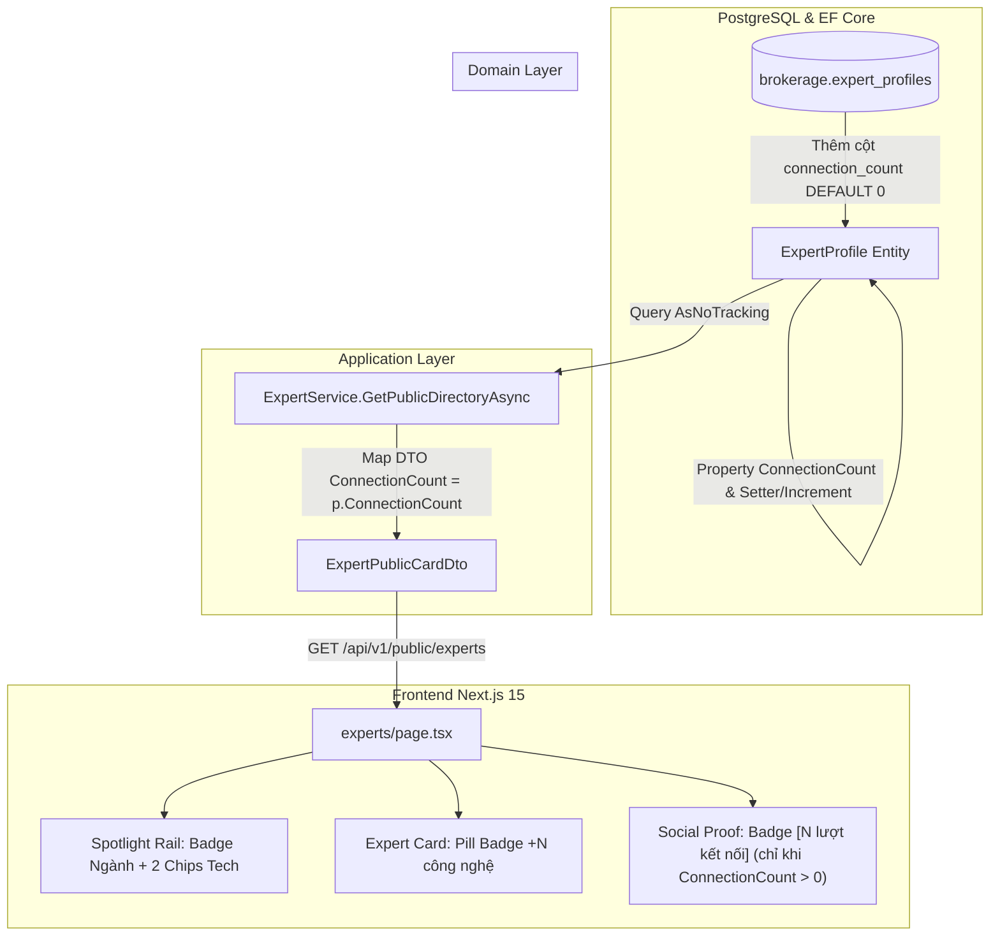

# Technical Plan: TASK-05 Hồ Sơ Chuyên Gia KH&CN & AI Scan LLKH

**Feature**: `TASK-05_HO_SO_CHUYEN_GIA_KHCN`  
**Spec Reference**: [`spec.md`](./spec.md)  
**Version**: 1.18.0  
**Status**: Completed (Shipped Gate 5)  
**Basic Design Mapping**: [`Specification/02_BASIC_DESIGN/TASK-05_HO_SO_CHUYEN_GIA_KHCN/README.md`](../../Specification/02_BASIC_DESIGN/TASK-05_HO_SO_CHUYEN_GIA_KHCN/README.md)  
**Architecture Report Reference**: [`Reports/Bao_cao_giai_phap_cong_nghe_va_nen_tang_NacenTech.md`](../../Reports/Bao_cao_giai_phap_cong_nghe_va_nen_tang_NacenTech.md) (Mục 2.2 Module Brokerage & Identity)  

---

## 1. Kiến Trúc Kỹ Thuật (Architecture & Module Allocation)

Theo Báo cáo giải pháp công nghệ gốc (Mục 2.2, Module 3: Sổ tay Chuyên gia & Tư vấn), phân hệ được tổ chức trực tiếp vào schema `brokerage` của `NacenTwinBE`:

```text
SourceCode/
├── backend/
│   ├── modules/
│   │   └── brokerage/                         # Module Sổ tay Chuyên gia & Tư vấn
│   │       ├── Domain/
│   │       │   ├── ExpertProfile.cs           # Thực thể Hồ sơ Chuyên gia KH&CN
│   │       │   └── ExpertStatuses.cs          # PENDING_REVIEW, APPROVED, CHANGES_REQUESTED, REJECTED
│   │       ├── Application/
│   │       │   ├── IExpertService.cs          # Contract dịch vụ Chuyên gia
│   │       │   ├── ExpertService.cs           # UseCases: Nộp hồ sơ, Tra cứu, Cập nhật
│   │       │   └── Contracts.cs               # DTOs: SubmitUpgradeRequest, ExpertProfileDto
│   │       └── Infrastructure/
│   │           └── Persistence/
│   │               └── Configurations.cs      # EF Core Entity Mapping cho expert_profiles
│   └── apps/
│       └── api/
│           └── Controllers/
│               └── ExpertController.cs        # REST API endpoints cho Portal và App
└── frontend/                                  # NacenTwinFE (Next.js 15 App Router)
    ├── src/
    │   ├── app/
    │   │   ├── (auth)/
    │   │   │   ├── login/page.tsx             # Màn hình Đăng nhập
    │   │   │   └── register/page.tsx          # Màn hình Đăng ký
    │   │   └── profile/
    │   │       └── upgrade/
    │   │           └── expert/page.tsx        # Wizard 3 bước Nâng cấp Chuyên gia
    │   ├── components/
    │   │   ├── ui/                            # Shadcn UI Primitives & <Async>
    │   │   └── expert/
    │   │       ├── Step1Identity.tsx          # Form Bước 1: Định danh & Học vị
    │   │       ├── Step2Competency.tsx        # Form Bước 2: Chuyên môn & AI Scan
    │   │       └── Step3Scientific.tsx        # Form Bước 3: Hồ sơ KH & Cam kết
    │   └── lib/
    │       ├── auth-client.ts                 # JWT Token Interceptor & Session Manager
    │       └── api-client.ts                  # Fetch / Axios wrapper
```

---

## 2. Thiết Kế Cơ Sở Dữ Liệu (Database Schema)

### Bảng Hồ Sơ Chuyên Gia KH&CN (`expert_profiles`)
```sql
CREATE TABLE expert_profiles (
    id UUID PRIMARY KEY DEFAULT gen_random_uuid(),
    person_id UUID NOT NULL UNIQUE REFERENCES persons(id) ON DELETE CASCADE,
    full_name VARCHAR(100) NOT NULL,
    birth_year INT NOT NULL,
    gender VARCHAR(10) NOT NULL,
    id_card_number VARCHAR(20) NOT NULL,
    id_card_date DATE NOT NULL,
    id_card_files_json JSONB NULL,              -- URLs ảnh CCCD 2 mặt
    portrait_url TEXT NULL,                     -- URL ảnh chân dung
    academic_rank VARCHAR(50) NOT NULL DEFAULT 'NONE', -- 'GS', 'PGS', 'NONE'
    academic_rank_year INT NULL,
    degree VARCHAR(50) NOT NULL,                -- 'DOCTOR', 'MASTER', 'ENGINEER_BACHELOR'
    degree_year INT NOT NULL,
    degree_certificate_url TEXT NULL,
    organization_name VARCHAR(255) NOT NULL,
    organization_address VARCHAR(255) NULL,
    research_title VARCHAR(100) NULL,
    position_title VARCHAR(100) NULL,
    expertise_sectors TEXT[] NOT NULL DEFAULT '{}', -- 18 ngành trọng điểm TT17
    training_history_json JSONB NULL,           -- Danh sách quá trình đào tạo
    employment_history_json JSONB NULL,         -- Quá trình công tác
    publications_json JSONB NULL,               -- 5 công trình tiêu biểu
    patents_json JSONB NULL,                    -- Bằng sáng chế / GPHI
    practical_projects_json JSONB NULL,         -- Dự án ứng dụng thực tiễn
    consulting_summary TEXT NULL,
    is_project_leader BOOLEAN NOT NULL DEFAULT FALSE,
    is_main_contributor BOOLEAN NOT NULL DEFAULT FALSE,
    pdpd_consent_at_utc TIMESTAMP WITH TIME ZONE NOT NULL,
    status VARCHAR(30) NOT NULL DEFAULT 'PENDING_REVIEW', -- 'PENDING_REVIEW', 'APPROVED', 'CHANGES_REQUESTED', 'REJECTED'
    reviewer_note TEXT NULL,
    created_at_utc TIMESTAMP WITH TIME ZONE DEFAULT NOW(),
    updated_at_utc TIMESTAMP WITH TIME ZONE DEFAULT NOW()
);

CREATE INDEX idx_expert_person ON expert_profiles(person_id);
CREATE INDEX idx_expert_status ON expert_profiles(status);
CREATE INDEX idx_expert_sectors ON expert_profiles USING GIN(expertise_sectors);
```

---

## 3. Hợp Đồng API (Contract-First Design)

### 3.1. Nộp Hồ Sơ Nâng Hạng Chuyên Gia
- **Endpoint**: `POST /api/v1/experts/upgrade-request`
- **Quyền hạn**: `[Authorize]` (Người dùng đã đăng nhập `USER` hoặc `GUEST`).
- **Request Body (JSON)**:
  ```json
  {
    "fullName": "Nguyễn Văn A",
    "birthYear": 1982,
    "gender": "male",
    "idCardNumber": "001082012345",
    "idCardDate": "2021-08-15",
    "academicRank": "PGS",
    "academicRankYear": 2022,
    "degree": "DOCTOR",
    "degreeYear": 2016,
    "organizationName": "Viện Công Nghệ Thông Tin",
    "organizationAddress": "18 Hoàng Quốc Việt, Hà Nội",
    "researchTitle": "Nghiên cứu viên cao cấp",
    "positionTitle": "Trưởng phòng Hệ thống thông minh",
    "expertiseSectors": [
      "Công nghệ thông tin & Chuyển đổi số",
      "Cơ khí chế tạo & Tự động hóa"
    ],
    "trainingHistory": [
      { "level": "Kỹ sư", "school": "ĐHBK Hà Nội", "major": "CNTT", "year": 2005 }
    ],
    "employmentHistory": [
      { "period": "2006-2012", "position": "Nghiên cứu viên", "org": "Viện CNTT" }
    ],
    "publications": [
      { "title": "Real-time Defect Detection", "role": "Tác giả chính", "journal": "IEEE Sensors Journal", "year": 2023 }
    ],
    "consultingSummary": "Chuyên gia cố vấn hệ thống IoT và Computer Vision công nghiệp.",
    "isProjectLeader": true,
    "isMainContributor": true,
    "pdpdConsent": true,
    "legalOath": true
  }
  ```
- **Responses**:
  - `201 Created`:
    ```json
    {
      "isSuccess": true,
      "data": {
        "profileId": "8b52c084-25b4-4340-96f3-10d65b1bc701",
        "code": "EXP-2026-0925-HN08",
        "status": "PENDING_REVIEW",
        "submittedAtUtc": "2026-09-25T11:55:00Z"
      },
      "error": null
    }
    ```
  - `400 Bad Request`: Chưa đồng ý PDPD (`ERR_PDPD_CONSENT_REQUIRED`).
  - `409 Conflict`: Người dùng đã có hồ sơ đang chờ thẩm định (`ERR_PENDING_REQUEST_EXISTS`).

### 3.2. Tra Cứu Trạng Thái Hồ Sơ Chuyên Gia
- **Endpoint**: `GET /api/v1/experts/my-profile`
- **Quyền hạn**: `[Authorize]`
- **Response**: Trả về toàn bộ thông tin đã khai báo kèm trạng thái `status` và `reviewerNote` (nếu có yêu cầu sửa đổi).

### 3.3. Mô Phỏng Trích Xuất AI-to-Text LLKH
- **Endpoint**: `POST /api/v1/experts/ai-cv-scan`
- **Quyền hạn**: `[Authorize]`
- **Response**: Trả về dữ liệu JSON trích xuất tự động từ tệp PDF/Word để Client điền trước vào Form Bước 2.

---

## 4. Thiết Kế Frontend UI/UX (5 Trạng Thái UX qua `<Async>`)

1. **Loading State**:
   - Khi bấm "Chọn tệp LLKH để AI Scan tự động": Thanh tiến trình động 0% $\rightarrow$ 100% với thông báo trạng thái "Đang OCR bóc tách và phân tích ngữ nghĩa bằng mô hình BGE-M3...".
   - Khi tải form hồ sơ: Skeleton loader cho từng nhóm trường.
2. **Empty State**: Khi người dùng chưa có hồ sơ $\rightarrow$ Hiển thị Hero banner giới thiệu quyền lợi của Chuyên gia KH&CN và nút [Bắt đầu tạo hồ sơ].
3. **Error State**: Nếu thiếu trường bắt buộc hoặc file quá 20MB $\rightarrow$ Viền đỏ quanh trường kèm thông báo lỗi cụ thể.
4. **Success State**: Khi nộp xong $\rightarrow$ Modal chúc mừng, hiển thị mã tra cứu `EXP-2026-0925-HN08` và thời hạn SLA tối đa 48 giờ.
5. **Partial State**: Lưu nháp (Auto-save) dữ liệu từng bước vào LocalStorage để tránh mất dữ liệu nếu tải lại trang.

---

## 5. Plan Delta v2: Tích Hợp Zalo Mini App & Backend Intake Endpoint

### 5.1. Database Schema Delta (Non-destructive Migration)
Để hỗ trợ tiếp nhận hồ sơ sơ bộ từ Zalo Mini App và chuẩn hóa trường năng lực công nghệ:

```sql
-- Migration: AddMasteredTechAndZaloIntakeToExpertProfile
ALTER TABLE expert_profiles 
  ADD COLUMN IF NOT EXISTS phone VARCHAR(20) NULL,
  ADD COLUMN IF NOT EXISTS email VARCHAR(100) NULL,
  ADD COLUMN IF NOT EXISTS mastered_tech_codes TEXT[] NOT NULL DEFAULT '{}',
  ADD COLUMN IF NOT EXISTS draft_source VARCHAR(30) NOT NULL DEFAULT 'PORTAL', -- 'PORTAL', 'ZALO_MINI_APP'
  ADD COLUMN IF NOT EXISTS magic_link_token VARCHAR(255) NULL,
  ADD COLUMN IF NOT EXISTS magic_link_expires_at_utc TIMESTAMP WITH TIME ZONE NULL;

-- Cho phép person_id NULL ở giai đoạn sơ bộ (kết nối chính thức khi chuyên gia kích hoạt Magic Link)
ALTER TABLE expert_profiles ALTER COLUMN person_id DROP NOT NULL;
CREATE INDEX IF NOT EXISTS idx_expert_magic_link ON expert_profiles(magic_link_token);
```

### 5.2. Backend API Contracts & CORS Delta
1. **CORS Policy Webview Zalo**:
   Trong `Program.cs` cấu hình policy:
   ```csharp
   policy.WithOrigins("https://h5.zdn.vn", "https://mini.zalo.me")
         .AllowAnyHeader()
         .AllowAnyMethod();
   ```
2. **Endpoint Tiếp Nhận Sơ Bộ (Quick Intake)**:
   - **Route**: `POST /api/v1/public/experts/quick-intake`
   - **Content-Type**: `multipart/form-data`
   - **DTO**: `QuickExpertIntakeRequest` (`FullName`, `Phone`, `Email`, `HighestDegree`, `Organization`, `SectorCode`, `List<string> MasteredTechCodes`, `IFormFile CvFile`, `bool PdpdConsent`)
   - **Response**: `200 OK`
     ```json
     {
       "success": true,
       "trackingId": "DRAFT-EXP-2026-0814",
       "status": "AI_PROCESSING",
       "magicLinkUrl": "https://nacentwin.vn/verify-profile?token=...",
       "estimatedSeconds": 30
     }
     ```

### 5.3. Kiến Trúc Kỹ Thuật Zalo Mini App (`SourceCode/ZaloMiniApp/`)
1. **Cấu hình định danh (`app-config.json`)**:
   - `title`: "Viện NacenTech — Sổ tay Chuyên gia KH&CN"
   - `headerColor`: `#1d4ed8`
   - Khai báo permissions: `scope.userInfo`, `scope.userPhonenumber`
2. **Cấu hình đóng gói (`vite.config.ts`)**:
   - Duy trì cố định tên bundle (`assets/index.module.js`, `assets/vendor.module.js`, `assets/index.css`) khớp chuẩn `app-config.json`.
   - Proxy dev: `/api` trỏ về API Backend .NET Core `http://localhost:5000`.
3. **Mã nguồn giao diện (`src/`)**:
   - `src/pages/home.tsx`: Chuyển đổi mã nguồn từ [`wireframe_zalo_input_form.html`](../../Specification/02_BASIC_DESIGN/TASK-05_HO_SO_CHUYEN_GIA_KHCN/wireframe_zalo_input_form.html).
   - Tích hợp Zalo SDK: Gọi `getUserInfo()` và `getPhoneNumber()` để tự động điền Họ tên và SĐT.
   - `src/components/ai-progress.tsx`: Thanh tiến trình giả lập / polling trạng thái AI Engine đọc hiểu CV.
   - `src/api/expert.ts`: Service gọi API `quick-intake` và kiểm tra trạng thái bóc tách.
   - `src/pages/me.tsx`: Giữ tab profile và nút "Quan tâm OA Viện NacenTech" (`followOA`).
   - Dọn dẹp: Gỡ bỏ các module tra cứu lô hàng cũ (`result.tsx`, `brand.tsx`, `history.tsx`, `qr.ts`).

---

## 6. Plan Delta v3: Hoàn chỉnh Data Model, Chứng từ và AI Ingestion (28/09/2026)

### 6.1. Kết luận và nguyên tắc thiết kế

Thiết kế cũ có bảng lõi `expert_profiles`, nhưng chưa đủ để lưu toàn bộ trường của Basic Design v2.2 và chưa có EF migration áp dụng vào database. Không dùng một cột JSONB cho toàn bộ hồ sơ: các danh mục có thể lặp, cần hiển thị công khai, lọc hoặc kiểm chứng phải được chuẩn hóa thành bảng con. JSONB chỉ giữ nguyên văn dữ liệu AI trích xuất và payload kỹ thuật có version.

Mọi bảng bên dưới đặt trong schema `brokerage`; tất cả thời điểm là UTC, có `created_at`, `updated_at`, `version` (optimistic concurrency) theo chuẩn platform. Tệp không lưu blob trong PostgreSQL: chỉ lưu object key/URI, checksum, MIME, kích thước và trạng thái quét mã độc.

### 6.2. Ma trận bao phủ trường

| Nhóm trường trong Basic Design | Đã có trong model hiện tại | Còn thiếu / sai lệch phải đóng |
| :--- | :--- | :--- |
| Định danh: họ tên, năm sinh, giới tính, CCCD, ngày cấp, học hàm/học vị, tổ chức, chức danh | Có phần lớn ở `ExpertProfile` | Thiếu nơi cấp CCCD (nếu được BA bổ sung), mã hồ sơ bền vững; số CCCD hiện lưu plain text, trái yêu cầu mã hóa AES-256 của `spec.md`. |
| Chứng từ: ảnh chân dung, CCCD hai mặt, văn bằng, CV/LLKH | `CvFileUrl` duy nhất | Thiếu `id_card_files_json`, `portrait_url`, `degree_certificate_url` trong entity/EF/API; không có metadata, checksum, trạng thái kiểm tra tệp hoặc phân quyền tải tệp. |
| Chuyên môn: 18 ngành, OECD, công nghệ làm chủ | Có `expertise_sectors`, `mastered_tech_codes` | Thiếu `oecd_fields`; hiện dùng text tự do thay vì FK/mã danh mục chuẩn TASK-06, nên không đảm bảo được tính hợp lệ và truy vấn liên ngành. |
| Đào tạo, công tác | Có 2 JSON string | Chưa chuẩn hóa từng dòng (bậc, cơ sở, chuyên ngành, từ/năm đến, vị trí, địa chỉ); không thể kiểm tra, tìm kiếm hay audit dữ liệu AI và dữ liệu chuyên gia chỉnh sửa. |
| Công trình khoa học | Có `publications_json` | Thiếu trường chỉ mục ISI/Scopus/DOI và bảng con để giới hạn tối đa 5 công trình, tránh JSON không hợp lệ. |
| Sáng chế, ứng dụng thực tế, đề tài 5 năm, giải thưởng | Không có trong entity/API dù schema cũ có 2 JSON đầu tiên | Thiếu hoàn toàn `patents`, `practical_projects`, `research_projects`, `awards`; schema cũ cũng chưa có đề tài và giải thưởng. |
| Dịch vụ tư vấn & lịch sẵn sàng | Có `consulting_summary` | Thiếu loại dịch vụ, hình thức làm việc, phạm vi/khu vực, thời lượng/khung giờ; không đáp ứng mục tiêu kết nối doanh nghiệp của Basic Design. |
| Pháp lý & quy trình duyệt | Có `pdpd_consent_at`, `status`, `reviewer_note`, 2 checkbox nhiệm vụ | Thiếu `legal_oath` và thời điểm cam kết; chưa liên kết có ràng buộc với `approval_requests`; thiếu lịch sử chuyển trạng thái/review. |
| Zalo + AI | Có phone, email, nguồn, magic token/hạn, CV filename | Thiếu `zalo_user_id` (nếu dùng SDK), tracking code lưu bền, trạng thái `AI_PROCESSING`/`AI_PREFILLED` nhất quán, job/phiên bản AI, kết quả confidence, lỗi và dữ liệu prefill. Endpoint hiện chỉ giữ tên file, không upload/lưu file. |
| Migration và ràng buộc vật lý | Có EF configuration nhưng snapshot/migrations chưa có `ExpertProfile` | Chưa có migration tạo bảng; unique index `person_id` cần partial unique index (`WHERE person_id IS NOT NULL`) để hỗ trợ nhiều draft chưa gắn người dùng; cần FK tới `persons` và các danh mục. |

### 6.3. Target schema bắt buộc

1. **`expert_profiles` (aggregate root)** — bổ sung `expert_code` (unique, immutable), `person_id` nullable FK, `submission_source`, `zalo_user_id` nullable, `profile_status`, `visibility_status`, `oecd_field_codes`, `mastered_tech_codes`, summary tư vấn, hai đăng ký nhiệm vụ và timestamps. `profile_status` dùng một enum thống nhất: `DRAFT`, `AI_PROCESSING`, `AI_PREFILLED`, `PENDING_REVIEW`, `CHANGES_REQUESTED`, `APPROVED`, `REJECTED`, `ARCHIVED`.
2. **`expert_identity_private` (1:1)** — `expert_profile_id` PK/FK; các giá trị mã hóa ở tầng ứng dụng: CCCD, ngày/nơi cấp, điện thoại, email. Tách khỏi profile công khai; log truy cập dữ liệu nhạy cảm qua audit module.
3. **`expert_documents`** — nhiều chứng từ với `document_type` (`PORTRAIT`, `ID_FRONT`, `ID_BACK`, `DEGREE_CERTIFICATE`, `CV_LLKH`, `EVIDENCE`), `storage_key`, `sha256`, `mime_type`, `size_bytes`, `malware_scan_status`, `uploaded_by`, `retention_until`. Ràng buộc chỉ một ảnh portrait active, hai mặt CCCD và một văn bằng active khi nộp chính thức.
4. **`expert_training_records`** và **`expert_employment_records`** — lưu từng dòng đào tạo/công tác, theo thứ tự hiển thị; công tác có `from_date`, `to_date`, `organization`, `organization_address`, `position_title`.
5. **`expert_publications`**, **`expert_patents`**, **`expert_practical_projects`**, **`expert_research_projects`**, **`expert_awards`** — FK `expert_profile_id`, các trường đã nêu tại Basic Design; publication có `display_order` và constraint tối đa 5 bản ghi active/profile.
6. **`expert_service_offerings`** và **`expert_availability`** — danh mục dịch vụ, hình thức làm việc, khu vực và thời lượng/khung giờ để thực hiện matchmaking với doanh nghiệp.
7. **`expert_consents`** — mỗi phiên bản văn bản PDPD/`LEGAL_OATH`, `accepted_at_utc`, `policy_version`, `source`, `ip_hash` (không lưu IP thô nếu không có căn cứ lưu trữ), `actor_ref`.
8. **`expert_ai_ingestions`** — input document, provider/model/version, trạng thái, request/result JSONB, confidence, error code, processed timestamps; tất cả kết quả AI phải chờ chuyên gia xác nhận trước khi thành dữ liệu chính thức.
9. **`expert_profile_status_history`** — from/to status, reason, changed_by, approval_request_id nullable FK. Đây là liên kết truy vết với `TASK-07`, không nhân bản luồng phê duyệt.

### 6.4. Ràng buộc, chỉ mục và bảo mật bắt buộc

- FK từ mã ngành/OECD/công nghệ sang master data TASK-06; không nhận nhãn text tự do làm dữ liệu chuẩn.
- Partial unique index: `person_id WHERE person_id IS NOT NULL`; unique index với `expert_code`; unique index có điều kiện với `zalo_user_id` chỉ khi BA phê duyệt dùng Zalo ID làm định danh.
- Index cho `profile_status`, `visibility_status`, GIN trên các mảng mã ngành/OECD/công nghệ; index `magic_link_token_hash` thay vì lưu token raw.
- Token Magic Link lưu hash SHA-256/HMAC, one-time use, có `used_at_utc`; endpoint chỉ nhận token thô và so sánh hash.
- Số CCCD, điện thoại, email và URL/chứng từ riêng tư phải được mã hóa tại application layer, phân quyền theo purpose; response public/portal không được trả CCCD. `ExpertProfileDto` phải tách DTO owner/admin/public.
- Kiểm tra MIME + magic bytes, virus scan async và checksum trước khi trạng thái chuyển `PENDING_REVIEW`; không lấy `IFormFile.FileName` làm `CvFileUrl`.

### 6.5. Thứ tự triển khai và Definition of Done

1. Chốt enum/trường còn mở với BA, đặc biệt: nơi cấp CCCD, danh mục OECD, mức công khai, danh mục dịch vụ và chính sách lưu hồ sơ/tệp.
2. Cập nhật domain entities, EF configurations và API contracts theo schema mục 6.3; loại bỏ DTO trả `Guid.Empty` cho draft chưa gắn `person_id`.
3. Tạo migration `CreateExpertProfileAndEvidenceSchema` bao gồm schema/bảng/FK/index/partial index; cập nhật `NacenTechDbContextModelSnapshot`; chạy migration trên database sạch và môi trường tích hợp.
4. Cập nhật intake Zalo thành upload thực, tạo `expert_documents` + `expert_ai_ingestions`, trả tracking code được lưu DB; tách trạng thái AI khỏi trạng thái phê duyệt.
5. Cập nhật luồng portal/TASK-07: nộp chính thức tạo `approval_requests` và `expert_profile_status_history` trong một transaction; chỉ approval hoàn tất mới gán role `EXPERT`.
6. Viết DB integration tests cho FK, partial uniqueness, mã hóa/không lộ PII, upload validation, token one-time và tất cả chuyển trạng thái; chỉ khi migration, tests và mapping field-to-DB đạt 100% mới đổi TASK-05 sang `Implemented/Verified`.

---

## 7. Plan Delta v4: Hợp nhất DB — Zalo Mini App — Web Portal

### 7.1 Contract chuẩn

`ExpertProfileDraftDto` là contract đọc chung cho owner; `SubmitExpertProfileRequest` là contract Web canonical; `QuickExpertIntakeRequest` giữ tối giản cho Zalo. Không reuse DTO public cho owner/admin. API cần cung cấp: tạo/cập nhật draft, upload document theo `documentType`, lấy draft bằng Magic Link, submit chính thức và lấy profile owner.

### 7.2 Luồng hai kênh

1. **Zalo:** quick-intake → document `CV_LLKH` → `expert_ai_ingestions` → `AI_PREFILLED` → Magic Link.
2. **Web:** nạp draft/Magic Link → nhập định danh, collections và chứng từ → xác nhận PDPD/legal oath → transaction submit + approval request TASK-07.
3. Hai UI dùng một status enum; mọi lỗi API hiển thị Error/Partial, không fallback success.

### 7.3 Compatibility và kiểm thử

- Giữ route quick-intake hiện hữu; bổ sung fields nullable/default, không phá Zalo app cũ.
- Web payload cũ phải được thay bằng canonical field names trước khi bật submit thật.
- Contract tests kiểm tra JSON Web/Zalo, upload type, token expiry và PII masking; E2E kiểm tra Zalo draft được Web đọc/submit.

---

## 8. Plan Delta v5: Implement trang Chi Tiết Chuyên Gia từ wireframe

### 8.1 Route và phân quyền

| Bề mặt | Route/UI | API | Quyền |
| :--- | :--- | :--- | :--- |
| Public Web | `/experts/[expertCode]` | `GET /api/v1/public/experts/{expertCode}` | Anonymous; Approved + Public |
| Owner Portal | `/portal/expert/profile` | `GET /api/v1/experts/me/detail` | Owner authenticated |
| Admin đối soát | Portal có guard | `GET /api/v1/admin/experts/{expertCode}/detail` | Permission TASK-07 cụ thể |
| Zalo Mini App | nút `Xem hồ sơ` ở `me.tsx` | deep link Public/Portal | không render Full data |

### 8.2 DB gap cần đóng

1. `expert_profiles`: `expert_code` unique immutable, `visibility_status` (`PRIVATE`, `PUBLIC`), `is_accepting_consultation`, `public_bio`; metrics tính từ dữ liệu thật, không persist/mock.
2. Các collection (publications, patents, practical projects, research projects, awards, đào tạo, công tác): `is_public`, `is_active`, `display_order` cùng metadata để render (DOI/indexing; số/cấp bằng/TRL; cấp đề tài/kết quả/vai trò; kết quả tư vấn; cấp/năm giải thưởng).
3. `expert_documents`: portrait public tách evidence private; signed download URL chỉ do endpoint có quyền phát, không serialize `storage_key`.
4. Dùng audit module platform hoặc tạo `expert_private_access_audits` cho `EXPERT_PRIVATE_PROFILE`/`EXPERT_DOCUMENT`, lưu actor/purpose/occurred_at.
5. Chưa tự suy đoán schema cho hội đồng/chứng nhận, trợ lý, lãnh đạo cơ quan, tài khoản/thù lao: phải chốt BA; nếu chưa có dữ liệu chuẩn hiển thị Partial.

### 8.3 API contracts

- `ExpertPublicDetailDto`: `expertCode`, identity được phép public, verification/readiness, organization/title, `publicBio`, tags, metrics, timelines, contact instruction, 5 public collections và CTA availability. Không có PII key.
- `ExpertPrivateDetailDto`: Public DTO + private identity/contact/bank/remuneration/PDPD/documents/roles/organization detail; chỉ server-side permission mapping tạo DTO này.
- Public query lọc status/visibility/record visibility ngay tại database và trả `404` khi không public.
- Owner/admin query dùng policy rõ ràng và log private read; download document tách endpoint có authorization + audit.
- CTA chỉ gọi endpoint khi contract module nhận yêu cầu được xác nhận; còn thiếu thì UI `Partial`.

### 8.4 Frontend Web, Zalo và test

Tạo feature `src/features/expert-detail/` với `ExpertHero`, `VerificationAndAvailabilityBadge`, `ExpertMetrics`, `TimelineCard`, `ContactCard`, `AchievementTabs`, `ConsultationCta`, `PrivateProfilePanel`, `ProfileDetailAsyncState`.

- Public page chỉ tải Public DTO: hero/tags/metrics/timeline/contact mask/5 tabs/CTA/share; desktop 1/3–2/3, mobile một cột, tabs ngang scroll.
- Owner page tải private DTO sau guard; edit/PDPD handoff dùng luồng hiện có; private cache không dùng lại cho public page.
- Đủ 5 UX states: loading skeleton, error retry, empty per tab/timeline, success, partial khi metadata/CTA chưa sẵn.
- `me.tsx` Zalo chỉ deep link: approved+public → Public Web; owner draft/approved → Portal xác thực; không raw token/PII trong URL.
- Test migration/index unique code, query filter, public JSON deny-list, owner/admin auth/audit, signed document download, component/E2E/visual responsive và Zalo link builder.

### 8.5 Thứ tự triển khai / Definition of Done

1. Chốt BA field chưa chuẩn ở §8.2 và module đích của CTA.
2. Migration/domain/query projection → API + auth/audit tests → Public Web → Owner panel → Zalo handoff.
3. Hoàn thành khi public response zero PII, owner/admin có authorization + audit, đủ 5 UX states và build/test 3 bề mặt sạch.

---

## 9. Plan Delta v6: Xác thực thật và Owner Detail E2E (29/09/2026)

### 9.1. Phạm vi, ranh giới Epic và tác động

Delta này thuộc **TASK-05** vì hoàn tất hành trình nghiệp vụ của chuyên gia: đăng nhập → Portal → Full Owner Detail. Không tạo Epic mới. Nó tái sử dụng và chỉnh phần hợp đồng JWT/RBAC chung của TASK-00, nhưng không thay đổi mục tiêu, UI hay backlog của TASK-00. Zalo Mini App và Public Detail không đổi chức năng trong Delta này; chỉ chạy regression để bảo đảm không bị ảnh hưởng.

Hiện trạng cần thay thế:

1. `login/page.tsx` gọi relative `/api/v1/auth/login` dù Web không có reverse proxy/API route tương ứng.
2. Nhánh `catch` tạo `mock-jwt-token` và mock user cho mọi lỗi, che lấp lỗi backend.
3. `V1Mappers.SanitizedUser` ép mọi PlatformRole về `user`/`admin`, trong khi Web cần nhận `VERIFIED_EXPERT` thật để điều hướng/guard.
4. Demo profile công khai chưa gắn `PersonId` của account chuyên gia, nên Owner endpoint đúng bảo mật nhưng không thể trả profile đó.

Không cần DB migration nếu database hiện hữu đã có `persons.id`, `expert_profiles.person_id` unique và nullable/linked theo migration trước. Nếu kiểm tra môi trường mục tiêu cho thấy constraint chưa tồn tại, chỉ tạo migration bổ sung non-destructive để thêm index/unique constraint tương đương; không sửa migration đã apply.

### 9.2. Backend identity và API contract

1. Tách use case login portal khỏi login admin: portal login xác thực account active và phát JWT với **PlatformRole thật**; admin login vẫn chỉ chấp nhận nhóm admin. Không dùng parameter `requiredRole = USER` để từ chối `VERIFIED_EXPERT`.
2. Chuẩn hóa response login thành `AuthSessionDto`:

```json
{
  "accessToken": "<backend-signed-jwt>",
  "user": {
    "id": "uuid",
    "email": "expert.demo@local.test",
    "fullName": "PGS.TS. Nguyễn Minh An",
    "role": "VERIFIED_EXPERT",
    "scopeType": "SECTOR",
    "scopeId": "CN_THONG_TIN"
  }
}
```

`role` phải là `PlatformRole` chuẩn, không còn adapter legacy `user`/`admin` cho endpoint login Web. Nếu legacy consumer cần shape cũ, tách adapter/versioned endpoint thay vì làm sai contract mới.

3. JWT tiếp tục có `sub`, `role`, `scope_type`, `scope_id`; `GET /api/v1/experts/me/detail` dùng `sub` qua `HttpCurrentActor.PersonId`. Endpoint không nhận personId/expertCode từ client, không có khả năng đọc chéo owner.
4. Giữ `GET /api/v1/public/experts/{expertCode}` anonymous và PII deny-list nguyên vẹn. Owner API trả 401 (không/invalid token), 403 (authenticated nhưng role không đủ) hoặc 404 (không có profile gắn actor) theo contract đã chốt, không trả partial PII.

### 9.3. Dữ liệu và fixture development

- Tạo fixture/command development idempotent, không nằm trong EF production migration: tìm hoặc tạo Person theo email cấu hình; kích hoạt account; gán `PlatformRole = VERIFIED_EXPERT`, scope; rồi gắn chính `persons.id` vào `ExpertProfile.ExpertCode = CG-NACEN-DEMOIT01`.
- Fixture dùng secret/biến môi trường Development cho password. Không commit password, hash hoặc secret mới; không ghi password ra console/log.
- Chạy lại fixture không tạo Person/Profile mới và không đụng profile khác. Đây là dữ liệu nghiệm thu local, không phải seed triển khai production.

### 9.4. Web Portal và UX

1. Trích `API_BASE` vào client dùng chung và dùng nó cho login, register, profile detail và CTA; URL chỉ lấy từ `NEXT_PUBLIC_API_BASE_URL`, development default `http://localhost:5080`.
2. Xóa toàn bộ `DEMO_ACCOUNTS`/mock fallback khỏi luồng production. Có thể giữ thông tin hướng dẫn tài khoản local ở tài liệu developer, không đưa credential vào UI bundle.
3. Login chỉ `setSession` sau response API hợp lệ có JWT/user đủ trường. 4xx/5xx/network hiển thị message an toàn; không tự điều hướng.
4. Bọc `/portal/expert/profile` bằng `RoleGuard` cho `VERIFIED_EXPERT` (admin theo policy rõ ràng nếu UI admin dùng route riêng). Khi owner API trả 401, clear session và hiển thị CTA Login; 403/404/Error phải phân biệt thông báo, có Retry khi phù hợp. Giữ đủ Loading, Error, Empty, Success, Partial.

### 9.5. Kiểm thử và Definition of Done

| Tầng | Kiểm chứng bắt buộc |
| :--- | :--- |
| Backend unit/contract | Portal login chấp nhận expert active; admin restriction; response giữ role/scope; token JWT claims; no mock token; owner lookup theo `sub`. |
| DB integration | Fixture idempotent; `PersonId` của profile demo là account fixture; unique ownership; owner khác không đọc được. |
| Web component | Login gọi API base đúng; lỗi không tạo localStorage session; valid response điều hướng đúng; owner page gửi Bearer token và hiển thị 401/403/404. |
| E2E local | Login account expert thật → `/portal` → `/portal/expert/profile` → Full detail `CG-NACEN-DEMOIT01`; login sai/token hết hạn bị chặn. |
| Regression | Public profile PII deny-list, CTA, Zalo deep link, `dotnet test`, `pnpm test`, `pnpm build`, Zalo build. |

Definition of Done: không còn chuỗi `mock-jwt-token` hay fallback mock account trong frontend production; API/Web/DB local chạy cùng config; E2E bằng account được Backend cấp JWT pass; public profile vẫn không expose PII.

## 10. Plan Delta v7: Không gian tác nghiệp của Chuyên gia

### 10.1. Information architecture và route

| Nhóm chức năng | Route / bề mặt | Chủ thể | Trạng thái |
| :--- | :--- | :--- | :--- |
| Tổng quan | `/portal/expert/profile` | Owner | Triển khai mở rộng Owner Detail hiện hữu |
| Hồ sơ của tôi | `/portal/expert/profile`, `/profile/upgrade/expert` | Owner | View thật đã có; Edit/lưu nháp/nộp lại cần canonical contract |
| Năng lực chuyên môn | phần Đào tạo/Công tác/Thành tựu/Dịch vụ trong Owner workspace | Owner | Collections hiện hữu; hoàn thiện thao tác edit ở T063 |
| Yêu cầu tư vấn & kết nối | `/portal/expert/consultations` | Owner | Mới thiết kế; tích hợp với bounded context Matching & Advisory |
| Thông báo | widget Owner workspace và inbox chung | Owner | Thông báo hồ sơ hiện hữu; mở rộng notification tư vấn |

Không đưa Quick Portal Switcher vào Navbar phát hành. Role là claim do backend phát; mọi thay đổi role thuộc TASK-07.

### 10.2. Hợp đồng API

| API | Trạng thái | Mục đích và quyền |
| :--- | :--- | :--- |
| `GET /api/v1/experts/me/detail` | Đã có | Full owner projection/audit, chỉ theo `sub` |
| `GET /api/v1/experts/me/completeness` | Mới thiết kế | Trả progress, nhóm thiếu và CTA key; chỉ Owner/Admin theo policy; không đưa PII raw vào lý do |
| `PATCH /api/v1/experts/me/draft` | Mới thiết kế | Lưu nháp trường owner được sửa, optimistic version và audit |
| `POST /api/v1/experts/me/submit` | Mới thiết kế | Nộp lại profile hợp lệ, liên thông approval TASK-07 |
| `GET /api/v1/experts/me/consultation-requests` | Mới thiết kế | Danh sách yêu cầu tư vấn/kết nối mà owner nhận; không phải order thương mại |
| `PATCH /api/v1/experts/me/consultation-requests/{id}` | Mới thiết kế | Owner xác nhận/từ chối/đề nghị lịch làm việc theo state machine Matching & Advisory |

### 10.3. Completeness và trạng thái

Backend là nguồn tính completeness. Input gồm profile core, contact private, consent, chứng từ active và collections chuyên môn. Response chỉ trả `percentage`, `items[]` (`group`, `severity`, `message`, `editAnchor`) và `reviewStatus`; frontend không tự suy diễn dữ liệu nhạy cảm.

| Trạng thái profile | Xem | Sửa/lưu nháp | Nộp lại | Thông báo |
| :--- | :--- | :--- | :--- | :--- |
| `DRAFT`, `AI_PREFILLED`, `CHANGES_REQUESTED` | Full owner | Cho phép | Khi đủ điều kiện | Danh sách thiếu/lý do review |
| `PENDING_REVIEW` | Full owner read-only | Khóa | Không | Đang thẩm định |
| `APPROVED` | Full + Public preview | Chỉ thông tin không cần tái thẩm định | Theo policy Task-07 | Sẵn sàng tư vấn / yêu cầu mới |
| `REJECTED`, `ARCHIVED` | Full owner | Theo quyết định Task-07 | Không mặc định | Lý do và CTA phù hợp |

### 10.4. UI/UX và 5 trạng thái

Owner workspace theo `wireframe_expert_owner_workspace.html`: header View/Edit/Public View; Completeness card; Private Detail; Năng lực chuyên môn; widget Thông báo. Mỗi nhóm có Loading, Empty, Error+Retry, Success và Partial độc lập. `Bổ sung ngay` dùng `editAnchor` để mở đúng nhóm wizard, không chuyển role/session.

Yêu cầu tư vấn dùng list/detail response: Empty khi chưa có, Partial khi chưa có lịch, Error retry khi notification service/API lỗi; nội dung yêu cầu chỉ hiển thị cho Owner/admin đúng scope.

### 10.5. Non-destructive data và kiểm thử

- Không migration cho “đơn hàng” hay payment. Nếu Matching & Advisory chưa có aggregate request, tạo liên kết/foreign key non-destructive ở module sở hữu, không nhét bảng commerce vào Brokerage.
- DB/API integration: owner isolation, completeness no-PII, profile lock, optimistic version, submit-to-approval và consultation request scope.
- Web: component tests completeness/Partial/locked edit, owner navigation, consultation Empty/Error; E2E login → workspace → Edit/submit lại theo trạng thái fixture.

## 11. Plan Delta v8: Dashboard chuyên gia theo role

### 11.1. Tác động và dữ liệu

Delta này chỉ thay Presentation Web. Không có migration, bảng, API endpoint hoặc thay đổi RBAC. `GET /api/v1/experts/me/detail` là nguồn owner-authorized hiện hữu; dashboard dẫn xuất ba nhóm cần làm từ contact, chứng từ active và công trình/sáng chế. Đây là projection UI tạm thời cho tới T062 completeness API server-side, không làm thay đổi trạng thái duyệt.

### 11.2. Điều hướng và 5 trạng thái UX

`/portal` đọc role session: `VERIFIED_EXPERT` render `ExpertDashboard`; role khác render `GeneralPortalDashboard` để bảo toàn hành vi cũ. `ExpertDashboard` có Loading, Error+Retry, Success; khối Thông báo dùng Empty khi không có thông báo thật. Không render các thẻ marketplace trong mọi trạng thái expert.

### 11.3. Kiểm thử

Component test mock Owner Detail: xác nhận danh sách todo, không có Gian hàng Công nghệ, và dữ liệu thật render. Frontend regression `pnpm test` và `pnpm build` phải pass.

## 12. Plan Delta v9: PII CCCD non-destructive

Migration `20260929140000_MakeExpertIdentityCardOptional` chỉ `ALTER ... DROP NOT NULL` tương đương cho `brokerage.expert_profiles.id_card_number` và `id_card_date`; không drop cột, xoá hay backfill dữ liệu. Domain sử dụng nullable values; Submit contract bỏ field; current Portal projections không chứa field. Web Wizard bỏ input/state/payload, Owner Private Panel bỏ display. Zalo đã đúng nên chỉ giữ regression. Test bắt buộc: profile nullable, Owner DTO deny-list, frontend no-input/build và migration apply trên PostgreSQL.

---

## 13. Plan Delta v10: Danh bạ Tìm kiếm & Lọc Chuyên gia Công Khai (`/experts` & `/chuyen-gia`)

### 13.1. Phạm vi Kiến trúc & Hợp đồng API (Contract-First)

1. **Backend API Endpoint**:
   - `GET /api/v1/public/experts`:
     - **Query Parameters**:
       - `q` (string, optional): Từ khóa tìm kiếm toàn văn.
       - `degree` (string, optional): Lọc theo học vị (GS, PGS, TS, ThS).
       - `sectorCode` (string, optional): Lọc theo mã ngành TT17 ("01" -> "18").
       - `provinceCode` (string, optional): Lọc theo mã địa bàn tỉnh/thành ("HN", "HCM", "DN"...).
       - `page` (int, default: 1): Số trang.
       - `pageSize` (int, default: 9): Số bản ghi/trang.
     - **Response Body (`ExpertPublicDirectoryDto`)**:
       - `items`: Danh sách thẻ chuyên gia `ExpertPublicCardDto` gồm: `expertCode`, `fullName`, `academicRank`, `degree`, `organizationName`, `sectorCode`, `sectorName`, `masteredTechCodes`, `provinceName`, `publicationCount`, `patentCount`, `projectCount`, `isVerified`.
       - `totalCount`: Tổng số chuyên gia khớp tiêu chí.
       - `page`, `pageSize`, `totalPages`.
     - **Security & PII Rules**: TUYỆT ĐỐI KHÔNG chứa CCCD, SĐT, Email cá nhân trong DTO trả về. Chỉ nạp các hồ sơ có `status == ExpertStatuses.APPROVED`.

2. **Frontend Architecture & Giao diện UX**:
   - **Tuyến đường (Routes)**:
     - Tạo thư mục trang: `SourceCode/frontend/src/app/experts/page.tsx` (Trang Danh bạ chính).
     - Điều hướng alias: `SourceCode/frontend/src/app/[module]/page.tsx` khi `module === "chuyen-gia"` sẽ chuyển hướng (redirect) hoặc render component Danh bạ Chuyên gia, giữ tính toàn vẹn với Navbar Header.
   - **Component phân rã**:
     - `ExpertHeroSearch`: Thanh tìm kiếm Hero, tag xu hướng.
     - `ExpertSidebarFilter`: Bộ lọc 4 trục (Học vị, 18 Ngành TT17, 34 Tỉnh thành, Chứng thực).
     - `ExpertCardGrid`: Lưới 3 cột render thẻ chuyên gia `ExpertCard`.
     - `ConnectModal`: Popup gửi yêu cầu kết nối nhanh (mô phỏng luồng tương tác với chuyên gia).
     - Bao phủ trọn vẹn 5 trạng thái UX qua chuẩn `<Async>`: Loading (Skeleton Cards), Empty (Không có kết quả), Error (Lỗi API + Retry), Success, Updating.

### 13.2. Kế hoạch Kiểm thử & Bảo vệ Regression
1. **Backend Invariants / Controller Tests**:
   - Test lọc danh bạ trả đúng hồ sơ `APPROVED`.
   - Test chặn rò rỉ PII: DTO không chứa CCCD, SĐT, Email.
   - Test phân trang và lọc theo query/sector/degree.
2. **Frontend Component & UI Tests**:
   - Test render đầy đủ bộ lọc và grid thẻ chuyên gia.
   - Test tìm kiếm và bấm nút [Xem hồ sơ chi tiết] chuyển tới `/experts/[expertCode]`.
   - Test modal gửi yêu cầu kết nối.

## 14. Plan Delta v11: Danh bạ theo taxonomy active và compact UI

### 14.1 Contract / nguồn dữ liệu
- Nạp `SECTOR` active từ `GET /api/v1/sectors`; FE không duy trì danh sách ngành hardcode. Hiển thị số lượng mục thực nhận và mã `code` đúng chuẩn `LVxx`.
- Tập trung nạp master data qua SDK dùng chung `frontend/src/lib/master-data-client.ts`; màn hình không tự khai báo mảng danh mục hoặc tự xử lý envelope khác nhau.
- Duy trì query `sectorCode` cho danh bạ. Bổ sung test contract/invariant để mã taxonomy lọc đúng hồ sơ public đã duyệt.
- Directory search giữ tham số `q` và nhận alias `query` theo contract REQ-EXP-DIR-001; nếu gửi cả hai, ưu tiên `q` để tương thích client hiện hành.
- Danh mục địa bàn lấy từ projection công khai tối thiểu của danh mục 34 tỉnh; không trả thông tin quản trị. Lọc dựa trên scope tỉnh thực của hồ sơ sở hữu bởi Person (`VERIFIED_EXPERT`, `PROVINCE` + `ScopeId`) qua API composition adapter để giữ ranh giới module; không gán địa bàn cho profile thiếu scope.
- Chỉ giữ filter/sort khi có query semantics thật. Các control chưa được hỗ trợ phải bỏ hoặc disable có giải thích, không giả vờ áp dụng.
- Nối CTA kết nối với `POST /api/v1/public/experts/{expertCode}/consultation-requests` đang tồn tại; báo thành công chỉ khi HTTP 202 và response thành công. Ghi rõ yêu cầu được chuyển tới NacenTech/admin để tránh tuyên bố sai là chuyên gia nhận trực tiếp.

### 14.2 Thiết kế UI/UX
- Cập nhật wireframe TASK-05 và thư viện `wireframe_tong_the_nacentwin.html` bằng nguồn HTML mới/đã cập nhật.
- Rút gọn Hero; đưa search thành một hàng rõ ràng; thu filter thành thanh tiêu chí + panel mở rộng (desktop), drawer/bottom sheet (mobile); filter đang chọn thành removable chips.
- Rút gọn card, bỏ decoration thừa, ưu tiên tên/học hàm, tổ chức, lĩnh vực, năng lực và CTA xem hồ sơ.
- Giữ Loading, Empty, Error, Success, Updating và retry; bảo đảm responsive 1440×900 và 390×844.

### 14.3. Surface implementation & verification
- Backend: directory filter phải áp dụng provinceCode thật; taxonomy endpoint hiện hữu là nguồn ngành; giữ DTO public tối thiểu và PII deny-list.
- Frontend: nạp taxonomy và tỉnh từ API, reset/clear filters, query-state/page reset nhất quán; bỏ sort chưa hoạt động và nối CTA với endpoint consultation request hiện hữu.
- Không cần migration nếu truy vấn Person scope đáp ứng; nếu kiểm chứng cho thấy không, dừng phần province và đề xuất schema delta trước khi đổi DB.
- QC: API/invariant (10 taxonomy active, sector/province filters, approved/public only, PII), FE tests (loading/error/retry/empty/query combination/pagination), contract và E2E screenshot desktop/mobile.

---

## 15. Plan Delta v14: Form Chỉnh Sửa Hồ Sơ Chuyên Gia & Completeness Engine

### 15.1. Domain & Kiến Trúc Tầng Ứng Dụng (Clean Architecture)
- **Domain Entity (`ExpertProfile.cs`)**:
  - Bổ sung phương thức `UpdateProfileDetails(...)` cho phép chủ hồ sơ cập nhật: `AcademicRank`, `AcademicRankYear`, `Degree`, `DegreeYear`, `OrganizationName`, `OrganizationAddress`, `ResearchTitle`, `PositionTitle`, `ExpertiseSectors`, `SpecializedKeywords`, `PublicBio`, `IsAcceptingConsultation`, `TrainingHistoryJson`, `EmploymentHistoryJson`, `PublicationsJson`, `ConsultingSummary`.
  - Cưỡng chế quy tắc bất biến: Ném ngoại lệ `ValidationException` nếu thiếu học vị, cơ quan, hoặc nếu hồ sơ đang trong trạng thái `PENDING_REVIEW` (`BR-EXP-042`).
  - Cập nhật thời điểm `UpdatedAtUtc = clock.UtcNow`.

- **Completeness Engine Logic (Thuật Toán Định Lượng)**:
  - Điểm tổng chuẩn hóa 100 điểm, chia đều 5 nhóm (mỗi nhóm 20 điểm):
    1. **Định danh & Pháp lý** (20đ): Có FullName, BirthYear hợp lệ, Gender, và đã xác nhận PDPD.
    2. **Học vị & Cơ quan** (20đ): Có Degree, DegreeYear, OrganizationName, và PositionTitle.
    3. **Lĩnh vực TT17 & Từ khóa** (20đ): Có ít nhất 1 mã trong `ExpertiseSectors` (10đ) và ít nhất 1 từ khóa trong `SpecializedKeywords` (10đ).
    4. **Thành tựu KH&CN** (20đ): Có dữ liệu công trình trong `PublicationsJson` hoặc `ExpertPublication` hoặc `ExpertPatent` (20đ).
    5. **Hồ sơ Công khai & Tư vấn** (20đ): Có `PublicBio` không rỗng (10đ) và đã kích hoạt `IsAcceptingConsultation` (10đ).
  - Phân hạng (`Grade`):
    - $\ge 90$: `EXCELLENT` (Xuất sắc)
    - $\ge 70$: `GOOD` (Khá tốt)
    - $\ge 50$: `BASIC` (Cơ bản)
    - $< 50$: `INCOMPLETE` (Chưa đạt)

### 15.2. Hợp Đồng API & DTOs
- `UpdateExpertProfileRequest`: Chứa toàn bộ các trường chuyên môn cho phép cập nhật.
- `ExpertCompletenessDto`: `Score` (int), `Grade` (string), `CompletedCriteria` (list string), `MissingCriteria` (list string), `Suggestions` (list string).
- Endpoint `PUT /api/v1/experts/my-profile`: Yêu cầu xác thực `[Authorize]`, kiểm tra role `VERIFIED_EXPERT`, validate `ExpertiseSectors` thuộc taxonomy active qua `ITaxonomyService`.
- Endpoint `GET /api/v1/experts/me/completeness`: Yêu cầu xác thực `[Authorize]`, trả về `ExpertCompletenessDto`.

### 15.3. Giao Diện Người Dùng & Trải Nghiệm 5 UX States
- Tạo trang `SourceCode/frontend/src/app/portal/expert/profile/edit/page.tsx` bọc `RoleGuard(VERIFIED_EXPERT)`:
  - Bố cục 3 khối chuẩn Wireframe `wireframe_chinh_sua_ho_so_chuyen_gia.html`:
    - Khối 1: Học Hàm, Học Vị & Cơ Quan Công Tác Chính.
    - Khối 2: Lĩnh Vực Chuyên Môn (10 LV TT17) & Từ Khóa Nghiên Cứu (`SpecializedKeywords`).
    - Khối 3: Danh Mục Công Trình Khoa Học, Sáng Chế & Đề Tài.
    - Status Bar: Thanh Completeness động & Công tắc bật/tắt nhận tư vấn.
  - Xử lý 5 UX states qua component chuẩn `<Async>`.
- Điều hướng:
  - Trang chi tiết `/portal/expert/profile`: Cập nhật nút "Chỉnh sửa hồ sơ" trỏ sang `/portal/expert/profile/edit`.
  - `CompletenessAlert`: Nạp dữ liệu thực tế từ `GET /api/v1/experts/me/completeness`.

### 15.4. Kế Hoạch Kiểm Thử
- Backend Invariants: Viết Unit tests cho `UpdateProfileDetails` và tính toán `Completeness` (đạt 100% các ngưỡng điểm).
- Frontend Vitest: Viết Component tests cho trang `edit/page.tsx` kiểm chứng render 5 UX states, tương tác form, và lưu thành công.

---

## 16. Plan Delta v16: Không Gian Quản Trị Tài Khoản Chuyên Gia (Account Workspace) [CR-2026-013]

### 16.1. Kiến Trúc Tổng Thể & Bố Cục Thành Phần Frontend (Frontend Component Tree & Clean Architecture)

1. **Điều Hướng Workspace Chuyên Gia (`src/app/portal/layout.tsx`)**:
   - Tái cấu trúc mảng `expertNavItems` từ 5 items thành 6 items.
   - Bổ sung Item 1 (Đầu tiên):
     ```typescript
     { href: "/portal/expert/account", label: "Tài khoản Chuyên gia", icon: ShieldCheck }
     ```
   - Thứ tự 6 navigation items chuẩn hóa:
     1. `Tài khoản Chuyên gia` (`/portal/expert/account`, `ShieldCheck`) — Bàn làm việc quản trị danh tính & pháp lý.
     2. `Tổng quan Chuyên gia` (`/portal`, `LayoutDashboard`) — Bảng điều khiển hiệu suất & chỉ số.
     3. `Hồ sơ LLKH của tôi` (`/portal/expert/profile`, `GraduationCap`) — Xem chi tiết hồ sơ khoa học.
     4. `Lời mời Tư vấn Doanh nghiệp` (`/portal/opportunities/pipeline?type=consulting`, `ClipboardList`) — Hộp thư tư vấn.
     5. `Radar Cơ hội Phù hợp (AI)` (`/portal/matching/radar`, `Sparkles`) — Ghép nối nhu cầu công nghệ.
     6. `Dự án Đồng hành & Hợp tác` (`/portal/opportunities/pipeline`, `Kanban`) — Tiến trình dự án & Deal Room.

2. **Cấu Trúc Trang Quản Trị Tài Khoản (`src/app/portal/expert/account/page.tsx`)**:
   - Được bảo vệ nghiêm ngặt bằng `<RoleGuard allowedRoles={["VERIFIED_EXPERT"]} portalName="Tài khoản Chuyên gia">`.
   - Thiết kế bám sát 100% `wireframe_expert_account.html`, chia thành 5 khối chức năng độc lập:
     - **Header & Hero Banner**: Hiển thị Huy hiệu "ĐÃ XÁC THỰC CẤP SỞ", Mã chuyên gia `EXP-2026-xxxx`, họ tên khoa học.
     - **Khối 1: Định Danh Khoa Học & Phê Duyệt Cấp Sở**:
       + Thẻ thông tin Họ tên, Chức danh chuyên môn;
       + Cơ quan / Đơn vị công tác (Viện/Trường trực thuộc);
       + Đơn vị thẩm định & Ký duyệt (Sở KH&CN Tỉnh/Thành phố), Số Quyết định công nhận, Ngày duyệt;
       + Huy hiệu cam kết bảo vệ dữ liệu PDPD (Nghị định 13/2023/NĐ-CP), bảo mật CCCD toàn trình.
     - **Khối 2: Thiết Lập Sẵn Sàng Tiếp Nhận Tư Vấn Doanh Nghiệp**:
       + Toggle switch Bật/Tắt tiếp nhận tư vấn (liên kết trường `isAcceptingConsultation`);
       + Danh sách Lĩnh vực TT17 tiếp nhận chính (nạp từ `expertiseSectors` hiện có);
       + 3 Hình thức hợp tác mong muốn (R&D dài hạn, Thẩm định Deal Room 1-1, Hội đồng TT17).
     - **Khối 3: Thước Đo Hoàn Thiện Hồ Sơ (Completeness Engine 5 Trụ Cột)**:
       + Progress bar tỷ lệ hoàn thiện hồ sơ trên thang 100 điểm (`score/100`);
       + Chi tiết 5 trụ cột: Định danh (20đ), Văn bằng (20đ), SHTT & Sáng chế (20đ), Đề tài chủ trì (20đ), Kinh nghiệm tư vấn (20đ);
       + CTA liên kết nhanh dẫn sang `/portal/expert/profile/edit` ("Chỉnh sửa chi tiết LLKH ->").
     - **Khối 4: Bảo Mật, Phiên Đăng Nhập & Liên Kết Zalo Mini App**:
       + Thông tin Email đăng nhập (readonly), Số điện thoại bảo vệ PDPD (masked `0912****89`);
       + Nút chức năng Đổi mật khẩu tài khoản;
       + Mã QR định danh Zalo Mini App chuyên gia đồng bộ tài khoản;
       + Bảng quản lý Active Sessions (Thiết bị, IP, Vị trí, Thời gian hoạt động, nút "Hủy phiên", nút "Đăng xuất tất cả thiết bị khác").
     - **Khối 5: Tùy Chọn Trải Nghiệm & Cấu Hình Thông Báo**:
       + Tùy chọn Giao diện (Sáng/Tối);
       + Tùy chọn Cỡ chữ (100% / 110% / 125%);
       + Cấu hình nhận thông báo Email & ZNS (Lời mời tư vấn mới, Tin nhắn Deal Room);
       + Cảnh báo SLA Deal Room trước 12h;
       + Nút [Lưu Thay Đổi Cài Đặt] lưu trữ preferences.

### 16.2. Luồng Dữ Liệu, Hợp Đồng DTO & Tích Hợp 5 UX States qua `<Async>`

1. **Nguồn Dữ Liệu & Hợp Đồng DTO (Reusing Existing Clean Architecture)**:
   - Dữ liệu định danh cơ bản: `authClient.getUser()` cung cấp `id`, `email`, `fullName`, `role`.
   - Dữ liệu hồ sơ chuyên sâu: gọi `getMyExpertDetail()` từ `src/lib/expert-detail.ts` (gọi endpoint `GET /api/v1/experts/me/detail`).
   - Dữ liệu Completeness Engine: gọi `getMyExpertCompleteness()` (gọi endpoint `GET /api/v1/experts/me/completeness`).
   - Cập nhật trạng thái nhận tư vấn: tái sử dụng `updateMyExpertProfile()` (endpoint `PUT /api/v1/experts/my-profile`) với trường `isAcceptingConsultation: boolean`.
   - **Zero-DB-Migration Assurance**: Không yêu cầu tạo bảng hoặc thêm cột DB mới. Toàn bộ các thuộc tính (`is_accepting_consultation`, `expertise_sectors`, `completeness`, `status`) đã tồn tại đầy đủ trong Entity `ExpertProfile` và PostgreSQL schema. Preferences người dùng (theme, cỡ chữ, thông báo) được quản lý ở client state hoặc ánh xạ vào cột `preferences (jsonb)` có sẵn.

2. **Quản Lý 5 Trạng Thái UX (`UXState`)**:
   - `loading`: Hiển thị Skeleton loading các khối thẻ card thông tin khi đang nạp profile và completeness.
   - `empty`: Hiển thị banner hướng dẫn khởi tạo hồ sơ nếu tài khoản chưa có bản ghi chuyên gia.
   - `error`: Hiển thị thông báo lỗi thân thiện kèm nút "Thử lại" (Retry action) khi API thất bại hoặc mất kết nối mạng.
   - `success`: Hiển thị toàn vẹn 5 khối giao diện trực quan theo chuẩn wireframe.
   - `updating`: Trạng thái spinner/overlay mượt mà khi đang thực thi thao tác lưu thiết lập hoặc chuyển đổi công tắc tiếp nhận tư vấn.

### 16.3. Kế Hoạch Kiểm Thử & Bảo Vệ Hồi Quy (Test Strategy & Invariants)

1. **Frontend Layout Tests (`src/app/portal/layout.test.tsx`)**:
   - Bổ sung assertion kiểm tra vai trò `VERIFIED_EXPERT` render Item 1 là `Tài khoản Chuyên gia` với href `/portal/expert/account`.
   - Đảm bảo đủ 6 navigation items cho chuyên gia, không chứa các mục của Seller/Buyer/Admin.
2. **Component Tests (`src/app/portal/expert/account/page.test.tsx`)**:
   - Test kiểm tra `RoleGuard` chặn người dùng không mang vai trò `VERIFIED_EXPERT`.
   - Test kiểm tra render đầy đủ 5 khối chức năng khi API trả dữ liệu thành công.
   - Test kiểm tra tương tác gạt toggle Sẵn sàng nhận tư vấn gọi đúng API cập nhật.
   - Test kiểm tra xử lý lỗi khi API thất bại (Error state + Retry).
3. **Regression Tests**:
   - Chạy `npm test` để xác nhận 100% test cases của Frontend vượt qua.
   - Kiểm tra `pnpm build` hoặc `npm run build` không phát sinh lỗi biên dịch TypeScript.

---

## 17. Plan Delta v17 (PO-DEC-20261014-02): Kiến Trúc Bàn Làm Việc Chuyên Gia, Hộp Thư Tư Vấn & Kanban TRL 1-9

### 17.1. Kiến Trúc Điều Hướng & Triệt Tiêu Xung Đột Active Menu (Navigation Architecture)

1. **Tệp Sửa Đổi**: `SourceCode/frontend/src/app/portal/layout.tsx`
2. **Cấu Hình Mảng Navigation Chuyên Gia (`expertNavItems`)**:
   Chuẩn hóa cố định 6 mục chức năng tách biệt hoàn toàn với sàn B2B:
   ```typescript
   export const expertNavItems: (NavItem & { key: string })[] = [
     { key: "account", href: "/portal/expert/account", label: "Tài khoản Chuyên gia", icon: ShieldCheck },
     { key: "profile", href: "/portal/expert/profile", label: "Tổng quan Chuyên gia", icon: LayoutDashboard },
     { key: "profile-edit", href: "/portal/expert/profile/edit", label: "Hồ sơ LLKH của tôi", icon: GraduationCap },
     { key: "consultations", href: "/portal/expert/consultations", label: "Hộp Thư Tư Vấn & Kết Nối", icon: Inbox },
     { key: "radar", href: "/portal/matching/radar", label: "Radar Cơ hội Phù hợp (AI)", icon: Sparkles },
     { key: "projects", href: "/portal/expert/projects", label: "Dự án Đồng hành & Hợp tác", icon: Kanban },
   ];
   ```

3. **Thuật Toán Phân Giải Active Menu (`resolveExpertActiveMenu`)**:
   Trích xuất hàm độc lập có khả năng Unit Test cao:
   ```typescript
   export function resolveExpertActiveMenu(pathname: string): string {
     if (pathname === "/portal/expert/account") return "account";
     if (pathname === "/portal/expert" || pathname === "/portal/expert/profile" || pathname === "/portal") return "profile";
     if (pathname.startsWith("/portal/expert/profile/edit")) return "profile-edit";
     if (pathname.startsWith("/portal/expert/consultations")) return "consultations"; // Tuyệt đối độc lập
     if (pathname.startsWith("/portal/expert/radar") || pathname.startsWith("/portal/matching/radar")) return "radar";
     if (pathname.startsWith("/portal/expert/projects")) return "projects";           // Tuyệt đối độc lập
     return "profile";
   }
   ```
   - Cơ chế Active Matching: Khi `isExpert === true`, `isActive = (item.key === resolveExpertActiveMenu(pathname))`.
   - Kết quả: Khi vào `/portal/expert/consultations`, chỉ item `consultations` active (`key: consultations`). Item `projects` tuyệt đối không bị sáng đèn nhầm.

---

### 17.2. Module Hộp Thư Tư Vấn & Kết Nối (`/portal/expert/consultations`)

1. **Tệp Tạo Mới**: `SourceCode/frontend/src/app/portal/expert/consultations/page.tsx`
2. **Hợp Đồng Dữ Liệu (DTOs) & Contracts**:
   ```typescript
   export type ConsultationSource = "DEPT_ASSIGNED" | "DIRECT_B2B";
   export type ConsultationStatus = "PENDING" | "SCHEDULED" | "COMPLETED" | "REJECTED" | "SLA_EXPIRED";

   export interface ConsultationTicketDto {
     id: string;                               // Mã đơn: REQ-CON-2026-xxx
     source: ConsultationSource;               // Nguồn Sở chỉ định vs DN trực tiếp
     assignedByDepartment?: string;            // Ví dụ: "Sở KH&CN Hà Nội"
     enterpriseName: string;                   // Tên công ty yêu cầu tư vấn
     enterpriseTniScore?: number;              // Điểm TNI ĐMST (ví dụ 86.4)
     enterpriseRank?: string;                  // Xếp hạng: "Hạng A: Năng lực hấp thụ cao"
     title: string;                            // Tiêu đề yêu cầu tư vấn
     description: string;                      // Mô tả bài toán kỹ thuật
     advisoryFeeVnd?: number;                  // Mức thù lao (ví dụ 15.000.000 VNĐ)
     feePayer?: string;                        // "Quỹ ĐMST Hà Nội chi trả" hoặc "DN chi trả"
     location: string;                         // Địa điểm khảo sát hoặc "Trực tuyến"
     duration: string;                         // "02 buổi làm việc"
     createdAt: string;                        // ISO DateTime
     expiresAt: string;                        // Thời điểm hết hạn SLA 48h
     remainingHours: number;                   // Số giờ còn lại để phản hồi
     status: ConsultationStatus;
     meetingUrl?: string;                      // Link Zoom/Meet
     meetingType?: "ONLINE_ZOOM" | "ONLINE_MEET" | "ON_SITE";
     scheduledTime?: string;                   // Thời gian chốt họp
     minutesOfAdvisoryUrl?: string;            // Link tải biên bản MoA
     reviewScore?: number;                     // Đánh giá 5 sao
     disbursementStatus?: "PAID" | "AUDITING" | "PENDING"; // Trạng thái quyết toán thù lao
     preReadAttachments?: Array<{ name: string; url: string; size: string }>;
   }

   export interface AcceptConsultationPayload {
     scheduledTime: string;
     meetingType: "ONLINE_ZOOM" | "ONLINE_MEET" | "ON_SITE";
     meetingUrl: string;
     expertNote?: string;
   }

   export interface RejectConsultationPayload {
     rejectionReasonCategory: "CONFLICT_SCHEDULE" | "OUT_OF_SPECIALTY" | "CONFLICT_OF_INTEREST" | "OTHER";
     rejectionNote: string;
   }
   ```

3. **Cấu Trúc Giao Diện 3 Tab Nghiệp Vụ**:
   - Header: Breadcrumb quay lại Dashboard, Họ tên GS.TS kèm Huy hiệu `EXPERT INBOX`, Tab selector 3 nút (`Lời Mời Chờ Xử Lý (03)`, `Lịch Hẹn Sắp Tới (02)`, `Đã Hoàn Thành (14)`).
   - **Tab 1: Lời Mời Chờ Xử Lý**:
     + Đồng hồ đếm ngược SLA 48h: nếu `remainingHours <= 24`, hiển thị huy hiệu đỏ cảnh báo `text-red-600 bg-red-50 border-red-200`.
     + Phân định nguồn: Khiên bảo hộ xanh lam (Cấp Sở) vs Huy hiệu xanh ngọc (DN đặt lịch).
     + Nút hành động: [Đồng Ý Tư Vấn & Chọn Lịch Hẹn] mở Modal chọn ngày/giờ/link Zoom; [Từ Chối & Nêu Lý Do] mở Modal nhập lý do bắt buộc.
   - **Tab 2: Lịch Hẹn Sắp Tới**:
     + Hiển thị thời gian họp nổi bật: `14:00 - 16:00 · Chiều Mai`.
     + Nút "Vào Phòng Họp": Tính toán chênh lệch thời gian, kích hoạt trạng thái bấm trước 15 phút, trước đó hiển thị thông báo countdown "Mở trước 15 phút".
     + Lối tắt tải tài liệu pre-read đính kèm.
   - **Tab 3: Lịch Sử & Nghiệm Thu**:
     + Thẻ phiên tư vấn hoàn tất, nút tải Biên bản tư vấn MoA có chữ ký 2 chiều.
     + Trạng thái giải ngân: `ĐÃ QUYẾT TOÁN THÙ LAO (15.000.000 VNĐ)` (Emerald) hoặc `ĐANG ĐỐI SOÁT HỒ SƠ QUỸ ĐMST` (Amber).
     + Điểm đánh giá 5 sao từ Doanh nghiệp.

---

### 17.3. Module Kanban Dự Án Đồng Hành TRL 1-9 (`/portal/expert/projects`)

1. **Tệp Tạo Mới**: `SourceCode/frontend/src/app/portal/expert/projects/page.tsx`
2. **Loại Bỏ Hoàn Toàn Nút "Giám Sát Sở KH&CN"**:
   - Khắc phục triệt để lỗi thẩm quyền.
   - Thay thế bằng:
     + Bộ lọc Lĩnh vực TT17 (`SectorFilter`)
     + Bộ lọc Thang đo TRL (`TrlFilter`: All, TRL 1-3, TRL 4-6, TRL 7-9)
     + Ô tìm kiếm dự án đối tác
     + Nút [Xuất Báo Cáo Tiến Độ Đồng Hành] (`Download` / PDF)
3. **5 Cột Kanban Tiến Trình Đồng Hành**:
   ```typescript
   export const EXPERT_PROJECT_STAGES = [
     { key: "INTAKE_NDA", label: "Tiếp Nhận & Ký NDA", color: "border-blue-500/30 bg-blue-50/50 text-blue-800" },
     { key: "DEAL_ROOM", label: "Đàm Phán Deal Room 1-1", color: "border-purple-500/30 bg-purple-50/50 text-purple-800" },
     { key: "TRL_ASSESSMENT", label: "Thẩm Định & Lộ Trình TRL", color: "border-amber-500/30 bg-amber-50/50 text-amber-800" },
     { key: "MOU_SIGNED", label: "Ký Kết Thỏa Thuận MOU", color: "border-indigo-500/30 bg-indigo-50/50 text-indigo-800" },
     { key: "TRANSFER_COMPLETED", label: "Đồng Hành & Nghiệm Thu", color: "border-emerald-500/30 bg-emerald-50/50 text-emerald-800" },
   ];
   ```
4. **Cấu Trúc Thẻ Dự Án TRL (`ExpertProjectCard`)**:
   - Mã dự án: `PRJ-EXP-YYYY-XXXX` (Mono font, badge bo góc).
   - Huy hiệu bảo mật: `CHỜ KÝ NDA`, `NDA ĐÃ KÝ`, `DỰ THẢO MOU`, `ĐANG NGHIỆM THU`.
   - Tiêu đề đề tài R&D / Chuyển giao.
   - Đối tác DN & Lĩnh vực TT17.
   - **Thang đo TRL kép**: Hiển thị rõ ràng thanh tiến trình từ `TRL hiện tại` sang `TRL mục tiêu` (ví dụ `[TRL 4: Lab] ====> [TRL 6: Prototype]`).
   - Giá trị R&D ước tính (VNĐ) & Deadline SLA mốc đánh giá.
   - Nút hành động: [VÀO DEAL ROOM 1-1].
5. **Chuẩn Hóa 5 Trạng Thái UX States Cho Từng Cột (Triệt Tiêu Chữ "Trống")**:
   - `loading`: 3 Thẻ Skeleton Card hiệu ứng pulse nhẹ.
   - `ideal`: Render danh sách thẻ `ExpertProjectCard`.
   - `empty`: Hộp nét đứt bo tròn `border-dashed border-slate-200 bg-slate-50/50 p-6 text-center space-y-3`:
     + Icon: `FolderSearch` hoặc `Sparkles` màu xám lam.
     + Tiêu đề: *"Giai đoạn này chưa có dự án"*
     + Mô tả: *"Các dự án chuyển giao mới sẽ tự động xuất hiện tại đây khi Doanh nghiệp hoàn tất phiên tư vấn hoặc gửi đề xuất từ Radar AI."*
     + Nút CTA: [Khám Phá Radar Cơ Hội AI] (`Link` sang `/portal/matching/radar`).
   - `error`: Card cảnh báo lỗi `AlertCircle` kèm nút [Thử Lại].
   - `filtered-empty`: Kính lúp rỗng `SearchX` kèm thông điệp *"Không có dự án khớp bộ lọc TRL/Lĩnh vực"* và nút [Đặt Lại Bộ Lọc].

---

### 17.4. Phân Quyền Scoped RBAC & Tích Hợp RoleGuard

1. **Ma Trận Phân Quyền Giữa `EXPERT` và `VERIFIED_EXPERT`**:
   - Tuyến `/portal/expert/account`: Bắt buộc `VERIFIED_EXPERT`.
   - Tuyến `/portal/expert/profile` & `/portal/expert/profile/edit`: Cho phép cả `EXPERT` và `VERIFIED_EXPERT`.
   - Tuyến `/portal/expert/consultations`: Cho phép `VERIFIED_EXPERT`. Với `EXPERT`, hiển thị Banner thông báo: *"Tài khoản đang chờ Cấp Sở phê duyệt. Bạn sẽ được kích hoạt tính năng tiếp nhận tư vấn ngay khi có Quyết định công nhận."*
   - Tuyến `/portal/expert/projects`: Cho phép `VERIFIED_EXPERT`. Với `EXPERT`, hiển thị Banner tương tự, ngăn tạo hợp đồng MOU chưa có tư cách pháp lý.
2. **Cấu Hình RoleGuard Trên Từng Tuyến**:
   - Bọc trang bằng `<RoleGuard allowedRoles={["VERIFIED_EXPERT", "EXPERT"]} portalName="Workspace Chuyên Gia">`.
   - Cung cấp component phụ trợ `PendingVerificationBanner` cảnh báo trực quan cho `EXPERT`.

---

### 17.5. Kế Hoạch Kiểm Thử Kỹ Thuật (Test Strategy)

1. **Unit Tests Cho Router Helper (`src/app/portal/layout.test.tsx`)**:
   - Kiểm tra `resolveExpertActiveMenu` trả về đúng key cho từng đường dẫn:
     + `/portal/expert/account` -> `account`
     + `/portal/expert/profile` -> `profile`
     + `/portal/expert/profile/edit` -> `profile-edit`
     + `/portal/expert/consultations` -> `consultations`
     + `/portal/expert/projects` -> `projects`
     + `/portal/matching/radar` -> `radar`
   - Đảm bảo khi đang ở `/portal/expert/consultations`, `projects` không bị active.
2. **Component Tests Cho Hộp Thư Tư Vấn (`src/app/portal/expert/consultations/consultations.test.tsx`)**:
   - Kiểm thử chuyển đổi giữa 3 tab (`pending`, `scheduled`, `completed`).
   - Kiểm thử hiển thị cảnh báo đỏ khi SLA $\le 24$h.
   - Kiểm thử mở modal Chấp thuận / Từ chối và validate form.
3. **Component Tests Cho Kanban Dự Án (`src/app/portal/expert/projects/projects.test.tsx`)**:
   - Kiểm thử không tồn tại bất kỳ phần tử nào chứa chữ "Giám sát Sở KH&CN".
   - Kiểm thử không tồn tại bất kỳ cột nào hiển thị chữ "Trống" thô sơ khi rỗng dữ liệu (thay bằng Empty State đạt chuẩn).
   - Kiểm thử hiển thị 5 cột TRL và thẻ TRL kép.
   - Kiểm thử bộ lọc TRL và lọc theo Lĩnh vực.


---

## 18. Plan Delta v17: Tối Ưu Hóa UI/UX Danh Bạ Chuyên Gia & Bộ Lọc Đa Tiêu Chí [CR-2026-016]

### 18.1. Bối Cảnh Kỹ Thuật & Thẩm Định Kiến Trúc (Architectural Assessment)

Căn cứ Quyết định phê duyệt sản phẩm `PO-DEC-20261016-03` và Đặc tả yêu cầu Spec Delta v17 tại `SourceCode/specs/TASK-05_HO_SO_CHUYEN_GIA_KHCN/spec.md`, TechLead/SA tiến hành thẩm định kiến trúc và xác lập kế hoạch triển khai kỹ thuật cho phân hệ Danh bạ Chuyên gia KH&CN (`/experts` và `/chuyen-gia`).

```
                              KIẾN TRÚC TỔNG THỂ DELTA v17
 ┌─────────────────────────────────────────────────────────────────────────────┐
 │                         Next.js 15 App Router Frontend                      │
 │                                                                             │
 │  ┌────────────────────────┐  ┌───────────────────────┐  ┌────────────────┐  │
 │  │ Tech Label Resolver    │  │ Conditional Stats     │  │ Multi-Select   │  │
 │  │ - Map 18 mã chuẩn TT17 │  │ - Hide 0 values       │  │ Checkbox Filter│  │
 │  │ - Fallback Title Case  │  │ - Hide block if sum=0 │  │ - Sync URL     │  │
 │  └────────────────────────┘  └───────────────────────┘  └────────────────┘  │
 │                                                                             │
 │  ┌────────────────────────────────────────────────────────────────────────┐ │
 │  │ 34 Sở KH&CN Trọng Điểm (<optgroup> 3 Miền Bắc - Trung - Nam)          │ │
 │  └────────────────────────────────────────────────────────────────────────┘ │
 └──────────────────────────────────────┬──────────────────────────────────────┘
                                        │ HTTP GET (degrees, sectorCodes, provinceCode)
                                        ▼
 ┌─────────────────────────────────────────────────────────────────────────────┐
 │                           ASP.NET Core Web API                              │
 │                                                                             │
 │  ┌────────────────────────────────────────────────────────────────────────┐ │
 │  │ PublicExpertController: GET /api/v1/public/experts                     │ │
 │  │ - Parse repeated params (degrees=GS&degrees=PGS)                       │ │
 │  │ - Parse CSV params (degrees=GS,PGS & sectorCodes=LV01,LV05)            │ │
 │  │ - Backward compatibility (đơn trị degree=GS & sectorCode=LV01)         │ │
 │  └───────────────────────────────────┬────────────────────────────────────┘ │
 │                                      ▼                                      │
 │  ┌────────────────────────────────────────────────────────────────────────┐ │
 │  │ ExpertService.GetPublicDirectoryAsync                                  │ │
 │  │ - Intra-group logic: OR (degree ∈ selectedDegrees || rank ∈ degrees)  │ │
 │  │ - Intra-group logic: OR (p.ExpertiseSectors ∩ selectedSectors ≠ ∅)     │ │
 │  │ - Inter-group logic: AND (Degrees AND Sectors AND Province AND Scope)  │ │
 │  └───────────────────────────────────┬────────────────────────────────────┘ │
 └──────────────────────────────────────┼──────────────────────────────────────┘
                                        ▼
 ┌─────────────────────────────────────────────────────────────────────────────┐
 │                  PostgreSQL Database & Master Data Projection               │
 │  - Zero-Mock: Lấy Master Data thật từ /api/v1/sectors & public-provinces    │
 │  - Non-Destructive: Không can thiệp cấu trúc bảng hoặc migration DB cũ     │
 └─────────────────────────────────────────────────────────────────────────────┘
```

---

### 18.2. Thiết Kế Chi Tiết API Contract Backend (Multi-Filter & Backward Compatibility)

#### 1. Contract Endpoint: `GET /api/v1/public/experts`
- **Tương thích ngược (Backward Compatibility)**: Giữ nguyên khả năng nhận tham số đơn trị cũ từ các client bên ngoài hoặc Zalo Mini App (`degree`, `sectorCode`).
- **Mở rộng Đa chọn (Multi-Select Extension)**:
  - Bổ sung tiếp nhận tham số mảng hoặc chuỗi phân tách dấu phẩy:
    * `degrees`: `string[]` hoặc `string` (ví dụ `degrees=GS,PGS` hoặc `degrees=GS&degrees=PGS` hoặc `degree=GS`).
    * `sectorCodes`: `string[]` hoặc `string` (ví dụ `sectorCodes=LV01,LV05` hoặc `sectorCodes=LV01&sectorCodes=LV05` hoặc `sectorCode=LV01`).
- **Cài đặt trong `PublicExpertController.cs`**:
  ```csharp
  [HttpGet]
  [AllowAnonymous]
  public async Task<IActionResult> GetDirectory(
      [FromQuery] string? q,
      [FromQuery(Name = "query")] string? query,
      [FromQuery] string? degree,
      [FromQuery(Name = "degrees")] string[]? degrees,
      [FromQuery] string? sectorCode,
      [FromQuery(Name = "sectorCodes")] string[]? sectorCodes,
      [FromQuery] string? provinceCode,
      [FromQuery] bool? acceptingConsultation,
      [FromQuery] int page = 1,
      [FromQuery] int pageSize = 9,
      CancellationToken ct = default)
  {
      var searchTerm = string.IsNullOrWhiteSpace(q) ? query : q;

      // Chuẩn hóa mảng học vị từ cả dạng lặp query param, dạng CSV và tham số đơn cũ
      var degreeList = ParseMultiValues(degrees, degree);

      // Chuẩn hóa mảng lĩnh vực từ cả dạng lặp query param, dạng CSV và tham số đơn cũ
      var sectorList = ParseMultiValues(sectorCodes, sectorCode);

      var result = await experts.GetPublicDirectoryAsync(
          searchTerm,
          degreeList,
          sectorList,
          provinceCode,
          acceptingConsultation,
          page,
          pageSize,
          ct);

      return Ok(new { success = true, data = result });
  }

  private static List<string> ParseMultiValues(string[]? arrayParams, string? singleCsvParam)
  {
      var results = new HashSet<string>(StringComparer.OrdinalIgnoreCase);

      if (arrayParams != null)
      {
          foreach (var item in arrayParams)
          {
              if (string.IsNullOrWhiteSpace(item)) continue;
              foreach (var split in item.Split(',', StringSplitOptions.RemoveEmptyEntries | StringSplitOptions.TrimEntries))
              {
                  results.Add(split);
              }
          }
      }

      if (!string.IsNullOrWhiteSpace(singleCsvParam))
      {
          foreach (var split in singleCsvParam.Split(',', StringSplitOptions.RemoveEmptyEntries | StringSplitOptions.TrimEntries))
          {
              results.Add(split);
          }
      }

      return results.ToList();
  }
  ```

#### 2. Nâng cấp Service & Query Logic (`ExpertService.cs`)
- Mở rộng phương thức `GetPublicDirectoryAsync`:
  ```csharp
  public async Task<ExpertPublicDirectoryDto> GetPublicDirectoryAsync(
      string? q,
      IReadOnlyList<string>? degrees,
      IReadOnlyList<string>? sectorCodes,
      string? provinceCode,
      bool? acceptingConsultation,
      int page,
      int pageSize,
      CancellationToken ct)
  ```
- **Xử lý Logic OR nội bộ & AND liên nhóm**:
  ```csharp
  // 1. Phối hợp tiêu chí Học hàm & Học vị: Logic OR nội bộ nhóm
  if (degrees is { Count: > 0 })
  {
      query = query.Where(p => degrees.Contains(p.Degree) || degrees.Contains(p.AcademicRank));
  }

  // 2. Phối hợp tiêu chí Lĩnh vực chuyên môn: Logic OR nội bộ nhóm (giao tập hợp sector)
  if (sectorCodes is { Count: > 0 })
  {
      query = query.Where(p => p.ExpertiseSectors.Any(s => sectorCodes.Contains(s)));
  }

  // 3. Phối hợp Địa bàn thẩm quyền cấp Sở: Logic AND liên nhóm
  if (!string.IsNullOrWhiteSpace(provinceCode))
  {
      var province = provinceCode.Trim().ToUpperInvariant();
      var scopedPersonIds = await provinceScopes.GetPersonIdsInProvinceAsync(province, ct);
      query = query.Where(p => p.PersonId != null && scopedPersonIds.Contains(p.PersonId.Value));
  }

  // 4. Phối hợp Trạng thái tiếp nhận tư vấn: Logic AND liên nhóm
  if (acceptingConsultation == true)
  {
      query = query.Where(p => p.IsAcceptingConsultation);
  }

  // 5. Tìm kiếm từ khóa: Logic AND liên nhóm
  if (!string.IsNullOrWhiteSpace(q))
  {
      var keyword = q.Trim().ToLower();
      query = query.Where(p =>
          p.FullName.ToLower().Contains(keyword) ||
          p.OrganizationName.ToLower().Contains(keyword) ||
          (p.ConsultingSummary != null && p.ConsultingSummary.ToLower().Contains(keyword)) ||
          p.MasteredTechCodes.Any(code => code.ToLower().Contains(keyword)) ||
          p.SpecializedKeywords.Any(tag => tag.ToLower().Contains(keyword)));
  }
  ```

---

### 18.3. Thiết Kế Chi Tiết Frontend (Component & State Management)

#### 1. Technology Label Resolver Utility (`src/lib/tech-label-resolver.ts`)
- **Vị trí**: Tạo mới tại `SourceCode/frontend/src/lib/tech-label-resolver.ts`.
- **Mục tiêu**: Loại trừ dứt điểm chuỗi mã thô và font monospace trên Thẻ Chuyên gia.
- **Từ điển ánh xạ (18 mã Master Data)**:
  ```typescript
  export const TECH_LABEL_DICTIONARY: Record<string, string> = {
    "TECH-SUPERCRITICAL-CO2": "Chiết xuất CO2 siêu tới hạn",
    "TECH-NANO-EXTRACTION": "Chiết xuất công nghệ Nano",
    "TECH-BIOACTIVE-COMPOUNDS": "Phân lập hoạt chất sinh học",
    "TECH-AI-VISION": "Thị giác máy tính AI",
    "TECH-EDGE-COMPUTING": "Điện toán biên (Edge Computing)",
    "TECH-SMART-FACTORY": "Nhà máy thông minh (Smart Factory)",
    "TECH-CNC-5AXIS": "Gia công CNC 5 trục",
    "TECH-INDUSTRIAL-ROBOT": "Robot công nghiệp",
    "TECH-PRESSURE-DIE-CASTING": "Đúc áp lực cao",
    "TECH-ASIC-DESIGN": "Thiết kế vi mạch ASIC",
    "TECH-FPGA-ACCEL": "Tăng tốc phần cứng FPGA",
    "TECH-IOT-GATEWAY": "Cổng kết nối IoT Gateway",
    "TECH-POSTHARVEST-PRESERVATION": "Bảo quản sau thu hoạch",
    "TECH-BIO-COATING": "Màng bao sinh học",
    "TECH-COLD-PLASMA": "Công nghệ Plasma lạnh",
    "TECH-GRAPHENE-NANO": "Vật liệu Nano Graphene",
    "TECH-ANTI-CORROSION": "Sơn phủ chống ăn mòn",
    "TECH-RECYCLED-COMPOSITE": "Vật liệu Composite tái chế",
  };

  export function resolveTechLabel(techCode: string): string {
    if (!techCode) return "";
    const cleanCode = techCode.trim();
    if (TECH_LABEL_DICTIONARY[cleanCode]) {
      return TECH_LABEL_DICTIONARY[cleanCode];
    }
    // Fallback: Loại bỏ tiền tố TECH-, chuyển "-" thành khoảng trắng và định dạng Title Case
    return cleanCode
      .replace(/^TECH[-_]/i, "")
      .replace(/[-_]+/g, " ")
      .toLowerCase()
      .replace(/\b\w/g, (char) => char.toUpperCase());
  }
  ```

#### 2. Khối Chỉ Số Thành Tựu Thông Minh (Conditional Rendering & Zero-Elimination)
- **Quy tắc**: "Cái gì đẹp show ra, không có thì ẩn đi".
- **Cài đặt trên Thẻ Chuyên Gia (`ExpertCard`)**:
  ```tsx
  {/* Khối Chỉ Số Thành Tựu: Chỉ render khi tổng số liệu > 0 */}
  {((expert.publicationCount > 0) || (expert.patentCount > 0) || (expert.projectCount > 0)) && (
    <div className="mt-3 flex flex-wrap gap-1.5 py-1.5" data-testid="expert-achievements-block">
      {expert.publicationCount > 0 && (
        <span className="px-2 py-0.5 rounded-md text-caption font-semibold bg-sky-50 text-sky-800 border border-sky-200 dark:bg-sky-950/60 dark:text-sky-300 dark:border-sky-800 flex items-center gap-1">
          <BookOpen className="w-3 h-3 text-sky-600" />
          {expert.publicationCount}+ Công bố quốc tế
        </span>
      )}
      {expert.patentCount > 0 && (
        <span className="px-2 py-0.5 rounded-md text-caption font-semibold bg-amber-50 text-amber-800 border border-amber-200 dark:bg-amber-950/60 dark:text-amber-300 dark:border-amber-800 flex items-center gap-1">
          <Award className="w-3 h-3 text-amber-600" />
          {expert.patentCount} Bằng sáng chế
        </span>
      )}
      {expert.projectCount > 0 && (
        <span className="px-2 py-0.5 rounded-md text-caption font-semibold bg-emerald-50 text-emerald-800 border border-emerald-200 dark:bg-emerald-950/60 dark:text-emerald-300 dark:border-emerald-800 flex items-center gap-1">
          <Layers className="w-3 h-3 text-emerald-600" />
          {expert.projectCount} Đề tài KH
        </span>
      )}
    </div>
  )}
  ```

#### 3. Bộ Lọc Checkbox Đa Tiêu Chí & URL Params Synchronization
- **Quản lý State tại `ExpertsDirectoryPage`**:
  * `selectedDegrees: string[]` (mặc định `[]`).
  * `selectedSectors: string[]` (mặc định `[]`).
  * `selectedProvince: string` (mặc định `""`).
  * `acceptingConsultation: boolean` (mặc định `false`).
  * `searchTerm: string` (mặc định `""`).
- **Đồng bộ hóa 2 chiều với URL Search Parameters**:
  * Khi trang tải lần đầu: Khôi phục state từ URL (`degrees=GS,PGS`, `sectorCodes=LV01,LV05`, `province=HN`, `q=...`, `consultation=true`).
  * Khi người dùng thay đổi checkbox: Cập nhật URL qua `window.history.replaceState` hoặc `next/navigation` router, đảm bảo người dùng có thể chia sẻ link hoặc refresh trang không mất tiêu chí.
- **Active Filter Chips Bar**:
  * Nằm trực tiếp dưới thanh thông tin kết quả.
  * Hiển thị Chip riêng cho từng học vị, từng lĩnh vực, địa bàn, từ khóa và tư vấn.
  * Nút `×` gỡ bỏ độc lập từng tiêu chí.
  * Nút `[Đặt lại bộ lọc]` trên thanh Chips và đầu Sidebar đặt lại toàn bộ về mặc định.

#### 4. Phân Nhóm 34 Sở KH&CN Trọng Điểm (<optgroup> 3 Miền)
- Nguồn dữ liệu từ `GET /api/v1/governance/org-units/public-provinces`.
- Cấu trúc `<select>` với 3 nhóm miền địa lý:
  ```tsx
  <select
    value={selectedProvince}
    onChange={(e) => { setCurrentPage(1); setSelectedProvince(e.target.value); }}
    className="form-control w-full text-caption"
    data-testid="province-filter-select"
  >
    <option value="">Tất cả địa bàn (34 Sở KH&CN)</option>
    <optgroup label="Miền Bắc (12 Tỉnh/TP)">
      {provinces.filter(p => p.region === "NORTH").map(p => (
        <option key={p.code} value={p.code}>{p.name}</option>
      ))}
    </optgroup>
    <optgroup label="Miền Trung & Tây Nguyên (10 Tỉnh/TP)">
      {provinces.filter(p => p.region === "CENTRAL").map(p => (
        <option key={p.code} value={p.code}>{p.name}</option>
      ))}
    </optgroup>
    <optgroup label="Miền Nam (12 Tỉnh/TP)">
      {provinces.filter(p => p.region === "SOUTH").map(p => (
        <option key={p.code} value={p.code}>{p.name}</option>
      ))}
    </optgroup>
  </select>
  ```

---

### 18.4. Thẩm Định Tính Phi Phá Hủy & Tương Thích Ngược (Non-Destructive Proof)

1. **Database Persistence**:
   - Delta v17 hoàn toàn KHÔNG thực hiện thay đổi nào trên Database Schema (không thêm bảng, không sửa cột, không xóa cột).
   - Dữ liệu chuyên gia, danh mục taxonomy và phân quyền Sở KH&CN được duy trì nguyên vẹn 100%.
2. **API Backward Compatibility**:
   - Mở rộng query parameter `degrees` và `sectorCodes` dưới dạng mảng/CSV song song với việc tiếp tục hỗ trợ tham số đơn `degree` và `sectorCode` hiện hữu.
   - Các hợp đồng API Zalo Mini App (`/api/v1/public/experts/quick-intake`) và các tích hợp cũ hoàn toàn không bị ảnh hưởng.
3. **UX Resilience & Single Source of Truth**:
   - Master Data địa bàn 34 tỉnh và lĩnh vực ngành nghề được lấy từ Single Source of Truth (API hệ thống thật, Zero-Mock).
   - Bảo toàn 5 UX States (Loading, Ideal, Empty, Error, Updating) bảo đảm độ tin cậy trải nghiệm người dùng cao cấp.

---

### 18.5. Kế Hoạch Kiểm Thử Kỹ Thuật (Test Strategy)

1. **Unit Tests Backend**:
   - `ExpertPublicDirectoryFilterTests`: Kiểm tra xử lý query parameter đa trị (lặp, CSV, đơn trị).
   - Kiểm tra logic kết hợp OR nội bộ nhóm (nhiều học vị, nhiều sector) và AND liên nhóm.
2. **Unit Tests Frontend**:
   - `tech-label-resolver.test.ts`: Kiểm tra giải mã 18 mã chuẩn TT17 và cơ chế fallback Title Case cho mã mới.
3. **Component Tests Frontend**:
   - Kiểm thử Thẻ Chuyên gia: Không hiển thị bất kỳ nhãn `TECH-*` thô hay font-mono; kiểm thử ẩn tuyệt đối chỉ số bằng 0; kiểm thử ẩn cả khối khi cả 3 chỉ số bằng 0.
   - Kiểm thử Sidebar Filter: Tích chọn nhiều checkbox Học vị và Lĩnh vực; kiểm thử phân nhóm 3 miền `<optgroup>`.
   - Kiểm thử Active Filter Chips: Bỏ từng chip và kiểm tra state cập nhật chính xác.
4. **End-to-End Blackbox Test**:
   - Bổ sung test case E2E kiểm chứng luồng lọc đa tiêu chí thực tế trên browser.

---

## Plan Delta v2: Kiến trúc Kỹ thuật Tinh chỉnh Thẻ & Social Proof Chuyên gia

### 19.1. Bối Cảnh & Thẩm Định Kiến Trúc (Architectural Assessment)

Căn cứ Quyết định PO Orchestrator và Đặc tả yêu cầu Spec Delta v2 (`spec.md` Mục 18), TechLead/SA xác lập phương án kiến trúc chi tiết, tuân thủ nguyên tắc thực dụng của Martin Fowler và Werner Vogels:
- **Clean Architecture & Separation of Concerns**: Không rò rỉ `DbContext` ra khỏi tầng Infrastructure/Persistence. Nghiệp vụ tính toán và dữ liệu hồ sơ chỉ đi qua Application Service và DTOs phân tầng rõ ràng.
- **Zero Regression & Backward Compatibility**: Đảm bảo 100% tương thích ngược với API hiện hành và dữ liệu lịch sử. Khách hàng sử dụng phiên bản API cũ hoặc Zalo Mini App không bị gãy vỡ contract.
- **Non-Destructive Schema Evolution**: Schema delta chỉ thêm cột `connection_count` kiểu `integer NOT NULL DEFAULT 0` vào bảng `brokerage.expert_profiles`. Không xóa, sửa hay can thiệp vào các cột hiện hữu.



---

### 19.2. Thiết Kế Cơ Sở Dữ Liệu (Database Schema Delta)

#### 1. SQL DDL Migration (Non-Destructive)
Bổ sung cột `connection_count` vào bảng `brokerage.expert_profiles` với giá trị mặc định là 0:

```sql
-- Migration: AddExpertConnectionCount
ALTER TABLE brokerage.expert_profiles 
    ADD COLUMN IF NOT EXISTS connection_count INTEGER NOT NULL DEFAULT 0;

COMMENT ON COLUMN brokerage.expert_profiles.connection_count 
    IS 'Số lượt kết nối / tư vấn thành công đã ghi nhận của chuyên gia KH&CN phục vụ Social Proof';
```

#### 2. EF Core Migration Specification
- **Tên Migration**: `20261021100000_AddExpertConnectionCount`
- **File**: `SourceCode/backend/packages/persistence/Migrations/20261021100000_AddExpertConnectionCount.cs`
- **Phương thức `Up`**:
  ```csharp
  migrationBuilder.AddColumn<int>(
      name: "connection_count",
      schema: "brokerage",
      table: "expert_profiles",
      type: "integer",
      nullable: false,
      defaultValue: 0);
  ```
- **Phương thức `Down`**:
  ```csharp
  migrationBuilder.DropColumn(
      name: "connection_count",
      schema: "brokerage",
      table: "expert_profiles");
  ```
- **EF Core Mapping (`Configurations.cs`)**:
  Cập nhật `ExpertProfileConfiguration`:
  ```csharp
  b.Property(x => x.ConnectionCount).HasColumnName("connection_count").HasDefaultValue(0).IsRequired();
  ```

---

### 19.3. Thiết Kế Domain Entity & Business Invariants

#### 1. Cập nhật `ExpertProfile.cs`
- Bổ sung property:
  ```csharp
  public int ConnectionCount { get; private set; } = 0;
  ```
- Bổ sung các phương thức nghiệp vụ đóng gói:
  ```csharp
  /// <summary>
  /// Cập nhật số lượt kết nối thành công (Social Proof).
  /// Đảm bảo giá trị không âm.
  /// </summary>
  public void SetConnectionCount(int count)
  {
      if (count < 0) throw new ValidationException("Số lượt kết nối không được âm.");
      ConnectionCount = count;
      Touch();
  }

  /// <summary>
  /// Tăng số lượt kết nối thành công khi hoàn thành một phiên tư vấn/chuyển giao.
  /// </summary>
  public void IncrementConnectionCount()
  {
      ConnectionCount++;
      Touch();
  }
  ```
- Bảo đảm constructor chính và phương thức `CreateQuickIntake` giữ nguyên giá trị mặc định `ConnectionCount = 0`, không gây phá vỡ khởi tạo thực thể cũ.

---

### 19.4. Hợp Đồng API & DTOs (Contracts)

#### 1. Mở rộng `ExpertPublicCardDto` trong `Contracts.cs`
Cập nhật record `ExpertPublicCardDto`:
```csharp
public sealed record ExpertPublicCardDto(
    string ExpertCode,
    string FullName,
    string AcademicRank,
    string Degree,
    string OrganizationName,
    string? PositionTitle,
    string? PrimarySectorCode,
    string? PrimarySectorName,
    IReadOnlyList<string> ExpertiseSectors,
    IReadOnlyList<string> MasteredTechCodes,
    string? ProvinceCode,
    string? ProvinceName,
    int PublicationCount,
    int PatentCount,
    int ProjectCount,
    bool IsVerified,
    bool IsAcceptingConsultation,
    IReadOnlyList<string>? SpecializedKeywords = null,
    int ConnectionCount = 0);
```
- Khởi tạo với default value `int ConnectionCount = 0` đảm bảo bất kỳ call-site nào trong mã nguồn backend chưa truyền tham số này vẫn biên dịch sạch và tương thích 100%.
- Không trả dữ liệu PII liên quan đến đối tác doanh nghiệp kết nối (tuân thủ `BR-DELTA-04` và PDPD NĐ 13/2023).

#### 2. Cập nhật Application Service (`ExpertService.cs`)
Trong phương thức `GetPublicDirectoryAsync`, ánh xạ thuộc tính `ConnectionCount: p.ConnectionCount` từ thực thể `ExpertProfile` sang `ExpertPublicCardDto`:
```csharp
var items = profiles.Select(p => new ExpertPublicCardDto(
    ExpertCode: p.ExpertCode,
    FullName: p.FullName,
    AcademicRank: p.AcademicRank,
    Degree: p.Degree,
    OrganizationName: p.OrganizationName,
    PositionTitle: p.PositionTitle,
    PrimarySectorCode: p.ExpertiseSectors.FirstOrDefault(),
    PrimarySectorName: p.ExpertiseSectors.FirstOrDefault(),
    ExpertiseSectors: p.ExpertiseSectors,
    MasteredTechCodes: p.MasteredTechCodes,
    ProvinceCode: p.PersonId is Guid personId && provinceByPerson.TryGetValue(personId, out var code) ? code : null,
    ProvinceName: null,
    PublicationCount: pubCounts.GetValueOrDefault(p.Id, 0),
    PatentCount: patCounts.GetValueOrDefault(p.Id, 0),
    ProjectCount: projCounts.GetValueOrDefault(p.Id, 0),
    IsVerified: p.Status == ExpertStatuses.Approved,
    IsAcceptingConsultation: p.IsAcceptingConsultation,
    SpecializedKeywords: p.SpecializedKeywords,
    ConnectionCount: p.ConnectionCount
)).ToList();
```

---

### 19.5. Thiết Kế Frontend UI/UX (`experts/page.tsx`)

#### 1. Cập nhật Interface `ExpertCardItem`
Bổ sung `connectionCount?: number` vào interface dữ liệu của frontend:
```typescript
interface ExpertCardItem {
  expertCode: string;
  fullName: string;
  academicRank: string;
  degree: string;
  organizationName: string;
  positionTitle?: string | null;
  primarySectorCode?: string | null;
  primarySectorName?: string | null;
  expertiseSectors: string[];
  masteredTechCodes: string[];
  provinceCode?: string | null;
  provinceName?: string | null;
  publicationCount: number;
  patentCount: number;
  projectCount: number;
  isVerified: boolean;
  isAcceptingConsultation: boolean;
  avatarUrl?: string | null;
  connectionCount?: number;
}
```

#### 2. Cải Tiến Spotlight Rail (`data-testid="featured-experts-rail"`)
Tích hợp hiển thị Badge Ngành và Chip Công nghệ cho từng item:
- **Badge Ngành chuyên môn chính**: Render badge nhỏ gọn từ `primarySectorName` hoặc `sectorOptions.find(s => s.code === feat.primarySectorCode)?.name`:
  `bg-brand-50 text-brand-800 border border-brand-200 text-xs px-2 py-0.5 rounded font-semibold dark:bg-brand-950/70 dark:text-brand-200 dark:border-brand-800`
- **Chip Công nghệ làm chủ**: Hiển thị tối đa 2 chip công nghệ qua `resolveTechLabel(code)`:
  `bg-slate-100 text-slate-700 border border-slate-200 text-xs px-1.5 py-0.5 rounded truncate max-w-[130px] dark:bg-slate-800 dark:text-slate-300 dark:border-slate-700`
- Cấu trúc layout flex-col trong khối thông tin, giữ min-height ổn định và không làm tràn viền trên mobile/desktop.

#### 3. Chuẩn Hóa Expert Card & Triệt Tiêu Số `+1` Lơ Lửng
- **Thay thế text `+{expert.masteredTechCodes.length - 2}`**:
  Sử dụng Pill Badge chuẩn thiết kế:
  ```tsx
  {expert.masteredTechCodes.length > 2 && (
    <span
      className="bg-slate-100 text-slate-600 border border-slate-200 text-xs px-2 py-0.5 rounded-full font-medium dark:bg-slate-800 dark:text-slate-300 dark:border-slate-700 shrink-0"
      data-testid="expert-overflow-tech-pill"
    >
      +{expert.masteredTechCodes.length - 2} công nghệ
    </span>
  )}
  ```
- **Cân Bằng Nhịp Điệu Thị Giác (Visual Rhythm)**:
  + Họ tên chuyên gia: `min-h-[44px]` với `line-clamp-2`
  + Cơ quan công tác: `truncate min-h-[20px]`
  + Khối Ngành & Chip công nghệ: `min-h-[64px]`
  + Nút CTA ghim chắc chắn ở chân thẻ (`mt-auto`)

#### 4. Social Proof Badge (Lượt kết nối thành công)
- **Điều kiện hiển thị nghiêm ngặt (`BR-DELTA-01`)**:
  Chỉ render khi `expert.connectionCount !== undefined && expert.connectionCount > 0`.
- **Cài đặt component**:
  ```tsx
  {expert.connectionCount !== undefined && expert.connectionCount > 0 && (
    <span
      className="px-2 py-0.5 rounded text-caption font-bold bg-blue-50 text-blue-700 border border-blue-200 flex items-center gap-1 dark:bg-blue-950/60 dark:text-blue-300 dark:border-blue-800"
      data-testid="expert-social-proof-badge"
    >
      <Users className="w-3 h-3 text-blue-600 dark:text-blue-400" />
      🤝 {expert.connectionCount} lượt kết nối
    </span>
  )}
  ```
- **Zero-Suppression**: Khi `connectionCount == 0`, `null` hoặc `undefined`, tuyệt đối không render bất kỳ phần tử DOM nào.

---

### 19.6. Thẩm Định Gate 2 (Design Approval Checklist)

| Tiêu Chí Thẩm Định | Đánh Giá Của SA / TechLead | Kết Quả |
| :--- | :--- | :---: |
| **Tính Phi Phá Hủy (Non-Destructive)** | Cột `connection_count` được thêm mới với `DEFAULT 0`. Mọi bản ghi cũ tự động nhận giá trị 0 an toàn. Không khóa bảng lâu, không làm gián đoạn hệ thống. | **PASS** |
| **Bảo Vệ PII & Quyền Riêng Tư** | Dữ liệu `connection_count` chỉ là số nguyên tổng hợp, không chứa ID doanh nghiệp, nội dung hay chi tiết hợp đồng, tuân thủ Nghị định 13/2023/NĐ-CP (PDPD). | **PASS** |
| **Không Rò Rỉ DbContext** | Toàn bộ truy vấn danh bạ thực hiện qua `ExpertService.GetPublicDirectoryAsync`, sử dụng `AsNoTracking` tối ưu bộ nhớ. | **PASS** |
| **Tương Thích Ngược 100% (Zero Regression)** | DTO `ExpertPublicCardDto` sử dụng default parameter `ConnectionCount = 0`. Client cũ không bị ảnh hưởng. | **PASS** |
| **Bảo Toàn 5 Trạng Thái UX** | Giữ trọn vẹn Loading Shimmer, Empty State, Error Retry, Success Grid, Updating mượt mà. | **PASS** |
| **Phê Duyệt Thiết Kế Gate 2** | **ĐỦ ĐIỀU KIỆN PHÊ DUYỆT ĐỂ BƯỚC VÀO TRIỂN KHAI CHI TIẾT** | **APPROVED** |

---

## 20. PLAN DELTA V1.6 (CR-2026-011): CHUẨN HÓA ĐỒNG BỘ TAXONOMY 10 LĨNH VỰC TT17, BIỂU MẪU CÔNG NGHỆ, TRANG HƯỚNG DẪN & ADMIN LAYOUT

### 20.1. Bối Cảnh Kỹ Thuật & Thẩm Định Kiến Trúc (Architectural Assessment)
- **Vấn đề phát hiện**:
  + Tại Form Tạo & Sửa Công Nghệ của Seller (`portal/seller/technologies/create` và `[id]/edit`): Nhãn Stepper Bước 2 vẫn hiển thị *"Bước 2: Thông số kỹ thuật & 18 Ngành TT17"*.
  + Tại Trang Hướng Dẫn Sử Dụng (`huong-dan/guide-data.ts`): Còn tồn tại 8 vị trí đề cập cụm từ *"18 ngành TT17"*, *"18 ngành kỹ thuật"*, *"Sàn Chào Bán 18 Ngành"*.
  + Tại Admin Navigation Layout (`admin/layout.tsx`): Nhãn menu còn hiển thị *"Danh mục 18 Ngành TT17 & TRL"*.
  + Tại Danh bạ Chuyên gia (`experts/page.tsx`): Cần đảm bảo bộ lọc lĩnh vực sử dụng chung nguồn `getPublicExpertFilterOptions()` nạp từ API `/api/v1/sectors`, đồng bộ 100% với chuẩn 10 Lĩnh vực TT17 từ CSDL SSOT.
- **Hệ quả**: Thuật ngữ "18 ngành" gây mâu thuẫn nhận thức cho người dùng và đối tác khi hệ thống đã chuẩn hóa sang 10 Lĩnh vực TT17 theo CSDL PostgreSQL.
- **Giải pháp Clean Architecture**:
  + Thống nhất thuật ngữ và nhãn hiển thị sang **"10 Lĩnh Vực TT17"** / **"Lĩnh vực công nghệ trọng điểm TT17"** trên toàn bộ các bề mặt frontend.
  + Đảm bảo tính phi phá hủy (Non-destructive): Giữ nguyên mã `LVxx`, cấu trúc form stepper, và các luồng submit hiện có.

### 20.2. Thiết Kế Chi Tiết Frontend Architecture Cho Từng Bề Mặt
1. **Form Tạo & Sửa Công Nghệ Seller (`create/page.tsx` & `[id]/edit/page.tsx`)**:
   - Vị trí sửa nhãn: Thay thế chuỗi `"Bước 2: Thông số kỹ thuật & 18 Ngành TT17"` thành `"Bước 2: Thông số kỹ thuật & 10 Lĩnh Vực TT17"`.
   - Giữ nguyên mảng `TT17_SECTORS` trong `types/technology-offer.ts` (đã chứa đủ 10 Lĩnh vực `LV01` $\rightarrow$ `LV17`).
2. **Trang Hướng Dẫn (`guide-data.ts`)**:
   - Rà soát và thay thế 8 điểm xuất hiện chuỗi "18 ngành":
     + Thay *"Bước 3: Chọn lĩnh vực chuyên môn (theo 18 ngành TT17)..."* $\rightarrow$ *"Bước 3: Chọn lĩnh vực chuyên môn (theo 10 Lĩnh Vực TT17)..."*
     + Thay *"bộ lọc 18 ngành TT17..."* $\rightarrow$ *"bộ lọc 10 Lĩnh Vực TT17..."*
     + Thay *"Sử dụng bộ lọc 18 ngành kỹ thuật..."* $\rightarrow$ *"Sử dụng bộ lọc 10 Lĩnh Vực kỹ thuật..."*
     + Thay *"bảng màu nhận diện 18 ngành kỹ thuật..."* $\rightarrow$ *"bảng màu nhận diện 10 Lĩnh Vực kỹ thuật..."*
     + Thay *"Sàn Chào Bán Công Nghệ Toàn Quốc 18 Ngành"* $\rightarrow$ *"Sàn Chào Bán Công Nghệ Toàn Quốc 10 Lĩnh Vực"*
     + Thay *"18 ngành trọng điểm..."* $\rightarrow$ *"10 Lĩnh Vực trọng điểm..."*
     + Thay *"ma trận 18 ngành kỹ thuật theo TT17/2019/TT-BKHCN..."* $\rightarrow$ *"ma trận 10 Lĩnh Vực kỹ thuật theo TT17/2019/TT-BKHCN..."*
     + Thay *"Phân bổ theo 18 ngành..."* $\rightarrow$ *"Phân bổ theo 10 Lĩnh Vực..."*
3. **Admin Layout Navigation (`admin/layout.tsx`)**:
   - Thay đổi item menu tại dòng 154:
     + `label: "Danh mục 18 Ngành TT17 & TRL"` $\rightarrow$ `label: "Danh mục 10 Lĩnh Vực TT17 & TRL"`.
     + `keywords: "18 nganh tt17 trl tieu chi danh muc linh vuc"` $\rightarrow$ `keywords: "10 linh vuc tt17 trl tieu chi danh muc"`.
4. **Danh Bạ Chuyên Gia (`experts/page.tsx`)**:
   - Xác nhận `getPublicExpertFilterOptions()` nạp từ API `/api/v1/sectors`.
   - Đảm bảo dropdown danh mục lĩnh vực hiển thị đầy đủ 10 Lĩnh vực TT17 và gửi đúng `sectorCodes` dạng `LVxx`.

### 20.3. Kế Hoạch Kiểm Thử Kỹ Thuật (Test Strategy)
1. **Grep-Check / Static Analysis**:
   - Chạy lệnh quét toàn bộ `SourceCode/frontend/src/` để đảm bảo không còn chuỗi "18 Ngành TT17" hoặc "18 ngành" xuất hiện trên UI.
2. **Component & Regression Tests**:
   - Kiểm tra render Form Tạo/Sửa công nghệ hiển thị đúng nhãn Stepper mới.
   - Kiểm tra trang Hướng dẫn hiển thị đúng nhãn 10 Lĩnh Vực.
   - Kiểm tra thanh Sidebar Admin hiển thị nhãn "Danh mục 10 Lĩnh Vực TT17 & TRL".
   - Kiểm tra bộ lọc chuyên gia nạp động 10 lĩnh vực và lọc dữ liệu chính xác.

---

## 21. KẾ HOẠCH TRIỂN KHAI DELTA V1.4 (CR-2026-012): MUA HÀNG & ĐĂNG NHU CẦU TRONG WORKSPACE CHUYÊN GIA

### 21.1. Bối Cảnh Kiến Trúc & Phân Tích Hiện Trạng
- **Căn cứ**: Spec Delta v1.4 tại `spec.md` Mục 24 và Quyết định PO `PO-DEC-20261030-04`.
- **Hiện trạng**:
  + Frontend Portal Layout (`src/app/portal/layout.tsx`): `expertNavItems` đang có 7 mục menu, thiếu lối vào quản lý Đơn mua hàng và Nhu cầu đã nộp.
  + Sàn Chào Bán (`src/app/chao-ban-cong-nghe/[id]/page.tsx`): Sau khi gửi đơn kết nối/đặt mua thương mại thành công, nút CTA `"Theo dõi đơn hàng trong Workspace →"` dẫn tới `/portal/buyer/demands?tab=commercial`. Khi tài khoản là Chuyên gia truy cập URL này, layout hiển thị Sidebar Chuyên gia nhưng không có mục menu nào tương ứng được highlight, gây đứt gãy luồng điều hướng.
  + Backend API & Database: Bảng `brokerage.demand_items` và controller `DemandController.cs` đã hỗ trợ đầy đủ `CreatedBy = Actor.PersonId`, nhận diện được mọi vai trò có Bearer Token (kể cả `EXPERT` / `VERIFIED_EXPERT`). Không phát sinh thay đổi schema CSDL PostgreSQL.

### 21.2. Thiết Kế Chi Tiết Frontend Architecture
1. **Cập nhật Navigation Sidebar Chuyên Gia (`src/app/portal/layout.tsx`)**:
   - Mở rộng `expertNavItems` từ 7 mục lên **8 mục**:
     ```typescript
     // Khối 1: Tác nghiệp hàng ngày
     { href: "/portal/expert/profile", label: "Tổng quan Chuyên gia", icon: LayoutDashboard, key: "profile", section: "Tác nghiệp hàng ngày" },
     { href: "/portal/expert/consultations", label: "Hộp Thư Tư Vấn & Kết Nối", icon: Inbox, key: "consultations", badge: 2, badgeType: "count" },
     { href: "/portal/matching/radar", label: "Radar Cơ hội Phù hợp (AI)", icon: Sparkles, key: "radar", badge: "Mới", badgeType: "new" },
     { href: "/portal/expert/projects", label: "Dự án Đồng hành & Hợp tác", icon: Kanban, key: "projects" },
     { href: "/portal/buyer/demands", label: "Đơn hàng & Nhu cầu đặt mua", icon: ShoppingBag, key: "orders-demands" }, // Mục 5 [MỚI]

     // Khối 2: Kinh tế & Hợp đồng (Sắp ra mắt)
     { href: "/portal/expert/contracts", label: "Hợp đồng & Thù lao", icon: FileText, key: "contracts", section: "Kinh tế & Hợp đồng", disabled: true, badge: "Sắp ra mắt", badgeType: "coming-soon", disabledMessage: "Tính năng Hợp đồng & Thù lao đang được phát triển theo lộ trình." },

     // Khối 3: Hồ sơ & Quản trị
     { href: "/portal/expert/profile/edit", label: "Hồ sơ LLKH của tôi", icon: GraduationCap, key: "profile-edit", section: "Hồ sơ & Quản trị" },
     { href: "/portal/expert/account", label: "Cài đặt & Tài khoản", icon: ShieldCheck, key: "account" },
     ```
   - Logic active highlight: Khi `pathname === "/portal/buyer/demands"`, item "Đơn hàng & Nhu cầu đặt mua" được highlight chuẩn xác.

2. **Tối Ưu Trải Nghiệm Trang Bàn Làm Việc Đơn Hàng (`src/app/portal/buyer/demands/page.tsx`)**:
   - Tiêu đề động: Khi người dùng có role là `VERIFIED_EXPERT` hoặc `EXPERT`, tiêu đề trang hiển thị ngữ cảnh phù hợp: *"Quản lý Đơn hàng & Nhu cầu Đặt mua của Chuyên gia"*.
   - Đảm bảo 2 Tabs vận hành trọn vẹn:
     * Tab 1 (`tab=commercial`): Danh sách đơn mua hàng hóa/mẫu thử thương mại kèm `OrderTrackingStepper` 4 bước và chức năng Hủy đơn khi ở trạng thái `SUBMITTED`.
     * Tab 2 (`tab=demands`): Danh sách bài toán nhu cầu R&D, nút mở `QuickDemandModal` tính điểm TNI và gửi duyệt.

3. **Xác Thực Dẫn Hướng CTA Từ Sàn Chào Bán (`src/app/chao-ban-cong-nghe/[id]/page.tsx`)**:
   - Đảm bảo nút CTA `"Theo dõi đơn hàng trong Workspace →"` dẫn thẳng về `/portal/buyer/demands?tab=commercial` và khớp hoàn toàn với Sidebar Chuyên gia.

### 21.3. Kế Hoạch Kiểm Thử Kỹ Thuật (Test Strategy)
1. **Unit & Component Testing (Vitest)**:
   - Cập nhật `src/app/portal/layout.test.tsx`:
     * Kiểm tra Workspace Chuyên gia render đủ 8 mục menu.
     * Kiểm tra mục "Đơn hàng & Nhu cầu đặt mua" xuất hiện với icon `ShoppingBag` và liên kết đúng `/portal/buyer/demands`.
     * Kiểm tra khi URL là `/portal/buyer/demands`, mục này nhận class active.
   - Kiểm tra `src/app/portal/buyer/demands/page.test.tsx`:
     * Đảm bảo các test case cho 2 Tabs, stepper 4 bước và hủy đơn tiếp tục pass 100%.
2. **E2E Integration & IDOR Verification**:
   - Kiểm tra Chuyên gia đăng nhập tạo đơn hàng thật, đối soát CSDL `CreatedBy == Actor.PersonId`.
   - Kiểm tra Chuyên gia A không xem được đơn hàng của Chuyên gia B hoặc Doanh nghiệp C.


