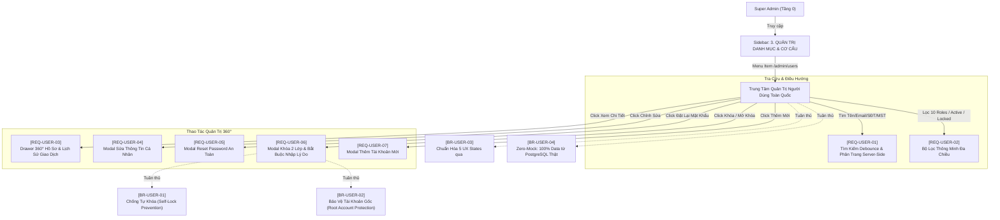

# Change Request: CR-2026-025 Quản Trị Người Dùng Toàn Hệ Thống (Super Admin User Management Center)

**CR-ID**: CR-2026-025  
**Epic**: TASK-07_PHAN_QUYEN_QUAN_TRI_ADMIN  
**Status**: SHIPPED  
**Target Version**: 1.8.0  
**Author**: PO kiêm Senior BA (`nacen-po-pm` & `nacen-ba`)  
**Date**: 2026-11-04  
**Căn cứ pháp lý & Thiết kế cơ sở**: Quyết định `PO-DEC-20261104-01` tại `Specification/BASIC_DESIGN_NACENTECH.md` Mục 29; HTML Wireframe SSOT `Specification/02_BASIC_DESIGN/TASK-07_PHAN_QUYEN_QUAN_TRI_ADMIN/wireframe_quan_ly_nguoi_dung_admin.html`; Hiến pháp Quản trị Đặc tả `SourceCode/specs/SPEC_MANAGEMENT_CONSTITUTION.md`.

---

### 1. Bối Cảnh & Lý Do Thay Đổi (Why)

- **Hiện trạng cũ (Current State / As-Is)**:
  - Tuyến `/admin/users` trên Web Portal đang bị lệnh `redirect("/admin/roles")` cưỡng bức, khiến Quản trị viên Tối cao (`SUPER_ADMIN`) Tầng 0 không có giao diện quản lý danh sách người dùng độc lập.
  - Phân hệ `/admin/roles` hiện tại chỉ tập trung vào Ma trận Phân quyền 10 Roles và danh sách Cán bộ công vụ (Officers), hoàn toàn thiếu vắng tầm nhìn toàn diện về các đối tượng người dùng khác trên nền tảng (Doanh nghiệp ĐMST, Bên Mua, Bên Bán, Chuyên gia KH&CN, Viện/Trường).
  - Phía Backend đã có sẵn cụm API `AdminUsersController` (`/api/v1/admin/users`) với `GET` (List & Search), `POST` (Create), `PATCH` (Update), `POST` (Reset Password), nhưng chưa có API Soft-Delete chính thức (`DELETE /api/v1/admin/users/{id}`) để vô hiệu hóa tài khoản an toàn kèm lý do và ghi log.
- **Vấn đề / Nỗi đau & Nhu cầu cấp thiết (Friction & Critical Needs)**:
  1. **Nhu cầu Quản trị Tập trung 360° (Centralized User Directory)**: Super Admin cần tra cứu tức thời hàng ngàn tài khoản người dùng trên 34 tỉnh/thành trọng điểm, tìm kiếm theo Tên, Email, SĐT, Tổ chức/MST.
  2. **Kỷ luật Bảo toàn Dữ liệu (Soft Delete Mandate)**: Tuyệt đối không xóa cứng (`HARD DELETE`) làm đứt gãy khóa ngoại của các hồ sơ Techmart, bài toán công nghệ, giao dịch và lịch sử thẩm định. Thao tác xóa tài khoản phải là Soft-Delete / Vô hiệu hóa (`IsActive = false`) có ghi nhận lý do và lưu vết `AuditLog` an toàn cấp 3.
  3. **Chống tự khóa và bảo vệ tài khoản gốc (Safety Guards)**: Ngăn chặn triệt để lỗi vận hành khi Super Admin tự khóa chính mình hoặc khóa tài khoản Quản trị gốc (`admin@nacentech.gov.vn`).

---

### 2. Chi Tiết Thay Đổi Quy Chuẩn & Mỏ Neo Bất Biến (Immutable Anchors)



#### [ADD] `REQ-USER-01`: Danh Sách Phân Trang & Tìm Kiếm Tức Thời (Server-side Pagination & Debounced Search)
- Hệ thống cung cấp bảng dữ liệu phân trang Server-side (10, 20, 50 bản ghi/trang) với các cột:
  - *Họ Tên & Danh Tính*: Avatar/Monogram chữ cái đầu, Họ và tên đầy đủ, Tên đơn vị công tác / MST.
  - *Email & SĐT*: Email công vụ / cá nhân, Số điện thoại định danh.
  - *Vai Trò Hệ Thống*: Badge vai trò (màu sắc phân tầng theo chuẩn Design System).
  - *Phạm Vi Thẩm Quyền (Scope)*: GLOBAL, PROVINCE (Mã tỉnh), SECTOR (Mã ngành TT17), hoặc TENANT (Mã đơn vị).
  - *Trạng Thái*: Badge xanh (`ACTIVE - Hoạt động`), Badge vàng (`PENDING - Chờ kích hoạt`), Badge đỏ (`LOCKED - Đang bị khóa`).
  - *Thời Điểm*: Lần cuối đăng nhập hoặc Ngày khởi tạo tài khoản.
  - *Thao Tác*: Cụm nút hành động (`Xem chi tiết`, `Chỉnh sửa`, `Đặt lại MK`, `Khóa/Mở khóa`).
- Ô tìm kiếm hỗ trợ debounce 300ms, tìm theo Họ tên, Email, Số điện thoại và Tên cơ quan/Doanh nghiệp.

#### [ADD] `REQ-USER-02`: Bộ Lọc Đa Chiều Thông Minh (Multi-Criteria Filtering)
- Bộ lọc theo Vai trò (10 Scoped RBAC Roles): `Tất cả`, `SUPER_ADMIN`, `OPERATOR_ADMIN`, `PROVINCIAL_ADMIN`, `CLUSTER_ADMIN`, `SECTOR_ADMIN`, `ENTERPRISE`, `BUYER`, `SELLER`, `VERIFIED_EXPERT`, `INNOVATION_ENTITY`.
- Bộ lọc theo Trạng thái: `Tất cả`, `ACTIVE (Hoạt động)`, `LOCKED (Đang bị khóa)`.

#### [ADD] `REQ-USER-03`: Drawer Xem Chi Tiết 360° (User Profile 360° Drawer)
- Hiển thị đầy đủ thông tin:
  - Nhóm 1: Thông tin cá nhân, định danh pháp lý (MST, Học vị, CCCD nếu có theo chuẩn bảo vệ dữ liệu PDPD).
  - Nhóm 2: Vai trò, phạm vi thẩm quyền và danh sách quyền hạn chi tiết.
  - Nhóm 3: Dữ liệu liên kết (Số bài toán công nghệ đã đăng, số giải pháp chào bán, hồ sơ khảo sát TT17 đã nộp).

#### [ADD] `REQ-USER-04`: Modal Chỉnh Sửa Thông Tin Người Dùng (Edit User Modal)
- Cho phép Super Admin cập nhật: Họ, Tên, Số điện thoại, Tổ chức/Doanh nghiệp, và Trạng thái kích hoạt.
- Gọi API `PATCH /api/v1/admin/users/{id}`.

#### [ADD] `REQ-USER-05`: Modal Đặt Lại Mật Khẩu (Reset Password Modal)
- Cho phép Super Admin cấp mật khẩu mới hoặc kích hoạt tạo chuỗi mật khẩu ngẫu nhiên an toàn.
- Gọi API `POST /api/v1/admin/users/{id}/reset-password`.

#### [ADD] `REQ-USER-06`: Khóa / Vô Hiệu Hóa Tài Khoản An Toàn (Soft-Delete / Deactivate)
- Cho phép Super Admin khóa hoặc mở khóa tài khoản người dùng.
- Khi khóa tài khoản:
  - Hiển thị hộp thoại xác nhận 2 lớp.
  - Bắt buộc nhập **Lý do khóa tài khoản** (tối thiểu 10 ký tự).
  - Gọi API `DELETE /api/v1/admin/users/{id}` (hoặc `PATCH` với `isActive = false` kèm `reason`).
  - Hệ thống ghi vết `AuditLog` lưu IP, thời gian, Super Admin thực hiện và lý do khóa.

#### [ADD] `REQ-USER-07`: Modal Thêm Mới Người Dùng (Create User Modal)
- Cho phép Super Admin tạo nhanh tài khoản cán bộ hoặc doanh nghiệp.
- Gọi API `POST /api/v1/admin/users` với các trường Email, Mật khẩu khởi tạo, Họ tên, SĐT, Tổ chức.

---

### 3. Quy Tắc Nghiệp Vụ Bất Biến (Business Rules)

- **`BR-USER-01 (Chống Tự Khóa - Self-Lock Prevention)`**: Super Admin đang đăng nhập không thể tự khóa, tự đổi trạng thái sang Inactive hoặc tự xóa tài khoản của chính mình. Nút khóa trên dòng tài khoản của chính Super Admin bị disabled và hiển thị tooltip giải thích.
- **`BR-USER-02 (Bảo Vệ Tài Khoản Gốc - Root Account Protection)`**: Tài khoản Quản trị gốc `admin@nacentech.gov.vn` là bất biến. Mọi thao tác khóa hoặc vô hiệu hóa tài khoản này đều bị từ chối ở cả tầng UI lẫn tầng Backend API với mã lỗi `403 Forbidden` (`CANNOT_DEACTIVATE_ROOT_ADMIN`).
- **`BR-USER-03 (Chuẩn Hóa 5 UX States)`**: Sử dụng component `<Async>` đảm bảo đầy đủ 5 trạng thái:
  1. *Loading*: Skeleton Table hiển thị mượt mà.
  2. *Empty*: Hình minh họa SVG và thông điệp rõ ràng khi không có dữ liệu tìm kiếm.
  3. *Error*: Thông báo lỗi mạng hoặc server kèm nút "Thử lại".
  4. *Success*: Bảng dữ liệu hiển thị đúng chuẩn Design System.
  5. *Submitting*: Trạng thái disable nút và loading spinner khi đang xử lý form.
- **`BR-USER-04 (Kỷ Luật Zero-Mock)`**: 100% dữ liệu hiển thị từ API backend `/api/v1/admin/users` kết nối cơ sở dữ liệu PostgreSQL thật; tuyệt đối cấm dùng fake array trong khối `catch`.

---

### 4. Thiết Kế Hợp Đồng API & Schema (API Contracts)

#### 4.1. Endpoint Danh Sách & Tìm Kiếm
- **Method**: `GET /api/v1/admin/users`
- **Query Params**:
  - `page`: int (mặc định 1)
  - `limit`: int (mặc định 10, tối đa 100)
  - `search`: string (tùy chọn)
  - `status`: string (`all`, `active`, `inactive`)
  - `role`: string (tùy chọn, lọc theo role code)
- **Response**:
```json
{
  "data": [
    {
      "id": "3fa85f64-5717-4562-b3fc-2c963f66afa6",
      "email": "user@example.com",
      "firstName": "Văn A",
      "lastName": "Nguyễn",
      "fullName": "Nguyễn Văn A",
      "phone": "0912345678",
      "organization": "Sở KH&CN Hà Nội",
      "role": "PROVINCIAL_ADMIN",
      "scopeType": "PROVINCE",
      "scopeId": "01",
      "isActive": true,
      "createdAt": "2026-10-15T08:00:00Z",
      "lastLoginAt": "2026-11-04T07:30:00Z"
    }
  ],
  "meta": {
    "total": 142,
    "page": 1,
    "limit": 10,
    "totalPages": 15
  }
}
```

#### 4.2. Endpoint Soft-Delete / Vô Hiệu Hóa
- **Method**: `DELETE /api/v1/admin/users/{id}`
- **Request Body**:
```json
{
  "reason": "Vi phạm điều khoản dịch vụ và chính sách an toàn thông tin."
}
```
- **Response**: `200 OK`
```json
{
  "success": true,
  "message": "User has been deactivated successfully",
  "userId": "3fa85f64-5717-4562-b3fc-2c963f66afa6",
  "isActive": false
}
```

---

### 5. Kế Hoạch Kiểm Thử 4 Tầng (Testing & Verification Matrix)

| Tầng Kiểm Thử | Mã Test Case | Mục Tiêu & Kịch Bản Kiểm Chứng | Kết Quả Mong Đợi |
| :--- | :--- | :--- | :--- |
| **Tầng 1: Unit Test** | `TEST-USER-001` | Kiểm tra quy tắc `BR-USER-01`: Chặn Super Admin tự khóa chính mình | Ném ngoại lệ `ValidationException` / `400 Bad Request` |
| **Tầng 1: Unit Test** | `TEST-USER-002` | Kiểm tra quy tắc `BR-USER-02`: Chặn khóa tài khoản root admin | Ném ngoại lệ `ForbiddenException` / `403 Forbidden` |
| **Tầng 2: Contract Test** | `TEST-USER-003` | Khớp schema JSON response giữa Backend C# DTO và Frontend TypeScript interface | 100% trường dữ liệu trùng khớp, không undefined |
| **Tầng 3: DB Integration** | `TEST-USER-004` | Cập nhật `isActive: false` trong PostgreSQL thật và kiểm tra ghi vết `ApprovalAuditLog` | CSDL ghi nhận `isActive = false` và bản ghi audit log đầy đủ |
| **Tầng 4: Playwright E2E** | `TEST-USER-005` | E2E toàn trình trên trình duyệt: Truy cập `/admin/users` $\rightarrow$ Tìm kiếm $\rightarrow$ Lọc role $\rightarrow$ Sửa profile $\rightarrow$ Khóa tài khoản $\rightarrow$ Kiểm tra Visual QA | Vượt qua 100% assertions, đạt điểm Visual QA $\ge 8.0/10$ |
