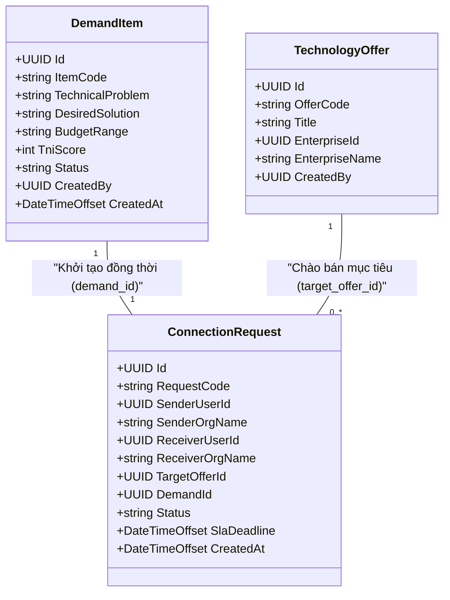

# Change Request: CR-TASK-08-DELTA-01 Khép Kín Luồng Giao Dịch Cung - Cầu 2 Chiều (Đặt Mua Sản Phẩm Thương Mại & Inbound Lead)

**CR-ID**: CR-TASK-08-DELTA-01  
**Phân hệ chủ quản**: `TASK-08_KET_NOI_CUNG_CAU_VA_QUAN_LY_CO_HOI`  
**Phân hệ phối hợp**: `TASK-03_HO_SO_TIM_MUA_BUYER`, `TASK-04_HO_SO_CHAO_BAN_SELLER_VA_BO_LOC`  
**Trạng thái**: `PROPOSED` (Sẵn sàng thẩm định & phê duyệt Gate 1)  
**Phiên bản mục tiêu (Target SemVer)**: `1.13.0`  
**Tác giả**: Senior BA NacenTech (`nacen-ba`)  
**Ngày ban hành**: 02/11/2026  
**Căn cứ pháp lý & Thiết kế cơ sở**:
- Quyết định `PO-DEC-20261102-02` tại [`Specification/BASIC_DESIGN_NACENTECH.md`](file:///Users/luongdt/Library/CloudStorage/GoogleDrive-luongdt.wi@gmail.com/My%20Drive/NacenTechProject/Specification/BASIC_DESIGN_NACENTECH.md) Mục 19.
- Lát cắt mỏng **Walking Skeleton WS-05 (Khép kín Luồng Giao Dịch Cung - Cầu 2 Chiều)** tại [`Specification/BASIC_DESIGN_NACENTECH.md`](file:///Users/luongdt/Library/CloudStorage/GoogleDrive-luongdt.wi@gmail.com/My%20Drive/NacenTechProject/Specification/BASIC_DESIGN_NACENTECH.md) Mục 3.2.
- Hiến pháp Quản trị Đặc tả Spec Kit tại [`SourceCode/specs/SPEC_MANAGEMENT_CONSTITUTION.md`](file:///Users/luongdt/Library/CloudStorage/GoogleDrive-luongdt.wi@gmail.com/My%20Drive/NacenTechProject/SourceCode/specs/SPEC_MANAGEMENT_CONSTITUTION.md).
- Nghị định 13/2023/NĐ-CP của Chính phủ về Bảo vệ Dữ liệu Cá nhân (PDPD).

---

## 1. Tuyên Bố Thay Đổi (Change Statement & Căn Cứ PO)

### 1.1. Hiện trạng Cũ (As-Is / Current State)
- Hiện tại trên Sàn Giao Dịch Công Nghệ & Sản Phẩm NacenTwin, khi Bên Mua (`BUYER` hoặc `PUBLIC_USER` đã đăng nhập) truy cập vào trang chi tiết sản phẩm / công nghệ chào bán tại `/chao-ban-cong-nghe/[id]` và thực hiện hành động **"Đặt Mua Sản Phẩm"** hoặc **"Đăng Ký Chuyển Giao"**:
  * Frontend gọi API `POST /api/v1/demands/items` (thông qua hàm `submitQuickDemand`) gửi kèm `offerId`, `offerTitle`, `offerCode`, `isCommercialOrder`, cùng các thông số kỹ thuật và thông tin liên hệ.
  * Backend API (`SourceCode/backend/apps/api/V1Compat/DemandController.cs`) chỉ khởi tạo duy nhất 1 bản ghi trong bảng `demand.demand_items` với mã bài toán / đơn hàng dạng `DMD-YYYYMMDD-XXXXXX`.
  * Hệ thống **hoàn toàn bỏ qua `offerId`** và **không sinh bất kỳ bản ghi tương ứng nào** trong bảng quản lý cơ hội kết nối `brokerage.connection_requests` (`REQ-*`) gửi tới Bên Bán.

### 1.2. Hậu quả & Nỗi đau Nghiệp vụ (Business Friction & Pain Points)
1. **Mù thông tin hoàn toàn đối với Bên Bán (Blind Seller Silo)**: Bên Bán khi đăng nhập vào Không gian cá nhân và truy cập Bàn làm việc Quản lý Cơ hội tại mục *"Yêu cầu kết nối nhận được"* ([`/portal/opportunities/pipeline?tab=inbound`](file:///Users/luongdt/Library/CloudStorage/GoogleDrive-luongdt.wi@gmail.com/My%20Drive/NacenTechProject/SourceCode/frontend/src/app/(portal)/opportunities/pipeline/page.tsx)) hoàn toàn không nhận được đơn hàng nào (danh sách hiển thị rỗng `0 lead`).
2. **Đơn hàng mồ côi phía Bên Mua (Orphan Demand)**: Bên Mua dù thấy đơn hàng xuất hiện tại [`/portal/buyer/demands?tab=commercial`](file:///Users/luongdt/Library/CloudStorage/GoogleDrive-luongdt.wi@gmail.com/My%20Drive/NacenTechProject/SourceCode/frontend/src/app/(portal)/buyer/demands/page.tsx) nhưng trạng thái bị "đóng băng", không bao giờ nhận được phản hồi từ Bên Bán vì Bên Bán không hề hay biết về đơn mua này.
3. **Đứt gãy dòng giá trị thương mại 2 chiều**: Vi phạm nguyên tắc cốt lõi của một sàn giao dịch thương mại công nghệ điện tử; làm tê liệt hoàn toàn phễu chuyển đổi từ Tra cứu $\rightarrow$ Đặt mua $\rightarrow$ Đàm phán Deal Room $\rightarrow$ Chốt hợp đồng MOU.

### 1.3. Đề Xuất Thay Đổi Chuẩn Hóa (To-Be / Proposed State)
- Khi Bên Mua gửi đơn đặt mua sản phẩm thương mại hoặc yêu cầu chuyển giao gắn với một `offerId` cụ thể:
  1. **Thực thi Giao dịch Nguyên tử (PostgreSQL ACID Transaction)**: Backend kích hoạt `IDbContextTransaction`, thực hiện ghi đồng thời 2 bản ghi phụ thuộc nhau:
     - Ghi bản ghi Đơn hàng / Nhu cầu Bên Mua vào `demand.demand_items` (`DMD-*`).
     - Ghi bản ghi Yêu cầu kết nối Inbound Lead vào `brokerage.connection_requests` (`REQ-*`), tự động trích xuất thông tin gian hàng Bên Bán (`seller_organization_id`, `receiver_org_name`, `receiver_user_id`) từ bản ghi `TechnologyOffer` gốc, gán đúng `target_offer_id` và thời hạn phản hồi SLA 48 giờ.
     - Cả 2 bản ghi cùng Commit thành công; nếu 1 trong 2 gặp sự cố thì Rollback 100%, bảo đảm không có dữ liệu rác.
  2. **Hiển thị Bàn Làm Việc Phân Tuyến 2 Chiều Minh Bạch**:
     - **Bên Mua**: Màn hình `/portal/buyer/demands?tab=commercial` hiển thị đơn hàng `DMD-*` ở trạng thái *"Chờ Bên Bán phản hồi"* kèm mã kết nối đối soát `REQ-*`.
     - **Bên Bán**: Màn hình `/portal/opportunities/pipeline?tab=inbound` hiển thị Inbound Lead `REQ-*` với nhãn phân loại badge nổi bật `[Đơn Mua Hàng Thương Mại]`, tên khách hàng, sản phẩm chào bán mục tiêu, đồng hồ đếm ngược SLA 48h, và nút bấm tác nghiệp nhanh *"Tiếp nhận đơn"* (tạo phòng đàm phán Deal Room) hoặc *"Từ chối"*.

---

## 2. Đánh Giá Tác Động Đa Bề Mặt (Cross-Surface Impact Matrix)

| Bề Mặt Kiến Trúc | Mức Độ Tác Động | Chi Tiết Ảnh Hưởng | Biện Pháp Can Thiệp & Kế Thừa |
| :--- | :---: | :--- | :--- |
| **1. Basic Design (`Specification/`)** | **CAO** | Cần bổ sung lát cắt mỏng Walking Skeleton WS-05 và Phụ lục Quyết định PO-DEC-20261102-02. | Đã cập nhật tại `BASIC_DESIGN_NACENTECH.md` Mục 3.2, Mục 8 và Mục 19 kèm Sequence Diagram Mermaid. |
| **2. Living Spec (`SourceCode/specs/`)** | **CAO** | Bổ sung mỏ neo `REQ-CONN-COMM-001`, `BR-CONN-SYNC-01`, `DB-CONN-01`, `API-CONN-SYNC-01`, `UI-SELLER-INB-01`, `TEST-CONN-SYNC-01`. Bump SemVer lên `1.13.0`. | Cập nhật `SourceCode/specs/TASK-08.../spec.md` và `plan.md`. |
| **3. CSDL PostgreSQL (`Schema`)** | **TRUNG BÌNH** | Bảng `brokerage.connection_requests` đã có sẵn các cột `target_offer_id`, `buyer_organization_id`, `seller_organization_id`, `sla_deadline` từ migration `20261030160000`. Cần đảm bảo cột `demand_id` lưu đúng `demand_items.id`. | Không cần migrate DDL mới; tận dụng 100% schema hiện có, bổ sung index truy vết nếu cần. |
| **4. Backend Core API (`.NET / C#`)** | **CAO** | Nâng cấp `DemandController.CreateQuickDemandItem` (`POST /api/v1/demands/items`): Khi payload có `offerId`, tra cứu `TechnologyOffer` và dùng Transaction ghi đồng thời `DemandItem` và `ConnectionRequest`. | Sử dụng `NacenTechDbContext.Database.BeginTransactionAsync()` để bảo đảm Atomic Dual-Write. |
| **5. Frontend Web Portal (`Next.js / React`)** | **TRUNG BÌNH** | - Trang `/portal/opportunities/pipeline`: Tab Inbound cần hiển thị badge `[Đơn Mua Hàng Thương Mại]` khi lead có liên kết `target_offer_id`.<br>- Nút "Tiếp nhận" xử lý chuyển stage sang Deal Room. | Cập nhật `PipelineKanbanView.tsx` và API adapter fetch inbound requests. |
| **6. Testing & QC Automation** | **CAO** | Cần bộ test case 4 tầng xác thực tính toàn vẹn 2 chiều và đối soát CSDL PostgreSQL. | Tạo test suite E2E và API contract test kiểm chứng luồng dual-write. |
| **7. Cross-Epic Boundaries** | **LIÊN ĐỚI** | Ảnh hưởng đến luồng giao tiếp giữa `TASK-03` (Buyer Demands), `TASK-04` (Seller Offers), và `TASK-08` (Brokerage & Opportunities). | Giữ nguyên API contract v1 (Backward Compatible), chỉ làm giàu dữ liệu đồng bộ ngầm. |

---

## 3. Đặc Tả Yêu Cầu Nghiệp Vụ Với Các Mỏ Neo Bất Biến (Immutable Anchors)



### 3.1. [ADD] `REQ-CONN-COMM-001`: Đặt Mua Sản Phẩm Thương Mại Tự Động Sinh Inbound Lead
1. **Mô tả**: Khi người dùng đã đăng nhập (`BUYER`, `ENTERPRISE`, hoặc `PUBLIC_USER`) gửi biểu mẫu đặt mua sản phẩm thương mại hoặc đăng ký chuyển giao tại trang chi tiết `/chao-ban-cong-nghe/[id]`, hệ thống MUST tự động khởi tạo đồng thời một Yêu cầu kết nối Inbound (`ConnectionRequest`) gửi đích danh tới tài khoản và gian hàng của Bên Bán sở hữu sản phẩm chào bán đó.
2. **Quy tắc định danh**:
   - Mã đơn mua của Bên Mua: Định dạng `DMD-YYYYMMDD-XXXXXX`.
   - Mã Yêu cầu kết nối gửi Bên Bán: Định dạng `REQ-YYYYMMDD-XXXXXX`.
3. **Mối liên kết bắt buộc**:
   - `ConnectionRequest.DemandId = DemandItem.Id`.
   - `ConnectionRequest.TargetOfferId = TechnologyOffer.Id`.
   - `ConnectionRequest.ReceiverUserId = TechnologyOffer.CreatedBy`.
   - `ConnectionRequest.ReceiverOrgName = TechnologyOffer.EnterpriseName`.
   - `ConnectionRequest.SenderUserId = Actor.PersonId`.
   - `ConnectionRequest.SenderOrgName = BuyerOrgName ?? BuyerFullName`.

---

### 3.2. [ADD] `BR-CONN-SYNC-01`: Quy Tắc Toàn Vẹn Giao Dịch Nguyên Tử 2 Chiều (Atomic Dual-Write & Rollback)
1. **Nguyên tắc Nguyên tử (Atomicity)**:
   - Thao tác ghi vào `demand.demand_items` và `brokerage.connection_requests` BẮT BUỘC phải nằm trọn vẹn trong cùng một Transaction CSDL PostgreSQL (`IDbContextTransaction`).
   - Tuyệt đối cấm tách thành 2 API riêng biệt hoặc gọi async lỏng lẻo dễ gây tình trạng bảng này ghi thành công nhưng bảng kia bị lỗi.
2. **Cơ chế Rollback**:
   - Nếu việc tra cứu `TechnologyOffer` bị lỗi, hoặc việc INSERT vào bảng `brokerage.connection_requests` ném ngoại lệ:
     * Toàn bộ transaction lập tức Rollback 100%.
     * Không một bản ghi `DemandItem` nào được phép tồn tại trong CSDL nếu Inbound Lead của Bên Bán chưa được khởi tạo.
     * Trả về HTTP 500 kèm mã lỗi chuẩn `ERR_ATOMIC_COMMERCIAL_ORDER_FAILED`.
3. **SLA Phản hồi Mặc định**:
   - Bản ghi `ConnectionRequest` sinh ra từ đơn đặt mua thương mại tự động được gán `SlaDeadline = DateTimeOffset.UtcNow.AddHours(48)`.
   - Trạng thái khởi tạo bắt buộc là `PENDING`.

---

### 3.3. [ADD] `DB-CONN-01`: Cấu Trúc Liên Kết & Toàn Vẹn CSDL
1. **Ánh xạ khóa và trường**:
   - Bảng `brokerage.connection_requests` liên kết với `demand.demand_items` thông qua cột `demand_id` (UUID).
   - Bảng `brokerage.connection_requests` liên kết với `technology_offers` thông qua `target_offer_id` (UUID) và `offer_id` (UUID).
2. **Chỉ mục tăng tốc độ truy vấn (Performance Indexes)**:
   - `CREATE INDEX IF NOT EXISTS idx_conn_requests_seller_status ON brokerage.connection_requests(seller_organization_id, status);`
   - `CREATE INDEX IF NOT EXISTS idx_conn_requests_target_offer_id ON brokerage.connection_requests(target_offer_id);`
   - `CREATE INDEX IF NOT EXISTS idx_conn_requests_demand_id ON brokerage.connection_requests(demand_id);`

---

### 3.4. [ADD] `API-CONN-SYNC-01`: Đặc Tả Nâng Cấp Endpoint `POST /api/v1/demands/items`

- **Endpoint**: `POST /api/v1/demands/items`
- **Xác thực**: Bearer JWT (Ưu tiên tài khoản đã đăng nhập).
- **Cấu trúc Payload Mở Rộng**:
```json
{
  "stageName": "Sản xuất & Chuyển giao",
  "technicalProblem": "[DN: Vinamilk] Nhu cầu đặt mua / kết nối thương phẩm: Dây chuyền chiết rót tự động",
  "desiredSolution": "[Đề xuất thương mại: Mua trọn gói] Khách hàng Vinamilk đặt mua SP SP-2026-001...",
  "needConsulting": true,
  "expectedGoal": "Cung cấp và vận hành tại nhà máy Bình Dương",
  "applicationScale": "Vinamilk Chi nhánh Nam",
  "sectorCode": "LV01",
  "techGroupCode": "CN01",
  "demandTypeCode": "NC01",
  "budgetRange": "1 – 2 tỷ VNĐ",
  "urgencyScore": 4,
  "impactScore": 4,
  "investmentCapacity": 4,
  "adoptionReadiness": 4,
  "offerId": "7b8f9e21-4d32-411a-9f55-123456789abc",
  "offerTitle": "Dây chuyền chiết rót vô trùng tự động",
  "offerCode": "SP-2026-001",
  "isCommercialOrder": true
}
```

- **Logic Xử Lý Phía Backend**:
```csharp
// [BR-CONN-SYNC-01] Giao dịch nguyên tử Dual-Write
using var transaction = await db.Database.BeginTransactionAsync(ct);
try
{
    // 1. Tạo DemandItem cho Bên Mua
    var demandItem = new DemandItem(...);
    db.Set<DemandItem>().Add(demandItem);
    await db.SaveChangesAsync(ct);

    string? requestCode = null;
    Guid? connectionRequestId = null;

    // 2. Nếu có offerId, tự động sinh Inbound ConnectionRequest cho Bên Bán
    if (req.OfferId.HasValue && req.OfferId != Guid.Empty)
    {
        var offer = await db.Set<TechnologyOffer>()
            .AsNoTracking()
            .FirstOrDefaultAsync(o => o.Id == req.OfferId.Value, ct);

        if (offer != null)
        {
            requestCode = $"REQ-{DateTime.UtcNow:yyyyMMdd}-{Guid.NewGuid().ToString("N")[..6].ToUpper()}";
            var connRequest = new ConnectionRequest(
                requestCode: requestCode,
                senderUserId: Actor.IsAuthenticated ? Actor.PersonId!.Value : Guid.Empty,
                senderOrgName: req.ApplicationScale ?? Actor.OrganizationName ?? "Khách hàng Bên Mua",
                senderRole: "BUYER",
                receiverUserId: offer.CreatedBy ?? Guid.Empty,
                receiverOrgName: offer.EnterpriseName ?? "Nhà Cung Ứng",
                demandId: demandItem.Id,
                offerId: offer.Id,
                message: req.DesiredSolution ?? req.TechnicalProblem,
                proposedBudgetRange: req.BudgetRange,
                status: "PENDING",
                targetOfferId: offer.Id,
                sellerOrganizationId: offer.EnterpriseId,
                slaDeadline: DateTimeOffset.UtcNow.AddHours(48)
            );

            db.Set<ConnectionRequest>().Add(connRequest);
            await db.SaveChangesAsync(ct);
            connectionRequestId = connRequest.Id;
        }
    }

    await transaction.CommitAsync(ct);

    return Ok(new
    {
        success = true,
        itemId = demandItem.Id,
        itemCode = demandItem.ItemCode,
        requestCode = requestCode,
        connectionRequestId = connectionRequestId,
        message = "Đã gửi đơn đặt mua và khởi tạo yêu cầu kết nối tới Bên Bán thành công."
    });
}
catch (Exception ex)
{
    await transaction.RollbackAsync(ct);
    return StatusCode(500, new { message = "Lỗi khi xử lý giao dịch đặt mua nguyên tử: " + ex.Message });
}
```

- **Phản hồi Thành Công (HTTP 200 OK)**:
```json
{
  "success": true,
  "itemId": "e3a89e12-87f1-46ab-8231-112233445566",
  "itemCode": "DMD-20261102-A1B2C3",
  "requestCode": "REQ-20261102-F4D5E6",
  "connectionRequestId": "c7b12d34-98e2-45af-a123-998877665544",
  "message": "Đã gửi đơn đặt mua và khởi tạo yêu cầu kết nối tới Bên Bán thành công."
}
```

---

### 3.5. [ADD] `UI-SELLER-INB-01`: Đặc Tả Hiển Thị Inbound Lead Trên Bàn Làm Việc Bên Bán
1. **Vị trí hiển thị**:
   - Đường dẫn URL: `/portal/opportunities/pipeline?tab=inbound` (hoặc `/portal/opportunities/pipeline`).
   - Phân loại tab: Cột hoặc danh sách *"Yêu Cầu Kết Nối Nhận Được (Inbound Leads)"*.
2. **Chi tiết Thẻ Yêu Cầu (Lead Card Specs)**:
   - **Mã yêu cầu**: `REQ-YYYYMMDD-XXXXXX` (font Monospace, đậm).
   - **Huy hiệu phân loại (Badge)**:
     * Nếu `target_offer_id` tồn tại: Hiển thị badge màu xanh ngọc bích (Emerald): `[Đơn Mua Hàng Thương Mại]`.
     * Nếu `target_offer_id` null (Ghép cặp theo bài toán): Hiển thị badge màu xanh dương (Brand): `[Kết Nối Chuyển Giao Công Nghệ]`.
   - **Sản phẩm mục tiêu**: Tên sản phẩm chào bán kèm link xem lại `/chao-ban-cong-nghe/[target_offer_id]`.
   - **Thông tin Bên Mua**: Tên tổ chức/doanh nghiệp Bên Mua, Người liên hệ, Ngân sách dự kiến. (Tuân thủ bảo vệ dữ liệu PDPD: SĐT/Email che mờ cho đến khi Seller bấm Tiếp nhận).
   - **Đồng hồ SLA**: Đếm ngược thời hạn phản hồi còn lại của mốc 48 giờ. (Nếu $< 12\text{h}$: Badge màu hổ phách; Quá hạn: Badge màu đỏ).
3. **Thao tác hành động (Actions)**:
   - Nút **"Tiếp Nhận Đơn Hàng"**:
     * Gọi `PUT /api/v1/brokerage/requests/{id}/respond` với payload `{ "action": "ACCEPT" }`.
     * Hệ thống gỡ mặt nạ thông tin liên hệ (PDPD Unmasked) và tự động tạo Không gian đàm phán hợp đồng 1-1 ([Deal Room](file:///Users/luongdt/Library/CloudStorage/GoogleDrive-luongdt.wi@gmail.com/My%20Drive/NacenTechProject/SourceCode/frontend/src/app/(portal)/opportunities/[id]/deal-room/page.tsx)).
   - Nút **"Từ Chối"**:
     * Mở modal yêu cầu nhập lý do từ chối ngắn gọn (`rejection_reason`).
     * Cập nhật trạng thái `REJECTED`, thông báo phản hồi về cho Bên Mua.

---

### 3.6. [ADD] `TEST-CONN-SYNC-01`: Tiêu Chuẩn Kiểm Thử Nghiệm Thu 4 Tầng

| Tầng Kiểm Thử | Tên Kịch Bản Kiểm Thử | Mục Tiêu & Dữ Liệu Kiểm Chứng | Kết Quả Kỳ Vọng (Pass Criteria) |
| :--- | :--- | :--- | :--- |
| **Tầng 1: Unit Test** | `Test_CreateDemandItem_Validation` | Kiểm tra logic nghiệp vụ hợp lệ của các chỉ số K, L, N, O và tính nguyên tử khi thiếu trường bắt buộc. | Trả về `BadRequest` khi thiếu trường; không ghi CSDL. |
| **Tầng 2: Contract Test** | `Test_PostDemandItem_WithOfferId_DualWrite` | Gọi `POST /api/v1/demands/items` với `offerId` hợp lệ. | HTTP 200, phản hồi có cả `itemCode` (`DMD-*`) và `requestCode` (`REQ-*`). |
| **Tầng 3: DB Audit Test** | `Test_PostgreSQL_Consistency_Audit` | Truy vấn trực tiếp PostgreSQL kiểm tra 2 bảng sau khi API hoàn tất. | `brokerage.connection_requests` có đúng 1 bản ghi có `demand_id = demand_items.id` và `target_offer_id = req.OfferId`. |
| **Tầng 4: E2E Playwright** | `Test_Buyer_Order_To_Seller_Inbound_Pipeline` | Giả lập Buyer đặt hàng tại `/chao-ban-cong-nghe/[id]` $\rightarrow$ Đăng nhập Seller vào `/portal/opportunities/pipeline?tab=inbound`. | Seller nhìn thấy ngay thẻ `REQ-*` có badge `[Đơn Mua Hàng Thương Mại]`, bấm "Tiếp nhận" thành công. |

---

## 4. Ma Trận Truy Vết Khép Kín (Traceability Matrix)

| Mã Yêu Cầu (REQ) | Quy Tắc Nghiệp Vụ (BR) | Thực Thể CSDL (DB) | Điểm Cuối API (API) | Giao Diện Người Dùng (UI) | Ca Kiểm Thử (TEST) | Trạng Thái |
| :--- | :--- | :--- | :--- | :--- | :--- | :---: |
| **REQ-CONN-COMM-001** | `BR-CONN-SYNC-01` | `DB-CONN-01` (`brokerage.connection_requests`, `demand.demand_items`) | `API-CONN-SYNC-01` (`POST /api/v1/demands/items`) | `UI-SELLER-INB-01` (`/portal/opportunities/pipeline?tab=inbound`) | `TEST-CONN-SYNC-01` | **PROPOSED** |

---

## 5. Quy Tắc Tương Thích Ngược & Cơ Chế Phục Hồi (Backward Compatibility & Safe Rollback)

1. **Tương thích ngược (Backward Compatibility)**:
   - Đối với các yêu cầu tạo bài toán nhu cầu truyền thống không gắn với sản phẩm chào bán (không có trường `offerId` hoặc `offerId = null`):
     * Backend xử lý như cũ: chỉ tạo bản ghi `DemandItem` độc lập, không sinh bản ghi trong `connection_requests`.
     * Đảm bảo 100% các API callers cũ, kịch bản khảo sát doanh nghiệp TT17 và test suite cũ không bị ảnh hưởng hay gãy luồng.
2. **Cơ chế Rollback khẩn cấp**:
   - Nếu trong quá trình vận hành phát sinh lỗi xung đột khóa ngoại trên môi trường Staging/Production:
     * Logic kiểm tra `if (offer != null)` có khối `catch` độc lập hoặc cờ Feature Toggle `EnableCommercialDualWrite = false` để tạm thời hạ cấp về luồng ghi đơn bảng mà không làm sập API.

---

## 6. Kế Hoạch Triển Khai Tuyến Tính (Implementation & Execution Plan)

- [ ] **Giai đoạn 1 (BA & Spec Approval)**: PO phê duyệt `CR-TASK-08-DELTA-01.md` tại Gate 1.
- [ ] **Giai đoạn 2 (Backend Core - .NET)**:
  - Cập nhật DTO `CreateQuickDemandItemRequest` trong `DemandController.cs`.
  - Triển khai `IDbContextTransaction` và logic tạo `ConnectionRequest` trong `CreateQuickDemandItem`.
- [ ] **Giai đoạn 3 (Frontend Web - Next.js)**:
  - Cập nhật hiển thị badge `[Đơn Mua Hàng Thương Mại]` và liên kết sản phẩm trên thẻ Kanban Inbound tại `/portal/opportunities/pipeline`.
- [ ] **Giai đoạn 4 (Kiểm thử 4 Tầng & QC Gate 4)**:
  - Viết và chạy kịch bản kiểm thử E2E đối soát PostgreSQL xác nhận đơn hàng xuất hiện ở cả 2 bàn làm việc.
- [ ] **Giai đoạn 5 (Ký Duyệt & Đóng CR - Gate 5)**:
  - Chuyển trạng thái CR sang `SHIPPED`, merge vào `spec.md` và bump SemVer lên `1.13.0`.

---

## 7. Tiêu Chuẩn Nghiệm Thu Cổng Gate 1 PO (Acceptance Criteria)

- [x] **AC-CONN-01**: Tài liệu Delta tuân thủ 100% cấu trúc Hiến pháp Spec Kit (`SPEC_MANAGEMENT_CONSTITUTION.md`).
- [x] **AC-CONN-02**: Ma trận phân tích tác động đa bề mặt đầy đủ từ Basic Design đến DB, API, UI và Testing.
- [x] **AC-CONN-03**: 100% logic được neo vào mã định danh bất biến chuẩn mực (`REQ-*`, `BR-*`, `DB-*`, `API-*`, `UI-*`, `TEST-*`).
- [x] **AC-CONN-04**: Giải quyết dứt điểm điểm nghẽn "Bên Bán không thấy đơn hàng nhận được" bằng cơ chế Atomic Dual-Write.
- [x] **AC-CONN-05**: Bảo toàn khả năng tương thích ngược cho các bài toán nhu cầu không gắn `offerId`.
- [x] **AC-CONN-06**: Đã đồng bộ vào Walking Skeleton WS-05 trong `Specification/BASIC_DESIGN_NACENTECH.md`.
