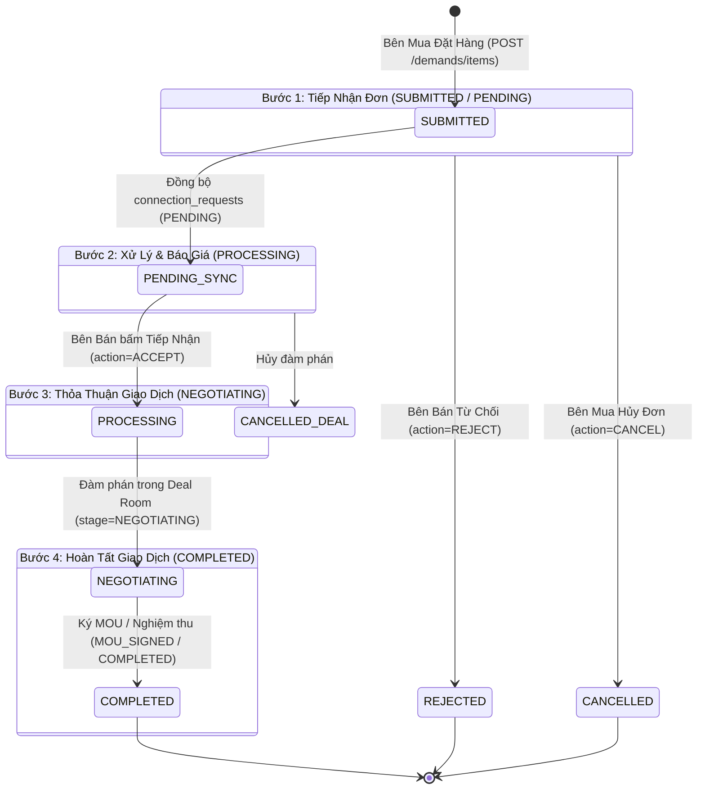

# Change Request: CR-TASK-08-DELTA-02 Máy Trạng Thái Đồng Bộ 2 Chiều Trạng Thái Đơn Hàng Thương Mại & Vòng Đời Deal Room

**CR-ID**: `CR-TASK-08-DELTA-02`  
**Phân hệ chủ quản**: `TASK-08_KET_NOI_CUNG_CAU_VA_QUAN_LY_CO_HOI`  
**Phân hệ phối hợp**: `TASK-03_HO_SO_TIM_MUA_BUYER`, `TASK-04_HO_SO_CHAO_BAN_SELLER_VA_BO_LOC`  
**Trạng thái**: `SHIPPED` (Gate 5 - Final DoD Signed off by PO)  
*Lịch sử vòng đời*: `PROPOSED` (02/11/2026 10:00) $\rightarrow$ `APPROVED` (02/11/2026 11:45 Gate 1 DoR) $\rightarrow$ `SHIPPED` (02/11/2026 12:05 Gate 5 DoD)  
**Phiên bản mục tiêu (Target SemVer)**: `1.14.0`  
**Tác giả**: Senior Business Analyst NacenTech (`nacen-ba`)  
**Thẩm định & Phê duyệt**: Product Owner (`nacen-po-pm`) & Software Architect (`nacen-techlead-sa`)  
**Ngày ban hành**: 02/11/2026  
**Căn cứ pháp lý & Thiết kế cơ sở**:
- Quyết định `PO-DEC-20261102-03: Máy Trạng Thái Đồng Bộ 2 Chiều Đơn Hàng Thương Mại & Vòng Đời Deal Room` tại [`Specification/BASIC_DESIGN_NACENTECH.md`](file:///Users/luongdt/Library/CloudStorage/GoogleDrive-luongdt.wi@gmail.com/My%20Drive/NacenTechProject/Specification/BASIC_DESIGN_NACENTECH.md) Mục 19.4 & Mục 3.2.1.
- Lát cắt mỏng **Walking Skeleton WS-05 (Khép kín Luồng Giao Dịch Cung - Cầu 2 Chiều)** tại [`Specification/BASIC_DESIGN_NACENTECH.md`](file:///Users/luongdt/Library/CloudStorage/GoogleDrive-luongdt.wi@gmail.com/My%20Drive/NacenTechProject/Specification/BASIC_DESIGN_NACENTECH.md) Mục 3.2.
- Delta Ledger tiền đề: [`CR-TASK-08-DELTA-01.md`](file:///Users/luongdt/Library/CloudStorage/GoogleDrive-luongdt.wi@gmail.com/My%20Drive/NacenTechProject/SourceCode/specs/TASK-08_KET_NOI_CUNG_CAU_VA_QUAN_LY_CO_HOI/deltas/CR-TASK-08-DELTA-01.md).
- Hiến pháp Quản trị Đặc tả Spec Kit tại [`SourceCode/specs/SPEC_MANAGEMENT_CONSTITUTION.md`](file:///Users/luongdt/Library/CloudStorage/GoogleDrive-luongdt.wi@gmail.com/My%20Drive/NacenTechProject/SourceCode/specs/SPEC_MANAGEMENT_CONSTITUTION.md).
- Quy chuẩn 3 nhóm chủ thể Bên Mua tại [`Specification/BASIC_DESIGN_NACENTECH.md`](file:///Users/luongdt/Library/CloudStorage/GoogleDrive-luongdt.wi@gmail.com/My%20Drive/NacenTechProject/Specification/BASIC_DESIGN_NACENTECH.md) Mục 21 và Nghị định 13/2023/NĐ-CP về Bảo vệ Dữ liệu Cá nhân (PDPD).

---

## 1. Tuyên Bố Thay Đổi (Change Statement & Căn Cứ PO)

### 1.1. Hiện trạng Cũ (As-Is / Current State)
1. **Sau khi Bên Mua gửi đơn đặt mua sản phẩm thương mại** (`POST /api/v1/demands/items`), hệ thống áp dụng cơ chế Atomic Dual-Write (theo `CR-TASK-08-DELTA-01`), khởi tạo thành công đồng thời:
   - Bản ghi đơn hàng tại `demand.demand_items` mang trạng thái `SUBMITTED` / `PENDING`.
   - Bản ghi yêu cầu kết nối tại `brokerage.connection_requests` mang trạng thái `PENDING`.
2. **Khi Bên Bán bấm "Tiếp nhận đơn"** (chấp thuận yêu cầu kết nối):
   - Frontend gửi yêu cầu `PUT /api/v1/brokerage/requests/{id}/respond` với payload `{ action: "ACCEPT" }`.
   - Backend chỉ cập nhật duy nhất trạng thái bản ghi `brokerage.connection_requests.status = 'ACCEPTED'` và khởi tạo bản ghi thương vụ `brokerage.opportunities` ở bước `INITIATED`.
   - **Lỗ hổng cốt lõi**: Backend **hoàn toàn không có cơ chế cập nhật đồng bộ ngược** về bản ghi đơn hàng gốc `demand.demand_items.status` của Bên Mua.
3. **Khi hai bên bước vào phòng đàm phán Deal Room và ký MOU**:
   - Khi chuyển giai đoạn thương vụ sang thương thảo (`NEGOTIATING`) hoặc hoàn tất ký MOU (`MOU_SIGNED`), hệ thống chỉ cập nhật bảng `brokerage.opportunities`, bỏ quên hoàn toàn bảng `demand.demand_items`.
4. **Hậu quả nghiệp vụ nghiêm trọng (Business Pain Points)**:
   - Trên Bàn làm việc của Bên Mua ([`/portal/buyer/demands?tab=commercial`](file:///Users/luongdt/Library/CloudStorage/GoogleDrive-luongdt.wi@gmail.com/My%20Drive/NacenTechProject/SourceCode/frontend/src/app/portal/buyer/demands/page.tsx)), đơn hàng mãi mãi bị "đóng băng" ở trạng thái `SUBMITTED` / `PENDING`.
   - Thanh tiến trình 4 bước (`OrderTrackingStepper`) đứng yên ở Bước 1 ("Chờ tiếp nhận"), không bao giờ chuyển sang Bước 2 ("Đang xử lý & Báo giá"), không tích xanh Bước 1, và không xuất hiện nút CTA dẫn vào Deal Room.
   - Bên Mua lầm tưởng đơn hàng của mình chưa được phản hồi hoặc bị bỏ quên, dẫn đến sự đứt gãy trải nghiệm người dùng và làm giảm uy tín vận hành của Sàn ĐMST Quốc Gia.

### 1.2. Đề Xuất Thay Đổi Chuẩn Hóa (To-Be / Proposed State)
1. **Thiết lập Máy Trạng Thái Đồng Bộ 2 Chiều (Bi-directional State Machine)**:
   - Kết nối chặt chẽ giữa 3 thực thể: `demand.demand_items` $\leftrightarrow$ `brokerage.connection_requests` $\leftrightarrow$ `brokerage.opportunities`.
   - Mọi biến động trạng thái phía Bên Bán (Tiếp nhận / Từ chối / Đàm phán Deal Room / Ký MOU) **BẮT BUỘC** phải kích hoạt đồng bộ ngược thời gian thực sang `demand.demand_items.status` trong cùng một Transaction CSDL PostgreSQL.
2. **Quy chuẩn 4 Bước Tiến Trình Giao Dịch**:
   - **Bước 1 (Tiếp nhận đơn)**: Khi `demand_items.status = 'PENDING' / 'SUBMITTED'` $\leftrightarrow$ `connection_requests.status = 'PENDING'`. Stepper sáng Bước 1.
   - **Bước 2 (Xử lý & Báo giá)**: Kích hoạt khi Bên Bán bấm *"Tiếp nhận đơn"* $\rightarrow$ `connection_requests.status = 'ACCEPTED'` $\rightarrow$ đồng bộ nguyên tử `demand_items.status = 'PROCESSING'`. Stepper tích xanh [✓] Bước 1, kích hoạt sáng Bước 2, mở phòng Deal Room và hiển thị nút CTA *"Vào Deal Room Thảo Luận"*.
   - **Bước 3 (Thỏa thuận giao dịch)**: Kích hoạt khi cơ hội trong Pipeline chuyển sang giai đoạn `NEGOTIATING` $\rightarrow$ đồng bộ nguyên tử `demand_items.status = 'NEGOTIATING'`. Stepper tích xanh [✓] Bước 1 & 2, kích hoạt sáng Bước 3.
   - **Bước 4 (Hoàn tất)**: Kích hoạt khi hai bên ký MOU (`MOU_SIGNED`) hoặc hoàn tất nghiệm thu (`COMPLETED`) $\rightarrow$ đồng bộ nguyên tử `demand_items.status = 'COMPLETED'`. Cả 4 bước tích xanh [✓], hoàn tất thương vụ trên sàn.
   - **Ngoại lệ**: Nếu Bên Bán từ chối (`REJECTED`) $\rightarrow$ đồng bộ `demand_items.status = 'REJECTED'`; Nếu Bên Mua hủy đơn (`CANCELLED`) $\rightarrow$ đồng bộ `connection_requests.status = 'CANCELLED'`.

---

## 2. Đánh Giá Tác Động Đa Bề Mặt (Cross-Surface Impact Matrix)

| Bề Mặt Kiến Trúc | Mức Độ Tác Động | Chi Tiết Ảnh Hưởng | Biện Pháp Can Thiệp & Kế Thừa |
| :--- | :---: | :--- | :--- |
| **1. Basic Design (`Specification/`)** | **CAO** | Cần quy định máy trạng thái đồng bộ 2 chiều và Sequence Diagram chi tiết. | Đã bổ sung Mục 3.2.1 và Mục 19.4 tại `Specification/BASIC_DESIGN_NACENTECH.md`. |
| **2. Living Spec (`SourceCode/specs/`)** | **CAO** | Cần bổ sung 6 mỏ neo bất biến và ma trận truy vết khép kín. Bump SemVer lên `1.14.0`. | Cập nhật `SourceCode/specs/TASK-08.../spec.md` và `plan.md`. |
| **3. CSDL PostgreSQL (`Schema`)** | **KHÔNG ĐỔI DDL** | Bảng `brokerage.connection_requests` đã có sẵn cột `demand_id` liên kết `demand.demand_items.id`. Bảng `brokerage.opportunities` liên kết qua `connection_request_id`. | Tận dụng 100% schema hiện hữu; thực thi các câu lệnh `UPDATE` có transaction bảo vệ nguyên tử. |
| **4. Backend API Core (`.NET / C#`)** | **CAO** | Cần mở rộng 2 endpoints:<br>1. `PUT /api/v1/brokerage/requests/{id}/respond`<br>2. `PUT /api/v1/brokerage/opportunities/{id}/stage` | Sử dụng `NacenTechDbContext.Database.BeginTransactionAsync()` đảm bảo cập nhật `demand_items.status` và `updated_at` trong cùng transaction. |
| **5. Frontend Web Portal (`Next.js / React`)** | **CAO** | - Trang `/portal/buyer/demands?tab=commercial`: Cập nhật logic hiển thị Stepper Bước 2 khi `status === 'PROCESSING'`, tích xanh Bước 1, và nút CTA dẫn vào Deal Room.<br>- Modal chi tiết đơn hàng: Cập nhật tương ứng. | Đồng bộ qua `OrderTrackingStepper.tsx` và `buyer/demands/page.tsx`, tuân thủ 5 UX States qua `<Async>`. |
| **6. Testing & QC Automation** | **CAO** | Cần bộ test case 4 tầng kiểm chứng toàn trình sự đồng bộ từ lúc Bên Bán bấm tiếp nhận đến khi Stepper Bên Mua nhảy bước. | Mở rộng Unit tests, Integration tests, DB Verification tests và Playwright E2E tests. |
| **7. Cross-Epic Boundaries** | **LIÊN ĐỚI** | Phối hợp giữa `TASK-08` (Brokerage & Deal Room) và `TASK-03` (Buyer Demands & Order Tracking). | Hợp đồng API và trạng thái dữ liệu được chuẩn hóa tương thích ngược 100%. |

---

## 3. Đặc Tả Yêu Cầu Nghiệp Vụ Với Các Mỏ Neo Bất Biến (Immutable Anchors)



### 3.1. [ADD] `REQ-SYNC-STEP-001`: Đơn Hàng Thương Mại Tự Động Đồng Bộ Trạng Thái 4 Bước Theo Vòng Đời Tác Nghiệp Bên Bán
1. **Yêu cầu cốt lõi**:
   - Khi Bên Bán thực hiện bất kỳ thao tác nào thay đổi tiến trình thương vụ (Tiếp nhận đơn, Chuyển giai đoạn đàm phán trong Deal Room, Ký kết biên bản ghi nhớ MOU, Từ chối đơn), hệ thống MUST tự động cập nhật trạng thái tương ứng của bản ghi đơn hàng của Bên Mua (`demand.demand_items.status`) và ghi nhận dấu thời gian `updated_at = NOW()`.
2. **Phạm vi áp dụng**:
   - Áp dụng cho toàn bộ các đơn hàng thương mại (`isCommercialOrder = true`) và yêu cầu chuyển giao công nghệ có liên kết giữa `demand.demand_items` và `brokerage.connection_requests`.
3. **Hiển thị thời gian thực phía Bên Mua**:
   - Khi Bên Mua truy cập `/portal/buyer/demands?tab=commercial` hoặc mở Modal xem chi tiết đơn hàng, thanh tiến trình 4 bước (`OrderTrackingStepper`) MUST hiển thị chính xác bước tương ứng với dữ liệu đồng bộ mới nhất.

---

### 3.2. [ADD] `BR-ORDER-STATE-01`: Quy Tắc Chuyển Đổi Trạng Thái Đồng Bộ 2 Chiều (Bi-directional State Transition Matrix)
1. **Ma trận Chuyển đổi Trạng thái Chuẩn (State Transition Matrix)**:

| Trạng Thái Ban Đầu (`demand_items`) | Trạng Thái Ban Đầu (`connection_requests`) | Sự Kiện Kích Hoạt (Trigger Event) | Trạng Thái Đích (`connection_requests`) | Giai Đoạn Đích (`opportunities.stage`) | Trạng Thái Đích Đồng Bộ (`demand_items`) | Bước Stepper Hiển Thị |
| :--- | :--- | :--- | :--- | :--- | :--- | :---: |
| `SUBMITTED` / `PENDING` | `PENDING` | Bên Bán bấm "Tiếp nhận đơn" (`action = 'ACCEPT'`) | `ACCEPTED` | `INITIATED` | `PROCESSING` | **Bước 2** (Tích xanh Bước 1) |
| `PROCESSING` | `ACCEPTED` | Cập nhật giai đoạn trong Deal Room | `ACCEPTED` | `NEGOTIATING` | `NEGOTIATING` | **Bước 3** (Tích xanh Bước 1 & 2) |
| `NEGOTIATING` | `ACCEPTED` | Ký MOU hoặc Hoàn tất thương vụ | `ACCEPTED` | `MOU_SIGNED` hoặc `COMPLETED` | `COMPLETED` | **Bước 4** (Tích xanh cả 4 bước) |
| `SUBMITTED` / `PENDING` | `PENDING` | Bên Bán bấm "Từ chối" (`action = 'REJECT'`) | `REJECTED` | *Không sinh* | `REJECTED` | Cảnh báo đỏ ("Đã từ chối") |
| `SUBMITTED` / `PENDING` | `PENDING` | Bên Mua bấm "Hủy đơn hàng" | `CANCELLED` | *Không sinh* | `CANCELLED` | Cảnh báo xám ("Đã hủy đơn") |

2. **Quy tắc Giao dịch Nguyên tử (Mandatory Atomic ACID Transaction)**:
   - Thao tác cập nhật `brokerage.connection_requests` (hoặc `brokerage.opportunities`) và `demand.demand_items` BẮT BUỘC phải thực thi trong cùng một Database Transaction.
   - Nếu việc cập nhật `demand.demand_items` thất bại, toàn bộ thao tác phía Brokerage phải Rollback 100%, không cho phép trạng thái một bên đã `ACCEPTED` mà bên kia vẫn `SUBMITTED`.
3. **Quy tắc Khóa Hủy Đơn Phía Bên Mua (Cancellation Guard)**:
   - Bên Mua chỉ được phép tự hủy đơn khi đơn hàng đang ở Bước 1 (`SUBMITTED` hoặc `PENDING`).
   - Khi đơn hàng đã chuyển sang Bước 2 (`PROCESSING`) hoặc cao hơn, nút "Hủy đơn" phía Bên Mua MUST bị ẩn hoặc vô hiệu hóa, kèm thông báo: *"Đơn hàng đã được Nhà cung cấp tiếp nhận và xử lý. Vui lòng trao đổi trực tiếp trong Deal Room nếu muốn dừng giao dịch."*

---

### 3.3. [ADD] `DB-SYNC-01`: Quy Chuẩn Đồng Bộ CSDL Giữa Schema `brokerage` & Schema `demand`
1. **Cơ chế truy vết khóa ngoại mềm**:
   - Bảng `brokerage.connection_requests` chứa trường `demand_id` (`UUID`, nullable) trỏ tới khóa chính `demand.demand_items.id`.
   - Bảng `brokerage.opportunities` chứa trường `connection_request_id` (`UUID`, nullable) trỏ tới `brokerage.connection_requests.id`.
2. **Cập nhật đồng bộ phía Backend (EF Core / Raw SQL)**:
   - Khi xử lý `RespondConnectionRequest` (`action = 'ACCEPT'`):
     ```sql
     -- 1. Cập nhật bảng kết nối
     UPDATE brokerage.connection_requests 
     SET status = 'ACCEPTED', updated_at = NOW() 
     WHERE id = @RequestId;

     -- 2. Đồng bộ ngược sang bảng đơn hàng Bên Mua
     UPDATE demand.demand_items 
     SET status = 'PROCESSING', updated_at = NOW() 
     WHERE id = (SELECT demand_id FROM brokerage.connection_requests WHERE id = @RequestId);
     ```
   - Khi xử lý `RespondConnectionRequest` (`action = 'REJECT'`):
     ```sql
     UPDATE brokerage.connection_requests 
     SET status = 'REJECTED', rejection_reason = @Reason, updated_at = NOW() 
     WHERE id = @RequestId;

     UPDATE demand.demand_items 
     SET status = 'REJECTED', updated_at = NOW() 
     WHERE id = (SELECT demand_id FROM brokerage.connection_requests WHERE id = @RequestId);
     ```
   - Khi xử lý `UpdateOpportunityStage` (`stage = 'NEGOTIATING'`):
     ```sql
     UPDATE brokerage.opportunities 
     SET stage = 'NEGOTIATING', updated_at = NOW() 
     WHERE id = @OpportunityId;

     UPDATE demand.demand_items 
     SET status = 'NEGOTIATING', updated_at = NOW() 
     WHERE id = (
       SELECT cr.demand_id 
       FROM brokerage.opportunities opp 
       JOIN brokerage.connection_requests cr ON opp.connection_request_id = cr.id 
       WHERE opp.id = @OpportunityId
     );
     ```
   - Khi xử lý `UpdateOpportunityStage` (`stage IN ('MOU_SIGNED', 'COMPLETED')`):
     ```sql
     UPDATE brokerage.opportunities 
     SET stage = @Stage, updated_at = NOW() 
     WHERE id = @OpportunityId;

     UPDATE demand.demand_items 
     SET status = 'COMPLETED', updated_at = NOW() 
     WHERE id = (
       SELECT cr.demand_id 
       FROM brokerage.opportunities opp 
       JOIN brokerage.connection_requests cr ON opp.connection_request_id = cr.id 
       WHERE opp.id = @OpportunityId
     );
     ```

---

### 3.4. [ADD] `API-SYNC-01`: Đặc Tả Mở Rộng API Endpoints Kích Hoạt Đồng Bộ Trạng Thái
1. **Endpoint 1: `PUT /api/v1/brokerage/requests/{id}/respond`**:
   - **Mục đích**: Bên Bán chấp thuận hoặc từ chối yêu cầu kết nối Inbound Lead.
   - **Request Payload**:
     ```json
     {
       "action": "ACCEPT | REJECT",
       "message": "Chúng tôi đã tiếp nhận đơn hàng và chuẩn bị phương án báo giá chi tiết.",
       "rejectionReason": "string (nếu action = REJECT)"
     }
     ```
   - **Xử lý nội bộ**:
     * Kiểm tra quyền sở hữu của Bên Bán (`seller_organization_id`).
     * Mở `IDbContextTransaction`.
     * Cập nhật `connection_requests.status = 'ACCEPTED'`.
     * Nếu `demand_id != null`, cập nhật `demand_items.status = 'PROCESSING'` (hoặc `'REJECTED'`).
     * Khởi tạo bản ghi `brokerage.opportunities` gắn `connection_request_id`.
     * Commit Transaction.
   - **Response HTTP 200**:
     ```json
     {
       "id": "3fa85f64-5717-4562-b3fc-2c963f66afa6",
       "requestCode": "REQ-20261102-000128",
       "status": "ACCEPTED",
       "syncedDemandStatus": "PROCESSING",
       "createdOpportunityId": "opp-9988-7766-5544",
       "message": "Tiếp nhận đơn hàng thành công và đồng bộ tiến trình giao dịch."
     }
     ```

2. **Endpoint 2: `PUT /api/v1/brokerage/opportunities/{id}/stage`**:
   - **Mục đích**: Cập nhật giai đoạn thương vụ trong bảng Kanban hoặc Deal Room.
   - **Request Payload**:
     ```json
     {
       "stage": "NEGOTIATING | MOU_SIGNED | COMPLETED | CLOSED_LOST",
       "note": "Hai bên đang đàm phán hợp đồng chuyển giao công nghệ."
     }
     ```
   - **Xử lý nội bộ**:
     * Cập nhật `opportunities.stage = @Stage`.
     * Tra cứu `connection_requests.demand_id`. Nếu tồn tại:
       - Nếu `stage == 'NEGOTIATING'` $\rightarrow$ Cập nhật `demand_items.status = 'NEGOTIATING'`.
       - Nếu `stage IN ('MOU_SIGNED', 'COMPLETED')` $\rightarrow$ Cập nhật `demand_items.status = 'COMPLETED'`.
   - **Response HTTP 200**:
     ```json
     {
       "id": "opp-9988-7766-5544",
       "stage": "NEGOTIATING",
       "syncedDemandStatus": "NEGOTIATING",
       "updatedAt": "2026-11-02T11:45:00Z"
     }
     ```

---

### 3.5. [ADD] `UI-BUYER-STEP-01`: Đặc Tả Giao Diện Chi Tiết Đơn Hàng & Tiến Trình Bên Mua
1. **Thanh Tiến Trình `OrderTrackingStepper` (`src/components/demand/OrderTrackingStepper.tsx`)**:
   - **Ánh xạ trạng thái**:
     * `status in ['SUBMITTED', 'PENDING']` $\rightarrow$ `stepIndex = 0` (Bước 1: Chờ tiếp nhận).
     * `status in ['PROCESSING', 'VERIFIED', 'IN_REVIEW']` $\rightarrow$ `stepIndex = 1` (Bước 2: Xử lý & Báo giá, Bước 1 có icon Check tròn xanh `CheckCircle2`).
     * `status in ['NEGOTIATING']` $\rightarrow$ `stepIndex = 2` (Bước 3: Thỏa thuận giao dịch, Bước 1 & 2 có icon Check tròn xanh).
     * `status in ['COMPLETED']` $\rightarrow$ `stepIndex = 3` (Bước 4: Hoàn tất, cả 4 bước có icon Check tròn xanh).
     * `status in ['REJECTED']` $\rightarrow$ Render Alert banner đỏ: *"Nhà cung cấp đã từ chối đơn hàng"*, kèm lý do từ chối.
     * `status in ['CANCELLED']` $\rightarrow$ Render Alert banner xám: *"Đơn hàng đã được hủy"*.
2. **Nút Thao Tác Nhanh (Call To Action - CTA)**:
   - Trên bảng danh sách `/portal/buyer/demands?tab=commercial` và trong Modal chi tiết đơn hàng:
     * Khi đơn hàng ở trạng thái `PROCESSING`, `NEGOTIATING`, hoặc `COMPLETED`:
       - Hiển thị nút bấm nổi bật: `<Link href="/portal/opportunities/{oppId}/deal-room">` với nhãn *"Vào Deal Room Thảo Luận Ngay $\rightarrow$"* (kèm icon `Handshake`).
       - Nút *"Hủy đơn"* bị ẩn hoàn toàn để bảo đảm tính thống nhất cam kết thương mại.
     * Khi đơn hàng ở trạng thái `SUBMITTED` hoặc `PENDING`:
       - Hiển thị nút *"Hủy đơn hàng"* (kèm Modal xác nhận lý do hủy).

---

### 3.6. [ADD] `TEST-SYNC-STEP-01`: Bộ Tiêu Chuẩn Kiểm Thử Chống Hồi Quy 4 Tầng
1. **Tầng 1: Unit & Component Tests (Vitest)**:
   - Kiểm thử `mapStatusToStepIndex('PROCESSING')` trả về đúng `stepIndex = 1`, `statusLabel = 'Đang xử lý & Báo giá'`, `isCancelled = false`, `isRejected = false`.
   - Kiểm thử `OrderTrackingStepper` khi nhận prop `status="PROCESSING"` hiển thị Bước 1 tích xanh [✓] và Bước 2 ở trạng thái active xanh đậm.
   - Kiểm thử hiển thị nút CTA Deal Room khi `status === 'PROCESSING'`.
2. **Tầng 2: Backend Integration & Transaction Tests (.NET xUnit)**:
   - Giả lập gọi `RespondConnectionRequest(action = ACCEPT)`:
     * Kiểm tra bản ghi `brokerage.connection_requests` mang `status = 'ACCEPTED'`.
     * Kiểm tra bản ghi `demand.demand_items` mang `status = 'PROCESSING'`.
     * Kiểm tra bản ghi `brokerage.opportunities` được khởi tạo.
   - Kiểm thử nhánh Rollback: Giả lập lỗi DB khi ghi `demand_items`, kiểm tra bản ghi `connection_requests` không bị đổi sang `ACCEPTED`.
3. **Tầng 3: API Contract Tests**:
   - Gọi API `PUT /api/v1/brokerage/requests/{id}/respond` xác nhận payload trả về có `status = "ACCEPTED"` và `syncedDemandStatus = "PROCESSING"`.
   - Gọi API `PUT /api/v1/brokerage/opportunities/{id}/stage` với `stage = "NEGOTIATING"` xác nhận `syncedDemandStatus = "NEGOTIATING"`.
4. **Tầng 4: Playwright E2E Tests (Full User Journey)**:
   - Bên Mua tạo đơn đặt mua tại trang chi tiết sản phẩm $\rightarrow$ Đơn xuất hiện tại `/portal/buyer/demands` ở Bước 1.
   - Bên Bán mở `/portal/seller/connection-requests` bấm "Tiếp nhận đơn".
   - Bên Mua tải lại trang `/portal/buyer/demands`: Stepper hiển thị chính xác Bước 2 ("Đang xử lý & Báo giá"), Bước 1 tích xanh, xuất hiện nút "Vào Deal Room".
   - Nhấp nút Deal Room chuyển tiếp mượt mà vào phòng đàm phán 1-1.

---

## 4. Ma Trận Truy Vết Khép Kín (Traceability Matrix)

| Yêu Cầu Chức Năng (REQ) | Quy Tắc Nghiệp Vụ (BR) | Thực Thể CSDL (DB Schema) | Hợp Đồng API (API Endpoint) | Giao Diện Người Dùng (UI Component) | Tiêu Chuẩn Kiểm Thử (Automated Tests) |
| :--- | :--- | :--- | :--- | :--- | :--- |
| **`REQ-SYNC-STEP-001`** | `BR-ORDER-STATE-01` | `DB-SYNC-01` (`demand.demand_items`, `brokerage.connection_requests`) | `API-SYNC-01` (`PUT /requests/{id}/respond`) | `UI-BUYER-STEP-01` (`OrderTrackingStepper.tsx`) | `TEST-SYNC-STEP-01` (Unit & Component Tests) |
| **`REQ-SYNC-STEP-001`** | `BR-ORDER-STATE-01` | `DB-SYNC-01` (`demand.demand_items`, `brokerage.opportunities`) | `API-SYNC-01` (`PUT /opportunities/{id}/stage`) | `UI-BUYER-STEP-01` (`buyer/demands/page.tsx`) | `TEST-SYNC-STEP-01` (Contract & Integration Tests) |
| **`REQ-SYNC-STEP-001`** | `BR-ORDER-STATE-01` | `DB-SYNC-01` | `API-SYNC-01` | `UI-BUYER-STEP-01` (Nút CTA Deal Room) | `TEST-SYNC-STEP-01` (Playwright E2E Test) |

---

## 5. Quy Tắc Tương Thích Ngược & Cơ Chế Phục Hồi (Backward Compatibility & Safe Rollback)

1. **Tương thích ngược tuyệt đối (100% Backward Compatible)**:
   - Các trường trạng thái `status` trên API DTO giữ nguyên kiểu dữ liệu chuỗi (String Enum), không làm thay đổi định dạng phản hồi của các client hiện tại.
   - Các bản ghi nhu cầu thông thường (phi thương mại, không có `target_offer_id` hoặc không qua quy trình kết nối) vẫn duy trì máy trạng thái kiểm duyệt độc lập (`SUBMITTED` $\rightarrow$ `IN_REVIEW` $\rightarrow$ `APPROVED`).
2. **Cơ chế Fallback an toàn (Safe Fallback)**:
   - Nếu một bản ghi `connection_requests` không có `demand_id` (ví dụ: lead kết nối chuyên gia hoặc đề xuất ngoài sàn), API handler tự động bỏ qua bước đồng bộ `demand_items` mà không ném ngoại lệ hay làm gián đoạn luồng tiếp nhận.
3. **Cơ chế Phục hồi Rollback**:
   - Nếu bất kỳ câu lệnh SQL cập nhật trạng thái nào gặp sự cố (Deadlock, Foreign Key violation, Timeout), toàn bộ Transaction CSDL sẽ được Rollback về trạng thái trước đó, bảo đảm không bao giờ xảy ra tình trạng trạng thái hai bên bị lệch pha.

---

## 6. Kế Hoạch Triển Khai Tuyến Tính (Implementation & Execution Plan)

### Nhóm 1: Backend API & Transaction Handler (.NET Core)
- **T053 [BE]**: Mở rộng `BrokerageControllers.cs` endpoint `PUT /api/v1/brokerage/requests/{id}/respond`: Tích hợp `IDbContextTransaction`, cập nhật đồng thời `connection_requests.status` và `demand.demand_items.status = 'PROCESSING'` (hoặc `'REJECTED'`).
- **T054 [BE]**: Mở rộng endpoint `PUT /api/v1/brokerage/opportunities/{id}/stage`: Bổ sung truy vấn tra cứu `demand_id` từ `connection_requests` và cập nhật `demand.demand_items.status` sang `NEGOTIATING` hoặc `COMPLETED`.
- **T055 [BE/DB]**: Thêm test kiểm chứng tính nguyên tử (Rollback on failure) trong xUnit integration test suite.

### Nhóm 2: Frontend Web Portal (Next.js 15)
- **T056 [FE]**: Cập nhật `src/app/portal/buyer/demands/page.tsx`:
  * Ánh xạ chính xác trạng thái `PROCESSING` sang Bước 2 trên bảng danh sách đơn hàng và Modal chi tiết.
  * Hiển thị nút CTA *"Vào Deal Room Thảo Luận"* khi đơn hàng ở trạng thái `PROCESSING` / `NEGOTIATING`.
  * Khóa nút "Hủy đơn" khi đơn hàng đã ở Bước 2 trở đi.
- **T057 [FE]**: Cập nhật `src/components/demand/OrderTrackingStepper.tsx`: Đảm bảo hiển thị tích xanh chuẩn cho Bước 1 khi ở Bước 2, và hỗ trợ nút CTA trực tiếp.

### Nhóm 3: Kiểm Thử Toàn Diện & Quality Gate (QC)
- **T058 [TEST]**: Cập nhật và bổ sung Unit test suites cho `OrderTrackingStepper.test.tsx` và `buyer/demands/page.test.tsx`.
- **T059 [TEST]**: Chạy kịch bản kiểm thử E2E Playwright: Xác thực toàn trình Bên Mua đặt hàng $\rightarrow$ Bên Bán tiếp nhận $\rightarrow$ Tiến trình Bên Mua nhảy Bước 2 [✓] Bước 1 $\rightarrow$ Vào Deal Room.

---

## 7. Tiêu Chuẩn Nghiệm Thu Cổng Gate 1 PO (Acceptance Criteria)

- **`AC-SYNC-01`**: Khi Bên Bán nhấn "Tiếp nhận đơn" tại Hộp thư `/portal/seller/connection-requests`, bản ghi `demand.demand_items` tương ứng MUST được cập nhật sang `status = 'PROCESSING'` trong cùng transaction CSDL.
- **`AC-SYNC-02`**: Trên Bàn làm việc Bên Mua `/portal/buyer/demands?tab=commercial`, đơn hàng hiển thị huy hiệu trạng thái *"Đang xử lý & Báo giá"*. Thanh tiến trình 4 bước hiển thị Bước 1 có tích xanh [✓] và Bước 2 đang active.
- **`AC-SYNC-03`**: Phía Bên Mua hiển thị nút CTA *"Vào Deal Room Thảo Luận Ngay"* dẫn thẳng tới `/portal/opportunities/{oppId}/deal-room`.
- **`AC-SYNC-04`**: Khi thương vụ trong Pipeline chuyển sang giai đoạn `NEGOTIATING`, `demand_items.status` tự động đồng bộ sang `'NEGOTIATING'`, Bước 1 & 2 tích xanh [✓], Bước 3 active.
- **`AC-SYNC-05`**: Khi hai bên ký MOU hoặc hoàn tất thương vụ, `demand_items.status` tự động đồng bộ sang `'COMPLETED'`, cả 4 bước tích xanh [✓].
- **`AC-SYNC-06`**: Khi Bên Bán từ chối yêu cầu, `demand_items.status` chuyển sang `'REJECTED'`, thanh tiến trình hiển thị cảnh báo đỏ kèm lý do từ chối.
- **`AC-SYNC-07`**: Nếu xảy ra lỗi CSDL tại 1 trong 2 bảng, toàn bộ thao tác tự động Rollback 100%, không phát sinh trạng thái bất nhất.
