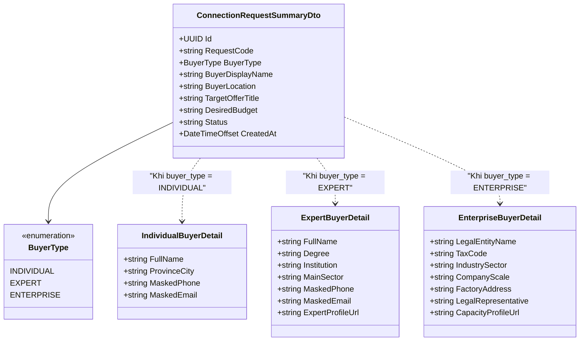

# Change Request: CR-TASK-08-DELTA-02 Quy Chuẩn 3 Nhóm Chủ Thể Bên Mua & Phân Tách Độc Lập Hộp Thư Yêu Cầu Kết Nối Với Pipeline Chuyển Giao MOU

**CR-ID**: `CR-TASK-08-DELTA-02`  
**Phân hệ chủ quản**: `TASK-08_KET_NOI_CUNG_CAU_VA_QUAN_LY_CO_HOI`  
**Phân hệ phối hợp**: `TASK-00_PLATFORM_FOUNDATION_VA_COMMON`, `TASK-03_HO_SO_TIM_MUA_BUYER`, `TASK-04_HO_SO_CHAO_BAN_SELLER_VA_BO_LOC`, `TASK-05_MANG_LUOI_CHUYEN_GIA_KHCN`  
**Trạng thái**: `APPROVED` (Gate 1 - DoR Approved by PO)  
*Lịch sử vòng đời*: `PROPOSED` (02/11/2026 09:00) $\rightarrow$ `APPROVED` (02/11/2026 11:30 Gate 1 DoR)  
**Phiên bản mục tiêu (Target SemVer)**: `1.14.0`  
**Tác giả**: Senior Business Analyst NacenTech (`nacen-ba`)  
**Thẩm định & Phê duyệt**: Product Owner (`nacen-po-pm`) & Software Architect (`nacen-techlead-sa`)  
**Ngày ban hành**: 02/11/2026  
**Căn cứ pháp lý & Thiết kế cơ sở**:
- Quyết định `PO-DEC-20261102-03: Quy chuẩn 3 nhóm chủ thể Bên Mua (Cá nhân, Chuyên gia, Doanh nghiệp) trên toàn hệ thống sàn giao dịch NacenTech` tại [`Specification/BASIC_DESIGN_NACENTECH.md`](file:///Users/luongdt/Library/CloudStorage/GoogleDrive-luongdt.wi@gmail.com/My%20Drive/NacenTechProject/Specification/BASIC_DESIGN_NACENTECH.md) Mục 21.
- Lát cắt mỏng **Walking Skeleton WS-05 (Khép kín Luồng Giao Dịch Cung - Cầu 2 Chiều)** tại [`Specification/BASIC_DESIGN_NACENTECH.md`](file:///Users/luongdt/Library/CloudStorage/GoogleDrive-luongdt.wi@gmail.com/My%20Drive/NacenTechProject/Specification/BASIC_DESIGN_NACENTECH.md) Mục 3.2.
- Basic Design Delta: [`Specification/02_BASIC_DESIGN/TASK-08_KET_NOI_CUNG_CAU_VA_QUAN_LY_CO_HOI/BD_DELTA_CR_025_TACH_INBOX_YEU_CAU_KET_NOI_VA_PIPELINE.md`](file:///Users/luongdt/Library/CloudStorage/GoogleDrive-luongdt.wi@gmail.com/My%20Drive/NacenTechProject/Specification/02_BASIC_DESIGN/TASK-08_KET_NOI_CUNG_CAU_VA_QUAN_LY_CO_HOI/BD_DELTA_CR_025_TACH_INBOX_YEU_CAU_KET_NOI_VA_PIPELINE.md).
- Hiến pháp Quản trị Đặc tả Spec Kit tại [`SourceCode/specs/SPEC_MANAGEMENT_CONSTITUTION.md`](file:///Users/luongdt/Library/CloudStorage/GoogleDrive-luongdt.wi@gmail.com/My%20Drive/NacenTechProject/SourceCode/specs/SPEC_MANAGEMENT_CONSTITUTION.md).
- Nghị định 13/2023/NĐ-CP của Chính phủ về Bảo vệ Dữ liệu Cá nhân (PDPD).

---

## 1. Tuyên Bố Thay Đổi (Change Statement & Căn Cứ PO)

### 1.1. Hiện trạng Cũ (As-Is / Current State)
1. **Giả định cứng sai lầm "100% Bên Mua là Doanh Nghiệp"**:
   - Toàn bộ giao diện tiếp nhận lead, thẻ kết nối và chi tiết đối tác đang mặc định bên gửi yêu cầu là một doanh nghiệp pháp nhân.
   - Giao diện cố định hiển thị các trường: *"Mã số thuế (MST)"*, *"Quy mô doanh nghiệp"*, *"Trụ sở nhà máy"*, *"Người đại diện pháp luật"*.
   - Khi một Khách hàng cá nhân (`PUBLIC_USER`) đặt mua sản phẩm thương mại hoặc một Chuyên gia KH&CN (`EXPERT`) gửi đề xuất nghiên cứu, các trường trên rơi vào trạng thái `N/A`, `undefined` hoặc để trống thô bạo. Điều này làm Bên Bán (`SELLER`) hiểu sai tính chất khách hàng, không phân định được đối tượng để phục vụ và tiềm ẩn nguy cơ vi phạm Nghị định 13/2023/NĐ-CP do không phân loại dữ liệu cá nhân.
2. **Nhập nhằng luồng giao diện giữa Tiếp nhận Yêu cầu Kết nối & Bảng Pipeline Kanban**:
   - Trên thanh điều hướng Sidebar của Nhà cung ứng (`SELLER`):
     * Mục `Yêu cầu Kết nối Nhận được` trỏ vào `/portal/opportunities/pipeline?tab=inbound`.
     * Mục `Tiến trình Chuyển giao & MOU` trỏ vào `/portal/opportunities/pipeline`.
   - Cả hai liên kết đều nạp chung tệp `app/portal/opportunities/pipeline/page.tsx`, hiển thị lẫn lộn bảng phễu Kanban 5 cột với tab hộp thư, phá vỡ luồng trải nghiệm khách hàng (Customer Journey) và gây khó khăn cho Nhà bán hàng trong việc phân loại lead.

### 1.2. Đề Xuất Thay Đổi Chuẩn Hóa (To-Be / Proposed State)
1. **Quy chuẩn 3 Nhóm Chủ Thể Bên Mua (Polymorphic Buyer Profiles)**:
   - **`INDIVIDUAL` (Cá nhân / Đại chúng - `PUBLIC_USER`, `GUEST`)**: Chỉ hiển thị Họ tên, Tỉnh/Thành phố sinh sống, Số điện thoại liên hệ, Email (được che mờ bảo vệ theo NĐ 13/2023/NĐ-CP). TUYỆT ĐỐI KHÔNG hiển thị MST, Quy mô nhân sự, Trụ sở nhà máy. Hiển thị badge nhận diện: `[Khách Hàng Cá Nhân]`.
   - **`EXPERT` (Chuyên gia KH&CN - `EXPERT`, `VERIFIED_EXPERT`)**: Hiển thị Họ tên, Học vị/Học hàm (Tiến sĩ, Thạc sĩ, GS, PGS), Cơ quan / Viện / Trường công tác, Lĩnh vực chuyên môn, SĐT, Email, và Liên kết mở nhanh Hồ sơ Chuyên gia (`/experts/{id}`). Hiển thị badge nhận diện: `[Chuyên Gia KH&CN]`.
   - **`ENTERPRISE` (Doanh nghiệp / Tổ chức - `BUYER`, `INNOVATION_ENTITY`, `SELLER`)**: Hiển thị đầy đủ Tên pháp nhân doanh nghiệp, Mã số thuế, Ngành nghề, Quy mô nhân sự (SME/Lớn), Trụ sở/nhà máy, Người đại diện pháp luật và Hồ sơ năng lực doanh nghiệp. Hiển thị badge nhận diện: `[Doanh Nghiệp / Tổ Chức]`.
2. **Phân tách Độc lập Tuyến Router Hộp Thư Tiếp Nhận Lead & Bảng Pipeline Kanban**:
   - **Tuyến 1 - Hộp Thư Yêu Cầu Kết Nối Nhận Được (`/portal/seller/connection-requests`)**: Quản lý tập trung mọi lead gửi đến (từ đơn hàng thương mại hoặc đề xuất chuyển giao), 4 tabs trạng thái (`ALL`, `PENDING`, `ACCEPTED`, `REJECTED`), 3 KPI Inbound, tích hợp Component Thẻ Bên Mua Đa Hình `<BuyerProfileCard>`.
   - **Tuyến 2 - Tiến Trình Chuyển Giao & MOU (`/portal/opportunities/pipeline`)**: Quản lý bảng Kanban 5 giai đoạn thuần túy (`SUGGESTED` $\rightarrow$ `INITIATED` $\rightarrow$ `NEGOTIATING` $\rightarrow$ `MOU_SIGNED` $\rightarrow$ `COMPLETED`), 3 KPI Pipeline, không còn tab lồng.
   - **Cầu nối 1-Click (Cross-Journey Bridge)**: Khi Seller bấm "Chấp thuận" tại Hộp thư, hệ thống mở phòng đàm phán bảo mật và hiển thị Toast liên kết chuyển tiếp trực tiếp vào Deal Room `/portal/opportunities/{id}/deal-room`.
   - **Tương thích ngược (Backward Compatibility)**: Tự động redirect từ `/portal/opportunities/pipeline?tab=inbound` sang `/portal/seller/connection-requests`.

---

## 2. Đánh Giá Tác Động Đa Bề Mặt (Cross-Surface Impact Matrix)

| Bề Mặt Kiến Trúc | Mức Độ Tác Động | Chi Tiết Ảnh Hưởng | Biện Pháp Can Thiệp & Kế Thừa |
| :--- | :---: | :--- | :--- |
| **1. Basic Design (`Specification/`)** | **CAO** | Cần cập nhật Walking Skeleton WS-05 và bổ sung Quyết định PO-DEC-20261102-03 tại Mục 21. | Đã cập nhật đầy đủ tại `BASIC_DESIGN_NACENTECH.md` Mục 3.2 và Mục 21. |
| **2. Living Spec (`SourceCode/specs/`)** | **CAO** | Bổ sung 5 mỏ neo bất biến: `REQ-BUYER-TYPE-001`, `BR-BUYER-TYPE-01`, `API-BUYER-TYPE-01`, `UI-BUYER-CARD-01`, `TEST-BUYER-TYPE-01` cùng `REQ-BRK-09..11`. Bump SemVer lên `1.14.0`. | Cập nhật `SourceCode/specs/TASK-08.../spec.md` Mục 9 & 10. |
| **3. CSDL PostgreSQL (`Schema`)** | **KHÔNG** | Bảng `brokerage.connection_requests` và `demand.demand_items` đã có sẵn các trường liên kết `sender_user_id`, `sender_org_name`, `demand_id`. Thông tin chi tiết của Chuyên gia / Doanh nghiệp được join động qua `auth.users`, `expert.profiles`, `auth.organizations`. | Không yêu cầu DDL Migration mới; giữ toàn vẹn schema CSDL. |
| **4. Backend API Contracts** | **TRUNG BÌNH** | Nâng cấp Contract DTO của `ConnectionRequestDetailDto` và `ConnectionRequestSummaryDto` trả về trường phân loại `buyer_type` và các khối thuộc tính tương ứng (`expert_profile`, `enterprise_profile`, `individual_contact`). | Bổ sung Enum `BuyerType` (`INDIVIDUAL`, `EXPERT`, `ENTERPRISE`) và contract serializer. |
| **5. Frontend Web Portal** | **CAO** | - Tạo Route mới `app/portal/seller/connection-requests/page.tsx`.<br>- Tinh gọn `app/portal/opportunities/pipeline/page.tsx`.<br>- Cập nhật sidebar tại `app/portal/layout.tsx`.<br>- Xây dựng UI Component `<BuyerProfileCard>` đa hình theo 3 nhóm chủ thể. | Áp dụng Clean UI Component, 5 UX States qua `<Async>`, tái sử dụng `<Badge>` và Tailwind CSS. |
| **6. Bảo Vệ Dữ Liệu PDPD (NĐ 13/2023)** | **CAO** | Số điện thoại và Email của Cá nhân / Chuyên gia bắt buộc phải che mờ (Masked) khi ở trạng thái `PENDING`; chỉ mở unmask khi Seller bấm `ACCEPTED`. | Kiểm soát cả ở DTO Response (Backend) lẫn Helper Masking (Frontend). |
| **7. Testing & Chống Hồi Quy** | **CAO** | Bổ sung test suites Unit, Component và E2E kiểm chứng hiển thị chính xác cho cả 3 nhóm chủ thể Bên Mua, không còn hiện tượng trường trống hay sai nhãn. | Bộ kiểm thử Vitest và Playwright E2E. |

---

## 3. Đặc Tả Chi Tiết Các Mỏ Neo Bất Biến (Immutable Anchors)



### 3.1. [ADD] `REQ-BUYER-TYPE-001`: Quy Chuẩn 3 Nhóm Chủ Thể Bên Mua Trên Toàn Hệ Thống Sàn
1. **Phân loại chủ thể**: Mọi yêu cầu kết nối (`ConnectionRequest`) và cơ hội thương mại (`Opportunity`) trên hệ thống NacenTech bắt buộc phải phân định chính xác 1 trong 3 nhóm chủ thể Bên Mua:
   - `INDIVIDUAL`: Khách hàng cá nhân / Đại chúng (`PUBLIC_USER`, `GUEST`).
   - `EXPERT`: Chuyên gia KH&CN / Giảng viên / Nghiên cứu viên (`EXPERT`, `VERIFIED_EXPERT`).
   - `ENTERPRISE`: Doanh nghiệp pháp nhân / Tổ chức ĐMST (`BUYER`, `INNOVATION_ENTITY`, `SELLER`).
2. **Loại bỏ hiển thị sai lệch**: Hệ thống TUYỆT ĐỐI KHÔNG hiển thị các trường dữ liệu của doanh nghiệp (như Mã số thuế, Quy mô nhân sự, Trụ sở/nhà máy) đối với Khách hàng cá nhân hoặc Chuyên gia.
3. **Phân tách Hộp thư & Pipeline**:
   - Cung cấp màn hình Hộp thư Yêu cầu Kết nối chuyên biệt tại `/portal/seller/connection-requests` (`REQ-BRK-09`).
   - Cung cấp màn hình Bảng Kanban 5 bước tinh gọn tại `/portal/opportunities/pipeline` (`REQ-BRK-10`).
   - Cập nhật Sidebar Navigation hiển thị 2 menu riêng biệt, active sáng đèn chính xác 1:1 theo URL (`REQ-BRK-11`).

### 3.2. [ADD] `BR-BUYER-TYPE-01`: Quy Tắc Phân Loại, Kiểm Soát Dữ Liệu & Bảo Vệ PDPD Theo 3 Nhóm Bên Mua
1. **Quy tắc xác định `BuyerType` tự động (Type Inference)**:
   - Nếu `sender_user` có liên kết hồ sơ `expert.profiles` đã được thẩm định (`status = 'APPROVED'` hoặc vai trò `EXPERT` / `VERIFIED_EXPERT`) $\rightarrow$ Xác định là `EXPERT`.
   - Nếu `sender_user` gắn với tổ chức doanh nghiệp trong `auth.organizations` có mã số thuế hợp lệ $\rightarrow$ Xác định là `ENTERPRISE`.
   - Các trường hợp còn lại (`PUBLIC_USER`, cá nhân đăng ký thông thường, không đại diện pháp nhân) $\rightarrow$ Xác định là `INDIVIDUAL`.
2. **Quy tắc bảo vệ dữ liệu cá nhân (PDPD Masking theo Nghị định 13/2023/NĐ-CP)**:
   - Đối với nhóm `INDIVIDUAL` và `EXPERT`:
     * Khi yêu cầu ở trạng thái `PENDING`: Số điện thoại bắt buộc che mờ dạng `09****1234`; Email bắt buộc che mờ dạng `l***@domain.com`.
     * Khi Bên Bán bấm "Chấp thuận" (`status = 'ACCEPTED'`): Hệ thống thực hiện Unmask, hiển thị đầy đủ thông tin liên hệ chính xác để hai bên xúc tiến trao đổi.
   - Đối với nhóm `ENTERPRISE`: Tên công ty, MST, Trụ sở là thông tin pháp nhân công khai; thông tin SĐT/Email cá nhân của Người đại diện tuân thủ quy tắc che mờ như trên.
3. **Quy tắc chuyển tiếp Deal Room (`BR-BRK-08`)**:
   - Khi Bên Bán chấp thuận lead tại Hộp thư kết nối, hệ thống chuyển trạng thái sang `ACCEPTED`, sinh `Opportunity` ở bước `INITIATED` và hiển thị Toast liên kết trực tiếp vào Deal Room `/portal/opportunities/{id}/deal-room`.
4. **Quy tắc tương thích ngược (`BR-BRK-09`)**:
   - Truy cập URL cũ `/portal/opportunities/pipeline?tab=inbound` tự động chuyển hướng client-side sang `/portal/seller/connection-requests`.

### 3.3. [ADD] `API-BUYER-TYPE-01`: Hợp Đồng Giao Tiếp API Dữ Liệu Bên Mua Đa Hình
- **Endpoint**: `GET /api/v1/brokerage/requests` & `GET /api/v1/brokerage/requests/{id}`.
- **Contract Payload Schema**:
```json
{
  "id": "3fa85f64-5717-4562-b3fc-2c963f66afa6",
  "requestCode": "REQ-20261102-000128",
  "buyerType": "INDIVIDUAL | EXPERT | ENTERPRISE",
  "buyerDisplayName": "Nguyễn Văn An",
  "buyerProfile": {
    "buyerType": "INDIVIDUAL",
    "fullName": "Nguyễn Văn An",
    "provinceCity": "Hà Nội",
    "phoneNumber": "09****1234",
    "email": "n***@gmail.com",
    "isMasked": true
  },
  "expertProfile": null,
  "enterpriseProfile": null,
  "targetOfferId": "e1f2b3c4-0000-0000-0000-000000000001",
  "targetOfferTitle": "Hệ thống sấy nông sản hiệu năng cao bằng năng lượng mặt trời",
  "status": "PENDING",
  "isCommercialOrder": true,
  "desiredBudget": "150.000.000 VNĐ",
  "slaDeadline": "2026-11-04T10:00:00Z",
  "createdAt": "2026-11-02T10:00:00Z"
}
```
*Đối với `buyerType = "EXPERT"`*:
```json
"expertProfile": {
  "fullName": "PGS. TS. Trần Anh Tuấn",
  "academicDegree": "Tiến sĩ",
  "academicTitle": "Phó Giáo Sư",
  "institution": "Viện Ứng Dụng Công Nghệ - Bộ KH&CN",
  "primaryExpertise": "Vật liệu bán dẫn & Quang điện tử",
  "expertProfileUrl": "/experts/EXP-202610-0042",
  "phoneNumber": "09****5678",
  "email": "t***@nacentech.vn",
  "isMasked": true
}
```
*Đối với `buyerType = "ENTERPRISE"`*:
```json
"enterpriseProfile": {
  "legalEntityName": "Công ty Cổ phần Công nghệ Nông nghiệp Xanh",
  "taxCode": "0109876543",
  "industrySector": "Chế biến Nông sản & Cơ khí Tự động hóa",
  "companyScale": "SME (50-100 nhân sự)",
  "headquartersAddress": "Lô CN-05, KCN Quang Minh, Mê Linh, Hà Nội",
  "legalRepresentative": "Bà Lê Thị Mai - Giám đốc Kỹ thuật",
  "capacityProfileUrl": "/enterprises/ORG-0109876543",
  "phoneNumber": "09****9999",
  "email": "c***@agritech.vn",
  "isMasked": true
}
```

### 3.4. [ADD] `UI-BUYER-CARD-01`: Thiết Kế Thành Phần Thẻ Bên Mua Đa Hình `<BuyerProfileCard>`
1. **Thành phần `<BuyerProfileCard>`**:
   - Được sử dụng trong: Thẻ danh sách Hộp thư kết nối, Modal xem chi tiết yêu cầu, và Header của Deal Room.
   - **Nhận diện trực quan (Visual Badges)**:
     * Nhóm Cá nhân: Badge xanh lam `[Cá Nhân]` kèm icon `User`.
     * Nhóm Chuyên gia: Badge tím `[Chuyên Gia KH&CN]` kèm icon `GraduationCap`.
     * Nhóm Doanh nghiệp: Badge ngọc bích `[Doanh Nghiệp / Tổ Chức]` kèm icon `Building2`.
   - **Render linh hoạt theo `buyerType`**:
     * Với `INDIVIDUAL`: Render Họ tên, Tỉnh thành, SĐT (masked/unmasked), Email. Ẩn hoàn toàn các block MST, Trụ sở.
     * Với `EXPERT`: Render Họ tên kèm Học vị, Cơ quan công tác, Lĩnh vực chuyên môn, Nút bấm *"Xem Hồ Sơ Chuyên Gia $\rightarrow$"*.
     * Với `ENTERPRISE`: Render Tên công ty, MST, Ngành nghề, Trụ sở nhà máy, Đại diện pháp luật, Nút bấm *"Xem Hồ Sơ Năng Lực $\rightarrow$"*.
2. **Chuẩn hóa 5 UX States qua `<Async>`**:
   - Skeleton loader với khung thẻ tương ứng.
   - Empty state thân thiện khi chưa có yêu cầu.
   - Error state với nút Retry phục hồi.
   - Action state: Nút "Chấp thuận" / "Từ chối" có loading spinner chống click đúp.

### 3.5. [ADD] `TEST-BUYER-TYPE-01`: Chiến Lược Kiểm Thử Chống Hồi Quy 4 Tầng
1. **Tầng 1 - Unit & Component Tests (Vitest)**:
   - `BuyerProfileCard.test.tsx`:
     * Kiểm tra render đúng thông tin Cá nhân: không render MST, không render trụ sở nhà máy.
     * Kiểm tra render đúng thông tin Chuyên gia: có học vị, có cơ quan công tác, có link profile chuyên gia.
     * Kiểm tra render đúng thông tin Doanh nghiệp: có MST, quy mô, địa chỉ nhà máy.
     * Kiểm tra che mờ PDPD (Masked format) khi trạng thái là `PENDING`.
2. **Tầng 2 - Navigation & Page Tests (Vitest)**:
   - `seller-connection-requests.test.tsx`:
     * Render trang `/portal/seller/connection-requests` với 4 tabs (`ALL`, `PENDING`, `ACCEPTED`, `REJECTED`) và 3 thẻ KPI Inbound.
     * Kiểm tra gọi API `PUT /requests/{id}/respond` và hiển thị toast link sang Deal Room.
   - `pipeline-clean.test.tsx`:
     * Render trang `/portal/opportunities/pipeline` không còn chứa tab inbound.
     * Tự động điều hướng sang `/portal/seller/connection-requests` nếu URL có `?tab=inbound`.
   - `sidebar-active.test.tsx`:
     * Kiểm tra highlight sáng đèn đúng 1:1 cho cả 2 mục menu tách biệt trên Sidebar.
3. **Tầng 3 - API Contract Tests**:
   - Kiểm tra endpoint trả về đúng cấu trúc `buyerType`, không trả về rỗng hay null cho các trường bắt buộc của từng nhóm.
4. **Tầng 4 - End-to-End Tests (Playwright)**:
   - Kịch bản thực tế 3 người dùng khác nhau (Cá nhân, Chuyên gia, Doanh nghiệp) đặt mua/gửi yêu cầu $\rightarrow$ Seller vào Bàn làm việc kiểm tra thẻ hiển thị chuẩn xác $\rightarrow$ Seller chấp thuận và chuyển thẳng sang Deal Room.

---

## 4. Tiêu Chuẩn Nghiệm Thu Chấp Nhận (Acceptance Criteria)

- **`AC-BUYER-01`**: Khi Bên Mua là Khách hàng cá nhân (`INDIVIDUAL`), thẻ thông tin chỉ hiển thị: Họ tên, Tỉnh thành, SĐT (masked), Email (masked). TUYỆT ĐỐI KHÔNG xuất hiện các nhãn hoặc giá trị về MST, Quy mô doanh nghiệp, Trụ sở nhà máy.
- **`AC-BUYER-02`**: Khi Bên Mua là Chuyên gia KH&CN (`EXPERT`), thẻ thông tin hiển thị rõ: Học vị, Cơ quan công tác, Lĩnh vực chuyên môn và có nút liên kết đến Hồ sơ Chuyên gia.
- **`AC-BUYER-03`**: Khi Bên Mua là Doanh nghiệp (`ENTERPRISE`), thẻ thông tin hiển thị đầy đủ: Tên pháp nhân, MST, Quy mô, Trụ sở nhà máy và Người đại diện.
- **`AC-BUYER-04`**: Truy cập menu "Yêu Cầu Kết Nối Nhận Được" mở đúng URL `/portal/seller/connection-requests`, hiển thị 4 tabs lọc trạng thái và 3 KPI Inbound. Sidebar chỉ sáng đèn duy nhất mục này.
- **`AC-BUYER-05`**: Truy cập menu "Tiến Trình Chuyển Giao & MOU" mở đúng URL `/portal/opportunities/pipeline`, hiển thị Kanban 5 cột và 3 KPI Pipeline. Không còn tab inbound lồng bên trong.
- **`AC-BUYER-06`**: Khi chấp thuận yêu cầu tại `/portal/seller/connection-requests`, hệ thống hiển thị Toast thành công kèm nút bấm *"Vào Deal Room Thảo Luận Ngay ->"* dẫn trực tiếp sang `/portal/opportunities/{id}/deal-room`.
- **`AC-BUYER-07`**: Nhập URL cũ `/portal/opportunities/pipeline?tab=inbound` tự động chuyển tiếp sang `/portal/seller/connection-requests`.
- **`AC-BUYER-08`**: Dữ liệu SĐT và Email của Cá nhân/Chuyên gia được che mờ (Masked) đúng chuẩn Nghị định 13/2023/NĐ-CP trước khi Bên Bán chấp thuận, và tự động mở rõ (Unmasked) sau khi chấp thuận.
