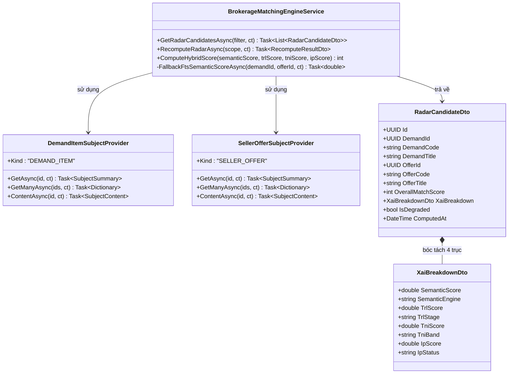

# Change Request: CR-TASK-08-DELTA-03 Hợp Nhất Hybrid Vector AI + Rule Engine 4 Trục & Zero-Mock Radar

**CR-ID**: `CR-TASK-08-DELTA-03`  
**Phân hệ chủ quản**: `TASK-08_KET_NOI_CUNG_CAU_VA_QUAN_LY_CO_HOI`  
**Phân hệ phối hợp**: `TASK-03_HO_SO_TIM_MUA_BUYER`, `TASK-04_HO_SO_CHAO_BAN_SELLER_VA_BO_LOC`, `Modules.Matching`  
**Trạng thái**: `APPROVED` (Gate 1 DoR Passed - Sẵn sàng thực thi Phase 1 Technical Plan)  
**Phiên bản mục tiêu (Target SemVer)**: `1.15.0`  
**Tác giả**: Software Architect kiêm TechLead (`nacen-techlead-sa`)  
**Thẩm định & Phê duyệt**: Product Owner (`nacen-po-pm`)  
**Ngày ban hành**: 02/11/2026  
**Căn cứ pháp lý & Thiết kế cơ sở**:
- Quyết định `PO-DEC-20261102-05: Hợp Nhất Hybrid Vector AI + Rule Engine 4 Trục & Zero-Mock Radar Ghép Nối Cung - Cầu` tại [`Specification/BASIC_DESIGN_NACENTECH.md`](file:///Users/luongdt/Library/CloudStorage/GoogleDrive-luongdt.wi@gmail.com/My%20Drive/NacenTechProject/Specification/BASIC_DESIGN_NACENTECH.md) Mục 5.4.1, 5.4.3 và Mục 23.
- Thiết kế cơ sở TASK-08 tại [`Specification/02_BASIC_DESIGN/TASK-08_KET_NOI_CUNG_CAU_VA_QUAN_LY_CO_HOI/README.md`](file:///Users/luongdt/Library/CloudStorage/GoogleDrive-luongdt.wi@gmail.com/My%20Drive/NacenTechProject/Specification/02_BASIC_DESIGN/TASK-08_KET_NOI_CUNG_CAU_VA_QUAN_LY_CO_HOI/README.md) Mục 1, 4 và 5.9.
- Delta Ledger tiền đề: [`CR-TASK-08-DELTA-01.md`](file:///Users/luongdt/Library/CloudStorage/GoogleDrive-luongdt.wi@gmail.com/My%20Drive/NacenTechProject/SourceCode/specs/TASK-08_KET_NOI_CUNG_CAU_VA_QUAN_LY_CO_HOI/deltas/CR-TASK-08-DELTA-01.md) và [`CR-TASK-08-DELTA-02.md`](file:///Users/luongdt/Library/CloudStorage/GoogleDrive-luongdt.wi@gmail.com/My%20Drive/NacenTechProject/SourceCode/specs/TASK-08_KET_NOI_CUNG_CAU_VA_QUAN_LY_CO_HOI/deltas/CR-TASK-08-DELTA-02.md).
- Hiến pháp Quản trị Đặc tả Spec Kit tại [`SourceCode/specs/SPEC_MANAGEMENT_CONSTITUTION.md`](file:///Users/luongdt/Library/CloudStorage/GoogleDrive-luongdt.wi@gmail.com/My%20Drive/NacenTechProject/SourceCode/specs/SPEC_MANAGEMENT_CONSTITUTION.md).
- Nghị định 13/2023/NĐ-CP về Bảo vệ Dữ liệu Cá nhân (PDPD).

---

## 1. Tuyên Bố Thay Đổi (Change Statement & Căn Cứ PO)

### 1.1. Hiện Trạng Cũ (As-Is / Current State)
1. **Hiện tượng Phân Mảnh Nhị Phân (Split-Brain Architecture)**:
   - Hệ thống tồn tại 2 cơ chế tính điểm và ghép nối hoàn toàn độc lập:
     * Phân hệ `Modules.Matching` (`SourceCode/backend/modules/matching/`) được trang bị pipeline RAG hiện đại: Vector Embedding BGE-M3 (1024 chiều), Lexical Sparse RRF, và Reranker chạy trên Python FastAPI sidecar (`localhost:8003`), ghi kết quả vào schema `matching.match_candidates`. Tuy nhiên pipeline này chỉ phục vụ các đối tượng `DemandBrief` và `TechnologyAsset` cũ, **hoàn toàn không kết nối** với bài toán nhu cầu (`demand.demand_items`) hay sản phẩm chào bán (`technology.seller_technology_offers`) thực tế của Sàn ĐMST Quốc Gia.
     * Ngược lại, Radar ghép nối của Phân hệ 08 (`BrokerageControllers.cs`, endpoint `GET /api/v1/brokerage/radar`) chỉ đọc từ bảng `brokerage.match_candidates`, vốn là dữ liệu tĩnh hoặc rule tính toán thô, không hề tận dụng mô hình AI ngữ nghĩa.
2. **Dữ liệu Giả Lập / Mock trên Radar (Fake XAI)**:
   - Thẻ giải trình AI (XAI Breakdown) trên màn hình Radar ([`/portal/matching/radar`](file:///Users/luongdt/Library/CloudStorage/GoogleDrive-luongdt.wi@gmail.com/My%20Drive/NacenTechProject/SourceCode/frontend/src/app/portal/matching/radar/page.tsx)) đang gán cứng tĩnh dòng chữ: `"Lĩnh vực: 100% Khớp"`. Các điểm số thành phần không được tính toán thực tế từ Backend.
3. **Rủi ro Gián đoạn Vận hành Đơn Điểm (Single Point of Failure - SPoF)**:
   - Python AI Sidecar (`localhost:8003`) là dịch vụ ngoại vi có khả năng sập, khởi động lại hoặc nghẽn mạng khi tải cao. Backend hoàn toàn thiếu cơ chế tự động suy biến khả dụng (**Graceful Degradation**), dẫn đến nguy cơ báo lỗi 500 hoặc rỗng danh sách khi sidecar gặp sự cố.
4. **Nút Thắt Kỹ Thuật (Concurrency & DB Performance Bottlenecks)**:
   - Field `_lastReranked` trong `MatchingService.cs` là biến trạng thái nội bộ có thể bị ghi đè khi nhiều request đồng thời truy cập, tiềm ẩn nguy cơ Race Condition.
   - Hàm `IndexChunksAsync` trong `PostgresSearchIndex.cs` thực hiện lệnh `INSERT ... ON CONFLICT` và lệnh xóa lặp qua từng phần tử (N+1 query) thay vì dùng Batch SQL.

### 1.2. Hậu Quả & Nỗi Đau Nghiệp Vụ (Business Friction & Pain Points)
1. **Lãng phí Năng Lực AI Quốc Gia**: Toàn bộ mô hình ngôn ngữ lớn BGE-M3 và Cross-Encoder Reranker không được áp dụng vào các bài toán chuyển giao công nghệ thực tế đang phát sinh hàng ngày trên sàn NacenTwin.
2. **Mất Niềm Tin Người Dùng (Trust Deficit)**: Khách hàng và Lãnh đạo Sở KH&CN khi mở Radar thấy nhãn "100% Khớp" cố định cho mọi cặp ghép nối, nhận định hệ thống thiếu minh bạch và mang tính chất "trình diễn" (toy mock).
3. **Trải Nghiệm Đứt Gãy Khi Phụ Thuộc AI**: Khi mạng chập chờn hoặc Python Sidecar bảo trì, toàn bộ tính năng Radar ngừng hoạt động, làm tê liệt phễu khởi tạo cơ hội chuyển giao.

### 1.3. Đề Xuất Thay Đổi Chuẩn Hóa (To-Be / Proposed State)
1. **Hợp Nhất Động Cơ Ghép Nối Lai (Hybrid Matching Engine)**:
   - Xây dựng `BrokerageMatchingEngineService` làm động cơ hạt nhân kết nối giữa `Modules.Matching` và `brokerage`:
     * Cài đặt `DemandItemSubjectProvider` và `SellerOfferSubjectProvider` triển khai `ISubjectResolver` của Kernel, nạp dữ liệu từ `demand.demand_items` và `technology.seller_technology_offers`.
     * Tính toán Matching Score theo công thức chuẩn hóa 4 trục: Semantic Vector AI (40%), TRL tương thích (30%), TNI cấp thiết (15%), IP bảo hộ SHTT (15%).
2. **Cơ Chế Graceful Degradation Fallback (PostgreSQL FTS)**:
   - Bọc toàn bộ lệnh gọi Vector AI trong khối try-catch có timeout $1500\text{ms}$.
   - Khi Python Sidecar không khả dụng: Engine tự động chuyển hướng tính điểm ngữ nghĩa $S_{\text{semantic}}$ qua PostgreSQL Full-Text Search (`tsvector`, `plainto_tsquery`, `ts_rank_cd`) kết hợp bộ lọc `sector_code`.
   - Trả về cờ `isDegraded = true` và `semanticEngine = "POSTGRES_FTS_FALLBACK"`, tuyệt đối không trả về HTTP 500.
3. **Zero-Mock Radar XAI DTOs & Nút Re-Match**:
   - DTO trả về 4 điểm số thành phần thật bóc tách từ Backend.
   - Frontend hiển thị Explainable AI breakdown trực quan và chân thực 100%.
   - Thêm nút CTA "Tính toán lại đối soát (Re-match)" kích hoạt endpoint `POST /api/v1/brokerage/radar/recompute`.
4. **3D Scoped RBAC trên Radar**:
   - Bên Mua (`BUYER`) chỉ thấy gợi ý ghép nối với bài toán của mình.
   - Bên Bán (`SELLER`) chỉ thấy gợi ý gắn với công nghệ chào bán của mình.
   - Admin và Cán bộ Sở KH&CN giám sát toàn diện.

---

## 2. Đánh Giá Tác Động Đa Bề Mặt (Cross-Surface Impact Matrix)

| Bề Mặt Kiến Trúc | Mức Độ Tác Động | Chi Tiết Ảnh Hưởng | Biện Pháp Can Thiệp & Kế Thừa |
| :--- | :---: | :--- | :--- |
| **1. Basic Design (`Specification/`)** | **CAO** | Cần cập nhật Mục 5.4.1, 5.4.3 và Phụ lục Quyết định Mục 23. | Đã hoàn tất cập nhật tại `Specification/BASIC_DESIGN_NACENTECH.md` và `02_BASIC_DESIGN/TASK-08.../README.md`. |
| **2. Living Spec (`SourceCode/specs/`)** | **CAO** | Bổ sung các mỏ neo bất biến `REQ-BRK-D3-01..03`, `BR-BRK-D3-01`, `API-BRK-D3-01`, `TEST-BRK-D3-01..04`. Bump SemVer lên `1.15.0`. | Cập nhật `spec.md`, biên soạn `plan_delta_cr03.md`, phân rã tasks trong `tasks.md`. |
| **3. CSDL PostgreSQL (`Schema`)** | **THẤP** | Tận dụng 100% schema hiện hữu `brokerage.match_candidates`, `demand.demand_items`, `technology.seller_technology_offers`. | Không cần migrate DDL mới; tối ưu hóa index FTS và foreign keys nếu cần. |
| **4. Backend Core API (`.NET 10`)** | **RẤT CAO** | - Xây dựng `DemandItemSubjectProvider` và `SellerOfferSubjectProvider`.<br>- Xây dựng `BrokerageMatchingEngineService`.<br>- Tích hợp Graceful Degradation fallback.<br>- Loại bỏ mutable state `_lastReranked` trong `MatchingService`.<br>- Nâng cấp `GET /api/v1/brokerage/radar` và thêm `POST /api/v1/brokerage/radar/recompute`. | Triển khai theo Clean Architecture trong `NacenTech.Modules.Brokerage` và `NacenTech.Modules.Matching`. |
| **5. Backend Batch SQL (`PostgresSearchIndex.cs`)** | **TRUNG BÌNH** | Tối ưu hóa các thao tác bulk delete và bulk upsert trong chỉ mục tìm kiếm. | Chuyển sang Batch SQL `ExecuteDeleteAsync` hoặc batch statement. |
| **6. Frontend Web Portal (`Next.js 15`)** | **CAO** | - Xóa bỏ 100% text mock trong XAI Breakdown trên Radar card.<br>- Binding 4 điểm số thật từ DTO mới.<br>- Hiển thị badge trạng thái Degradation nếu fallback.<br>- Bổ sung nút CTA "Tính toán lại đối soát" và modal confirm. | Cập nhật `SourceCode/frontend/src/app/portal/matching/radar/page.tsx` và `services/api/brokerage.ts`. |
| **7. Testing & QC Automation** | **RẤT CAO** | Cần bộ test suites 4 tầng bao gồm Unit tests 4 trục, Chaos test giả lập Python sidecar down, Contract tests và Playwright E2E. | Bổ sung `HybridMatchingEngineTests.cs`, `GracefulDegradationTests.cs`, cập nhật FE tests. |

---

## 3. Đặc Tả Yêu Cầu Nghiệp Vụ Với Các Mỏ Neo Bất Biến (Immutable Anchors)



### 3.1. [ADD] `REQ-BRK-D3-01`: Động Cơ Ghép Nối Lai Hybrid Vector AI + Rule Engine 4 Trục & Graceful Degradation
1. **Yêu cầu hạt nhân**:
   - Backend MUST cung cấp dịch vụ `BrokerageMatchingEngineService` hợp nhất dữ liệu Cung - Cầu thực tế từ `demand.demand_items` và `technology.seller_technology_offers`.
   - Điểm tương thích tổng hợp (`OverallMatchScore`) MUST được tính toán dựa trên 4 trục thành phần theo công thức `BR-BRK-D3-01`:
     * Trục 1 (40%): Độ tương đồng ngữ nghĩa AI Vector BGE-M3 ($S_{\text{semantic}}$).
     * Trục 2 (30%): Độ tương thích mức độ sẵn sàng công nghệ TRL ($S_{\text{trl}}$).
     * Trục 3 (15%): Trọng số cấp thiết bài toán nhu cầu TNI ($S_{\text{tni}}$).
     * Trục 4 (15%): Hệ số tin cậy bảo hộ quyền Sở hữu trí tuệ ($S_{\text{ip}}$).
2. **Cơ chế Tự Động Suy Biến Khả Dụng (Graceful Degradation)**:
   - Khi dịch vụ Python AI Sidecar (`localhost:8003`) không phản hồi, timeout quá $1.5$s, hoặc phát sinh lỗi ngoại lệ mạng, hệ thống MUST tự động chuyển sang chế độ dự phòng PostgreSQL Full-Text Search (`tsvector`) kết hợp bộ lọc ngành `sector_code` để tính toán $S_{\text{semantic}}$.
   - Hệ thống MUST thiết lập `isDegraded = true` và `semanticEngine = "POSTGRES_FTS_FALLBACK"`, tuyệt đối không được ném lỗi HTTP 500 làm gián đoạn trải nghiệm của người dùng.

### 3.2. [ADD] `REQ-BRK-D3-02`: Zero-Mock Radar & XAI Breakdown Minh Bạch
1. **Yêu cầu hiển thị**:
   - Màn hình Radar (`/portal/matching/radar`) MUST hiển thị Explainable AI (XAI) Breakdown dựa trên 4 điểm số thành phần thật được trả về từ Backend DTO.
   - Toàn bộ chuỗi gán cứng tĩnh (`Lĩnh vực: 100% Khớp`) MUST bị triệt tiêu 100%.
   - Mỗi thẻ ứng viên MUST hiển thị rõ ràng:
     * Tỷ lệ % khớp tổng hợp (ví dụ: `88% Tổng Hợp - Khớp Cao`).
     * Điểm Ngữ nghĩa AI (hoặc nhãn `FTS Fallback` nếu hệ thống đang suy biến).
     * Mức TRL của giải pháp và điểm tương thích TRL.
     * Điểm cấp thiết TNI / 100 và phân loại độ cấp thiết.
     * Điểm bảo hộ SHTT và tình trạng pháp lý sáng chế.
2. **Nút Tác Vụ Tái Đối Soát (Re-match on Demand)**:
   - Giao diện Radar MUST cung cấp nút bấm CTA **"Tính toán lại đối soát"** (kèm icon `RefreshCw`). Khi người dùng nhấn nút, giao diện kích hoạt API `POST /api/v1/brokerage/radar/recompute` để engine quét lại toàn bộ dữ liệu Cung - Cầu mới nhất và làm mới giao diện.

### 3.3. [ADD] `REQ-BRK-D3-03`: 3D Scoped RBAC trên Radar Ghép Nối
1. **Phân quyền ngữ cảnh dữ liệu (Data Context Scoping)**:
   - **Bên Mua (`BUYER`)**: Chỉ nhìn thấy các cặp ứng viên gợi ý ghép nối với bài toán nhu cầu do chính người dùng hoặc tổ chức của mình khởi tạo (`demand.created_by == CurrentUser.PersonId` hoặc `demand.buyer_organization_id == CurrentUser.OrganizationId`).
   - **Bên Bán (`SELLER`)**: Chỉ nhìn thấy các cặp ứng viên gợi ý ghép nối với các công nghệ chào bán do tổ chức của mình sở hữu (`offer.seller_organization_id == CurrentUser.OrganizationId`).
   - **Cán bộ Sở KH&CN (`PROVINCIAL_ADMIN`, `CLUSTER_ADMIN`)**: Giám sát toàn bộ các gợi ý ghép nối phát sinh từ Bên Mua hoặc Bên Bán trên địa bàn tỉnh/thành phụ trách.
   - **Quản trị Toàn quốc (`SUPER_ADMIN`, `OPERATOR_ADMIN`)**: Giám sát phạm vi toàn sàn giao dịch.

---

## 4. Quy Tắc Nghiệp Vụ Chuẩn Hóa (Business Rules)

### 4.1. [ADD] `BR-BRK-D3-01`: Công Thức Tính Điểm 4 Trục & Thuật Toán Fallback
1. **Công thức chuẩn hợp nhất**:
   $$\text{MatchScore} = \text{Round}\left(0.40 \times S_{\text{semantic}} + 0.30 \times S_{\text{trl}} + 0.15 \times S_{\text{tni}} + 0.15 \times S_{\text{ip}}\right)$$
   trong đó $\text{MatchScore} \in [0, 100]$.

2. **Cách tính từng trục thành phần**:
   - **Trục 1: Semantic Score ($S_{\text{semantic}} \in [0, 100]$)**:
     * *Chế độ thông thường (AI Sidecar OK)*:
       $$S_{\text{semantic}} = \text{Clamp}\left(\text{CosineSimilarity}(\vec{v}_{\text{demand}}, \vec{v}_{\text{offer}}) \times 100, 0, 100\right)$$
       (hoặc chuẩn hóa từ điểm Cross-Encoder Reranker).
     * *Chế độ Fallback (Sidecar Offline)*:
       $$S_{\text{semantic}} = \text{Clamp}\left(\text{ts\_rank\_cd}(\text{tsv}_{\text{offer}}, \text{tsquery}_{\text{demand}}) \times 120, 0, 100\right)$$
       Nếu 2 bên cùng mã ngành `sector_code`, cộng thêm 15 điểm ưu đãi ($S_{\text{semantic}} = \min(100, S_{\text{semantic}} + 15)$).
   - **Trục 2: TRL Compatibility Score ($S_{\text{trl}} \in [0, 100]$)**:
     * Nếu $\text{TRL}_{\text{seller}} \ge 7$ (Sẵn sàng thương mại): $S_{\text{trl}} = 100$.
     * Nếu $\text{TRL}_{\text{seller}} \in [4, 6]$ và bài toán Buyer tìm kiếm nghiên cứu/thử nghiệm: $S_{\text{trl}} = 85$.
     * Độ lệch TRL:
       $$S_{\text{trl}} = \begin{cases}
       100, & \text{khi } |\text{TRL}_{\text{seller}} - \text{TRL}_{\text{buyer\_target}}| = 0 \\
       85, & \text{khi } |\text{TRL}_{\text{seller}} - \text{TRL}_{\text{buyer\_target}}| = 1 \\
       65, & \text{khi } |\text{TRL}_{\text{seller}} - \text{TRL}_{\text{buyer\_target}}| = 2 \\
       40, & \text{khi } |\text{TRL}_{\text{seller}} - \text{TRL}_{\text{buyer\_target}}| \ge 3
       \end{cases}$$
   - **Trục 3: TNI Urgency Score ($S_{\text{tni}} \in [0, 100]$)**:
     * Kế thừa trực tiếp `demand.demand_items.tni_score`:
       $$S_{\text{tni}} = \text{Clamp}(\text{DemandItem.TniScore}, 0, 100)$$
   - **Trục 4: IP Trust Boost ($S_{\text{ip}} \in [0, 100]$)**:
     * `PATENT_GRANTED`: 100 điểm.
     * `PATENT_PENDING`: 60 điểm.
     * `TRADE_SECRET`: 50 điểm.
     * `NONE` hoặc không khai báo: 20 điểm.

---

## 5. Hợp Đồng Giao Diện Lập Trình (API Contracts)

### 5.1. [ADD] `API-BRK-D3-01`: Contract DTO Radar XAI & Endpoints

#### Endpoint 1: Lấy Danh Sách Ghép Nối Radar
- **Method & Route**: `GET /api/v1/brokerage/radar`
- **Query Params**:
  * `sector` (string, optional): Mã ngành lọc (ví dụ: `ICT`, `AGRI`).
  * `minScore` (int, optional): Điểm sàn (0–100).
  * `demandCode` (string, optional): Lọc theo mã bài toán cụ thể.
  * `search` (string, optional): Tìm kiếm từ khóa tự do.
- **Authorization**: `Bearer JWT` (Áp dụng 3D Scoped RBAC theo role và context tổ chức).
- **Response HTTP 200**:
```json
{
  "success": true,
  "statusCode": 200,
  "data": [
    {
      "id": "7b8f9e21-4d32-411a-8f3e-1b2c3d4e5f60",
      "demandId": "a1b2c3d4-e5f6-7890-abcd-ef1234567890",
      "demandCode": "DMD-20261102-000001",
      "demandTitle": "Ứng dụng AI tối ưu hóa tiêu hao năng lượng trong sấy nông sản",
      "buyerOrganizationId": "c4d5e6f7-a8b9-0123-cdef-456789012345",
      "buyerOrganizationName": "Công ty CP Chế biến Nông sản Đồng Tháp",
      "offerId": "f1e2d3c4-b5a6-9870-fedc-ba9876543210",
      "offerCode": "OFF-20261015-000008",
      "offerTitle": "Hệ thống sấy đa tầng hồi lưu nhiệt thông minh IoT/AI",
      "sellerOrganizationId": "d5e6f7a8-b9c0-1234-defa-567890123456",
      "sellerOrganizationName": "Viện Ứng Dụng Công Nghệ NacenTech",
      "sectorCode": "AGRI",
      "overallMatchScore": 89,
      "xaiBreakdown": {
        "semanticScore": 92.5,
        "semanticEngine": "BGE-M3_RERANK",
        "trlScore": 85.0,
        "trlLevel": 7,
        "trlStage": "Thương mại hóa (TRL 7)",
        "tniScore": 88.0,
        "tniBand": "Rất cao (TNI 88/100)",
        "ipScore": 100.0,
        "ipStatus": "PATENT_GRANTED",
        "ipDescription": "Đã cấp Bằng Độc quyền Sáng chế"
      },
      "isDegraded": false,
      "computedAt": "2026-11-02T14:30:00Z"
    }
  ]
}
```

#### Endpoint 2: Kích Hoạt Tính Toán Lại Đối Soát (Recompute Radar)
- **Method & Route**: `POST /api/v1/brokerage/radar/recompute`
- **Payload**: `{}`
- **Response HTTP 200**:
```json
{
  "success": true,
  "statusCode": 200,
  "data": {
    "computedMatchesCount": 24,
    "tookMs": 340,
    "isDegraded": false,
    "engineVersion": "HYBRID_V2_CORRECTED",
    "timestamp": "2026-11-02T14:35:12Z"
  }
}
```

---

## 6. Kế Hoạch Kiểm Thử & Tiêu Chí Chấp Nhận (Acceptance Criteria)

- **`TEST-BRK-D3-01` (Unit Test Thuật Toán 4 Trục)**:
  * Xác thực công thức tính điểm `ComputeHybridScore`: Truyền vào các bộ điểm thành phần biên ($0, 100, 50$), kiểm chứng trọng số $40\% - 30\% - 15\% - 15\%$ cho kết quả chính xác đến từng số nguyên làm tròn.
- **`TEST-BRK-D3-02` (Contract Test Zero-Mock Radar XAI)**:
  * Gọi API `GET /api/v1/brokerage/radar`, xác thực 100% bản ghi trả về có trường `xaiBreakdown` hợp lệ; không chứa giá trị null hoặc chuỗi mock tĩnh.
- **`TEST-BRK-D3-03` (Concurrency & Thread-Safety Test)**:
  * Thực thi kiểm thử đồng thời 50 threads song song gọi `MatchingService.SearchAsync`, kiểm chứng không còn lỗi xung đột biến trạng thái `_lastReranked`.
- **`TEST-BRK-D3-04` (Chaos Test Graceful Degradation)**:
  * Giả lập Python AI Sidecar tắt hoặc đóng cổng 8003: Gọi `GetRadarCandidatesAsync`, xác thực hệ thống tự động fallback về PostgreSQL FTS, trả về `isDegraded = true`, mã HTTP 200, danh sách ứng viên không rỗng và không sinh ngoại lệ 500.
