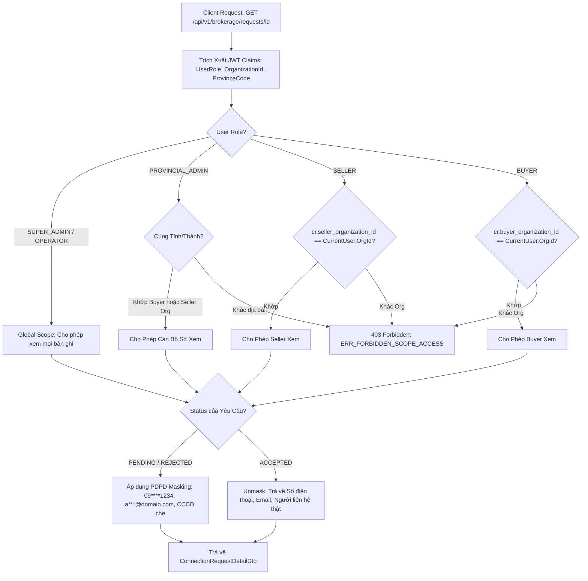

# Implementation Plan: TASK-08 Kết Nối Cung–Cầu & Quản Lý Cơ Hội Hợp Tác

**Feature Directory**: `specs/TASK-08_KET_NOI_CUNG_CAU_VA_QUAN_LY_CO_HOI`  
**Version**: 1.14.0  
**Status**: Delta CR-TASK-08-DELTA-02 In Planning (Gate 2 Ready)  

---

## 1. Kiến Trúc Tổng Thể & Module Boundary

Dự án áp dụng mô hình **Modular Monolith & Clean Architecture**:
- Phân hệ kỹ thuật: `SourceCode/backend/modules/brokerage/` (`NacenTech.Modules.Brokerage`)
- Tầng Domain: Thực thể `MatchCandidate`, `ConnectionRequest`, `Opportunity`, `DealDiscussion`, `MouAgreement`.
- Tầng Application: Use cases, DTOs, Repository interfaces, và `MatchingEngineService`.
- Tầng Infrastructure: EF Core DbContext mapping vào schema `brokerage` trên PostgreSQL.
- Tầng Presentation: `BrokerageControllers.cs` tại `SourceCode/backend/apps/api/V1Compat/` và `V2/`.

---

## 2. Lược Đồ Cơ Sở Dữ Liệu PostgreSQL (Schema: `brokerage`)

```sql
-- 1. Bảng Ứng viên ghép cặp (Match Candidates Cache)
CREATE TABLE IF NOT EXISTS brokerage.match_candidates (
    id UUID PRIMARY KEY DEFAULT gen_random_uuid(),
    demand_id UUID NOT NULL,
    demand_code VARCHAR(50) NOT NULL,
    demand_title VARCHAR(255) NOT NULL,
    buyer_organization_id UUID NOT NULL,
    buyer_organization_name VARCHAR(255) NOT NULL,
    offer_id UUID NOT NULL,
    offer_code VARCHAR(50) NOT NULL,
    offer_title VARCHAR(255) NOT NULL,
    seller_organization_id UUID NOT NULL,
    seller_organization_name VARCHAR(255) NOT NULL,
    sector_code VARCHAR(50) NOT NULL,
    match_score INT NOT NULL,
    tni_score INT NOT NULL,
    trl_level INT NOT NULL,
    ip_status VARCHAR(50) NOT NULL,
    is_active BOOLEAN NOT NULL DEFAULT true,
    created_at TIMESTAMPTZ NOT NULL DEFAULT NOW()
);

-- 2. Bảng Yêu cầu kết nối (Connection Requests)
CREATE TABLE IF NOT EXISTS brokerage.connection_requests (
    id UUID PRIMARY KEY DEFAULT gen_random_uuid(),
    request_code VARCHAR(50) UNIQUE NOT NULL,
    sender_user_id UUID NOT NULL,
    sender_org_name VARCHAR(255) NOT NULL,
    sender_role VARCHAR(50) NOT NULL, -- BUYER | SELLER
    receiver_user_id UUID NOT NULL,
    receiver_org_name VARCHAR(255) NOT NULL,
    demand_id UUID NOT NULL,
    offer_id UUID NOT NULL,
    message TEXT NOT NULL,
    proposed_budget_range VARCHAR(100),
    status VARCHAR(50) NOT NULL DEFAULT 'PENDING', -- PENDING | ACCEPTED | REJECTED | EXPIRED
    response_note TEXT,
    responded_at TIMESTAMPTZ,
    created_at TIMESTAMPTZ NOT NULL DEFAULT NOW()
);

-- 3. Bảng Cơ hội hợp tác (Opportunities Kanban)
CREATE TABLE IF NOT EXISTS brokerage.opportunities (
    id UUID PRIMARY KEY DEFAULT gen_random_uuid(),
    opportunity_code VARCHAR(50) UNIQUE NOT NULL,
    connection_request_id UUID REFERENCES brokerage.connection_requests(id),
    title VARCHAR(255) NOT NULL,
    buyer_org_name VARCHAR(255) NOT NULL,
    buyer_contact_name VARCHAR(255) NOT NULL,
    buyer_contact_phone VARCHAR(50) NOT NULL,
    buyer_contact_email VARCHAR(100) NOT NULL,
    seller_org_name VARCHAR(255) NOT NULL,
    seller_contact_name VARCHAR(255) NOT NULL,
    seller_contact_phone VARCHAR(50) NOT NULL,
    seller_contact_email VARCHAR(100) NOT NULL,
    assigned_expert_name VARCHAR(255),
    managing_authority_id VARCHAR(50),
    stage VARCHAR(50) NOT NULL DEFAULT 'SUGGESTED', -- SUGGESTED | REQUESTED | NEGOTIATION | DRAFTING_MOU | CLOSED_WON | CLOSED_LOST
    estimated_value_million_vnd INT,
    created_at TIMESTAMPTZ NOT NULL DEFAULT NOW(),
    updated_at TIMESTAMPTZ NOT NULL DEFAULT NOW()
);

-- 4. Bảng Nhật ký trao đổi Deal Room (Deal Discussions)
CREATE TABLE IF NOT EXISTS brokerage.deal_discussions (
    id UUID PRIMARY KEY DEFAULT gen_random_uuid(),
    opportunity_id UUID NOT NULL REFERENCES brokerage.opportunities(id) ON DELETE CASCADE,
    sender_name VARCHAR(255) NOT NULL,
    sender_role VARCHAR(50) NOT NULL, -- BUYER | SELLER | EXPERT | GOV
    message TEXT NOT NULL,
    attachment_url VARCHAR(500),
    created_at TIMESTAMPTZ NOT NULL DEFAULT NOW()
);

-- 5. Bảng Biên bản ghi nhớ (MOU Agreements)
CREATE TABLE IF NOT EXISTS brokerage.mou_agreements (
    id UUID PRIMARY KEY DEFAULT gen_random_uuid(),
    mou_code VARCHAR(50) UNIQUE NOT NULL,
    opportunity_id UUID NOT NULL REFERENCES brokerage.opportunities(id) ON DELETE CASCADE,
    scope_of_work TEXT NOT NULL,
    pilot_duration_months INT NOT NULL DEFAULT 6,
    commercial_terms TEXT NOT NULL,
    intellectual_property_terms TEXT NOT NULL,
    status VARCHAR(50) NOT NULL DEFAULT 'DRAFT', -- DRAFT | SIGNED | REJECTED
    signed_date TIMESTAMPTZ,
    created_at TIMESTAMPTZ NOT NULL DEFAULT NOW()
);
```

---

## 3. Thiết Kế Frontend UI/UX (5 UX States & 4 Màn Hình)

1. `/portal/matching/radar` (Radar Ghép Nối 2 Chiều):
   - Grid thẻ ứng viên có Match Score Ring SVG, chỉ số TNI, TRL, huy hiệu Patent.
   - Nút "Gửi Yêu Cầu Kết Nối" mở Modal kèm masking thông tin liên hệ PDPD.
2. `/portal/opportunities/pipeline` (Pipeline Quản Lý Cơ Hội Kanban):
   - 5 cột kéo thả / chuyển stage: Gợi ý $\rightarrow$ Yêu cầu $\rightarrow$ Đàm phán $\rightarrow$ Soạn MOU $\rightarrow$ Hoàn tất.
3. `/portal/opportunities/[id]/deal-room` (Phòng Đàm Phán Hợp Tác 1-1 & Soạn Thảo MOU):
   - Giao diện 2 cột: Cột trái (Thông tin ca, hồ sơ Demand & Offer, liên hệ Unmasked), Cột phải (Hộp thoại trao đổi Deal Discussion + Modal Soạn thảo MOU).
4. `/gov/opportunities` (Cổng Tác Nghiệp Lãnh Đạo Sở KH&CN):
   - Thống kê cơ hội theo địa bàn, cảnh báo yêu cầu kết nối > 48h quá hạn SLA, bộ lọc trạng thái.

Tất cả các màn hình tuân thủ:
- Thư viện Design System chung (`globals.css`, Brand colors, Dark Mode).
- Chuẩn hóa 5 UX States qua component `<Async>`.
- Responsive hoàn toàn trên Desktop, Tablet và Mobile.

---

## 4. Kế Hoạch Kiến Trúc Delta v3 (CR-2026-012) — Chuẩn Hóa Tiền Tệ & Triệt Tiêu Mock Ngân Sách Brokerage

> **Căn cứ**: Quyết định `PO-DEC-20261030-03`, Hồ sơ Change Request [`CR-2026-012`](../../docs/change-requests/CR-2026-012-brokerage-dealroom-budget-alignment.md), và Basic Design Delta [`BD_DELTA_CR_024`](../../../Specification/02_BASIC_DESIGN/TASK-08_KET_NOI_CUNG_CAU_VA_QUAN_LY_CO_HOI/BD_DELTA_CR_024_CHUAN_HOA_NGAN_SACH_DEALROOM.md).

### 4.1. Thiết Kế Tiện Ích Dùng Chung: Currency Formatting Utility (`lib/currency.ts`)

Để đảm bảo tính nhất quán của quy chuẩn tiền tệ trên toàn bộ sàn giao dịch và bảo vệ ranh giới Single Source of Truth (SSOT), hệ thống bổ sung tiện ích dùng chung độc lập tại `SourceCode/frontend/src/lib/currency.ts`:

```typescript
/**
 * Quy chuẩn định dạng tiền tệ Triệu / Tỷ VNĐ toàn sàn NacenTwin
 * SSOT: Giá trị lưu trữ gốc là triệu VNĐ (estimatedValueMillionVnd: number | null | undefined)
 */
export interface FormatCurrencyOptions {
  emptyLabel?: string;     // Chuỗi hiển thị khi null / 0 (mặc định: "0 VNĐ" hoặc "Thương lượng")
  compact?: boolean;        // Chế độ thu gọn cho thẻ badge / Kanban (VD: "2,4 Tỷ", "800 Tr")
}

export function formatCurrencyMillionVnd(
  valueInMillion: number | null | undefined,
  options: FormatCurrencyOptions = {}
): string {
  const { emptyLabel = '0 VNĐ', compact = false } = options;

  if (valueInMillion == null || valueInMillion === 0) {
    return emptyLabel;
  }

  if (valueInMillion >= 1000) {
    const billionValue = valueInMillion / 1000;
    const formatted = billionValue.toLocaleString('vi-VN', { maximumFractionDigits: 1 });
    return compact ? `${formatted} Tỷ` : `${formatted} Tỷ VNĐ`;
  }

  const formatted = valueInMillion.toLocaleString('vi-VN', { maximumFractionDigits: 0 });
  return compact ? `${formatted} Tr` : `${formatted} Triệu VNĐ`;
}
```

### 4.2. Kiến Trúc Chi Tiết Tầng Frontend

#### 1. `ConnectionRequestModal.tsx` (Triệt Tiêu Hoàn Toàn Mock Defaults & Enforce Validation)
- **Tình trạng cũ**:
  - `senderOrgName = 'Công ty CP Nông Nghiệp Xanh Hà Nội'` (Cứng).
  - `proposedBudget = '800 triệu - 1.2 tỷ VNĐ'` (Cứng).
  - `message = 'Chúng tôi quan tâm sâu sắc tới công nghệ này...'` (Cứng).
- **Phương án kiến trúc mới**:
  - Nạp tổ chức bên gửi từ `authClient`:
    ```typescript
    const sessionUser = authClient.getUser();
    const [senderOrgName, setSenderOrgName] = useState(() => sessionUser?.organizationName || '');
    const [proposedBudget, setProposedBudget] = useState('');
    const [message, setMessage] = useState('');
    ```
  - Placeholder trực quan:
    - `proposedBudget`: `"VD: 500 triệu - 1 tỷ VNĐ, hoặc Thỏa thuận"`
    - `message`: `"Mô tả mục tiêu thử nghiệm, bối cảnh bài toán và mong muốn phối hợp..."`
  - Thêm nút tiện ích nếu có ngân sách bài toán nguồn: Cho phép bấm *"Sử dụng ngân sách bài toán"* để tự điền nếu có.
  - Validation trước khi submit (BR-DEL-08-02):
    - `senderOrgName.trim().length >= 3`: Thông báo lỗi nếu chưa nhập hoặc quá ngắn.
    - `message.trim().length >= 10`: Bắt buộc nhập ít nhất 10 ký tự, chặn gửi tin nhắn rỗng.

#### 2. `Pipeline Page` (`/portal/opportunities/pipeline/page.tsx`)
- **Card KPI "Tổng giá trị dự kiến"**:
  - Tính tổng từ các cơ hội thật: `const totalValue = opportunities.reduce((sum, o) => sum + (o.estimatedValueMillionVnd || 0), 0);`
  - Định dạng hiển thị qua `formatCurrencyMillionVnd(totalValue)`:
    - Nếu $\ge 1.000$ Triệu VNĐ: Tự động render thành `"X,X Tỷ VNĐ"` (ví dụ: `5.450` Tr $\rightarrow$ `"5,5 Tỷ VNĐ"`).
    - Nếu $< 1.000$ Triệu VNĐ: Render `"XXX Triệu VNĐ"`.
- **Card Opportunity trên cột Kanban**:
  - Badge giá trị trên card: `formatCurrencyMillionVnd(opp.estimatedValueMillionVnd, { compact: true })` (ví dụ: `~2,4 Tỷ` hoặc `~800 Tr`).

#### 3. `Cổng Giám Sát Sở` (`/gov/opportunities/page.tsx`)
- **Thẻ KPI "Tổng GT dự kiến"**:
  - Hiển thị: `{formatCurrencyMillionVnd(stats.totalEstimatedValueMillionVnd)}` thay cho `{stats.totalEstimatedValueMillionVnd.toLocaleString('vi-VN')} Tr`.
- **Cột "Giá trị dự kiến" trên bảng giám sát**:
  - Render: `opp.estimatedValueMillionVnd ? formatCurrencyMillionVnd(opp.estimatedValueMillionVnd) : '---'`.
- **Modal Giám sát Deal chi tiết**:
  - Dòng "Giai đoạn & Giá trị": `{selectedDeal.stage} • {formatCurrencyMillionVnd(selectedDeal.estimatedValueMillionVnd, { emptyLabel: 'Chưa xác định' })}`.

#### 4. `Deal Room Page` & `MouModal.tsx`
- **`DealRoomPage` (`/portal/opportunities/[id]/deal-room/page.tsx`)**:
  - Loại bỏ chuỗi cứng `senderName = 'Kỹ sư Vũ Quang Hải'`.
  - Khởi tạo: `const [senderName, setSenderName] = useState(() => authClient.getUser()?.fullName || '');`
  - Giữ placeholder: `"Họ và tên người phát biểu..."` nếu chưa đăng nhập.
- **`MouModal.tsx` (`/portal/opportunities/[id]/deal-room/MouModal.tsx`)**:
  - Loại bỏ fallback ảo `|| 1000`.
  - Điều khoản thương mại mặc định:
    ```typescript
    const commercialValueText = opportunity.estimatedValueMillionVnd
      ? `trị giá dự kiến ${formatCurrencyMillionVnd(opportunity.estimatedValueMillionVnd)}`
      : 'thỏa thuận theo phụ lục hợp đồng';
    ```
    Thay thế vào chuỗi: `"...tiến hành đàm phán hợp đồng chuyển giao công nghệ trọn gói ${commercialValueText}."`

### 4.3. Kiến Trúc Tầng Backend (`BrokerageControllers.cs`)

1. **Ranh giới Clean Architecture & Data Integrity**:
   - `BrokerageControllers.cs` là tầng Presentation/Compat API controller, sử dụng `NacenTechDbContext` theo mô hình truy vấn tối ưu.
   - Các phép tính tổng hợp `SUM(estimated_value_million_vnd)` và bộ lọc stage trong `GetGovOpportunities` phản ánh chính xác các dòng dữ liệu trong bảng `brokerage.opportunities` của PostgreSQL, tuyệt đối không hardcode kết quả tính toán.
2. **Củng Cố Ràng Buộc Kiểm Tra (BR-DEL-08-02 Validation Enforcement)**:
   - Trong `POST /api/v1/brokerage/requests`:
     - Kiểm tra `string.IsNullOrWhiteSpace(req.SenderOrgName) || req.SenderOrgName.Trim().Length < 3`: Trả về `BadRequest("Tên tổ chức gửi kết nối phải có tối thiểu 3 ký tự.")`.
     - Kiểm tra `string.IsNullOrWhiteSpace(req.Message) || req.Message.Trim().Length < 10`: Trả về `BadRequest("Nội dung đề xuất kết nối phải có tối thiểu 10 ký tự.")`.

### 4.4. Chiến Lược Kiểm Thử 3 Tầng (Testing & Quality Gate 4 Strategy)

1. **Unit Test Cho Helper Tiền Tệ (`currency.test.ts`)**:
   - Kiểm thử các ca: `null`, `undefined`, `0`, số nhỏ (`800` Tr $\rightarrow$ `800 Triệu VNĐ`), số lớn (`2400` Tr $\rightarrow$ `2,4 Tỷ VNĐ`, `5450` Tr $\rightarrow$ `5,5 Tỷ VNĐ`), chế độ `compact`.
2. **Unit & Component Test Cho `ConnectionRequestModal`**:
   - Kiểm thử trạng thái khởi tạo rỗng (Zero-Mock), prefill tổ chức từ `authClient`, validate độ dài tối thiểu, và submit thành công.
3. **Cập Nhật Test Suites Hiện Có**:
   - `pipeline/page.test.tsx`: Cập nhật assertion cho `Tổng giá trị dự kiến` từ `5.450` sang `5,5 Tỷ VNĐ`.
   - `gov/opportunities/page.test.tsx`: Kiểm tra format `5 Tỷ VNĐ` cho KPI `totalEstimatedValueMillionVnd = 5000`.
   - `deal-room/page.test.tsx`: Kiểm tra `senderName` lấy từ `authClient` và submit thành công không phụ thuộc chuỗi cứng cũ.
4. **Kiểm Tra Không Rò Rỉ Mock (Zero-Mock Grep Guard)**:
   - Chạy lệnh grep đảm bảo 0 kết quả cho các chuỗi: `'Công ty CP Nông Nghiệp Xanh Hà Nội'`, `'800 triệu - 1.2 tỷ VNĐ'`, `'Kỹ sư Vũ Quang Hải'`, `|| 1000`.

---

## 5. Kế Hoạch Kiến Trúc Delta CR-2026-012: Enriched Connection Details & Scoped Pipeline

> **Căn cứ**: Quyết định PO `PO-DEC-20261030-05`, Hồ sơ Change Request `CR-2026-012`, và Đặc tả `spec.md` (Mục DELTA-CR-2026-012).  
> **Mục tiêu kỹ thuật**: 
> 1. Xây dựng DTO enriched và endpoint chi tiết `GET /api/v1/brokerage/requests/{id}` kết nối dữ liệu 3 phân hệ: Yêu cầu kết nối (`brokerage`), Chào bán công nghệ (`supply.offers`), và Hồ sơ doanh nghiệp bên mua (`auth.enterprises`/`auth.organizations`).
> 2. Triển khai cơ chế phân quyền Scoped RBAC đa chiều (3D Scoped RBAC) chống rò rỉ dữ liệu phễu thương mại (IDOR / Cross-Tenant Leak).
> 3. Hiện thực hóa quy định bảo vệ dữ liệu cá nhân theo Nghị định số 13/2023/NĐ-CP (PDPD) qua cơ chế Zero-Leak Masking tại tầng Backend DTO Projection.
> 4. Xây dựng component giao diện `ConnectionRequestDetailModal.tsx` và thanh lọc 4 sub-tabs trạng thái (`ALL`, `PENDING`, `ACCEPTED`, `REJECTED`) kèm đồng bộ tức thời các KPI counters.

---

### 5.1. Thiết Kế Hợp Đồng API & DTOs (API Contracts & Data Transfer Objects)

#### 1. Cấu Trúc DTO Phía Backend (`NacenTech.Api.V1Compat` & `NacenTech.Modules.Brokerage`)

```csharp
namespace NacenTech.Api.V1Compat;

// DTO chi tiết công nghệ mục tiêu
public sealed record TargetOfferSummaryDto(
    Guid OfferId,
    string OfferCode,
    string OfferTitle,
    int TrlLevel,
    string TrlStage,        // Lab (TRL 1-3) | Pilot (TRL 4-6) | Commercial (TRL 7-9)
    string IpStatus,        // PATENTED | PENDING | TRADE_SECRET | NONE
    string? SectorCode,
    string? SectorName,
    decimal? PriceMillionVnd
);

// DTO chi tiết hồ sơ doanh nghiệp bên mua
public sealed record BuyerEnterpriseProfileDto(
    Guid? EnterpriseId,
    Guid BuyerOrganizationId,
    string CompanyName,
    string? TaxCode,
    string? Industry,
    string? ProvinceCode,
    string? ProvinceName,
    string? Address,
    string? ScaleCategory,   // MICRO | SMALL | MEDIUM | LARGE
    int? EmployeeCountRange
);

// DTO thông tin liên hệ được quản lý PDPD
public sealed record PdpdContactInfoDto(
    string ContactPersonName,
    string PhoneNumber,      // Masked "09****1234" nếu PENDING/REJECTED; Thật nếu ACCEPTED
    string Email,            // Masked "a***@domain.com" nếu PENDING/REJECTED; Thật nếu ACCEPTED
    string? IdentityNumber,  // "[Được bảo vệ theo NĐ 13/2023/NĐ-CP]" nếu PENDING; Thật nếu ACCEPTED
    bool IsMasked,
    string PdpdNotice
);

// DTO Danh Sách Yêu Cầu Kết Nối Nâng Cao (Enriched List DTO)
public sealed record ConnectionRequestEnrichedDto(
    Guid Id,
    string RequestCode,
    Guid SenderUserId,
    Guid? BuyerOrganizationId,
    string SenderOrgName,
    string SenderRole,
    Guid? ReceiverUserId,
    Guid? SellerOrganizationId,
    string ReceiverOrgName,
    Guid? DemandId,
    string? DemandCode,
    string? DemandTitle,
    Guid? TargetOfferId,
    string? OfferCode,
    string? OfferTitle,
    int? OfferTrlLevel,
    string? OfferIpStatus,
    string? SenderTaxCode,
    string? SenderIndustry,
    string? SenderProvince,
    string Message,
    string? ProposedBudgetRange,
    string Status,           // PENDING | ACCEPTED | REJECTED | EXPIRED
    string? RejectionReason,
    DateTime? SlaDeadline,
    bool IsSlaWarning,       // true nếu PENDING và thời gian còn lại < 12h hoặc đã quá 48h
    DateTime? RespondedAt,
    DateTime CreatedAt
);

// DTO Chi Tiết Toàn Vẹn Yêu Cầu Kết Nối (Detail Modal DTO)
public sealed record ConnectionRequestDetailDto(
    Guid Id,
    string RequestCode,
    string Status,           // PENDING | ACCEPTED | REJECTED
    string? RejectionReason,
    string Message,
    string? ProposedBudgetRange,
    DateTime CreatedAt,
    DateTime? RespondedAt,
    DateTime? SlaDeadline,
    bool IsSlaWarning,
    Guid? CreatedOpportunityId,
    string? CreatedOpportunityCode,
    TargetOfferSummaryDto? TargetOffer,
    BuyerEnterpriseProfileDto BuyerProfile,
    PdpdContactInfoDto ContactInfo
);
```

#### 2. Chi Tiết Endpoint `GET /api/v1/brokerage/requests` (Enriched List)
- **Path**: `GET /api/v1/brokerage/requests`
- **Authentication**: Bắt buộc Bearer JWT Token (`[Authorize]`).
- **Query Parameters**:
  - `status` (string, optional): `ALL` (mặc định), `PENDING`, `ACCEPTED`, `REJECTED`.
  - `scope` (string, optional): `my` (lọc theo tổ chức người dùng) hoặc bỏ trống (tự động theo vai trò).
  - `search` (string, optional): Tìm kiếm theo từ khóa trong tiêu đề chào bán, tên doanh nghiệp, mã yêu cầu.
  - `page` (int, default: 1): Trang hiện tại.
  - `pageSize` (int, default: 20, max: 100): Kích thước trang.
- **SQL Execution Plan (JOIN Enriched)**:
  ```sql
  SELECT 
      cr.id, cr.request_code, cr.sender_user_id, cr.buyer_organization_id, cr.sender_org_name, cr.sender_role,
      cr.receiver_user_id, cr.seller_organization_id, cr.receiver_org_name,
      cr.demand_id, d.code AS demand_code, d.title AS demand_title,
      cr.offer_id AS target_offer_id, o.code AS offer_code, o.title AS offer_title, o.trl_level AS offer_trl, o.ip_status AS offer_ip_status,
      ent.tax_code AS sender_tax_code, ent.industry AS sender_industry, ent.province_name AS sender_province,
      cr.message, cr.proposed_budget_range, cr.status, cr.rejection_reason,
      cr.sla_deadline,
      (cr.status = 'PENDING' AND NOW() > (cr.created_at + INTERVAL '36 hours')) AS is_sla_warning,
      cr.responded_at, cr.created_at
  FROM brokerage.connection_requests cr
  LEFT JOIN supply.offers o ON cr.offer_id = o.id
  LEFT JOIN demand.tickets d ON cr.demand_id = d.id
  LEFT JOIN auth.enterprises ent ON cr.buyer_organization_id = ent.organization_id
  WHERE 1=1
    -- Scoped RBAC Constraint
    AND (@IsGlobalAdmin = true OR cr.seller_organization_id = @CurrentUserOrgId OR cr.buyer_organization_id = @CurrentUserOrgId)
    AND (@Status IS NULL OR @Status = 'ALL' OR cr.status = @Status)
    AND (@Search IS NULL OR (cr.request_code ILIKE @SearchPattern OR cr.sender_org_name ILIKE @SearchPattern OR o.title ILIKE @SearchPattern))
  ORDER BY cr.created_at DESC;
  ```
- **Response HTTP 200 OK**:
  ```json
  {
    "success": true,
    "code": 200,
    "data": [
      {
        "id": "7b3b9b4d-5f33-4a1e-84b2-0192e2bb1101",
        "requestCode": "REQ-20261030-A8F1",
        "senderUserId": "a1b2c3d4-e5f6-7a8b-9c0d-1e2f3a4b5c6d",
        "buyerOrganizationId": "bbbbbbbb-1111-2222-3333-444444444444",
        "senderOrgName": "Công ty TNHH Chế Biến Nông Sản Tây Nguyên",
        "senderRole": "BUYER",
        "receiverUserId": "c9d8e7f6-a5b4-3c2d-1e0f-9a8b7c6d5e4f",
        "sellerOrganizationId": "ssssssss-5555-6666-7777-888888888888",
        "receiverOrgName": "Viện Máy Nông Nghiệp & Cơ Giới Hóa",
        "demandId": "9c8b7a6f-5e4d-3c2b-1a0f-9e8d7c6b5a4f",
        "demandCode": "DEM-2026-042",
        "demandTitle": "Nâng cấp hệ thống sấy nông sản tiết kiệm năng lượng",
        "targetOfferId": "e1f2a3b4-c5d6-7e8f-9a0b-1c2d3e4f5a6b",
        "offerCode": "SP-2026-088",
        "offerTitle": "Hệ thống sấy lạnh bơm nhiệt đa tầng",
        "offerTrlLevel": 8,
        "offerIpStatus": "PATENTED",
        "senderTaxCode": "6001234567",
        "senderIndustry": "Chế biến nông sản & thực phẩm",
        "senderProvince": "Đắk Lắk",
        "message": "Chúng tôi cần ứng dụng thử nghiệm dây chuyền sấy hạt mắc-ca tại xưởng Buôn Ma Thuột...",
        "proposedBudgetRange": "1.5 Tỷ VNĐ",
        "status": "PENDING",
        "rejectionReason": null,
        "slaDeadline": "2026-11-01T08:30:00Z",
        "isSlaWarning": false,
        "respondedAt": null,
        "createdAt": "2026-10-30T08:30:00Z"
      }
    ],
    "meta": {
      "totalItems": 1,
      "page": 1,
      "pageSize": 20,
      "totalPages": 1
    }
  }
  ```

#### 3. Chi Tiết Endpoint `GET /api/v1/brokerage/requests/{id}` (Detail Modal)
- **Path**: `GET /api/v1/brokerage/requests/{id:guid}`
- **Authentication**: Bắt buộc Bearer JWT Token (`[Authorize]`).
- **Phân Quyền & Scoping**:
  - Trích xuất `currentOrgId` từ Claims của JWT.
  - Kiểm tra quyền:
    - Nếu vai trò là `SELLER`: bắt buộc `cr.seller_organization_id == currentOrgId`.
    - Nếu vai trò là `BUYER`: bắt buộc `cr.buyer_organization_id == currentOrgId`.
    - Nếu vai trò là `PROVINCIAL_ADMIN`: kiểm tra `buyer_org.province_code == userProvince` hoặc `seller_org.province_code == userProvince`.
    - Nếu vai trò là `SUPER_ADMIN` / `OPERATOR_ADMIN`: Cho phép truy cập (Audit).
    - Trường hợp vi phạm (truy cập chéo tổ chức): Lập tức trả về **HTTP 403 Forbidden** kèm mã lỗi `ERR_FORBIDDEN_SCOPE_ACCESS`.
  - Nếu không tìm thấy: Trả về **HTTP 404 Not Found** (`ERR_CONNECTION_REQUEST_NOT_FOUND`).
- **PDPD Masking Logic Thực Thi Tại Tầng Controller**:
  ```csharp
  bool isAccepted = string.Equals(cr.Status, "ACCEPTED", StringComparison.OrdinalIgnoreCase);
  
  var contactInfo = new PdpdContactInfoDto(
      ContactPersonName: cr.BuyerContactName ?? "Đại diện bên mua",
      PhoneNumber: isAccepted ? (cr.BuyerContactPhone ?? "") : MaskPhone(cr.BuyerContactPhone),
      Email: isAccepted ? (cr.BuyerContactEmail ?? "") : MaskEmail(cr.BuyerContactEmail),
      IdentityNumber: isAccepted ? cr.BuyerContactCccd : "[Được bảo vệ theo NĐ 13/2023/NĐ-CP]",
      IsMasked: !isAccepted,
      PdpdNotice: isAccepted 
          ? "Hai bên đã đồng thuận kết nối. Thông tin liên hệ trực tiếp đã được giải phóng theo Điều 11 NĐ 13/2023/NĐ-CP."
          : "Thông tin liên hệ được che mờ theo Nghị định 13/2023/NĐ-CP. Chỉ hiển thị đầy đủ sau khi Bên Bán chấp thuận kết nối."
  );
  ```
- **Response HTTP 200 OK (Khi PENDING - Masked)**:
  ```json
  {
    "success": true,
    "code": 200,
    "data": {
      "id": "7b3b9b4d-5f33-4a1e-84b2-0192e2bb1101",
      "requestCode": "REQ-20261030-A8F1",
      "status": "PENDING",
      "rejectionReason": null,
      "message": "Chúng tôi cần ứng dụng thử nghiệm dây chuyền sấy hạt mắc-ca tại xưởng Buôn Ma Thuột...",
      "proposedBudgetRange": "1.5 Tỷ VNĐ",
      "createdAt": "2026-10-30T08:30:00Z",
      "respondedAt": null,
      "slaDeadline": "2026-11-01T08:30:00Z",
      "isSlaWarning": false,
      "createdOpportunityId": null,
      "createdOpportunityCode": null,
      "targetOffer": {
        "offerId": "e1f2a3b4-c5d6-7e8f-9a0b-1c2d3e4f5a6b",
        "offerCode": "SP-2026-088",
        "offerTitle": "Hệ thống sấy lạnh bơm nhiệt đa tầng",
        "trlLevel": 8,
        "trlStage": "Commercial",
        "ipStatus": "PATENTED",
        "sectorCode": "LV04",
        "sectorName": "Cơ khí chế tạo & Tự động hóa",
        "priceMillionVnd": 1500
      },
      "buyerProfile": {
        "enterpriseId": "11223344-5566-7788-9900-aabbccddeeff",
        "buyerOrganizationId": "bbbbbbbb-1111-2222-3333-444444444444",
        "companyName": "Công ty TNHH Chế Biến Nông Sản Tây Nguyên",
        "taxCode": "6001234567",
        "industry": "Chế biến nông sản & thực phẩm",
        "provinceCode": "66",
        "provinceName": "Đắk Lắk",
        "address": "Lô B2, KCN Hòa Phú, TP. Buôn Ma Thuột",
        "scaleCategory": "MEDIUM",
        "employeeCountRange": 120
      },
      "contactInfo": {
        "contactPersonName": "Lê Văn Tuấn",
        "phoneNumber": "09****7890",
        "email": "t***@taynguyenagri.vn",
        "identityNumber": "[Được bảo vệ theo NĐ 13/2023/NĐ-CP]",
        "isMasked": true,
        "pdpdNotice": "Thông tin liên hệ được che mờ theo Nghị định 13/2023/NĐ-CP. Chỉ hiển thị đầy đủ sau khi Bên Bán chấp thuận kết nối."
      }
    }
  }
  ```

#### 4. Chi Tiết Cập Nhật Endpoint `PUT /api/v1/brokerage/requests/{id}/respond`
- **Path**: `PUT /api/v1/brokerage/requests/{id:guid}/respond`
- **Request Body**:
  ```csharp
  public sealed record RespondConnectionRequest(
      string Action,           // ACCEPT | REJECT
      string? Note,            // Ghi chú thêm
      string? RejectionReason  // Bắt buộc khi Action == "REJECT" (tối thiểu 10 ký tự)
  );
  ```
- **Validation Rules**:
  - `Action` phải là `"ACCEPT"` hoặc `"REJECT"`.
  - Nếu `Action == "REJECT"`: `string.IsNullOrWhiteSpace(req.RejectionReason) || req.RejectionReason.Trim().Length < 10` $\rightarrow$ Trả về `400 Bad Request` (`"Vui lòng cung cấp lý do từ chối với tối thiểu 10 ký tự."`).
  - Nếu `Action == "ACCEPT"`:
    - Cập nhật `status = 'ACCEPTED'`, `responded_at = now()`.
    - Tự động sinh `Opportunity` trong `brokerage.opportunities` ở giai đoạn `INITIATED` (hoặc `REQUESTED`).
    - Nạp `seller_organization_id` và `buyer_organization_id` vào cơ hội mới.
    - Trả về mã cơ hội vừa tạo (`createdOpportunityId`, `createdOpportunityCode`) để UI hiển thị nút chuyển hướng sang Deal Room 1-1.

---

### 5.2. Thiết Kế Cơ Chế Scoped RBAC An Toàn & PDPD Masking



#### Quy Tắc Chống Rò Rỉ (Security Invariants):
1. **JWT-First Context**: `OrganizationId` luôn được trích xuất từ `ClaimsPrincipal` của request. Tuyệt đối không đọc tham số `orgId` hoặc `sellerId` từ query string để làm điều kiện phân quyền.
2. **Zero-Leak DTO**: Không bao giờ map các trường `BuyerContactPhone` và `BuyerContactEmail` dạng plaintext vào DTO rồi gửi về Client khi trạng thái khác `ACCEPTED`. Quá trình masking diễn ra trong bộ nhớ máy chủ (Server-side Projection).
3. **Audit Trail**: Mọi lượt xem và phản hồi yêu cầu kết nối được ghi log trong bảng giám sát hệ thống với đầy đủ `user_id`, `organization_id`, `ip_address`, `timestamp`.

---

### 5.3. Thiết Kế Kiến Trúc UI Frontend

#### 1. Cấu Trúc Component Mới: `ConnectionRequestDetailModal.tsx`
- **Vị trí tệp**: `SourceCode/frontend/src/app/portal/opportunities/pipeline/ConnectionRequestDetailModal.tsx`
- **Props Interface**:
  ```typescript
  export interface ConnectionRequestDetailModalProps {
    isOpen: boolean;
    onClose: () => void;
    requestId: string | null;
    onAccepted?: (createdOpportunityId?: string) => void;
    onRejected?: () => void;
  }
  ```
- **Layout & Trải Nghiệm Người Dùng (3 Khối Thông Tin)**:
  1. **Khối Header**: 
     - Mã yêu cầu (`REQ-20261030-XXXX`), ngày gửi, nhãn trạng thái (Badge PENDING [Vàng], ACCEPTED [Xanh lá], REJECTED [Đỏ]).
     - Nút đóng modal `(X)`.
  2. **Khối 1: Sản Phẩm / Công Nghệ Mục Tiêu (`TargetOfferCard`)**:
     - Tiêu đề công nghệ và mã số chào bán.
     - Badge cấp độ TRL 1–9 với hệ màu quy chuẩn (TRL 1-3 Xám, TRL 4-6 Vàng, TRL 7-9 Xanh lục).
     - Huy hiệu bảo hộ SHTT (Đã cấp bằng / Đang nộp đơn / Bí quyết).
     - Lĩnh vực công nghệ chuẩn TT17.
     - Giá chào bán tham chiếu (định dạng `formatCurrencyMillionVnd`).
  3. **Khối 2: Hồ Sơ Pháp Nhân Bên Mua (`BuyerProfileCard`)**:
     - Tên doanh nghiệp/tổ chức bên mua.
     - Mã số thuế (MST) và tỉnh/thành phố trụ sở.
     - Ngành nghề sản xuất/kinh doanh chính.
     - Quy mô doanh nghiệp (Số lao động, dải doanh thu).
  4. **Khối 3: Đề Xuất Hợp Tác & Thông Tin Liên Hệ PDPD (`ProposalAndContactCard`)**:
     - Ngân sách đề xuất: Hiển thị nổi bật với định dạng tiền tệ động (`formatCurrencyMillionVnd`).
     - Nội dung trao đổi / mục tiêu hợp tác (`message`).
     - Thời hạn SLA 48h và thanh đếm thời gian còn lại (kèm cờ đỏ SLA Warning nếu còn < 12h).
     - **Hộp thoại bảo mật PDPD**:
       - Hiển thị SĐT và Email che mờ (`09****7890`, `t***@domain.com`).
       - Dòng thông báo màu xanh nhạt giải thích quy định bảo vệ dữ liệu theo NĐ 13/2023/NĐ-CP.
  5. **Khối Footer & Hành Động Trực Tiếp (Action Bar)**:
     - Khi `status === 'PENDING'`:
       * Nút **"Từ chối kết nối"** (Màu viền đỏ): Mở rộng form nhập lý do từ chối (textarea có bộ đếm ký tự $\ge 10$), nút "Xác nhận từ chối".
       * Nút **"Chấp thuận kết nối"** (Nút chính màu xanh lục đậm/emerald): Gọi API `PUT /requests/{id}/respond` với `action: "ACCEPT"`, hiển thị thông báo thành công, mở khóa thông tin unmasked ngay trên modal và hiển thị nút chuyển hướng sang **"Truy cập Deal Room 1-1"**.
     - Khi `status === 'ACCEPTED'`:
       * Hiển thị nút **"Truy cập Deal Room 1-1"** dẫn tới `/portal/opportunities/[id]/deal-room`.
     - Khi `status === 'REJECTED'`:
       * Khối thông báo màu đỏ ghi rõ lý do từ chối đã gửi cho bên mua.

#### 2. Cấu Trúc Bộ Lọc 4 Sub-Tabs Trạng Thái (`UI-CONN-REQ-FILTER-001`)
- **Tích hợp trong tab Inbound** của `src/app/portal/opportunities/pipeline/page.tsx`:
  ```typescript
  type ConnectionRequestStatusFilter = 'ALL' | 'PENDING' | 'ACCEPTED' | 'REJECTED';
  ```
- **Thanh 4 Sub-Tabs Điều Hướng**:
  - Tab 1: **Tất cả (`ALL`)** — Badge tổng số yêu cầu của tổ chức.
  - Tab 2: **Chờ phản hồi (`PENDING`)** — Badge màu hổ phách/amber hiển thị số yêu cầu cần xử lý gấp.
  - Tab 3: **Đã chấp thuận (`ACCEPTED`)** — Badge màu xanh lục/emerald hiển thị số yêu cầu đã mở Deal Room.
  - Tab 4: **Đã từ chối (`REJECTED`)** — Badge màu xám/đỏ hiển thị các yêu cầu đã từ chối.
- **Tương tác**:
  - Khi người dùng click chọn sub-tab, state `requestFilter` được cập nhật.
  - Bảng danh sách lập tức lọc theo trạng thái mà không cần tải lại toàn bộ trang.
  - Nút "Xem chi tiết" trên từng card mở `ConnectionRequestDetailModal` với `requestId` tương ứng.

#### 3. Cơ Chế Đồng Bộ KPI Counters (Synchronized KPI Counters)
- Khi thực hiện Chấp thuận hoặc Từ chối trong `ConnectionRequestDetailModal`:
  1. Callback `onAccepted` hoặc `onRejected` được kích hoạt.
  2. Hàm `fetchData()` trong `OpportunitiesPipelinePage` tự động chạy lại để cập nhật:
     - Số lượng `pendingRequestsCount` trên badge tab Inbound.
     - Số lượng cơ hội trên 5 cột Kanban.
     - Thẻ KPI "Tổng cơ hội trong phễu" và "Tổng giá trị dự kiến".
     - Badge đếm trên 4 sub-tabs lọc trạng thái.

---

### 5.4. Lược Đồ CSDL & Migration (Schema `brokerage`)

```sql
-- Migration: CR_2026_012_EnrichConnectionRequestsAndScoping.sql

-- 1. Bổ sung các cột quan hệ và kiểm soát SLA cho bảng connection_requests
ALTER TABLE brokerage.connection_requests
    ADD COLUMN IF NOT EXISTS target_offer_id UUID REFERENCES supply.offers(id),
    ADD COLUMN IF NOT EXISTS buyer_organization_id UUID,
    ADD COLUMN IF NOT EXISTS seller_organization_id UUID,
    ADD COLUMN IF NOT EXISTS rejection_reason TEXT,
    ADD COLUMN IF NOT EXISTS sla_deadline TIMESTAMPTZ DEFAULT (NOW() + INTERVAL '48 hours');

-- 2. Đồng bộ dữ liệu cũ (nếu có) từ offer_id sang target_offer_id
UPDATE brokerage.connection_requests
SET target_offer_id = offer_id
WHERE target_offer_id IS NULL AND offer_id IS NOT NULL;

-- 3. Tạo các chỉ mục tối ưu cho truy vấn Scoped RBAC và lọc trạng thái
CREATE INDEX IF NOT EXISTS idx_conn_requests_seller_status 
    ON brokerage.connection_requests (seller_organization_id, status);

CREATE INDEX IF NOT EXISTS idx_conn_requests_buyer_status 
    ON brokerage.connection_requests (buyer_organization_id, status);

CREATE INDEX IF NOT EXISTS idx_conn_requests_sla 
    ON brokerage.connection_requests (status, sla_deadline) 
    WHERE status = 'PENDING';
```

---

### 5.5. Chiến Lược Kiểm Thử Đa Tầng (Quality Gate Strategy)

1. **Unit Test Quy Tắc Nghiệp Vụ (`BrokeragePdpdMaskingTests.cs`)**:
   - Kiểm thử thuật toán `MaskPhone` với các đầu vào: số hợp lệ (`0912345678` $\rightarrow$ `09****5678`), chuỗi ngắn, chuỗi rỗng.
   - Kiểm thử thuật toán `MaskEmail`: `le.tuan@agri.vn` $\rightarrow$ `l***n@agri.vn`.
   - Kiểm thử bảo đảm DTO khi `PENDING` không bao giờ chứa thông tin liên hệ thật.
2. **Unit Test Scoped RBAC (`BrokerageScopedRbacTests.cs`)**:
   - Giả lập Seller thuộc Tổ chức A cố tình đọc request của Tổ chức B $\rightarrow$ Xác nhận trả về 403 Forbidden.
   - Giả lập Buyer thuộc Tổ chức A cố tình xem request của Buyer khác $\rightarrow$ 403 Forbidden.
   - Cán bộ Sở KH&CN truy cập ngoài tỉnh $\rightarrow$ 403 Forbidden.
3. **Contract & API Test (`BrokerageApiContractsTests.cs`)**:
   - Kiểm tra `GET /api/v1/brokerage/requests/{id}` trả về đủ 3 khối `targetOffer`, `buyerProfile`, `contactInfo`.
   - Kiểm tra `PUT /api/v1/brokerage/requests/{id}/respond` với `action = "REJECT"` và `rejectionReason` ngắn hơn 10 ký tự $\rightarrow$ Trả về 400 Bad Request.
4. **Component Test Frontend (`ConnectionRequestDetailModal.test.tsx`)**:
   - Render modal ở trạng thái `PENDING`: Xác nhận SĐT và Email hiển thị che mờ; có nút "Chấp thuận kết nối" và "Từ chối".
   - Kiểm tra hành vi từ chối: Bắt buộc nhập lý do $\ge 10$ ký tự trước khi nút xác nhận được kích hoạt.
   - Kiểm tra hành vi chấp thuận: Sau khi chấp thuận, thông tin unmasked xuất hiện và nút "Truy cập Deal Room 1-1" được hiển thị.
5. **Component Test Frontend (`ConnectionRequestFilterTabs.test.tsx`)**:
   - Nhấp chọn từng tab `ALL`, `PENDING`, `ACCEPTED`, `REJECTED`: Bảng dữ liệu lọc chính xác theo trạng thái.
   - Badge số lượng trên mỗi tab phản ánh chính xác số bản ghi.

---

## 6. Kế Hoạch Kiến Trúc Delta CR-TASK-08-DELTA-01: Khép Kín Luồng Giao Dịch Cung - Cầu 2 Chiều (Atomic Dual-Write)

> Chi tiết kỹ thuật đầy đủ: Xem [`plan_delta_cr01.md`](./plan_delta_cr01.md) và quyết định kiến trúc [`ADR-0012`](file:///Users/luongdt/Library/CloudStorage/GoogleDrive-luongdt.wi@gmail.com/My%20Drive/NacenTechProject/SourceCode/backend/docs/decisions/ADR-0012-ATOMIC-DUAL-WRITE-COMMERCIAL-ORDER-INBOUND-LEAD.md).

### 6.1. Mục Tiêu Kỹ Thuật & Căn Cứ PO
- Thực hiện quyết định `PO-DEC-20261102-02` (WS-05) khép kín lát cắt mỏng giao dịch 2 chiều:
  * Bên Mua gửi đơn đặt mua sản phẩm thương mại tại `/chao-ban-cong-nghe/[id]` $\rightarrow$ CSDL PostgreSQL tự động sinh bản ghi Đơn mua (`DMD-*`) đồng thời sinh Inbound Lead (`REQ-*`) gửi tới gian hàng Bên Bán.
  * Hai thao tác ghi được bảo vệ trong cùng 1 khối `IDbContextTransaction` (PostgreSQL ACID Transaction). Rollback 100% nếu có lỗi, không sinh bản ghi mồ côi (`BR-CONN-SYNC-01`).
  * Bên Bán tại `/portal/opportunities/pipeline?tab=inbound` nhận được lead có nhãn `[Đơn Mua Hàng Thương Mại]`, đếm ngược SLA 48h, và nút tiếp nhận chuyển tiếp Deal Room.

### 6.2. Phân Tích Bề Mặt Thực Thi
1. **CSDL PostgreSQL**: Tận dụng bảng `brokerage.connection_requests` đã có sẵn các cột `demand_id`, `target_offer_id`, `offer_id`, `buyer_organization_id`, `seller_organization_id`, `sla_deadline`. Sử dụng các index `idx_conn_requests_seller_status`, `idx_conn_requests_target_offer_id`.
2. **Backend .NET**: Nâng cấp `CreateQuickDemandItemRequest` và hàm `CreateQuickDemandItem` trong `DemandController.cs`. Khi `req.OfferId.HasValue`, dùng `await using var transaction = await db.Database.BeginTransactionAsync(ct);` để ghi đồng thời 2 bảng. Trả về response chứa cả `itemId`, `itemCode`, `requestCode`, `connectionRequestId`.
3. **Frontend Next.js**:
   - `technology-offer.ts`: `submitQuickDemand` nhận thêm `requestCode`, `connectionRequestId`.
   - `chao-ban-cong-nghe/[id]/page.tsx`: Modal thành công hiển thị cả mã đơn mua và mã yêu cầu kết nối.
   - `portal/opportunities/pipeline/page.tsx`: Thẻ Inbound hiển thị badge `[Đơn Mua Hàng Thương Mại]`, link chào bán và SLA 48h.
4. **Kiểm Thử 4 Tầng**: Unit Test PDPD, Contract Test Dual-Write, PostgreSQL Audit Test, và Playwright/Component Test Pipeline.

---

## 7. Kế Hoạch Kiến Trúc Delta CR-TASK-08-DELTA-02: Máy Trạng Thái Đồng Bộ 2 Chiều Trạng Thái Đơn Hàng Thương Mại & Vòng Đời Deal Room

> Chi tiết kỹ thuật đầy đủ: Xem [`plan_delta_cr02.md`](./plan_delta_cr02.md) và quyết định kiến trúc [`ADR-0013`](file:///Users/luongdt/Library/CloudStorage/GoogleDrive-luongdt.wi@gmail.com/My%20Drive/NacenTechProject/SourceCode/backend/docs/decisions/ADR-0013-BI-DIRECTIONAL-ORDER-STATE-MACHINE-SYNC.md).

### 7.1. Mục Tiêu Kỹ Thuật & Căn Cứ PO
- Thực hiện quyết định `PO-DEC-20261102-03` tại [`BASIC_DESIGN_NACENTECH.md`](file:///Users/luongdt/Library/CloudStorage/GoogleDrive-luongdt.wi@gmail.com/My%20Drive/NacenTechProject/Specification/BASIC_DESIGN_NACENTECH.md) Mục 19.4 & Mục 3.2.1:
  * Khắc phục triệt để hiện tượng đơn hàng Bên Mua bị "đóng băng" ở Bước 1 ("Chờ tiếp nhận") dù Bên Bán đã chấp thuận tiếp nhận đơn hoặc đàm phán trong Deal Room.
  * Thiết lập Máy Trạng Thái Đồng Bộ 2 Chiều (Bi-directional State Machine) giữa `demand.demand_items.status`, `brokerage.connection_requests.status` và `brokerage.opportunities.stage` trong cùng giao dịch CSDL nguyên tử PostgreSQL ACID.
  * Đảm bảo trải nghiệm thời gian thực phía Bên Mua: Thanh tiến trình 4 bước (`OrderTrackingStepper`) nhảy sang Bước 2 ("Đang xử lý & Báo giá"), Bước 1 tích xanh [✓], và xuất hiện nút CTA *"Vào Deal Room Thảo Luận &rarr;"*.

### 7.2. Phân Tích & Can Thiệp Bề Mặt Kỹ Thuật

#### 1. Tầng Backend CSDL & API (`BrokerageControllers.cs`)
- **Endpoint 1: `PUT /api/v1/brokerage/requests/{id}/respond`**:
  * Khi `action == "ACCEPT"`:
    - Cập nhật `brokerage.connection_requests.status = 'ACCEPTED'`.
    - Lấy `demand_id` từ bản ghi request. Nếu `demand_id != null && demand_id != Guid.Empty`:
      Thực thi `UPDATE demand.demand_items SET status = 'PROCESSING', updated_at = now() WHERE id = @demandId;`.
    - Tạo bản ghi thương vụ `brokerage.opportunities` (`stage = 'INITIATED'`).
  * Khi `action == "REJECT"`:
    - Cập nhật `brokerage.connection_requests.status = 'REJECTED'`.
    - Nếu `demand_id != null`:
      Thực thi `UPDATE demand.demand_items SET status = 'REJECTED', updated_at = now() WHERE id = @demandId;`.
  * **Ràng buộc ACID**: Toàn bộ chuỗi thao tác trên bắt buộc nằm trong cùng một Transaction CSDL (`conn.BeginTransactionAsync()` hoặc `IDbContextTransaction`). Nếu có lỗi, Rollback 100%.
  * Bổ sung trường `syncedDemandStatus` trong response HTTP 200.

- **Endpoint 2: `PUT /api/v1/brokerage/opportunities/{id}/stage` (`UpdateOpportunityStage`)**:
  * Thẩm định chuyển trạng thái FSM theo quy tắc `BR-BRK-06` (chống nhảy cóc).
  * Khi `stage` chuyển sang `NEGOTIATING`:
    - Tra cứu `connection_request_id` từ `brokerage.opportunities`, lấy `demand_id` từ `brokerage.connection_requests`.
    - Nếu `demand_id != null`:
      Thực thi `UPDATE demand.demand_items SET status = 'NEGOTIATING', updated_at = now() WHERE id = @demandId;`.
  * Khi `stage` chuyển sang `MOU_SIGNED` hoặc `COMPLETED`:
    - Nếu `demand_id != null`:
      Thực thi `UPDATE demand.demand_items SET status = 'COMPLETED', updated_at = now() WHERE id = @demandId;`.
  * Đảm bảo thực thi trong Transaction CSDL, trả về response có `syncedDemandStatus`.

#### 2. Tầng Frontend Web Portal (`Next.js 15`)
- **Component `OrderTrackingStepper.tsx`**:
  * Cập nhật mô tả Bước 2: nhãn chuẩn *"Bên bán đã tiếp nhận & đang xử lý"*.
  * Kiểm soát chính xác: Khi `status === 'PROCESSING'`, Bước 1 hiển thị tích xanh `CheckCircle2` [✓], Bước 2 hiển thị viền active pulse thương hiệu.
- **Trang Bàn Làm Việc Bên Mua: `buyer/demands/page.tsx`**:
  * Tại Modal Chi Tiết Đơn Hàng (`selectedOrder`): Nếu `isCommercialDemandItem(selectedOrder)` và trạng thái là `PROCESSING`, `NEGOTIATING`, hoặc `COMPLETED`:
    Tra cứu/liên kết tới Deal Room tương ứng, hiển thị nút CTA nổi bật: **"Vào Deal Room Thảo Luận &rarr;"** (icon `Handshake`, màu xanh ngọc lục bảo).
  * Khóa nút "Hủy đơn": Chỉ cho phép hủy khi đơn ở Bước 1 (`SUBMITTED` / `PENDING`). Khi đã chuyển sang Bước 2 trở đi, nút "Hủy đơn" bị ẩn.

#### 3. Bộ Kiểm Thử Chống Hồi Quy 4 Tầng
- **Unit Test**: Kiểm thử `OrderTrackingStepper` và hàm mapping trạng thái với Vitest.
- **Integration Test**: Kiểm thử giao dịch CSDL nguyên tử và cơ chế Rollback an toàn trong xUnit (`OrderStateMachineSyncTests.cs`).
- **Contract Test**: Xác thực contract DTO của các endpoints cập nhật trạng thái có `syncedDemandStatus`.
- **E2E Test**: Kịch bản Playwright kiểm chứng toàn trình dòng chảy từ Bên Bán tiếp nhận tới giao diện Bên Mua cập nhật tức thì.


