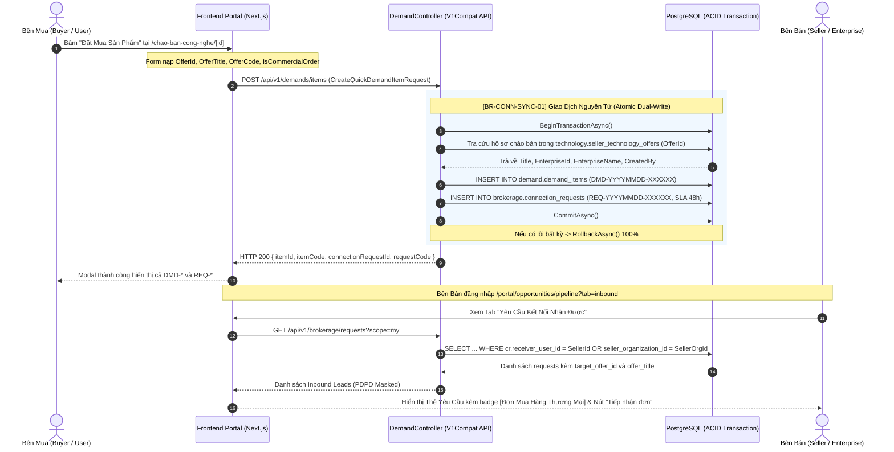

# Kế Hoạch Kỹ Thuật Chi Tiết (Technical Plan Delta)
## Delta CR-TASK-08-DELTA-01: Khép Kín Luồng Giao Dịch Cung - Cầu 2 Chiều (Đặt Mua Sản Phẩm Thương Mại & Tự Động Sinh Inbound Lead)

- **CR-ID**: `CR-TASK-08-DELTA-01`
- **Phân hệ chủ quản**: `TASK-08_KET_NOI_CUNG_CAU_VA_QUAN_LY_CO_HOI`
- **Phân hệ phối hợp**: `TASK-03_HO_SO_TIM_MUA_BUYER`, `TASK-04_HO_SO_CHAO_BAN_SELLER_VA_BO_LOC`
- **Phiên bản mục tiêu (Target SemVer)**: `1.13.0`
- **Tác giả & Thẩm định**: Software Architect kiêm TechLead SA (`nacen-techlead-sa`)
- **Ngày ban hành**: 02/11/2026
- **Trạng thái**: Ready for Gate 2 Review (Sẵn sàng trình PO ký duyệt Gate 2)
- **Căn cứ pháp lý & Thiết kế cơ sở**:
  * Quyết định `PO-DEC-20261102-02` tại [`Specification/BASIC_DESIGN_NACENTECH.md`](file:///Users/luongdt/Library/CloudStorage/GoogleDrive-luongdt.wi@gmail.com/My%20Drive/NacenTechProject/Specification/BASIC_DESIGN_NACENTECH.md) Mục 19.
  * Walking Skeleton WS-05 tại [`Specification/BASIC_DESIGN_NACENTECH.md`](file:///Users/luongdt/Library/CloudStorage/GoogleDrive-luongdt.wi@gmail.com/My%20Drive/NacenTechProject/Specification/BASIC_DESIGN_NACENTECH.md) Mục 3.2.
  * Quyết định kiến trúc [`ADR-0012-ATOMIC-DUAL-WRITE-COMMERCIAL-ORDER-INBOUND-LEAD.md`](file:///Users/luongdt/Library/CloudStorage/GoogleDrive-luongdt.wi@gmail.com/My%20Drive/NacenTechProject/SourceCode/backend/docs/decisions/ADR-0012-ATOMIC-DUAL-WRITE-COMMERCIAL-ORDER-INBOUND-LEAD.md).
  * Delta Ledger [`CR-TASK-08-DELTA-01.md`](file:///Users/luongdt/Library/CloudStorage/GoogleDrive-luongdt.wi@gmail.com/My%20Drive/NacenTechProject/SourceCode/specs/TASK-08_KET_NOI_CUNG_CAU_VA_QUAN_LY_CO_HOI/deltas/CR-TASK-08-DELTA-01.md).

---

## 1. Sơ Đồ Kiến Trúc Luồng Dữ Liệu Tương Tác (Sequence Diagram)



---

## 2. Thiết Kế Tầng CSDL & Entity Mapping

### 2.1. Trạng Thái CSDL Thực Tế (Schema Analysis)
- Bảng `brokerage.connection_requests` đã được tạo từ migration `20261030150000_CreateBrokerageTables.cs` và mở rộng tại `20261030160000_AddConnectionRequestEnrichedFields.cs`.
- Bảng đã có đầy đủ các cột phục vụ liên kết 2 chiều:
  * `demand_id` (UUID): Khóa ngoại logic liên kết trực tiếp tới `demand.demand_items(id)`.
  * `target_offer_id` (UUID): Khóa ngoại logic liên kết tới `technology.seller_technology_offers(id)`.
  * `offer_id` (UUID): Khóa ngoại tương thích ngược liên kết tới `technology.seller_technology_offers(id)`.
  * `seller_organization_id` (UUID): Đơn vị thụ hưởng cơ hội (gian hàng Bên Bán).
  * `buyer_organization_id` (UUID): Đơn vị gửi đơn đặt mua (Bên Mua).
  * `receiver_user_id` (UUID): Tài khoản người dùng Bên Bán (lấy từ `SellerTechnologyOffer.CreatedBy`).
  * `receiver_org_name` (VARCHAR): Tên doanh nghiệp Bên Bán (lấy từ `SellerTechnologyOffer.EnterpriseName`).
  * `sender_role` (VARCHAR): Mặc định là `"BUYER"`.
  * `sla_deadline` (TIMESTAMPTZ): Thời hạn cam kết phản hồi 48 giờ (`now() + interval '48 hours'`).
  * `status` (VARCHAR): Khởi tạo là `"PENDING"`.

### 2.2. Chỉ Mục Tối Ưu Hóa (Performance Indexes)
Hệ thống tận dụng các index đã có và bảo đảm không phát sinh Full Table Scan:
- `idx_conn_requests_seller_status`: `(seller_organization_id, status)` $\rightarrow$ Tăng tốc độ nạp Kanban Inbound.
- `idx_conn_requests_target_offer_id`: `(target_offer_id)` $\rightarrow$ Tăng tốc truy vấn liên kết sản phẩm chào bán.
- `idx_conn_requests_demand_id`: `(demand_id)` $\rightarrow$ Tăng tốc truy vấn đối soát chéo từ Bên Mua sang Bên Bán.

---

## 3. Thiết Kế Tầng Backend API (Atomic Dual-Write Specs)

### 3.1. File Tác Động: `SourceCode/backend/apps/api/V1Compat/DemandController.cs`

#### A. Cập Nhật DTO `CreateQuickDemandItemRequest`
```csharp
public sealed record CreateQuickDemandItemRequest(
    string? StageName,
    string TechnicalProblem,
    string? DesiredSolution,
    bool NeedConsulting,
    string ExpectedGoal,
    string? ApplicationScale,
    string? SectorCode,
    string? TechGroupCode,
    string? DemandTypeCode,
    string? BudgetRange,
    int UrgencyScore,
    int ImpactScore,
    int InvestmentCapacity,
    int AdoptionReadiness,
    // [CR-TASK-08-DELTA-01] Mở rộng trường ngữ cảnh liên kết chào bán
    Guid? OfferId = null,
    string? OfferTitle = null,
    string? OfferCode = null,
    bool? IsCommercialOrder = null
);
```

#### B. Logic Triển Khai Trong Endpoint `POST /api/v1/demands/items`
```csharp
[HttpPost("demands/items")]
[AllowAnonymous]
public async Task<IActionResult> CreateQuickDemandItem([FromBody] CreateQuickDemandItemRequest req, CancellationToken ct)
{
    // 1. Validation đầu vào
    if (string.IsNullOrWhiteSpace(req.TechnicalProblem) || string.IsNullOrWhiteSpace(req.ExpectedGoal))
        return BadRequest(new { message = "Vấn đề kỹ thuật và mục tiêu kỳ vọng không được để trống." });

    if (req.UrgencyScore < 1 || req.UrgencyScore > 5 ||
        req.ImpactScore < 1 || req.ImpactScore > 5 ||
        req.InvestmentCapacity < 1 || req.InvestmentCapacity > 5 ||
        req.AdoptionReadiness < 1 || req.AdoptionReadiness > 5)
    {
        return BadRequest(new { message = "Các chỉ số định lượng K, L, N, O phải nằm trong khoảng từ 1 đến 5." });
    }

    var itemCode = $"DMD-{DateTime.UtcNow:yyyyMMdd}-{Guid.NewGuid().ToString("N")[..6].ToUpper()}";
    var demandItem = new DemandItem(
        null,
        itemCode,
        req.StageName ?? "Sản xuất & Chuyển giao",
        req.TechnicalProblem,
        req.DesiredSolution,
        req.NeedConsulting,
        req.ExpectedGoal,
        req.ApplicationScale,
        req.SectorCode ?? "LV01",
        req.TechGroupCode ?? "CN01",
        req.DemandTypeCode ?? "NC01",
        req.BudgetRange ?? "500 triệu – 1 tỷ VNĐ",
        req.UrgencyScore,
        req.ImpactScore,
        req.InvestmentCapacity,
        req.AdoptionReadiness,
        Actor.IsAuthenticated ? Actor.PersonId : null
    );

    // [BR-CONN-SYNC-01] Giao dịch nguyên tử Dual-Write qua IDbContextTransaction
    await using var transaction = await db.Database.BeginTransactionAsync(ct);
    try
    {
        // 2. Ghi bản ghi DemandItem
        db.Set<DemandItem>().Add(demandItem);
        await db.SaveChangesAsync(ct);

        string? requestCode = null;
        Guid? connectionRequestId = null;

        // 3. Nếu gắn với sản phẩm chào bán (OfferId có giá trị), tự động sinh Inbound Lead
        if (req.OfferId.HasValue && req.OfferId.Value != Guid.Empty)
        {
            var offer = await db.Set<SellerTechnologyOffer>()
                .AsNoTracking()
                .FirstOrDefaultAsync(o => o.Id == req.OfferId.Value, ct);

            if (offer != null)
            {
                requestCode = $"REQ-{DateTime.UtcNow:yyyyMMdd}-{Guid.NewGuid().ToString("N")[..6].ToUpper()}";
                connectionRequestId = Guid.NewGuid();
                var senderUserId = Actor.IsAuthenticated && Actor.PersonId.HasValue ? Actor.PersonId.Value : Guid.NewGuid();
                var senderOrgName = !string.IsNullOrWhiteSpace(req.ApplicationScale) 
                    ? req.ApplicationScale 
                    : (!string.IsNullOrWhiteSpace(Actor.OrganizationName) ? Actor.OrganizationName : "Khách hàng Bên Mua");

                // Thao tác ghi trực tiếp vào brokerage.connection_requests
                var conn = db.Database.GetDbConnection();
                if (conn.State != ConnectionState.Open) await conn.OpenAsync(ct);

                using var cmd = conn.CreateCommand();
                cmd.Transaction = transaction.GetDbTransaction();
                cmd.CommandText = @"
                    INSERT INTO brokerage.connection_requests (
                        id, request_code, sender_user_id, sender_org_name, sender_role,
                        receiver_user_id, receiver_org_name, seller_organization_id,
                        demand_id, target_offer_id, offer_id, message, proposed_budget_range,
                        status, sla_deadline, created_at
                    ) VALUES (
                        @id, @requestCode, @senderUserId, @senderOrgName, 'BUYER',
                        @receiverUserId, @receiverOrgName, @sellerOrgId,
                        @demandId, @targetOfferId, @offerId, @message, @budget,
                        'PENDING', @slaDeadline, now()
                    );";

                void AddParam(string name, object? val)
                {
                    var p = cmd.CreateParameter();
                    p.ParameterName = name;
                    p.Value = val ?? DBNull.Value;
                    cmd.Parameters.Add(p);
                }

                AddParam("@id", connectionRequestId.Value);
                AddParam("@requestCode", requestCode);
                AddParam("@senderUserId", senderUserId);
                AddParam("@senderOrgName", senderOrgName);
                AddParam("@receiverUserId", offer.CreatedBy);
                AddParam("@receiverOrgName", offer.EnterpriseName ?? "Nhà Cung Ứng");
                AddParam("@sellerOrgId", DBNull.Value); // Có thể tra cứu từ Enterprise nếu có
                AddParam("@demandId", demandItem.Id);
                AddParam("@targetOfferId", offer.Id);
                AddParam("@offerId", offer.Id);
                AddParam("@message", req.DesiredSolution ?? req.TechnicalProblem);
                AddParam("@budget", req.BudgetRange ?? "Thỏa thuận");
                AddParam("@slaDeadline", DateTimeOffset.UtcNow.AddHours(48));

                await cmd.ExecuteNonQueryAsync(ct);
            }
        }

        // 4. Commit nguyên tử
        await transaction.CommitAsync(ct);

        return Ok(new
        {
            success = true,
            itemId = demandItem.Id,
            itemCode = demandItem.ItemCode,
            tniScore = demandItem.TniScore,
            tniClassification = demandItem.TniClassification,
            connectionRequestId = connectionRequestId,
            requestCode = requestCode,
            message = req.OfferId.HasValue 
                ? "Đã gửi đơn đặt mua và khởi tạo yêu cầu kết nối tới Bên Bán thành công."
                : "Đăng bài toán nhu cầu công nghệ thành công."
        });
    }
    catch (Exception ex)
    {
        await transaction.RollbackAsync(ct);
        return StatusCode(500, new 
        { 
            code = "ERR_ATOMIC_COMMERCIAL_ORDER_FAILED", 
            message = "Lỗi khi xử lý giao dịch đặt mua nguyên tử: " + ex.Message 
        });
    }
}
```

---

## 4. Thiết Kế Tầng Frontend

### 4.1. File: `SourceCode/frontend/src/services/api/technology-offer.ts`
- Cập nhật kiểu trả về của hàm `submitQuickDemand`:
```typescript
export async function submitQuickDemand(payload: CreateQuickDemandPayload): Promise<{
  success: boolean;
  itemId?: string;
  itemCode?: string;
  connectionRequestId?: string;
  requestCode?: string;
  message?: string;
}>
```

### 4.2. File: `SourceCode/frontend/src/app/chao-ban-cong-nghe/[id]/page.tsx`
- Lưu trữ thêm `createdRequestCode` khi đặt mua thành công:
  ```typescript
  const [createdRequestCode, setCreatedRequestCode] = useState<string | null>(null);
  ```
- Trong modal thông báo thành công:
  * Hiển thị cả **Mã đơn mua**: `DMD-YYYYMMDD-XXXXXX` (Bên Mua lưu trữ).
  * Hiển thị cả **Mã yêu cầu gửi Bên Bán**: `REQ-YYYYMMDD-XXXXXX` (Đã chuyển tiếp tới Bên Bán).
  * Nút dẫn tới `/portal/buyer/demands?tab=commercial` để theo dõi tiến độ.

### 4.3. File: `SourceCode/frontend/src/app/portal/opportunities/pipeline/page.tsx`
- Kiểm tra danh sách thẻ Inbound:
  * Khi thẻ có `req.targetOfferId || req.offerId`:
    - Hiển thị badge màu xanh ngọc bích (Emerald): `[Đơn Mua Hàng Thương Mại]`.
    - Tiêu đề sản phẩm chào bán mục tiêu có đường link mở trang `/chao-ban-cong-nghe/${req.targetOfferId || req.offerId}`.
    - Hiển thị đồng hồ đếm ngược SLA 48h.
  * Khi bấm "Tiếp nhận đơn" $\rightarrow$ Gọi `PUT /api/v1/brokerage/requests/{id}/respond` với `ACCEPT`, gỡ mặt nạ PDPD và tự động tạo Deal Room 1-1.

---

## 5. Chiến Lược Kiểm Thử & Tiêu Chí Nghiệm Thu 4 Tầng

| Tầng | File Kiểm Thử / Lệnh Thực Thi | Mục Tiêu Kiểm Thử | Tiêu Chí Pass |
| :--- | :--- | :--- | :--- |
| **Layer 1: Unit Test** | `BrokerageConnectionRequestInvariantsTests.cs` | Kiểm tra tính bất biến che mờ PDPD (`MaskPhone`, `MaskEmail`) và ràng buộc lý do từ chối $\ge 10$ ký tự | 100% Pass |
| **Layer 2: Contract Test** | `DemandControllerTests.cs` | Gọi `POST /api/v1/demands/items` với `offerId`: kiểm tra HTTP 200 trả về cả `itemCode` và `requestCode` | HTTP 200, cả 2 trường không null |
| **Layer 3: DB Audit Test** | Direct SQL Query trên PostgreSQL | Đối soát 2 bảng `demand.demand_items` và `brokerage.connection_requests`: có đúng 1 cặp bản ghi liên kết qua `demand_id` | Đếm chính xác $1:1$ |
| **Layer 4: Component / E2E** | `page.test.tsx` tại pipeline | Giả lập Inbound lead có `targetOfferId`: hiển thị badge `[Đơn Mua Hàng Thương Mại]` và link chào bán | Render đúng nhãn & thuộc tính |

---

## 6. Phân Rã Công Việc Kỹ Thuật (Work Breakdown Structure - WBS)

Các tasks kỹ thuật cụ thể đã được đồng bộ vào [`tasks.md`](file:///Users/luongdt/Library/CloudStorage/GoogleDrive-luongdt.wi@gmail.com/My%20Drive/NacenTechProject/SourceCode/specs/TASK-08_KET_NOI_CUNG_CAU_VA_QUAN_LY_CO_HOI/tasks.md) Phase 8:
- **T041 [BE]**: Cập nhật DTO `CreateQuickDemandItemRequest` bổ sung `OfferId`, `OfferTitle`, `OfferCode`, `IsCommercialOrder`.
- **T042 [BE]**: Triển khai `IDbContextTransaction` trong `DemandController.CreateQuickDemandItem` thực hiện ghi đồng thời `DemandItem` và `ConnectionRequest` với cơ chế rollback 100%.
- **T043 [FE]**: Cập nhật `submitQuickDemand` trong `services/api/technology-offer.ts` trả về `connectionRequestId` và `requestCode`.
- **T044 [FE]**: Cập nhật modal thành công tại `/chao-ban-cong-nghe/[id]/page.tsx` hiển thị mã đơn mua và mã yêu cầu kết nối.
- **T045 [FE]**: Cập nhật thẻ Inbound tại `/portal/opportunities/pipeline/page.tsx` hiển thị badge `[Đơn Mua Hàng Thương Mại]` và liên kết tới offer.
- **T046 [TEST]**: Cập nhật test suite và chạy đối soát CSDL hoàn tất kiểm thử 4 tầng.
