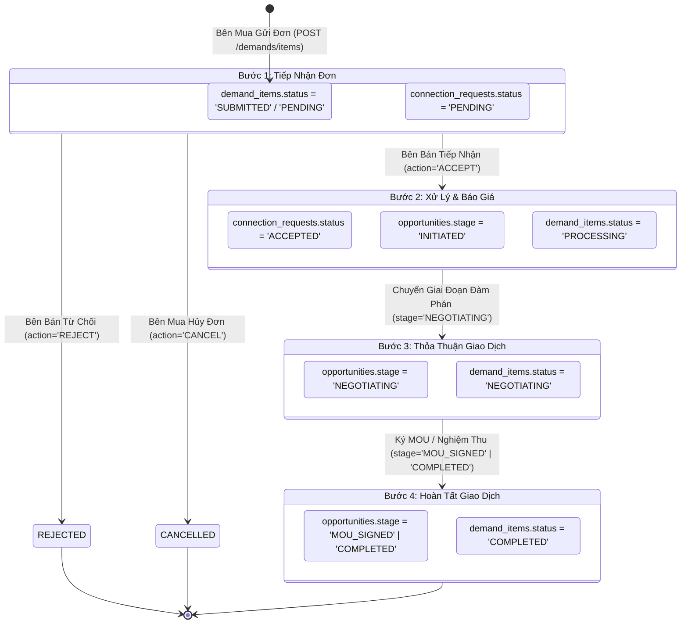
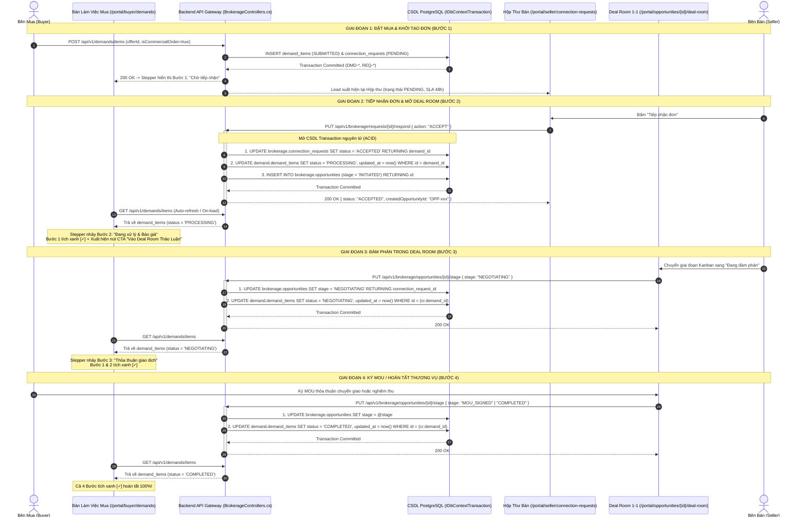

# Kế Hoạch Kỹ Thuật Chi Tiết (Technical Plan Delta)
## Delta CR-TASK-08-DELTA-02: Máy Trạng Thái Đồng Bộ 2 Chiều Trạng Thái Đơn Hàng Thương Mại & Vòng Đời Deal Room

- **CR-ID**: `CR-TASK-08-DELTA-02`
- **Phân hệ chủ quản**: `TASK-08_KET_NOI_CUNG_CAU_VA_QUAN_LY_CO_HOI`
- **Phân hệ phối hợp**: `TASK-03_HO_SO_TIM_MUA_BUYER`, `TASK-04_HO_SO_CHAO_BAN_SELLER_VA_BO_LOC`
- **Phiên bản mục tiêu (Target SemVer)**: `1.14.0`
- **Tác giả & Thẩm định**: Software Architect kiêm TechLead SA (`nacen-techlead-sa`)
- **Phê duyệt DoR Gate 2**: Product Owner kiêm Project Manager (`nacen-po-pm`)
- **Ngày ban hành**: 02/11/2026
- **Trạng thái**: Ready for Implementation (Gate 2 Approved)
- **Căn cứ pháp lý & Thiết kế cơ sở**:
  * Quyết định `PO-DEC-20261102-03: Máy Trạng Thái Đồng Bộ 2 Chiều Đơn Hàng Thương Mại & Vòng Đời Deal Room` tại [`Specification/BASIC_DESIGN_NACENTECH.md`](file:///Users/luongdt/Library/CloudStorage/GoogleDrive-luongdt.wi@gmail.com/My%20Drive/NacenTechProject/Specification/BASIC_DESIGN_NACENTECH.md) Mục 19.4 & Mục 3.2.1.
  * Lát cắt mỏng **Walking Skeleton WS-05 (Khép kín Luồng Giao Dịch Cung - Cầu 2 Chiều)** tại [`Specification/BASIC_DESIGN_NACENTECH.md`](file:///Users/luongdt/Library/CloudStorage/GoogleDrive-luongdt.wi@gmail.com/My%20Drive/NacenTechProject/Specification/BASIC_DESIGN_NACENTECH.md) Mục 3.2.
  * Delta Ledger: [`SourceCode/specs/TASK-08_KET_NOI_CUNG_CAU_VA_QUAN_LY_CO_HOI/deltas/CR-TASK-08-DELTA-02.md`](file:///Users/luongdt/Library/CloudStorage/GoogleDrive-luongdt.wi@gmail.com/My%20Drive/NacenTechProject/SourceCode/specs/TASK-08_KET_NOI_CUNG_CAU_VA_QUAN_LY_CO_HOI/deltas/CR-TASK-08-DELTA-02.md).
  * Quyết định Kiến trúc: [`ADR-0013-BI-DIRECTIONAL-ORDER-STATE-MACHINE-SYNC.md`](file:///Users/luongdt/Library/CloudStorage/GoogleDrive-luongdt.wi@gmail.com/My%20Drive/NacenTechProject/SourceCode/backend/docs/decisions/ADR-0013-BI-DIRECTIONAL-ORDER-STATE-MACHINE-SYNC.md).
  * Living Spec: [`SourceCode/specs/TASK-08_KET_NOI_CUNG_CAU_VA_QUAN_LY_CO_HOI/spec.md`](file:///Users/luongdt/Library/CloudStorage/GoogleDrive-luongdt.wi@gmail.com/My%20Drive/NacenTechProject/SourceCode/specs/TASK-08_KET_NOI_CUNG_CAU_VA_QUAN_LY_CO_HOI/spec.md).

---

## 1. Kiến Trúc Máy Trạng Thái Đồng Bộ 2 Chiều (Bi-directional State Machine)

### 1.1. Sơ đồ Chuyển Dịch Trạng Thái Giữa 3 Thực Thể


### 1.2. Sequence Diagram Luồng Tương Tác 2 Chiều Thời Gian Thực


---

## 2. Thiết Kế Kỹ Thuật Chi Tiết Backend API & CSDL

### 2.1. Cập Nhật Endpoint: `PUT /api/v1/brokerage/requests/{id}/respond`
- **File**: `SourceCode/backend/apps/api/V1Compat/BrokerageControllers.cs`
- **Method**: `RespondConnectionRequest(Guid id, RespondConnectionRequest req, CancellationToken ct)`
- **Logic can thiệp chi tiết**:
  1. Kiểm tra đầu vào `req.Action`: Chấp nhận `"ACCEPT"` hoặc `"REJECT"`. Nếu `"REJECT"` và có lý do: bắt buộc tối thiểu 10 ký tự.
  2. Mở kết nối CSDL và khởi tạo transaction CSDL:
     ```csharp
     var conn = db.Database.GetDbConnection();
     if (conn.State != ConnectionState.Open) await conn.OpenAsync(ct);
     await using var tx = await conn.BeginTransactionAsync(ct);
     ```
  3. Cập nhật `brokerage.connection_requests`:
     ```sql
     UPDATE brokerage.connection_requests
     SET status = @status,
         response_note = @note,
         rejection_reason = @rejectionReason,
         responded_at = now()
     WHERE id = @id
     RETURNING id, request_code, sender_org_name, receiver_org_name, demand_id, offer_id, status;
     ```
  4. Đọc `demand_id` từ kết quả truy vấn.
  5. **Đồng bộ trạng thái 2 chiều sang `demand.demand_items`**:
     * **Nhánh Chấp Thuận (`action == "ACCEPT"`)**:
       Nếu `demand_id != null && demand_id != Guid.Empty`:
       ```sql
       UPDATE demand.demand_items
       SET status = 'PROCESSING',
           updated_at = now()
       WHERE id = @demandId;
       ```
     * **Nhánh Từ Chối (`action == "REJECT"`)**:
       Nếu `demand_id != null && demand_id != Guid.Empty`:
       ```sql
       UPDATE demand.demand_items
       SET status = 'REJECTED',
           updated_at = now()
       WHERE id = @demandId;
       ```
  6. Nếu `action == "ACCEPT"`, khởi tạo bản ghi thương vụ `brokerage.opportunities` với `stage = 'INITIATED'`.
  7. **Commit Transaction**:
     ```csharp
     await tx.CommitAsync(ct);
     ```
  8. **Rollback an toàn**: Nếu xảy ra bất kỳ lỗi ngoại lệ nào trong quá trình thực thi:
     ```csharp
     await tx.RollbackAsync(ct);
     ```
  9. **Response trả về**:
     ```json
     {
       "success": true,
       "data": {
         "requestId": "3fa85f64-5717-4562-b3fc-2c963f66afa6",
         "status": "ACCEPTED",
         "requestCode": "REQ-20261102-000128",
         "syncedDemandStatus": "PROCESSING",
         "createdOpportunityId": "opp-9988-7766-5544",
         "createdOpportunityCode": "DEAL-2026-XXXX"
       }
     }
     ```

### 2.2. Cập Nhật Endpoint: `PUT /api/v1/brokerage/opportunities/{id}/stage`
- **File**: `SourceCode/backend/apps/api/V1Compat/BrokerageControllers.cs`
- **Method**: `UpdateOpportunityStage(Guid id, UpdateOpportunityStageRequest req, CancellationToken ct)`
- **Logic can thiệp chi tiết**:
  1. Thẩm định FSM chuyển giai đoạn hợp lệ (chống nhảy cóc trạng thái theo `BR-BRK-06`).
  2. Mở transaction CSDL:
     ```csharp
     await using var tx = await conn.BeginTransactionAsync(ct);
     ```
  3. Cập nhật `brokerage.opportunities`:
     ```sql
     UPDATE brokerage.opportunities
     SET stage = @stage, updated_at = now()
     WHERE id = @id
     RETURNING id, opportunity_code, connection_request_id, stage, updated_at;
     ```
  4. Lấy `connection_request_id` từ kết quả RETURNING.
  5. Nếu `connection_request_id != null`:
     Tra cứu `demand_id` từ bảng `brokerage.connection_requests`:
     ```sql
     SELECT demand_id FROM brokerage.connection_requests WHERE id = @connReqId;
     ```
  6. Nếu tìm thấy `demand_id`:
     * Khi `stage == "NEGOTIATING"`:
       ```sql
       UPDATE demand.demand_items
       SET status = 'NEGOTIATING', updated_at = now()
       WHERE id = @demandId;
       ```
     * Khi `stage == "MOU_SIGNED"` hoặc `stage == "COMPLETED"`:
       ```sql
       UPDATE demand.demand_items
       SET status = 'COMPLETED', updated_at = now()
       WHERE id = @demandId;
       ```
  7. Commit Transaction `await tx.CommitAsync(ct);`.
  8. Trả về response có bổ sung trường `syncedDemandStatus`.

---

## 3. Thiết Kế Kỹ Thuật Chi Tiết Frontend Web Portal

### 3.1. Nâng Cấp `OrderTrackingStepper.tsx`
- **File**: `SourceCode/frontend/src/components/demand/OrderTrackingStepper.tsx`
- **Quy chuẩn hiển thị**:
  1. Trong mảng `ORDER_STEPS`:
     - Bước 1: `label: 'Tiếp nhận đơn'`, `description: 'Đã gửi yêu cầu / Chờ tiếp nhận'`
     - Bước 2: `label: 'Xử lý & Báo giá'`, `description: 'Bên bán đã tiếp nhận & đang xử lý'`
     - Bước 3: `label: 'Thỏa thuận giao dịch'`, `description: 'Thương thảo hợp đồng & điều khoản'`
     - Bước 4: `label: 'Hoàn tất'`, `description: 'Ký kết & Nghiệm thu giao dịch'`
  2. Hàm `mapStatusToStepIndex(status)`:
     - `PROCESSING`, `VERIFIED`, `IN_REVIEW` $\rightarrow$ `stepIndex = 1`, `statusLabel = 'Đang xử lý & Báo giá'`.
     - `NEGOTIATING` $\rightarrow$ `stepIndex = 2`, `statusLabel = 'Đang thỏa thuận'`.
     - `COMPLETED` $\rightarrow$ `stepIndex = 3`, `statusLabel = 'Hoàn tất'`.
     - `REJECTED` $\rightarrow$ `stepIndex = -1`, `isRejected = true`, `statusLabel = 'Đã từ chối'`.
     - `CANCELLED`, `CLOSED` $\rightarrow$ `stepIndex = -1`, `isCancelled = true`, `statusLabel = 'Đã hủy đơn'`.
     - Mặc định: `stepIndex = 0`, `statusLabel = 'Chờ tiếp nhận'`.
  3. Render Stepper:
     - Khi `stepIndex >= 1` (ví dụ `status === 'PROCESSING'`): Bước 1 hiển thị icon `CheckCircle2` nền xanh ngọc `bg-emerald-600` [✓], Bước 2 sáng đèn ring xanh thương hiệu `bg-brand-600` và `animate-pulse`.

### 3.2. Nâng Cấp Bàn Làm Việc Bên Mua: `buyer/demands/page.tsx`
- **File**: `SourceCode/frontend/src/app/portal/buyer/demands/page.tsx`
- **Logic can thiệp chi tiết**:
  1. **Nhận diện liên kết Deal Room**:
     - Khi `selectedOrder` mở lên, nếu `isCommercialDemandItem(selectedOrder)`:
     - Trạng thái `status` thuộc `['PROCESSING', 'NEGOTIATING', 'COMPLETED']`:
     - Tra cứu cơ hội tương ứng thông qua API `GET /api/v1/brokerage/opportunities?search={selectedOrder.itemCode}` hoặc cơ chế lưu trữ liên kết.
  2. **Hiển thị nút CTA "Vào Deal Room Thảo Luận ->"**:
     - Tại Footer Modal Chi Tiết Đơn Hàng:
       ```tsx
       {isCommercialDemandItem(selectedOrder) &&
        ['PROCESSING', 'NEGOTIATING', 'COMPLETED'].includes(selectedOrder.status?.toUpperCase() || '') && (
          <Link
            href={`/portal/opportunities/${dealOpportunityId || selectedOrder.id}/deal-room`}
            className="inline-flex items-center gap-2 px-4 py-2.5 rounded-xl bg-emerald-600 hover:bg-emerald-700 text-white text-xs font-bold transition shadow-sm"
          >
            <Handshake className="w-4 h-4" />
            <span>Vào Deal Room Thảo Luận &rarr;</span>
          </Link>
       )}
       ```
  3. **Khóa nút Hủy đơn**:
     - Nút "Hủy đơn" chỉ hiển thị khi `status === 'SUBMITTED' || status === 'PENDING' || !status`.
     - Khi `status === 'PROCESSING'` trở đi: nút "Hủy đơn" tuyệt đối bị ẩn để bảo vệ giao kết thương mại giữa hai bên.

---

## 4. Kế Hoạch Kiểm Thử Chống Hồi Quy 4 Tầng

| Tầng Kiểm Thử | Mục Tiêu & Kịch Bản | Công Cụ & Tệp Thực Thi |
| :--- | :--- | :--- |
| **1. Unit Tests** | - Kiểm tra `mapStatusToStepIndex('PROCESSING')` trả về `stepIndex = 1`, `statusLabel = 'Đang xử lý & Báo giá'`.<br>- Kiểm tra stepper render tích xanh Bước 1 khi `PROCESSING`. | Vitest (`OrderTrackingStepper.test.tsx`) |
| **2. Integration Tests** | - Giả lập `RespondConnectionRequest(action = ACCEPT)` kiểm tra đồng thời 3 bảng được cập nhật.<br>- Giả lập Rollback khi ghi `demand_items` bị lỗi: xác nhận `connection_requests` không đổi trạng thái. | .NET xUnit (`OrderStateMachineSyncTests.cs`) |
| **3. Contract Tests** | - Gửi payload `PUT /requests/{id}/respond` xác nhận trường `syncedDemandStatus = "PROCESSING"`.<br>- Gửi payload `PUT /opportunities/{id}/stage` xác nhận `syncedDemandStatus = "NEGOTIATING"`. | .NET xUnit Contract Tests |
| **4. E2E Playwright** | - Luồng toàn trình: Bên Mua đặt hàng $\rightarrow$ Bên Bán bấm tiếp nhận $\rightarrow$ Tiến trình Bên Mua nhảy Bước 2 [✓] Bước 1 $\rightarrow$ Nút Vào Deal Room hoạt động thông suốt. | Playwright E2E Test Suite |

---

## 5. Tiêu Chí Nghiệm Thu Kỹ Thuật (DoD - Definition of Done)

- [ ] `DoD-01`: Cả 2 endpoints `requests/{id}/respond` và `opportunities/{id}/stage` thực thi cập nhật `demand.demand_items` trong cùng PostgreSQL ACID transaction.
- [ ] `DoD-02`: Đơn hàng tại `/portal/buyer/demands?tab=commercial` tự động chuyển sang Bước 2 ("Đang xử lý & Báo giá") ngay khi Bên Bán bấm "Tiếp nhận đơn".
- [ ] `DoD-03`: Bước 1 tích xanh [✓], Bước 2 active pulse sáng đèn, hiển thị nhãn chuẩn: *"Bên bán đã tiếp nhận & đang xử lý"*.
- [ ] `DoD-04`: Nút CTA *"Vào Deal Room Thảo Luận &rarr;"* hiển thị nổi bật trên Modal chi tiết đơn hàng.
- [ ] `DoD-05`: Nút "Hủy đơn" bị khóa khi đơn hàng chuyển sang Bước 2 trở đi.
- [ ] `DoD-06`: 100% tests (Unit, Integration, Contract, E2E) vượt qua màu xanh, không có bất kỳ hồi quy nào.
