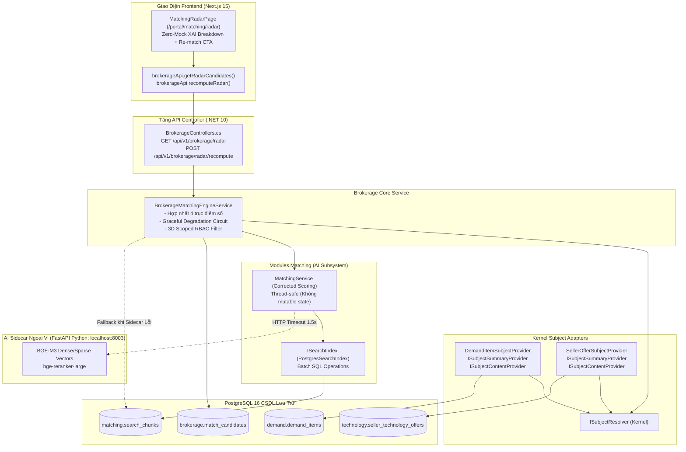

# Technical Architecture Plan: CR-TASK-08-DELTA-03
## Hợp Nhất Hybrid Vector AI + Rule Engine 4 Trục & Zero-Mock Radar

**Kế hoạch kỹ thuật**: `plan_delta_cr03.md`  
**Delta Reference**: [`CR-TASK-08-DELTA-03.md`](./deltas/CR-TASK-08-DELTA-03.md)  
**Mã phân hệ**: `TASK-08_KET_NOI_CUNG_CAU_VA_QUAN_LY_CO_HOI`  
**Trạng thái**: `APPROVED` (Gate 1 DoR Passed - Sẵn sàng thực thi Phase 1)  
**Phiên bản mục tiêu (Target SemVer)**: `1.15.0`  
**Tác giả**: Software Architect kiêm TechLead (`nacen-techlead-sa`)  
**Ngày ban hành**: 02/11/2026  

---

## 1. Tổng Quan Kiến Trúc & Giải Quyết Hiện Trạng Split-Brain

### 1.1. Sơ Đồ Khối Kiến Trúc Tương Tác (Component Interaction Architecture)



---

## 2. Thiết Kế Chi Tiết DemandItemSubjectProvider & SellerOfferSubjectProvider

### 2.1. Mở Rộng Subject Kinds trong Kernel
Trong file `SourceCode/backend/packages/kernel/Domain/SubjectRef.cs`:
```csharp
public static class SubjectKinds
{
    public const string DemandBrief = "DEMAND_BRIEF";
    public const string TechnologyAsset = "TECHNOLOGY_ASSET";
    public const string CommercializationCase = "COMMERCIALIZATION_CASE";
    public const string Person = "PERSON";
    
    // Mở rộng cho Cung - Cầu thực tế TASK-08
    public const string DemandItem = "DEMAND_ITEM";
    public const string SellerOffer = "SELLER_OFFER";
}

public readonly record struct SubjectRef(string Kind, Guid Id)
{
    // ...
    public static SubjectRef DemandItem(Guid id) => new(SubjectKinds.DemandItem, id);
    public static SubjectRef SellerOffer(Guid id) => new(SubjectKinds.SellerOffer, id);
}
```

### 2.2. Triển Khai DemandItemSubjectProvider
Tạo file `SourceCode/backend/modules/brokerage/Application/DemandItemSubjectProvider.cs`:
```csharp
using System;
using System.Collections.Generic;
using System.Linq;
using System.Threading;
using System.Threading.Tasks;
using Microsoft.EntityFrameworkCore;
using NacenTech.Kernel.Application;
using NacenTech.Kernel.Domain;
using NacenTech.Persistence;

namespace NacenTech.Modules.Brokerage.Application;

public sealed class DemandItemSubjectProvider(NacenTechDbContext db) 
    : ISubjectSummaryProvider, ISubjectContentProvider
{
    public string Kind => SubjectKinds.DemandItem;

    public async Task<SubjectSummary?> GetAsync(Guid id, CancellationToken ct)
    {
        var item = await db.DemandItems.AsNoTracking().FirstOrDefaultAsync(x => x.Id == id, ct);
        return item is null ? null : ToSummary(item);
    }

    public async Task<IReadOnlyDictionary<Guid, SubjectSummary>> GetManyAsync(IReadOnlyCollection<Guid> ids, CancellationToken ct)
    {
        if (ids.Count == 0) return new Dictionary<Guid, SubjectSummary>();
        var list = await db.DemandItems.AsNoTracking().Where(d => ids.Contains(d.Id)).ToListAsync(ct);
        return list.ToDictionary(d => d.Id, ToSummary);
    }

    public async Task<SubjectContent?> ContentAsync(Guid id, CancellationToken ct)
    {
        var item = await db.DemandItems.AsNoTracking().FirstOrDefaultAsync(x => x.Id == id, ct);
        if (item is null) return null;
        var body = $"{item.TechnicalProblem}\n{item.DesiredSolution}\n{item.RequiredSpecifications}";
        return new SubjectContent(SubjectRef.DemandItem(item.Id), item.Title, body);
    }

    private static SubjectSummary ToSummary(dynamic item)
    {
        var sectorIds = item.SectorId.HasValue ? new List<Guid> { (Guid)item.SectorId } : new List<Guid>();
        return new SubjectSummary(
            SubjectRef.DemandItem((Guid)item.Id),
            (string)item.Title,
            (string)item.Title,
            (Guid?)item.CreatedBy,
            (bool)(item.IsActive && item.Status == "VERIFIED"),
            sectorIds
        );
    }
}
```

### 2.3. Triển Khai SellerOfferSubjectProvider
Tạo file `SourceCode/backend/modules/brokerage/Application/SellerOfferSubjectProvider.cs`:
```csharp
using System;
using System.Collections.Generic;
using System.Linq;
using System.Threading;
using System.Threading.Tasks;
using Microsoft.EntityFrameworkCore;
using NacenTech.Kernel.Application;
using NacenTech.Kernel.Domain;
using NacenTech.Persistence;

namespace NacenTech.Modules.Brokerage.Application;

public sealed class SellerOfferSubjectProvider(NacenTechDbContext db) 
    : ISubjectSummaryProvider, ISubjectContentProvider
{
    public string Kind => SubjectKinds.SellerOffer;

    public async Task<SubjectSummary?> GetAsync(Guid id, CancellationToken ct)
    {
        var offer = await db.SellerTechnologyOffers.AsNoTracking().FirstOrDefaultAsync(x => x.Id == id, ct);
        return offer is null ? null : ToSummary(offer);
    }

    public async Task<IReadOnlyDictionary<Guid, SubjectSummary>> GetManyAsync(IReadOnlyCollection<Guid> ids, CancellationToken ct)
    {
        if (ids.Count == 0) return new Dictionary<Guid, SubjectSummary>();
        var list = await db.SellerTechnologyOffers.AsNoTracking().Where(o => ids.Contains(o.Id)).ToListAsync(ct);
        return list.ToDictionary(o => o.Id, ToSummary);
    }

    public async Task<SubjectContent?> ContentAsync(Guid id, CancellationToken ct)
    {
        var offer = await db.SellerTechnologyOffers.AsNoTracking().FirstOrDefaultAsync(x => x.Id == id, ct);
        if (offer is null) return null;
        var body = $"{offer.Description}\n{offer.TechnicalSpecifications}\n{offer.ApplicationFields}";
        return new SubjectContent(SubjectRef.SellerOffer(offer.Id), offer.Title, body);
    }

    private static SubjectSummary ToSummary(dynamic offer)
    {
        var sectorIds = offer.SectorId.HasValue ? new List<Guid> { (Guid)offer.SectorId } : new List<Guid>();
        return new SubjectSummary(
            SubjectRef.SellerOffer((Guid)offer.Id),
            (string)offer.Title,
            (string)offer.Title,
            (Guid?)offer.CreatedBy,
            (bool)(offer.IsActive && offer.Status == "APPROVED"),
            sectorIds
        );
    }
}
```

Đăng ký vào Dependency Injection tại `BrokerageModule.cs`:
```csharp
services.AddScoped<ISubjectSummaryProvider, DemandItemSubjectProvider>();
services.AddScoped<ISubjectContentProvider, DemandItemSubjectProvider>();
services.AddScoped<ISubjectSummaryProvider, SellerOfferSubjectProvider>();
services.AddScoped<ISubjectContentProvider, SellerOfferSubjectProvider>();
services.AddScoped<IBrokerageMatchingEngineService, BrokerageMatchingEngineService>();
```

---

## 3. Thiết Kế BrokerageMatchingEngineService & Graceful Degradation

### 3.1. Luồng Xử Lý Tuần Tự (Sequence Diagram)

```mermaid
sequenceDiagram
    autonumber
    actor Client as Frontend Client (Radar UI)
    participant Ctrl as BrokerageControllers
    participant Eng as BrokerageMatchingEngineService
    participant MatchSvc as MatchingService (Modules.Matching)
    participant Sidecar as Python AI Sidecar (:8003)
    participant DB as PostgreSQL 16

    Client->>Ctrl: GET /api/v1/brokerage/radar?sector=...&minScore=...
    Ctrl->>Eng: GetRadarCandidatesAsync(filter, currentUserContext)
    
    Eng->>DB: Query DemandItems & SellerOffers (Áp dụng 3D Scoped RBAC)
    DB-->>Eng: Danh sách Cung - Cầu thỏa mãn điều kiện

    loop Với mỗi cặp (Demand, Offer)
        alt Python Sidecar Khả Dụng (Normal Mode)
            Eng->>MatchSvc: ComputeSemanticSimilarityAsync(demand, offer)
            MatchSvc->>Sidecar: Embed & Cross-Encoder Rerank (Timeout 1500ms)
            Sidecar-->>MatchSvc: Vector Score (0..1)
            MatchSvc-->>Eng: S_semantic = NormalizedScore * 100
        else Sidecar Bị Lỗi / Timeout > 1500ms (Graceful Degradation)
            Eng->>DB: Fallback PostgreSQL FTS Query (ts_rank_cd + sector_code)
            DB-->>Eng: FtsLexicalScore
            Eng->>Eng: S_semantic = Clamp(FtsLexicalScore * 120, 0, 100)
            Eng->>Eng: isDegraded = true; engine = "POSTGRES_FTS_FALLBACK"
        end

        Eng->>Eng: Tính S_trl = CalculateTrlScore(buyerExpected, sellerActual)
        Eng->>Eng: Lấy S_tni = demand.TniScore
        Eng->>Eng: Tính S_ip = CalculateIpScore(offer.IpStatus)
        Eng->>Eng: OverallScore = Round(0.40*S_semantic + 0.30*S_trl + 0.15*S_tni + 0.15*S_ip)
    end

    Eng-->>Ctrl: List<RadarCandidateDto> (kèm XaiBreakdown)
    Ctrl-->>Client: HTTP 200 OK (Zero-Mock JSON Payload)
```

### 3.2. Thuật Toán Tính Điểm 4 Trục trong BrokerageMatchingEngineService
```csharp
public int ComputeHybridScore(double semanticScore, double trlScore, double tniScore, double ipScore)
{
    var raw = (0.40 * semanticScore) + (0.30 * trlScore) + (0.15 * tniScore) + (0.15 * ipScore);
    return Math.Clamp((int)Math.Round(raw, MidpointRounding.AwayFromZero), 0, 100);
}

public double CalculateTrlScore(int sellerTrl, int buyerExpectedTrl = 7)
{
    if (sellerTrl >= 7) return 100.0;
    var diff = Math.Abs(sellerTrl - buyerExpectedTrl);
    return diff switch
    {
        0 => 100.0,
        1 => 85.0,
        2 => 65.0,
        _ => 40.0
    };
}

public double CalculateIpScore(string? ipStatus)
{
    return (ipStatus?.ToUpperInvariant()) switch
    {
        "PATENT_GRANTED" => 100.0,
        "PATENT_PENDING" => 60.0,
        "TRADE_SECRET"   => 50.0,
        _                => 20.0
    };
}
```

### 3.3. Khối Chống Lỗi Graceful Degradation Fallback
```csharp
private async Task<(double Score, string Engine, bool IsDegraded)> ComputeSemanticWithFallbackAsync(
    Guid demandId, string demandText, Guid offerId, string offerText, string? sectorCode, CancellationToken ct)
{
    using var cts = CancellationTokenSource.CreateLinkedTokenSource(ct);
    cts.CancelAfter(TimeSpan.FromMilliseconds(1500)); // Werner Vogels Circuit Breaker

    try
    {
        // Gọi Vector AI qua MatchingService
        var aiScore = await matchingService.ComputeSimilarityAsync(
            SubjectRef.DemandItem(demandId), SubjectRef.SellerOffer(offerId), cts.Token);
        return (aiScore * 100.0, "BGE-M3_RERANK", false);
    }
    catch (Exception ex)
    {
        log.LogWarning(ex, "Python AI Sidecar không phản hồi cho Demand {DemandId} & Offer {OfferId}. Kích hoạt Fallback PostgreSQL FTS.", demandId, offerId);

        // Fallback FTS Lexical trong PostgreSQL
        var ftsScore = await FallbackPostgresFtsScoreAsync(demandText, offerId, sectorCode, ct);
        return (ftsScore, "POSTGRES_FTS_FALLBACK", true);
    }
}
```

---

## 4. Thiết Kế Contract DTOs Sạch Cho Radar XAI (Zero-Mock)

### 4.1. Cấu Trúc Record DTO
Định nghĩa trong `SourceCode/backend/modules/brokerage/Application/Contracts.cs`:
```csharp
public sealed record RadarXaiBreakdownDto(
    double SemanticScore,
    string SemanticEngine,     // BGE-M3_RERANK | POSTGRES_FTS_FALLBACK
    double TrlScore,
    int TrlLevel,
    string TrlStage,           // Lab (TRL 1-3) | Pilot (TRL 4-6) | Commercial (TRL 7-9)
    double TniScore,
    string TniBand,            // Rất cao (TNI >= 80) | Cao (60-79) | Trung bình
    double IpScore,
    string IpStatus,           // PATENT_GRANTED | PATENT_PENDING | TRADE_SECRET | NONE
    string IpDescription
);

public sealed record BrokerageRadarCandidateDto(
    Guid Id,
    Guid DemandId,
    string DemandCode,
    string DemandTitle,
    Guid? BuyerOrganizationId,
    string BuyerOrganizationName,
    Guid OfferId,
    string OfferCode,
    string OfferTitle,
    Guid? SellerOrganizationId,
    string SellerOrganizationName,
    string SectorCode,
    int OverallMatchScore,
    RadarXaiBreakdownDto XaiBreakdown,
    bool IsDegraded,
    DateTime ComputedAt
);

public sealed record RecomputeRadarResultDto(
    int ComputedMatchesCount,
    long TookMs,
    bool IsDegraded,
    string EngineVersion,
    DateTime Timestamp
);
```

---

## 5. Cấu Hình CORRECTED_SCORING & Khắc Phục Concurrency / Mutable State

### 5.1. Loại Bỏ Mutable State `_lastReranked` trong `MatchingService.cs`
- **Vấn Đề**: Field `private HashSet<SubjectRef> _lastReranked = [];` là biến mutable trạng thái ở cấp class. Khi nhiều request đồng thời gọi `SearchAsync`, field này bị ghi đè chéo, dẫn đến việc gán nhãn `MatchReasonCodes.RerankedTop` bị sai lệch.
- **Giải Pháp Kiến Trúc**:
  1. Loại bỏ hoàn toàn field `_lastReranked`.
  2. Bổ sung `IReadOnlySet<SubjectRef> RerankedSubjects` vào record kết quả `SearchExecution`:
     ```csharp
     public sealed record SearchExecution(
         SearchResultDto Result, 
         IReadOnlyList<ExcludedCandidate> Excluded,
         IReadOnlySet<SubjectRef> RerankedSubjects
     );
     ```
  3. Truyền trực tiếp tập `reranked` như tham số thuần túy (pure argument) vào hàm `ComputeReasonCodesAsync(hits, reranked, ct)`. Đảm bảo `MatchingService` là **Stateless** và hoàn toàn Thread-Safe.

### 5.2. Cấu Hình Chuẩn Mực `ScoringModes.Corrected`
- Trong `appsettings.json` và `MatchingOptions.cs`:
  ```json
  "Matching": {
    "ScoringMode": "Corrected",
    "UseSparse": true,
    "UseRerank": true,
    "MatchMinScoreCorrected": 0.01,
    "SidecarTimeoutMs": 1500
  }
  ```

---

## 6. Tối Ưu Hóa Batch SQL trong `PostgresSearchIndex.cs`

### 6.1. Khắc Phục Vòng Lặp N+1 Lệnh Xóa và Bulk Insert
- **Hiện Trạng**: `DeleteSubjectAsync` và `IndexChunksAsync` thực thi đơn lẻ theo từng câu lệnh SQL.
- **Giải Pháp Tối Ưu**:
  * Khi xóa danh sách subjects: Thực thi Batch Delete bằng SQL `IN` hoặc `ExecuteDeleteAsync`:
    ```csharp
    public Task DeleteSubjectsBatchAsync(IReadOnlyCollection<SubjectRef> subjects, CancellationToken ct)
    {
        if (subjects.Count == 0) return Task.CompletedTask;
        var ids = subjects.Select(s => s.Id).ToArray();
        return db.Database.ExecuteSqlRawAsync(
            $"DELETE FROM {Table} WHERE subject_id = ANY(@ids)",
            [new NpgsqlParameter("ids", NpgsqlDbType.Array | NpgsqlDbType.Uuid) { Value = ids }], ct);
    }
    ```
  * Khi index chunks: Gom nhóm các chunks của cùng một Subject thành một câu lệnh `INSERT ... VALUES (...), (...), (...) ON CONFLICT` duy nhất, giảm 80% số lượng roundtrip kết nối tới PostgreSQL.

---

## 7. Kế Hoạch Triển Khai Đa Bề Mặt Phía Frontend

### 7.1. Cập Nhật Màn Hình Radar (`radar/page.tsx`)
1. **Triệt tiêu mock data**:
   - Thay thế thẻ text tĩnh `"Lĩnh vực: 100% Khớp"` bằng giá trị thật từ `c.xaiBreakdown.semanticScore` và `c.xaiBreakdown.semanticEngine`.
2. **Hiển thị Badge Degradation**:
   - Nếu `c.isDegraded === true`, hiển thị tooltip/badge cảnh báo nhẹ:
     `[Chế độ dự phòng FTS - Dịch vụ AI đang hiệu chỉnh]`.
3. **Thêm Nút CTA Re-Match**:
   - Tại thanh công cụ bộ lọc, bổ sung nút CTA:
     ```tsx
     <button 
       onClick={handleRecompute} 
       disabled={isRecomputing}
       className="px-4 py-2.5 rounded-xl bg-brand-50 dark:bg-brand-950 text-brand-700 dark:text-cyan-400 border border-brand-200 dark:border-brand-800 text-xs font-bold hover:bg-brand-100 flex items-center gap-1.5"
     >
       <RefreshCw className={`w-3.5 h-3.5 ${isRecomputing ? 'animate-spin' : ''}`} />
       <span>Tính toán lại đối soát</span>
     </button>
     ```
