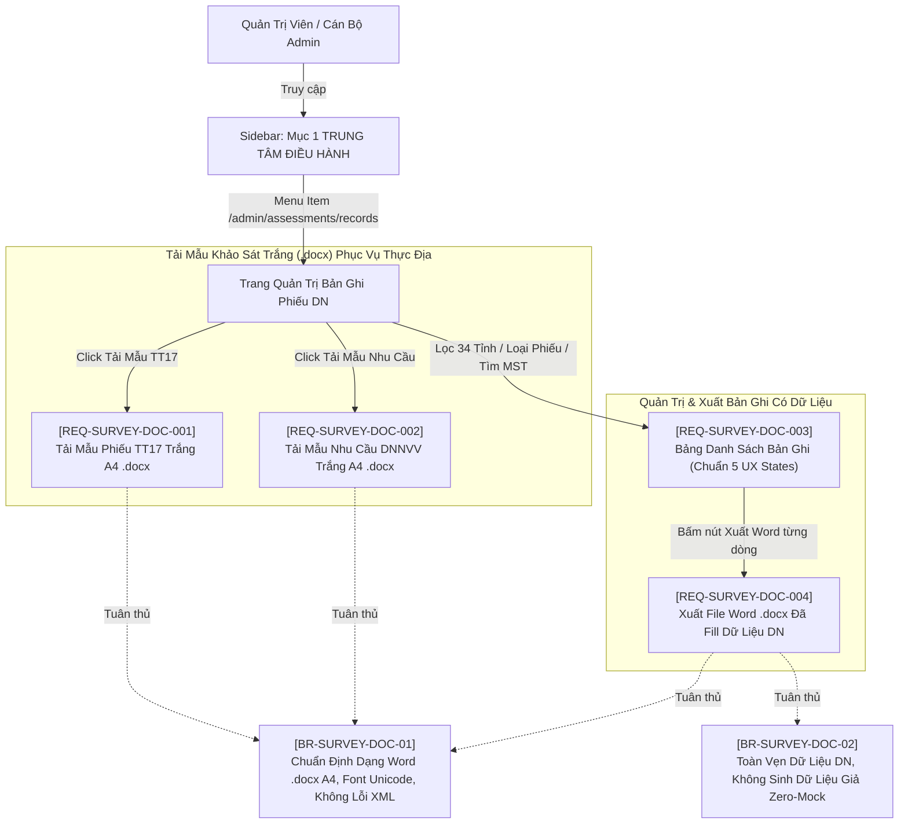

# Change Request: CR-2026-021 Quản Trị Hồ Sơ Phiếu Thu Thập TT17 & Nhu Cầu ĐMST, Xuất Bản In & Mẫu Khảo Sát Thực Địa

**CR-ID**: CR-2026-021  
**Epic**: TASK-09_DANH_GIA_TRINH_DO_NANG_LUC_CONG_NGHE_TT17  
**Status**: APPROVED  
**Target Version**: 1.4.0  
**Author**: PO kiêm Senior BA (`nacen-po-pm` & `nacen-ba`)  
**Date**: 2026-11-03  
**Căn cứ pháp lý & Thiết kế cơ sở**: Quyết định `PO-DEC-20261103-01` tại `Specification/BASIC_DESIGN_NACENTECH.md` Mục 28; Thông tư 17/2019/TT-BKHCN; Luật Hỗ trợ Doanh nghiệp nhỏ và vừa 2017; Nghị định 80/2021/NĐ-CP; Nghị định 13/2023/NĐ-CP (PDPD); Hiến pháp Quản lý Đặc tả `SPEC_MANAGEMENT_CONSTITUTION.md`.  

---

### 1. Bối Cảnh & Lý Do Thay Đổi (Why)

- **Hiện trạng cũ (Current State / As-Is)**:
  - Phân hệ `TASK-09` hiện tại tập trung vào Form Wizard 6 bước kê khai trực tuyến cho doanh nghiệp (`/assessments/tt17/wizard`), công cụ tính điểm trực tiếp Sticky Calculator, và hàng đợi thẩm định của Cán bộ Sở KH&CN (`/gov/assessments/tt17`).
  - Chưa có giao diện quản trị tập trung toàn quốc dành cho Quản trị viên Trung ương (`SUPER_ADMIN`, `OPERATOR_ADMIN`) để tra cứu, lọc và quản lý toàn bộ các bản ghi phiếu khảo sát đã nộp từ các doanh nghiệp (cả Phiếu Đánh giá TT17 lẫn Phiếu Khảo sát Nhu cầu DNNVV).
  - Chưa hỗ trợ cơ chế xuất văn bản dạng Microsoft Word (.docx): Người dùng chỉ có thể xem báo cáo online trên trình duyệt hoặc in PDF dạng web view, dễ vỡ khung hình, không chuẩn hóa lề lối văn bản hành chính Việt Nam.
  - Khi cán bộ điều tra viên, đoàn khảo sát của Sở KH&CN hoặc NacenTech đi công tác thực địa tại các tỉnh/thành phố, địa bàn chưa có sóng internet hoặc doanh nghiệp chưa có tài khoản số hóa, không có sẵn mẫu phiếu Word trắng (.docx) chuẩn A4 để in ấn mang đi khảo sát trực tiếp.
- **Vấn đề / Nỗi đau & Nhu cầu cấp thiết (Friction & Critical Needs)**:
  1. **Nhu cầu khảo sát thực địa (Field Survey Readiness)**: Cần có ngay nút tải mẫu phiếu trắng dạng file Word (.docx) được định dạng sẵn chuẩn khổ giấy A4, có tiêu đề cơ quan, hướng dẫn cách trích xuất số liệu từ BCTC, các bảng biểu để trống phục vụ điều tra viên ghi chép tay.
  2. **Nhu cầu in ấn lưu trữ hồ sơ pháp lý (Document Archiving & Legal Compliance)**: Doanh nghiệp và cơ quan quản lý cần kết xuất hồ sơ đã điền ra file Word (.docx) có đầy đủ dữ liệu định danh (Tên DN, MST, địa chỉ, người đại diện), thông tin thiết bị máy móc, bảng số liệu tài chính 3 năm và bảng điểm 26 tiêu chí TT17 để trình Giám đốc doanh nghiệp ký tên, đóng dấu và bàn giao lưu trữ hồ sơ cứng.
  3. **Tập trung hóa công tác giám sát toàn quốc**: Cần đưa mục quản lý các bản ghi phiếu vào menu Cổng Quản trị Admin Sidebar tại vị trí trọng tâm (Mục 1 TRUNG TÂM ĐIỀU HÀNH) để Admin nắm bắt số lượng bản ghi theo 34 tỉnh/thành phố trọng điểm.

---

### 2. Chi Tiết Thay Đổi Quy Chuẩn & Mỏ Neo Bất Biến (Immutable Anchors)



#### [ADD] `REQ-SURVEY-DOC-001`: Tải Mẫu Phiếu Thu Thập TT17 Trắng Dạng Word (.docx) Chuẩn A4
- Hệ thống cung cấp nút bấm *"Tải Mẫu Phiếu TT17 (A4 .docx)"* trên thanh công cụ của trang quản trị `/admin/assessments/records`.
- Tệp xuất ra là tệp mẫu Microsoft Word (.docx) chuẩn khổ A4, bao gồm toàn bộ cấu trúc thu thập số liệu phục vụ đánh giá trình độ và năng lực công nghệ sản xuất theo Thông tư 17/2019/TT-BKHCN:
  * Trang bìa / Phần đầu: Tiêu đề Quốc hiệu, Cơ quan quản lý, thông tin định danh Doanh nghiệp (để trống các dòng chấm `...`).
  * Mục A: Thông tin chung về doanh nghiệp (Vốn, Lao động, Ngành kinh tế VSIC cấp 2 C.10-C.32).
  * Mục B: Hiện trạng công nghệ và thiết bị (Danh mục 03 dây chuyền máy móc chính, nguyên giá, hao mòn, mức độ tự động hóa).
  * Mục C: Hiệu quả khai thác công nghệ & Hoạt động SXKD 3 năm (Bảng ma trận tài chính 3 năm: $G_{sp}, G_{dt}, G_{cp}, P, G_{nl}, G_{nvl}$).
  * Mục D: Năng lực tổ chức, quản lý & Nhân lực (Cơ cấu nhân sự, chi phí đào tạo, các hệ thống MES/ERP, chứng chỉ chất lượng).
  * Mục Đ: Năng lực nghiên cứu và phát triển (CNTT, nhân lực R&D, chi phí R&D).
  * Mục E: Đổi mới sáng tạo & Chuyển đổi số (Văn bằng SHTT, sản phẩm mới, công nghệ 4.0).
  * Phần ký xác nhận: Chữ ký của Người khai phiếu, Trưởng đoàn khảo sát và Đại diện theo pháp luật của Doanh nghiệp.

#### [ADD] `REQ-SURVEY-DOC-002`: Tải Mẫu Phiếu Khảo Sát Nhu Cầu DNNVV Trắng Dạng Word (.docx) Chuẩn A4
- Hệ thống cung cấp nút bấm *"Tải Mẫu Khảo Sát Nhu Cầu DNNVV (A4 .docx)"* trên thanh công cụ của trang quản trị `/admin/assessments/records`.
- Tệp xuất ra là tệp mẫu Microsoft Word (.docx) chuẩn khổ A4, chứa đầy đủ các phần khảo sát hiện trạng, khó khăn và nhu cầu công nghệ của Doanh nghiệp nhỏ và vừa theo Luật Hỗ trợ DNNVV:
  * Phần I: Thông tin định danh doanh nghiệp và lĩnh vực sản xuất kinh doanh chính.
  * Phần II: Hiện trạng áp dụng công nghệ và mức độ tự động hóa hiện tại.
  * Phần III: Các khó khăn, điểm nghẽn kỹ thuật và nhu cầu tìm mua máy móc thiết bị, giải pháp phần mềm, chuyển giao công nghệ.
  * Phần IV: Nhu cầu kết nối chuyên gia tư vấn kỹ thuật và các gói hỗ trợ từ ngân sách nhà nước / Sở KH&CN.

#### [ADD] `REQ-SURVEY-DOC-003`: Danh Sách Quản Lý Bản Ghi Phiếu Đã Điền Tại `/admin/assessments/records`
- Xây dựng giao diện trang `/admin/assessments/records` hiển thị toàn bộ danh sách các bản ghi phiếu đã được doanh nghiệp hoặc điều tra viên gửi lên hệ thống.
- Cung cấp bộ lọc thông minh:
  * Lọc theo Địa bàn: Dropdown 34 Tỉnh/Thành phố trọng điểm ĐMST (`province`).
  * Lọc theo Loại phiếu (`surveyType`): Tất cả / Phiếu Đánh giá TT17 / Phiếu Khảo sát Nhu cầu DNNVV.
  * Lọc theo Trạng thái hồ sơ (`status`): Tất cả / Bản nháp (DRAFT) / Đã nộp (SUBMITTED) / Đang thẩm định (IN_REVIEW) / Đã duyệt (APPROVED).
  * Ô tìm kiếm tức thời: Tìm theo Mã số thuế (MST), Tên doanh nghiệp hoặc Mã hồ sơ phiếu.
- Bảng hiển thị thông tin trực quan: Mã hồ sơ, Tên Doanh nghiệp, Mã số thuế, Tỉnh/Thành phố, Loại phiếu, Ngày gửi/cập nhật, Điểm số / Xếp loại (đối với TT17), Trạng thái, và Cột Thao tác hành động.

#### [ADD] `REQ-SURVEY-DOC-004`: Xuất File Word (.docx) Từng Phiếu Có Dữ Liệu Điền Sẵn Của Doanh Nghiệp
- Tại mỗi dòng bản ghi trong danh sách, cung cấp nút hành động *"Xuất file Word"* (Icon `FileDown` / `Download`).
- Khi người dùng click, hệ thống nạp dữ liệu chi tiết từ CSDL (`assessment.tt17_evaluations` hoặc `demand.sme_surveys`), tự động điền (fill) chính xác 100% dữ liệu vào khung biểu mẫu Word:
  * Tên pháp nhân, Mã số thuế, Địa chỉ trụ sở, Nhà máy, Người liên hệ, Điện thoại, Email.
  * Danh mục máy móc thiết bị chính, giá trị nguyên giá, năm sản xuất, nước xuất xứ.
  * Số liệu tài chính chuỗi 3 năm đã kê khai.
  * Bảng điểm chi tiết 26 tiêu chí TT17 (Điểm tự chấm, điểm từng nhóm T, E, O, R, I, Điểm tổng $\tau$, Hệ số đồng bộ $T_{ĐB}$, Kết luận phân hạng trình độ công nghệ).
  * Ghi chú nhận xét của Cán bộ thẩm định Sở KH&CN (nếu có).

#### [ADD] `BR-SURVEY-DOC-01`: Chuẩn Định Dạng Văn Bản Word (.docx) Hợp Lệ & Thẩm Mỹ
- **Chuẩn tệp tin (File Format Invariants)**:
  * Tệp xuất ra bắt buộc là tệp Microsoft Word `.docx` (Office OpenXML format) hợp lệ.
  * Mở mượt mà, không gặp lỗi cảnh báo "Corrupted XML file" hoặc lỗi "Word found unreadable content" trên mọi phiên bản Microsoft Word (Word 2013, 2016, 2019, 2021, Microsoft 365), LibreOffice Writer, và Google Docs.
  * Tên tệp xuất tự động theo quy chuẩn:
    + Mẫu trắng: `Mau_Phieu_Thu_Thap_TT17_Trang_A4.docx` và `Mau_Phieu_Khao_Sat_Nhu_Cau_DNNVV_Trang_A4.docx`.
    + Phiếu có dữ liệu: `Phieu_TT17_[MaSoThue]_[NamDanhGia].docx` hoặc `Khao_Sat_Nhu_Cau_[MaSoThue]_[NgayXuat].docx`.
- **Quy chuẩn bố cục & Trình bày (Typography & Layout)**:
  * Khổ giấy: Bắt buộc tiêu chuẩn khổ A4 ($210\text{mm} \times 297\text{mm}$), hướng dọc (Portrait).
  * Căn lề chuẩn văn bản quản lý nhà nước: Lề trên $20\text{mm} - 25\text{mm}$, lề dưới $20\text{mm} - 25\text{mm}$, lề trái $30\text{mm} - 35\text{mm}$, lề phải $15\text{mm} - 20\text{mm}$.
  * Font chữ: Times New Roman hoặc Calibri, mã Unicode tiếng Việt dựng sẵn tiêu chuẩn TCVN 6909:2001. Cỡ chữ nội dung từ 12pt đến 13pt, khoảng cách dòng (line spacing) 1.15 đến 1.3 lines.
  * Bảng biểu: Có viền kẻ thanh mảnh (0.5pt), ô tiêu đề in đậm nền xám nhạt (10-15% shading), tiêu đề bảng tự động lặp lại khi bảng bị ngắt qua trang kế tiếp (`tblHeader`).

#### [ADD] `BR-SURVEY-DOC-02`: Đảm Bảo Toàn Vẹn Dữ Liệu & Bảo Mật Pháp Nhân (Zero-Mock Data Integrity)
- Tuyệt đối 100% dữ liệu xuất trong file Word có sẵn dữ liệu (`REQ-SURVEY-DOC-004`) phải được trích xuất từ dữ liệu thực tế do Doanh nghiệp kê khai hoặc đã được Sở KH&CN thẩm định trong CSDL.
- Nghiêm cấm sinh dữ liệu mẫu, dữ liệu giả (fake/mock data) chèn vào file Word xuất ra.
- Nếu một trường dữ liệu doanh nghiệp không kê khai (nullable), hiển thị rõ ràng chuỗi ký tự gạch ngang `"---"` hoặc để trống dòng kẻ chấm `"........................"`, không điền các giá trị mặc định ngẫu nhiên.
- Dữ liệu định danh cá nhân và thông tin tài chính nhạy cảm được bảo vệ theo Nghị định 13/2023/NĐ-CP (PDPD), chỉ người dùng mang vai trò có thẩm quyền (`SUPER_ADMIN`, `OPERATOR_ADMIN`, hoặc `PROVINCIAL_ADMIN` đúng địa bàn) mới được phép xuất file.

#### [ADD] `UI-SURVEY-DOC-001`: Menu Item Mới Trên Sidebar & Layout Trang `/admin/assessments/records` Chuẩn 5 UX States Qua `<Async>`
1. **Menu Item Sidebar Admin**:
   - Vị trí: Đặt trong **Mục 1: TRUNG TÂM ĐIỀU HÀNH** trên Sidebar Quản trị Admin.
   - Nhãn hiển thị: `"Danh sách Phiếu Thu thập & Đánh giá DN"`
   - Đường dẫn (URL): `/admin/assessments/records`
   - Huy hiệu (Badge): `"Bản ghi DN"`
   - Trạng thái Active: Highlight màu thương hiệu Deep Teal khi URL hiện tại là `/admin/assessments/records` hoặc các đường dẫn con.
2. **Layout Trang `/admin/assessments/records`**:
   - Header: Tiêu đề trang *"Quản Lý Bản Ghi Phiếu Thu Thập TT17 & Nhu Cầu ĐMST"*, mô tả tổng quan và 2 nút tải template trắng:
     * Nút 1: `[Tải Mẫu Phiếu TT17 (A4 .docx)]`
     * Nút 2: `[Tải Mẫu Nhu Cầu DNNVV (A4 .docx)]`
   - Filter Toolbar: Gồm Search input (tìm theo MST / Tên DN), Dropdown Tỉnh/Thành (34 tỉnh), Dropdown Loại phiếu, Dropdown Trạng thái.
   - Bảng Danh sách bản ghi: Bọc hoàn toàn bên trong component `<Async>` bảo đảm 5 trạng thái UX:
     * **1. Loading**: Hiển thị bảng khung xương Skeleton Table (5-7 dòng) kèm hiệu ứng shimmer.
     * **2. Empty**: Khi không có dữ liệu khớp bộ lọc, hiển thị minh họa hộp rỗng và nút *"Đặt lại bộ lọc"*.
     * **3. Error**: Khối Alert màu đỏ thông báo lỗi kết nối kèm nút *"Thử lại"* (`retry()`).
     * **4. Success**: Bảng dữ liệu hoàn chỉnh, phân trang rõ ràng (10, 25, 50 bản ghi/trang), nút hành động *"Xuất file Word"* hoạt động tức thời.
     * **5. Updating / Exporting**: Khi click nút xuất file Word, hiển thị spinner xoay nhẹ và disable nút để tránh spam click.

---

### 3. Thiết Kế Kỹ Thuật: Hợp Đồng API & Dữ Liệu (Technical Design)

#### 3.1. Hợp Đồng API Mới (API Contracts)

- **`API-SURVEY-DOC-001`**: Tải mẫu phiếu Word trắng (.docx)
  * **Endpoint**: `GET /api/v1/assessments/templates/blank-docx?type={tt17|demand}`
  * **Quyền hạn**: `SUPER_ADMIN`, `OPERATOR_ADMIN`, `PROVINCIAL_ADMIN`, `ENTERPRISE`, `PUBLIC_USER`.
  * **Response**: Binary stream với MIME type `application/vnd.openxmlformats-officedocument.wordprocessingml.document`.
  * **Header**: `Content-Disposition: attachment; filename="Mau_Phieu_Thu_Thap_TT17_Trang_A4.docx"`.

- **`API-SURVEY-DOC-002`**: Truy vấn danh sách bản ghi phiếu thu thập & khảo sát
  * **Endpoint**: `GET /api/v1/assessments/records`
  * **Tham số Query**:
    + `page`: integer (mặc định 1)
    + `pageSize`: integer (mặc định 10)
    + `province`: string (Mã 34 tỉnh hoặc null)
    + `surveyType`: string (`ALL`, `TT17`, `SME_DEMAND`)
    + `status`: string (`ALL`, `DRAFT`, `SUBMITTED`, `IN_REVIEW`, `APPROVED`)
    + `search`: string (tìm theo Tên DN hoặc MST)
  * **Response**:
    ```json
    {
      "items": [
        {
          "id": "e8d649cf-8ef8-4d56-a4c3-1d2a45b8f102",
          "surveyType": "TT17",
          "enterpriseName": "CÔNG TY CỔ PHẦN CÔNG NGHỆ CHẾ TẠO ĐÔNG Á",
          "taxCode": "0108923451",
          "province": "HN",
          "provinceName": "Hà Nội",
          "assessmentYear": 2026,
          "totalScore": 76.5,
          "synchronizationRatio": 0.68,
          "classification": "TIEN_TIEN",
          "status": "APPROVED",
          "submittedAt": "2026-11-01T09:30:00Z",
          "updatedAt": "2026-11-02T14:15:00Z"
        }
      ],
      "totalCount": 128,
      "page": 1,
      "pageSize": 10
    }
    ```

- **`API-SURVEY-DOC-003`**: Xuất file Word (.docx) bản ghi đã điền dữ liệu của Doanh nghiệp
  * **Endpoint**: `GET /api/v1/assessments/records/{id}/export-docx?type={tt17|demand}`
  * **Quyền hạn**: `SUPER_ADMIN`, `OPERATOR_ADMIN`, `PROVINCIAL_ADMIN` (có kiểm tra Scope Tỉnh).
  * **Response**: Binary stream với MIME type `application/vnd.openxmlformats-officedocument.wordprocessingml.document`.
  * **Header**: `Content-Disposition: attachment; filename="Phieu_TT17_0108923451_2026.docx"`.

#### 3.2. CSDL & Truy Vấn (`DB-SURVEY-RECORDS`)
- Tận dụng cấu trúc Hybrid JSONB hiện hành trong `assessment.tt17_evaluations` và `demand.sme_surveys`:
  * Đối với TT17: Trích xuất `survey_data_json` và `scores_json` từ bảng `assessment.tt17_evaluations`.
  * Đối với Khảo sát DNNVV: Trích xuất dữ liệu khảo sát từ bảng `demand.sme_surveys`.
  * Chỉ mục tối ưu hóa: Bổ sung B-Tree index trên `(status, scope_id, assessment_year)` và GIN index trên trường tra cứu `taxCode` / `enterpriseName`.

---

### 4. Ma Trận Tác Động (Cross-Surface & Cross-Epic Impact)

| Phân Hệ / Thành Phần | Bề Mặt Ảnh Hưởng | Chi Tiết Ảnh Hưởng & Biện Pháp Đảm Bảo Không Phá Vỡ |
| :--- | :--- | :--- |
| **`TASK-09` (TT17)** | Spec & Logic xuất tài liệu | Mở rộng tính năng xuất file Word cho phiếu đánh giá; giữ nguyên toàn bộ bộ tính điểm và schema hiện hữu. |
| **`TASK-03` (Buyer Demand)** | Phiếu khảo sát DNNVV | Liên kết biểu mẫu khảo sát DNNVV để xuất chung trong danh mục template trắng và bản ghi phiếu. |
| **`TASK-07` (Admin Governance)** | Menu Sidebar Admin & RBAC | Thêm route `/admin/assessments/records` vào Mục 1 TRUNG TÂM ĐIỀU HÀNH. Không làm thay đổi 4 nhóm Accordion khác. |
| **Frontend UI (Next.js)** | Component Navigation & Trang mới | Thêm link trong `admin-nav.tsx` / `DashboardLayout.tsx`. Xây dựng trang `/admin/assessments/records` mới độc lập. |
| **Backend Services (.NET)** | Document Generation Service | Tích hợp thư viện sinh OpenXML (.docx) bảo đảm tính tương thích cao, không phụ thuộc cài đặt MS Office trên máy chủ. |

---

### 5. Tiêu Chuẩn Chấp Thuận & Kịch Bản Kiểm Thử (Acceptance Criteria & Tests)

- **`AC-SURVEY-DOC-01`**: Quản trị viên truy cập Cổng Admin nhìn thấy menu item *"Danh sách Phiếu Thu thập & Đánh giá DN"* kèm huy hiệu *"Bản ghi DN"* tại Mục 1 TRUNG TÂM ĐIỀU HÀNH.
- **`AC-SURVEY-DOC-02`**: Click nút *"Tải Mẫu Phiếu TT17 (A4 .docx)"* tải về máy tính tệp Word `.docx` mở được ngay, hiển thị đúng mẫu biểu Thông tư 17, khổ A4, không có bất kỳ lỗi XML nào (`TEST-SURVEY-DOC-001`).
- **`AC-SURVEY-DOC-03`**: Click nút *"Tải Mẫu Khảo Sát Nhu Cầu DNNVV (A4 .docx)"* tải về tệp Word `.docx` mẫu điều tra nhu cầu công nghệ DNNVV chuẩn A4.
- **`AC-SURVEY-DOC-04`**: Trang `/admin/assessments/records` hiển thị danh sách các bản ghi phiếu, hỗ trợ lọc theo 34 tỉnh/thành phố, loại phiếu và ô tìm kiếm tức thời theo MST/Tên DN.
- **`AC-SURVEY-DOC-05`**: Click nút *"Xuất file Word"* tại một dòng bản ghi tải về tệp Word `.docx` chứa đầy đủ, chính xác 100% dữ liệu đã điền của doanh nghiệp (Tên DN, MST, dây chuyền máy móc, số liệu 3 năm, điểm 26 tiêu chí TT17) (`TEST-SURVEY-DOC-002`).
- **`AC-SURVEY-DOC-06`**: Trang quản trị tuân thủ 5 trạng thái UX qua `<Async>`, hiển thị Skeleton Table khi tải và Alert khi lỗi mạng. Người dùng không có quyền bị chặn truy cập HTTP 403 Forbidden (`TEST-SURVEY-DOC-003`).
