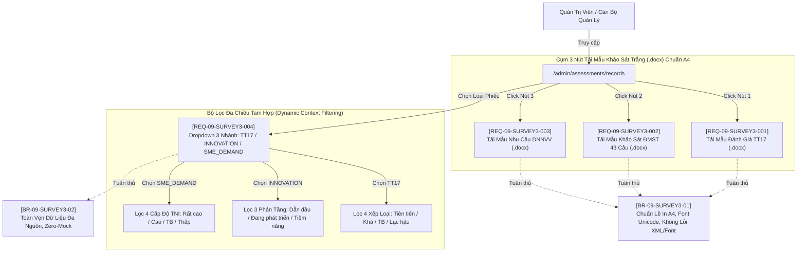

# Change Request: CR-2026-026 Chuẩn Hóa Bộ Tam Hợp Phiếu Khảo Sát & Đánh Giá Doanh Nghiệp Thực Địa

**CR-ID**: CR-2026-026  
**Epic**: TASK-09_DANH_GIA_TRINH_DO_NANG_LUC_CONG_NGHE_TT17 (Liên phân hệ với TASK-02 & TASK-03)  
**Status**: APPROVED_BY_PO  
**Target Version**: 1.5.0  
**Author**: Product Owner kiêm Senior BA (`nacen-po-pm` & `nacen-ba`)  
**Date**: 2026-11-04  
**Căn cứ pháp lý & Thiết kế cơ sở**:
1. Quyết định `PO-DEC-20261104-02` tại `Specification/BASIC_DESIGN_NACENTECH.md` Mục 30.
2. Thông tư 17/2019/TT-BKHCN về đánh giá trình độ và năng lực công nghệ sản xuất.
3. SSOT Khảo sát 304 DN ĐMST: `Specification/01_DATA_RAW/Khảo sát 304 DN-final-2408.xlsx` & Thiết kế cơ sở `THIET_KE_CO_SO_BO_TIEU_CHI_CHAM_DIEM_DN_DMST.md` (`TASK-02`).
4. Luật Hỗ trợ Doanh nghiệp nhỏ và vừa 2017 & Phiếu khảo sát nhu cầu công nghệ DNNVV (`TASK-03`).
5. Hiến pháp Quản lý Đặc tả `SourceCode/specs/SPEC_MANAGEMENT_CONSTITUTION.md`.

---

### 1. Bối Cảnh & Lý Do Thay Đổi (Why)

- **Hiện trạng cũ (Current State / As-Is)**:
  - Màn hình Quản trị Bản ghi Khảo sát `/admin/assessments/records` (được bổ sung trong CR-2026-021) mới chỉ có 2 nút tải template Word: `Tải mẫu Phiếu TT17 (.docx)` và `Tải mẫu Phiếu Nhu cầu (.docx)`.
  - Dropdown lọc Loại phiếu khảo sát chỉ có 2 options: `TT17` và `SME_DEMAND`, bỏ sót hoàn toàn loại phiếu trọng yếu thứ hai: **Phiếu Khảo Sát & Đánh Giá Năng Lực ĐMST Doanh Nghiệp (Bộ 43 câu hỏi / 8 nhóm năng lực)**.
  - Bộ lọc điều kiện thứ 3 bị khóa cứng vào "Xếp loại trình độ TT17", không tự động đổi sang "Phân tầng ĐMST" khi chọn Phiếu ĐMST hoặc "Mức độ cấp thiết TNI" khi chọn Phiếu Nhu cầu DNNVV.
- **Nhu cầu nghiệp vụ cấp thiết (Critical Needs / To-Be)**:
  1. **Khảo sát thực địa đồng bộ (Field Triad Readiness)**: Đoàn khảo sát của Cục Đổi mới sáng tạo, Sở KH&CN và Viện Ứng dụng Công nghệ cần trọn vẹn **Bộ Tam Hợp 3 Phiếu Khảo Sát** dạng file Word (.docx) chuẩn A4 để in ấn thực địa:
     - Phiếu 1: Đánh giá Trình độ & Năng lực Công nghệ theo TT17 (`phieu_thu_thap_tt17.docx`).
     - Phiếu 2: Đánh giá Năng lực Đổi mới sáng tạo 43 câu (`phieu_khao_sat_dmst_43_cau_mau_trang.docx`).
     - Phiếu 3: Khảo sát Hiện trạng & Nhu cầu Công nghệ DNNVV (`phieu_khao_sat_nhu_cau_dnnvv_mau_trang.docx`).
  2. **Bộ lọc linh hoạt đa chiều (Context-Aware Dynamic Filtering)**: Dropdown loại phiếu khảo sát cần đủ 3 nhánh tường minh, và bộ lọc phân loại đi kèm phải chuyển đổi ngữ cảnh tương thích theo đúng tiêu chí định lượng của từng loại phiếu.

---

### 2. Chi Tiết Thay Đổi Quy Chuẩn & Mỏ Neo Bất Biến (Immutable Anchors)

#### [ADD] `REQ-09-SURVEY3-001`: Cụm 3 Nút CTA Header Tải Template Word Thực Địa
- Tại phần Header trang `/admin/assessments/records`, hệ thống hiển thị đồng bộ 3 nút bấm tải mẫu Word (.docx):
  1. `[Tải mẫu Đánh giá TT17 (.docx)]`: Tải tệp `phieu_thu_thap_tt17.docx` (Cyan badge/button).
  2. `[Tải mẫu Khảo sát ĐMST (.docx)]`: Tải tệp `phieu_khao_sat_dmst_43_cau_mau_trang.docx` (Violet/Purple badge/button).
  3. `[Tải mẫu Nhu cầu DNNVV (.docx)]`: Tải tệp `phieu_khao_sat_nhu_cau_dnnvv_mau_trang.docx` (Teal/Emerald badge/button).

#### [ADD] `REQ-09-SURVEY3-002`: Chuẩn Hóa Template Word Mẫu Trắng ĐMST 43 Câu
- Tệp Word `phieu_khao_sat_dmst_43_cau_mau_trang.docx` được lưu sẵn tại `SourceCode/frontend/public/templates/surveys/`, định dạng chuẩn A4 (Lề trái 3cm, trên/dưới/phải 2cm, Font Times New Roman), có đầy đủ 43 câu hỏi chia thành 5 phần khảo sát chuẩn mực.

#### [ADD] `REQ-09-SURVEY3-003`: Dropdown Loại Phiếu Khảo Sát 4 Lựa Chọn
- Cập nhật dropdown `Loại phiếu khảo sát` (`id="survey-type-filter"`) với 4 giá trị:
  - `ALL`: *Tất cả loại phiếu (Bộ tam hợp)*.
  - `TT17`: *Phiếu TT17 — Đánh giá Trình độ Công nghệ (26 Tiêu chí)*.
  - `INNOVATION`: *Phiếu ĐMST — Đánh giá Năng lực ĐMST (43 Câu / 8 Nhóm)*.
  - `SME_DEMAND`: *Phiếu Nhu cầu — Khảo sát Hiện trạng & Điểm nghẽn DNNVV*.

#### [ADD] `REQ-09-SURVEY3-004`: Bộ Lọc Điều Kiện Động Theo Ngữ Cảnh Loại Phiếu
- Ô lọc thứ 3 tự động chuyển đổi tiêu đề và options tương ứng theo giá trị của `surveyTypeFilter`:
  - Khi chọn `TT17`: Nhãn *"Xếp loại trình độ TT17"* với options: *Tất cả*, *Tiên tiến*, *Khá / TB Tiên tiến*, *Trung bình*, *Lạc hậu*.
  - Khi chọn `INNOVATION`: Nhãn *"Phân tầng năng lực ĐMST"* với options: *Tất cả*, *Dẫn đầu (≥ 75đ)*, *Đang phát triển (50–74đ)*, *Tiềm năng (< 50đ)*, *Chưa đánh giá*.
  - Khi chọn `SME_DEMAND`: Nhãn *"Mức độ cấp thiết TNI"* với options: *Tất cả*, *Rất cao (TNI ≥ 75)*, *Cao (60–74)*, *Trung bình (45–59)*, *Thấp (< 45)*.
  - Khi chọn `ALL`: Hiển thị nhãn *"Phân loại / Xếp loại"* tổng quát.

#### [RULE] `BR-09-SURVEY3-01`: Chuẩn In Ấn & An Toàn Tệp Khảo Sát Thực Địa
- 100% các file `.docx` mẫu tải về phải mở được trên Microsoft Word và LibreOffice không phát sinh cảnh báo lỗi XML hỏng ("Word found unreadable content..."). Bảng biểu không bị tràn lề A4.

#### [RULE] `BR-09-SURVEY3-02`: Kỷ Luật Dữ Liệu Đa Nguồn & Zero-Mock
- Khi chuyển đổi loại phiếu sang `INNOVATION` hoặc `SME_DEMAND`, hệ thống truy vấn dữ liệu thực tế từ các bảng tương ứng (`enterprise.innovation_evaluations`, `demand.demand_surveys`, `demand.demand_items`). Tuyệt đối không sinh mảng tĩnh mock ngầm.

---

### 3. Tiêu Chuẩn Chấp Thuận & Kịch Bản Kiểm Thử (Acceptance Criteria)

- **`TEST-09-SURVEY3-01` (Render Đủ 3 Nút Header)**:
  - Giao diện nạp thành công cả 3 nút tải mẫu Word tương ứng 3 màu nhận diện.
  - Thuộc tính `href` và `download` trỏ chính xác về 3 file `.docx` trong `/templates/surveys/`.
- **`TEST-09-SURVEY3-02` (Kiểm Tra Tải Về Thực Tế Cả 3 File .docx)**:
  - Playwright E2E kích hoạt click lần lượt cả 3 nút tải về.
  - Kích thước các file tải về $> 30\text{ KB}$, không có mã phản hồi 404.
- **`TEST-09-SURVEY3-03` (Chuyển Đổi Dropdown Động Không Lỗi State)**:
  - Khi chuyển từ `TT17` sang `INNOVATION`, nhãn lọc tự động đổi sang *"Phân tầng năng lực ĐMST"*.
  - Nút *"Đặt lại bộ lọc"* khôi phục chính xác trạng thái ban đầu (`ALL`).
