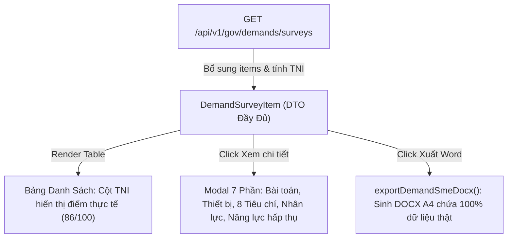

# Change Request: CR-2026-027 Chuẩn Hóa Dữ Liệu Bản Ghi Phiếu Nhu Cầu DNNVV — Modal 7 Phần & Xuất Word (.docx) Động

**CR-ID**: CR-2026-027  
**Epic**: TASK-09_DANH_GIA_TRINH_DO_NANG_LUC_CONG_NGHE_TT17 (Liên phân hệ với TASK-03)  
**Status**: APPROVED_BY_PO  
**Target Version**: 1.6.0  
**Author**: Product Owner kiêm Senior BA (`nacen-po-pm` & `nacen-ba`)  
**Date**: 2026-11-04  
**Căn cứ pháp lý & Thiết kế cơ sở**:
1. Quyết định PO `PO-DEC-20261104-01` tại `Specification/02_BASIC_DESIGN/TASK-03_HO_SO_TIM_MUA_BUYER/SPEC_PHIEU_KHAO_SAT_NHU_CAU_CONG_NGHE_DNNVV.md` Mục 11.
2. Luật Hỗ trợ Doanh nghiệp nhỏ và vừa 2017 & Nghị định 80/2021/NĐ-CP.
3. Công thức chuẩn hóa chỉ số cấp thiết công nghệ TNI 4 chiều ($K \times 35 + L \times 30 + N \times 20 + O \times 15)/5$.
4. Hiến pháp Quản lý Đặc tả `SourceCode/specs/SPEC_MANAGEMENT_CONSTITUTION.md`.

---

### 1. Bối Cảnh & Lý Do Thay Đổi (Why)

- **Hiện trạng cũ (As-Is)**:
  1. Trong CSDL PostgreSQL (`demand.demand_surveys` & `demand.demand_items`), dữ liệu phiếu khảo sát nhu cầu DNNVV (mã `#SUR-...`) được thu thập rất chi tiết: bài toán kỹ thuật, giải pháp AI Vision, thiết bị máy móc, 8 tiêu chí trình độ công nghệ, khâu khó nhất, nguyên nhân, nhân lực, năng lực hấp thụ, định hướng và điểm TNI ($= 86/100$).
  2. Tuy nhiên, API Backend `GET /api/v1/gov/demands/surveys` chỉ trả về thông tin bảng cha mà không đính kèm mảng `items`, đồng thời trường `tniScore` của cha bị null khiến cột "ĐIỂM TT17 / XẾP LOẠI" trên giao diện hiển thị nhãn "Chờ tính TNI".
  3. Modal "Xem chi tiết" (`inspectingDemandItem`) chỉ bóc tách 4 nhóm trường cơ bản bề nổi, hoàn toàn không render `surveyDetails` và `items`, tạo cảm giác phiếu khảo sát bị thiếu hụt dữ liệu.
  4. Nút hành động tại từng dòng bản ghi đang bị gán link tải file mẫu trắng `/templates/surveys/phieu_khao_sat_nhu_cau_dnnvv_mau_trang.docx` và đặt nhãn nhầm là "Tải mẫu (.docx)", khiến người dùng tải về file trắng không có bất kỳ dữ liệu nào của doanh nghiệp.

- **Mục tiêu thay đổi (To-Be)**:
  1. **Đồng bộ Điểm TNI & DTO**: API Backend trả về mảng `items` và tự động fallback `tniScore` lấy từ `items.Max(i => i.TniScore)` khi `s.TniScore == null`. Cột bảng danh sách hiển thị đúng điểm số (ví dụ: `TNI: 86` - Cấp thiết).
  2. **Modal Chi Tiết Toàn Diện 7 Phần**: Bóc tách toàn bộ `surveyDetails` và `items` hiển thị thành 7 khối thông tin trực quan theo chuẩn phiếu khảo sát.
  3. **Xuất Word (.docx) Động**: Đổi nhãn nút trên từng dòng thành **"Xuất Word (.docx)"**, kết nối với generator `exportDemandSmeDocx` để điền động 100% dữ liệu thực tế từ database vào file Word chuẩn A4 khi người dùng bấm tải.

---

### 2. Mỏ Neo Yêu Cầu & Quy Tắc Nghiệp Vụ (Requirements & Business Rules)



#### [ADD] `REQ-09-SURVEY-RECORD-001`: Backend API Đính Kèm Items & Đồng Bộ Điểm TNI
- Trong `DemandController.cs`:
  - API `GET /api/v1/gov/demands/surveys` và `GET /api/v1/demands/surveys` phải thực hiện projection trường `items`:
    ```csharp
    items = s.Items.Select(i => new {
        id = i.Id,
        itemCode = i.ItemCode,
        stageName = i.StageName,
        technicalProblem = i.TechnicalProblem,
        desiredSolution = i.DesiredSolution,
        needConsulting = i.NeedConsulting,
        expectedGoal = i.ExpectedGoal,
        applicationScale = i.ApplicationScale,
        budgetRange = i.BudgetRange,
        urgencyScore = i.UrgencyScore,
        impactScore = i.ImpactScore,
        investmentCapacity = i.InvestmentCapacity,
        adoptionReadiness = i.AdoptionReadiness,
        tniScore = i.TniScore
    }).ToList()
    ```
  - Tính toán fallback `tniScore`: Nếu `s.TniScore.HasValue` thì lấy `s.TniScore.Value`; ngược lại nếu `s.Items.Any()` thì lấy `s.Items.Max(i => (decimal?)i.TniScore)`.
  - Tự động map `tniClassification` nếu chưa có: $\ge 75 \to \text{VERY\_HIGH}$, $50-74 \to \text{HIGH}$, $25-49 \to \text{MEDIUM}$, $< 25 \to \text{LOW}$.

#### [ADD] `REQ-09-SURVEY-RECORD-002`: Modal "Xem Chi Tiết" Bóc Tách 7 Phần Nghiệp Vụ
- Modal chi tiết `inspectingDemandItem` tại `SourceCode/frontend/src/app/admin/assessments/records/page.tsx` phải parse an toàn `surveyDetails` và hiển thị đầy đủ 7 khối:
  1. **Khối 1: Bài toán & Nhu cầu công nghệ ưu tiên**: Tên bài toán, giải pháp mong muốn, mục tiêu, ngân sách, thời gian và điểm TNI 4 chiều ($K, L, N, O$).
  2. **Khối 2: Thông tin doanh nghiệp & Người đại diện**: Tên DN, MST, địa chỉ, người liên hệ, chức danh, điện thoại, email, quy mô lao động, doanh thu 3 năm.
  3. **Khối 3: Hiện trạng thiết bị & 8 tiêu chí trình độ công nghệ**: Danh mục máy móc (`currentEquipments`) và thanh điểm 8 tiêu chí (`criteria8` từ 1 đến 5).
  4. **Khối 4: Khâu sản xuất khó nhất & Điểm nghẽn kỹ thuật**: Khâu khó nhất (`hardestStage`), nguyên nhân (`primaryCause`), mức độ nghiêm trọng của điểm nghẽn (`bottlenecksDetail`).
  5. **Khối 5: Thống kê nhân lực kỹ thuật & 9 tiêu chí năng lực hấp thụ**: Lưới thống kê 6 nhóm nhân sự (`technicalPersonnel`) và bảng 9 tiêu chí làm chủ công nghệ (`adoptionCapacity`).
  6. **Khối 6: Định hướng công nghệ 2026–2030 & Nhu cầu hỗ trợ**: Danh mục giải pháp công nghệ tiên tiến (`futureDirections`), nhu cầu hỗ trợ (`supportNeeds`) và đối tác mong muốn (`desiredPartners`).
  7. **Khối 7: Chữ ký điện tử & Dấu thời gian**: Hiển thị ảnh chữ ký của người đại diện (`representativeSignatureUrl`) và ngày gửi phiếu.

#### [ADD] `REQ-09-SURVEY-RECORD-003`: Xuất File Word (.docx) Động Điền Đầy Đủ Dữ Liệu Thật
- Nút bấm hành động trên từng dòng bản ghi đổi nhãn thành **"Xuất Word (.docx)"** (Tooltip: "Xuất file Word (.docx) chứa dữ liệu doanh nghiệp").
- Nút bấm trong Footer của Modal "Xem chi tiết" đổi thành **"Xuất file Word (.docx)"**.
- Khi người dùng click:
  - Hệ thống gọi hàm `exportDemandSmeDocx` trong `@/services/survey-docx-exporter`.
  - Tự động tạo tài liệu OpenXML Word (.docx) chuẩn A4 bao gồm toàn bộ nội dung 7 phần lấy từ bản ghi thực tế trong database.
  - Tải về tệp có định danh chuẩn: `Phieu_Nhu_Cau_DN_{taxCode}_{cleanName}.docx`.

#### [RULE] `BR-09-SURVEY-RECORD-01`: Chuẩn Định Dạng File Word & Chống Lỗi Corrupt
- File `.docx` xuất ra phải đảm bảo cấu trúc OpenXML hợp lệ, bảng mã UTF-8 tiếng Việt không vỡ font, kích thước tệp tối thiểu $\ge 15\text{ KB}$, mở được mượt mà trên Microsoft Word và Google Docs.

#### [RULE] `BR-09-SURVEY-RECORD-02`: Zero-Mock & Đối Soát Trực Tiếp Với PostgreSQL
- Tuyệt đối không mock tĩnh dữ liệu trong modal hoặc export docx. Dữ liệu phải được bóc tách trực tiếp từ payload thật nhận từ Backend API.

---

### 3. Ma Trận Truy Vết (Traceability Matrix)

| Yêu Cầu | Quy Tắc | Tệp Mã Nguồn Can Thiệp | Kịch Bản Kiểm Thử |
| :--- | :--- | :--- | :--- |
| `REQ-09-SURVEY-RECORD-001` | `BR-09-SURVEY-RECORD-02` | `DemandController.cs`, `assessment-tt17.ts` | `TC-CR027-API-001`: API trả về mảng `items` và `tniScore = 86`. |
| `REQ-09-SURVEY-RECORD-002` | `BR-09-SURVEY-RECORD-02` | `records/page.tsx` | `TC-CR027-UI-001`: Modal render đầy đủ 7 khối thông tin. |
| `REQ-09-SURVEY-RECORD-003` | `BR-09-SURVEY-RECORD-01` | `survey-docx-exporter.ts`, `records/page.tsx` | `TC-CR027-DOCX-001`: Xuất DOCX, giải nén XML verify MST và dữ liệu thật. |
