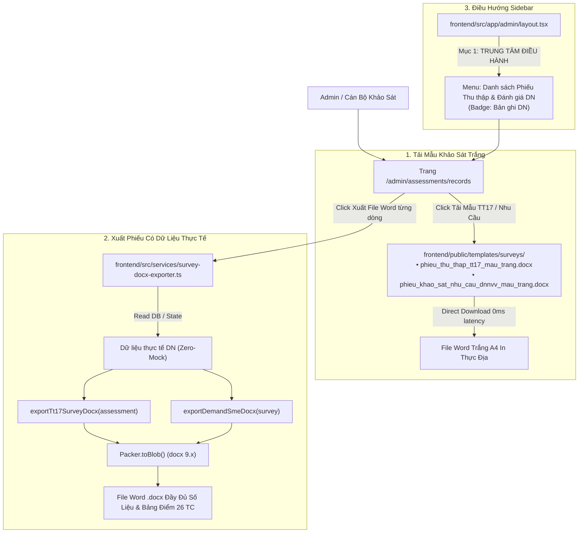

# Kế Hoạch Kiến Trúc & Kỹ Thuật (Implementation Plan)
# TASK-09: ĐÁNH GIÁ TRÌNH ĐỘ & NĂNG LỰC CÔNG NGHỆ SẢN XUẤT (TT17)

> **Mã Epic**: `TASK-09_DANH_GIA_TRINH_DO_NANG_LUC_CONG_NGHE_TT17`  
> **Version**: 1.7.0  
> **Kiến trúc áp dụng**: Clean Architecture .NET 10 + Next.js 15 App Router + Hybrid JSONB (`ADR-0013`, `ADR-0018`)  
> **Status**: In Implementation (CR-BACLINK-006)  

---

## 1. THIẾT KẾ HỢP ĐỒNG API (CONTRACT-FIRST)

### 1.1. Endpoints
- `GET /api/v1/assessments/tt17/current`: Lấy thông tin bản đánh giá của năm hiện tại hoặc bản nháp gần nhất của DN.
- `GET /api/v1/assessments/tt17/history`: Lấy danh sách lịch sử các kỳ đánh giá (Yearly Snapshots) của DN.
- `GET /api/v1/assessments/tt17/{id}`: Lấy chi tiết hồ sơ đánh giá và điểm số theo ID.
- `POST /api/v1/assessments/tt17`: Khởi tạo kỳ đánh giá mới cho một năm cụ thể.
- `PUT /api/v1/assessments/tt17/{id}/draft`: Lưu nháp (Auto-Save Debounce) toàn bộ dữ liệu Phụ lục I.
- `POST /api/v1/assessments/tt17/{id}/calculate`: Gọi Engine tính điểm tức thời (Real-time Calculator) mà không cần ghi DB.
- `POST /api/v1/assessments/tt17/{id}/submit`: Đóng băng hồ sơ thành Snapshot bất biến và chuyển sang trạng thái `SUBMITTED`.
- `GET /api/v1/gov/assessments/tt17`: [Cán bộ Sở] Lấy danh sách hàng đợi hồ sơ địa bàn (`ScopeId`).
- `POST /api/v1/gov/assessments/tt17/{id}/review`: [Cán bộ Sở] Thẩm định hồ sơ (`APPROVE`, `REJECT`, `REQUEST_CHANGES`, hiệu chỉnh điểm).

### 1.2. Cấu trúc DTO Lõi
```csharp
public sealed class Tt17AssessmentDto
{
    public Guid Id { get; set; }
    public Guid EnterpriseId { get; set; }
    public string EnterpriseName { get; set; } = "";
    public string TaxCode { get; set; } = "";
    public int AssessmentYear { get; set; }
    public string Status { get; set; } = "DRAFT";
    public string ScopeType { get; set; } = "PROVINCE";
    public string ScopeId { get; set; } = "";
    public Tt17SurveyDataDto SurveyData { get; set; } = new();
    public Tt17ScoreResultDto ScoreResult { get; set; } = new();
    public DateTimeOffset CreatedAt { get; set; }
    public DateTimeOffset? SubmittedAt { get; set; }
    public DateTimeOffset? ApprovedAt { get; set; }
}

public sealed class Tt17ScoreResultDto
{
    public double ScoreT { get; set; } // Max 30
    public double ScoreE { get; set; } // Max 20
    public double ScoreO { get; set; } // Max 19
    public double ScoreR { get; set; } // Max 17
    public double ScoreI { get; set; } // Max 14
    public double TotalScore { get; set; } // Max 100
    public double SyncCoefficient { get; set; } // T_ĐB
    public string Classification { get; set; } = ""; // LAC_HAU, TRUNG_BINH, TRUNG_BINH_TIEN_TIEN, TIEN_TIEN, CAN_THAM_DINH
    public List<CriterionScoreDto> Criteria { get; set; } = new(); // 26 tiêu chí
    public List<string> Bottlenecks { get; set; } = new(); // Danh sách mã điểm nghẽn
}
```

---

## 2. THIẾT KẾ BACKEND .NET 10 (CLEAN ARCHITECTURE)

- **Domain Layer (`NacenTech.Modules.Assessment`)**:
  - `Tt17Assessment`: Aggregate Root quản lý vòng đời hồ sơ, kiểm tra điều kiện chuyển trạng thái.
  - Value Objects & Models: `SurveyData`, `ScoreResult`, `MachineryItem`, `CriterionScore`.
  - Domain Invariants: Kiểm tra tính hợp lệ chuỗi 3 năm tài chính, công thức lũy thừa $T_{ĐB}$.
- **Application Layer**:
  - `Tt17ScoringEngine`: Hiện thực hóa chính xác thuật toán 26 tiêu chí, chia 5 nhóm T-E-O-R-I.
  - Commands & Queries: `CreateAssessmentCommand`, `SaveDraftCommand`, `SubmitAssessmentCommand`, `ReviewAssessmentCommand`, `GetAssessmentByIdQuery`.
  - Phân quyền: Cưỡng chế 3D Scoped RBAC qua `ICurrentActor.ValidateScopeAccess()`.
- **Infrastructure / Persistence Layer**:
  - EF Core Configuration sử dụng kiểu cột PostgreSQL `jsonb` cho `SurveyData` và `ScoreResult`.
  - Áp dụng `ValueComparer` để EF Core Change Tracker nhận diện đúng khi mảng JSONB thay đổi.

---

## 3. THIẾT KẾ FRONTEND NEXT.JS 15 (UI/UX 4 MÀN HÌNH)

- **Kiến trúc Component**:
  - `src/app/(portal)/assessments/tt17/page.tsx`: Màn 1 — Dashboard lịch sử và trung tâm đánh giá.
  - `src/app/(portal)/assessments/tt17/wizard/page.tsx`: Màn 2 — Form Wizard 6 bước + Sticky Realtime Calculator.
  - `src/app/(portal)/assessments/tt17/[id]/report/page.tsx`: Màn 3 — Báo cáo Phụ lục II/IV + Radar Chart + Điểm nghẽn liên thông TASK-03.
  - `src/app/gov/assessments/tt17/page.tsx`: Màn 4 — Cổng thẩm định hồ sơ của Sở KH&CN theo địa bàn.
- **Thư viện & Công nghệ**:
  - `react-hook-form` quản lý trạng thái form khối lớn với `useFieldArray` cho danh mục máy móc động.
  - `recharts` hoặc SVG thuần để vẽ biểu đồ mạng nhện Radar Chart 5 đỉnh chuẩn nét.
  - Component chuẩn `<Async>` bọc toàn bộ giao diện đảm bảo 5 trạng thái UX (Loading, Empty, Error, Success, Partial).
  - Tuân thủ nghiêm ngặt Design Token System (`slate`, `emerald`, `brand`, font $\ge$ 12px).

---

## 4. THIẾT KẾ DELTA: PUBLIC SURVEY INTAKE & AUTO-PROVISIONING (PO-DEC-20261012-08)

- **Public Survey Intake**: Form Wizard (`/assessments/tt17/wizard`) không chặn xác thực, cho phép bất kỳ doanh nghiệp nào nhận link đều có thể kê khai trực tiếp và xem kết quả tính điểm thời gian thực.
- **Thu thập định danh Mục A**: Bổ sung bắt buộc: Tên Doanh nghiệp, Mã số thuế (MST), Họ tên người đại diện liên hệ, Email, Số điện thoại.
- **Auto-Provisioning Engine Backend (`POST /api/v1/assessments/tt17/submit`)**:
  - Khi người dùng chưa đăng nhập bấm nộp bài:
    * Kiểm tra CSDL xem MST đã tồn tại chưa.
    * Nếu chưa: Tự động khởi tạo `EnterpriseProfile` và User mới với vai trò `ENTERPRISE`.
    * Đóng băng dữ liệu khảo sát thành Snapshot bất biến, gán `enterprise_id` và trạng thái `SUBMITTED`.
    * Trả về kết quả đánh giá kèm thông tin tài khoản tự động sinh để FE hiển thị.
- **Hub UI Zero Data Leak (`/assessments/tt17`)**:
  - Khi người dùng chưa đăng nhập hoặc chưa có hồ sơ đánh giá: Tuyệt đối không hiển thị dữ liệu mẫu 80.7đ của doanh nghiệp khác.
  - Thay vào đó hiển thị **Hero Banner Khảo Sát Năng Lực Công Nghệ** + nút CTA lớn *"Bắt Đầu Kê Khai Khảo Sát"* dẫn thẳng vào Wizard.
  - Khi Doanh nghiệp đã nộp bài: Hiển thị bảng tổng hợp và lịch sử các năm của chính DN đó.

---

## 5. THIẾT KẾ KỸ THUẬT CR-2026-021: QUẢN TRỊ BẢN GHI PHIẾU & XUẤT VĂN BẢN WORD (.DOCX) CHUẨN A4



### 5.1. Kiến Trúc Lưu Trữ Mẫu Biểu Tĩnh (`frontend/public/templates/surveys/`)
- **Vị trí vật lý**: `SourceCode/frontend/public/templates/surveys/`
- **Tập tin định dạng sẵn**:
  * `phieu_thu_thap_tt17_mau_trang.docx`: Mẫu phiếu thu thập hiện trạng công nghệ theo Phụ lục I Thông tư 17/2019/TT-BKHCN khổ A4 dọc, có Quốc hiệu Tiêu ngữ, bảng thiết bị máy móc, ma trận số liệu tài chính 3 năm, tiêu chí Mục A-E, dòng trống kẻ chấm và khu vực ký 3 bên.
  * `phieu_khao_sat_nhu_cau_dnnvv_mau_trang.docx`: Mẫu phiếu khảo sát nhu cầu đổi mới sáng tạo, chuyển đổi số DNNVV theo Luật Hỗ trợ DNNVV và Nghị định 80/2021/NĐ-CP, bảng khảo sát nhu cầu 15 nhóm công nghệ, biểu mẫu ngân sách và đề xuất kết nối.
- **Ưu điểm kiến trúc**: Tải trực tiếp qua Web Server / CDN tĩnh với header `Content-Disposition: attachment`, không tiêu tốn tài nguyên tính toán server, mở mượt mà 100% không cảnh báo XML.

### 5.2. Kiến Trúc Service Sinh DOCX Động (`SourceCode/frontend/src/services/survey-docx-exporter.ts`)
- **Thư viện chuẩn**: Sử dụng `docx` (Office OpenXML JS engine) tạo cấu trúc văn bản phân cấp gồm: `Document`, `Paragraph`, `Table`, `TableRow`, `TableCell`, `WidthType`, `BorderStyle`.
- **Cấu trúc hàm & Interface**:
  ```typescript
  export async function exportTt17SurveyDocx(assessment: Tt17Assessment): Promise<Blob>;
  export async function exportDemandSmeDocx(record: DemandSmeSurveyRecord): Promise<Blob>;
  export function downloadDocxBlob(blob: Blob, filename: string): void;
  ```
- **Nội dung sinh động cho Phiếu TT17**:
  1. **Quốc hiệu & Tiêu ngữ**: Bảng 2 cột không viền chuẩn thể thức văn bản hành chính Việt Nam (Nghị định 30/2020/NĐ-CP).
  2. **Tiêu đề & Căn cứ**: Khổ A4, font Times New Roman, lề Trái 30mm, Trên/Dưới 20mm, Phải 20mm.
  3. **Mục A (Pháp nhân)**: Tên DN, MST, Địa chỉ trụ sở, Nhà máy, Vốn, Lao động, Ngành cấp 2 C.10-C.32.
  4. **Mục B (Máy móc thiết bị)**: Bảng chi tiết danh mục dây chuyền thiết bị đã nhập kèm chỉ tiêu tài chính nguyên giá $G_{bđ}$, giá trị còn lại $G_{sx}$, đầu tư mới $G_{tbm1}, G_{tbm2}$, thiết bị số hóa $G_{sh}$.
  5. **Mục C (Tài chính 3 năm)**: Ma trận số liệu 3 năm $G_{sp}, G_{dt}, G_{cp}, P, G_{nl}, G_{nvl}, M_{tt}$ và tiêu chuẩn chất lượng sản phẩm.
  6. **Mục D & Đ (Nhân lực, Quản trị, R&D)**: Cơ cấu lao động, chi phí đào tạo, phần mềm quản lý, CNTT và R&D.
  7. **Mục E & Bảng Tổng Hợp Điểm 26 Tiêu Chí TT17**:
     - Bảng điểm chi tiết 26 tiêu chí phân theo 5 nhóm T-E-O-R-I với Cột: Mã TC, Tên tiêu chí, Điểm tối đa, Điểm đạt được, Ghi chú/Điểm nghẽn.
     - Hộp tóm tắt xếp loại: Điểm tổng kết $\tau$ (Thang 100), Hệ số đồng bộ $T_{ĐB}$, và Phân hạng trình độ công nghệ (`TIEN_TIEN`, `TRUNG_BINH_TIEN_TIEN`, `TRUNG_BINH`, `LAC_HAU`, `CAN_THAM_DINH`).
- **Nội dung sinh động cho Phiếu Khảo Sát Nhu Cầu DNNVV**:
  - Thông tin DN, người liên hệ, lĩnh vực hoạt động, quy mô DNNVV.
  - Hiện trạng máy móc thiết bị và phần mềm quản lý.
  - Bảng tổng hợp nhu cầu công nghệ tìm kiếm: tên giải pháp, hình thức nhu cầu, dự toán kinh phí, thời gian triển khai.
  - Nhu cầu kết nối chuyên gia và chính sách hỗ trợ từ Nhà nước.
- **Nguyên tắc bảo vệ dữ liệu Zero-Mock (`BR-SURVEY-DOC-02`)**:
  - Trích xuất 100% dữ liệu có thật từ hồ sơ doanh nghiệp.
  - Các trường rỗng hiển thị `"---"` hoặc dòng kẻ chấm `"................"`.
  - MIME type: `application/vnd.openxmlformats-officedocument.wordprocessingml.document`.

### 5.3. Kiến Trúc Giao Diện `/admin/assessments/records`
- **Vị trí menu Sidebar**: Thêm vào `SourceCode/frontend/src/app/admin/layout.tsx` tại **Mục 1: TRUNG TÂM ĐIỀU HÀNH**, URL `/admin/assessments/records`, nhãn `"Danh sách Phiếu Thu thập & Đánh giá DN"`, badge `"Bản ghi DN"`.
- **Trang quản trị**: `SourceCode/frontend/src/app/admin/assessments/records/page.tsx`:
  * **Header**: Tiêu đề trang + 2 nút tải template trắng A4 (kết nối trực tiếp tới `/templates/surveys/*.docx`).
  * **Filter Bar**: Dropdown 34 Tỉnh/Thành phố (`PROVINCES_34`), Loại phiếu (`ALL`, `TT17`, `SME_DEMAND`), Trạng thái (`ALL`, `DRAFT`, `SUBMITTED`, `IN_REVIEW`, `APPROVED`), và Ô tìm kiếm MST / Tên DN.
  * **Component `<Async>` 5 UX States**:
    1. *Loading*: 6 dòng Skeleton Table với hiệu ứng shimmer.
    2. *Empty*: Empty State box khi bộ lọc không có bản ghi phù hợp.
    3. *Error*: Khung cảnh báo đỏ kèm nút retry.
    4. *Success*: Bảng bản ghi đầy đủ, phân trang 10/25/50, nút *"Xuất file Word"* (Icon `Download`) kích hoạt hàm export realtime.
    5. *Updating/Exporting*: Spinner hiển thị tại nút xuất, disable chống double-click.


---

### 5.4. Kiến Trúc Bộ Tam Hợp 3 Phiếu Khảo Sát & Dynamic Context Filtering (`CR-2026-026`)

#### 1. Nguyên Tắc Thiết Kế Cụm 3 Nút Header
- **Bộ 3 Nút Tải Template Mẫu Trắng A4 Hành Chính**:
  * Nút 1: `Tải mẫu Đánh giá TT17 (.docx)` $\rightarrow$ URL: `/templates/surveys/phieu_thu_thap_tt17.docx` (Theme: Cyan-600).
  * Nút 2: `Tải mẫu Khảo sát ĐMST (.docx)` $\rightarrow$ URL: `/templates/surveys/phieu_khao_sat_dmst_43_cau_mau_trang.docx` (Theme: Violet-600).
  * Nút 3: `Tải mẫu Nhu cầu DNNVV (.docx)` $\rightarrow$ URL: `/templates/surveys/phieu_khao_sat_nhu_cau_dnnvv_mau_trang.docx` (Theme: Teal-600).
- **Tính khả dụng**: Đáp ứng đầy đủ thuộc tính `download`, `rel="noopener noreferrer"`, kiểm tra HTTP status 200 tại build time.

#### 2. Kiến Trúc Bộ Lọc Điều Kiện Động (Dynamic Context Filter Engine)
- **State Management**:
  * `surveyTypeFilter`: `'ALL' | 'TT17' | 'INNOVATION' | 'SME_DEMAND'`
  * `classificationFilter`: Chuỗi phân loại động tương ứng theo loại phiếu.
- **Ma trận ánh xạ Options theo ngữ cảnh**:
  ```typescript
  type SurveyCategory = 'ALL' | 'TT17' | 'INNOVATION' | 'SME_DEMAND';

  interface FilterOption {
    label: string;
    value: string;
  }

  const DYNAMIC_CLASSIFICATION_MAP: Record<SurveyCategory, { label: string; options: FilterOption[] }> = {
    ALL: {
      label: 'Phân loại / Xếp loại',
      options: [{ label: 'Tất cả xếp loại', value: 'ALL' }],
    },
    TT17: {
      label: 'Xếp loại trình độ TT17',
      options: [
        { label: 'Tất cả xếp loại', value: 'ALL' },
        { label: 'Tiên tiến (≥ 75đ & T_ĐB ≥ 0.75)', value: 'TIEN_TIEN' },
        { label: 'Khá / TB Tiên tiến (60–74đ)', value: 'KHA' },
        { label: 'Trung bình (50–59đ)', value: 'TRUNG_BINH' },
        { label: 'Lạc hậu (< 50đ)', value: 'LAC_HAU' },
      ],
    },
    INNOVATION: {
      label: 'Phân tầng năng lực ĐMST',
      options: [
        { label: 'Tất cả phân tầng', value: 'ALL' },
        { label: 'Dẫn đầu (Leading - ≥ 75đ)', value: 'LEADING' },
        { label: 'Đang phát triển (Developing - 50–74đ)', value: 'DEVELOPING' },
        { label: 'Tiềm năng (Potential - < 50đ)', value: 'POTENTIAL' },
        { label: 'Chưa đánh giá (Unrated)', value: 'UNRATED' },
      ],
    },
    SME_DEMAND: {
      label: 'Mức độ cấp thiết TNI',
      options: [
        { label: 'Tất cả mức độ', value: 'ALL' },
        { label: 'Rất cao (TNI ≥ 75)', value: 'VERY_HIGH' },
        { label: 'Cao (TNI 60–74)', value: 'HIGH' },
        { label: 'Trung bình (TNI 45–59)', value: 'MEDIUM' },
        { label: 'Thấp (TNI < 45)', value: 'LOW' },
      ],
    },
  };
  ```
- **Hành vi Reset**: Khi thay đổi `surveyTypeFilter`, hệ thống tự động reset `classificationFilter` về `'ALL'` để tránh xung đột dữ liệu giữa các thang đo.

---

## 9. KẾ HOẠCH THIẾT KẾ KIẾN TRÚC CR-2026-027 (ARCHITECTURE PLAN)

### 9.1. Backend API DTO Enrichment (`DemandController.cs`)
- Bổ sung projection `items` vào DTO trả về của `GET /api/v1/gov/demands/surveys`:
  ```csharp
  items = s.Items.Select(i => new
  {
      id = i.Id,
      itemCode = i.ItemCode,
      stageName = i.StageName,
      technicalProblem = i.TechnicalProblem,
      desiredSolution = i.DesiredSolution,
      needConsulting = i.NeedConsulting,
      expectedGoal = i.ExpectedGoal,
      applicationScale = i.ApplicationScale,
      budgetRange = i.BudgetRange,
      urgencyScore = i.UrgencyScore,
      impactScore = i.ImpactScore,
      investmentCapacity = i.InvestmentCapacity,
      adoptionReadiness = i.AdoptionReadiness,
      tniScore = i.TniScore
  }).ToList(),
  tniScore = s.TniScore ?? (s.Items.Any() ? s.Items.Max(i => (decimal?)i.TniScore) : null),
  tniClassification = s.TniClassification ?? (
      (s.TniScore ?? (s.Items.Any() ? s.Items.Max(i => (decimal?)i.TniScore) : null)) switch
      {
          >= 75 => "VERY_HIGH",
          >= 50 => "HIGH",
          >= 25 => "MEDIUM",
          > 0 => "LOW",
          _ => null
      }
  )
  ```

### 9.2. Frontend Type & Modal Enrichment (`page.tsx` & `assessment-tt17.ts`)
- Cập nhật `DemandSurveyItem` trong `assessment-tt17.ts`:
  ```typescript
  export interface DemandSurveyDetailItem {
    id: string;
    itemCode?: string;
    stageName?: string;
    technicalProblem?: string;
    desiredSolution?: string;
    needConsulting?: boolean;
    expectedGoal?: string;
    applicationScale?: string;
    budgetRange?: string;
    urgencyScore?: number;
    impactScore?: number;
    investmentCapacity?: number;
    adoptionReadiness?: number;
    tniScore?: number;
  }

  // Bổ sung vào DemandSurveyItem:
  items?: DemandSurveyDetailItem[];
  ```
- Parser an toàn `surveyDetails` trong React component:
  ```typescript
  const details = useMemo(() => {
    if (!inspectingDemandItem?.surveyDetails) return null;
    if (typeof inspectingDemandItem.surveyDetails === "object") return inspectingDemandItem.surveyDetails;
    try {
      return JSON.parse(inspectingDemandItem.surveyDetails);
    } catch {
      return null;
    }
  }, [inspectingDemandItem]);
  ```

### 9.3. Dynamic DOCX Generator (`survey-docx-exporter.ts`)
- Nâng cấp `exportDemandSmeDocx(target: DemandSurveyItem)`:
  - Sinh toàn bộ 7 phần chuẩn mực A4 theo OpenXML.
  - Sử dụng `safeText`, `createAdministrativeHeader`, `createParagraph`, `makeTableCell`.
  - Nhúng ảnh chữ ký điện tử nếu có URL hợp lệ.

---

## 10. PLAN DELTA V1.7.0 (CR-BACLINK-006): ĐÁNH GIÁ NĂNG LỰC NHÀ MÁY & CĐS BACLINK, MAPPING 8 NGÀNH `IND_*` (Q2)

> **Change Request**: `CR-BACLINK-006` | **Quyết định**: `ADR-0018`, `open-questions.md` (**Q2**), `PO-DEC-BACLINK-04`  
> **Coverage**: `REQ-09-BL-01`, `REQ-09-BL-02`, `BR-09-BL-01`, `BR-09-BL-02`, `AC-09-BL-01`..`AC-09-BL-03`

### 10.1. Bảng Ánh Xạ Trọng Số Từ 8 Mã `IND_*` Trong `Tt17ScoringEngine.cs` (`BR-09-BL-01`, Q2)

- **Nguyên tắc bảo toàn (Q2)**: Giữ nguyên hoàn toàn công thức tính 26 tiêu chí T-E-O-R-I, hệ số đồng bộ $T_{ĐB}$, `Benchmarks` (`C.10`–`C.32`) và Yearly Snapshot trong `SourceCode/backend/modules/assessment/NacenTech.Modules.Assessment/Application/Tt17ScoringEngine.cs`.
- **Cơ chế ánh xạ 8 mã ngành BACLINK (`IND_*`) & Fallback chuẩn BACLINK**:
  - Bổ sung `BaclinkIndustryBenchmarks` và hàm `ResolveBenchmark(string? industryCode)` trong `Tt17ScoringEngine.cs`:
    - Nếu `industryCode` khớp trực tiếp key trong `Benchmarks` (`C.10`–`C.32`) $\rightarrow$ dùng trực tiếp để bảo toàn tương thích ngược.
    - Nếu `industryCode` thuộc 8 mã `IND_*` của BACLINK $\rightarrow$ ánh xạ sang bộ trọng số công nghiệp tương ứng:

| Mã Ngành BACLINK | Tên Ngành Công Nghiệp BACLINK | Mã Ánh Xạ (`Tt17ScoringEngine`) | Nhóm Tham Chiếu (`KChuan1..4`) |
| :--- | :--- | :---: | :--- |
| `IND_ELEC` | Điện tử, Bán dẫn & Thiết bị điện | `C.26` | Sản phẩm điện tử, máy vi tính & quang học |
| `IND_MECH` | Cơ khí chính xác, Khuôn mẫu & Chế tạo máy | `C.25` | Sản xuất sản phẩm từ kim loại đúc sẵn |
| `IND_AUTO` | Tự động hóa, Robot & Smart Factory | `C.28` | Sản xuất máy móc, thiết bị chuyên dụng |
| `IND_PLAS` | Nhựa kỹ thuật, Bao bì & Hóa chất công nghiệp | `C.22` | Sản xuất sản phẩm từ cao su và plastic |
| `IND_MAT` | Vật liệu mới & Công nghiệp hỗ trợ | `C.24` | Sản xuất kim loại & vật liệu nền |
| `IND_IT` | CNTT, Phần mềm công nghiệp & MES/ERP | `C.26` | Công nghệ cao & thiết bị điện tử/điều khiển |
| `IND_GREEN` | Công nghiệp xanh, Năng lượng sạch & ESG | `C.32` | Công nghiệp chế biến, chế tạo khác |
| `IND_LOG` | Logistics công nghiệp, Kho vận & Chuỗi cung ứng | `C.29` | Sản xuất phương tiện & hạ tầng vận tải |
| *(Fallback)* | Mã ngoài bảng / trống / chưa xác định | `BACLINK_DEFAULT` | `KChuan1=250, KChuan2=0.07, KChuan3=0.55, KChuan4=150` |

### 10.2. Khóa `[AllowAnonymous]` Trên `/gov/assessments/tt17*` & Duyệt 1 Cấp `ADMIN` (`BR-09-BL-02`)

- **Tại `SourceCode/backend/apps/api/V2/AssessmentsController.cs`**:
  - **Khóa endpoint `/gov/*`**: Gỡ `[AllowAnonymous]` khỏi `GetGovAssessmentQueue` (`GET /api/v1|v2/gov/assessments/tt17`, dòng 430) và `GetTt17Dashboard` (`GET /api/v1|v2/gov/assessments/tt17/dashboard`, dòng 462). Bắt buộc `[Authorize(Roles = "ADMIN")]` hoặc trả `410 Gone` cho các route `/gov/assessments/tt17*`; tách riêng route quản trị `/api/v1|v2/admin/assessments/tt17/dashboard` có `[Authorize(Roles = "ADMIN,SUPER_ADMIN,OPERATOR_ADMIN")]` (theo chuẩn hóa `PlatformRoles.NormalizeTier`).
  - **Chuẩn hóa `NormalizeScopeId` & `IndustryCode` mặc định**: Trong `AssessmentsController.cs` (dòng 29, 91, 159, 244, 323, 562), bỏ mặc định `"HN"` và `"C.10"` $\rightarrow$ mặc định `ScopeId = "GLOBAL"` (hoặc mã địa bàn/KCN Bắc Ninh hợp lệ) và `IndustryCode = "IND_ELEC"` / `"BACLINK_DEFAULT"`.
  - **Quy trình nghiệm thu 1 cấp**: `ReviewAssessment` chỉ yêu cầu `ADMIN` Hiệp hội BACLINK (bỏ thẩm định cấp Sở KH&CN).

### 10.3. Cập Nhật Template Xuất Word `.docx` & Giao Diện BACLINK (`REQ-09-BL-01`, `REQ-09-BL-02`)

- **DOCX Exporters (`SourceCode/frontend/src/services/survey-docx-exporter.ts`, `SourceCode/frontend/src/services/tt17-docx-template-filler.ts`)**:
  - Cập nhật `createAdministrativeHeader`, tiêu đề, cơ quan chủ quản, chân trang (từ `BỘ KHOA HỌC VÀ CÔNG NGHỆ` / `Sở KH&CN` / `NacenTech` tại `survey-docx-exporter.ts:198` và `tt17-docx-template-filler.ts:912`) sang **Hiệp hội Sản xuất Công nghiệp tỉnh Bắc Ninh (BACLINK)**, bảo đảm chuẩn A4 OpenXML Unicode, kích thước $\ge 15\text{ KB}$, không corrupt XML.
  - Cập nhật 2 mẫu trắng thực địa tại `SourceCode/frontend/public/templates/surveys/` (khi tải từ `/admin/assessments/records`).
- **Frontend UI & Local Scoring (`SourceCode/frontend/src/services/api/assessment-tt17.ts`, `src/app/(portal)/assessments/tt17/**`, `src/app/admin/assessments/tt17/page.tsx`, `src/app/admin/assessments/records/page.tsx`)**:
  - Đồng bộ bảng ánh xạ 8 mã `IND_*` + fallback BACLINK vào `calculateLocalScore` trong `assessment-tt17.ts`.
  - Tái định vị toàn bộ UI sang **Đánh giá Năng lực Nhà máy & Chuyển đổi số BACLINK**, thay bộ lọc 34 tỉnh tại `/admin/assessments/records` bằng địa bàn/KCN Bắc Ninh.

