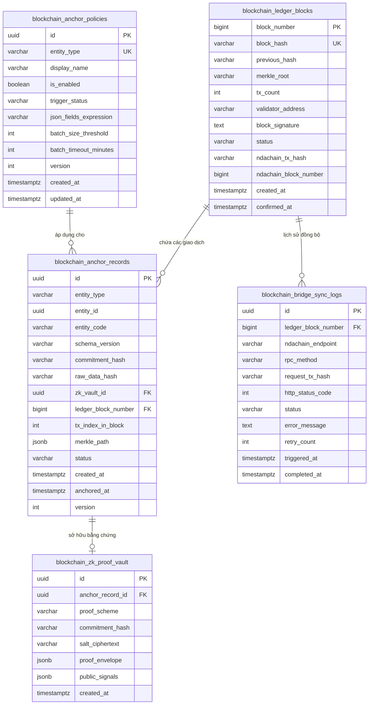
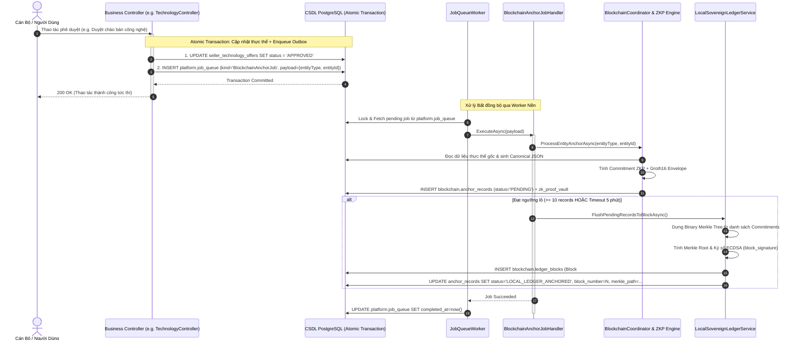

# KẾ HOẠCH KIẾN TRÚC KỸ THUẬT (TECHNICAL PLAN)
## PHÂN HỆ: HẠ TẦNG LIÊN THÔNG NDACHAIN (BỘ CÔNG AN) & BẢO CHỨNG MẬT MÃ ZKPROOF (TASK-11)

> **Mã Epic**: `TASK-11_HA_TANG_BLOCKCHAIN_NDACHAIN_VA_ZKPROOF`  
> **Kiến trúc áp dụng**: Clean Architecture .NET 10 LTS Modular Monolith + Hexagonal Ports & Adapters + Next.js 15 App Router + PostgreSQL 16 Cryptographic Ledger  
> **Tài liệu quyết định kiến trúc**: [`ADR-0017: Entity-Agnostic Blockchain & ZKP Anchoring Engine`](../../backend/docs/decisions/ADR-0017-ENTITY-AGNOSTIC-BLOCKCHAIN-AND-ZKP-ANCHORING-ENGINE.md)  
> **Căn cứ nghiệp vụ**: [`Specification/BASIC_DESIGN_NACENTECH.md`](file:///Users/luongdt/Library/CloudStorage/GoogleDrive-luongdt.wi@gmail.com/My%20Drive/NacenTechProject/Specification/BASIC_DESIGN_NACENTECH.md) Mục 24 (Quyết định `PO-DEC-20261102-06`) & Walking Skeleton WS-06  

---

### 1. KIẾN TRÚC TỔNG THỂ & PHÂN TẦNG CLEAN ARCHITECTURE

Tạo module mới `SourceCode/backend/modules/blockchain/` độc lập, tuân thủ nguyên tắc cách ly ranh giới và Hexagonal Architecture:

```text
SourceCode/backend/modules/blockchain/
├── NacenTech.Blockchain.csproj
├── BlockchainModule.cs (Đăng ký DI, Schema "blockchain", Module Registry)
├── Domain/
│   ├── Enums/
│   │   ├── AnchorStatus.cs (PENDING, LOCAL_LEDGER_ANCHORED, NDACHAIN_SUBMITTED, NDACHAIN_CONFIRMED, FAILED)
│   │   ├── BlockStatus.cs (COMMITTED, NDACHAIN_PENDING, NDACHAIN_SYNCED)
│   │   └── VerificationVerdict.cs (VERIFIED, TAMPERED, NOT_ANCHORED, BLOCK_UNCONFIRMED)
│   ├── Entities/
│   │   ├── AnchorPolicy.cs (AggregateRoot - Chính sách neo đa thực thể)
│   │   ├── AnchorRecord.cs (AggregateRoot - Bản ghi neo mật mã của từng thực thể)
│   │   ├── LedgerBlock.cs (AggregateRoot - Khối sổ cái chuỗi nội bộ có chữ ký số)
│   │   ├── ZkProofVaultRecord.cs (Bằng chứng không kiến thức & Envelope mật mã)
│   │   └── BridgeSyncLog.cs (Nhật ký đồng bộ với NDAChain)
│   └── Invariants/
│       └── BlockchainBusinessRules.cs (BR-BC-01 đến BR-BC-08)
├── Application/
│   ├── Ports/
│   │   ├── IZkProofService.cs (Port tạo Cam kết và Bằng chứng ZKP)
│   │   ├── IBlockchainAnchorGateway.cs (Port giao tiếp Sổ cái chuỗi khối)
│   │   └── IMerkleTreeEngine.cs (Port dựng cây Merkle và tạo Audit Path)
│   ├── Services/
│   │   ├── BlockchainAnchoringCoordinatorService.cs (Điều phối toàn trình neo dữ liệu)
│   │   ├── LocalSovereignLedgerService.cs (Quản lý và đóng khối sổ cái nội bộ PostgreSQL)
│   │   ├── NdaChainGatewayService.cs (Đầu chờ giao tiếp NDAChain JSON-RPC / ChainHub)
│   │   ├── NativeZkProofEngine.cs (Cài đặt RFC 8785 Canonical JSON + Poseidon/SHA + Groth16)
│   │   ├── BinaryMerkleTreeEngine.cs (Cài đặt cây Merkle nhị phân cân bằng)
│   │   └── BlockchainVerificationService.cs (Bộ thẩm định và kiểm chứng toán học trực tuyến)
│   └── Dtos/
│       ├── AnchorPolicyDtos.cs (List, Toggle, Update policies)
│       ├── AnchorRecordDtos.cs (Detail, History, Audit Path)
│       ├── LedgerBlockDtos.cs (Block summary, Block detail, Merkle Tree view)
│       ├── BlockchainVerificationDtos.cs (Live verify request, Verdict details)
│       └── NdaChainBridgeDtos.cs (Bridge status, Sync trigger, Network health)
├── Infrastructure/
│   ├── Persistence/
│   │   ├── BlockchainDbContextConfig.cs (EF Core Fluent API, Schema blockchain, Indexes)
│   │   └── Configurations/ (AnchorPolicyConfig, AnchorRecordConfig, LedgerBlockConfig...)
│   ├── Adapters/
│   │   ├── LocalSovereignLedgerAdapter.cs (Thực thi IBlockchainAnchorGateway cho Local Ledger)
│   │   └── NdaChainGatewayAdapter.cs (Thực thi IBlockchainAnchorGateway cho NDAChain)
│   └── Cryptography/
│       ├── CanonicalJsonSerializer.cs (RFC 8785 JCS implementation)
│       └── PlatformKeyManager.cs (Quản lý cặp khóa ECDSA secp256k1 / Ed25519 nền tảng)
├── Workers/
│   ├── BlockchainAnchorJobHandler.cs (Xử lý job gom lô từ platform.job_queue)
│   └── NdaChainBridgeSyncWorker.cs (Background HostedService đẩy bù lên NDAChain)
└── Api/
    ├── BlockchainAdminController.cs (Quản trị chính sách, khối, bản ghi, bridge)
    └── BlockchainPublicController.cs (Cổng tra cứu công khai & Live Verify Tool)
```

---

### 2. THIẾT KẾ SCHEMA CSDL POSTGRESQL 16 (`blockchain.*`)

Hệ thống thiết lập 5 bảng dữ liệu chuyên biệt trong schema `blockchain`, được cấu hình qua EF Core Fluent API và thực thi bằng Non-Destructive Migration:



#### Chi Tiết Thuộc Tính & Ràng Buộc Các Bảng:

1. **`blockchain.anchor_policies`**:
   - `id uuid PRIMARY KEY`, `entity_type varchar(50) UNIQUE NOT NULL` (e.g., `SELLER_OFFER`, `DEAL_ROOM_MOU`, `TT17_ASSESSMENT`).
   - `display_name varchar(150) NOT NULL`.
   - `is_enabled boolean NOT NULL DEFAULT TRUE`.
   - `trigger_status varchar(50) NOT NULL` (e.g., `APPROVED`, `MOU_SIGNED`).
   - `json_fields_expression varchar(500) NOT NULL` (Danh sách các trường cần băm / bảo chứng).
   - `batch_size_threshold int NOT NULL DEFAULT 10 CHECK (batch_size_threshold >= 1 AND batch_size_threshold <= 500)`.
   - `batch_timeout_minutes int NOT NULL DEFAULT 5 CHECK (batch_timeout_minutes >= 1 AND batch_timeout_minutes <= 60)`.
   - `version int NOT NULL DEFAULT 1` (`IsConcurrencyToken()`).
   - `created_at timestamptz NOT NULL DEFAULT now()`, `updated_at timestamptz NOT NULL DEFAULT now()`.

2. **`blockchain.ledger_blocks`**:
   - `block_number bigint PRIMARY KEY` (Số thứ tự khối tăng dần, Block #0 là Genesis).
   - `block_hash varchar(66) UNIQUE NOT NULL` (0x + 64 hex chars SHA-256).
   - `previous_hash varchar(66) NOT NULL` (Liên kết khối trước, Block #0 là 64 số 0).
   - `merkle_root varchar(66) NOT NULL`.
   - `tx_count int NOT NULL CHECK (tx_count >= 0)`.
   - `validator_address varchar(100) NOT NULL` (Địa chỉ ví Public Key nền tảng NacenTech).
   - `block_signature text NOT NULL` (Chữ ký số ECDSA/Ed25519 của validator ký lên block_hash).
   - `status varchar(30) NOT NULL DEFAULT 'COMMITTED'` (`COMMITTED`, `NDACHAIN_PENDING`, `NDACHAIN_SYNCED`).
   - `ndachain_tx_hash varchar(66) NULL`, `ndachain_block_number bigint NULL`.
   - `created_at timestamptz NOT NULL DEFAULT now()`, `confirmed_at timestamptz NULL`.

3. **`blockchain.anchor_records`**:
   - `id uuid PRIMARY KEY`.
   - `entity_type varchar(50) NOT NULL`.
   - `entity_id uuid NOT NULL`.
   - `entity_code varchar(50) NOT NULL`.
   - `schema_version varchar(20) NOT NULL DEFAULT 'v1.0'`.
   - `commitment_hash varchar(66) NOT NULL` (Cam kết mật mã học ZKP).
   - `raw_data_hash varchar(66) NOT NULL` (SHA-256 của Canonical JSON).
   - `zk_vault_id uuid NULL REFERENCES blockchain.zk_proof_vault(id) ON DELETE SET NULL`.
   - `ledger_block_number bigint NULL REFERENCES blockchain.ledger_blocks(block_number) ON DELETE RESTRICT`.
   - `tx_index_in_block int NULL`.
   - `merkle_path jsonb NULL` (Mảng Audit Path chứa sibling hashes và directions `["L:0x...", "R:0x..."]`).
   - `status varchar(30) NOT NULL DEFAULT 'PENDING'` (`PENDING`, `LOCAL_LEDGER_ANCHORED`, `NDACHAIN_SUBMITTED`, `NDACHAIN_CONFIRMED`, `FAILED`).
   - `created_at timestamptz NOT NULL DEFAULT now()`, `anchored_at timestamptz NULL`.
   - `version int NOT NULL DEFAULT 1` (`IsConcurrencyToken()`).
   - `UNIQUE(entity_type, entity_id)` (Mỗi thực thể tại một thời điểm chỉ có 1 bản ghi neo active).
   - *Indexes*: `ix_anchor_records_status_created_at`, `ix_anchor_records_block_number`.

4. **`blockchain.zk_proof_vault`**:
   - `id uuid PRIMARY KEY`.
   - `anchor_record_id uuid NOT NULL`.
   - `proof_scheme varchar(50) NOT NULL DEFAULT 'Groth16_BN254'`.
   - `commitment_hash varchar(66) NOT NULL`.
   - `salt_ciphertext varchar(500) NOT NULL` (Salt 256-bit mã hóa đối xứng bảo vệ PDPD).
   - `proof_envelope jsonb NOT NULL` (Cấu trúc `pi_a`, `pi_b`, `pi_c`).
   - `public_signals jsonb NOT NULL` (Các tín hiệu công khai phục vụ verify).
   - `created_at timestamptz NOT NULL DEFAULT now()`.
   - *Index*: `ix_zk_proof_vault_commitment`.

5. **`blockchain.bridge_sync_logs`**:
   - `id uuid PRIMARY KEY`.
   - `ledger_block_number bigint NOT NULL REFERENCES blockchain.ledger_blocks(block_number)`.
   - `ndachain_endpoint varchar(255) NOT NULL`.
   - `rpc_method varchar(50) NOT NULL`.
   - `request_tx_hash varchar(66) NULL`.
   - `http_status_code int NULL`.
   - `status varchar(30) NOT NULL` (`SUCCESS`, `FAILED`, `RETRYING`).
   - `error_message text NULL`.
   - `retry_count int NOT NULL DEFAULT 0`.
   - `triggered_at timestamptz NOT NULL DEFAULT now()`, `completed_at timestamptz NULL`.

---

### 3. TÍCH HỢP TRANSACTIONAL OUTBOX & BACKGROUND WORKERS

Cơ chế tạo bản ghi neo tuân thủ nguyên tắc **Không làm chậm luồng nghiệp vụ chính (Non-blocking)** và **Đảm bảo không mất dữ liệu (At-least-once Delivery)** qua `platform.job_queue`:



---

### 4. THIẾT KẾ CÁC HỢP ĐỒNG API (RESTFUL CONTRACTS)

#### 4.1. Nhóm API Quản Trị Cấp Cao (`/api/v1/admin/blockchain/*`)
*Quyền truy cập*: `ADMIN`, `SUPER_ADMIN`, `OPERATOR_ADMIN`.

1. **Quản Lý Chính Sách Neo (`/policies`)**:
   - `GET /api/v1/admin/blockchain/policies`: Trả về danh sách chính sách đa thực thể kèm trạng thái bật/tắt và số lượng bản ghi đã neo.
   - `PUT /api/v1/admin/blockchain/policies/{id}`: Bật/tắt chính sách (`isEnabled`), điều chỉnh ngưỡng lô (`batchSizeThreshold`, `batchTimeoutMinutes`).

2. **Quản Trị Sổ Cái & Khối (`/blocks`)**:
   - `GET /api/v1/admin/blockchain/blocks?page=1&pageSize=10`: Danh sách khối sổ cái, phân trang, hiển thị BlockNumber, BlockHash, TxCount, Chữ ký số, Trạng thái NDAChain.
   - `GET /api/v1/admin/blockchain/blocks/{blockNumber}`: Chi tiết khối kèm danh sách cây Merkle và các giao dịch bên trong.
   - `POST /api/v1/admin/blockchain/blocks/flush`: Kích hoạt đóng khối ngay lập tức cho các bản ghi đang chờ (`PENDING`), không cần chờ hết timeout.

3. **Tra Cứu Bản Ghi Neo (`/records`)**:
   - `GET /api/v1/admin/blockchain/records?entityType=...&status=...&keyword=...`: Tra cứu bản ghi neo, xem đường dẫn Merkle Path và ZKP Commitment.

4. **Quản Trị Đầu Chờ NDAChain & Bridge (`/bridge`)**:
   - `GET /api/v1/admin/blockchain/bridge/status`: Trạng thái kết nối node NDAChain (Endpoint, NetworkID, SyncMode, LastSyncedBlock, PendingBlocksCount).
   - `POST /api/v1/admin/blockchain/bridge/trigger-sync`: Kích hoạt worker đồng bộ thủ công các khối nội bộ lên NDAChain.

#### 4.2. Nhóm API Kiểm Chứng Công Khai (`/api/v1/public/blockchain/*`)
*Quyền truy cập*: Công khai cho mọi đối tượng khách vãng lai (`GUEST`), đối tác, cơ quan thanh tra.

1. **Tra Cứu Trạng Thái Neo Của Thực Thể**:
   - `GET /api/v1/public/blockchain/verify/{entityType}/{entityId}`:
     * Trả về thông tin bảo chứng: `status`, `blockNumber`, `blockHash`, `merkleRoot`, `anchoredAt`, `ndachainTxHash`, `isTampered`.
2. **Công Cụ Kiểm Chứng Toán Học Trực Tuyến Sống (Live Verifier Tool)**:
   - `POST /api/v1/public/blockchain/verify/live`:
     * Nhận `entityType` và `entityId`.
     * Backend đọc dữ liệu hiện tại từ bảng nghiệp vụ gốc, serialize Canonical JSON, tính toán lại hash cam kết.
     * Đối chiếu với `commitment_hash` lưu trong `anchor_records` và kiểm tra đường dẫn `merkle_path` tới `merkle_root` của khối.
     * Trả về kết luận xác thực toán học:
       - `VERIFIED`: Dữ liệu toàn vẹn 100%, chữ ký hợp lệ, khối bất biến.
       - `TAMPERED`: Cảnh báo dữ liệu đã bị sửa đổi trái phép trong CSDL.
       - `NOT_ANCHORED`: Thực thể chưa được đưa vào sổ cái.

---

### 5. THIẾT KẾ GIAO DIỆN NGƯỜI DÙNG (FRONTEND DUAL-SURFACE UI)

#### 5.1. Bề Mặt Quản Trị: Trung Tâm Điều Hành Blockchain (`/admin/blockchain`)
Xây dựng giao diện chuẩn 3 Tabs, bọc trong component `<Async>` chuẩn hóa 5 trạng thái UX:

- **Tab 1: Ma Trận Chính Sách Neo Dữ Liệu (Policy Matrix)**:
  * Bảng điều khiển trực quan các thực thể: `SELLER_OFFER`, `DEAL_ROOM_MOU`, `TT17_ASSESSMENT`, `ENTERPRISE_PROFILE`...
  * Switch bật/tắt tức thì chính sách.
  * Modal cấu hình nâng cao: Ngưỡng gom lô, thời gian timeout, biểu thức trường bảo chứng.
- **Tab 2: Sổ Cái Khối & Trình Kiểm Chứng Toán Học ZKP (Ledger & Live Verifier)**:
  * Thanh KPI Header động: Tổng số khối, Tổng giao dịch neo, Khối mới nhất, Tỷ lệ toàn vẹn (100%).
  * Nút CTA nổi bật: *"Đóng Khối Ngay (Flush Pending Records)"*.
  * Bảng danh sách Block: Xem chi tiết Block, copy BlockHash, MerkleRoot, xem chữ ký số validator.
  * Trình Kiểm Chứng Trực Tuyến (Live Verifier Card): Chọn loại thực thể, nhập mã ID, bấm "Kiểm chứng ngay" $\rightarrow$ Hiển thị chi tiết từng bước xác thực toán học (Canonical Hash $\rightarrow$ ZKP Commitment $\rightarrow$ Merkle Path Proof $\rightarrow$ Chữ ký số khối).
- **Tab 3: Đầu Chờ Liên Thông Chuỗi Khối Quốc Gia NDAChain (NDAChain Hub & Bridge)**:
  * Thẻ trạng thái kết nối Bộ Công An: Huy hiệu `ĐẦU CHỜ SẴN SÀNG (READY)` hoặc `ĐÃ LIÊN THÔNG (CONNECTED)`.
  * Hiển thị cấu hình node: RPC Endpoint, Chain ID, Smart Contract Registry Address, Chuẩn `did:nda`.
  * Bộ đếm khối chờ đồng bộ (Unsynced Blocks) và Nút kích hoạt *"Đồng Bộ Bù Lên NDAChain"*.
  * Bảng nhật ký `bridge_sync_logs` hiển thị chi tiết lịch sử request/response.

#### 5.2. Bề Mặt Công Khai / Nhúng Dùng Chung: `<BlockchainZkpBadge />`
- Component React dùng chung được nhúng tại:
  * Trang chi tiết công nghệ chào bán: `/chao-ban-cong-nghe/[id]`.
  * Biên bản thỏa thuận Deal Room: `/portal/opportunities/[id]/deal-room`.
  * Báo cáo đánh giá năng lực công nghệ TT17: `/portal/enterprise/assessments/[id]`.
- **Hiển thị**:
  * Badge viền xanh ánh kim loại tinh tế: **"🛡️ Bảo chứng Mật mã học ZKP & Chuỗi khối"**.
  * Tooltip / Popover khi click: Hiển thị Block Number, Merkle Root, Mã cam kết ZKP, nút bấm *"Kiểm chứng tính toàn vẹn (Live Verify)"* mở Modal kiểm chứng độc lập.

---

### 6. MA TRẬN AN TOÀN & BẢO VỆ DỮ LIỆU (PDPD & CONCURRENCY GUARDS)

1. **Tuân Thủ Nghị Định 13/2023/NĐ-CP (PDPD)**:
   - Tuyệt đối không lưu dữ liệu thô (Plaintext) có chứa PII (Số điện thoại, CCCD, Email, Báo cáo tài chính chi tiết) vào `anchor_records` hay `ledger_blocks`.
   - Toàn bộ dữ liệu được băm qua RFC 8785 Canonical JSON + Salt 256-bit trước khi đưa vào Merkle Tree.
   - Salt được mã hóa đối xứng AES-GCM 256-bit trong `zk_proof_vault`, chỉ người có thẩm quyền được cấp phép mới có thể giải mã để đối soát.
2. **Khóa Xung Đột Concurrency Token (`version`)**:
   - Cả hai bảng `anchor_policies` và `anchor_records` đều sở hữu cột `version int NOT NULL DEFAULT 1` được cấu hình `IsConcurrencyToken()`.
   - Ngăn chặn triệt để tình trạng hai tiến trình worker cùng đóng một bản ghi vào hai khối khác nhau.
3. **Cơ Chế Bất Biến & Chống Sửa Đổi Khối (Block Immutability Guard)**:
   - CSDL PostgreSQL được cấu hình Trigger hoặc Rule chặn lệnh `UPDATE` và `DELETE` trên bảng `blockchain.ledger_blocks`.
   - Khối đã sinh là vĩnh viễn không thể thay đổi, đảm bảo tính chất Append-Only của công nghệ sổ cái phân tán.
