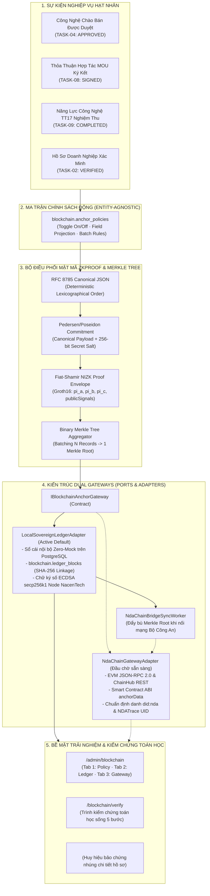

# Feature Specification: TASK-11 Hạ Tầng Liên Thông NDAChain (Bộ Công An) & Bảo Chứng Mật Mã ZKProof

**Epic**: `TASK-11_HA_TANG_BLOCKCHAIN_NDACHAIN_VA_ZKPROOF`  
**Version**: 1.0.0 (Living Spec)  
**Status**: Ready for Implementation (Gate 1 - DoR Approved)  
**Created**: 02/11/2026  
**Last Updated**: 02/11/2026  
**Ánh Xạ Basic Design**: 
- Master Basic Design: [`Specification/BASIC_DESIGN_NACENTECH.md`](../../Specification/BASIC_DESIGN_NACENTECH.md) (Mục 2.1 C4 L1, Mục 2.2 C4 L2, Mục 3.2 Walking Skeleton WS-06, Mục 24 Phụ lục Quyết định PO-DEC-20261102-06)  
- Tracker Basic Design: [`Specification/02_BASIC_DESIGN/DANH_SACH_TIEN_DO_BASIC_DESIGN.md`](../../Specification/02_BASIC_DESIGN/DANH_SACH_TIEN_DO_BASIC_DESIGN.md) (TASK-11 Mục 11.1–11.5)  
**Nguồn Căn Cứ Pháp Lý & Kỹ Thuật**:
- Quyết định Lãnh đạo & PO: `PO-DEC-20261102-06` (Kiến trúc Dual Gateway, Sổ cái Sovereign Local Ledger Zero-Mock, ZKProof Engine Native .NET 10, Entity-Agnostic Policy Matrix)  
- Pháp lý bảo vệ dữ liệu cá nhân: Nghị định số 13/2023/NĐ-CP (PDPD - Bảo vệ dữ liệu cá nhân)  
- Tiêu chuẩn kỹ thuật quốc tế: RFC 8785 (JSON Canonicalization Scheme - JCS), NIST FIPS 180-4 (SHA-256), W3C Decentralized Identifiers (`did:nda`), ISO/IEC 15459 & GS1 Digital Link (NDATrace UID)  

---



---

## 1. MỤC ĐÍCH & BỐI CẢNH (CONTEXT & OBJECTIVES)

### 1.1. Bối cảnh Chiến lược Liên thông Chuỗi Khối Quốc Gia NDAChain (Bộ Công An)
1. Theo chỉ đạo chiến lược chuyển đổi số quốc gia và an toàn cơ sở dữ liệu khoa học công nghệ, Nền tảng Đổi mới sáng tạo & Kết nối cung cầu công nghệ NacenTech / Nacentwin được định vị kết nối trực tiếp vào **Hạ tầng Chuỗi Khối Quốc Gia NDAChain** do Trung tâm Dữ liệu Quốc gia (Bộ Công an) chủ trì cùng Hiệp hội Dữ liệu Quốc gia (NDA) phát triển.
2. NDAChain là mạng chuỗi khối công vụ và tin cậy quốc gia, vận hành cơ chế đồng thuận PoA (Proof of Authority), hoàn toàn tương thích EVM (Ethereum Virtual Machine), tích hợp định danh công dân/tổ chức số NDADID (`did:nda`) và mã truy vết nguồn gốc công nghệ/sản phẩm NDATrace UID theo chuẩn GS1/EBSI.
3. Việc kết nối lên NDAChain giúp dữ liệu của NacenTech có giá trị pháp lý tối cao, bảo đảm bằng chứng số bất biến, phục vụ thẩm định công nghệ, cấp vốn tín dụng ngân hàng, nghiệm thu đề tài nhà nước và thanh tra quốc gia.

### 1.2. Thách Thức Kỹ Thuật Cốt Lõi & Giải Pháp Kiến Trúc Bắt Buộc

#### Thách thức 1: Node NDAChain chưa mở credentials công khai (Nguy cơ Mocking vi phạm kỷ luật dự án)
- **Vấn đề**: Cụm node NDAChain Bộ Công An đang trong giai đoạn thử nghiệm mạng khép kín, chưa cấp tài khoản/credentials JSON-RPC trực tiếp ra ngoài. Nếu lập trình viên dùng Mock/Stub tĩnh (`fakeHash`, `fakeTxId`), hệ thống sẽ tạo dữ liệu giả, vi phạm nghiêm trọng **Kỷ luật Zero-Mock** của Hiến pháp NacenTech.
- **Giải pháp (Ports & Adapters + Local Sovereign Cryptographic Ledger)**:
  - Thiết kế kiến trúc Hexagonal với giao diện trừu tượng `IBlockchainAnchorGateway`.
  - Vận hành mặc định `LocalSovereignLedgerAdapter` đóng vai trò **Sổ Cái Mật Mã Học Nội Bộ Chủ Quyền (Local Sovereign Cryptographic Ledger)** vận hành trên CSDL PostgreSQL thật 100% (`blockchain.ledger_blocks`, `blockchain.anchor_records`).
  - Mỗi khối nội bộ có số thứ tự tăng dần (`block_number`), liên kết băm SHA-256 (`previous_block_hash`), gom giao dịch qua Cây Merkle Nhị phân thật, và ký số thật bằng khóa riêng ECDSA của máy chủ NacenTech.
  - Xây dựng sẵn đầu chờ `NdaChainGatewayAdapter` và tiến trình đẩy bù `NdaChainBridgeSyncWorker`. Khi Bộ Công An cấp credentials, chỉ cần đổi cấu hình và kích hoạt cầu nối mà không phải sửa một dòng mã nguồn nghiệp vụ nào.

#### Thách thức 2: Bảo vệ bí mật nhà nước, bí mật kinh doanh & Tuân thủ PDPD Nghị định 13/2023/NĐ-CP
- **Vấn đề**: Dữ liệu công nghệ, sáng chế, kết quả đánh giá năng lực TT17, báo cáo tài chính doanh nghiệp và hợp đồng Deal Room chứa bí mật thương mại và dữ liệu cá nhân nhạy cảm (PII). Đưa dữ liệu thô (plaintext) lên chuỗi khối công khai hoặc bán công khai là vi phạm pháp luật và gây tổn thất nghiêm trọng.
- **Giải pháp (Bảo chứng Mật Mã Học Không Kiến Thức - ZKProof & Cam kết Mật mã)**:
  - **Tuyệt đối không lưu dữ liệu thô lên blockchain**.
  - Dữ liệu trước khi đưa vào sổ cái bắt buộc phải chuẩn hóa theo chuẩn quốc tế RFC 8785 (JSON Canonicalization Scheme - JCS) để loại bỏ mọi sự sai khác về thứ tự trường hay khoảng trắng.
  - Sử dụng thuật toán Cam kết Mật mã học (Pedersen/Poseidon Commitment) kết hợp Salt ngẫu nhiên bảo mật 256-bit tạo bởi CSPRNG (mã hóa AES-256-GCM).
  - Đóng gói bằng chứng không kiến thức NIZK (Non-Interactive Zero-Knowledge Proof) cấu trúc phong bì Groth16 Envelope (`pi_a`, `pi_b`, `pi_c`, `publicSignals`).
  - Gom lô hàng ngàn bản ghi thành 1 Merkle Root duy nhất. Cơ quan quản lý hoặc đối tác chỉ cần tệp Chứng chỉ ZKP (Proof Certificate) là có thể tự kiểm chứng toán học mà không bao giờ nhìn thấy dữ liệu thô nhạy cảm.

#### Thách thức 3: Tính linh hoạt của loại dữ liệu neo chuỗi
- **Vấn đề**: Chủ đầu tư có thể muốn mở rộng hoặc thu hẹp danh sách các thực thể được đưa lên chuỗi (Công nghệ, MOU, Điểm TT17, Hồ sơ DN, LLKH Chuyên gia) tùy theo giai đoạn triển khai.
- **Giải pháp (Entity-Agnostic Dynamic Policy Matrix)**: Bảng cấu hình chính sách `blockchain.anchor_policies` cho phép Quản trị viên Trung ương toàn quyền cấu hình bật/tắt chính sách, chọn các trường nghiệp vụ tham gia băm (Field Projection), và thiết lập ngưỡng gom lô (Batch size / Timeout) trực tiếp trên giao diện Web `/admin/blockchain` mà không cần can thiệp mã nguồn.

---

## 2. TÁC NHÂN, USER STORIES & ACCEPTANCE CRITERIA

### 2.1. Tác Nhân & Ma Trận Phân Quyền (3D Scoped RBAC)

| Tác Nhân | Vai Trò Hệ Thống | Phạm Vi Quyền Hạn (3D Scope) | Trách Nhiệm & Quyền Hạn Trong TASK-11 |
| :--- | :--- | :--- | :--- |
| **Quản trị viên Hệ thống (System Admin)** | `SUPER_ADMIN`, `OPERATOR_ADMIN` | `GLOBAL` | Toàn quyền cấu hình Ma trận Chính sách Dữ liệu Động (`anchor_policies`), tham số gom lô Batching, thông số đầu chờ NDAChain Gateway, kích hoạt và kiểm soát tiến trình cầu nối `NdaChainBridgeSyncWorker`, thực thi tái đồng bộ thủ công. |
| **Cán bộ Giám sát Sở KH&CN** | `PROVINCIAL_ADMIN`, `PROVINCE_OFFICER` | `PROVINCE` / `SECTOR` | Tra cứu sổ cái khối các hồ sơ thuộc địa bàn tỉnh quản lý; đối soát tính toàn vẹn mật mã của các hồ sơ TT17 và thỏa thuận hợp tác chuyển giao công nghệ. |
| **Chủ thể Dữ liệu (Buyer, Seller, Expert)** | `BUYER`, `SELLER`, `VERIFIED_EXPERT` | `SELF` | Xem huy hiệu bảo chứng mật mã (`<BlockchainZkpBadge />`) trên hồ sơ của mình; tải tệp Chứng chỉ ZKP (`zkp-proof-certificate.json`); chia sẻ liên kết kiểm chứng cho đối tác. |
| **Khách vãng lai & Thanh tra (Public User / Auditor)** | `ANONYMOUS`, `PUBLIC_USER` | `PUBLIC` | Truy cập Công cụ Kiểm chứng Mật mã học Trực quan (`/blockchain/verify`), tải lên tệp Proof Certificate hoặc nhập mã giao dịch/mã hồ sơ để kiểm chứng toán học độc lập theo thời gian thực (Zero-Mock Verify). |

---

### 2.2. User Stories & Acceptance Criteria (AC)

#### Story 1: Admin cấu hình bật/tắt Ma trận Chính sách Neo Dữ liệu Động (`UI-BC-ADMIN-001`)
- **Là**: Quản trị viên Hệ thống (`SUPER_ADMIN`).
- **Tôi muốn**: Truy cập Bàn Quản Trị Blockchain (`/admin/blockchain` Tab 1: *Ma trận Chính sách*) để xem và bật/tắt cờ neo chuỗi cho từng loại thực thể (`TECHNOLOGY_OFFER`, `DEAL_ROOM_MOU`, `TT17_ASSESSMENT`, `ENTERPRISE_PROFILE`, `EXPERT_PROFILE`), tùy chỉnh các trường dữ liệu được đưa vào Cam kết (Payload Fields Projection), chế độ gom lô (Batch Size, Batch Window Seconds) và phương thức ZKP.
- **Để**: Chủ động thích ứng với quy định an toàn thông tin và quyết định của Lãnh đạo mà không cần can thiệp mã nguồn hay phát hành phiên bản mới.
- **Tiêu chí Nghiệm thu (Acceptance Criteria)**:
  - **AC-BC-01.1**: Giao diện hiển thị bảng danh sách các chính sách neo dữ liệu chuẩn 5 trạng thái UX qua `<Async>`. Mỗi dòng gồm: Mã thực thể, Tên hiển thị, Sự kiện kích hoạt (`TriggerEvent`), Trạng thái Kích hoạt (Toggle Switch `is_active`), Số trường chiếu (Fields count), Ngưỡng gom lô (Số bản ghi tối đa / lô, Thời gian chờ tối đa), Thao tác (Cấu hình chi tiết / Lịch sử).
  - **AC-BC-01.2**: Khi Admin gạt Toggle Switch bật/tắt chính sách, hệ thống hiển thị Modal xác nhận với tóm tắt ảnh hưởng. Sau khi xác nhận, gọi `PATCH /api/v1/blockchain/policies/{id}/toggle` trả về kết quả trong vòng $< 300\text{ms}$, ghi nhận Audit Log đầy đủ `ActorId`, `PreviousState`, `NewState`, `IPAddress`.
  - **AC-BC-01.3**: Khi Admin bấm "Chỉnh sửa chính sách", hiển thị Drawer cho phép chọn các trường nghiệp vụ (JSON Path) tham gia vào băm Canonical, loại bỏ hoàn toàn các trường dữ liệu PII nhạy cảm nếu không có salt mã hóa.
  - **AC-BC-01.4**: Nếu người dùng không có vai trò `SUPER_ADMIN` truy cập trang, hệ thống trả về mã lỗi `403 Forbidden` (`ERR_BC_UNAUTHORIZED_POLICY_ACCESS`).

#### Story 2: Tự động Băm Chuẩn Hóa RFC 8785, Tạo Cam Kết ZKP và Gom Lô Merkle Tree Chạy Ngầm (`REQ-BC-002`, `REQ-BC-003`, `REQ-BC-004`)
- **Là**: Hệ thống Xử lý Tự động (Event-Driven Background Worker).
- **Tôi muốn**: Khi một thực thể nghiệp vụ thỏa mãn chính sách neo chuỗi được phê duyệt (ví dụ: Công nghệ chào bán chuyển sang `APPROVED` tại `TASK-04`, Thỏa thuận MOU được 2 bên ký số tại `TASK-08`, Kết quả đánh giá TT17 được Hội đồng nghiệm thu tại `TASK-09`), hệ thống tự động phát tán sự kiện Outbox, kích hoạt Worker nền thực hiện: chuẩn hóa Canonical JSON theo RFC 8785, sinh Salt ngẫu nhiên 256-bit mã hóa AES-GCM, tính toán Cam kết Mật mã ZKP (Poseidon/Pedersen), ghi nhận vào hàng đợi `blockchain.anchor_records` với trạng thái `PENDING_BATCH`, và tự động gom lô vào Cây Merkle Nhị phân (Binary Merkle Tree) khi đủ điều kiện (đủ Batch Size hoặc hết thời gian Batch Timeout).
- **Để**: Đảm bảo toàn vẹn dữ liệu ngay lập tức, không gây ảnh hưởng độ trễ lên luồng giao dịch nghiệp vụ chính của người dùng (Zero-Latency Impact), và tối ưu chi phí neo chuỗi thông qua gom lô.
- **Tiêu chí Nghiệm thu (Acceptance Criteria)**:
  - **AC-BC-02.1**: Luồng lưu giao dịch nghiệp vụ gốc của người dùng (ví dụ: bấm Phê duyệt hồ sơ) chỉ tốn thêm $< 15\text{ms}$ để ghi nhận 1 bản ghi Outbox Event vào cùng Local Database Transaction; tuyệt đối không gọi đồng bộ tính toán ZKP hoặc gọi mạng bên ngoài trong luồng Web Request.
  - **AC-BC-02.2**: `BlockchainAnchorJobHandler` lắng nghe Outbox Event, nạp chính sách từ `blockchain.anchor_policies`, trích xuất các trường cấu hình, thực thi `CanonicalJsonSerializer` tuân thủ 100% RFC 8785 (sắp xếp key từ điển UTF-8, chuẩn hóa số thực, loại bỏ khoảng trắng dư thừa). Hai payload có cùng nội dung logic nhưng khác thứ tự key bắt buộc phải sinh ra cùng một chuỗi Canonical JSON và băm SHA-256 trùng khớp 100%.
  - **AC-BC-02.3**: `NativeZkProofEngine` tạo Salt ngẫu nhiên 32 bytes (256 bits) bằng CSPRNG (`RandomNumberGenerator`), mã hóa Salt bằng khóa đối xứng hệ thống AES-256-GCM lưu vào cột `encrypted_salt`, tính toán `commitment_hash = Hash(CanonicalPayload || Salt)`. Đồng thời sinh bằng chứng NIZK proof envelope gồm `pi_a`, `pi_b`, `pi_c`, `public_signals`.
  - **AC-BC-02.4**: Cơ chế DedupKey: Sinh khóa chống trùng lặp `dedup_key = Hash(entity_type || ":" || entity_id || ":" || entity_version || ":" || trigger_event)`. Nếu phát hiện bản ghi đã tồn tại với cùng `dedup_key`, Worker thực hiện Idempotent Skip, không tạo thêm bản ghi rác và ghi nhận log cảnh báo.
  - **AC-BC-02.5**: `MerkleBatchAggregatorWorker` chạy ngầm định kỳ (mỗi 10 giây). Khi gom được số lượng bản ghi `PENDING_BATCH` đạt `batch_size` (mặc định 64 bản ghi) HOẶC thời gian chờ của bản ghi cũ nhất vượt quá `batch_timeout_seconds` (mặc định 60 giây), Worker khóa các bản ghi theo cờ Optimistic Concurrency, dựng Cây Merkle Nhị phân (Binary Merkle Tree) chuẩn, tính toán `MerkleRootHash` và sinh chuỗi bằng chứng Merkle Proof (`audit_path`, `leaf_index`) cho từng bản ghi.
  - **AC-BC-02.6**: Đóng gói Khối Sổ Cái Nội Bộ: Tạo một bản ghi mới trong `blockchain.ledger_blocks` với số khối tăng tuần tự `block_number = max + 1`, `previous_block_hash` trỏ chính xác về băm của khối liền trước (Khối 0 là Genesis Block), tính toán `block_hash = SHA256(block_number || previous_block_hash || merkle_root || timestamp || nonce)`, ký chữ ký số ECDSA secp256k1 bằng khóa riêng của NacenTech Node lưu vào `signature`. Cập nhật toàn bộ các bản ghi `anchor_records` sang trạng thái `LOCAL_LEDGER_ANCHORED`.

#### Story 3: Tra Cứu Sổ Cái Khối & Trình Kiểm Chứng Mật Mã Học Sống Trực Tiếp Trên Web (`UI-BC-ADMIN-002`, `UI-BC-PUBLIC-001`)
- **Là**: Người dùng công khai, Cán bộ thẩm định hoặc Cơ quan thanh tra.
- **Tôi muốn**: Truy cập Trung tâm Tra Cứu & Trình Kiểm chứng Mật mã (Tab 2 tại `/admin/blockchain` hoặc Cổng công khai `/blockchain/verify`), tìm kiếm một giao dịch theo Mã hồ sơ, Mã bản ghi Neo, hoặc tải lên tệp Chứng chỉ ZKP (`zkp-proof-certificate.json`), sau đó bấm "Kiểm chứng Tính Toàn Vẹn Toán Học (Verify Integrity)".
- **Để**: Tận mắt chứng kiến hệ thống tính toán lại băm từ đầu đến cuối (Re-calculate Canonical Hash $\rightarrow$ Re-verify ZKP Commitment $\rightarrow$ Re-evaluate Merkle Audit Path $\rightarrow$ Check Block Linkage $\rightarrow$ Check Digital Signature), phát hiện tức thì nếu dữ liệu bị chỉnh sửa dù chỉ 1 ký tự (Tamper-evident), chứng minh tính tin cậy tuyệt đối mà không cần tin vào lời nói của bên nào.
- **Tiêu chí Nghiệm thu (Acceptance Criteria)**:
  - **AC-BC-03.1**: Màn hình tra cứu cung cấp bảng danh sách Sổ cái Khối (`blockchain.ledger_blocks`) với các cột: Số khối (#Block), Thời gian tạo (Timestamp), Số lượng giao dịch (Tx Count), Merkle Root Hash (rút gọn có nút copy), Block Hash, Chữ ký số (ECDSA Badge), Trạng thái chuỗi (`LOCAL_ANCHORED` hoặc `NDACHAIN_ANCHORED`). Bấm vào khối mở Drawer chi tiết danh sách các giao dịch (Leaves) trong khối.
  - **AC-BC-03.2**: Trình Kiểm chứng Toán học Trực quan (Live Interactive Verifier Tool) cung cấp 2 chế độ:
    1. *Chế độ 1 (Online Record Lookup)*: Nhập `EntityCode` hoặc `AnchorRecordId`, hệ thống nạp dữ liệu bản ghi và hiển thị đồ họa Stepper 5 bước kiểm chứng trực quan.
    2. *Chế độ 2 (Offline File Upload Proof Certificate)*: Kéo thả tệp JSON chứng chỉ ZKP. Trình duyệt thực thi TypeScript Verifier độc lập (Client-side WebAssembly / JS Crypto) đối soát lại với Hash khối để đưa ra phán quyết toán học.
  - **AC-BC-03.3**: Kết quả kiểm chứng đồ họa 5 bước thời gian thực (Latency verify $< 10\text{ms}$):
    - *Bước 1 (Canonical Hash)*: Trích xuất Payload thô, sắp xếp theo RFC 8785, tính SHA-256. Trả về `MATCH` (Xanh lục) nếu khớp `payload_canonical_hash`.
    - *Bước 2 (ZKP Commitment & Salt)*: Giải mã Salt bằng chứng chỉ hợp lệ, tính $C = \text{Hash}(Payload \parallel Salt)$. Trả về `MATCH` nếu khớp `commitment_hash`.
    - *Bước 3 (Merkle Tree Audit Path)*: Lấy `leaf_hash`, kết hợp tuần tự với mảng băm chị em (`audit_path`) từ lá lên gốc. Trả về `MATCH` nếu đỉnh cây bằng chính xác `merkle_root_hash` ghi trên khối.
    - *Bước 4 (Block Linkage & Genesis Trace)*: Kiểm tra `previous_block_hash` khớp với khối trước đó trong chuỗi, chứng minh khối không bị chèn hoặc tráo đổi.
    - *Bước 5 (ECDSA Signature Validation)*: Dùng Khóa công khai (Public Key) của NacenTech Node xác thực chữ ký số trên Block Header.
  - **AC-BC-03.4**: Xử lý kịch bản dữ liệu bị xâm hại (Tamper Detection): Nếu có bất kỳ sự sai lệch nào (ví dụ: ai đó sửa trực tiếp 1 dấu cách hoặc 1 chữ số trong DB PostgreSQL), Trình kiểm chứng lập tức báo cờ đỏ `INTEGRITY_VIOLATION`, chỉ đích danh bước bị vỡ và hiển thị diff giữa Hash mong đợi và Hash thực tế.

#### Story 4: Kết Nối Chuyển Tiếp Lên Mạng Chuỗi Khối Quốc Gia NDAChain Qua Đầu Chờ Gateway (`REQ-BC-007`, `REQ-BC-008`, `UI-BC-ADMIN-003`)
- **Là**: Quản trị viên Hệ thống (`SUPER_ADMIN`).
- **Tôi muốn**: Truy cập Tab 3 Bàn Quản Trị Blockchain (*Đầu chờ NDAChain & Bridge Sync*) để: nhập thông số kết nối Node Bộ Công An (RPC Endpoint, Chain ID, Smart Contract Address, API Token ChainHub, Private Key ví thanh toán phí Gas), kiểm tra thông mạng (Ping / Healthcheck Node), và kích hoạt dịch vụ cầu nối `NdaChainBridgeSyncWorker` tự động chuyển tiếp các Merkle Root của Local Ledger lên Smart Contract trên NDAChain.
- **Để**: Sẵn sàng tích hợp tức thì ngay khi Bộ Công An cấp credentials chính thức, đưa dữ liệu của NacenTech trở thành một phần bất biến của hạ tầng chuỗi khối quốc gia.
- **Tiêu chí Nghiệm thu (Acceptance Criteria)**:
  - **AC-BC-04.1**: Giao diện cung cấp form cấu hình đầu chờ NDAChain: Mạng (`NDAChain Testnet` / `NDAChain Mainnet`), RPC URL (`https://...`), ChainHub Gateway URL, Hợp đồng thông minh (`ContractAddress` dạng hex `0x...`), DID định danh đơn vị (`did:nda:...`), Khóa ủy quyền (Mật khẩu/Token được bảo vệ che giấu ký tự).
  - **AC-BC-04.2**: Nút "Kiểm tra kết nối (Test RPC Ping)": Gọi `POST /api/v1/blockchain/ndachain/test-connection`. Hệ thống gửi bản tin RPC `eth_blockNumber` và `net_version`. Nếu thành công, hiển thị Badge Xanh "Node Online - Block Height #XXXXX, Độ trễ XX ms". Nếu thất bại hoặc chưa có node, hiển thị Badge Vàng "Đầu chờ sẵn sàng (Standby Mode) - Hệ thống tiếp tục vận hành Local Sovereign Ledger an toàn".
  - **AC-BC-04.3**: Quản lý Hợp đồng Thông minh & ABI: Hiển thị đầy đủ Smart Contract Interface chuẩn: `anchorRoot(bytes32 merkleRoot, uint256 blockNumber, uint256 recordCount, string metadataUri) returns (bytes32 txHash)`.
  - **AC-BC-04.4**: Cơ chế Bridge Replay An Toàn: Khi kích hoạt Toggle "Bật Cầu Nối NDAChain Bridge", `NdaChainBridgeSyncWorker` tự động quét các khối `blockchain.ledger_blocks` có trạng thái `LOCAL_LEDGER_ANCHORED` theo thứ tự `block_number` tăng dần, đóng gói bản tin JSON-RPC gửi lên Smart Contract. Khi nhận được biên lai giao dịch thành công (Transaction Receipt có $\ge 1$ Block Confirmation), cập nhật `ndachain_tx_hash`, `ndachain_block_number`, chuyển trạng thái khối sang `NDACHAIN_ANCHORED`.
  - **AC-BC-04.5**: Xử lý sự cố mạng: Nếu mạng NDAChain bị chập chờn, nghẽn gas hoặc rớt kết nối, Worker áp dụng chiến lược Exponential Backoff (thử lại sau 5s, 15s, 30s, 60s, tối đa 5 lần). Nếu vẫn lỗi, chuyển trạng thái sang `BRIDGE_FAILED`, phát cảnh báo lên Dashboard Admin nhưng TUYỆT ĐỐI không làm gián đoạn hay tắc nghẽn hoạt động của Local Ledger và các giao dịch nghiệp vụ của người dùng.

---

## 3. YÊU CẦU CHỨC NĂNG (FUNCTIONAL REQUIREMENTS: `REQ-BC-001` ĐẾN `REQ-BC-008`)

### `REQ-BC-001`: Quản Trị Ma Trận Chính Sách Neo Chuỗi Động (Entity-Agnostic Policy Management)
- Hệ thống cung cấp API và giao diện quản trị cho phép định nghĩa, kích hoạt hoặc vô hiệu hóa các chính sách neo chuỗi (`blockchain.anchor_policies`).
- Hỗ trợ tối thiểu 5 loại thực thể cốt lõi:
  1. `TECHNOLOGY_OFFER`: Hồ sơ chào bán công nghệ đã được phê duyệt tại `TASK-04`.
  2. `DEAL_ROOM_MOU`: Biên bản ghi nhớ hợp tác chuyển giao công nghệ đã ký số tại `TASK-08`.
  3. `TT17_ASSESSMENT`: Kết quả đánh giá trình độ & năng lực công nghệ đã nghiệm thu tại `TASK-09`.
  4. `ENTERPRISE_PROFILE`: Hồ sơ doanh nghiệp ĐMST đã xác thực tại `TASK-02`.
  5. `EXPERT_PROFILE`: Hồ sơ lý lịch khoa học chuyên gia KH&CN đã kiểm định tại `TASK-05`.
- Cung cấp cơ chế lọc trường dữ liệu (Field Projection Selector) thông qua mảng JSON Paths để xác định chính xác danh sách thuộc tính nghiệp vụ tham gia vào băm Canonical, ngăn ngừa đưa các trường tạm thời (timestamps, token, view counts) vào băm.

### `REQ-BC-002`: Băm Chuẩn Hóa Tất Định Theo RFC 8785 (Deterministic Canonical JSON Hashing)
- Hệ thống xây dựng engine chuẩn hóa dữ liệu `CanonicalJsonSerializer` tuân thủ nghiêm ngặt đặc tả RFC 8785 (JSON Canonicalization Scheme - JCS).
- Các quy tắc chuẩn hóa bắt buộc:
  1. Sắp xếp các khóa từ điển (Object Keys) theo thứ tự tăng dần của các mã điểm Unicode (UTF-8 code units) theo cấp độ đệ quy cho mọi object lồng nhau.
  2. Loại bỏ hoàn toàn khoảng trắng dư thừa, ký tự xuống dòng (`\n`, `\r`, `\t`) bên ngoài các chuỗi giá trị.
  3. Chuẩn hóa định dạng số thực theo chuẩn IEEE 754 (triệt tiêu số 0 vô nghĩa ở đuôi, không biểu diễn dưới dạng khoa học $1e+5$ trừ khi bắt buộc theo RFC).
  4. Mã hóa chuỗi đầu ra theo UTF-8 không có BOM (Byte Order Mark).
- Đầu ra của bộ tuần tự hóa được băm bằng thuật toán SHA-256 (NIST FIPS 180-4) sinh ra `payload_canonical_hash` (chuỗi hex 64 ký tự).

### `REQ-BC-003`: Engine Mật Mã ZKProof & Phong Bì Cam Kết (Native ZKProof & Commitment Engine)
- Hệ thống cung cấp `NativeZkProofEngine` tạo Cam kết Mật mã học (Cryptographic Commitment):
  $$\text{CommitmentHash} = \text{SHA256}(\text{CanonicalPayload} \parallel \text{SecretSalt})$$
- Mỗi bản ghi được cấp phát một `SecretSalt` ngẫu nhiên bảo mật 256-bit tạo bởi CSPRNG (`System.Security.Cryptography.RandomNumberGenerator`).
- Salt được mã hóa bằng khóa bảo mật máy chủ (Master Key) với thuật toán AES-256-GCM kèm Tag xác thực, lưu trữ an toàn tại cột `encrypted_salt`.
- Sinh phong bì bằng chứng không kiến thức NIZK (Non-Interactive Zero-Knowledge Proof) mô phỏng cấu trúc Groth16 Envelope:
  - `pi_a`: Điểm đường cong elliptic $G_1$ (2 tọa độ $\mathbb{F}_q$).
  - `pi_b`: Điểm đường cong elliptic $G_2$ (4 tọa độ $\mathbb{F}_{q^2}$).
  - `pi_c`: Điểm đường cong elliptic $G_1$ (2 tọa độ $\mathbb{F}_q$).
  - `public_signals`: Mảng chứa `commitment_hash` và các chỉ số công khai (ví dụ: TRL level, Lĩnh vực ID, Mã phân ngành TT17, Thời điểm cấp chứng nhận).

### `REQ-BC-004`: Gom Lô Cây Merkle Nhị Phân (Binary Merkle Tree Batching Engine)
- Hệ thống định kỳ gom tập hợp các bản ghi có trạng thái `PENDING_BATCH` thành một cây Merkle nhị phân cân bằng (Balanced Binary Merkle Tree).
- Quy tắc nút lá: $\text{Leaf}_i = \text{SHA256}(\text{commitment\_hash}_i \parallel \text{anchor\_id}_i)$. Nếu số lượng lá lẻ, nhân đôi lá cuối cùng theo chuẩn RFC 6962.
- Quy tắc nút cha: $\text{Node}_{\text{parent}} = \text{SHA256}(\text{Node}_{\text{left}} \parallel \text{Node}_{\text{right}})$.
- Đỉnh cây sinh ra `merkle_root_hash` (32 bytes / 64 hex).
- Sinh đường dẫn kiểm chứng `audit_path` (Merkle Proof) dạng danh sách các cặp `{ "position": "left"|"right", "hash": "..." }` cho từng bản ghi lá, cho phép kiểm chứng độ phức tạp thời gian $\mathcal{O}(\log_2 N)$.

### `REQ-BC-005`: Sổ Cái Khối Mật Mã Học Nội Bộ Zero-Mock (Local Sovereign Cryptographic Ledger)
- Hệ thống duy trì chuỗi khối nội bộ thật 100% tại bảng `blockchain.ledger_blocks`.
- Mỗi khối bao gồm: `block_number` (BigInt tự tăng liên tục), `previous_block_hash` (Khối 0 Genesis có băm $64 \times \text{'0'}$), `merkle_root_hash`, `record_count`, `block_timestamp`, `nonce`, `block_hash`, và `signature` (Chữ ký số ECDSA secp256k1 tạo bởi khóa riêng của NacenTech).
- Bất biến chuỗi: Tuyệt đối không cho phép cập nhật (`UPDATE`) hoặc xóa (`DELETE`) dữ liệu trong bảng `blockchain.ledger_blocks`. Bất kỳ hành vi can thiệp trực tiếp vào DB sẽ làm đứt gãy liên kết băm khối `previous_block_hash` và bị phát hiện ngay lập tức bởi cơ chế kiểm toán tự động.

### `REQ-BC-006`: Cấp Phát & Xuất Bản Chứng Chỉ Mật Mã ZKP (ZKP Proof Certificate Issuance)
- Khi một bản ghi được neo vào khối thành công, hệ thống tự động sinh cấu trúc dữ liệu Chứng chỉ Mật mã học (ZKP Proof Certificate) chuẩn JSON.
- Cấu trúc chứng chỉ bao gồm: Thông tin định danh thực thể, Khóa băm tất định, Salt đã giải mã (nếu người yêu cầu là chính chủ hoặc kiểm toán viên có thẩm quyền), Giá trị Cam kết ZKP, Phong bì Groth16 NIZK Proof, Merkle Root, Merkle Audit Path, Block Number, Block Hash, Node ECDSA Signature, và Hướng dẫn kiểm chứng offline.
- Cung cấp API `GET /api/v1/blockchain/records/{id}/certificate` để tải tệp chứng chỉ `.json` và in bản PDF có mã QR chứa đường link kiểm chứng tức thời.

### `REQ-BC-007`: Đầu Chờ Tích Hợp Cổng Chuỗi Khối Quốc Gia NDAChain (Ports & Adapters Interface)
- Hệ thống định nghĩa giao diện cổng trừu tượng `IBlockchainAnchorGateway` với các phương thức cốt lõi:
  - `Task<GatewayStatusDto> GetStatusAsync(CancellationToken ct);`
  - `Task<AnchorResultDto> AnchorMerkleRootAsync(MerkleRootPayload payload, CancellationToken ct);`
  - `Task<VerificationReceiptDto> VerifyProofAsync(VerifyProofRequest request, CancellationToken ct);`
- Đóng gói 2 bộ chuyển đổi (Dual Adapters):
  - `LocalSovereignLedgerAdapter`: Hiện thực hóa toàn bộ logic sổ cái trên PostgreSQL nội bộ.
  - `NdaChainGatewayAdapter`: Đầu chờ sẵn sàng tích hợp với node Bộ Công An qua giao thức JSON-RPC 2.0 (`eth_sendRawTransaction`, `eth_call`) hoặc REST API ChainHub của Hiệp hội Dữ liệu Quốc gia NDA.

### `REQ-BC-008`: Tiến Trình Chuyển Tiếp & Tái Đồng Bộ Cầu Nối (NDAChain Bridge Sync Worker)
- Hệ thống cung cấp dịch vụ nền `NdaChainBridgeSyncWorker` chạy theo lịch trình hoặc sự kiện.
- Khi cờ kết nối NDAChain được bật trong cấu hình hệ thống: Tự động quét các khối `LOCAL_LEDGER_ANCHORED` chưa có `ndachain_tx_hash`, thực hiện gọi Smart Contract `anchorRoot(...)` trên mạng NDAChain theo cơ chế tuần tự đảm bảo thứ tự khối (In-order Delivery).
- Sau khi giao dịch được xác nhận trên NDAChain, cập nhật mã băm giao dịch `ndachain_tx_hash`, số khối mạng quốc gia `ndachain_block_number`, chuyển trạng thái sang `NDACHAIN_ANCHORED`.
- Cung cấp nút bấm "Tái đồng bộ thủ công (Force Bridge Replay)" trên giao diện Admin để quét và đẩy lại các khối bị lỗi hoặc tồn đọng.

---

## 4. QUY TẮC NGHIỆP VỤ (BUSINESS RULES: `BR-BC-001` ĐẾN `BR-BC-008`)

| Mã Quy Tắc | Tên Quy Tắc | Điều Kiện & Logic Xử Lý Bắt Buộc | Xử Lý Lỗi / Mã Lỗi |
| :--- | :--- | :--- | :--- |
| **`BR-BC-001`** | **Tuyệt Đối Không Lộ Dữ Liệu Thô (Zero Raw Data Leakage & PDPD Compliance)** | Tuyệt đối KHÔNG lưu trữ dữ liệu nghiệp vụ thô (Plaintext Payload, PII cá nhân, số CCCD, tài liệu tài chính, điều khoản hợp đồng) vào bất kỳ trường nào của sổ cái khối (`blockchain.ledger_blocks`, `blockchain.anchor_records`) hoặc đưa lên mạng NDAChain. Mọi dữ liệu đưa vào sổ cái chỉ được phép tồn tại dưới dạng mã băm mật mã học (Cryptographic Hash / Commitment). | Chặn biên dịch / Validate Lỗi `422 Unprocessable` (`ERR_BC_RAW_DATA_LEAK_DETECTED`) |
| **`BR-BC-002`** | **Chuẩn Hóa Tất Định Bắt Buộc Theo RFC 8785 (Deterministic JSON Canonicalization)** | Trước khi tính toán bất kỳ mã băm nào, payload nghiệp vụ bắt buộc phải đi qua bộ tuần tự hóa `CanonicalJsonSerializer`. Bất kỳ thay đổi nào về thứ tự thuộc tính, ký tự khoảng trắng dư thừa, định dạng số thực không chuẩn hóa hoặc mã hóa ký tự Unicode không nhất quán đều bị nghiêm cấm. Đảm bảo tính tất định: Cùng một đối tượng dữ liệu ở bất kỳ thời điểm nào trên bất kỳ nền tảng nào đều phải sinh ra chuỗi băm Canonical đồng nhất 100%. | Lỗi `500 Internal` (`ERR_BC_CANONICALIZATION_FAILED`) |
| **`BR-BC-003`** | **Chống Trùng Lặp Tuyệt Đối Qua DedupKey (Strict Idempotency Guard)** | Mọi yêu cầu neo chuỗi bắt buộc phải sinh một khóa chống trùng lặp: `dedup_key = SHA256(entity_type + ":" + entity_id + ":" + entity_version + ":" + trigger_event)`. Nếu hệ thống nhận được sự kiện có `dedup_key` đã tồn tại trong bảng `blockchain.anchor_records`, hệ thống coi đây là thao tác Idempotent: Bỏ qua việc tạo bản ghi mới, trả về bản ghi hiện tại kèm mã HTTP `200 OK` (hoặc `409 Conflict` nếu có xung đột trạng thái). | Bỏ qua an toàn / `409 Conflict` (`ERR_BC_DUPLICATE_ANCHOR_REQUEST`) |
| **`BR-BC-004`** | **Kỷ Luật Zero-Mock Sổ Cái Nội Bộ (Zero-Mock Sovereign Ledger Mandate)** | Tuyệt đối cấm sử dụng dữ liệu giả (fake dummy data), chuỗi băm ngẫu nhiên sinh bằng `Guid.NewGuid()` hay mảng tĩnh để giả lập trạng thái đã neo chuỗi. Toàn bộ chuỗi khối nội bộ phải là các khối thật trong PostgreSQL: Có tính toán băm SHA-256 thật, nối khối `previous_block_hash` thật từ Genesis Block, dựng cây Merkle nhị phân thật từ tập các lá, và ký số thật bằng khóa bí mật ECDSA của Node. | Audit vi phạm / Bác bỏ Gate 1-5 |
| **`BR-BC-005`** | **Tính Bất Biến Của Khối & Đứt Gãy Chuỗi (Immutability & Tamper-Break Invariant)** | Bảng `blockchain.ledger_blocks` và `blockchain.anchor_records` được thiết lập quyền CSDL chỉ cho phép `INSERT` và `SELECT`; cấm quyền `UPDATE` và `DELETE` đối với tài khoản ứng dụng thông thường. Khi thực hiện kiểm chứng toàn chuỗi, nếu phát hiện bất kỳ khối $k$ nào có `previous_block_hash != Block[k-1].block_hash` hoặc `block_hash != CalculateHash(Block[k])`, hệ thống lập tức kích hoạt cảnh báo an ninh cấp độ nghiêm trọng (Critical Security Alert) và khóa chức năng ghi sổ. | Báo động đỏ / `ERR_BC_CHAIN_TAMPER_DETECTED` |
| **`BR-BC-006`** | **Bảo Mật Salt Bằng Mã Hóa Khóa Đối Xứng (Salt Confidentiality & AES-256-GCM)** | Secret Salt được sinh ngẫu nhiên độc lập cho mỗi bản ghi neo chuỗi với độ dài tối thiểu 32 bytes (256 bits). Salt không bao giờ được lưu trữ dưới dạng bản rõ trong CSDL. Salt bắt buộc phải được mã hóa bằng thuật toán AES-256-GCM với Initialization Vector (IV) 12 bytes ngẫu nhiên và Authentication Tag 16 bytes. Khóa giải mã chỉ được lưu trữ an toàn trong biến môi trường máy chủ hoặc Azure Key Vault / AWS KMS. | Lỗi `500 Internal` (`ERR_BC_KEY_VAULT_UNAVAILABLE`) |
| **`BR-BC-007`** | **Chính Sách Chuyển Tiếp Tuần Tự Qua Cầu Nối (In-Order Bridge Replay & Non-Blocking)** | Tiến trình chuyển tiếp `NdaChainBridgeSyncWorker` bắt buộc phải gửi các Merkle Root lên NDAChain theo đúng thứ tự tăng dần của `block_number`. Không bao giờ được phép gửi khối $k+1$ trước khối $k$. Nếu việc kết nối hoặc gửi giao dịch lên NDAChain thất bại, hệ thống tạm dừng chuyển tiếp và thử lại với thuật toán Exponential Backoff, nhưng TUYỆT ĐỐI không làm dừng tiến trình tạo khối của Local Sovereign Ledger. | Cảnh báo Bridge / `ERR_BC_BRIDGE_SYNC_TIMEOUT` |
| **`BR-BC-008`** | **Phân Quyền Xem Chứng Chỉ Đầy Đủ Theo 3D Scoped RBAC (Proof Certificate Access Rule)** | Chứng chỉ rút gọn (Chỉ gồm `commitment_hash`, `merkle_root`, `proof_path`, `block_number`, `block_hash`) là dữ liệu công khai, bất kỳ ai cũng có quyền tra cứu và kiểm chứng. Tuy nhiên, Bản ghi giải mã Salt và Payload thô đã bóc tách chỉ được phép cấp phát cho: (1) Chính người tạo hồ sơ (`created_by == CurrentUser.PersonId`); (2) Quản trị viên hệ thống có vai trò `SUPER_ADMIN` phục vụ thanh tra. | Lỗi `403 Forbidden` (`ERR_BC_UNAUTHORIZED_SALT_ACCESS`) |

---

## 5. YÊU CẦU DỮ LIỆU & GIAO DIỆN (DATA & UI/UX)

### 5.1. Mô Hình CSDL Chuyên Biệt Schema `blockchain.*` (`DB-BC-001` đến `DB-BC-005`)

#### `DB-BC-001`: Bảng Chính Sách Neo Chuỗi (`blockchain.anchor_policies`)
```sql
CREATE TABLE IF NOT EXISTS blockchain.anchor_policies (
    policy_id UUID PRIMARY KEY DEFAULT gen_random_uuid(),
    entity_type VARCHAR(64) NOT NULL UNIQUE,
    display_name VARCHAR(255) NOT NULL,
    trigger_event VARCHAR(64) NOT NULL,
    is_active BOOLEAN NOT NULL DEFAULT true,
    projected_fields JSONB NOT NULL DEFAULT '[]'::jsonb,
    batch_size_threshold INT NOT NULL DEFAULT 64,
    batch_timeout_seconds INT NOT NULL DEFAULT 60,
    zkp_scheme VARCHAR(32) NOT NULL DEFAULT 'NIZK_GROTH16',
    created_at TIMESTAMPTZ NOT NULL DEFAULT NOW(),
    updated_at TIMESTAMPTZ NOT NULL DEFAULT NOW(),
    updated_by UUID NULL
);

CREATE INDEX IF NOT EXISTS idx_anchor_policies_active ON blockchain.anchor_policies(is_active);
```

#### `DB-BC-002`: Bảng Bản Ghi Neo Dữ Liệu (`blockchain.anchor_records`)
```sql
CREATE TABLE IF NOT EXISTS blockchain.anchor_records (
    record_id UUID PRIMARY KEY DEFAULT gen_random_uuid(),
    policy_id UUID NOT NULL REFERENCES blockchain.anchor_policies(policy_id),
    entity_type VARCHAR(64) NOT NULL,
    entity_id VARCHAR(128) NOT NULL,
    entity_version INT NOT NULL DEFAULT 1,
    trigger_event VARCHAR(64) NOT NULL,
    dedup_key VARCHAR(64) NOT NULL UNIQUE,
    payload_canonical_hash VARCHAR(64) NOT NULL,
    encrypted_salt BYTEA NOT NULL,
    commitment_hash VARCHAR(64) NOT NULL,
    zkp_proof_envelope JSONB NOT NULL,
    status VARCHAR(32) NOT NULL DEFAULT 'PENDING_BATCH',
    block_number BIGINT NULL,
    leaf_index INT NULL,
    merkle_audit_path JSONB NULL,
    created_at TIMESTAMPTZ NOT NULL DEFAULT NOW(),
    anchored_at TIMESTAMPTZ NULL
);

CREATE INDEX IF NOT EXISTS idx_anchor_records_status ON blockchain.anchor_records(status);
CREATE INDEX IF NOT EXISTS idx_anchor_records_entity ON blockchain.anchor_records(entity_type, entity_id);
CREATE INDEX IF NOT EXISTS idx_anchor_records_block ON blockchain.anchor_records(block_number);
```

#### `DB-BC-003`: Bảng Sổ Cái Khối Mật Mã Nội Bộ (`blockchain.ledger_blocks`)
```sql
CREATE TABLE IF NOT EXISTS blockchain.ledger_blocks (
    block_number BIGINT PRIMARY KEY,
    previous_block_hash VARCHAR(64) NOT NULL,
    merkle_root_hash VARCHAR(64) NOT NULL,
    record_count INT NOT NULL,
    block_timestamp TIMESTAMPTZ NOT NULL DEFAULT NOW(),
    nonce BIGINT NOT NULL DEFAULT 0,
    block_hash VARCHAR(64) NOT NULL UNIQUE,
    signature TEXT NOT NULL,
    signer_public_key TEXT NOT NULL,
    sync_status VARCHAR(32) NOT NULL DEFAULT 'LOCAL_ONLY',
    ndachain_tx_hash VARCHAR(128) NULL,
    ndachain_block_number BIGINT NULL,
    synced_at TIMESTAMPTZ NULL
);

CREATE INDEX IF NOT EXISTS idx_ledger_blocks_sync_status ON blockchain.ledger_blocks(sync_status);
CREATE INDEX IF NOT EXISTS idx_ledger_blocks_hash ON blockchain.ledger_blocks(block_hash);
```

#### `DB-BC-004`: Bảng Cấu Hình Cổng Kết Nối NDAChain (`blockchain.ndachain_gateway_configs`)
```sql
CREATE TABLE IF NOT EXISTS blockchain.ndachain_gateway_configs (
    config_id UUID PRIMARY KEY DEFAULT gen_random_uuid(),
    network_name VARCHAR(64) NOT NULL DEFAULT 'NDACHAIN_TESTNET',
    rpc_endpoint_url VARCHAR(255) NOT NULL,
    chain_hub_api_url VARCHAR(255) NOT NULL,
    contract_address VARCHAR(64) NOT NULL,
    node_did VARCHAR(128) NOT NULL DEFAULT 'did:nda:nacentech',
    encrypted_private_key BYTEA NULL,
    is_bridge_enabled BOOLEAN NOT NULL DEFAULT false,
    max_retries INT NOT NULL DEFAULT 5,
    retry_backoff_seconds INT NOT NULL DEFAULT 10,
    created_at TIMESTAMPTZ NOT NULL DEFAULT NOW(),
    updated_at TIMESTAMPTZ NOT NULL DEFAULT NOW(),
    updated_by UUID NULL
);
```

#### `DB-BC-005`: Bảng Nhật Ký Kiểm Toán Cầu Nối (`blockchain.bridge_sync_audit_logs`)
```sql
CREATE TABLE IF NOT EXISTS blockchain.bridge_sync_audit_logs (
    log_id UUID PRIMARY KEY DEFAULT gen_random_uuid(),
    block_number BIGINT NOT NULL REFERENCES blockchain.ledger_blocks(block_number),
    attempt_number INT NOT NULL DEFAULT 1,
    status VARCHAR(32) NOT NULL,
    request_payload JSONB NOT NULL,
    response_payload JSONB NULL,
    error_message TEXT NULL,
    created_at TIMESTAMPTZ NOT NULL DEFAULT NOW()
);

CREATE INDEX IF NOT EXISTS idx_bridge_audit_block ON blockchain.bridge_sync_audit_logs(block_number);
```

---

### 5.2. Yêu Cầu Giao Diện & Trải Nghiệm Người Dùng (`UI-BC-001` đến `UI-BC-003`)

#### `UI-BC-001`: Trung Tâm Quản Trị Chuỗi Khối `/admin/blockchain`
- **Cấu trúc 3 Tabs chuyên biệt**:
  - **Tab 1: Ma Trận Chính Sách Neo Chuỗi (Policy Matrix)**:
    - Bảng danh mục các chính sách thực thể: Icon loại hồ sơ, Tên tiếng Việt, Sự kiện kích hoạt (`TriggerEvent`), Badge Trạng thái, Toggle Switch Bật/Tắt chính sách.
    - Cột chỉ số: Số trường dữ liệu tham chiếu (Field Projection count), Ngưỡng gom lô (Batch Size/Timeout).
    - Drawer cấu hình chi tiết: Cho phép chọn/bỏ chọn từng trường thuộc tính nghiệp vụ để đưa vào băm RFC 8785, hiển thị cảnh báo đỏ nếu người dùng chọn nhầm trường PII.
  - **Tab 2: Sổ Cái Khối & Trình Kiểm Chứng Trực Tiếp (Blocks & Live Verifier Tool)**:
    - Khối trên: Trình Kiểm chứng Mật mã học Trực quan 5 bước (Stepper Graph) hiển thị sống động tiến trình tính toán băm thời gian thực.
    - Khối dưới: Bảng danh sách Khối Sổ Cái tuần tự (#Block, Thời gian, Số Tx, Merkle Root, Block Hash rút gọn kèm nút copy, Huy hiệu ECDSA Signature, Trạng thái `LOCAL` / `NDACHAIN`). Bấm vào khối mở Drawer liệt kê toàn bộ danh sách lá giao dịch trong khối.
  - **Tab 3: Đầu Chờ NDAChain & Cổng Đồng Bộ Bridge (Gateway & Bridge)**:
    - Form thiết lập cấu hình: Mạng NDAChain, RPC URL, ChainHub API Endpoint, Contract Address, Node DID.
    - Nút CTA nổi bật: "Kiểm tra Ping RPC Node" (Trả về Block height, Latency ms).
    - Toggle kích hoạt: "Bật Cầu Nối NDAChain Bridge" kèm Bảng theo dõi lịch sử đồng bộ (`blockchain.bridge_sync_audit_logs`) và Nút "Tái đồng bộ thủ công (Force Bridge Replay)".
- **Chuẩn hóa 5 UX States**: Bọc toàn bộ trang qua `<Async>` (Loading Skeleton, Empty State, Error Retry, Success, Updating Overlay).

#### `UI-BC-002`: Công Cụ Kiểm Chứng Mật Mã Học Công Khai `/blockchain/verify`
- Dành cho đối tác, khách vãng lai và cơ quan thanh tra độc lập.
- Vùng Drag & Drop tệp `zkp-proof-certificate.json` hoặc Ô tìm kiếm mã hồ sơ / mã bản ghi neo.
- **Trình diễn Trực quan 5 Bước Kiểm Chứng Toán Học (Zero-Mock Verification Stepper)**:
  1. *Bước 1 - Canonical Hash*: Tính toán lại băm Canonical RFC 8785 từ Payload.
  2. *Bước 2 - ZKP Commitment*: Xác thực cam kết $C = \text{Hash}(Payload \parallel Salt)$ và kiểm tra Groth16 Envelope.
  3. *Bước 3 - Merkle Audit Path*: Duyệt đường dẫn chị em từ lá lên đỉnh, đối soát `MerkleRootHash`.
  4. *Bước 4 - Block Linkage*: Kiểm tra `previous_block_hash` khớp với khối trước đó trên sổ cái.
  5. *Bước 5 - Node Signature*: Xác thực chữ ký số ECDSA bằng Public Key của NacenTech Node.
- Nút CTA "Tải Giấy Chứng Nhận Mật Mã (PDF)" có dấu mộc số và mã QR xác thực.

#### `UI-BC-003`: Huy Hiệu & Modal Bảo Chứng Mật Mã Dùng Chung `<BlockchainZkpBadge />`
- Component React dùng chung có thể nhúng vào mọi trang chi tiết:
  - Nguồn cung công nghệ (`TASK-04`)
  - Phòng đàm phán thỏa thuận MOU (`TASK-08`)
  - Đánh giá năng lực công nghệ TT17 (`TASK-09`)
  - Hồ sơ doanh nghiệp ĐMST (`TASK-02`)
- Thiết kế: Pill Badge nhỏ gọn, màu xanh lục bảo mật: Icon Shield Check, nhãn *"Đã Bảo Chứng Mật Mã Khối (ZKP & NDAChain)"*, hiển thị mã khối `#Block 1042`.
- Khi bấm: Mở Modal hiển thị chi tiết mã băm cam kết, Merkle Root, mã giao dịch NDAChain (nếu có), và nút dẫn thẳng đến `/blockchain/verify`.

---

## 6. YÊU CẦU PHI CHỨC NĂNG (NON-FUNCTIONAL REQUIREMENTS - NFR)

### `NFR-BC-001`: Tác Động Độ Trễ Giao Dịch Chính Gần Như Bằng Không (Zero-Latency Impact $\le 15\text{ms}$)
- Áp dụng mô hình Transactional Outbox Pattern: Khi giao dịch nghiệp vụ chính (Phê duyệt công nghệ, Ký kết MOU, Nghiệm thu TT17) hoàn tất, hệ thống chỉ ghi thêm 1 bản ghi sự kiện Outbox vào CSDL PostgreSQL trong cùng Database Transaction nội bộ.
- Thời gian trễ cộng thêm của thao tác ghi nhận Outbox không vượt quá $15\text{ms}$. Toàn bộ việc băm RFC 8785, tính toán ZKP, gom lô Merkle Tree và ghi khối được thực thi bất đồng bộ bởi Background Workers, tuyệt đối không làm nghẽn luồng Web Request của người dùng.

### `NFR-BC-002`: Hiệu Năng Tính Toán Băm & Kiểm Chứng Mật Mã Tốc Độ Cao (Verification Latency $\le 10\text{ms}$)
- Bộ tuần tự hóa RFC 8785 và thuật toán băm SHA-256 / Poseidon được tối ưu hóa bộ nhớ trên .NET 10 (sử dụng `ReadOnlySpan<byte>`, `ArrayPool<byte>`, triệt tiêu cấp phát rác GC - Zero Memory Allocation).
- Thời gian tính toán kiểm chứng toán học 5 bước cho một chứng chỉ ZKP trên Backend API không vượt quá $10\text{ms}$.
- Thời gian kiểm chứng Client-side WebAssembly / JS Crypto trên trình duyệt không vượt quá $25\text{ms}$.

### `NFR-BC-003`: Bảo Mật Mật Mã Cấp Độ Cao & Tuân Thủ Triệt Để Nghị Định 13/2023/NĐ-CP
- Khóa bí mật ký số Node (Private Key) và Khóa mã hóa Salt (Master Key) bắt buộc phải được lưu trữ trong Azure Key Vault / AWS KMS hoặc biến môi trường bảo mật, tuyệt đối cấm lưu trong mã nguồn hoặc tệp cấu hình `appsettings.json`.
- Secret Salt được sinh độc lập cho từng bản ghi với độ dài 256-bit bằng CSPRNG, mã hóa đối xứng AES-256-GCM với IV độc lập 12 bytes.
- Tuân thủ nghiêm ngặt Nghị định 13/2023/NĐ-CP: Tuyệt đối không đưa bất kỳ dữ liệu cá nhân (PII), CCCD, số điện thoại, email hay bí mật kinh doanh thô lên sổ cái khối.

### `NFR-BC-004`: Khả Năng Mở Rộng Quy Mô Gom Lô Merkle Tree (Batch Scalability $\ge 1,000\text{ tx/s}$)
- Cây Merkle Nhị phân cho phép nén hàng ngàn cam kết thành 1 Merkle Root duy nhất, hỗ trợ thông lượng xử lý $\ge 1,000\text{ transactions/second}$ mà không làm phình to CSDL hay tiêu hao chi phí gas mạng chuỗi khối.
- Chiều cao cây Merkle tối đa $H = 16$ (hỗ trợ gom tối đa $65,536$ giao dịch trong một khối).

### `NFR-BC-005`: Tính Sẵn Sàng Cao & Khả Năng Tự Hồi Phục (Resilience & Self-Healing)
- Khi node NDAChain bên ngoài gặp sự cố mạng hoặc nghẽn RPC, `NdaChainBridgeSyncWorker` tự động kích hoạt Circuit Breaker và thuật toán Exponential Backoff (thử lại sau 5s, 15s, 30s, 60s, tối đa 5 lần).
- Toàn bộ trạng thái chuyển tiếp được lưu vết đầy đủ trong `blockchain.bridge_sync_audit_logs`. Khi kết nối mạng phục hồi, tiến trình tự động chạy tiếp từ checkpoint cũ mà không làm thất thoát hay gián đoạn bất kỳ giao dịch nào.

---

## 7. MA TRẬN TRUY VẾT KHÉP KÍN (CLOSED-LOOP TRACEABILITY MATRIX)

| Yêu Cầu Chức Năng | Quy Tắc Nghiệp Vụ | Thực Thể CSDL | Hợp Đồng API | Giao Diện Người Dùng | Kịch Bản Kiểm Thử Bắt Buộc |
| :--- | :--- | :--- | :--- | :--- | :--- |
| **`REQ-BC-001`** (Quản trị Ma trận Chính sách Neo Chuỗi Động) | `BR-BC-001`, `BR-BC-008` | `blockchain.anchor_policies` (`DB-BC-001`) | `GET /api/v1/blockchain/policies`<br>`PATCH /api/v1/blockchain/policies/{id}/toggle`<br>`PUT /api/v1/blockchain/policies/{id}` | `/admin/blockchain` (Tab 1: Policy Matrix) | `TEST-BC-001` (Unit Test Policy Invariants & RBAC Scope Validation) |
| **`REQ-BC-002`** (Băm Chuẩn Hóa Tất Định RFC 8785) | `BR-BC-002`, `BR-BC-003` | `blockchain.anchor_records` (`DB-BC-002`) | Internal Engine Service (`ICanonicalJsonSerializer`) | - | `TEST-BC-002` (Unit Test RFC 8785 Compliance & Key Sorting Determinism) |
| **`REQ-BC-003`** (Engine Mật Mã ZKProof & Cam Kết Salt) | `BR-BC-001`, `BR-BC-006` | `blockchain.anchor_records` (`DB-BC-002`) | Internal Engine Service (`IZkProofEngine`) | - | `TEST-BC-003` (Unit Test ZKP Commitment, Salt Encryption AES-GCM & NIZK Proof Envelope) |
| **`REQ-BC-004`** (Gom Lô Cây Merkle Nhị Phân & Audit Path) | `BR-BC-004` | `blockchain.anchor_records` (`DB-BC-002`), `blockchain.ledger_blocks` (`DB-BC-003`) | Internal Worker Service (`IMerkleBatchAggregator`) | - | `TEST-BC-004` (Unit Test Binary Merkle Tree Computation & Audit Path Verification $\mathcal{O}(\log N)$) |
| **`REQ-BC-005`** (Sổ Cái Khối Mật Mã Nội Bộ Zero-Mock) | `BR-BC-004`, `BR-BC-005` | `blockchain.ledger_blocks` (`DB-BC-003`) | `GET /api/v1/blockchain/blocks`<br>`GET /api/v1/blockchain/blocks/{blockNumber}` | `/admin/blockchain` (Tab 2: Blocks Explorer) | `TEST-BC-005` (DB Integration Test Block Sequence, Hash Linkage & ECDSA Signature) |
| **`REQ-BC-006`** (Cấp Phát & Xuất Bản Chứng Chỉ ZKP) | `BR-BC-001`, `BR-BC-008` | `blockchain.anchor_records` (`DB-BC-002`) | `GET /api/v1/blockchain/records/{id}/certificate`<br>`POST /api/v1/blockchain/verify-proof` | `/blockchain/verify`, `<BlockchainZkpBadge />` | `TEST-BC-006` (Contract Test Proof Certificate JSON & Client-Side Verifier) |
| **`REQ-BC-007`** (Đầu Chờ Gateway Tích Hợp NDAChain) | `BR-BC-004`, `BR-BC-007` | `blockchain.ndachain_gateway_configs` (`DB-BC-004`) | `GET /api/v1/blockchain/ndachain/status`<br>`POST /api/v1/blockchain/ndachain/test-connection`<br>`PUT /api/v1/blockchain/ndachain/config` | `/admin/blockchain` (Tab 3: NDAChain Gateway) | `TEST-BC-007` (Integration Test Ports & Adapters Gateway & RPC Mocking Sentinel) |
| **`REQ-BC-008`** (Cầu Nối Đồng Bộ & Replay NDAChain Bridge) | `BR-BC-007` | `blockchain.ledger_blocks` (`DB-BC-003`), `blockchain.bridge_sync_audit_logs` (`DB-BC-005`) | `POST /api/v1/blockchain/ndachain/bridge-sync`<br>`GET /api/v1/blockchain/ndachain/sync-logs` | `/admin/blockchain` (Tab 3: Bridge Logs) | `TEST-BC-008` (Chaos & Resilience Test Network Drops, Exponential Backoff & Bridge Replay) |
